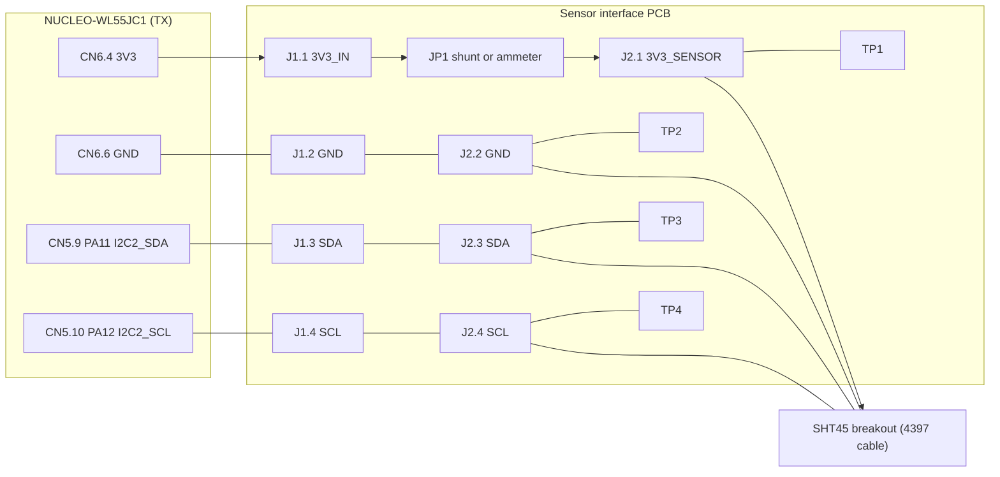
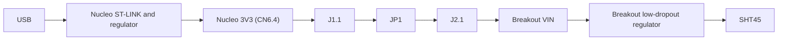

# Circuit review

- Project: weather-station-2026, the bench prototype (two development boards and one sensor on a desk).
- Revision: `hardware/chicago-test-hardware-r0` (commit 7e5a1c0), firmware release a07f498273f7.
- Status: `USER_REVIEW`. Finding F6 (below) is open: Clint must decide whether to order the passive PCB.
- Review date: 2026-10-13. This is a review only. No design files changed.
- Electrical source of truth: `source/build_schematic.py`. It generates `pcb/sensor-interface.kicad_sch`. `source/build_pcb.py` generates the PCB.
- Reviewed evidence:
  - the generator part and net table
  - the exported `validation/schematic-netlist.xml` and `validation/electrical.json`
  - `validation/pcb-drc.txt` (a KiCad 7.0.11 design rule check, run on another machine on 2026-10-08)
  - `manufacturing/BOM.csv` (the bill of materials), `docs/build-and-order.md` and `docs/schematic.png`
  - firmware `App/sensor.c` and `sensor.h`, `docs/protocol-stack.md` and `docs/hardware/nucleo-wl55jc-bringup.md`
  - Adafruit product pages 5665 and 6174 (fetched 2026-10-13).
- KiCad is not installed on this machine. The design rule check (DRC) and the netlist export were **not run again**.

## Operating principle

The test bed is two purchased NUCLEO-WL55JC1 boards and one Adafruit SHT45 breakout. One board is the TX node (transmitter). The other board is the RX bridge (receiver). The SHT45 connects to the I2C2 bus of the TX board.

The only custom hardware is a passive 50 x 35 mm "sensor interface" PCB between the Nucleo and the breakout. It passes 3.3 V, GND, SDA and SCL straight through. A removable jumper in the sensor's 3.3 V feed lets you insert a series ammeter. Four pads give probe points. The PCB has no active parts and no firmware.

## Functional blocks and component roles

| Ref | Part | Role |
|---|---|---|
| J1 | Samtec TSW-104-07-G-S, 1x4 2.54 mm | Host side: 3V3_IN, GND, SDA, SCL from Nucleo CN6.4, CN6.6, CN5.9, CN5.10 |
| J2 | Samtec TSW-104-07-G-S, 1x4 2.54 mm | Sensor side: 3V3_SENSOR, GND, SDA, SCL to the breakout through the Adafruit 4397 JST-SH-to-socket cable |
| JP1 + shunt | TSW-102-07-G-S + SNT-100-BK-G | Links 3V3_IN to 3V3_SENSOR. Remove the shunt and insert an ammeter to measure the sensor-side current |
| TP1–TP4 | Bare copper pads | Probe points: 3V3_SENSOR, GND, SDA, SCL |
| H1–H4 | 3.2 mm non-plated holes | M3 mounting to the printed base |

The netlist has 5 nets. It matches the generator exactly:

| Net | Pins |
|---|---|
| 3V3_IN | J1.1, JP1.1 |
| 3V3_SENSOR | J2.1, JP1.2, TP1 |
| GND | J1.2, J2.2, TP2 |
| SDA | J1.3, J2.3, TP3 |
| SCL | J1.4, J2.4, TP4 |

## Power tree and budget

The sensor takes its power from the Nucleo USB supply:

The sensor draws well under 1 mA on average at one reading per minute. The Nucleo 3V3 rail has ample margin. `[TBD-MEASURE]`: measure the actual breakout current through JP1.

## Voltage domains and interfaces

The board has a single 3.3 V domain. The I2C2 settings in `sensor.c` are:

- PA11 = SDA (alternate function AF4), PA12 = SCL (AF4)
- open-drain, MCU pull-ups off
- 100 kHz, analog filter on.

The breakout carries the pull-ups. The product page does not publish their values. The SHT45 address is 0x44.

The pin mapping agrees across these sources: the firmware (`sensor.h`), `protocol-stack.md`, the bring-up log (checked against UM2592 Rev 4 Table 17), the hardware build guide and the context pack.

## Operating states, reset, and ownership

The MCU is the only I2C master. After any failed transfer, the firmware de-initialises the bus and clocks it free (stuck-bus recovery). The firmware reports a failed read or a read with a bad CRC as `sensor_fault` with no value. It never reports a plausible number. `tests/test_stage0.py` tests this, including the Sensirion CRC-8 vector 0xBEEF → 0x92.

Partial power: with JP1 open, the SDA and SCL pull-ups can back-feed the unpowered breakout. The build guide documents this.

## Timing and signal integrity

The bus runs in 100 kHz standard mode on short unbuffered leads. The build guide sets a target of 25 cm or less from host to sensor. This is adequate for the bench. It is not suitable for a remote outdoor sensor cable.

## Protection, thermal, and mechanics

The I2C lines have no ESD (electrostatic discharge) or series protection. This is acceptable for indoor bench use only. The build guide keeps the sensor away from the warm MCU and regulator. Nobody has tested the fit of the printed cradles, base and tray.

## Layout handoff constraints

- `[SPEC]` 2 layers, 1.6 mm FR-4, 0.50 mm traces, 0.25 mm clearance, no impedance control. The board is already laid out. DRC reported 0 violations (not run again here).
- `[TARGET]` I2C total lead length 25 cm or less.

## Findings

| ID | Severity | Evidence | Consequence | Action | Gate | Status |
|---|---|---|---|---|---|---|
| F1 | Minor | The R0 build guide (`docs/build-and-order.md`:8, :100) names Adafruit **5665**. The R0 `BOM.csv` lists only the headers and the shunt, not the sensor. The firmware, `protocol-stack.md` and the context pack name **6174**. The Adafruit pages show that 6174 is the same SHT45 breakout plus a PTFE membrane (IP67, particle and liquid protection), $13.50 against $12.50. | The two parts are electrically interchangeable. The only risk is documentation drift. 6174 is the better long-term choice outdoors. | None. 6174 is the part of record (`firmware/README.md`: "superseding the starter's older 5665 suggestion"). Clint's order, delivered 2026-10-13, is 6174. `SHA256SUMS.txt` locks the R0 package, so the package stays unedited. The erratum is in `hardware/chicago-test-hardware-r0-ERRATA.md`. | Sourcing | Closed |
| F2 | Information | Context pack §6.2 said "Firmware sensor driver: TODO" at review time. `App/sensor.c` already implements the I2C2 driver with stuck-bus recovery. Unit tests cover the CRC and fault handling. Release a07f498 contains the driver. Its readings are `sensor_fault` because no sensor is connected. | The planned work is smaller than the pack implies. The next step is wiring and hardware verification, not driver writing. | Correct the context pack. Done: `docs/CONTEXT-PACK.md` now says that the driver is written. | — | Closed |
| F3 | Minor | The breakout has its own low-dropout regulator, level shifters and pull-ups (Adafruit page). | The current through JP1 is the whole breakout, not the SHT45 chip. It overstates the sensor current for the energy budget of the battery and solar build. | Record measurements as "breakout current". Budget the bare SHT45 from its datasheet until the battery and solar board exists. | Battery and solar power | Open |
| F4 | Information | The build guide says: disable I2C and set the pins to high impedance before you remove sensor power. The firmware has no console command for that. | The pack's "unplug test" is a hot unplug with I2C active. The risk is low at 3.3 V through the breakout's level shifters. The driver must survive exactly this fault. | None needed for the bench prototype. Note it in the bring-up log when you do the test. | — | Accepted |
| F5 | Information | No ERC (electrical rule check) exists, because the KiCad 7 command-line tool does not have one. A netlist comparison stands in. | For a 5-net passive board with no driven outputs, the netlist comparison covers what an ERC would catch. | None. Run DRC and the netlist export again if the board is regenerated. | — | Accepted |
| F6 | Information | Nobody has ordered the custom PCB (build guide). It only passes four wires through. | The bench prototype does not need it. The breakout can connect directly to the Nucleo with the 4397 cable and male-to-female jumpers, with the same pin table. The PCB adds only the ammeter jumper and the probe pads. | Clint decides whether to order. A purchase needs his approval. | — | Open |

The review has no critical or major findings.

## Approved design decisions and waivers

- Indoor bench only: no ESD protection, unbuffered I2C (build guide).
- Clint deferred true USB power-cut testing (removing power, not only a reset).

## Verification and unresolved evidence

- Verified here by reading: the generator agrees with the netlist. The firmware pin map agrees with the documents. The Adafruit pages confirm the breakout identity and features.
- Not verified here: a new DRC run, the physical fit, continuity checks, a real sensor read on hardware (the sensor arrived 2026-10-13 and is not yet wired) and the breakout pull-up values `[TBD-MEASURE]`.
