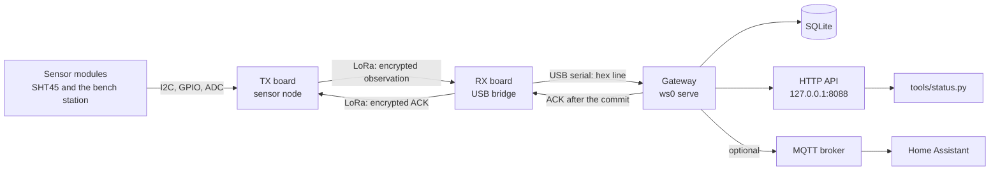
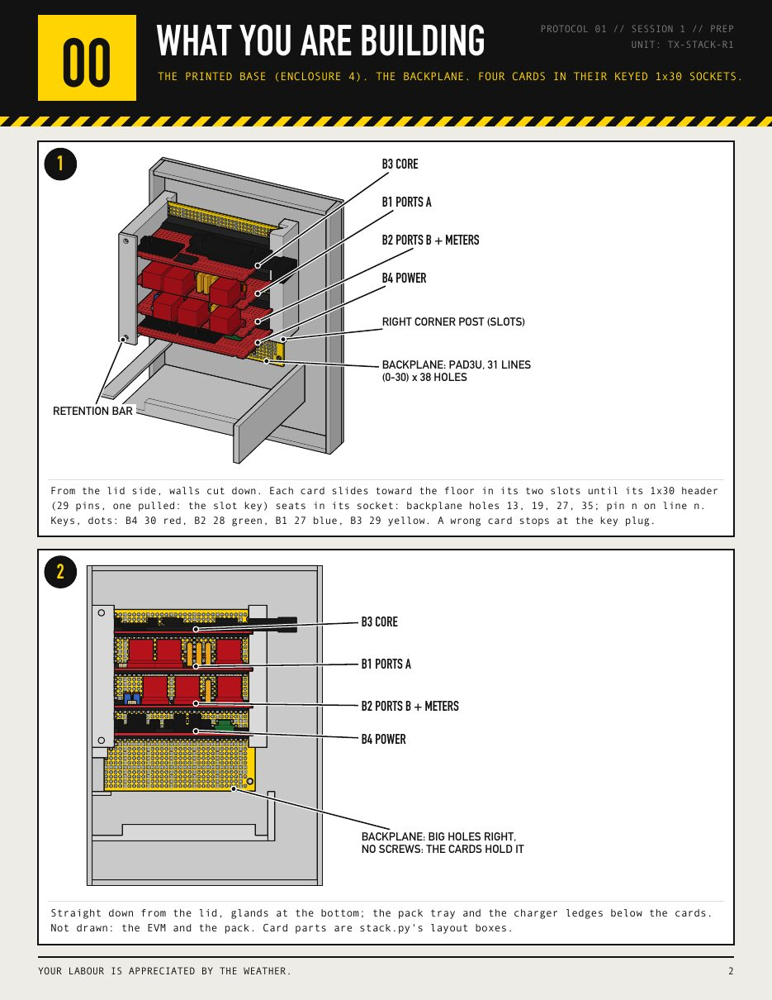
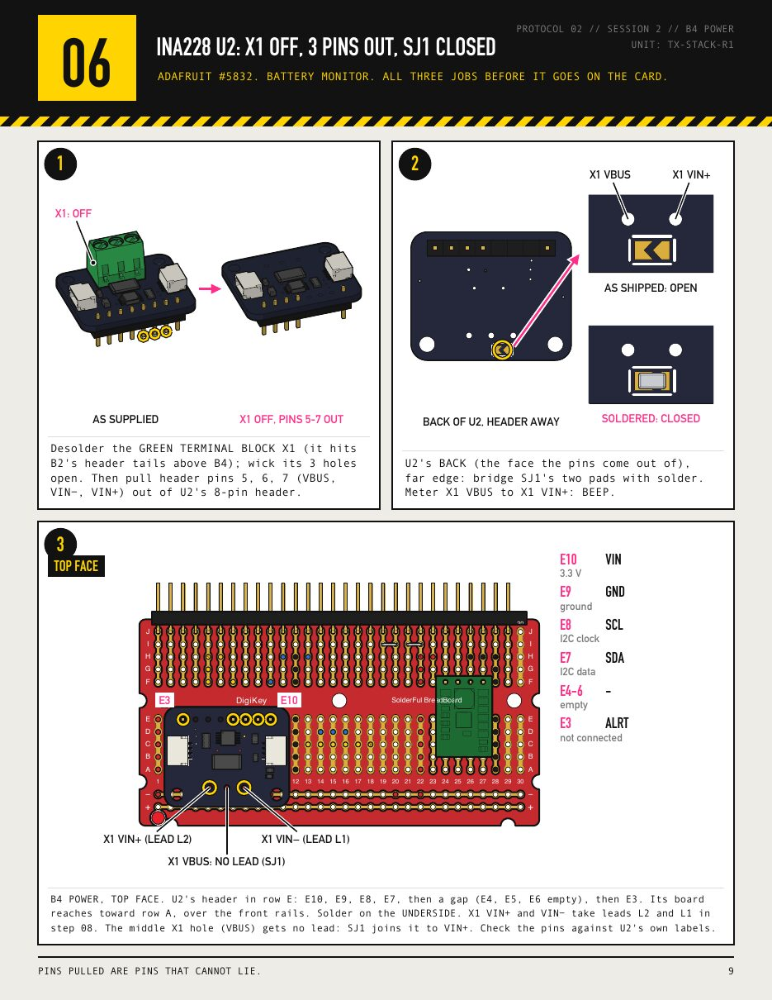
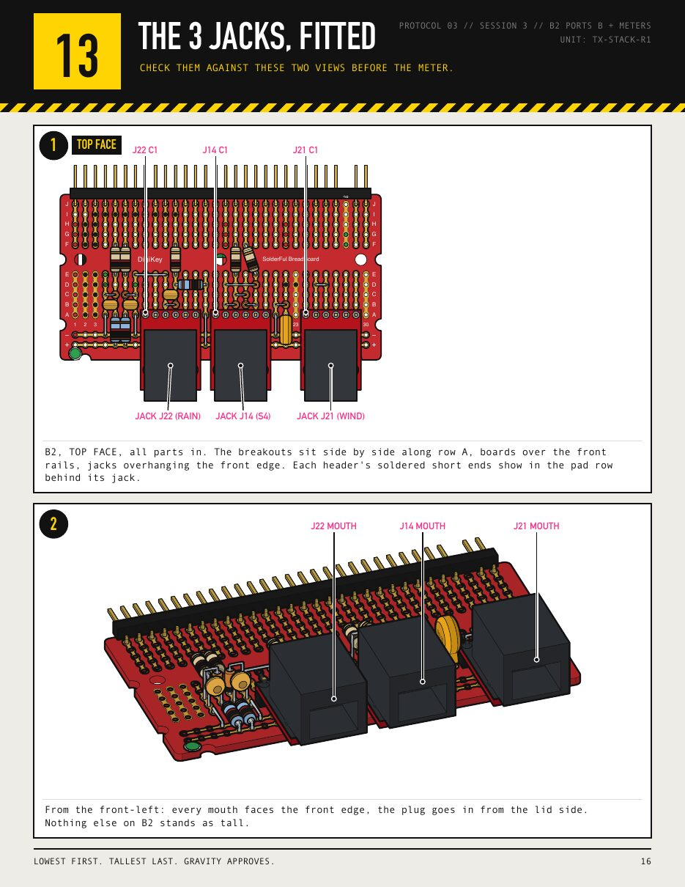

# Weather Station: bench prototype software

A home weather station, still on the bench. A sensor node (an STM32WL NUCLEO board) samples its sensors every 15 seconds. Once a minute it sends one observation, a summary of that minute, over encrypted LoRa to a second board on USB. A Python gateway (`ws0`) stores each reading in SQLite and acknowledges it over the radio. The gateway then serves the reading over a local HTTP API, a web dashboard and optional MQTT for Home Assistant.

This repository holds the firmware, the gateway, the tests, a fault-injection simulator, the bench hardware files and the dated evidence of each bench run.

Authority: the **Weather Station v0.2 product and technical requirements document (PRD/TRD), 8 October 2026**, sections 3, 9, 11 and the 24-hour delivery test (H01). H01 lives in section 12 of that document. The PRD/TRD itself is not in this repository.

Where things stand:

- The Python gateway (`ws0`) and the firmware for two NUCLEO-WL55JC1 boards (`firmware/stage0-node/`) live here.
- The boards run release `04fcc656938d` (TX) and `cc2766a38c61` (RX), protocol version 5. We built, flashed and tested that release on the bench, with the gateway of that release.
- Master is a step ahead. The firmware and the gateway on master speak protocol version 6 (power telemetry). Nobody cut them as a release yet, and they never met the boards ([`firmware/stage0-node/RELEASES.md`](firmware/stage0-node/RELEASES.md), "Next release").
- The project is the breadboarded development version (build steps 1 and 1b). We removed the later stages from the repository on 2026-11-02. Git history still has them.
- **The 24-hour delivery test (H01, [`docs/H01-checklist.md`](docs/H01-checklist.md)) did NOT RUN yet.**

Back at the bench after a break? Start with [`docs/CONTEXT-PACK.md`](docs/CONTEXT-PACK.md). Other entry points:

- Firmware: [`firmware/stage0-node/README.md`](firmware/stage0-node/README.md).
- Releases: [`firmware/stage0-node/RELEASES.md`](firmware/stage0-node/RELEASES.md).
- Move boards between gateways: [`docs/runbook-moving-boards.md`](docs/runbook-moving-boards.md).
- Tools: [`tools/README.md`](tools/README.md).
- The build sheets: [The bench build sheets](#the-bench-build-sheets).
- Every other document and package: [Where things are](#where-things-are).

The data path with the boards:



In the simulated demo, `ws0 demo` stands in for the boards. It sends encrypted frames to the same gateway code.

## The bench build sheets

The bench build sheets are illustrated PDFs that walk you through building the hardware, one step per page. They're the nicest thing in here, so have a look.

There are two sets:

- **TX stack, Sessions 1 to 5** (`hardware/tx-stack-r1/sheets/`). The printed base, the backplane and the four cards (B1 to B4) in their keyed 1x30 sockets.
- **Pods, Sessions P and Q** (`hardware/pods-r1/sheets/`). Session P builds the three pod boards and the port cable. Session Q covers the boxes, the shield and the install.

Why they are good:

- **Real geometry.** Every illustration comes from 3D models of the real parts (CadQuery and OpenCascade), with hidden lines removed and flat colour on each face. The renderer refuses a mirrored picture of a real object.
- **Exact parts.** The labels name the board, the face, the hole and the lead: "B4 POWER, TOP FACE", "X1 VIN+ (LEAD L2)", "backplane holes 13, 19, 27, 35". Nobody has to guess what "the card" means.
- **One step per page.** Each page opens with one big step number in a hazard-yellow box, then numbered panels with short captions.
- **Label chips that never collide.** Each label sits on a paper chip, and its leader stops at the chip edge. The build checks every page for chips that overlap, cross a panel edge or sit under another leader. One bad chip, and the build stops with `BUILD FAILED: label or hole-callout issues`.







The full tour, how the pipeline works and a reusable skill for other projects are in [`docs/build-sheets/README.md`](docs/build-sheets/README.md) and [`docs/build-sheets/skill/SKILL.md`](docs/build-sheets/skill/SKILL.md). The PDFs build into each `sheets/out/` folder and stay out of git.

## Run the simulated demo on your Mac

You don't need any boards for this. The demo fakes the radio side and runs the real gateway. Python 3.12 is the tested baseline. Open this folder in VS Code and run:

```sh
python3 -m venv .venv
source .venv/bin/activate
python -m pip install -r requirements.txt
python -m ws0 init
python -m ws0 demo
```

`init` creates a private `run-demo` directory with a fresh radio key, an API token and persistent nonce state. It refuses to overwrite an existing directory.

`demo` sends one simulated sample at once, then one every 60 seconds. It tests the path from encrypted frame to gateway to SQLite to encrypted ACK. The station name in records, the API and the MQTT topics is `simulation-01`. Its numeric radio station ID is 1. Ctrl-C stops the demo. Run `demo` again, and it resumes with a new observation epoch and the old queued history.

In a second terminal, from the same folder:

```sh
source .venv/bin/activate
python tools/status.py
```

This shows the live status and does not print your API token. The read-only API listens at `127.0.0.1:8088`. Every request needs the bearer token from `run-demo/gateway.json`. Routes:

- `GET /v1/status`
- `GET /v1/observations/latest`
- `GET /v1/observations?limit=100&offset=0`
- `GET /v1/observations?from=2026-10-09T00:00:00Z&to=2026-10-10T00:00:00Z&format=csv`

Times in records are Unix seconds UTC. `from` is inclusive and `to` is exclusive.

A sample with an unknown clock gets a reconstructed UTC time with an uncertainty. The gateway makes that time when a synchronized sample from the same boot epoch exists. Until then the effective time is null. SQLite keeps the sample, but `/v1/observations` never returns it.

A page holds at most 1,000 rows. [`docs/openapi.json`](docs/openapi.json) describes the interface, and the dashboard routes too.

The same port serves a live dashboard at `http://127.0.0.1:8088/`. It asks for the same token ([`docs/web-dashboard.md`](docs/web-dashboard.md)).

## Break things on purpose

While the demo runs, you can break things on purpose and watch how the gateway handles it. Run these commands in a second terminal. They act only on the simulator:

```sh
# Interrupt transport; leave demo running so it journals new observations.
touch run-demo/link-down
# After three missed reporting intervals, status becomes unavailable.
# Restore the path: live data is sent first, then at most five queued records/minute.
rm run-demo/link-down

# Make the next sensor samples explicitly invalid.
touch run-demo/sensor-fault
# Restore measurements.
rm run-demo/sensor-fault
```

Rules that the demo shows:

- The transmitter journal deletes a reading only after the gateway sends an authenticated reply. That reply is an ACK, or a NACK for a record that the gateway rejects for good. The firmware also drops a reading when the strike limit abandons it. A forged or unauthenticated reply never deletes a reading.
- The gateway makes the ACK only after the database commit.
- Old backfill and exact duplicate packets never refresh the age of a measurement.
- A newer sample whose sensors all failed marks the measurement unavailable. If only some sensors fail, only those fields go unavailable.
- A newer sample with an unknown clock stays unavailable until the gateway can reconstruct its time to within 10 s. The gateway uses a synchronized sample of the same boot epoch for that.
- The gateway quarantines a sample with a future clock when it arrives. The next correctly timed observation makes the measurement available again.

## Run with the boards

Both boards run the firmware in [`firmware/stage0-node/`](firmware/stage0-node/README.md). Find the port and the ST-LINK serial number of each board with `.venv/bin/python -m serial.tools.list_ports -v`.

**CAUTION:** Never provision a wiped TX board again with a key that it used before ([`docs/runbook-moving-boards.md`](docs/runbook-moving-boards.md)).

Start with an unprovisioned TX board. `WIPE ERASE-ALL-NODE-STATE` on its console erases it.

Use a new run directory (here `run-<name>`) each time you make a new key. `ws0 init` refuses a directory that exists.

```sh
.venv/bin/python -m ws0 init --hardware --station station-01 --station-id 1 --directory run-<name>
.venv/bin/python -m ws0 provision-node --directory run-<name> --serial /dev/cu.usbmodem<TX>
.venv/bin/python -m ws0 serve --directory run-<name> --serial-number <RX ST-LINK serial>
.venv/bin/python tools/status.py --directory run-<name>
```

`serve` writes receiver diagnostics to `run-<name>/receiver.log`. For unattended runs, use the launchd agent (`tools/deploy/macos/install.sh`) or the systemd unit (`tools/deploy/linux/ws0-gateway.service`). See [`tools/README.md`](tools/README.md). For Home Assistant, see [`docs/runbook-home-assistant.md`](docs/runbook-home-assistant.md).

The gateway runs on macOS and Linux. Windows is not supported.

## Run the simulation harness

The harness runs the demo in virtual time with faults injected. Each scenario covers a full virtual day.

```sh
# 15 deterministic scenarios, 24 virtual hours each; no hardware or broker required.
python -m ws0.harness --output my-simulation-results

# Inspect the generated report on macOS.
open my-simulation-results/report.html

# Edit a scenario JSON to change loss, delay, outages, clock faults or reboots.
python -m ws0.harness --scenario examples/scenarios/custom-outage.json --output custom-results

# Intentional failure control: this should exit with status 1 and report a missing row.
python -m ws0.harness --scenario examples/scenarios/short-baseline.json --negative-control --output negative-results
```

Each output directory must be new, so a repeated run cannot overwrite evidence. Fixed scenario seeds reproduce the raw frame and event traces.

The included `simulation-results/report.html` comes from an older campaign. It has 12 scenarios, recorded at commit 8aca123 with protocol version 1, before the `reboot-during-outage` scenario existed. In that campaign the gateway recovered all 17,280 observations. It found zero duplicate rows and zero nonce reuse. One noisy-link seed delivered 98.82 % on time, below the 99 % target.

A scenario PASS means that its declared recovery and integrity contract passed. It is not a pass of the 24-hour delivery test. [`docs/simulation-harness.md`](docs/simulation-harness.md) gives the exact model and its limits.

## Home Assistant and MQTT

The weather, on your home dashboard. The gateway can publish to MQTT, with Home Assistant discovery for these items:

- Every observation field that the station sends: temperature, humidity and the values of the other bench modules. From protocol version 6, the power rails come too, as diagnostic entities.
- The power keys of the node health report.
- One diagnostic sensor per module type.

The details are in [`docs/runbook-home-assistant.md`](docs/runbook-home-assistant.md), "Power entities". MQTT is off by default, so the demo runs without a broker.

To enable MQTT:

1. Stop the service.
2. Edit `run-demo/gateway.json`. Set `mqtt.enabled` to true and set the broker hostname and port.
3. If the broker needs a user name, add `mqtt.username`. For a TLS broker, set `mqtt.tls`.
4. Put the password in the environment variable `WS_MQTT_PASSWORD`, or in the file `<run dir>/mqtt-password`. The source code does not store it.
5. Start the service again. The gateway reads the configuration only at start.

You must configure the broker in Home Assistant first. This repository changed no Home Assistant instance and no broker. The simulated device appears as **simulation-01**.

Its sensors are available only while the gateway health and the measurement freshness are both online:

- The gateway uses an MQTT last will to report its disconnection.
- A measurement goes offline when it is 180 seconds old.
- The gateway publishes discovery again when the broker reconnects.

The temperature and humidity sensors meet the weather-data integration requirement of the bench prototype. The gateway does not make a forecast or composite weather entity, because no data supports one. (No crystal ball yet.)

A test against a local Mosquitto broker verified discovery, last will and reconnect (`evidence/mqtt-local-broker-2026-10-13/`). Against Clint's Home Assistant, the HA-user broker login and the device's discovery passed (`evidence/ha-broker-2026-10-22/`). Nobody tested TLS. Use a separate station ID and key for hardware. Never use the demo state to provision real boards.

## What works today

- AES-128-CCM authenticated observation and ACK frames.
- Durable allocation of the host nonce, binding of the endpoint and key, and a separate observation identity.
- SQLite storage, immutable deduplication and collision rejection.
- A persistent simulated transmitter queue, restart handling and bounded backfill.
- An authenticated loopback HTTP API for status and history, with CSV export.
- Optional MQTT snapshots, availability and Home Assistant discovery.
- USB serial input from the RX board (`ws0 serve`), with the ACK/NACK return path.
- Portable C code for the SHT45: acquisition, CRC check and conversion.
- The TX reads its sensors as DATAVANE5K local modules, with the module protocol WSMP ([`docs/module-protocol.md`](docs/module-protocol.md)). The source has eight modules: outside air, pressure, UVA, enclosure, battery, power rails, wind and rain (`firmware/stage0-node/App/mod_*.c`, `App/wsmp_host.c`). The boards' release `04fcc656938d` has seven, with one power module.
- Power telemetry, protocol version 6 (in the source, no version 6 release yet). Design: [`docs/superpowers/specs/2026-10-29-power-telemetry-design.md`](docs/superpowers/specs/2026-10-29-power-telemetry-design.md).
  - The node reads power phase A on the 1S3P pack. From the bq24074 charger it reads ISET, input voltage, CHG and PGOOD. It also reads the battery INA228 and the MAX17048 gauge.
  - Every minute it sends the battery voltage and signed current, the load voltage and the charger input voltage.
  - Every 15 minutes it sends a 64-byte health report. The report holds these values:
    - gauge SOC and rate, charger status, die temperature and MCU supply
    - reset cause, boot and crash counts and the last crash PC
    - radio TX timeouts and I2C recoveries
  - The gateway stores these values and shows them through the API, the dashboard and MQTT.
- TX and RX firmware (`firmware/stage0-node/`):
  - A flash journal of at least 609 records, about 10.15 hours, of the version 6 node field set (77 bytes in 96-byte slots).
  - The version 5 release `04fcc656938d` held 1,725 records, 28.75 hours.
  - A build whose field set exceeds 80 bytes does not compile.
  - Durable counters and epochs, a watchdog, and provisioning over USB.
- Python and C tests that target failures, and recorded validation output.

## Current state and open work

Here is the honest scoreboard. The releases are in [`firmware/stage0-node/RELEASES.md`](firmware/stage0-node/RELEASES.md). The TX runs release `04fcc656938d` (flashed 2026-10-19). The RX runs release `cc2766a38c61`, because the RX code did not change.

No gateway runs right now. The last gateway session served run directory `run-d7` and stopped on 2026-10-19 at 21:58 UTC, when the boards went home. That run directory and its key are no longer in this checkout. The next bench run starts a new run directory and key (`ws0 init`, `WIPE` on the TX, `provision-node`).

The track record so far:

- On the earlier release `a07f498273f7`, a 9-hour bench soak delivered 549 of 549 minutes on time (`evidence/soak-a07f498-2026-10-13/`).
- Two lab rehearsals with the H01 scoring rules followed. The first got 1,440 of 1,440 intervals on time on release `bc5e6ede429c` (`evidence/h01-rehearsal-2026-10-14/`).
- The second got 960 of 960 over 16 hours on release `7eb79f64f2bd` and ended early (`evidence/h01-rehearsal-2026-10-15/`).
- Neither rehearsal is H01. Both ran with bench radio settings, away from the intended placement.

The radio settings are bench values (`firmware/stage0-node/App/radio_cfg.h`): 915.0 MHz, 500 kHz bandwidth, spreading factor 7, coding rate 4/5, 0 dBm.

Open before the 24-hour delivery test (its preconditions: [`docs/H01-checklist.md`](docs/H01-checklist.md)):

- The step 1 build (breadboard v2) exits on every criterion, mode B for 1 hour included. The breadboard build, where H01 runs, has a `valid` preflight block that includes the 1 A spans (build-progression record section 3).
- The USB acceptance test H8(d) passes on the H01 topology (the RX alone on a direct Mac port, 7.1 Q5).
- The running gateway carries the ws0 silent-port reopen from `ws0/link.py`, loaded by a gateway agent restart (record H8(f)).
- Home Assistant entities update live, with the gateway logged in on the rotated password. (Login and discovery passed a check on 2026-10-22.)
- The link budget at the real placement, the antennas and the current measurements.
- The 24-hour run with its restart and outage matrix.
- Clint's open decision D2: does H01 run on a protocol version 6 (power telemetry) release? The recommendation is yes. The H01 preconditions as written (`meter_link=ok` from the M7 probe, the power phase A exit criteria) need a version 6 build. A "no" needs a version 5 backport of the M7 probe and the power reading, and no plan carries one ([`docs/H01-checklist.md`](docs/H01-checklist.md)).

Power phase A exit criteria 1 and 2 (node firmware and gateway) gate H01 (build-progression record, section 3, step 1 note). They are not step 1 exit criteria, so H01 precondition 1 (step 1 exit) does not include them. The exit criteria are in the [power telemetry design](docs/superpowers/specs/2026-10-29-power-telemetry-design.md), section 2. Open for power phase A:

- Measure the phase A constants (R_ISET, the divider ratio, the TMR strap). Check the INA228 shunt against a series reference. Cut a version 6 release.
- The node-against-benchlink acceptance drill with the cell through the shunt.
- A 1 A charge with the shunt in the battery path that ends in a normal termination.
- Clint's open decision D1: the 1S3P pack (about 24.4 Wh) against the PRD's energy reserve (about 50.4 Wh).

Open bench checks of the DATAVANE5K bench station (GitHub issues #2, #3 and #4, label `needs-bench`):

- #2: the INA228 charge and energy accumulators.
- #3: the wind vane ADC calibration.
- #4: the anemometer input filter on PB5.

The bench station wiring is in [`docs/hardware/bench-station-wiring.md`](docs/hardware/bench-station-wiring.md). The breadboard map is in [`hardware/bench-breadboard-r0/`](hardware/bench-breadboard-r0/README.md).

Simulation cannot pass the 24-hour delivery test. The 30-day on-device storage requirement belongs to the later qualification H11. The ordered next steps are in [`docs/CONTEXT-PACK.md`](docs/CONTEXT-PACK.md) §6.

## Tests

The safety net. Fetch the vendor code once, then run the suite:

```sh
sh tools/fetch-vendor.sh   # pinned STM32CubeWL + Mbed TLS; without it the tests that need Mbed TLS skip
WS0_UNSAFE_FAST_FSYNC=1 python -m unittest discover -s tests -v
```

On 2026-10-19 at commit 09e6cea, the suite had 595 tests and all gates passed (commit e379cff). The count grew since then: [`tests/README.md`](tests/README.md) records 1,304 tests collected on 2026-10-30.

Some tests need extra tools:

- One SNTP test needs the network and skips without it.
- The C tests need `cc` (Apple Command Line Tools on macOS).
- The dashboard script tests need `node`.
- The KiCad tests in `test_breadboard.py` (the Board and Outputs classes) need KiCad 10 and `tools/fetch-router.sh`. The breadboard-map model and sheet tests need neither.
- Other tests skip when `make`, the ARM toolchain, CadQuery/numpy, Pillow, the shield 3MF, the BOB-14021 STEP or IPv6 is missing.

Each test skips and says why when its tool is missing. [`tests/README.md`](tests/README.md) lists what most test files cover (47 of 66) and the main environment variables. The 1,440-record test uses accelerated virtual timestamps, not 24 hours of real time. `evidence/validation.txt` is a historical record: 28 tests at commit 8aca123.

`tools/gates.sh` runs the CI gates locally on macOS or Linux: ruff, code shape, cppcheck, two clean firmware builds, analysis, the tests and the fuzzers.

**CAUTION:** `WS0_UNSAFE_FAST_FSYNC=1` is **only for tests**. Never set it for a gateway that acknowledges real data. It sets SQLite `synchronous=OFF` and turns off `fullfsync`. As a result, a commit might not survive a power loss or an OS crash, and the database can become corrupt.

## Keep the keys secret

Keys are the crown jewels here, so treat each run directory like a wallet. Keep the whole run directory private. Obey these rules:

- Never copy a run directory to two hosts that run at the same time.
- Never restore an older nonce state and keep its key.
- If the nonce state is lost or rolled back, retire that key. Provision a new configuration for both ends.
- Never use a known key with a reset counter.
- Do not commit keys, tokens or run databases.

The host counters persist in SQLite. On the TX board, the counters and boot epochs persist in flash (`firmware/stage0-node/App/node_store.c`). A wiped node needs a new key ([`firmware/stage0-node/README.md`](firmware/stage0-node/README.md), "Re-keying rule"). The downloadable archive contains no working secrets.

## What comes next

See [`docs/CONTEXT-PACK.md`](docs/CONTEXT-PACK.md) §6 for the ordered list. Power phase A (the bq24074 charger and its monitors on the 1S3P pack, read by the node) runs now, on the step 1 build, before H01. H01 runs on the breadboard build only after step 1 exits (build-progression record section 3). Step 1b adds the load, solar and USB-C rails on the same breadboard build.

This repository adds no charger or pack control, no RJ45/Modbus (off-board wired-module bus) abstraction, no heater and no shared charging. The node measures the power system and never controls it. Look, don't touch.

Power phase A measures the battery (cell voltage and signed current), the load voltage and the charger input voltage. It cannot tell if that input comes from solar or USB-C. The final goal is the voltage and current of four rails: battery, solar input, USB-C input and load. Phase B (step 1b) adds one INA228 per rail ([`docs/hardware/power-metering.md`](docs/hardware/power-metering.md)). USB-C is for bench work and occasional backup charging only, never connected together with solar.

## Where things are

| Path | What |
|---|---|
| [`docs/CONTEXT-PACK.md`](docs/CONTEXT-PACK.md) | Where to start: state, setup and next steps. §8 maps the main documents |
| [`docs/build-sheets/`](docs/build-sheets/README.md) | The bench build sheets: the showcase, how the pipeline works, and a reusable skill (`skill/SKILL.md`) |
| [`hardware/tx-stack-r1/sheets/`](hardware/tx-stack-r1/sheets/) | Sources of the TX stack build sheets, Sessions 1 to 5 |
| [`hardware/pods-r1/sheets/`](hardware/pods-r1/sheets/) | Sources of the pod build sheets, Sessions P and Q |
| [`docs/superpowers/specs/2026-10-29-power-telemetry-design.md`](docs/superpowers/specs/2026-10-29-power-telemetry-design.md) | Power telemetry design: phases, the per-phase fill table, protocol version 6, the 64-byte health report, node firmware, gateway |
| [`docs/superpowers/specs/2026-10-29-build-progression-decisions.md`](docs/superpowers/specs/2026-10-29-build-progression-decisions.md) | The build-progression decision record: build steps 1 and 1b on the breadboard, the NUCLEO pin contract, the step 1 build and shopping, the cascade list. Clint's survey answers (2026-10-30) are in section 7.1 |
| [`docs/superpowers/plans/2026-10-29-power-telemetry.md`](docs/superpowers/plans/2026-10-29-power-telemetry.md) | Power telemetry implementation plan |
| [`docs/superpowers/plans/2026-10-29-power-telemetry-issues.md`](docs/superpowers/plans/2026-10-29-power-telemetry-issues.md) | Power telemetry issue catalog: each issue's layer, severity, batch and state |
| [`docs/superpowers/plans/2026-10-30-build-progression-issues.md`](docs/superpowers/plans/2026-10-30-build-progression-issues.md) | Build progression issue catalog: each issue from the decision record and Clint's 2026-10-30 answers, by area, severity, batch and state |
| [`docs/hardware/power-metering.md`](docs/hardware/power-metering.md) | Power metering: rails, monitors, addresses, shunts and sense points in each phase |
| [`docs/H01-checklist.md`](docs/H01-checklist.md) | The 24-hour delivery test |
| [`docs/firmware-current-design.md`](docs/firmware-current-design.md) | The design sections the firmware implements: the mux profile, module identity, the module record, the flash layout |
| [`docs/protocol.md`](docs/protocol.md), [`docs/protocol-design.md`](docs/protocol-design.md), [`docs/protocol-stack.md`](docs/protocol-stack.md) | The radio protocol: specification, design rationale, layered explanation |
| [`docs/module-protocol.md`](docs/module-protocol.md) | DATAVANE5K, the module protocol WSMP |
| [`docs/hardware/bench-station-wiring.md`](docs/hardware/bench-station-wiring.md) | How the bench station sensors connect to the TX board |
| [`docs/hardware/nucleo-wl55jc-bringup.md`](docs/hardware/nucleo-wl55jc-bringup.md) | Board bring-up log |
| [`docs/failure-modes.md`](docs/failure-modes.md) | Failure modes, loss budget, recovery runbook |
| [`docs/firmware-budget.md`](docs/firmware-budget.md), [`docs/firmware-event-model.md`](docs/firmware-event-model.md), [`docs/power-of-ten.md`](docs/power-of-ten.md) | Firmware budgets, run-time model, coding rules |
| [`docs/runbook-moving-boards.md`](docs/runbook-moving-boards.md), [`docs/runbook-home-assistant.md`](docs/runbook-home-assistant.md) | Runbooks |
| [`docs/superpowers/`](docs/superpowers/) | Design specifications and implementation plans |
| [`ws0/`](ws0/README.md), [`gateway.py`](gateway.py) | The gateway package and its SQLite store |
| `*.lit.md` ([`gateway.lit.md`](gateway.lit.md), [`ws0/protocol.lit.md`](ws0/protocol.lit.md), eleven under `firmware/`, 13 in all) | Literate sources. Each is the source of the committed `.c` or `.py` file it generates (`tools/tangle.py`). Edit the document, not the generated file |
| [`firmware/`](firmware/README.md) | Board firmware, fuzz targets and the range-test tool |
| [`tools/`](tools/README.md) | Scripts, CI gates and service files |
| [`tests/`](tests/README.md) | Python and C tests |
| [`examples/scenarios/`](examples/scenarios/) | Two scenario files for `ws0.harness --scenario`: `custom-outage.json` (240 minutes, an outage and a reboot. Edit it) and `short-baseline.json` (10 minutes, the negative-control fixture) |
| [`simulation-results/`](simulation-results/) | The committed output of an older harness campaign: 12 scenarios at commit 8aca123 ([Run the simulation harness](#run-the-simulation-harness)) |
| [`.github/workflows/ci.yml`](.github/workflows/ci.yml) | CI ([`tools/README.md`](tools/README.md#ci)) |
| `requirements.txt`, `requirements-dev.txt`, `ruff.toml` | Pinned gateway dependencies. Pinned lint, code-shape, Cppcheck and Pillow for development and CI. The ruff bug rules |
| `VALIDATION.txt` | A four-line pointer: the historical 28-test record (`evidence/validation.txt`, commit 8aca123) and the command for the current suite (595 tests on 2026-10-19). See [Tests](#tests) |
| `vendor/` (git-ignored) | Pinned third-party checkouts: STM32CubeWL with Mbed TLS (`tools/fetch-vendor.sh`), KiCadRoutingTools and its Python environment `krt-venv` (`tools/fetch-router.sh`). Never edit. Fetch again |
| `run-*/` (git-ignored) | Gateway run directories. Each holds one radio key and its data: `gateway.json` (key, API token, settings), `observations.sqlite3`, the nonce state `gateway-nonces.sqlite3`, logs such as `receiver.log`, and an optional `mqtt-password`. One directory per key. `run-demo` is the simulator's. No run directory is current: on 2026-11-18 every earlier run directory (`run-hw`, `run-office`, the `run-d5`/`run-d6` archives, `run-d7`) was deleted. The next bench run starts with a new run directory and a new key (`ws0 init`, `WIPE` on the TX, `provision-node`). Keep them private. Never commit them |
| [`hardware/bench-breadboard-r0/`](hardware/bench-breadboard-r0/README.md) | Breadboard map of the bench station: build sheet, renders, KiCad model |
| [`hardware/base-plate/`](hardware/base-plate/spec-r2.md) | The printed bench base plate: its spec |
| [`evidence/`](evidence/README.md) | Every bench run, dated |
