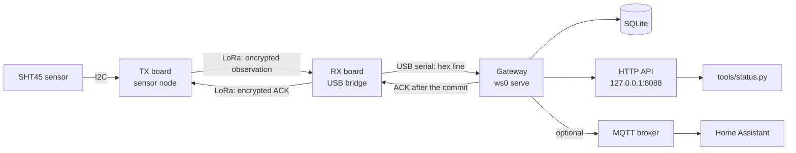

# Weather Station: bench prototype software

Authority: the **Weather Station v0.2 product and technical requirements document (PRD/TRD), 8 October 2026**, sections 3, 9, 11 and the 24-hour delivery test (H01).

Status: this repository holds the Python gateway (`ws0`) and the firmware for two NUCLEO-WL55JC1 boards (`firmware/stage0-node/`). Both are built, flashed and tested on the bench. The bench prototype is Stage 0 of the staged plan ([`docs/next-stages-plan.md`](docs/next-stages-plan.md)). **Stage 0 is not complete. The 24-hour delivery test (H01, [`docs/H01-checklist.md`](docs/H01-checklist.md)) has NOT RUN.**

Do you resume the bench work? Start with [`docs/CONTEXT-PACK.md`](docs/CONTEXT-PACK.md). Other entry points:

- Firmware: [`firmware/stage0-node/README.md`](firmware/stage0-node/README.md).
- Releases: [`firmware/stage0-node/RELEASES.md`](firmware/stage0-node/RELEASES.md).
- Moving boards between gateways: [`docs/runbook-moving-boards.md`](docs/runbook-moving-boards.md).
- Tools: [`tools/README.md`](tools/README.md).

The data path with the boards:



In the simulated demo, `ws0 demo` takes the place of the boards. It sends encrypted frames to the same gateway code.

## Run the simulated demo on your Mac

Python 3.12 is the tested baseline. Open this folder in VS Code and run:

```sh
python3 -m venv .venv
source .venv/bin/activate
python -m pip install -r requirements.txt
python -m ws0 init
python -m ws0 demo
```

`init` creates a private `run-demo` directory with a fresh radio key, an API token and persistent nonce state. It refuses to overwrite an existing directory.

`demo` sends one simulated sample at once, then one every 60 seconds. It tests the path from encrypted frame to gateway to SQLite to encrypted ACK. All station identifiers say `simulation-01`. Ctrl-C stops it. Run `demo` again to resume with a new observation epoch and the old queued history.

In a second terminal, from the same folder:

```sh
source .venv/bin/activate
python tools/status.py
```

This shows the live status and does not print your API token. The read-only API listens at `127.0.0.1:8088`. Every request needs the bearer token from `run-demo/gateway.json`. Routes:

- `GET /v1/status`
- `GET /v1/observations/latest`
- `GET /v1/observations?limit=100&offset=0`
- `GET /v1/observations?from=2026-10-09T00:00:00Z&to=2026-10-10T00:00:00Z&format=csv`

Times in records are Unix seconds UTC. `from` is inclusive and `to` is exclusive.

A sample with an unknown clock gets a reconstructed UTC time with an uncertainty. The gateway makes it when a synchronized sample from the same boot epoch exists. Until then the effective time is null. SQLite keeps the sample, but `/v1/observations` never returns it.

A page holds at most 1,000 rows. [`docs/openapi.json`](docs/openapi.json) describes the interface.

## Test failures while the demo runs

Run these commands in a second terminal. They act only on the simulator:

```sh
# Interrupt transport; leave demo running so it journals new observations.
touch run-demo/link-down
# After three missed reporting intervals, status becomes unavailable.
# Restore the path: live data is sent first, then at most two queued records/minute.
rm run-demo/link-down

# Make the next sensor samples explicitly invalid.
touch run-demo/sensor-fault
# Restore measurements.
rm run-demo/sensor-fault
```

Rules that the demo shows:

- The transmitter journal deletes a reading only after a valid authenticated ACK.
- The gateway makes that ACK only after the database commit.
- Old backfill and exact duplicate packets never refresh the age of a measurement.
- A newer sensor failure or an unknown clock marks the measurement unavailable.
- The gateway quarantines a sample with a future clock when it arrives. The next correctly timed observation makes the measurement available again.

## Run with the boards

Both boards run the firmware in [`firmware/stage0-node/`](firmware/stage0-node/README.md). Find the port and the ST-LINK serial number of each board with `.venv/bin/python -m serial.tools.list_ports -v`.

The TX board must be unprovisioned. `WIPE ERASE-ALL-NODE-STATE` on its console erases it. Never provision a wiped TX board again with a key that it used before ([`docs/runbook-moving-boards.md`](docs/runbook-moving-boards.md)).

```sh
python -m ws0 init --hardware --station station-01 --station-id 1 --directory run-office
python -m ws0 provision-node --directory run-office --serial /dev/cu.usbmodem<TX>
python -m ws0 serve --directory run-office --serial-number <RX ST-LINK serial>
python tools/status.py --directory run-office
```

`serve` writes receiver diagnostics to `run-office/receiver.log`. For unattended runs, use the launchd agent (`tools/deploy/macos/install.sh`) or the systemd unit (`tools/deploy/linux/ws0-gateway.service`). See [`tools/README.md`](tools/README.md). For Home Assistant, see [`docs/runbook-home-assistant.md`](docs/runbook-home-assistant.md).

The gateway runs on macOS and Linux. Windows has low priority.

## Run the simulation harness

```sh
# 13 deterministic scenarios, 24 virtual hours each; no hardware or broker required.
python -m ws0.harness --output my-simulation-results

# Inspect the generated report on macOS.
open my-simulation-results/report.html

# Edit a scenario JSON to change loss, delay, outages, clock faults or reboots.
python -m ws0.harness --scenario examples/scenarios/custom-outage.json --output custom-results

# Intentional failure control: this should exit with status 1 and report a missing row.
python -m ws0.harness --scenario examples/scenarios/short-baseline.json --negative-control --output negative-results
```

Each output directory must be new, so a repeated run cannot overwrite evidence. Fixed scenario seeds reproduce the raw frame and event traces.

The included `simulation-results/report.html` is from an older campaign. It has 12 scenarios, recorded at commit 8aca123 with protocol version 1, before the `reboot-during-outage` scenario existed. In that campaign the gateway recovered all 17,280 observations. It found zero duplicate rows and zero nonce reuse. One noisy-link seed delivered 98.82 % on time, below the 99 % target.

A scenario PASS means that its declared recovery and integrity contract passed. It is not a pass of the 24-hour delivery test. [`docs/simulation-harness.md`](docs/simulation-harness.md) gives the exact model and its limits.

## Home Assistant and MQTT

The gateway can publish to MQTT, with Home Assistant discovery for temperature and humidity. MQTT is off by default, so the demo runs without a broker.

To turn on MQTT:

1. Stop the service.
2. Edit `run-demo/gateway.json`. Set `mqtt.enabled` to true and set the broker hostname and port.
3. Add `mqtt.username` if the broker needs it. Set `mqtt.tls` for a TLS broker.
4. Put the password in the environment variable `WS_MQTT_PASSWORD`. The source code does not store it.
5. Start the service again. The gateway reads the configuration only at start.

You must configure the broker in Home Assistant first. This repository changed no Home Assistant instance and no broker. The simulated device appears as **simulation-01**.

Its sensors are available only while the gateway health and the measurement freshness are both online:

- The gateway uses an MQTT last will to report its disconnection.
- A measurement goes offline when it is 180 seconds old.
- The gateway publishes discovery again when the broker reconnects.

The two measurement sensors meet the weather-data integration requirement of the bench prototype. The gateway does not make a forecast or composite weather entity, because no data supports one.

A test against a local Mosquitto broker verified discovery, last will and reconnect (`evidence/mqtt-local-broker-2026-10-13/`). Nobody has tested a real Home Assistant instance, TLS or broker authentication yet. Use a separate station ID and key for hardware. Never use the demo state to provision real boards.

## What is implemented

- AES-128-CCM authenticated observation and ACK frames.
- Durable allocation of the host nonce, binding of the endpoint and key, and a separate observation identity.
- SQLite storage, immutable deduplication and collision rejection.
- A persistent simulated transmitter queue, restart handling and bounded backfill.
- An authenticated loopback HTTP API for status and history, with CSV export.
- Optional MQTT snapshots, availability and Home Assistant discovery.
- USB serial input from the RX board (`ws0 serve`), with the ACK/NACK return path.
- Portable C code for the SHT45: acquisition, CRC check and conversion.
- TX and RX firmware (`firmware/stage0-node/`): a flash journal of about 2.3 days, durable counters and epochs, a watchdog, and provisioning over USB.
- Python and C tests that target failures, and recorded validation output.

## Current state and open work

Release `260c9ccbe938` is built, recorded in [`firmware/stage0-node/RELEASES.md`](firmware/stage0-node/RELEASES.md) and flashed to both boards (2026-10-16). On the earlier release `a07f498273f7`, a 9-hour bench soak delivered 549 of 549 minutes on time (`evidence/soak-a07f498-2026-10-13/`).

The radio settings are bench values (`firmware/stage0-node/App/radio_cfg.h`): 915.0 MHz, 500 kHz bandwidth, spreading factor 7, coding rate 4/5, 0 dBm.

Open before the 24-hour delivery test:

- Home Assistant against the real broker.
- The link budget at the real placement, the antennas and the current measurements.
- The 24-hour run with its restart and outage matrix.

Simulation cannot pass the 24-hour delivery test. The 30-day on-device storage requirement belongs to the later qualification H11. The ordered next steps are in [`docs/CONTEXT-PACK.md`](docs/CONTEXT-PACK.md) §6.

## Tests

```sh
sh tools/fetch-vendor.sh   # pinned STM32CubeWL + Mbed TLS; without it 7 C-vs-Python crypto tests skip
WS0_UNSAFE_FAST_FSYNC=1 python -m unittest discover -s tests -v
```

One SNTP test needs the network and skips without it. The C tests need `cc` (Apple Command Line Tools on macOS). The 1,440-record test uses accelerated virtual timestamps, not 24 hours of real time. `evidence/validation.txt` is a historical record: 28 tests at commit 8aca123.

`WS0_UNSAFE_FAST_FSYNC=1` is **only for tests**. It sets SQLite `synchronous=OFF` and turns off `fullfsync`, so a commit does not survive a power loss. Never set it for a gateway that acknowledges real data.

## State and key handling

Keep the whole run directory private. Obey these rules:

- Never copy a run directory to two hosts that run at the same time.
- Never restore an older nonce state and keep its key.
- If the nonce state is lost or rolled back, retire that key. Provision a new configuration for both ends.
- Never use a known key with a reset counter.
- Do not commit keys, tokens or run databases.

The host counters persist in SQLite. On the TX board, the counters and boot epochs persist in flash (`firmware/stage0-node/App/node_store.c`). A wiped node needs a new key ([`firmware/stage0-node/README.md`](firmware/stage0-node/README.md), "Re-keying rule"). The downloadable archive contains no working secrets.

## Ordered next steps

See [`docs/CONTEXT-PACK.md`](docs/CONTEXT-PACK.md) §6. The battery and solar build (Stage 1: power and pack state) starts only after the 24-hour delivery test passes.

The PCB and print orders that exist are aids for the prototype. The first USB-powered data path on the development boards does not need them. This repository adds no solar power, pack control, RJ45/Modbus abstraction, heater or shared charging.
