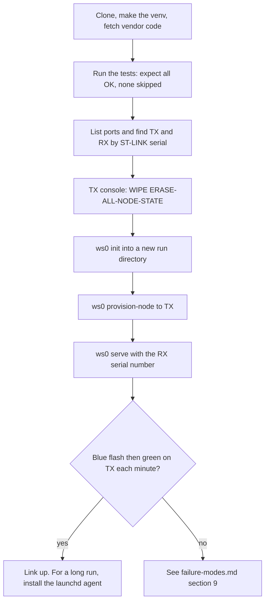
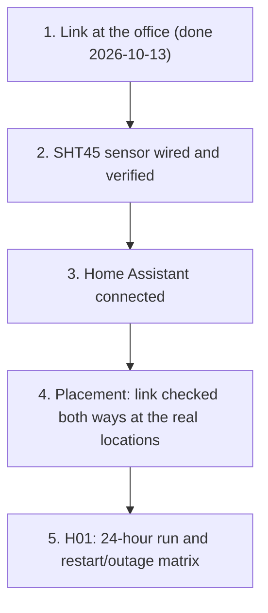

# Context pack: resume the bench prototype on a new machine

Written 2026-10-13 for picking the work up at the office with the two boards. Updated 2026-10-14
for protocol version 5, 2026-10-16 for release `260c9ccbe938`, and 2026-10-19 for the DATAVANE5K
bench station and release `04fcc656938d`, and 2026-10-29 for the power telemetry design (power
phase A on the bench, protocol version 6 in the source), and 2026-10-30 for the build-progression
record and Clint's survey answers (its section 7.1). Give this file to a fresh Claude Code session
first. Links to the deeper documents are at the end.

## 0. Current focus (2026-11-02): the breadboarded development version

The project is the **breadboarded development version** of the station: step 1, the breadboard
prototype (`hardware/bench-breadboard-r0`, model `bench-bb-r0.3`) on a 3D-printed base plate, and
step 1b, the four INA228 rails on the same breadboard bench (battery 0x40, load 0x41, solar 0x45,
USB-C 0x48). The firmware, gateway, protocol, tools and tests are the ones that run today.

- **Later stages were removed from the repository on 2026-11-02** (the protoboard, the BQ25798
  charger, the PCB, the enclosure, the field station, the custom board, sixteen stations); git history
  has them. The parts of the old designs the firmware implements are in
  [`firmware-current-design.md`](firmware-current-design.md).
- **Change C** (the PA9 sensor load switch) is not part of the breadboard build; `i2c_bus`
  power-cycling is a no-op.
- **The base plate spec** is `hardware/base-plate/spec-r2.md`. It is written for the nurb CAD project at `~/Documents/nurb/board for weather/`, whose v1 tiles it revises, and it records the user's answers so far in its §7a. Its open items (§7) are what's left to settle before the rebuild.
- **The parts for steps 1 and 1b** were ordered from DigiKey on 2026-11-02 (`docs/poc-shopping-list.md`,
  "Purchasing status").

## 1. What this project is

A home weather station.

- The sensor node is a NUCLEO-WL55JC1 development board (STM32WL microcontroller with a LoRa
  radio). It sends one reading a minute over encrypted LoRa to a receiver board on USB. The reading
  holds temperature and relative humidity (T/RH), plus the fields of the other bench station modules.
- A Python gateway (`ws0`) stores the readings in SQLite. Later it feeds Home Assistant (HA) over
  MQTT.
- The two boards are the transmitter (TX, the sensor node) and the receiver (RX).

The station runs on a battery charged from solar or USB-C; the breadboard version measures that
power path (steps 1 and 1b). The node must fail cheaply. Push work to the mains-powered gateway.

**Plan of record:** the breadboard build, steps 1 and 1b
([`superpowers/specs/2026-10-29-build-progression-decisions.md`](superpowers/specs/2026-10-29-build-progression-decisions.md),
section 3).

- **H01**, the 24-hour delivery test of the data path (TX board → LoRa → RX board → USB → gateway →
  SQLite, on USB power), runs on the breadboard build.
- H01 requires 1,440 one-minute intervals in 24 h, with at least 1,426 valid readings committed
  within 120 s, plus a restart and outage matrix (`docs/H01-checklist.md`).
- **Power phases** (Clint, 2026-10-29; [`hardware/power-metering.md`](hardware/power-metering.md)): the
  pack is **1S3P** (three 2,200 mAh Li-ion cells in parallel, 6,600 mAh, 3.0–4.2 V, about 24.4 Wh).
  **Phase A** (step 1): the Adafruit bq24074 charger, one battery INA228 (0x40) and the MAX17048 gauge
  (0x36) on the cell. **Phase B** (step 1b): one INA228 per rail: battery (signed), solar input,
  USB-C input, load. USB-C is for bench work and backup charging only, never together with solar.

## 2. Where things stand (on `master`)

- **Firmware release `04fcc656938d`** (2026-10-19) is on TX. RX stays on `cc2766a38c61`, because
  the RX code did not change (`firmware/stage0-node/RELEASES.md`). The gateway runs on run directory
  `run-d7`. The key check value (KCV) of its key is `6e30cf`.
  - Check `STATUS` on each board before you rely on it. **No rebuild is needed** to resume.
  - TX = board A, ST-LINK serial `003B00194142500E20353451`.
  - RX = board B, ST-LINK serial `0016001E4142500E20353451`.
  - Identify boards by serial number. Port names change between machines.
- **Sensors:** the TX reads its sensors as DATAVANE5K local modules (WSMP 1.0 on the boards'
  release, WSMP 1.1 with registry version 2 in the version 6 source; `docs/module-protocol.md`). The boards' release has seven modules: outside air, pressure, UVA,
  enclosure, power, wind and rain (`App/mod_*.c`, `App/wsmp_host.c`). The version 6 source splits
  power into two base-board modules, battery and power rails: eight. The wiring is in
  `docs/hardware/bench-station-wiring.md`. The breadboard map is `hardware/bench-breadboard-r0/`.
  - At the bench check of `cc2766a38c61`, only the SHT45 was on the bus.
  - GitHub issues #2, #3 and #4 (INA228 accumulators, vane ADC calibration, cup input filter) are
    fixed in firmware. They stay open until their bench checks pass.
- **Protocol version 6 in the source, version 5 on the boards.** Spec: `docs/protocol.md`. Design
  rationale: `docs/protocol-design.md`. Version 6 (power telemetry: catalog version 2, the 64-byte
  health report) reaches the boards only by the release procedure of `protocol-design.md` section 7
  (drain, WIPE, flash both boards, new run directory, `provision-node`). No version 6 release exists
  yet.
  - Encryption: AES-128-CCM with an 8-byte header (version and kind, station u16, counter u40)
    and an 8-byte tag.
  - Observation frame: 51 bytes for a T/RH-only field set. The WSMP bench field set gives at most
    77 bytes in version 5, and 93 bytes (77 bytes of plaintext) in version 6
    (`firmware/stage0-node/README.md`). It has a 22-byte
    head, a field bitmap and catalog fields. Each field has its own INVALID code.
  - ACK and NACK frames: 33 bytes. The ACK carries the host time.
  - Health report: every 15 min. Version 6 (in the source, power design §6): 64 bytes of
    plaintext, an 80-byte frame, with the power and station health values. Version 5 (on the
    boards): 32 bytes of plaintext, a 48-byte frame.
  - **A frame-format change needs a fresh key.** Send `WIPE ERASE-ALL-NODE-STATE` on TX,
    `init` a new run directory, run `provision-node`, and flash both boards. The first
    version-5 release (`bc5e6ede429c`) was installed that way.
  - Keys and run directories from protocol version 4 (`run-hw/`, `run-office/`) are retired.
    `run-d5` is archived as `run-d5-archive-2026-10-15/`.
  - The flash-layout change of `cc2766a38c61` also needed a fresh key. `run-d6` is archived as
    `run-d6-archive-2026-10-19/` (`docs/runbook-moving-boards.md`, "Changing the flash layout").
- **Power, phase A.** The MCU pins proven with `firmware/benchlink` on 2026-10-28/29 are the official
  design
  ([`firmware/benchlink/README.md`](../firmware/benchlink/README.md#wiring), "Wiring"). The wiring
  around them is breadboard v2, step 1 of the build-progression record
  ([`superpowers/specs/2026-10-29-build-progression-decisions.md`](superpowers/specs/2026-10-29-build-progression-decisions.md),
  section 4). The node firmware reads all of it in protocol version 6.

  | Signal | Wiring (breadboard v2) | Record |
  |---|---|---|
  | ISET | the charger ISET pin → 10 kΩ 1 % at the charger end → the PB1 node (100 nF and 1 MΩ to logic ground) → PB1 (A0, CN8.1). R_ISET is 1 kΩ (R9 behind the closed 1A jumper; 0.89 A typ): adopted with change A, read by this workflow from 7.1 P3; Clint to confirm (design D4/D5) | 1.4, M2 |
  | Charger VBUS | 20 kΩ over 10 kΩ → PA10 (A2, CN8.3); each resistor measured, the ratio stored as `POWER_VIN_DIVIDER_PPM` (nominal 3,000,000) | M2 |
  | CHG, PGOOD | CHG → PB10 on **CN9.7** (D6) and PGOOD → PB8 on **CN9.6** (D5), on the internal pull-ups. CN10.25 and CN10.27 are the same pins on morpho (aliases; the 2026-10-28/29 bench used them) | 1.4, N3 |
  | Battery INA228 (0x40) | the 15 mΩ shunt in the cell's + lead (CELL+ → VIN+, VIN− → BATT); its **VBUS sense lead runs to the OUT connector** (WAGO OUT position 3); the back VBUS-to-VIN+ jumper (SJ1) open | P3, P5 |
  | MAX17048 gauge (0x36) | its red lead at the **CELL+ node** (WAGO CELL+ position 3), its minus unconnected, ground over STEMMA QT. Under current it reads the CELL+ node, which includes the pack-lead drop (I × R_pack) | P4, P5, M4 |

  - **State (2026-10-30): breadboard v2 is modelled and pending on the bench.** `wiring.toml` is at
    revision `bench-bb-r0.3` (change A: the power path and NUCLEO headers; change B: cups PB5, rain
    PB4, approved 7.1 N2; change C: the split QT bus and the mode-B hour; *2026-11-02:* the PA9 sensor
    switch left the breadboard build and r0.3 is redefined in place without it), with its build sheet
    and drawings regenerated. The bench itself still has the 2026-10-28/29 as-run topology: the pack in
    the charger's socket, so the shunt was bypassed and those runs' `ishunt` and charge counters are
    invalid (record D1, F5). Change A rebuilds it.
  - **Power is off the breadboard (P1).** No battery, charge, input or load current goes through any
    breadboard contact, header pin or Dupont contact. Current leaves the charger only through its own
    JST PH sockets (BATT, SYSOUT; P2) to WAGO 222 lever connectors off the board (CELL+, BATT, OUT,
    STAR; P3, P4, P6). The one tolerated exception is the mode-B regulator supply chain, tagged
    `P1 regulator` in the model.
  - Lessons of 2026-10-28/29 (record section 1.1): a 0.2 Ω breadboard path ended 1 A charges early;
    3–4 Ω of moving contact resistance fooled the gauge's SOC; the gauge and the INA228 VBUS were first
    on the wrong nodes. The battery-path limits at 1 A (P8): + span at most 75 mΩ, − span at most
    40 mΩ, each pack-side span at most 28 mΩ (their sum is R_pack).
- **Radio:** 915.0 MHz, 500 kHz bandwidth, spreading factor (SF) 7, coding rate 4/5, 0 dBm (bench).
- **Bench-verified:**
  - the journal, in version 5 on the boards: about 28.75 hours of outage buffer in internal flash
    (1,725 slots of 80 bytes for the WSMP bench field set, in the 70-page journal of that release).
    The version 6 source keeps at least 609 slots of 96 bytes for the 77-byte node field set,
    about 10.15 hours (30-page ring, flash layout v3), not yet on a board
    (`firmware/stage0-node/README.md`, "Flash layout and outage capacity"). The 9.5-hour rule holds
    for the build's widest record (`App/node_store.c`): a field set above 80 bytes does not
    compile, so every catalog version 2 field (94 bytes, 8.7 hours) is never a build,
  - durable counters and the watchdog,
  - the reset-during-write test (70 cycles),
  - outage recovery with link back-off, NACK, and gateway auto-reconnect,
  - the host clock check and RX liveness,
  - MQTT against a local broker. `run-d7/gateway.json` now enables MQTT to the Home Assistant
    broker. No record yet shows the entities in Home Assistant,
  - the H01 scorer `tools/h01_report.py`.
- **Soak evidence:** `evidence/soak-a07f498-2026-10-13/`. Over 9 h, 549 of 549 minutes
  arrived on time, with median latency 1.5 s, 0 lost and 0 missed ACKs.
- **Latest long runs:** two lab rehearsals scored with the H01 rules, neither of them H01 (bench
  radio settings, not the intended placement). `evidence/h01-rehearsal-2026-10-14/`: release
  `bc5e6ede429c`, 1,440 of 1,440 intervals on time. `evidence/h01-rehearsal-2026-10-15/`: release
  `7eb79f64f2bd`, ended at 16 h, 960 of 960. Both: median latency 1.5 s, maximum 2.0 s.
- **Tests:** `WS0_UNSAFE_FAST_FSYNC=1 .venv/bin/python -m unittest discover -s tests` gave **595**
  passing, none skipped, on 2026-10-19 (commit 09e6cea). One SNTP test needs the network. The
  power-telemetry and build-progression work has many more; the current count is in
  `tests/README.md`.
  - Run `tools/fetch-vendor.sh` first. Without `vendor/`, the tests skip the C-against-Python
    crypto tests.
- **Other checks** (all in CI, `.github/workflows/ci.yml`):
  - `ruff check`: Python bug rules only (pyflakes, bugbear, errors, `ruff.toml`). Install it with
    `pip install -r requirements-dev.txt`. CI runs it on Linux only.
  - Fuzzing of the node's input parsers: `make -C firmware/fuzz check`. The targets are `reply`
    (envelope open and seal limits), `provision`, `console` (line assembly, hex decode, RX up/down
    filters), `obs` (the observation encoder) and `wsmp` (the WSMP module blocks). `tests/test_fuzz.py` runs them on every test
    run. CI also runs libFuzzer for 60 s per target (`firmware/fuzz/README.md`).
  - The C host tests (`test_policy`, `test_sensor`, the flash power-cut tests) and the fuzzers
    run under AddressSanitizer and UndefinedBehaviorSanitizer.
  - Firmware builds: GCC `-fanalyzer` on our files, the worst-case stack bound (`make stack`:
    TX 78 % of 8 KB for `04fcc656938d`. Its release record gives no RX figure), and no blocking wait reachable at run time
    (`make waits`, `docs/firmware-budget.md` §Blocking waits).
  - `tools/gates.sh` runs these gates locally, one line per gate (not libFuzzer).

## 3. Moving the boards: the radio key stays on the gateway machine

The run directory holds the radio key. Git ignores it, and it must never be committed. The
office trip of 2026-10-13 showed what happens when the boards move without it:

- The TX board was provisioned with a key that lived only in `run-hw/` on the home Mac.
- The home gateway's launchd agent kept running and waiting for the boards.
- After TX got a new office key, the home gateway rejected its frames as unauthenticated.

**When the boards move, use one of these** (details and decision chart:
[`runbook-moving-boards.md`](runbook-moving-boards.md)):

- Run the gateway on the machine that holds the matching run directory (for example, take that
  laptop along).
- Copy the run directory by a private route (never git, chat or email), and point the gateway at
  the copy.
- Make a **new** key: `init` a new run directory, `WIPE` TX, `provision-node`.

**For a fresh key:**

1. On the TX console, send `WIPE ERASE-ALL-NODE-STATE`. This erases the key and the journal.
   From release `0f456040fe54` on, it keeps the counter and the epoch.
2. `init` a new run directory, then run `provision-node`.

A new key is always safe. Reuse a key only if the board's counter has never gone back since that
key was first used.

**Never re-provision TX with the old `run-hw` key after a WIPE.** (Corrected 2026-10-13. An
earlier version of this pack suggested it.)

- The AES-CCM nonce is kind + station + the transmission counter (`header()` in
  `firmware/common/ws_frame.c`, `docs/protocol.md` section 1).
- On firmware before release `0f456040fe54`, WIPE reset that counter to 1. The morning office
  wipe of 2026-10-13 did that.
- From `0f456040fe54` on, WIPE keeps the counter. But this board's counter is now far below what
  the home key already used, so the home key stays retired for this board.
- The `PROVISION` epoch floor raises only the epoch, which is the observation identity
  (`App/node_store.c`, `store_epoch_floor`). It does not raise the counter.
- TX had already transmitted with the home key (for example the 9 h soak,
  `evidence/soak-a07f498-2026-10-13/`). Reuse would repeat nonces already sent on air.

## 4. Office setup (fast path: run the bench, no firmware build)



```sh
git clone https://github.com/clintecker/weather-station-2026 && cd weather-station-2026
python3.12 -m venv .venv && .venv/bin/pip install -r requirements.txt   # or: uv venv && uv pip install -r requirements.txt
sh tools/fetch-vendor.sh                                                  # needed for the C-against-Python crypto tests
WS0_UNSAFE_FAST_FSYNC=1 .venv/bin/python -m unittest discover -s tests   # expect all OK, none skipped; the count is in tests/README.md (one SNTP test needs the network)

# Plug both boards in, then find their ports. Each board is one /dev/cu.usbmodem*.
# This lists each port with its ST-LINK serial (SER=...):
.venv/bin/python -m serial.tools.list_ports -v

# Wipe and re-provision TX with a new key (115200 8N1 console):
.venv/bin/python -m serial.tools.miniterm /dev/cu.usbmodem<TX> 115200
#   type: WIPE ERASE-ALL-NODE-STATE   (TX reboots with solid red LED3 = unprovisioned). Ctrl-] to quit.
.venv/bin/python -m ws0 init --hardware --station station-01 --station-id 1 --directory run-<name>
.venv/bin/python -m ws0 provision-node --directory run-<name> --serial /dev/cu.usbmodem<TX>
.venv/bin/python -m ws0 serve --directory run-<name> --serial-number 0016001E4142500E20353451
# API: http://127.0.0.1:8088/v1/status. One reading a minute; blue LED flash, then green = ACKed.
```

- Use a new run directory (`run-<name>`) for each new key: `ws0 init` refuses one that exists. Every
  `run*/` directory matches the ignore rule, so nobody can commit it by accident.
- For a long run, install the launchd agent:
  `tools/deploy/macos/install.sh install run-<name> 0016001E4142500E20353451`.
- The office gateway Mac is a desktop that stays on all the time: no keep-awake step is needed.

## 5. Full setup (only to change or rebuild firmware)

- **Homebrew:** `brew install stlink open-ocd`. `uhubctl` and `mosquitto` are optional.
- **Toolchain:** the xPack arm-none-eabi-gcc **15.2.1-1.1** must be at
  `~/.local/opt/xpack-arm-none-eabi-gcc-15.2.1-1.1/`. To use another install, set the Makefile's
  `TOOLCHAIN` variable to that install's `bin` directory: `TOOLCHAIN=<root>/bin`.
  - Download: https://github.com/xpack-dev-tools/arm-none-eabi-gcc-xpack/releases/tag/v15.2.1-1.1,
    asset `xpack-arm-none-eabi-gcc-15.2.1-1.1-darwin-arm64.tar.gz`.
  - Expected SHA-256 (from the home machine):
    `574082d35e49a2bcbdc355836b2a3ae5e5bb3b9456c9f5e37177db2ab4aad870`.
  - Do not use the Homebrew `gcc-arm-embedded` cask. Its checksum failed here, and we did not
    bypass the check.
- **Vendor code:** `tools/fetch-vendor.sh` fetches the pinned STM32CubeWL v1.6.0 and its
  submodules into `vendor/` (git-ignored). Mbed TLS 3.6.6 comes in as ST's `mbed-crypto`
  submodule of STM32CubeWL, not as a separate download.
- **Build and flash:**
  - `cd firmware/stage0-node && make ROLE=rx flash SERIAL=0016001E4142500E20353451`. Then do the
    same with `ROLE=tx` and the TX serial.
  - Flashing keeps the provisioning and the journal, if the flash layout does not change.
  - Record every release in `firmware/stage0-node/RELEASES.md`. H01 evidence must name a release.

## 6. Next steps, in order



1. **Re-establish the link at the office.** Steps above. Confirm green ACK LEDs and
   `/v1/status`. *Done 2026-10-13: office key KCV `b7142e` in `run-office/` (see
   `docs/hardware/nucleo-wl55jc-bringup.md`, "Office session").*
2. **SHT45 sensor (Adafruit 6174), delivered 2026-10-13** with a 4397 STEMMA QT-to-female-socket
   cable, 1954 female/male jumpers and a spare Micro-B cable. *Wired 2026-10-14 on the morpho
   pins, with valid readings (`docs/hardware/nucleo-wl55jc-bringup.md`, "SHT45 first light").
   On release `bc5e6ede429c` the sensor-unplug check passed (`null` T/RH, `quality=sensor_fault`,
   then recovery. See the bring-up log, "Release bc5e6ede429c"). The first health report (build ID,
   ACK RSSI/SNR) had no record then.*
   - Wiring (Arduino headers): SDA → CN5.9 (D14/PA11), SCL → CN5.10 (D15/PA12), 3V3 → CN6.4,
     GND → CN6.6. The bus is I2C2 at 100 kHz.
   - **The 4397's female sockets do not fit the female Arduino headers.** No-solder route: plug
     them onto the male ST morpho pins. Yellow SCL → CN10.3, blue SDA → CN10.5, black GND →
     CN10.9, red 3V3 → CN7.16 (not CN7.18, which is 5 V). Positions and source:
     `docs/protocol-stack.md` §3.1. Alternative: solder the breakout's header strip and use the
     1954 jumpers on CN5/CN6. Wire with TX unplugged.
   - The firmware reads the SHT45 through its WSMP module (`firmware/stage0-node/App/mod_th.c`).
     The shared I2C2 bus with the stuck-bus recovery is `App/i2c_bus.c`. Host tests cover the CRC
     and fault handling.
   - Verify a CRC-checked reading, plus the unplug and fault behaviour. Then cut a new release.
3. **Home Assistant.** The steps are in `docs/runbook-home-assistant.md`. *Done 2026-10-22: the
   dedicated HA user `weatherstation` logs in to the HA Mosquitto add-on (port 1883, no TLS; host
   and password in `run-d7/`), checked with a read-only client; the gateway published discovery
   during run-d7, and HA shows the `station-01` device with its 11 entities
   (`evidence/ha-broker-2026-10-22/`).* Still to see, at the next hardware session: the gateway
   logging in with the rotated password, and the entities updating live. H01 requires an HA entity.
4. **Placement.** Check the link in both directions at the real TX and RX locations. Then tune
   SF and power.
5. **H01:** the 24-hour run plus the restart and outage matrix. Score it with
   `tools/h01_report.py --db <run dir>/observations.sqlite3 --station station-01 --start <UTC> --hours 24 --output evidence/h01-<date>`.
   Use the run directory that the gateway actually served. `--db` defaults to `run-hw/`.

**The build sequence** (record section 3, S1): step 1, then step 1b, both on the breadboard bench;
H01 runs on the breadboard build, before 1b's four-rail work (7.1 Q8). It folds in power phase A (the
power plan [`superpowers/plans/2026-10-29-power-telemetry.md`](superpowers/plans/2026-10-29-power-telemetry.md)).
Build from `hardware/bench-breadboard-r0/build-sheet.md`: it is the step 1 (breadboard v2) sheet, and
its "Changes from the previous revision" section says which wires come out and which go in (W-numbers
change on every regeneration, so that list names ends, not W-numbers).

1. **The model commits, then change A** (record 4.4). Every rewire is one commit with `wiring.toml`
   and the regenerated sheet (D1, D4); Clint makes the tags `bench-bb-r0.1` to `bench-bb-r0.3`.
   Change A: stop the logger and put a run boundary in the notes (Clint's, record 6.7); the base plate
   (H1); the cut #1131 pigtails and the WAGO joints, so the pack goes through the INA228 shunt and
   never into the charger's BATT socket (7.1 P3: change A as written); the sense leads; the ISET
   network and the measured divider (M2); the CHG, PGOOD and vane jumpers onto the Arduino headers;
   the OLED's own supply pair; the mode-B feed at CN6.4. Step 4a solders the jack and header pins
   onto both BOB-14021s as module preparation (7.1 Q6).
2. **The section 4.3 checks and the exit runs.** C1–C11 and C19 before every mode-A run, C12–C18
   after every rewire and at every step exit, all read on the Fluke 87V's 600 mV range (7.1 Q2) into
   the run's `toml preflight` block (`tools/preflight.py`, D6). The build sheet's "Power checks"
   measure the constants: R_ISET (check 2), the divider ratio, the INA228 shunt **verified** against a
   series reference (within 2 % + 2 mA; only a fail replaces the nominal 15 mΩ). Measured values go
   into the model first (`hardware/bench-breadboard-r0/source/wiring.toml`: the charger's `iset_ohms`
   or `iset_gain_ppm`, R4–R6's `measured_ohms`; record M2 dated note, 4.4 steps 11–12), then into
   `firmware/stage0-node/App/power_config.h` and the bench link's and logger's copies, with the sheet
   regenerated, in one commit before the build that carries them (D3 checks 8 and 9 hold the firmware
   to the model; a dirty-tree build reports firmware build ID 0). Then step 1 exits 2–5: a 1 A charge to P9's normal
   termination, 12 h of the host path metric, the two injection cases, gauge agreement.
3. **Change B** (record 4.5; N2 approved, 7.1 N2): the cups jumper to CN9.5 (PB5), the rain jumper to
   CN8.4 (PB4), the node firmware built from the same commit, landing on the BOB-14021s prepared in
   step 4a; then exit 6 (100 counted pulses, 20 tips).
4. **Change C** (record 4.6): the QT bus split into a power-monitor branch and a sensor-hub branch,
   both on the unswitched 3V3, and exit 10 (mode B for one hour on the CN6.4 entry). *2026-11-02:* the
   PA9 sensor switch and exit 9 left the breadboard build (Clint's decision; record 4.6 dated note);
   PA9 is unconnected.
5. **H01 on the breadboard build.** First the version 6 release
   (`protocol-design.md` section 7: drain, WIPE, flash both boards, `init` a new run directory,
   `provision-node`; whether H01 runs on it is Clint's open decision D2, power telemetry design
   section 15, recommendation yes; the H01 preconditions, `meter_link=ok` and the phase A exit criteria, can be
   met only on a version 6 build, so a "no" needs a version 5 backport of the M7 probe and the power
   reading, which no plan carries), the gateway check of every phase A value (`/v1/observations`, the dashboard,
   `…/diagnostics`, the Home Assistant power entities, [`runbook-home-assistant.md`](runbook-home-assistant.md)
   "Power entities"), the acceptance drill (`firmware/benchlink/README.md`, "Acceptance drill"), and
   H01 with its preconditions (`docs/H01-checklist.md`: a valid preflight with the 1 A spans, H8(d),
   the ws0 serial reopen, the counter link probe).
6. **Then step 1b** (record section 3, step 1b): the load, solar and USB-C INA228s (0x41, 0x45,
   0x48) on the breadboard beside the battery INA228, with the #368/#369 solar barrel adapters and the
   #4090/#5978 USB-C breakout pair (INA228 module preparation allowed, 7.1 Q1).

**Bench station checks (beside the steps above):** the bench checks of GitHub issues #2, #3 and #4
on the step 1 build. The `cc2766a38c61` section of `RELEASES.md` lists two bench faults found so far.

**SHT45 test plan:** `docs/firmware-review-2026-10-13.md` §2.

**Deliberately open:**

- Flash read-out protection.
- Brown-out reset level.
- Clint's open power decisions D1 (the 1S3P pack against the PRD reserve) and D2 (H01 on a version 6
  release): power telemetry design section 15.
- H11, the 30-day storage test: it needs external SPI NOR flash.
- A timed ACK receive slot.
- Code space (`docs/firmware-budget.md`). Keep the STM32WL55JC. Plan flash
  layout v2 with H11. The final image must be ≤ 75 % of its region. Watch the flash guard in
  every build.
- **True USB power-cut testing** is **deferred by Clint**. Do not raise it.

**Bench note (2026-10-13):** a USB dropout of about 1 s makes the ST-LINK reset its board (seen
on both boards). For H01 on USB, secure the cables. Keep hands and debugger sessions off them.
**USB topology (record H8, 7.1 Q5):** both NUCLEOs were on one hub when the RX's port stalled on
2026-10-28/29, so the RX goes **alone on a direct Mac port** and is never plugged or unplugged
during a run; the TX and other bench boards go on another port or hub, replugged only there. Label
each cable with its ST-LINK serial.
Range-test tool and findings: `firmware/rangetest/README.md`,
`evidence/rangetest-office-2026-10-13/`.

**Minor:** the simulator drains 5 backlog records per minute, like the firmware in the NORMAL
energy state. It does not model the drain stop or the PROBING link state
(`docs/protocol-stack.md` §9.4).

## 7. Working rules (from Clint)

- Do routine authorized work on your own. Ask only for decisions that are Clint's.
- Explain electronics plainly. Clint is a strong software developer who is new to embedded work.
- Never loosen a test criterion. Never claim H01 from a smoke test or a simulation.
- No purchases, emails, sharing, or destructive resets without his OK. Setting up again at the
  office was Clint's call (2026-10-13).
- Never commit keys, tokens or run databases.
- Document trials and errors (`docs/hardware/nucleo-wl55jc-bringup.md`).
- Keep bench tests short: minutes, not hours, unless the test is H01 itself.
- **No current through a breadboard contact** (record P1): no battery, charge, input or load current
  through a breadboard contact, header pin or Dupont contact, in any step. The breadboard carries
  sense and logic lines only; the one exception is the tagged mode-B regulator chain.
- **Prove before solder** (record section 1.2): every connection is first proven on the no-solder
  bench, with numbers recorded, before anything is soldered. Module preparation (header
  pins, the BOB-14021 jacks, the INA228 address jumpers) is allowed (7.1 Q1, Q6); soldered circuit wiring waits for its proof.
- **Bench quirks:**
  - The factory ST firmware disables the debug port (SWD), so flashing needs connect-under-reset.
    Our firmware keeps SWD enabled.
  - Generic USB hubs that claim per-port power switching do not actually cut the USB supply
    (VBUS).

## 8. Map of the docs

| File | What |
|---|---|
| `docs/protocol.md` | Wire format, protocol version 6 (normative): observation catalog version 2 with the extension bitmap, the 64-byte health report with its fitted byte |
| `docs/protocol-design.md` | Why the format looks the way it does (design rationale, reviews) |
| `docs/protocol-stack.md` | Layered explanation with diagrams |
| `docs/module-protocol.md` | DATAVANE5K, the module protocol WSMP 1.1 (normative), registry version 2 |
| `docs/hardware/bench-station-wiring.md` | Bench station wiring to the TX board |
| `hardware/bench-breadboard-r0/` | Breadboard map: `build-sheet.md` (the step 1 v2 sheet, with its "Changes from the previous revision"), renders, KiCad 10 model (`source/make.py`; `make.py sheet` needs no KiCad) |
| `hardware/bench-breadboard-r0/source/checklist.py` | The pre-run checklist C1–C23 with its pass limits, the P8 budgets, the meter (Fluke 87V, 600 mV range) and the `wiring.toml` blob hash: one source for the build sheet and `tools/preflight.py` |
| `hardware/bench-breadboard-r0/source/checks.py` | The model checks of record D3 (force leads off the breadboard, the tagged P1 chain, one ground tie, sense landings, the gauge upstream of the shunt, test-point strips, the divider ratio) and the H7 lead lengths |
| `tools/preflight.py` | Checks a run's `toml preflight` block against the model and the limits: valid, failing, missing or stale (`tools/README.md`) |
| `docs/poc-shopping-list.md` | Off-the-shelf parts for the bench station |
| `docs/failure-modes.md` | Failure modes and effects (FMEA), loss budget, recovery runbook, open issues |
| `docs/radio-energy-policy.md` | Approved send and back-off policy |
| `docs/H01-checklist.md` | The 24-hour delivery test |
| `docs/superpowers/specs/2026-10-29-power-telemetry-design.md` | Power telemetry design: phases, the fill table, protocol version 6, the 64-byte health report, node firmware, gateway |
| `docs/superpowers/plans/2026-10-29-power-telemetry.md` | Power telemetry implementation plan: its batches and wave gates |
| `docs/superpowers/plans/2026-10-29-power-telemetry-issues.md` | Power telemetry issue catalog: every issue the power decision caused, by layer, severity, batch and state, and what each open issue still needs |
| `docs/superpowers/plans/2026-10-30-build-progression-issues.md` | Build progression issue catalog: every issue the build-progression record and its section 7.1 answers caused, by area, severity, batch and state, and what each open issue still needs |
| `docs/hardware/power-metering.md` | Power metering: rails, monitors, addresses, shunts and sense points in each phase, the phase B join, input voltage limits |
| `docs/superpowers/specs/2026-10-29-build-progression-decisions.md` | Build progression decision record: the breadboard build (steps 1 and 1b), the bench power path, the NUCLEO pin contract (4.2), the pre-run checklist (4.3), changes A, B and C, the shopping list (5), the cascade (6). Section 7.1 holds Clint's survey answers of 2026-10-30, which govern. Its section 8 (and the power design's section 17) says which rows the power design adopted, deferred or rejected |
| `docs/hardware/nucleo-wl55jc-bringup.md` | Board bring-up trial-and-error log |
| `firmware/stage0-node/README.md` | Build, console commands, LEDs, flash layout |
| `firmware/stage0-node/RELEASES.md` | Release hashes |
| `docs/firmware-review-2026-10-13.md` | Firmware review roadmap (§2: SHT45 test plan) |
| `docs/firmware-budget.md` | Flash, RAM and radio budget, measured. Layout v2 and payload plan |
| `docs/firmware-event-model.md` | How the firmware runs on both boards |
| `docs/firmware-current-design.md` | The sections of the earlier ports and sixteen-stations designs that the firmware implements: the mux profile, module identity, the module record, the flash layout |
| `docs/power-of-ten.md` | The firmware against the Power of Ten rules |
| `docs/superpowers/` | Design specifications and implementation plans |
| `docs/runbook-home-assistant.md` | MQTT and Home Assistant setup, password file, running the gateway on macOS and Linux |
| `docs/runbook-moving-boards.md` | Moving boards between gateways without key or nonce reuse |
| `docs/simulation-harness.md` | Simulation harness model and limits |
| `docs/web-dashboard.md` | Live dashboard served by the gateway |
| `docs/openapi.json` | Gateway HTTP API |
| `firmware/rangetest/README.md` | Range-test bench tool |
| `firmware/i2cscan/README.md` | I2C bench tool: bus scan, INA228 and MAX17048 readings |
| `firmware/benchlink/README.md` | Bench telemetry link: the power breadboard's readings over plain LoRa, its logger and dashboard, its watchdog drills |
| `tools/README.md` | Every tool in `tools/` |
| `tests/README.md` | What each test file covers, what it needs, when it skips |
| `ws0/README.md` | The gateway modules |
| `evidence/` | Every bench run, dated |
