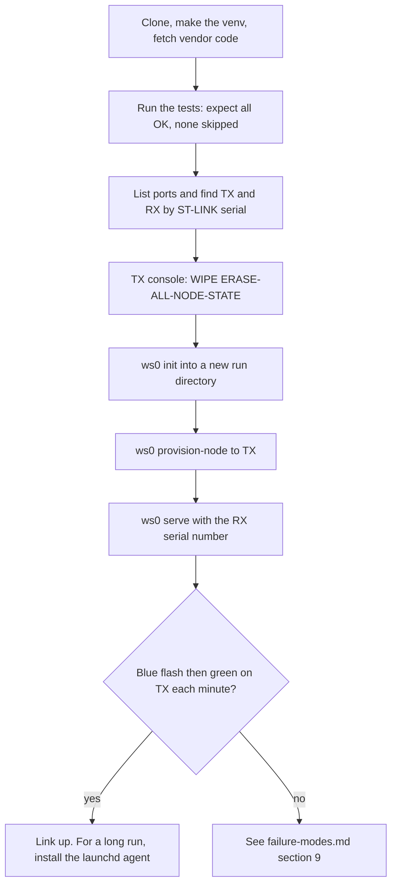
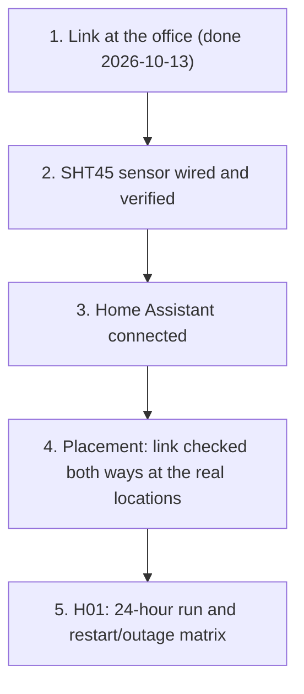

# Context pack: resume the bench prototype on a new machine

Written 2026-10-13 for picking the work up at the office with the two boards. Updated 2026-10-14
for protocol version 5, 2026-10-16 for release `260c9ccbe938`, and 2026-10-19 for the DATAVANE5K
bench station and release `04fcc656938d`. Give this file to a fresh Claude
Code session first. Links to the deeper documents are at the end.

## 1. What this project is

A home weather station.

- The sensor node is a NUCLEO-WL55JC1 development board (STM32WL microcontroller with a LoRa
  radio). It sends one reading a minute over encrypted LoRa to a receiver board on USB. The reading
  holds temperature and relative humidity (T/RH), plus the fields of the other bench station modules.
- A Python gateway (`ws0`) stores the readings in SQLite. Later it feeds Home Assistant (HA) over
  MQTT.
- The two boards are the transmitter (TX, the sensor node) and the receiver (RX).

The final node runs **unattended on battery and solar, at long range**. Judge every decision for
that node, not for the USB bench. The node must fail cheaply. Push work to the mains-powered
gateway.

**Plan of record:** strict stage order ([`next-stages-plan.md`](next-stages-plan.md)).


- **Stage 0** is the bench data path: TX board → LoRa → RX board → USB → gateway → SQLite, on USB
  power. Stage 0 ends when **H01**, the 24-hour delivery test, passes.
- H01 requires 1,440 one-minute intervals in 24 h, with at least 1,426 valid readings committed
  within 120 s, plus a restart and outage matrix (`docs/H01-checklist.md`).
- **Stage 1** (main battery pack, charger and solar) does not start before H01 passes.
- Stage 2 adds one wired sensor module on an RS-485 port. Stage 3 adds the complete unheated
  sensor set.

## 2. Where things stand (on `master`)

- **Firmware release `04fcc656938d`** (2026-10-19) is on TX. RX stays on `cc2766a38c61`, because
  the RX code did not change (`firmware/stage0-node/RELEASES.md`). The gateway runs on run directory
  `run-d7`. The key check value (KCV) of its key is `6e30cf`.
  - Check `STATUS` on each board before you rely on it. **No rebuild is needed** to resume.
  - TX = board A, ST-LINK serial `003B00194142500E20353451`.
  - RX = board B, ST-LINK serial `0016001E4142500E20353451`.
  - Identify boards by serial number. Port names change between machines.
- **Sensors:** the TX reads its sensors as DATAVANE5K local modules (WSMP 1.0,
  `docs/module-protocol.md`). There are seven modules: outside air, pressure, UVA, enclosure, power,
  wind and rain (`App/mod_*.c`, `App/wsmp_host.c`). The wiring is in
  `docs/hardware/bench-station-wiring.md`. The breadboard map is `hardware/bench-breadboard-r0/`.
  - At the bench check of `cc2766a38c61`, only the SHT45 was on the bus.
  - GitHub issues #2, #3 and #4 (INA228 accumulators, vane ADC calibration, cup input filter) are
    fixed in firmware. They stay open until their bench checks pass.
- **Protocol version 5.** Spec: `docs/protocol.md`. Design rationale: `docs/protocol-design.md`.
  - Encryption: AES-128-CCM with an 8-byte header (version and kind, station u16, counter u40)
    and an 8-byte tag.
  - Observation frame: 51 bytes for a T/RH-only field set. The WSMP bench field set gives at most
    77 bytes (`firmware/stage0-node/README.md`). It has a 22-byte
    head, a field bitmap and catalog fields. Each field has its own INVALID code.
  - ACK and NACK frames: 33 bytes. The ACK carries the host time.
  - Health report: 48 bytes, every 15 min.
  - **A frame-format change needs a fresh key.** Send `WIPE ERASE-ALL-NODE-STATE` on TX,
    `init` a new run directory, run `provision-node`, and flash both boards. The first
    version-5 release (`bc5e6ede429c`) was installed that way.
  - Keys and run directories from protocol version 4 (`run-hw/`, `run-office/`) are retired.
    `run-d5` is archived as `run-d5-archive-2026-10-15/`.
  - The flash-layout change of `cc2766a38c61` also needed a fresh key. `run-d6` is archived as
    `run-d6-archive-2026-10-19/` (`docs/runbook-moving-boards.md`, "Changing the flash layout").
- **Radio:** 915.0 MHz, 500 kHz bandwidth, spreading factor (SF) 7, coding rate 4/5, 0 dBm (bench).
- **Bench-verified:**
  - the journal: about 28.7 hours of outage buffer in internal flash (1,725 slots of 80 bytes for the WSMP bench field set, 24 hours for a station with every sensor),
  - durable counters and the watchdog,
  - the reset-during-write test (70 cycles),
  - outage recovery with link back-off, NACK, and gateway auto-reconnect,
  - the host clock check and RX liveness,
  - MQTT against a local broker. `run-d7/gateway.json` now enables MQTT to the Home Assistant
    broker. No record yet shows the entities in Home Assistant,
  - the H01 scorer `tools/h01_report.py`.
- **Soak evidence:** `evidence/soak-a07f498-2026-10-13/`. Over 9 h, 549 of 549 minutes
  arrived on time, with median latency 1.5 s, 0 lost and 0 missed ACKs.
- **Latest long runs:** two lab rehearsals scored with the H01 rules, neither of them H01 (bench
  radio settings, not the intended placement). `evidence/h01-rehearsal-2026-10-14/`: release
  `bc5e6ede429c`, 1,440 of 1,440 intervals on time. `evidence/h01-rehearsal-2026-10-15/`: release
  `7eb79f64f2bd`, ended at 16 h, 960 of 960. Both: median latency 1.5 s, maximum 2.0 s.
- **Tests:** `WS0_UNSAFE_FAST_FSYNC=1 .venv/bin/python -m unittest discover -s tests` gave **595**
  passing, none skipped, on 2026-10-19 (commit 09e6cea). One SNTP test needs the network.
  - Run `tools/fetch-vendor.sh` first. Without `vendor/`, the tests skip the C-against-Python
    crypto tests.
- **Other checks** (all in CI, `.github/workflows/ci.yml`):
  - `ruff check`: Python bug rules only (pyflakes, bugbear, errors, `ruff.toml`). Install it with
    `pip install -r requirements-dev.txt`. CI runs it on Linux only.
  - Fuzzing of the node's input parsers: `make -C firmware/fuzz check`. The targets are `reply`
    (envelope open and seal limits), `provision`, `console` (line assembly, hex decode, RX up/down
    filters), `obs` (the observation encoder) and `wsmp` (the WSMP module blocks). `tests/test_fuzz.py` runs them on every test
    run. CI also runs libFuzzer for 60 s per target (`firmware/fuzz/README.md`).
  - The C host tests (`test_policy`, `test_sensor`, the flash power-cut tests) and the fuzzers
    run under AddressSanitizer and UndefinedBehaviorSanitizer.
  - Firmware builds: GCC `-fanalyzer` on our files, the worst-case stack bound (`make stack`:
    TX 78 % of 8 KB for `04fcc656938d`. Its release record gives no RX figure), and no blocking wait reachable at run time
    (`make waits`, `docs/firmware-budget.md` §Blocking waits).
  - `tools/gates.sh` runs these gates locally, one line per gate (not libFuzzer).

## 3. Moving the boards: the radio key stays on the gateway machine

The run directory holds the radio key. Git ignores it, and it must never be committed. The
office trip of 2026-10-13 showed what happens when the boards move without it:

- The TX board was provisioned with a key that lived only in `run-hw/` on the home Mac.
- The home gateway's launchd agent kept running and waiting for the boards.
- After TX got a new office key, the home gateway rejected its frames as unauthenticated.

**When the boards move, use one of these** (details and decision chart:
[`runbook-moving-boards.md`](runbook-moving-boards.md)):

- Run the gateway on the machine that holds the matching run directory (for example, take that
  laptop along).
- Copy the run directory by a private route (never git, chat or email), and point the gateway at
  the copy.
- Make a **new** key: `init` a new run directory, `WIPE` TX, `provision-node`.

**For a fresh key:**

1. On the TX console, send `WIPE ERASE-ALL-NODE-STATE`. This erases the key and the journal.
   From release `0f456040fe54` on, it keeps the counter and the epoch.
2. `init` a new run directory, then run `provision-node`.

A new key is always safe. Reuse a key only if the board's counter has never gone back since that
key was first used.

**Never re-provision TX with the old `run-hw` key after a WIPE.** (Corrected 2026-10-13. An
earlier version of this pack suggested it.)

- The AES-CCM nonce is kind + station + the transmission counter (`header()` in
  `firmware/common/ws_frame.c`, `docs/protocol.md` section 1).
- On firmware before release `0f456040fe54`, WIPE reset that counter to 1. The morning office
  wipe of 2026-10-13 did that.
- From `0f456040fe54` on, WIPE keeps the counter. But this board's counter is now far below what
  the home key already used, so the home key stays retired for this board.
- The `PROVISION` epoch floor raises only the epoch, which is the observation identity
  (`App/node_store.c`, `store_epoch_floor`). It does not raise the counter.
- TX had already transmitted with the home key (for example the 9 h soak,
  `evidence/soak-a07f498-2026-10-13/`). Reuse would repeat nonces already sent on air.

## 4. Office setup (fast path: run the bench, no firmware build)



```sh
git clone https://github.com/clintecker/weather-station-2026 && cd weather-station-2026
python3.12 -m venv .venv && .venv/bin/pip install -r requirements.txt   # or: uv venv && uv pip install -r requirements.txt
sh tools/fetch-vendor.sh                                                  # needed for the C-against-Python crypto tests
WS0_UNSAFE_FAST_FSYNC=1 .venv/bin/python -m unittest discover -s tests   # expect 595 OK, none skipped (needs network for one SNTP test)

# Plug both boards in, then find their ports. Each board is one /dev/cu.usbmodem*.
# This lists each port with its ST-LINK serial (SER=...):
.venv/bin/python -m serial.tools.list_ports -v

# Wipe and re-provision TX with a new key (115200 8N1 console):
.venv/bin/python -m serial.tools.miniterm /dev/cu.usbmodem<TX> 115200
#   type: WIPE ERASE-ALL-NODE-STATE   (TX reboots with solid red LED3 = unprovisioned). Ctrl-] to quit.
.venv/bin/python -m ws0 init --hardware --station station-01 --station-id 1 --directory run-<name>
.venv/bin/python -m ws0 provision-node --directory run-<name> --serial /dev/cu.usbmodem<TX>
.venv/bin/python -m ws0 serve --directory run-<name> --serial-number 0016001E4142500E20353451
# API: http://127.0.0.1:8088/v1/status. One reading a minute; blue LED flash, then green = ACKed.
```

- Use a new run directory (`run-<name>`) for each new key: `ws0 init` refuses one that exists. Every
  `run*/` directory matches the ignore rule, so nobody can commit it by accident.
- For a long run, install the launchd agent:
  `tools/deploy/macos/install.sh install run-<name> 0016001E4142500E20353451`.
- The office gateway Mac is a desktop that stays on all the time: no keep-awake step is needed.

## 5. Full setup (only to change or rebuild firmware)

- **Homebrew:** `brew install stlink open-ocd`. `uhubctl` and `mosquitto` are optional.
- **Toolchain:** the xPack arm-none-eabi-gcc **15.2.1-1.1** must be at
  `~/.local/opt/xpack-arm-none-eabi-gcc-15.2.1-1.1/`. To use another install, set the Makefile's
  `TOOLCHAIN` variable to that install's `bin` directory: `TOOLCHAIN=<root>/bin`.
  - Download: https://github.com/xpack-dev-tools/arm-none-eabi-gcc-xpack/releases/tag/v15.2.1-1.1,
    asset `xpack-arm-none-eabi-gcc-15.2.1-1.1-darwin-arm64.tar.gz`.
  - Expected SHA-256 (from the home machine):
    `574082d35e49a2bcbdc355836b2a3ae5e5bb3b9456c9f5e37177db2ab4aad870`.
  - Do not use the Homebrew `gcc-arm-embedded` cask. Its checksum failed here, and we did not
    bypass the check.
- **Vendor code:** `tools/fetch-vendor.sh` fetches the pinned STM32CubeWL v1.6.0 and its
  submodules into `vendor/` (git-ignored). Mbed TLS 3.6.6 comes in as ST's `mbed-crypto`
  submodule of STM32CubeWL, not as a separate download.
- **Build and flash:**
  - `cd firmware/stage0-node && make ROLE=rx flash SERIAL=0016001E4142500E20353451`. Then do the
    same with `ROLE=tx` and the TX serial.
  - Flashing keeps the provisioning and the journal, if the flash layout does not change.
  - Record every release in `firmware/stage0-node/RELEASES.md`. H01 evidence must name a release.

## 6. Next steps, in order



1. **Re-establish the link at the office.** Steps above. Confirm green ACK LEDs and
   `/v1/status`. *Done 2026-10-13: office key KCV `b7142e` in `run-office/` (see
   `docs/hardware/nucleo-wl55jc-bringup.md`, "Office session").*
2. **SHT45 sensor (Adafruit 6174), delivered 2026-10-13** with a 4397 STEMMA QT-to-female-socket
   cable, 1954 female/male jumpers and a spare Micro-B cable. *Wired 2026-10-14 on the morpho
   pins, with valid readings (`docs/hardware/nucleo-wl55jc-bringup.md`, "SHT45 first light").
   On release `bc5e6ede429c` the sensor-unplug check passed (`null` T/RH, `quality=sensor_fault`,
   then recovery. See the bring-up log, "Release bc5e6ede429c"). The first health report (build ID,
   ACK RSSI/SNR) had no record then.*
   - Wiring (Arduino headers): SDA → CN5.9 (D14/PA11), SCL → CN5.10 (D15/PA12), 3V3 → CN6.4,
     GND → CN6.6. The bus is I2C2 at 100 kHz.
   - **The 4397's female sockets do not fit the female Arduino headers.** No-solder route: plug
     them onto the male ST morpho pins. Yellow SCL → CN10.3, blue SDA → CN10.5, black GND →
     CN10.9, red 3V3 → CN7.16 (not CN7.18, which is 5 V). Positions and source:
     `docs/protocol-stack.md` §3.1. Alternative: solder the breakout's header strip and use the
     1954 jumpers on CN5/CN6. Wire with TX unplugged.
   - The firmware reads the SHT45 through its WSMP module (`firmware/stage0-node/App/mod_th.c`).
     The shared I2C2 bus with the stuck-bus recovery is `App/i2c_bus.c`. Host tests cover the CRC
     and fault handling.
   - Verify a CRC-checked reading, plus the unplug and fault behaviour. Then cut a new release.
3. **Home Assistant.** The steps are in `docs/runbook-home-assistant.md`. They need Clint's
   broker host, port, TLS on/off and user name. The password goes in a private file, not in chat.
   H01 requires an HA entity.
4. **Placement.** Check the link in both directions at the real TX and RX locations. Then tune
   SF and power.
5. **H01:** the 24-hour run plus the restart and outage matrix. Score it with
   `tools/h01_report.py --db <run dir>/observations.sqlite3 --station station-01 --start <UTC> --hours 24 --output evidence/h01-<date>`.
   Use the run directory that the gateway actually served. `--db` defaults to `run-hw/`.

**Bench station (beside the steps above):** build it from
`hardware/bench-breadboard-r0/build-sheet.md`. Then do the bench checks of GitHub issues #2, #3
and #4. The `cc2766a38c61` section of `RELEASES.md` lists two bench faults found so far.

**SHT45 test plan:** `docs/firmware-review-2026-10-13.md` §2.

**Deliberately open:**

- Flash read-out protection (for field use).
- Brown-out reset level (Stage 1).
- H11, the 30-day storage test: it needs external SPI NOR flash.
- A timed ACK receive slot.
- Code space for the final station (`docs/firmware-budget.md`). Keep the STM32WL55JC. Plan flash
  layout v2 with H11. The final image must be ≤ 75 % of its region. Watch the flash guard in
  every build.
- **True USB power-cut testing** is **deferred by Clint**. Do not raise it.

**Bench note (2026-10-13):** a USB dropout of about 1 s makes the ST-LINK reset its board (seen
on both boards). For H01 on USB, secure the cables. Keep hands and debugger sessions off them.
Range-test tool and findings: `firmware/rangetest/README.md`,
`evidence/rangetest-office-2026-10-13/`.

**Minor:** the simulator drains 5 backlog records per minute, like the firmware in the NORMAL
energy state. It does not model the drain stop or the PROBING link state
(`docs/protocol-stack.md` §9.4).

## 7. Working rules (from Clint)

- Do routine authorized work on your own. Ask only for decisions that are Clint's.
- Explain electronics plainly. Clint is a strong software developer who is new to embedded work.
- Never loosen a test criterion. Never claim H01 from a smoke test or a simulation.
- No purchases, emails, sharing, or destructive resets without his OK. Setting up again at the
  office was Clint's call (2026-10-13).
- Never commit keys, tokens or run databases.
- Document trials and errors (`docs/hardware/nucleo-wl55jc-bringup.md`).
- Keep bench tests short: minutes, not hours, unless the test is H01 itself.
- **Bench quirks:**
  - The factory ST firmware disables the debug port (SWD), so flashing needs connect-under-reset.
    Our firmware keeps SWD enabled.
  - Generic USB hubs that claim per-port power switching do not actually cut the USB supply
    (VBUS).

## 8. Map of the docs

| File | What |
|---|---|
| `docs/protocol.md` | Wire format, protocol version 5 (normative) |
| `docs/protocol-design.md` | Why the format looks the way it does (design rationale, reviews) |
| `docs/protocol-stack.md` | Layered explanation with diagrams |
| `docs/module-protocol.md` | DATAVANE5K, the module protocol WSMP 1.0 (normative) |
| `docs/hardware/bench-station-wiring.md` | Bench station wiring to the TX board |
| `hardware/bench-breadboard-r0/` | Breadboard map: `build-sheet.md`, renders, KiCad 10 model (`source/make.py`) |
| `docs/poc-shopping-list.md` | Off-the-shelf parts for the bench station |
| `docs/failure-modes.md` | Failure modes and effects (FMEA), loss budget, recovery runbook, open issues |
| `docs/radio-energy-policy.md` | Approved send and back-off policy for battery and solar |
| `docs/H01-checklist.md` | The 24-hour delivery test |
| `docs/next-stages-plan.md` | Stages 1–3: parts and plan |
| `docs/hardware/nucleo-wl55jc-bringup.md` | Board bring-up trial-and-error log |
| `firmware/stage0-node/README.md` | Build, console commands, LEDs, flash layout |
| `firmware/stage0-node/RELEASES.md` | Release hashes |
| `docs/firmware-review-2026-10-13.md` | Firmware review roadmap (§2: SHT45 test plan) |
| `docs/firmware-budget.md` | Flash, RAM and radio budget, measured. Layout v2 and payload plan |
| `docs/firmware-event-model.md` | How the firmware runs on both boards |
| `docs/power-of-ten.md` | The firmware against the Power of Ten rules |
| `docs/lora-firmware-update-study.md` | Design study: firmware updates over LoRa (nothing built) |
| `docs/superpowers/` | Design specifications and implementation plans |
| `docs/runbook-home-assistant.md` | MQTT and Home Assistant setup, password file, running the gateway on macOS and Linux |
| `docs/runbook-moving-boards.md` | Moving boards between gateways without key or nonce reuse |
| `docs/simulation-harness.md` | Simulation harness model and limits |
| `docs/web-dashboard.md` | Live dashboard served by the gateway |
| `docs/openapi.json` | Gateway HTTP API |
| `firmware/rangetest/README.md` | Range-test bench tool |
| `hardware/poc-enclosure-r1/` | Printed enclosure parts for the proof of concept |
| `hardware/chicago-test-hardware-r0/` | Chicago test hardware, revision 0: build and order guide, manufacturing files |
| `tools/README.md` | Every tool in `tools/` |
| `tests/README.md` | What each test file covers, what it needs, when it skips |
| `ws0/README.md` | The gateway modules |
| `evidence/` | Every bench run, dated |
