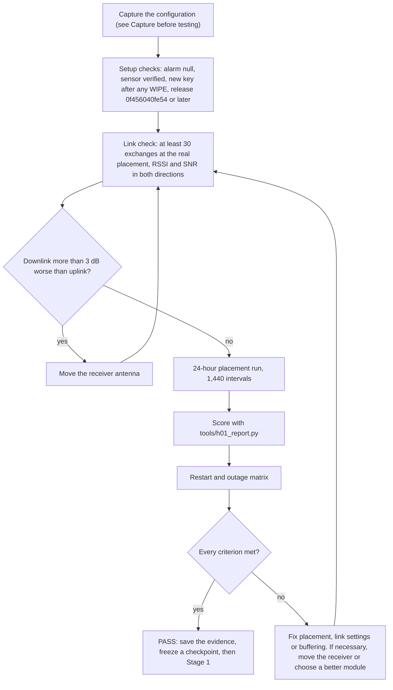

# H01: the 24-hour delivery test

H01 is the 24-hour delivery test: at least 1,426 of 1,440 one-minute readings reach the gateway within 120 s, plus a restart and outage matrix.
Its acceptance criteria come from the v0.2 product and technical requirements (PRD/TRD), section 3 (Stage 0) and section 12 (H01).

Stage 0 is the first stage of the plan ([`next-stages-plan.md`](next-stages-plan.md)): two development boards on USB power, one temperature/humidity sensor, and the gateway. H01 is the gate that ends Stage 0. Stage 1 (main battery pack, charger and solar) does not start before H01 passes.

**Status: NOT RUN.** Simulated observations cannot satisfy this test.

## Procedure



A fault-test phase can run separately from the placement run. Its intervals never leave the placement run's denominator.

## Capture before testing

- Source revision, vendor and toolchain versions, binary hashes, and the configuration without keys.
- Board, sensor and bill-of-materials revisions. Exact wiring, supply and current-measurement boundaries.
- Receiver host, antennas and intended placement, including obstructions.
- The declared synchronized acquisition-time source, the clock accuracy and the report period.
- Raw receiver frames and logs, the SQLite database and the transmitter journal counters.
- MQTT and Home Assistant (HA) discovery, measurement availability and local API checks.

## Setup before the run

- `/v1/status` shows `"alarm": null` before the run starts and after it ends.
  - A non-null alarm means possible key reuse (`failure-modes.md` §8.2). Causes: a restored flash backup, two boards that share a key, or a key reused after a WIPE.
  - `ws0 provision-node` prints the gateway's counter high-water mark. It refuses a board at or below the mark.
- **Wire and verify the SHT45 sensor first.** The transmitter (TX) console must show a CRC-checked valid reading. The unplug test must show `sensor_fault`, then recovery.
  - Without a sensor every reading is a `sensor_fault`. The verdict is then FAIL by design (see `evidence/soak-a07f498-2026-10-13/`).
- **Secure the USB cables. Run no debugger sessions during the run.**
  - A USB dropout of about 1 s makes the ST-LINK reset its board (`reset=pin`). A debugger session can also reset TX.
  - Sources: `docs/hardware/nucleo-wl55jc-bringup.md`, "Office session", and the USB-dropout failure mode in `failure-modes.md` §6.
- If TX was wiped, provision it with a **new** key (`docs/runbook-moving-boards.md`).
  - On firmware before release `0f456040fe54`, a WIPE restarts the nonce counter.
  - A key used before that release, or on another board, can repeat nonces.
- Do not run bench fault-injection commands (`TEST-HANG`, `TEST-FLASH-STORM`) on the boards under test during the placement run.
- Run firmware from release `0f456040fe54` or later.
  - In the NORMAL energy state (always on USB), this firmware keeps sending the live reading every minute while it probes a silent link. An outage therefore costs no extra late intervals (`failure-modes.md` §3.3).
  - Earlier releases backed off up to 15 min.

## Link check before the run

At the intended placements, record the received signal strength (RSSI) and signal-to-noise ratio (SNR) in **both** directions for at least 30 exchanges:

- uplink from `receiver.log` (`#rx obs`),
- downlink from the TX console (`#ack … rssi`).

Both boards print `power=` at boot. The two values must match. If the downlink margin is more than 3 dB worse than the uplink, fix the receiver antenna position before you start the 24-hour run.

## 24-hour placement test

Use one-minute observations, USB bench power and the actual intended placements.

- Schedule 1,440 intervals. At least **1,426** must arrive within 120 s of acquisition (ceil(0.99 × 1440)).
- Count unique intervals, not packets or retransmissions.
- An unknown acquisition time cannot prove latency.
- A **gateway-reconstructed** time (`protocol-stack.md` 11.3.2) is a known time when it meets the 5 s tolerance. Count it, and report reconstructed intervals separately (decision by Clint, 2026-10-12).
- Publish missing, late, invalid-clock and sensor-fault records as separate counts. Do not silently exclude them.

Score the run with:

```
.venv/bin/python tools/h01_report.py --db <run-dir>/observations.sqlite3 --station <station name> \
    --start <UTC, e.g. 2026-10-15T00:00:00Z> --hours 24 --output evidence/h01-<date>
```

- Always give `--db` and `--station` explicitly. The defaults (`run-hw/observations.sqlite3`, `station-01`) may not match the run, and a wrong station scores 0 intervals.
- `--output` must be a new directory. The tool refuses an existing one.
- The exit code is 0 for PASS and 1 for FAIL.
- The tool applies these rules to the gateway database. It writes `report.json` and `report.md`.
- The verdict needs on-time **valid** readings. The report gives transport-only success (sensor-fault readings delivered on time) beside the verdict, never instead of it.
- `invalid_clock_observations` counts observations, not intervals.

Record the exact test interval and denominator. If you inject faults in the same run, report all intervals. A separate fault-test phase can characterize recovery. Never subtract it silently from the placement run's denominator.

## Restart and outage matrix

- Reboot the transmitter, the receiver and the gateway independently.
- Confirm that sample identities never collide and transmission nonces never repeat.
- Drop the link. Confirm that sampling and journaling continue.
- At 180 s without a fresh valid reading, HA and the API show unavailable.
- Restore the link. Live observations go before backfill.
- Recover every journaled observation without duplicate database rows.
- Lose an ACK after the commit. The retry must produce a new ACK and only one stored record.
- Inject a sensor failure and an unknown clock. The readings must show both conditions honestly.
- Correct a clock error. A newer valid observation restores availability.
- Confirm that a broker outage and reconnect do not stop SQLite ingestion. Confirm the HA last-will message.

## Decision

H01 passes only when placement latency, identity, time, restarts, stale state and recovery all meet the specification. Save the full evidence set. Freeze a reproducible checkpoint before Stage 1.

On failure, fix the antenna placement, the link settings and the buffering. If necessary, move the receiver or select a better qualified radio module. Then test again. Do not introduce a mesh. Do not lower the pass threshold.
