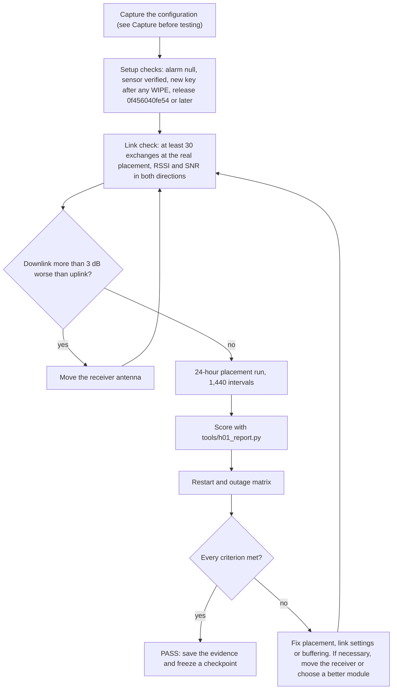

# H01: the 24-hour delivery test

H01 is the 24-hour delivery test: at least 1,426 of 1,440 one-minute readings reach the gateway within 120 s, plus a restart and outage matrix.
Its acceptance criteria come from the v0.2 product and technical requirements (PRD/TRD), section 3 (Stage 0) and section 12 (H01).

H01 runs on the breadboard build: two development boards on USB power, the bench sensor modules, and the gateway. The TX reads its sensors as WSMP local modules ([`module-protocol.md`](module-protocol.md)). Power phase A (the bq24074 charger, the 1S3P pack and their monitors, read by the node) runs beside it ([`hardware/power-metering.md`](hardware/power-metering.md) section 1).

**Where H01 runs.** H01 runs on the breadboard build, after step 1 exits (build-progression record [S1](superpowers/specs/2026-10-29-build-progression-decisions.md#25-build-steps)). Clint's answer 7.1 Q8 ("H01 first") puts it before step 1b's four-rail work (profile B: the load, solar and USB-C INA228s on the bq24074).

**Status: NOT RUN.** Simulated observations cannot satisfy this test.

## Procedure



You can run a fault-test phase separately from the placement run to characterize recovery. Never subtract it silently from the placement run's denominator. If you inject faults in the placement run itself, report all intervals.

## Capture before testing

- Source revision, vendor and toolchain versions, binary hashes, and the configuration without keys.
- Board, sensor and bill-of-materials revisions. Exact wiring, supply and current-measurement boundaries.
- Receiver host, antennas and intended placement, with any obstructions.
- The declared synchronized acquisition-time source, the clock accuracy and the report period.
- Raw receiver frames and logs, the SQLite database and the transmitter journal counters.
- MQTT and Home Assistant (HA) discovery, measurement availability and local API checks.
- The power wiring phase (A or B, see [`hardware/power-metering.md`](hardware/power-metering.md) section 1) and the monitored rails, as the release's `RELEASES.md` entry records them (step g): which rails the build fills and which are absent.
- Separately from that entry, note the INA228 addresses and the constants in `App/power_config.h` (R_ISET, divider ratio, and a shunt only if it failed its verification), measured or "nominal". Also note the firmware build ID from the health report. A nonzero ID means a build from a clean commit, and it's the first 8 hex digits of the release commit.
  - The `RELEASES.md` entry doesn't carry these. It carries the commit, plus the section 12.2 drill results when the power wiring changed.
- Name the TX supply (USB bench power) apart from the power breadboard the node reads.

## Preconditions (build-progression record S1, H8, D6, M7)

Record each one in the run notes before the 24-hour run starts. A run that starts without one of them is not an H01 run.

| # | Precondition | How it is shown | Source |
|---|---|---|---|
| 1 | Step 1 has exited, every criterion, including exit 10: mode B for 1 hour, the station fed from the regulator through the CN6.4 (3V3) entry | the step 1 exit run's notes | record section 3, step 1 exit criteria |
| 2 | The breadboard build has a preflight block with status `valid` that includes the 1 A spans (C12–C14, C16–C18: the block sets `step_exit = true` or `rewire = true`, which makes them required) | `.venv/bin/python tools/preflight.py <run notes>` prints `preflight: valid` and exits 0. `stale`, `failing` or `missing` does not meet this precondition | record D6, P8, section 4.3 |
| 3 | The USB acceptance test H8(d) has passed on the H01 topology (below): both boards logged, the TX unplugged and replugged 5 times, no gap in the RX log | the H8(d) record in the run notes | record H8(d) |
| 4 | The ws0 silent-port reopen is deployed: the running gateway has the `ws0/link.py` reopen (90 s of silence, doubling to 400 s). Clint restarts the gateway agent to load it | Clint's note of the gateway agent restart, made after the reopen landed; the deployed `ws0/link.py` holds `SILENT_REOPEN_S = 90`. A reopen during the run is logged as a `gateway_events` row of kind `serial-reopen` (warn) and drawn on the dashboard as a "serial reopen" marker | record H8(f) |
| 5 | The counter link probe is running on the TX: `#status` shows `meter_link=ok` | the TX console `#status` line | record M7 |

## Setup before the run

- `/v1/status` shows `"alarm": null` before the run starts and after it ends.
  - A non-null alarm means possible key reuse (`failure-modes.md` §8.2). Causes: a restored flash backup, two boards that share a key, or a key reused after a WIPE.
  - `ws0 provision-node` prints the gateway's counter high-water mark. It refuses a board at or below the mark.
- **Wire and check the SHT45 sensor first.** It's the air temperature and humidity module (`App/mod_th.c`). The H01 verdict counts a reading as valid only when its temperature and humidity are valid. The transmitter (TX) console must show a CRC-checked valid reading (`#sample … valid=1`).
  - Unplug test: after the unplug, the TX `#sample` line must go to `valid=0` (`t=0`, `rh=-`) and the `#counts` `sensor_faults` counter must rise. The gateway record must turn "partial". The H01 report counts it as `on_time_sensor_fault`. After the replug, `valid=1` must come back.
  - Without a sensor every reading counts as a sensor fault, so the verdict is FAIL by design (see `evidence/soak-a07f498-2026-10-13/`).
- **USB topology (record H8, 7.1 Q5).** On 2026-10-28/29 both NUCLEOs shared one hub, and a TX unplug stalled the RX port: open but silent (record F6).
  - The RX gateway NUCLEO goes alone on a direct Mac port. Never unplug or replug it during the run.
  - The TX and any other bench board go on another port or hub. Their replugs happen only there, at the board end.
  - Label each USB cable with its board's ST-LINK serial.
- **Secure the USB cables. Run no debugger sessions during the run.**
  - A USB dropout of about 1 s makes the ST-LINK reset its board (`reset=pin`). A debugger session can also reset TX.
  - Sources: `docs/hardware/nucleo-wl55jc-bringup.md`, "Office session", and the USB-dropout failure mode in `failure-modes.md` §6.
- If you wiped TX, provision it with a **new** key (`docs/runbook-moving-boards.md`).
  - On firmware before release `0f456040fe54`, a WIPE restarts the nonce counter.
  - A key used before that release, or on another board, can repeat nonces.
- **Power release (open decision D2).** Clint decides if H01 runs on a protocol version 6 release (power telemetry design [section 15](superpowers/specs/2026-10-29-power-telemetry-design.md#15-risks-and-open-decisions), D2). Recommendation: yes, so the H01 evidence names the shipping protocol.
  - *Note (2026-10-30):* as the build-progression record stands, only a version 6 build can meet the H01 preconditions.
  - Precondition 5 needs `#status` `meter_link=ok`. Only the version 6 node source prints it (`App/tx_console.c:62`). The version 5 status line has no such field.
  - Precondition 1 needs the power-telemetry phase A exit criteria, and version 5 firmware can't meet them. Version 5 reads the battery INA228 (voltage and accumulators), the MAX17048 SOC and PGOOD/CHG. It doesn't read ISET, the charger input voltage, the INA228 die temperature, or the gauge cell voltage and rate. The version 5 gateway has no fields for them either.
  - So a "no" on D2 also needs a version 5 backport of the M7 counter link probe and of the missing phase A power readings. No plan carries that backport. Without it, H01 runs on a version 6 build.
  - A version 6 release changes the frame format. Do the release procedure ([`protocol-design.md`](protocol-design.md) section 7: drain, WIPE, flash both boards, new run directory, new key) before the run, never during it.
- **On a version 6 release, check that the gateway stores the power fields** before the run.
  - `/v1/observations/latest` and the dashboard show each power field of the phase's column ([`hardware/power-metering.md`](hardware/power-metering.md) section 4) in one of three ways:
    - a value (valid),
    - absent, when the phase has no source for it (no field, no HA entity),
    - `null` (INVALID), when its fitted part failed.
  - The newest health report (`…/diagnostics`) carries the power keys.
  - An INVALID power field marks the record "partial". That doesn't change the verdict, because the verdict counts temperature and humidity only (power design section 5.3).
- Do not run bench fault-injection commands (`TEST-HANG`, `TEST-FLASH-STORM`) on the boards under test during the placement run.
- Run firmware from release `0f456040fe54` or later. Name the release in the evidence (`firmware/stage0-node/RELEASES.md`).
  - On 2026-10-19 the TX runs `04fcc656938d` and the RX runs `cc2766a38c61`. Both are bench releases, not H01 releases: their radio settings are bench values.
  - In the NORMAL energy state (always on USB), this firmware keeps sending the live reading every minute while it probes a silent link. So an outage costs no extra late intervals (`failure-modes.md` §3.3).
  - Earlier releases backed off up to 15 min.

## Link check before the run

At the intended placements, record the received signal strength (RSSI) and signal-to-noise ratio (SNR) in **both** directions for at least 30 exchanges. The count of 30 is this checklist's own rule, added with the link check on 2026-10-12. No measurement sets it.

- uplink from `receiver.log` (`#rx obs`),
- downlink from the TX console (`#ack … rssi`).

Both boards print `power=` at boot. The two values must match. The ACK uses the same radio settings as the uplink, so the two margins should be about the same.

If the downlink margin is more than 3 dB worse than the uplink, move the receiver antenna before the 24-hour run. The 3 dB limit is also this checklist's own rule from 2026-10-12, not a measured figure.

## 24-hour placement test

Use one-minute observations, USB bench power and the actual intended placements.

- Schedule 1,440 intervals. At least **1,426** must arrive within 120 s of acquisition (ceil(0.99 × 1440)).
- Count unique intervals, not packets or retransmissions.
- An unknown acquisition time cannot prove latency.
- A **gateway-reconstructed** time (`protocol-stack.md` 11.3.2) is a known time when it meets the 5 s tolerance. Count it, and report reconstructed intervals separately (decision by Clint, 2026-10-12).
- Publish missing, late, invalid-clock and sensor-fault records as separate counts. Do not silently exclude them.

Score the run with:

```
.venv/bin/python tools/h01_report.py --db <run-dir>/observations.sqlite3 --station <station name> \
    --start <UTC, e.g. 2026-10-15T00:00:00Z> --hours 24 --output evidence/h01-<date>
```

- Always give `--db` and `--station` explicitly. The defaults (`run-hw/observations.sqlite3`, `station-01`) may not match the run, and a wrong station scores 0 intervals.
- No gateway runs now and no run directory is current. The `run-d7` session ended on 2026-10-19 at 21:58 UTC. The 2026-11-18 cleanup deleted every earlier run directory (`run-hw`, `run-office`, the `run-d5`/`run-d6` archives, `run-d7`). The next bench run uses a new run directory, so pass its `observations.sqlite3` path to `--db` and its station name to `--station`.
- `--output` must be a new directory. The tool refuses an existing one.
- The exit code is 0 for PASS and 1 for FAIL.
- The tool applies these rules to the gateway database. It writes `report.json` and `report.md`.
- The verdict needs on-time **valid** readings. The report gives transport-only success (sensor-fault readings delivered on time) beside the verdict, never instead of it.
- `invalid_clock_observations` counts observations, not intervals.
- The report lists the **serial-link gaps** (`serial_gaps`, `serial_gap_count`, `serial_gap_total_s`) beside the score, never in it. A gap is one of these:
  - each serial-lost to the next serial-open,
  - each `serial-reopen` over its `silent_s`,
  - each `receiver-silent` span (180 s without an RX report),
  - each run of missing `#alive` minutes.

  Name every gap in the evidence. A gap that matches late or missing intervals explains them. It never removes them from the denominator. `not recorded` means a gateway without the `gateway_events` table: gaps unknown, not zero.

Record the exact test interval and denominator. If you inject faults in the same run, report all intervals. A separate fault-test phase can characterize recovery. Never subtract it silently from the placement run's denominator.

## Restart and outage matrix

- Reboot the transmitter, the receiver and the gateway independently.
- Confirm that sample identities never collide and transmission nonces never repeat.
- Drop the link. Confirm that sampling and journaling continue.
- At 180 s without a fresh valid reading, HA and the API show unavailable.
- Restore the link. Live observations go before backfill.
- Recover every journaled observation without duplicate database rows.
- Lose an ACK after the commit. The retry must produce a new ACK and only one stored record.
- Inject a sensor failure and an unknown clock. The readings must show both conditions honestly.
- Correct a clock error. A newer valid observation restores availability.
- Confirm that a broker outage and reconnect do not stop SQLite ingestion. Confirm the HA last-will message.

## Decision

H01 passes only when placement latency, identity, time, restarts, stale state and recovery all meet the specification. Save the full evidence set. Freeze a reproducible checkpoint. The verdict criteria above don't change with the power release. The gateway stores and exposes the power fields but never scores them.

On failure, fix the antenna placement, the link settings and the buffering. If necessary, move the receiver or select a better qualified radio module. Then test again. Do not introduce a mesh. Do not lower the pass threshold.
