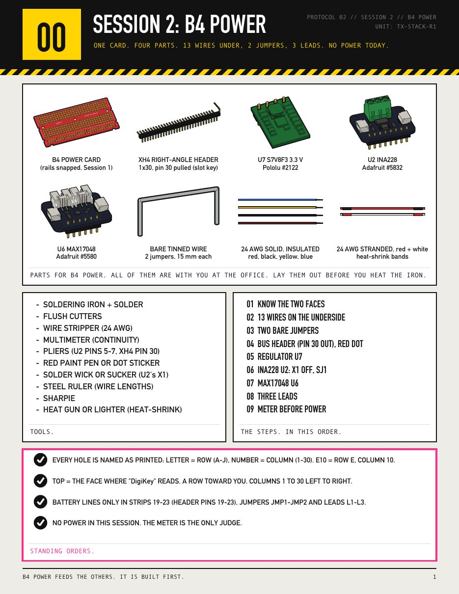
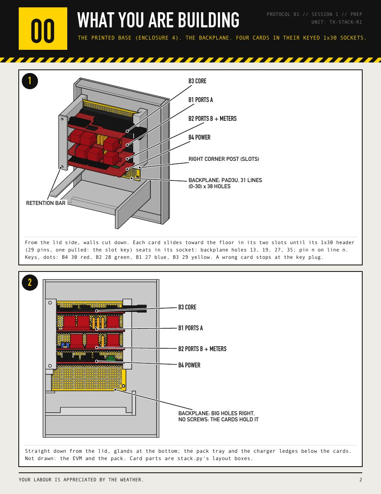
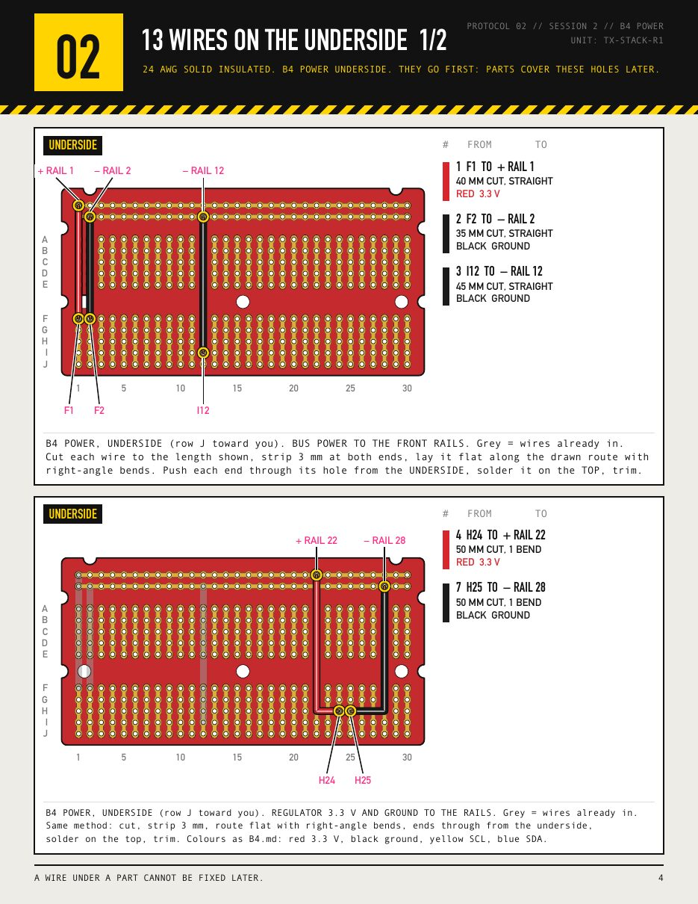
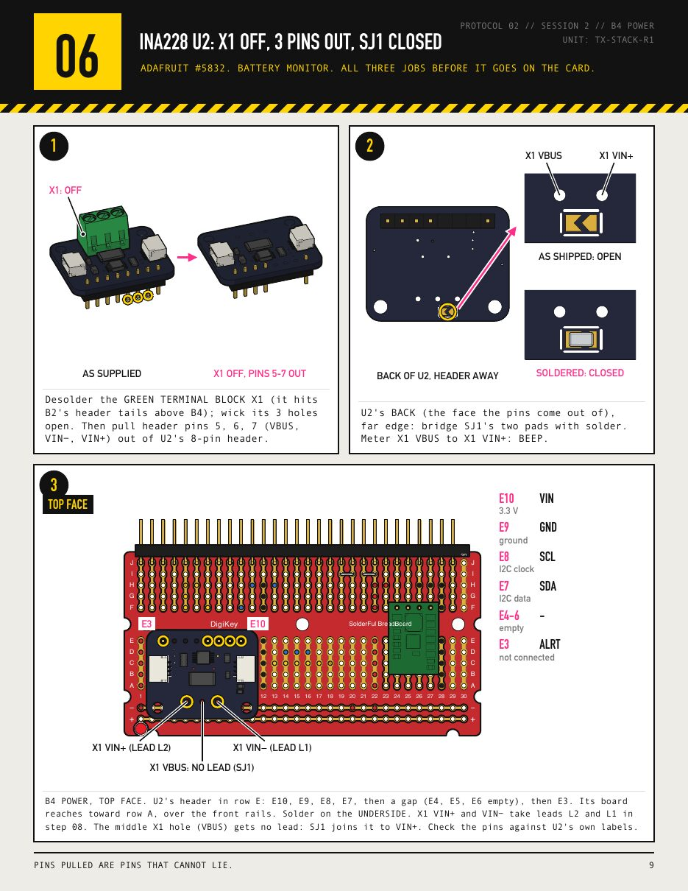
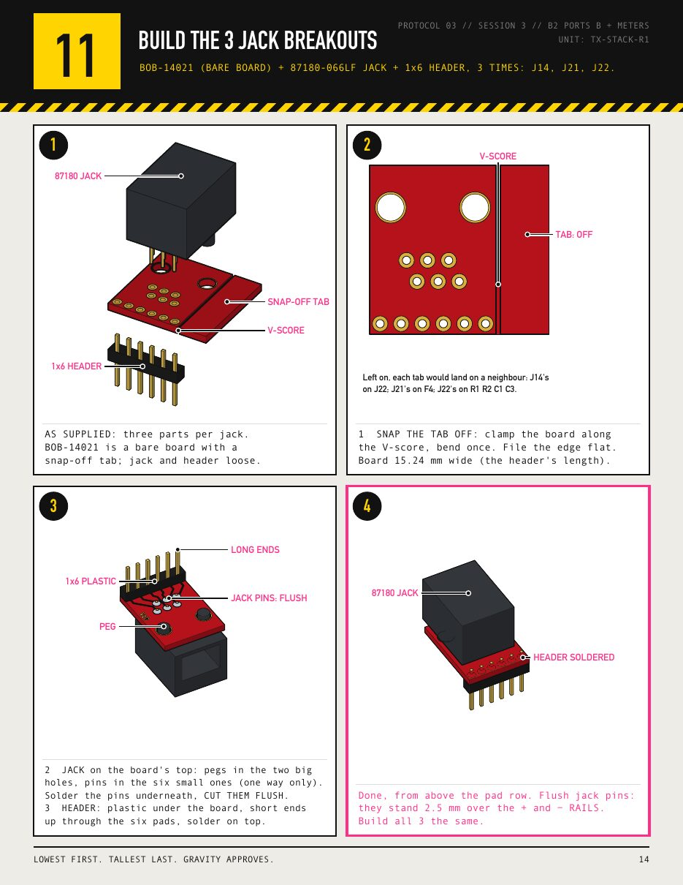
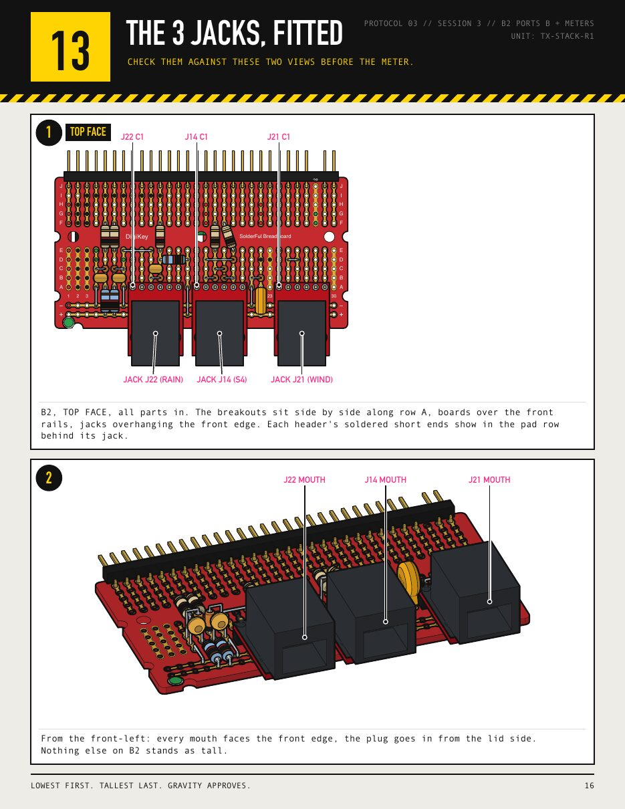

# Illustrated build sheets

These are the bench PDFs for the weather station. You open one, put it next to the soldering iron, and build the board page by page. Every picture on every page comes from real CAD geometry. Nothing is drawn by hand, and no picture comes from an image generator.

They're styled like flat-pack furniture instructions. Each page has a black header band with a yellow step number, a hazard stripe, and a footer line. Sessions 1 to 5 still carry a slogan there, such as "METER FIRST. POWER NEVER. NOT TODAY." Sessions 6 to 9 use a plain footer that names the session and the build documents it comes from.

Clint builds from them at the bench, and he liked the look enough to ask for a recipe that works on other projects. That recipe is in [skill/SKILL.md](skill/SKILL.md).

## The PDFs

Ready-to-print copies are in [`pdf/`](pdf/). Sessions 1 to 5 were rebuilt and checked page by page on 2026-11-19, after the build docs switched to the board's own hole names (letter = column, number = row, so `E10` is column E, row 10). Sessions 6 to 9 were rebuilt and checked page by page on 2026-11-23, after the backplane's copper-side leads were re-laned. These four refer to their own and each other's pages by step number, such as "Session 9 step 07". Sessions 3, 4, 7, 8 and 9 were rebuilt again later on 2026-11-23 for the P4KE6.8A TVS clamps on B1 and B2, the pack fuse F5, the outdoor antenna, vent, S4 blanking pin and lid shade, and the pod ID records (Session P page W1) in Session 9 step 07. Sessions 7 and 8 were rebuilt once more that day for the solar TVS D6 on J2 (Session 8 step 12), the antenna AE1 straight on the bulkhead and the bond to the pole (Session 8 steps 03 and 14).

Once the station is up, [`hardware/tx-stack-r1/MAINTENANCE.md`](../../hardware/tx-stack-r1/MAINTENANCE.md) has the maintenance plan: what to check, how often, and what each alert means.

| PDF | What you build | Pages |
|---|---|---|
| [tx-session1-prep.pdf](pdf/tx-session1-prep.pdf) | Snap the card rails, label, measure the insert, cut and test-fit the PAD3U backplane | 11 |
| [tx-session2-b4-power.pdf](pdf/tx-session2-b4-power.pdf) | B4 POWER | 12 |
| [tx-session3-b2-ports-b-meters.pdf](pdf/tx-session3-b2-ports-b-meters.pdf) | B2 PORTS B + METERS | 18 |
| [tx-session4-b1-ports-a.pdf](pdf/tx-session4-b1-ports-a.pdf) | B1 PORTS A | 17 |
| [tx-session5-b3-core.pdf](pdf/tx-session5-b3-core.pdf) | B3 CORE | 18 |
| [tx-session6-backplane.pdf](pdf/tx-session6-backplane.pdf) | Wire the PAD3U backplane: key plugs, XJ1, R7, R8, the mux with its 5 header leads (over B4's socket to holes 14-18) and 4 QT cables, links, EVM and pack leads (board end), 24 bus wires | 13 |
| [tx-session7-charger-pack.pdf](pdf/tx-session7-charger-pack.pdf) | Set the BQ25798EVM's jumpers, the J5 sense lead, thermistor RT1 at J7, the J5/J3 leads, the pack leads at PG1, the J8 lead to XJ1 (three 1-way housings at the XJ1 end), meter checks and a USB-only first power. The charger's I2C set-up is the firmware's CHARGER check in Session 9 step 07 | 12 |
| [tx-session8-into-the-box.pdf](pdf/tx-session8-into-the-box.pdf) | Rim test ring, the base and its inserts, glands, the wrong-card test, colour dots, backplane, pack, EVM, cards, cable runs and 6P plugs, the solar lead and its TVS D6 to J2, the coax, the before-power list, lid, mount, antenna and the bond to the pole | 17 |
| [tx-session9-commission.pdf](pdf/tx-session9-commission.pdf) | SWD from J3 to the ST-LINK, the one-time unlock, build and flash (RX, then TX, with WS_POWER_PROFILE=3 WS_I2C_MUX=1), the brown-out level (`make bor`, BOR level 4, dry run first), the console on the mini's USB-C, provisioning with a new key, the self-test on USB, the pack on, the first frames on air | 11 |
| [pods-session-p-boards.pdf](pdf/pods-session-p-boards.pdf) | The TH, BARO and UV pod boards and their leads | 34 |

Session Q (pod boxes, radiation shield, install) isn't here: its pictures come from the shield model, whose licence is unknown. Build it locally (see below).

When you change a sheet, rebuild it and copy the booklet over the one here.

## A few pages

| | |
|---|---|
|  |  |
| Session 2, page 1. Each part as it comes out of the bag, with its maker part number. | Session 1, page 2. The four cards in their keyed sockets, from the CAD of the printed base. |
|  |  |
| Session 2, page 4. Each wire follows its routed path, with its cut length and colour. | Session 2, page 9. The INA228 arrives with a green terminal block. The sheet shows it, then tells you to take it off. |
|  |  |
| Session 3, page 14. Three loose parts become one jack breakout in four panels. | Session 3, page 16. The finished card from two angles. Compare before you pick up the meter. |

The images are page renders of the PDFs. The build writes into `hardware/tx-stack-r1/sheets/out/` and `hardware/pods-r1/sheets/out/`, which git ignores; the copies in `pdf/` are the ones that are committed.

## What makes them good

The pictures are the real parts. A CadQuery model, or the maker's own STEP file, goes in. OpenCascade removes the hidden lines. Then a ray cast picks the colour of each closed region and gives it one of three flat tones. The result is crisp vector line art that matches the board on your bench. The renderer is [`r3d.py`](../../hardware/tx-stack-r1/sheets/session1/v2/r3d.py).

Boards look as they arrive. The INA228 keeps its factory-fitted X1 block in the drawing, and page 9 of Session 2 has a step to remove it. The SolderFul cards show their strips joined, as on the real card. If a part comes off, it gets its own step.

Every label names the exact thing. A hole is "E10", as printed on the board. A face is "TOP FACE", and the sheet says how to recognise it ("the face where DigiKey reads"). A wire is "24 AWG SOLID, INSULATED" with a cut length in mm. You never see "the card" when four red cards sit on the bench.

Labels sit on white paper chips. Each leader starts at the chip edge and ends on a dot on the part. On the red cards, every leader is black on a white halo (`SL.LEADER_INK = True` in each session script).

The build checks the layout of each page. It fails if a chip overlaps another chip or crosses a panel edge, or if a leader crosses a chip that it does not belong to. A second check measures each hole callout against the hole. The callout must be within 0.15 mm of the hole's model position and of the circle that the render drew ([`holecheck.py`](../../hardware/tx-stack-r1/sheets/session1/v2/holecheck.py)).

The renderer refuses a mirrored picture. Each scene declares the frames its geometry went through, and `r3d.render()` stops on any map with a negative determinant ([`handed.py`](../../hardware/tx-stack-r1/sheets/session1/v2/handed.py)). It also stops if a leader anchor is hidden behind another part.

The words come from the build documents. Sessions 3 to 5 parse `build/B2.md`, `B1.md` and `B3.md` with a small reader (`b2md.py`, `b1md.py`, `b3md.py`). The scene scripts cross-check those tables against the layout on import. So the page text and the picture cannot drift apart without a loud failure.

## The sessions

Run every command from the repo root. Each build only lays out pages from SVGs that already exist in that session's `svg/` folder. On this machine, each TX build took 6 to 17 seconds.

| Session | Builds | Pages | Layout command (writes into `OUT`) |
|---|---|---|---|
| 1, prep | Snap the card rails, label and photograph, measure the insert, cut the PAD3U backplane, test-fit the base | 11 | `.venv-pdf/bin/python -B hardware/tx-stack-r1/sheets/session1/v2/make_session1_v2.py OUT` |
| 2, B4 POWER | 13 underside wires, 2 jumpers, the bus header, regulator U7, INA228 U2, MAX17048 U6, 3 leads, meter checks | 12 | `.venv-pdf/bin/python -B hardware/tx-stack-r1/sheets/session2/make_session2.py OUT` |
| 3, B2 PORTS B + METERS | 8 wires, 6 jumpers, header XH2, pull-ups, filters, diodes, TVS clamps, fuse F4, 3 jack breakouts, strip map, meter checks | 18 | `.venv-pdf/bin/python -B hardware/tx-stack-r1/sheets/session3/make_session3.py OUT` |
| 4, B1 PORTS A | 11 wires, 3 jumpers, header XH1, 6 resistors, 15 diodes, fuses F1 to F3, 3 jack breakouts, strip map, meter checks | 17 | `.venv-pdf/bin/python -B hardware/tx-stack-r1/sheets/session4/make_session4.py OUT` |
| 5, B3 CORE | Snap the back rails, 21 wires, SWD header J3, header XH3, SHTC3 U5, Wio-E5 mini A1, strip map, meter checks | 18 | `.venv-pdf/bin/python -B hardware/tx-stack-r1/sheets/session5/make_session5.py OUT` |
| 6, backplane | Key plugs and colour dots, XJ1, R7, R8, mux U4 on foam with 5 leads and 4 QT cables, 3 links, 5 EVM and pack leads (backplane end only), 24 bus wires, meter checks | 13 | `.venv-pdf/bin/python -B hardware/tx-stack-r1/sheets/session6/make_session6.py OUT` |
| 7, charger and pack | BQ25798EVM jumpers, J5 sense lead, RT1 at J7, J5/J3 leads, PG1 pack leads, J8 lead to XJ1, meter checks, USB-only first power | 12 | `.venv-pdf/bin/python -B hardware/tx-stack-r1/sheets/session7/make_session7.py OUT` |
| 8, into the box | Rim ring, base inserts, glands and labels, wrong-card test, slot dots, backplane, pack, EVM, cards and bar, cables with 6P plugs crimped inside, solar lead to J2, coax, before-power list, lid, mount | 17 | `.venv-pdf/bin/python -B hardware/tx-stack-r1/sheets/session8/make_session8.py OUT` |
| 9, commission | SWD wiring, unlock, build and flash, brown-out level (`make bor`), console, provision, self-test (STATUS, KAT, #counts, MODULES, CHARGER, wrong port), pack on, on-air and meter checks | 11 | `.venv-pdf/bin/python -B hardware/tx-stack-r1/sheets/session9/make_session9.py OUT` |
| P, pod boards | The TH, BARO and UV pod boards on Perma-Proto Quarters, 3 jack breakouts, the port cables | 34 | `sh hardware/pods-r1/sheets/build.sh` |

Use `hardware/tx-stack-r1/sheets/out` for `OUT` to match the PDFs that are there now. If you leave it out, Session 1 writes to `session1/v2/out`, Session 2 to `session2/out`, and Sessions 3 to 9 to `sheets/out`.

Sessions 1 and 2 write one PDF per step and a booklet (`session1-all.pdf`, `session2-all.pdf`). Sessions 3 to 9 write the booklet only. Session P writes `out/session-p-pods.pdf` and `out/session-p-manifest.json`. The manifest lists each page with its title, tags and issue counts, and [`tests/test_pods_sheets.py`](../../tests/test_pods_sheets.py) reads it.

There is also a Session Q in `hardware/pods-r1/sheets/` for the pod boxes, the radiation shield and the installation (23 pages, `sh hardware/pods-r1/sheets/render_q.sh`, then `build_q.sh`). The shield model has an unknown licence, so its pictures and PDF stay in the gitignored `svg/` and `out/` folders. This page shows none of them.

### Render the pictures first

The layout step needs the SVGs. Rendering is the slow part, and each scene runs in its own process.

```sh
# Session P: re-renders only stale scenes, 6 at a time (JOBS=n, FORCE=1 to redo all)
sh hardware/pods-r1/sheets/render_all.sh

# Sessions 3 and 4 read CADPY, Sessions 5 and 6 read CAD
CADPY=$PWD/.venv-cad/bin/python sh hardware/tx-stack-r1/sheets/session3/render_all.sh
CADPY=$PWD/.venv-cad/bin/python sh hardware/tx-stack-r1/sheets/session4/render_all.sh
CAD=$PWD/.venv-cad/bin/python   sh hardware/tx-stack-r1/sheets/session5/render_all.sh
sh hardware/tx-stack-r1/sheets/session6/render_all.sh   # finds .venv-cad itself; JOBS=n
sh hardware/tx-stack-r1/sheets/session7/render_all.sh   # the same
sh hardware/tx-stack-r1/sheets/session8/render_all.sh   # the same
sh hardware/tx-stack-r1/sheets/session9/render_all.sh   # the same (it also renders the Session 5, 7 and 8 pictures it shares)

# Sessions 1 and 2 have no render_all.sh: give one scene name per call
(cd hardware/tx-stack-r1/sheets/session1/v2 && ../../../../../.venv-cad/bin/python -B scenes.py NAME)
(cd hardware/tx-stack-r1/sheets/session1/v2 && ../../../../../.venv-cad/bin/python -B assembly.py asm_iso)
(cd hardware/tx-stack-r1/sheets/session2 && ../../../../.venv-cad/bin/python -B scenes2.py NAME)
```

`scenes3.py list`, `scenes4.py list`, `scenes5.py list` and `scenes_p.py list` print the scene names (39, 41, 34 and 56). `scenes3.py list` takes about 3.5 minutes because the import routes every wire. Session 1 has 54 scenes plus the two in `assembly.py`, and Session 2 has 27. With no name, `scenes.py` and `scenes2.py` render all of them in one process. Do not do that (see the pitfalls below).

Without `CADPY` or `CAD`, the TX `render_all.sh` scripts use the repo-local `.venv-cad`.

### Make the two Python environments

```sh
sh hardware/pods-r1/sheets/setup-envs.sh
```

This uses [uv](https://docs.astral.sh/uv/) to make `.venv-cad` (Python 3.12, CadQuery 2.7.0, shapely, contourpy, manifold3d) and `.venv-pdf` (Python 3.13, reportlab 5.1.0, svglib 2.4.0) at the repo root. Then it fetches the makers' STEP models with `hardware/tx-stack-r1/render/fetch_models.py`. The BOB-14021 board STEP needs `kicad-cli`. The TX pins are in `hardware/tx-stack-r1/sheets/requirements-cad.txt` and `requirements-pdf.txt`.

The pages use the DIN Condensed, DIN Alternate and Andale Mono fonts from `/System/Library/Fonts/Supplemental/`. So the layout step runs on macOS only, for now.

## The pipeline

Seven stages turn a parts list into a PDF. Each stage reads the one before it. The aim is that no stage types a dimension of its own.

1. Facts table. [`hardware/tx-stack-r1/sources.py`](../../hardware/tx-stack-r1/sources.py) and [`hardware/pods-r1/sources.py`](../../hardware/pods-r1/sources.py) hold every dimension. Each row is `key: (value, what, source, status)`. The status is `sourced`, `derived` or `TBD`. A TBD value is a placeholder until Clint measures the part, and `label()` prints it with `[TBD-MEASURE]`. `python3 sources.py --check` keeps the README table in step with the file.
2. Layout model and checks. [`layout/stack.py`](../../hardware/tx-stack-r1/layout/stack.py) places every part, pin and box on the hole grid. [`layout/route.py`](../../hardware/tx-stack-r1/layout/route.py) routes each wire flat, on a 1.27 mm grid, with right-angle bends. [`layout/layout_checks.py`](../../hardware/tx-stack-r1/layout/layout_checks.py) runs checks L1 to L13: holes, copper against the schematic, 3D clashes, handedness, slot keys. The pods use `layout/pods.py`, `permaproto.py` and `pod_checks.py`. `layout/drawings.py` writes the text build sheets `build/B1.md` to `B4.md`.
3. CadQuery models. [`session1/v2/models.py`](../../hardware/tx-stack-r1/sheets/session1/v2/models.py) builds the cards, the backplane and the bench tools. Breakouts come from the makers' STEP files in `render/models/` (gitignored). [`hardware/pods-r1/sheets/models_p.py`](../../hardware/pods-r1/sheets/models_p.py) places factory-fitted parts at the positions in each board's Eagle `.brd`.
4. Scenes. A scene function in `scenesN.py` builds an `r3d.Scene`, adds the parts with colours, puts decals (silkscreen, hole letters) on faces, and names anchors for the labels.
5. Hidden-line render. `r3d.render()` writes `svg/NAME.svg` and `svg/NAME.json`. The JSON holds the anchors in page points. Triangle meshes use [`mrender.py`](../../hardware/pods-r1/sheets/mrender.py) instead, with a depth buffer and the same output format.
6. Page assembly. [`sheetlib.py`](../../hardware/tx-stack-r1/sheets/session3/sheetlib.py) gives the page furniture, `Grid`, `panel`, `Art`, `chip`, `label`, `leader` and `dim`. `Art` places an SVG with svglib and maps its anchors to page points. `make_sessionN.py` lists the pages and writes the PDF with reportlab.
7. Checks and review. The booklet build runs `LAB.check()` (chips and leaders) and `HC.check()` (hole callouts) on every page. Then a person looks at every page. For Session P, `out/review/` holds one PNG per page for that look.

## Pitfalls we hit

These came from the code and the commit history. The skill repeats them for other projects.

- A run of many scenes in one process can segfault partway and still exit 0. So each `render_all.sh` runs one scene per process and then checks that every SVG exists.
- OpenCascade's hidden-line removal crashes on a mesh made into faces. That is why the shield needed `mrender.py`.
- A large face can take the colour of a small part whose outline did not close. `r3d` now votes over up to nine points inside each large region (commit `01e507a`).
- A vendor STEP can include parts that matter. The missing INA228 X1 block hid a real clash with B2's header tails (commit `304e308`).
- The first PAD3U model drew every other row of pads square. Clint's photos showed square pads on every fifth line and row, so the sheets now name FRONT by the legend (commit `10d391b`).
- Sessions 2 to 4 keep their own copy of `asm_iso.svg`, but their scene scripts have no entry to render it. On this machine those copies are older than Session 1's and differ from it. Session 5 renders the shared pictures into its own folder (`_shared` in `scenes5.py`), which is the better pattern.
- Sessions 1 and 2 print label issues but fail only on hole issues. Sessions 3 to 5 and P fail on both.
- The TX scripts hold absolute repo paths, and their `render_all.sh` scripts used to default to a venv in a session scratchpad that later lost its packages. They now default to the repo-local `.venv-cad`. The pod sheets do this with `env.sh` and a loud WARNING (commit `3b6cebd`).
- A build doc's wording can change under a reader. When the strip names flipped from "column N, rows ..." to "row N, columns ...", Session 5's strip-map regex matched nothing and the page would have built with no bars. Readers should fail when a pattern finds nothing.
