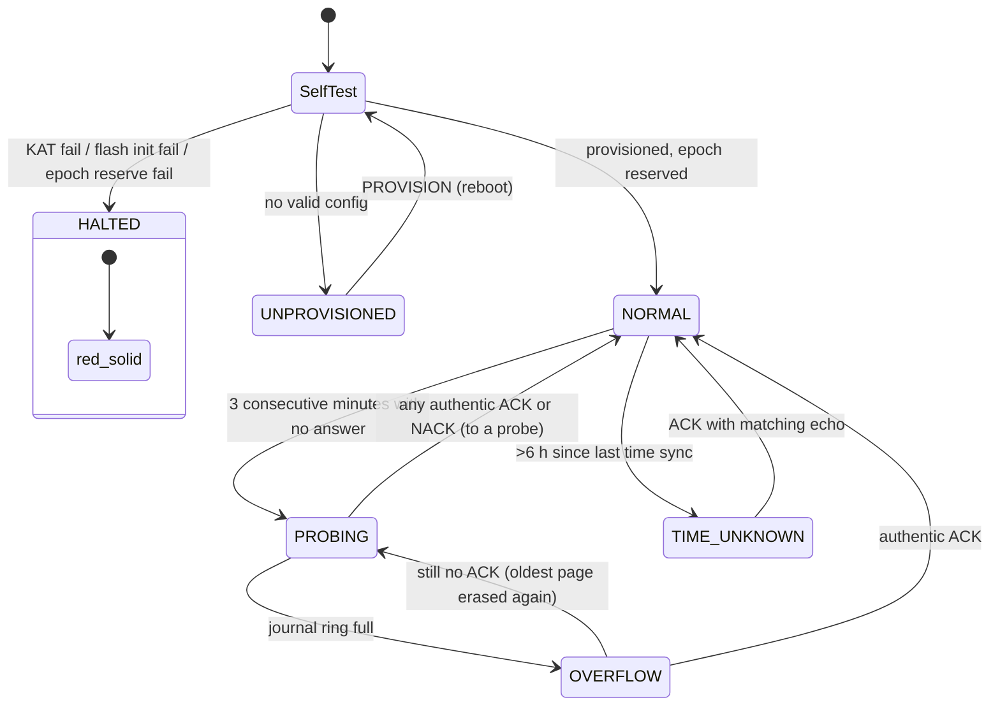

# Stage-0 communication: failure modes, recovery, and loss budget

> **Document type:** Failure modes and effects analysis (FMEA) and recovery runbook.
> **Applies to:** Stage 0 data path: TX board → LoRa → RX board → USB → gateway (`ws0`) → SQLite. Protocol draft 4 and later.
> **Status:** Most behaviors exist in code. Column **Verified** tells you what has evidence. Section 10 lists the known gaps. **H01 is NOT RUN.**
> **Related:** [`protocol-stack.md`](protocol-stack.md) (how each layer operates) · [`protocol.md`](protocol.md) (byte formats) · [`H01-checklist.md`](H01-checklist.md).

---

## 1. Purpose and scope

This document defines the behavior of the Stage-0 communication system when a part of it does not operate correctly. For each failure, it gives:

- how the system detects the failure,
- what the system does immediately,
- how the system recovers (automatically, by an operator, or not at all),
- what data the failure can delay or lose,
- the effect on the H01 acceptance test,
- the evidence that the behavior is correct.

**In scope:** the TX board, the RX board, the radio link, the USB link, the gateway process, its SQLite files, and the host computer.
**Out of scope:** Stage 1 and later items (battery, solar, RS-485 modules, heaters), and MQTT/Home Assistant availability. These components are downstream of storage, so their failures cannot cause data loss.

### 1.1 Operating context: the bench is not the use case

The protocol exists for one job: **an unattended station sends periodic sensor readings over a long radio path, from battery and solar power, to an indoor receiver.** Stage 0 runs on a desk with USB power. Many failures that cost nothing on the bench cost energy, airtime, or data in the field. This document classifies each failure for the **deployment**, and it gives the bench evidence where it exists.

| Property | Stage-0 bench (now) | Deployment (design target) |
|---|---|---|
| TX power | USB, unlimited | Protected 4S battery pack + 20–40 W solar. **Average budget ≤ 0.25 W for the complete station** (spec §4) |
| TX attendance | On the desk | Outdoors, unattended; a site visit is expensive |
| Distance | ~30 cm | Roof/yard to indoor receiver through walls; to be measured (H01). No range claim. |
| Radio settings | SF7, 0 dBm, RSSI ≈ −23 dBm | SF and power from the measured link budget: SF9–SF12, up to +22 dBm (§15.247 allows +30 dBm) |
| Airtime, 42-byte observation frame (draft 5) | 21.8 ms | 72 ms (SF9) to 453 ms (SF12) |
| Packet loss | Rare | **Routine.** Weather, snow on the antenna, interference, temperature |
| Gateway host | Mac, can sleep | Always-on Linux computer or SBC on mains (spec §1). It must not sleep. |
| Typical outage | Developer stops the gateway | **House power outage or storm.** The station keeps measuring on solar; the gateway is down. This is exactly what store-and-forward is for. |

**Design principle.** The node is the energy-limited and unattended side. The gateway is mains-powered and attended. Therefore:

1. The node must **fail cheaply.** A failure must not make it spend much more energy than normal operation.
2. Put decisions and extra work on the **gateway side** where possible (for example: NACKs, time checks, monitoring).
3. Never trade data safety for energy, and never trade energy for convenience.

### 1.2 Energy cost of a failed exchange

Each frame costs transmit energy plus the energy of the ACK receive window. The window is short when the ACK arrives. It stays open for the full **2,000 ms** when no ACK arrives.

| SF (500 kHz) | Airtime, 42-byte observation | TX charge at ~100 mA (+20 dBm class) | RX charge, full 2 s window at ~5 mA |
|---|---:|---:|---:|
| SF7 | 22 ms | 2.2 mC | 10 mC |
| SF10 | 134 ms | 13 mC | 10 mC |
| SF12 | 453 ms | 45 mC | 10 mC |

Draft 4 frames were 56 bytes (27 / 164 / 576 ms, 2.7 / 16 / 58 mC); the pre-G13 arithmetic below uses those.

*The current values are datasheet-class assumptions for the STM32WL. Stage 1 must measure them (spec H02).*

- In a **normal minute**, the node sends 1 frame and the ACK closes the window early.
- In a **failed minute**, the firmware sends **1 frame** and waits the **full 2 s**: the drain stops at the first missed ACK. After *K* = 3 silent minutes the node enters PROBING and sends only one live probe per back-off interval (2, 4, 8, then 15 min); the minutes between probes have no radio activity (G13, `radio-energy-policy.md` §6).
- **Pre-G13 (before 2026-10-13)** a failed minute sent **3 frames** (live + 2 backlog), each with the full 2 s window. The arithmetic below is that pre-G13 cost; it is kept because it motivated G13.

Pre-G13, at SF12 and +20 dBm, one failed minute cost about 3 × (58 + 10) ≈ 200 mC, against about 60 mC in a normal minute. Over a one-day gateway outage, that is about 290 C ≈ 80 mAh, or roughly **0.27 Wh/day** at 3.3 V. That is about **4–5 % of the 6 Wh/day core budget**, spent on a link that is known to be down. G13 (closed) reduces this to about 100 probes, about 0.007 Wh/day; G16 (open) would shorten each failed window.

---

## 2. Definitions

### 2.1 Recovery classes

| Class | Meaning |
|---|---|
| **AUTO** | The system recovers with no human action. No data is lost. Data can be late. |
| **AUTO-BOUNDED** | The system recovers with no human action. It can lose a defined, counted, small quantity of data. |
| **OPERATOR** | A person must do a procedure from section 9. Data is safe if the person acts before a stated deadline. |
| **UNRECOVERABLE** | Some data is lost permanently, or it was never acquired. The system must make the loss visible. |

### 2.2 Data custody states

One observation goes through these states. At each state, **one** component is responsible for it.

| State | Custodian | Durable? | What destroys it |
|---|---|---|---|
| Acquired | TX RAM | No | TX reset before the journal write (a window of a few milliseconds) |
| Journaled / InFlight | TX flash | Yes | Journal overflow (counted), TX flash failure, `WIPE` |
| Committed | Gateway SQLite **and** TX flash | Yes (two copies) | Nothing, until the ACK arrives |
| Acknowledged | Gateway SQLite only | Yes (see gap G4) | Loss or corruption of the gateway database |

**Key property:** An observation always has at least one durable custodian between the journal write and the end of its life. The TX board deletes its copy only after it verifies an authentic ACK. The gateway makes that ACK only after its commit.

---

## 3. Guarantees and loss budget

### 3.1 Invariants (must hold in every failure)

| # | Invariant | Mechanism | Verified |
|---|---|---|---|
| I1 | The gateway never sends an ACK for an observation that it did not commit. | `Gateway.receive`: commit, then seal ACK | Simulation `storage-failure`; unit `test_commit_failure_no_ack` |
| I2 | The TX board never deletes an observation without an authentic ACK for that identity. | `ws_open_ack` + `store_journal_find` | Unit `test_ack_tamper_keeps_pending` (simulator); bench (firmware) |
| I3 | No (key, nonce) pair is used two times. | Durable counter blocks; kind byte splits directions | Bench: reboot skips the block (8 → 257); reset during writes tested (G7 part A: counter never went back over 71 boots); true power removal not tested (G7 part B) |
| I4 | No two different observations have the same identity. | Durable epoch before the first sample | Bench: epochs 1 → 2 → 3 over reboots (`hardware/nucleo-wl55jc-bringup.md`, "Reboot behaviour"); epochs always increased over 71 boots (G7 part A); after `WIPE` + `provision-node` the epoch floor keeps identities unique (G5). **The nonce counter is not protected after a WIPE: see G17.** |
| I5 | The database stores each identity once. A changed payload with an old identity is rejected. | Primary key + payload comparison | Simulation `identity-collision`, `ack-loss` |
| I6 | An invalid or stale reading is never shown as current. | Validity flag, impossible fillers (draft 3), 180 s freshness, 5 s future quarantine | Unit + simulation `sensor-fault`, `clock-errors` |
| I7 | A replayed ACK cannot change the TX clock. | Counter echo in the ACK | Design + unit vectors; no adversarial bench test |

### 3.2 Loss budget

This is the data loss that the design accepts. **Items marked ⚠ need Clint's approval. They define how H01 and H11 read a failure.**

| Category | Accepted loss | Rationale |
|---|---|---|
| **Never acceptable** | Loss of a committed observation; a duplicate row; nonce reuse; an invalid or stale value shown as current | Spec §9, §11, H01, H11 |
| TX power cut during a journal write | **≤ 1 observation per power cut** (the slot in progress) | Flash cannot commit atomically faster than a power loss |
| TX unpowered (battery depleted, brown-out), or TX sensor absent | **All intervals while the TX board is down.** These readings never exist, so they are not "lost". They show as a time gap between two epochs. | No energy, no measurement. In deployment, prevention is the job of the power system (spec R03: 168 h without solar). |
| RX, gateway, or link down | **0 lost** if the outage is ≤ **65 h** (journal capacity: 3,906 one-minute records, T/RH build; 79 h in draft 4). Data is late. | Store-and-forward. A multi-day winter storm outage at the house can exceed 65 h; the 30-day target is H11 (external flash). |
| Outage > 65 h | **Oldest pending observations, 42 at a time** (one flash page of 48-byte slots). Counted on the TX board as `lost`. | **Approved by Clint 2026-10-12:** drop oldest first (newest data is more valuable). |
| Time unknown after a TX boot | **Closed (G6).** Warm reset: time trust restored (D). Power loss: the gateway reconstructs the time of every reading in the epoch after its first sync (C). Residual: an epoch that ends before its first sync stays `unknown`. | Approved by Clint 2026-10-12 (C + D) |
| Backlog drain | Backlog clears at up to **5 observations per minute** (NORMAL; `backlog_limit` in `firmware/common/ws_policy.c`) in addition to live data, and stops at the first missed ACK. An outage of *D* minutes takes about *D*/5 minutes to clear. | Live data has priority. ⚠ H11 must accept or raise this rate. |

### 3.3 H01 budget

H01 needs **≥ 1,426 of 1,440** one-minute intervals committed within 120 s of acquisition. So the run can miss **at most 14 intervals in 24 h**.

| Event during H01 | Intervals it costs |
|---|---|
| One lost frame or one lost ACK | **0.** The next minute resends the reading as the oldest backlog item. It commits at about t + 61 s, so it is still within 120 s. |
| Two lost exchanges in a row for one reading | 1 (it commits at about t + 121 s or later) |
| Outage of *N* minutes (any cause) | About *N* − 1 (live reading every minute in NORMAL; in CONSERVE up to 14 more, see below) |
| TX reboot (any cause) | Outage time only. Warm reset: no time loss (D). Power loss: first reading reconstructed (C). |
| RX reboot | 0 to 1 |
| Gateway restart (a few seconds) | 0 |

**Probe back-off and H01 (resolved 2026-10-13, Clint's decision).** Before the change, PROBING back-off (2, 4, 8, then 15 min) applied in every energy state, so one outage of 3 minutes or more could make up to 14 more readings late: the whole H01 budget. Now SURPLUS and NORMAL send the live reading every minute while probing (`ws_link_may_send()`, `firmware/stage0.c`); only CONSERVE backs off. Stage 0 and H01 run in NORMAL. The H01 criteria did not change.

---

## 4. Component behavior models

### 4.1 TX board

| State | LED | Samples? | Transmits? | Exit |
|---|---|---|---|---|
| NORMAL | Blue blip every 2 s; blue then green each minute | Yes | Yes | — |
| NORMAL, minute with a missed ACK (silent minutes 1–2) | Blue then **red** | Yes, journaled | 1 frame; the drain stops at the first miss | Next authentic ACK |
| PROBING (`link=probing`) | Blue then **red** at each probe; **no radio flash** in the minutes between probes | Yes, journaled | Live-only probe at 2, 4, 8, then every 15 min | Any answered probe |
| TIME_UNKNOWN | as NORMAL or PROBING | Yes, UTC = 0 | Yes | Next ACK with matching echo |
| OVERFLOW (not a separate firmware state) | as PROBING | Yes; erases the oldest page and counts `lost` | Probes only | Link returns; backlog drains |
| UNPROVISIONED | **Red solid** | No | No | `ws0 provision-node` |
| HALTED | **Red solid** | No | No | Operator (section 9) |

### 4.2 RX board

The RX board has one operating state: **continuous receive**. It leaves this state only to send one ACK, then it returns. It has no key and no stored data, so a reset loses only a frame or ACK that is in progress.

### 4.3 Gateway

| State | Detection | Behavior |
|---|---|---|
| Serving | `serve.out` "Stage 0 hardware; API …" | Normal |
| Rejecting | `receiver.log`: `rejected …` | No ACK; TX journals and retries |
| **Exited** | Process gone; no new lines in `receiver.log` | No ACKs; TX journals. launchd (`KeepAlive`) or systemd restarts it (G3 closed). |

---

## 5. Failure catalogue — peer unavailable

| ID | Scenario | Detection | Immediate behavior | Recovery | Data impact | H01 | Verified |
|---|---|---|---|---|---|---|---|
| P1 | **Gateway process stopped** (crash, Ctrl-C, update). Now restarted by launchd/systemd (G3). | No `#ack` on TX; red LED each minute; API down | RX prints frames; nobody answers. TX journals. | AUTO after restart (R1). Backlog up to 5/min. | None if restarted within 65 h | *N* − 1 | **Bench, 2026-10-12:** gateway stopped during draft-3 switch; queued reading delivered next minute |
| P2 | **Host asleep** (Mac lid closed, sleep) | As P1; process suspended | As P1. USB VCP data from RX is lost while the host sleeps. | AUTO on wake. | None if < 65 h | *N* − 1 | No. **Bench only.** The deployment host is always-on (spec §1). Disable sleep for H01. |
| P7 | **House power outage** (deployment) | Gateway, RX, and network down; station runs on solar | TX journals every minute and retries (energy cost, §1.2) | AUTO when power returns | None if < 65 h; oldest data lost beyond (S1) | *N* − 1 | No. This is the main store-and-forward case. |
| P3 | **RX USB disconnected** while the gateway runs | `receiver.log`: `#gateway serial-lost`, then `serial-open` | The gateway keeps serving its API. It looks for the RX board by **ST-LINK serial number** with back-off (1–15 s) and reopens it under any port name. | AUTO | None (TX journals) | *N* − 1 | Unit tests (`tests/test_link.py`: unplug, replug under a new name, missing board, write failure). **Physical replug: pending.** |
| P4 | **RX board down** (unpowered, hung, wrong firmware) | Red each minute on TX; no `#rx` lines; no RX blue heartbeat | TX journals | AUTO if power returns; OPERATOR if hung (R2) | None if < 65 h | *N* − 1 | Bench: RX reflashes (seconds) |
| P5 | **TX board down** | No new frames; API `available=false` after 180 s | Nothing is acquired | AUTO on power return: new epoch, backlog first | **Readings during the outage are never acquired** | *N* | Bench: TX reboots, epochs 1→8; cold start reconstructed |
| P6 | **All down** (shared USB hub or building power) | Everything dark | Nothing acquired | AUTO on power return | As P5 | As P5 | No |

---

## 6. Failure catalogue — power events

| ID | Scenario | Immediate behavior | Recovery | Data impact | Verified |
|---|---|---|---|---|---|
| E1 | TX power cut **between** flash writes | RAM lost; journal intact | AUTO: new epoch, counters skip to the next block, backlog first | Reading in RAM not yet journaled: ≤ 1 | Bench: resets (not cuts) |
| E2 | TX power cut **during** a journal slot write | Slot torn | AUTO: scan counts the slot as `burned` | **≤ 1 observation** | Reset-tested (G7 part A, `evidence/g7-reset-during-write-2026-10-13/`); true power cut not tested (part B deferred). 21 boots found and handled torn double-words |
| E3 | TX power cut during an **ACK-word** write | ACK word torn | AUTO: ECC fault treated as acknowledged (the gateway committed it first) | None | Reset-tested (G7 part A, `evidence/g7-reset-during-write-2026-10-13/`); true power cut not tested (part B deferred) |
| E4 | TX power cut during a **counter or epoch** reservation | Entry torn | AUTO: torn entry ignored; maximum of valid entries used. Can skip numbers; cannot repeat them. | None | Reset-tested (G7 part A, `evidence/g7-reset-during-write-2026-10-13/`); true power cut not tested (part B deferred): epochs always increased, counter never went back |
| E5 | TX power cut during **meta-page compaction** | New page has no header | AUTO: old page stays authoritative | None | Storm workload includes compactions; no record shows a reset landed inside one. True power cut not tested (part B) |
| E6 | TX power cut during a **flash page erase** (ring advance) | Page partly erased | AUTO: page has no valid header; its slots are not read. Its pending entries were already counted `lost`. | Already counted | Storm workload includes ring-advance erases; no record shows a reset landed inside one. True power cut not tested (part B) |
| E7 | RX power cut | Frame or ACK in progress lost | AUTO: TX retries next minute | None | Bench (reflash resets) |
| E8 | Host power cut **during** a SQLite commit | Transaction rolls back or completes | AUTO: if rolled back, no ACK was sent and TX retries. If completed, the ACK may be missing and TX resends a duplicate. | None (full flush on, G4) | Simulation; pragma unit test |
| E9 | Host power cut **after** commit, before ACK | Row committed; ACK not sent | AUTO: duplicate next minute, ACK again | None | Simulation `ack-loss` |
| E10 | USB brown-out / hub reset | Board resets (as E1/E7). USB device may get a **new port name.** | AUTO for boards and gateway: with `--serial-number` the gateway finds the RX board under its new name (G3). OPERATOR only when the gateway runs with `--serial <path>` (R8) | As E1 | Bench: board A dropped off USB once |
| E11 | **TX battery near empty: brown-out cycling** (deployment; for example at dawn, when weak solar starts the board and a radio burst stops it again) | Each boot reserves a new epoch and skips the rest of a 256-counter block; after a power loss the first readings have no time until a sync (reconstructed later, C); a flash write can occur at marginal voltage | AUTO when energy recovers | Each cycle: ≤ 1 torn slot, ≥ 1 time-unknown reading. A fast cycle can repeat many times. | **Not tested.** Needs low-voltage inhibit (G14). |
| E12 | **USB dropout of about 1 s on a bench board** (cable moved or touched; also an OpenOCD/debugger session) | The ST-LINK pulses the MCU reset pin when it re-enumerates: the board restarts with `reset=pin` (not `power`). TX: new epoch, counter block skipped, time trust restored (D). The gateway sees `serial-lost` / `serial-open` for RX | AUTO | As E1 (≤ 1 reading in RAM); outage time counts against H01 | **Bench 2026-10-13:** TX 4 times, RX twice; `RCC_CSR` showed `PINRSTF` only; two TX resets from debugger sessions (`docs/hardware/nucleo-wl55jc-bringup.md`, "Office session"). Bench only (no ST-LINK on the field node). For H01: secure cables, no debugger sessions |

---

## 7. Failure catalogue — radio link

| ID | Scenario | Detection | Behavior | Recovery | Data impact | H01 | Verified |
|---|---|---|---|---|---|---|---|
| L1 | Observation frame lost | TX `#ack none`, red | Slot stays pending | AUTO: resent next minute (new counter) | None | 0 (single loss) | Bench, before the symbol-timeout fix |
| L2 | ACK lost | As L1; gateway already has the row | Duplicate next minute; gateway ACKs again | AUTO | None | 0 | Simulation `ack-loss` |
| L3 | ACK late (after the 2 s window) | As L1 | TX ignores it (radio off); duplicate later | AUTO | None | 0 | Design |
| L4 | **Obs gets through, ACKs never do** (asymmetric link) | First 3 minutes: gateway receives every minute, TX red every minute. Then the gateway receives only probes (≤ 1 per 15 min); TX `link=probing` (console `STATUS`); TX `pending` grows. Health reports arrive with link state probing (G8) | The node decides the link state from ACKs only, so it enters PROBING (G13): live reading only, no backlog. With healthy energy (SURPLUS, NORMAL; always in Stage 0) the live reading still goes every minute (changed 2026-10-13); in CONSERVE only at 2, 4, 8, then 15 min. The backlog cannot drain without ACKs. | OPERATOR to repair the link (G15) | NORMAL: the gateway gets every live reading on time; unacknowledged copies fill the journal and the oldest are overwritten after about 65 h (counted `lost`, though the gateway already holds them). CONSERVE: only probes arrive | NORMAL: **0** (live readings commit on arrival). CONSERVE: most intervals missed | No |
| L5 | Interference or jamming | Both directions fail | As P4 | AUTO when it stops | None if < 65 h | *N* − 1 | No |
| L6 | Out of range / bad placement | Low RSSI, intermittent L1/L2 | As L1/L2 | OPERATOR: placement, SF, power (spec H01 branch) | None if ≥ 1 success per 65 h | Likely fail | Bench (30 cm): −23 / −24 dBm only (`protocol-stack.md` §8.5) |
| L7 | TX frame during the RX ACK transmission | Frame lost | As L1 | AUTO | None | 0 | **Fixed:** symbol-timeout bug (2026-10-12) |
| L8 | Foreign LoRa traffic on 915 MHz | RX `#rx drop`; `#rx crc`/`#rx hdr` (bad receptions, stored in `rx_faults`, `tools/rx_faults.py`) | RX discards (length, magic, version); the gateway counts bad receptions and warns above 30 an hour | AUTO | None | 0 | No |
| L9 | **Link margin changes** with weather, snow or ice on the antenna, wet foliage, and temperature (deployment) | RSSI/SNR trend in `receiver.log`; more L1/L2 events | Intermittent L1/L2 and duplicates; more TX energy per delivered reading | AUTO per exchange; OPERATOR if the trend continues (antenna, placement, SF) | None if ≥ 1 success per 65 h | Risk to the 14-interval budget | No. H01 must run at the real placement in real weather. |
| L10 | **Downlink weaker than uplink** (the ACK path) | Gateway receives frames (only probes after 3 minutes); TX gets no ACKs (L4) | As L4 | OPERATOR: give the ACK the same link budget (G15) | As L4 | As L4 | No. Today the RX board sends ACKs at **0 dBm** from indoors. |

---

## 8. Failure catalogue — misbehaving devices and configuration

### 8.1 Misbehaving devices

| ID | Scenario | Detection | Behavior | Recovery | Data impact | Verified |
|---|---|---|---|---|---|---|
| M1 | **TX firmware hang** | `#boot … reset=watchdog` | Supervised IWDG resets the board in ≤ 8 s if the main loop stops, sampling stops for > 150 s, or an exchange is stuck for > 30 s. Time trust is restored (D). | AUTO | ≤ 1 interval per hang | **Bench 2026-10-12:** `TEST-HANG` → `reset=watchdog` after 7.9 s, time restored, next reading ACKed |
| M2 | **RX firmware hang** | `#boot … reset=watchdog` in `receiver.log` | IWDG resets the board in ≤ 8 s if the main loop stops or the radio stops listening (one re-arm attempt first) | AUTO | None (TX retries) | **Bench 2026-10-12:** `TEST-HANG` → `reset=watchdog` after 7 s |
| M3 | TX sends corrupt frames | Gateway `rejected InvalidTag` | No ACK; TX retries | AUTO if transient | None if transient | Unit tests |
| M4 | **TX clock ahead** of host | Gateway quarantines (`future_clock_at_receipt`) | Stored, not available | AUTO: next ACK corrects the clock | Readings not current until corrected | Simulation `clock-errors` |
| M5 | TX clock behind host | Readings look old; may be stale | Stored; availability by age | AUTO: next ACK | As M4 | Simulation |
| M6 | **Host clock wrong** (no NTP) | `host_clock.state=bad` in `/v1/status`; `#gateway host-clock bad` in `receiver.log` | ACKs carry no time; the node keeps its own clock, then marks samples unknown after 6 h | OPERATOR: fix host time sync | Timestamps stay correct while the node clock holds; no wrong host time reaches the data | Unit tests (G9) |
| M7 | TX transmits continuously ("babbling") | RX blue LED constant; `receiver.log` flood | Gateway deduplicates; airtime used | OPERATOR: reset/reflash TX | None | No (firmware cannot do this by design) |
| M8 | RX drops, duplicates, or delays frames | Gaps / duplicate log lines | Duplicates are idempotent; delays reduce timeliness | AUTO | None (late only) | Simulation |
| M9 | RX alters a frame | Tag fails | Rejected; retried | AUTO | None | Unit tests |
| M10 | RX forges an ACK | Impossible: the RX board has no key | — | — | None | Design |
| M11 | **A frame that the gateway always rejects** ("poison") | `receiver.log` `-> nack`; TX `#nack`; gateway `rejections` table | Authentic but unacceptable (identity collision, invalid record): the gateway stores the raw frame in `rejections` and sends an authenticated **NACK**; TX drops the record and counts `abandoned`. Safety net: 10 unanswered tries while the gateway answers other frames → `#abandon`. An unauthenticated frame gets no NACK. | AUTO | None: the frame is kept in `rejections` and can be recovered | **Bench 2026-10-12:** planted collision → `#nack reason=1`, `abandoned=1`; the reading was then recovered from `rejections`. Unit tests (5); harness `identity-collision` (1 NACK) |

### 8.2 Configuration and provisioning errors

| ID | Scenario | Detection | Behavior | Recovery | Data impact | Verified |
|---|---|---|---|---|---|---|
| C1 | **Protocol version mismatch** (one board or gateway not updated) | `#rx drop` or `rejected Unexpected frame header` | All traffic stops; TX journals | OPERATOR: update all three (R4). **Check TX `pending=0` first.** | None if the old pending plaintexts stay canonical; else poison (M11) | Bench: draft-3 switch |
| C2 | Wrong key on TX | Every frame `rejected InvalidTag` | TX journals until full | OPERATOR: re-key (R5) | Journal content after a WIPE is lost | Prevented by KCV check at provisioning |
| C3 | Wrong station ID | `Unexpected frame header` | As C2 | OPERATOR (R5) | As C2 | Unit tests |
| C4 | Both boards flashed with the same role | No `#rx` lines / no TX samples | As P4 or P5 | OPERATOR: reflash (README) | As P4/P5 | No |
| C5 | **`WIPE` then re-provision under the same station name** | — | **Identity: closed by G5.** `provision-node` sends an epoch floor = 1 + the highest epoch stored in **that state directory's** database, so new identities do not collide. It does **not** protect nonces: the counter restarts after a WIPE (G17, C9). | Use a **new key** after every WIPE (R5). With a new state directory the floor is 0 and the history lives in the old directory | None for identity, if the same directory is used | Unit `test_epoch_floor_is_above_all_stored_epochs` |
| C6 | **Gateway nonce database lost** | Gateway refuses to start (`Missing nonce state`) | No ACKs | OPERATOR: re-key (R5). **First, drain TX if possible (impossible without the nonce DB).** | TX journal lost at WIPE | Unit `test_nonce_restart_and_missing_state` |
| C7 | Old backup of nonce DB or TX flash restored with the same key | A TX flash restore: **Detected** on the first frame whose counter is at or below the gateway's high-water mark (review P4, since 2026-10-13): no reply, nothing stored, frame kept in `rejections` (reason `counter_regression`), `/v1/status` `alarm` = "possible key reuse: re-key the node" (persists; cleared only by re-keying into a new state directory). Tests: `tests/test_counter_regression.py`. A nonce-DB restore lowers the mark too, so it is not detected: never restore it (R7) | **Nonce reuse, a confidentiality and integrity break** | **UNRECOVERABLE for that key.** Re-key immediately. | Security, not data | Prohibited by procedure |
| C8 | Two TX boards with the same key and station | Identity collisions; nonce reuse. **Detected** on the first frame whose counter is at or below the gateway's high-water mark (review P4, since 2026-10-13): no reply, nothing stored, frame kept in `rejections` (reason `counter_regression`), `/v1/status` `alarm` = "possible key reuse: re-key the node" (persists; cleared only by re-keying into a new state directory). Tests: `tests/test_counter_regression.py` | As C7 | UNRECOVERABLE for that key | As C7 | Prohibited by procedure |
| C9 | **`WIPE`, then `PROVISION` with a key TX has used before** (gap G17) | **Detected** on the first frame whose counter is at or below the gateway's high-water mark (review P4, since 2026-10-13): no reply, nothing stored, frame kept in `rejections` (reason `counter_regression`), `/v1/status` `alarm` = "possible key reuse: re-key the node" (persists; cleared only by re-keying into a new state directory). Tests: `tests/test_counter_regression.py`. `ws0 provision-node` also refuses a board whose `ctr` is at or below the mark | Before release `0f456040fe54`, `store_wipe()` erased both meta pages, so the 64-bit counter restarted at 1; the epoch floor does not raise the counter. From `0f456040fe54`, WIPE keeps the counter, but a key used before that release (or on another board) can still collide. Every new frame repeats an AES-CCM nonce (kind + station + counter) already sent on air: **a confidentiality and integrity break** | **UNRECOVERABLE for that key.** Re-key | Security, not data | Firmware fix in `0f456040fe54` (G17) plus procedure: `docs/runbook-moving-boards.md` (prefer a new key) |

### 8.3 Storage

| ID | Scenario | Behavior | Recovery | Data impact | Verified |
|---|---|---|---|---|---|
| S1 | TX journal full | Erase oldest page; count `lost` (cumulative, persisted in flash before the erase, reported in the kind-4 health report; G8 closed) | AUTO-BOUNDED | Oldest ≤ 51 per page | No |
| S2 | TX journal write fails | Sample identity used; slot counted `burned`; that reading is not sent | AUTO-BOUNDED | 1 per failure | No |
| S3 | TX counter reservation fails | That minute's exchange stops (no counter, no frame) | AUTO retry next minute; persistent failure = HALTED in effect | Journals until full | No |
| S4 | TX flash wear-out | Program/erase errors (S2/S3) | OPERATOR: replace board | — | Estimate: journal pages ≈ 1 erase / 2.7 days each; meta pages ≈ 1 compaction / 40 days. Far below 10,000 cycles. |
| S5 | Host disk full | Commit fails; no ACK | AUTO when space returns | None | Simulation `storage-failure` |
| S6 | Gateway database corrupt or deleted | Gateway errors / empty history | OPERATOR: restore `observations.sqlite3` from backup (R7) | **Rows committed after the backup and already ACKed are lost permanently** | No |

---

## 9. Recovery procedures (runbook)

**R1 — Restart the gateway.** Normally launchd (`tools/deploy/macos/install.sh status`) or systemd does this automatically.
1. Run `tools/deploy/macos/install.sh install`, or by hand `python -m ws0 serve --directory run-hw --serial-number 0016001E4142500E20353451`.
2. Make sure `serve.out` shows `Stage 0 hardware`.
3. Make sure a TX green flash occurs within 60 s.
4. The backlog drains at up to 5 per minute (NORMAL). If TX is in PROBING, the drain starts after its next answered probe (up to 15 min). Do not stop the gateway during the drain.

**R2 — Reset the RX board.** Push the black RESET button, or unplug and reconnect the USB cable. If the port name changes, do R8. RX holds no state.

**R3 — Reset the TX board.** Push RESET. The board reserves a new epoch and sends the backlog first. It restores its time trust (`#time restored`) if it synced in the last 6 hours.

**R4 — Change the protocol version.**
1. On the TX console, send `STATUS`. Wait for `pending=0`. If the link is down, repair it first.
2. Flash the RX board.
3. Flash the TX board.
4. Restart the gateway with the matching code.
5. Make sure the next minute gives green on TX.

**R5 — Re-key a station (destructive).**
1. Drain the TX journal first (`pending=0`) with the **old** gateway, if it still operates.
2. Stop the gateway.
3. Make a new state directory with a **new key**: `python -m ws0 init --hardware --station <name> --station-id <id> --directory <new dir>`. `ws0 init` refuses an existing directory, so there is no in-place re-key. **Never re-provision a key TX has used before:** a WIPE restarts the nonce counter (G17, C9; `docs/runbook-moving-boards.md`). The G5 epoch floor protects observation identities only, and only against the history in the directory that `provision-node` reads (a new directory gives floor 0).
4. On the TX console, send `WIPE ERASE-ALL-NODE-STATE`.
5. Run `python -m ws0 provision-node --directory <dir> --serial <TX port>`.
6. Never use the old key again.

**Rejections with reason `counter_regression` are not readings to recover:** they mean a key was reused (C7–C9). Re-key the node (R5); never re-ingest them.

**R6 — Recover a NACKed reading.** The gateway keeps every NACKed frame in `observations.sqlite3`, table `rejections` (`frame_hex`). After you correct the cause (for example, a wrong stored row), decode the frame with the station key and `Store.ingest` it. Example: the bench recovery in `docs/hardware/nucleo-wl55jc-bringup.md`.

**R7 — Restore the gateway database.**
- You can restore `observations.sqlite3` from a backup. Both gateway databases use a write-ahead log:
  a database is the `.sqlite3` file **plus** its `-wal` and `-shm` files. Back up and restore all
  three together while the gateway is stopped (or use `sqlite3 <db> ".backup <file>"`), never the
  `.sqlite3` file alone: recent commits live in the `-wal` file.
- **Never restore `gateway-nonces.sqlite3`.** If it is lost, do R5. Deleting only its `-wal` file
  loses the latest counters, which is the same as restoring an old copy: never do it.
- Rows that the TX board deleted after the backup time are lost. Record the loss window.

**R8 — Port name changed.** No action is necessary with `--serial-number`; the gateway finds the board again. With `--serial <path>`, run `st-info --probe`, find the RX board (`0016001E4142500E20353451`), and restart with the new path.

**R9 — Bench fault injection (never during an H01 placement run).**
- **Watchdog:** send `TEST-HANG` on the TX or RX console. The main loop stops; expect `#boot … reset=watchdog` within about 8 s (G1).
- **Flash writes under reset (G7):** `TEST-FLASH-STORM` on the TX console pauses sampling and writes journal slots (acknowledged at once, epoch 4294967295, never transmitted) and counter reservations continuously until the next reboot. It uses up journal slots and counter blocks. The boot scrub drops any storm slot left pending.
- **Automated:** `tools/power_cut_test.py --method reset --serial-number <TX ST-LINK serial> --cycles <n> --gateway-db <dir>/observations.sqlite3 --output evidence/<new dir>` asserts NRST through the ST-LINK (needs `openocd`) at a random time (`--min-run`/`--max-run`, default 0.3–4 s) during the storm. It checks on every boot that the epoch strictly increases, the counter never goes back, the self-test passes, and the reset cause is `pin`; at the end it checks the gateway database for storm records. `--method power --hub <loc> --port <n>` removes VBUS with `uhubctl` (part B); run `--check` first, because the bench hubs do not really cut VBUS. `--output` must not exist; the exit code is 0 for pass, 1 for fail.

---

## 10. Known gaps and remediation plan

Priority: **P1** = fix before H01; **P2** = fix before field use; **P3** = track.

| ID | Gap | Risk | Proposed fix | Priority |
|---|---|---|---|---|
| G1 | ~~No hardware watchdog~~ **Closed 2026-10-12** (evidence: M1, M2). Was: no hardware watchdog on TX or RX | A hang stops the system until a person resets it (M1, M2). **A field station is unattended: a hang can last until a site visit.** | Enable the IWDG (independent watchdog, LSI clock), ~8 s timeout. Refresh it from the main loop only when the radio state machine and the sample timer advance. | **P1** |
| G2 | ~~Poison records block the backlog~~ **Closed 2026-10-12** (evidence: M11). Was: poison records block the backlog | Two permanently rejected records stop all backlog drain (M11, C1, C5), and each retry costs node energy | (a) The gateway answers a permanent rejection with an authenticated NACK, so the node stops at once (the mains side decides; §1.1 principle). (b) As a safety net, the TX board marks an entry `abandoned` after *N* attempts (counted and reported). Implement both. | **P1** |
| G3 | ~~Gateway exits on a serial error; no supervisor; port names change~~ **Closed 2026-10-12** (evidence: P3; launchd restart after SIGKILL: `evidence/mqtt-local-broker-2026-10-13/`, discovery and `online` republished within 1 s). Was: gateway exits on a serial error; no supervisor; port names change | One USB glitch stops H01 data until a person acts | Catch `SerialException`, reopen with back-off, find the RX board by **ST-LINK serial number** (pyserial `list_ports`), and run under `launchd` with `KeepAlive`. | **P1** |
| G4 | ~~SQLite `synchronous=FULL` on macOS does not flush the drive cache~~ **Closed 2026-10-12**: `fullfsync` and `checkpoint_fullfsync` on for the observation and nonce databases. Measured (recorded in `gateway.py` lines 23–24): commit 0.06 ms before (not durable), 5.3 ms median / 16 ms max after; two commits per frame use < 2 % of the 2 s ACK window. Simulations opt out explicitly (`WS0_UNSAFE_FAST_FSYNC=1`). Was: | A host power cut can lose a committed and ACKed row (I1 weakened) | Set `PRAGMA fullfsync=ON` (and `checkpoint_fullfsync=ON`) on macOS [[SQLite]](https://www.sqlite.org/pragma.html#pragma_fullfsync). Measure the commit latency after the change. | **P1** |
| G5 | ~~`WIPE` restarts epochs at 1~~ **Closed 2026-10-13**: `provision-node` sends an epoch floor = 1 + the highest epoch the gateway has stored (observations, rejections, health reports); the node raises its epoch base before its first sample. Re-provisioning under the same station name no longer collides with history (a new key is still required after a wipe). Unit test. | — |
| G6 | ~~First reading after each TX boot has unknown time~~ **Closed 2026-10-12** | — | **Done:** D (time trust across resets, backup registers) and C (draft 4 uptime field; gateway reconstruction). Evidence: bench warm reset `#time restored`; cold start reconstructed ±2 s; simulation `reboot-during-outage` 32/32 reconstructed. | — |
| G7 | **Power-loss behavior only partly tested** | E2–E6 | **Part A (reset during flash writes): PASS 2026-10-13, 70 cycles** (`evidence/g7-reset-during-write-2026-10-13/`; stopped early by Clint): epochs always increased, the counter never went back, self-test passed on all 71 boots, 21 boots found and handled double-ECC (torn) double-words, up to 3 torn slots burned per boot, 0 storm records reached the gateway. `tools/power_cut_test.py --method reset` asserts NRST at random times during `TEST-FLASH-STORM` (continuous journal, ACK-word and counter-reservation writes). A reset aborts a flash program/erase like a power cut does (RM0453), so it covers torn slots, ECC recovery, counter and epoch monotonicity. **Part B (true power removal, including slow supply decay): deferred by Clint 2026-10-13.** Finding: the bench VIA Labs hubs advertise per-port power switching but do not cut VBUS (board reset cause `pin`, not `power`); part B needs a hub that really switches VBUS, for example Yepkit YKUSH. | Done (A) / deferred (B) |
| G8 | ~~TX loss counters are local and RAM-only~~ **Closed 2026-10-13**: journal-overflow losses and abandoned records are cumulative and persisted in the monotonic flash log; a health report (kind 4; 24-byte plaintext, 32 bytes since draft 5 with firmware build ID, ACK RSSI/SNR, crash count and energy state) carries epoch, uptime, pending, lost, torn slots, abandoned, missed ACKs, rejected replies, reset cause and link state every 15 min and at each link-state change. Since 2026-10-13 (`send_diag` in `App/app_tx.c`) reports are also sent while PROBING, so the link-state field can read `probing`; before that they went out only while linked. Gateway stores it (`diagnostics` table, ordered by epoch/uptime so replays cannot roll it back), shows it in `/v1/status` and publishes `…/diagnostics` to MQTT. Bench: the 9 h soak shows the first report at uptime 1 s (`evidence/soak-a07f498-2026-10-13/`). C/Python agreement + 3 unit tests. | — |
| G9 | ~~Host time correctness is not checked~~ **Closed 2026-10-13**: `ws0/clock.py` measures the host offset by SNTP at start and hourly (background thread). Wrong by more than 1 s even allowing for the measurement's rtt/2 uncertainty → `bad`: ACKs carry UTC 0, so the node keeps its own clock (fails safe). Unreachable, or a round trip too slow to decide → `unverified`: time still issued (the clock was NTP-set), and the next check is 5 min later instead of an hour. 2026-10-14 fix: the name lookup used to be timed as network delay, which read as offset = rtt/2 and once flagged a correct clock `bad` (+1.114 s with rtt 2.099 s); the address is now resolved before timing starts. State in `/v1/status` → `host_clock` and `receiver.log`. 6 unit tests (incl. a real SNTP query). | — |
| G10 | **The key is in plain flash (RDP level 0)** | Physical access to the board gives the key | Set RDP level 1 before field use. Document the recovery (a mass erase loses the journal). | P2 |
| G11 | **Backlog drain rate for H11** (design: [`radio-energy-policy.md`](radio-energy-policy.md) §5–6). Implemented with G13 (2026-10-13): up to 5/min in NORMAL, 20 in SURPLUS, airtime-capped, and the drain stops at the first missed ACK (pre-G13: 2/min always) | A long outage takes about one fifth of its own length to clear | Review the 5/min NORMAL rate in H11. | P3 |
| G12 | ~~RX liveness is not monitored~~ **Closed 2026-10-13**: RX prints `#alive` (uptime, forwarded, dropped, ACKs, reports, listening) every 60 s; the gateway shows `receiver` in `/v1/status` and logs `#gateway receiver-silent` after 180 s without a report. Bench: `evidence/soak-a07f498-2026-10-13/` (550 RX `#alive` lines in 9 h; `receiver-silent` logged after the unplug). | — |
| G13 | ~~No energy-aware back-off when the link is down~~ **Closed 2026-10-13** (link part; energy inputs are Stage 1). Bench outage, `evidence/g13-outage-2026-10-13/`: 1 frame per silent minute (was 3), PROBING after 3 silent minutes, journal-only minutes between probes, live-only probe, back-off doubled, relinked on the first answered probe, backlog drained 5 per minute oldest first, `lost=0` (the log ends mid-drain at `pending=5`). Fixed during the test: probes are now scheduled from the exchange start (they ran 1 minute late). The evidence log predates that fix (probes at +3 and +5 min instead of +2 and +4); no log of the fixed schedule yet. Design: [`radio-energy-policy.md`](radio-energy-policy.md) §6. Was: no energy-aware back-off when the link is down | During an outage the node spends about 3× the normal radio energy every minute (§1.2), for up to days, on a link that is known to be down | Implemented: after *K* = 3 silent minutes, PROBING: one **live-only probe** at 2, 4, 8, then every 15 min; minutes between probes are journal only (no live frame); full drain resumes after the first answered probe. (The original proposal, live every minute plus one backlog item every *M* minutes, was not built.) Cost: up to 14 late intervals after an outage (§3.3); asymmetric link (L4). | **P1 for deployment** |
| G14 | **No low-voltage inhibit** | At a marginal supply voltage, a flash write can tear and a radio burst can cause a brown-out loop (E11) | Set the brown-out reset (BOR) level in the option bytes. Do not start a journal write or a transmission below a measured voltage threshold (pack voltage from Stage 1 telemetry; VDD/VREFINT now). | P2 (Stage 1 interface) |
| G15 | ~~ACK link budget is not equal to the uplink~~ **Closed 2026-10-12**: both roles configure the radio from the same `radio_cfg.h` constants (power, SF, BW); RX now prints `power=` at boot. H01 checklist now requires a both-directions measurement at the real placement. Was: | Asymmetric link (L4, L10): data arrives but the node never clears its journal | The RX board uses the same SF and a TX power that gives the downlink at least the uplink's margin. Put the receiver antenna where the link test shows the best path (spec H01 branch). | P1 before H01 placement |
| G16 | **The ACK window is a blind 2 s window** | Each failed exchange costs a full 2 s of receive current (§1.2) | Use a timed receive slot: the gateway's turnaround is predictable, so open the receiver at a fixed delay after TxDone and close it with a symbol timeout sized for the SF (LoRaWAN Class A uses the same idea: RX1 delay + preamble timeout) [[LoRaWAN]](https://resources.lora-alliance.org/technical-specifications). Measure the gateway turnaround first. **Recalculate the symbol timeout for each SF** (see the 1.3 ms bug in `protocol-stack.md` §8.4). | P2 |
| G17 | ~~**Nonce reuse after `WIPE`** (C9)~~ **Closed for future wipes in release `0f456040fe54`** (2026-10-13) | Before: `store_wipe()` erased both meta pages, so the 64-bit transmission counter restarted at 1, and `PROVISION`'s epoch floor (G5) raises only the epoch. Now `store_wipe()` erases only the key page and the journal (`App/node_store.c`), so the counter, epoch and lost/abandoned totals rise for the life of the board. Residual: a key used before `0f456040fe54`, or on another board, can still collide; the gateway now detects it on the first such frame (P4, C9) | Procedure: `docs/runbook-moving-boards.md` (prefer a new key). Done: P4 gateway counter high-water mark (2026-10-13). Still proposed (`docs/firmware-review-2026-10-13.md`): P17 fail closed when counter state is lost | — |
| G18 | **Code space for the final station** (`docs/firmware-budget.md`) | TX uses 82.0 % of the 64 KB application region (release `bc5e6ede429c`); Stage 1+ features are estimated at 18–33 KB against about 11.5 KB left. The region is a layout choice (`App/flash_layout.h`, `firmware/board/nucleo-wl55jc/STM32WL55JCIX_FLASH.ld`), not a chip limit: the STM32WL55JC has 256 KB. The key and counter pages (32–34) sit right after the code, so growing the region means moving them | Watch: Makefile flash guard (fails above 90 %), sizes in every release. Fix (Stage 1, with H11): flash layout v2 with key/counter pages at the top of flash, one shared boundary constant, and a one-time migration that carries counter and epoch (never a reset, G17). Target: final image ≤ 75 % of its region | Before Stage 1 features |

---

## 11. Verification status

| Evidence | Covers |
|---|---|
| Unit tests (`tests/`, 82 test functions on 2026-10-13, including 21 for the range-test tool) | Frame agreement C ↔ Python, tamper/replay rejection, commit-failure no-ACK, nonce restart, canonical fillers, NACK, health reports, epoch floor, serial link, host clock, H01 scorer |
| Simulation harness (12 scenarios × 1,440 samples) | Outages, reboots, ACK loss, duplication, corruption, commit failure, clock faults, identity collision. **The node is the Python simulator, not the firmware.** The simulator still models the pre-G13 rule (2 backlog per minute, no PROBING, no drain stop), so its outage results do not cover the current firmware link behaviour. |
| Bench (2026-10-12) | Gateway down → journal → delivery; TX reboots → new epoch and counter skip; version mismatch rejection; reflash keeps state; foreign LoRa frames dropped; symbol-timeout failure and fix |
| Bench (2026-10-13) | Watchdog (G1, M1/M2), NACK (G2), reset during flash writes (G7 part A, 70 cycles), link outage with PROBING (G13), 9 h soak (`evidence/soak-a07f498-2026-10-13/`) |
| **Not yet tested** | True power removal (G7 part B), journal overflow (S1), physical USB replug under load (P3; unit-tested), long RX outage (P4), asymmetric link (L4), host sleep (P2) |

H01 needs the P1 gaps closed, or each one explicitly accepted by Clint, before the 24-hour run starts. Do not run H01 and then remove failures from the denominator.

H01 runs on USB power (spec Stage 0), so it does not test the energy behavior (§1.2, G13, G14, G16). Those behaviors are verified in Stage 1 with measured current (H02/H03). G13 is implemented; verify its energy effect with measured current (H02/H03) before the station runs from a battery for the first time.

---

## 12. Change control

When a change affects a behavior in this document:

1. Update the row in sections 5–8.
2. Update the **Verified** column only when there is evidence: a test, a log, or a measurement. Give its location.
3. If the change closes a gap, move the gap from section 10 to the row, and give the evidence.
4. If the change can lose data in a new way, add a row to the loss budget (3.2) and get approval.
