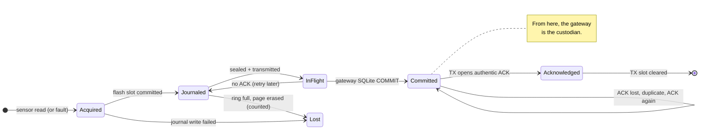
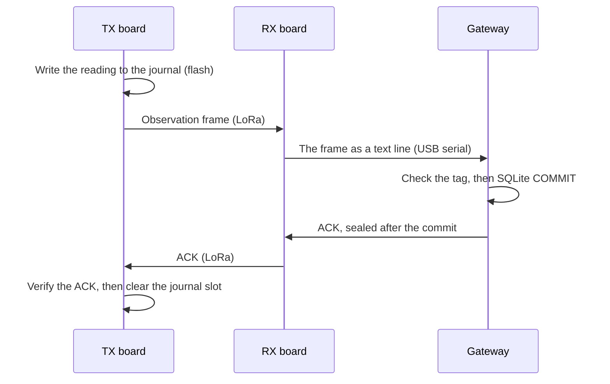
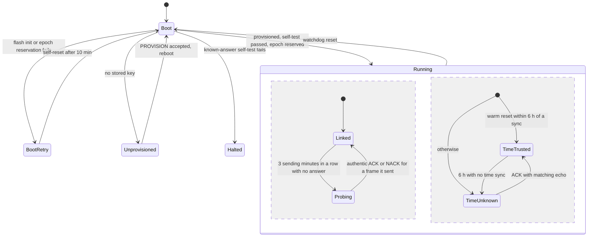
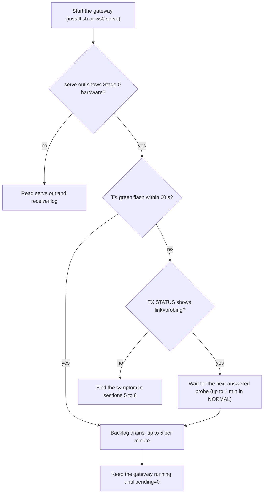
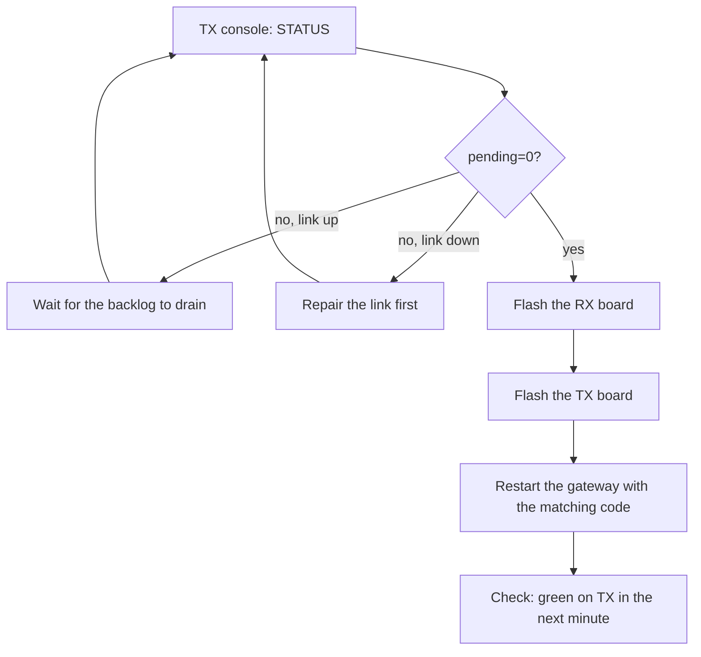
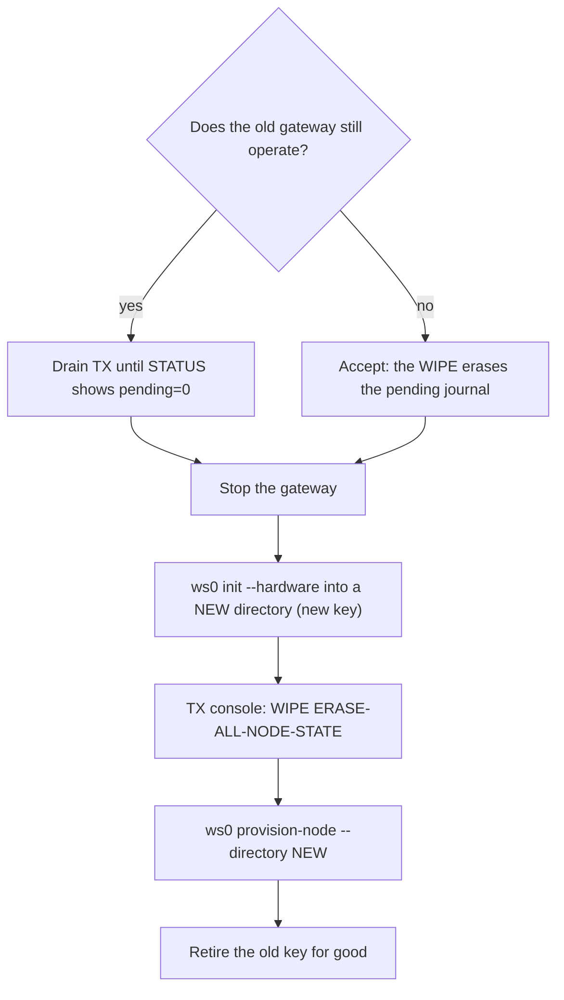

# Bench data path: failure modes, recovery, and loss budget

> **Document type:** Failure modes and effects analysis (FMEA) and recovery runbook.
>
> **Applies to:** the bench data path: transmitter board (TX) → LoRa radio → receiver board (RX) → USB → gateway (`ws0`) → SQLite. Protocol version 6 (the power telemetry design, 2026-10-29), with the TX board's phase A power measurement (§1, §6.1).
>
> **Status:** Most behaviors exist in code. The **Verified** column tells you what has evidence. Section 10 lists the open issues. **The 24-hour delivery test (H01) is NOT RUN.**
>
> **Related:** [`protocol-stack.md`](protocol-stack.md) (how each layer operates) · [`protocol.md`](protocol.md) (byte formats) · [`H01-checklist.md`](H01-checklist.md) · [`radio-energy-policy.md`](radio-energy-policy.md) (energy states, the pack, decision D1) · the [power design](superpowers/specs/2026-10-29-power-telemetry-design.md) ("the power design": phases, fill table, and risks R1–R12 and R14–R16. Commit `e2a56da` removed R13).

---

## 1. Purpose and scope

The project is the breadboarded development version (build steps 1 and 1b). The later stages came out of the repository on 2026-11-02. Git history still has them.

- **Stage 0** is the data path on the bench: two development boards on USB power, the bench sensor modules, and the gateway. The TX reads its sensors as WSMP local modules ([`module-protocol.md`](module-protocol.md)). The gate for Stage 0 is H01, the 24-hour delivery test.
- **Power.** The battery pack, the charger and solar power sit beside the data path on the breadboard. The power design names two hardware phases:
  - **A** (now) has these parts:
    - the 1S3P Li-ion pack: three 2,200 mAh cells in parallel, 6,600 mAh, 3.0–4.2 V, about 24.4 Wh,
    - the Adafruit bq24074 charger (#4755) with one input: one 6 V solar panel, or USB-C for bench work and backup charging, never both,
    - one INA228 at 0x40, with its shunt in the battery path and its VBUS on the charger OUT,
    - the MAX17048 gauge at 0x36 on the cell.
  - **B** (step 1b, on the breadboard) adds a load, a solar and a USB-C INA228.
- **Stage 0 already runs phase A on the bench.** The node measures the battery, the charger and its own supply, and sends them (protocol version 6). The bench builds (power profiles 1 and 2) keep the energy state at NORMAL. The TX stack build (profile 3) sets it from the battery each minute, with the thresholds of decision D1 (settled 2026-11-22, [`radio-energy-policy.md`](radio-energy-policy.md) section 3, and §1.2).

This document defines the behavior of the Stage-0 communication system when a part of it does not operate correctly. For each failure, it gives:

- how the system detects the failure,
- what the system does immediately,
- how the system recovers (automatically, by an operator, or not at all),
- what data the failure can delay or lose,
- the effect on H01,
- the evidence that the behavior is correct.

**In scope:** the TX board, the RX board, the radio link, the USB link, the gateway process, its SQLite files and the host computer. Since 2026-10-29 it also covers the phase A power measurement and its telemetry (§6.1). A power-part failure costs power values, never a reading.
**Out of scope:** the energy-state transitions of the TX stack build (they are in [`radio-energy-policy.md`](radio-energy-policy.md) sections 3 and 5), field installation and later items (RS-485 modules, heaters), and MQTT/Home Assistant availability. MQTT and Home Assistant are downstream of storage, so their failures cannot cause data loss.

"The PRD" below is the v0.2 product and technical requirements document (`weather-station-v0.2-prd-trd.html`).

### 1.1 Operating context: the bench is not the use case

The protocol exists for one job. **An unattended station on battery and solar power sends periodic readings over a long radio path to an indoor receiver.** Stage 0 runs on a desk with USB power. Many failures cost nothing on the bench but cost energy, airtime, or data in the field. This document classifies each failure for the **deployment**. It gives the bench evidence where it exists.

| Property | Stage-0 bench (now) | Deployment (design target) |
|---|---|---|
| TX power | USB, unlimited. The phase A power hardware (pack, charger, monitors) is on the bench and measured | 1S3P Li-ion pack, 6,600 mAh, about 24.4 Wh (Clint, 2026-10-29), charged from one 6 V solar panel in phase A (USB-C only for backup charging, never together with solar). **Average budget ≤ 0.25 W for the complete station** (PRD §4). The PRD reserve (≥ 50.4 Wh) is about twice the pack: open decision D1 ([`radio-energy-policy.md`](radio-energy-policy.md) section 3) |
| TX attendance | On the desk | Outdoors, unattended. A site visit is expensive |
| Distance | ~30 cm | Roof or yard to an indoor receiver through walls. H01 measures it. No range claim. |
| Radio settings | Spreading factor (SF) 7, 0 dBm, received signal strength (RSSI) ≈ −23 dBm | SF and power from the measured link budget: SF9–SF12, up to +22 dBm (FCC §15.247 allows +30 dBm) |
| Airtime, widest observation frame (93 bytes, version 6 node field set; a node build never exceeds 96 bytes) | 41 ms | 128 ms (SF9) to 821 ms (SF12) |
| Airtime, health report (80 bytes, every 15 min) | 36 ms | 113 ms (SF9) to 739 ms (SF12) |
| Packet loss | Rare | **Routine.** Weather, snow on the antenna, interference, temperature |
| Gateway host | Mac desktop, kept on 24/7 | Always-on Linux computer or single-board computer on mains (PRD §1). It must not sleep. |
| Typical outage | Developer stops the gateway | **House power outage or storm.** The station keeps measuring on solar. The gateway is down. Store-and-forward exists for this case. |

**Design principle.** The node is the energy-limited and unattended side. The gateway is mains-powered and attended. So:

1. The node must **fail cheaply.** A failure must not make it spend much more energy than normal operation.
2. Put decisions and extra work on the **gateway side** where possible (for example: NACKs, time checks, monitoring).
3. Never trade data safety for energy. Never trade energy for convenience.

### 1.2 Energy cost of a failed exchange

Each frame costs transmit energy plus the energy of the ACK receive window. The window closes early when the ACK arrives. It stays open for the full **2,000 ms** when no ACK arrives.

| SF (500 kHz) | Airtime, 93-byte observation | TX charge at ~100 mA (+20 dBm class) | RX charge, full 2 s window at ~5 mA |
|---|---:|---:|---:|
| SF7 | 41 ms | 4.1 mC | 10 mC |
| SF10 | 236 ms | 24 mC | 10 mC |
| SF12 | 821 ms | 82 mC | 10 mC |

The 93-byte frame is the widest record of the version 6 node field set (`OBS_FRAME_MAX`, `App/tx_exchange.h:13`). It holds 77 bytes of plaintext (`App/node_fields.h:29`). No node build exceeds a 96-byte frame (the per-build ceiling, power design sections 5.4 and 7). A record carries only the fields of the modules present, so many frames are shorter. The 80-byte health report takes 36 / 216 / 739 ms at SF7 / SF10 / SF12. The airtimes come from `ws_lora_airtime_ms()` (`firmware/common/ws_policy.c:43-56`).

The outage arithmetic below uses the 56-byte frames of protocol version 4: 27 / 164 / 576 ms and 2.7 / 16 / 58 mC. The current widest frame is longer, so the real TX cost is about 40–50 % higher ([`radio-energy-policy.md`](radio-energy-policy.md) section 3 gives the version 6 figures).

*The current values are datasheet-class assumptions for the STM32WL. The pack energy accounting test (H02) would measure them.*

The node has four energy states: SURPLUS, NORMAL, CONSERVE and CRITICAL ([`radio-energy-policy.md`](radio-energy-policy.md) §4 and `firmware/common/ws_policy.c`). The bench now has battery data from power phase A: cell voltage, battery current and counters, SOC and charger status. The bench builds (power profiles 1 and 2) always run in NORMAL. The TX stack build (profile 3) picks the state once a minute (`energy_state()` and `policy_energy_minute()` in `App/tx_policy.c`, `ws_energy_next()` in `firmware/common/ws_policy.c`). Decision D1 set the thresholds on 2026-11-22 with a 25 mW planning load, until H02 measures the real one: CONSERVE at 30 / 35 % SOC and 3.60 / 3.70 V, CRITICAL at 8 / 13 % and 3.45 / 3.55 V (enter / leave). SURPLUS holds while SOC stays at or above 90 % with power good and no charger fault. On entering CRITICAL the node sends a beacon at once, and an unanswered beacon goes once more the next minute.

- In a **normal minute**, the node sends 1 frame. The ACK closes the window early.
- In a **failed minute**, the firmware sends **1 frame** and waits the **full 2 s**. The backlog drain stops at the first missed ACK.
- Exception: when backlog is pending, the node sends one more frame after the miss. The strike rule needs that frame to tell a refused record from a lost frame (`protocol-stack.md` 9.5).
- After *K* = 3 silent minutes, the node enters the PROBING link state. In PROBING the node sends only the live reading (a probe) and no backlog.
- In SURPLUS and NORMAL, the probe goes every minute. In CONSERVE, the node waits 2, 4, 8, then 15 min between probes. CONSERVE's 5-minute send interval also applies, so the probes really go at about 5, 5, 8, then every 15 min. The minutes between probes have no radio activity (`radio-energy-policy.md` §6).

Here's why PROBING exists. Say a rule sends 3 frames per failed minute (live + 2 backlog), each with the full 2 s window. At SF12 and +20 dBm, that rule costs about 3 × (58 + 10) ≈ 200 mC per minute. A normal minute costs about 60 mC. Over a one-day gateway outage, the rule costs about 290 C ≈ 80 mAh, or roughly **0.27 Wh/day** at 3.3 V.

That's about **4–5 % of the 6 Wh/day core budget**. It's also about 1.1 % of the 24.4 Wh 1S3P pack a day, all spent on a link you already know is down. PROBING with the CONSERVE back-off cuts this to about 100 probes, about 0.006 Wh/day (about 0.008 Wh/day with the 93-byte version 6 frame). A timed ACK window would shorten each failed window further (§10, *Blind 2 s ACK window*).

---

## 2. Definitions

### 2.1 Recovery classes

| Class | Meaning |
|---|---|
| **AUTO** | The system recovers with no human action. No data is lost. Data can be late. |
| **AUTO-BOUNDED** | The system recovers with no human action. It can lose a defined, counted, small quantity of data. |
| **OPERATOR** | A person must do a procedure from section 9. Data is safe if the person acts before a stated deadline. |
| **UNRECOVERABLE** | Some data is lost permanently, or the system never acquired it. The system must make the loss visible. |

### 2.2 Data custody states

One observation goes through these states. At each state, **one** component is responsible for it.

| State | Custodian | Durable? | What destroys it |
|---|---|---|---|
| Acquired | TX RAM | No | A power cut or a TX reset before the journal write. The TX board usually journals the reading within the same minute (milliseconds, or about 22 ms when it must erase a new journal page). A reading made while the previous exchange still runs stays in RAM until the radio goes idle: seconds, at most the exchange bound of about 116 s. A power cut or a non-watchdog reset in that time loses it. The stuck-exchange watchdog path journals it first. A third held reading pushes out the oldest, which the board counts in `held_lost` |
| Journaled / InFlight | TX flash | Yes | Journal overflow (counted), TX flash failure, `WIPE` |
| Committed | Gateway SQLite **and** TX flash | Yes (two copies) | Nothing, until the ACK arrives |
| Acknowledged | Gateway SQLite only | Yes (full flush on. See §6, *Host power cut during a SQLite commit*) | Loss or corruption of the gateway database |

**Key property:** an observation always has at least one durable custodian from the journal write to the end of its life. The TX board marks its copy acknowledged only after it verifies an authentic reply. An ACK is one such reply, and the gateway seals it only after its SQLite commit. A NACK is the other, and the gateway seals it only after it stores the rejected frame in its `rejections` table. This sequence shows one exchange with an ACK:

The RX board has no key. It forwards bytes in both directions and cannot make an ACK.

---

## 3. Guarantees and loss budget

### 3.1 Invariants (must hold in every failure)

| Invariant | Mechanism | Verified |
|---|---|---|
| The gateway never sends an ACK for an observation that it did not commit. | `Gateway.receive`: commit, then seal ACK | Simulation `storage-failure`. Unit `test_commit_failure_no_ack` |
| The TX board never deletes an observation without an authentic ACK for that identity. | `ws_open_reply` (`App/tx_exchange.c`) + `store_journal_find` | Unit `test_ack_tamper_keeps_pending` (simulator). Bench (firmware) |
| No (key, nonce) pair is used two times. | Durable counter blocks. The kind byte splits the two directions | Bench: reboot skips the block (8 → 257). Reset during flash writes: the counter never went back over 71 boots (`evidence/g7-reset-during-write-2026-10-13/`). True power removal not tested (§10, *Power-removal test not done*). Key reuse after a WIPE: see §8.2. |
| No two different observations have the same identity. | Durable epoch before the first sample | Bench: epochs 1 → 2 → 3 over reboots (`hardware/nucleo-wl55jc-bringup.md`, "Reboot behaviour"). Epochs always increased over 71 boots of the reset test. After `WIPE` + `provision-node`, the epoch floor keeps identities unique (§8.2, *WIPE then re-provision under the same station name*). |
| The database stores each identity once. The gateway rejects a changed payload with an old identity. | Primary key + payload comparison | Simulation `identity-collision`, `ack-loss` |
| The gateway never shows an invalid or stale reading as current. | Validity flag, impossible filler values, freshness by energy state (the live interval + 120 s: 180 s in SURPLUS and NORMAL, 420 s in CONSERVE, 3,720 s in CRITICAL), 5 s future quarantine | Unit + simulation `sensor-fault`, `clock-errors` |
| A replayed ACK cannot change the TX clock. | Counter echo in the ACK | Design + unit vectors. No adversarial bench test |

### 3.2 Loss budget

This is the data loss that the design accepts. **Items marked ⚠ need Clint's approval. They define how H01 and the 30-day storage test (H11) read a failure.**

| Category | Accepted loss | Rationale |
|---|---|---|
| **Never acceptable** | Loss of a committed observation. A duplicate row. Nonce reuse. An invalid or stale value shown as current | PRD §9 and §11 (the PRD isn't in this repository, so you can't check those sections here). H01: `H01-checklist.md` restates part of it (no nonce repeat, no duplicate rows). H11, the 30-day storage test (its text isn't in the repository either) |
| TX power cut during a journal write | **≤ 1 observation per power cut** (the slot in progress) | Flash cannot commit atomically faster than a power loss |
| TX unpowered (battery depleted, brown-out), or TX sensor absent | **All intervals while the TX board is down.** These readings never exist, so they are not "lost". They show as a time gap between two epochs. | No energy, no measurement. In deployment, the power system must prevent this (PRD requirement R03: 168 h without solar). The 1S3P pack holds about 98 h at the 0.25 W budget: decision D1 ([`radio-energy-policy.md`](radio-energy-policy.md) section 3). |
| RX, gateway, or link down | **0 lost** if the outage is ≤ **9.5 h** (journal capacity: 29 usable pages × 21 slots = 609 one-minute records, about 10.1 h, version 6 node field set; flash layout v3 shrank the ring from 70 to 30 pages until the journal moves to SPI flash. `App/node_store.c` refuses to compile a build whose widest record keeps less than 9.5 h). Data is late. | Store-and-forward. A winter storm outage at the house can exceed 10 h. Clint accepted losing the oldest readings past about 10 h for the PoC (2026-11-23). The 30-day target is H11 (external flash). |
| Outage > about 10.1 h (the 30-page ring of flash layout v3: 609 records) | **Oldest pending observations, 21 at a time** (one flash page of 96-byte slots). The TX board counts them as `lost`. | **Approved by Clint 2026-10-12:** drop oldest first (newest data is more valuable). |
| Time unknown after a TX boot | Warm reset: the board keeps time trust across the reset (backup registers). Power loss: after the first time sync, the gateway reconstructs the time of every reading in the epoch from the uptime field. Residual: an epoch that ends before its first sync stays `unknown`. | Approved by Clint 2026-10-12. Evidence: bench warm reset `#time restored`. Cold start reconstructed ±2 s. Simulation `reboot-during-outage`: 32/32 reconstructed. |
| Health-report values during an outage | **The slow values of every health report sent while the link is down:** gauge SOC and rate, charger status, power-monitor die temperature, MCU supply, the charger-reported values. Health reports are not journaled. The counters (boots, crashes, TX timeouts, I2C recoveries) recover with the next report; every fast power value is in the journaled observation | Power design section 6.4 and risk R1 (accepted in the design). ⚠ Clint's approval (§12, rule 4) |
| Backlog drain | The backlog clears at up to **5 observations per minute** in NORMAL (`backlog_limit` in `firmware/common/ws_policy.c`), in addition to live data. After the first missed ACK the drain sends at most one more frame. An outage of *D* minutes takes about *D*/5 minutes to clear. | Live data has priority. ⚠ H11 must accept or raise this rate. |

### 3.3 H01 budget

H01 needs **≥ 1,426 of 1,440** one-minute intervals committed within 120 s of acquisition. So the run can miss **at most 14 intervals in 24 h**.

| Event during H01 | Intervals it costs |
|---|---|
| One lost frame or one lost ACK | **0.** The next minute resends the reading as the oldest backlog item. It commits at about t + 61 s, so it is still within 120 s. |
| Two lost exchanges in a row for one reading | 1 (it commits at about t + 121 s or later) |
| Outage of *N* minutes (any cause) | About *N* − 1 (live reading every minute in NORMAL. In CONSERVE up to 14 more, see below) |
| TX reboot (any cause) | Outage time only. Warm reset: no time loss. Power loss: the gateway reconstructs the first reading's time. |
| RX reboot | 0 to 1 |
| Gateway restart (a few seconds) | 0 |

**Probe back-off and H01 (Clint's decision, 2026-10-13).** In SURPLUS and NORMAL, the node sends the live reading every minute while it probes (`ws_link_may_send()`, `firmware/stage0.c`). Only CONSERVE backs off (2, 4, 8, then 15 min, held to CONSERVE's 5-minute send interval, so about 5, 5, 8, then 15). In CONSERVE, one outage of 3 minutes or more can make up to 14 more readings late. That is the whole H01 budget. Stage 0 and H01 run in NORMAL.

---

## 4. Component behavior models

### 4.1 TX board

At boot the TX board checks its flash storage, its key and its self-test before it samples. In operation it tracks two independent states: the link state and the time trust.

The boot checks run in this order (`boot_ready()` in `App/app_tx.c`): flash init, key, self-test, epoch reservation. The board does the 10-minute self-reset only when the self-test passed. A board that fails the self-test stays halted.

| State | LED | Samples? | Transmits? | Exit |
|---|---|---|---|---|
| LINKED | Blue blip every 2 s. Blue then green each minute | Yes | Yes | — |
| LINKED, minute with a missed ACK (silent minutes 1–2) | Blue then **red** | Yes, journaled | After the first miss the drain sends one more frame, to tell a refused record from a lost one. It stops at a second miss in a row, so at most 2 frames go out: the live reading plus one backlog frame | Next authentic ACK |
| PROBING (`link=probing`) | Blue then **red** at each probe. In CONSERVE, **no radio flash** in the minutes between probes | Yes, journaled | Live reading only. Every minute in SURPLUS and NORMAL. In CONSERVE the back-off is 2, 4, 8, then 15 min after the unanswered exchange. CONSERVE's 5-minute send interval also applies, so the probes actually go at about 5, 5, 8, then every 15 min | Any answered probe |
| Time unknown | As LINKED or PROBING | Yes, UTC = 0 | Yes | Next ACK with matching echo |
| Journal overflow (not a separate firmware state) | As PROBING | Yes. Erases the oldest page and counts `lost` | Probes only | Link returns. Backlog drains |
| Unprovisioned | **Red solid** | No | No | `ws0 provision-node` |
| Boot retry (`#error store-init` or `#error epoch-reserve`) | **Red solid** | No | No | Self-reset after 10 min |
| Halted (`#error self-test failed`) | **Red solid** | No | No | Operator (section 9) |

### 4.2 RX board

The RX board has one operating state: **continuous receive**. It leaves this state only to send one ACK, then it returns. It has no key and no stored data. So a reset loses only a frame or ACK that's in progress.

### 4.3 Gateway

| State | Detection | Behavior |
|---|---|---|
| Serving | `serve.out` "Stage 0 hardware; API …" | Normal |
| Rejecting | `receiver.log`: `rejected …` | No ACK. TX journals and retries |
| **Exited** | Process gone. No new lines in `receiver.log` | No ACKs. TX journals. launchd (`KeepAlive`) or systemd restarts the gateway. |

---

## 5. Failure catalogue — peer unavailable

*N* is the outage length in minutes.

| Scenario | Detection | Immediate behavior | Recovery | Data impact | H01 | Verified |
|---|---|---|---|---|---|---|
| **Gateway process stopped** (crash, Ctrl-C, update). launchd or systemd restarts it. | No `#ack` on TX. Red LED each minute. API down | RX prints frames. Nobody answers. TX journals. | AUTO after restart (§9.1). Backlog up to 5/min. | None if restarted within 9.5 h | *N* − 1 | **Bench, 2026-10-12:** during a protocol version change the still-running old gateway rejected TX's first new-version frame. The frame stayed in the journal and arrived the next minute, after the gateway restart. (This is the rejecting case, not a stopped gateway.) launchd restart after SIGKILL: discovery and `online` republished within 1 s (`evidence/mqtt-local-broker-2026-10-13/`) |
| **Host asleep** (Mac lid closed, sleep) | As *gateway process stopped*. The process is suspended | As *gateway process stopped*. The host loses the RX board's USB serial data while it sleeps. | AUTO on wake. | None if < 9.5 h | *N* − 1 | No. **Bench only.** The deployment host is always on (PRD §1). Disable sleep for H01. |
| **House power outage** (deployment) | Gateway, RX, and network down. The station runs on solar | TX journals every minute and retries (energy cost, §1.2) | AUTO when power returns | None if < 9.5 h. Oldest data lost beyond (§8.3, *TX journal full*) | *N* − 1 | No. This is the main store-and-forward case. |
| **RX USB disconnected** while the gateway runs (an error on the port; for a port that stays open but silent, see the next row) | `receiver.log`: `#gateway serial-lost`, then `serial-open`. The dashboard draws a "serial lost" marker. It stores `serial-open` as a calm info event and doesn't draw it | The gateway keeps serving its API. It looks for the RX board by **ST-LINK serial number** with back-off (1–15 s). It reopens the board under any port name. | AUTO | None (TX journals) | *N* − 1 | Unit tests (`tests/test_link.py`: unplug, replug under a new name, missing board, write failure). **Physical replug: pending.** |
| **RX port open but silent** after a USB replug of another board on a shared hub (build-progression record F6; 7.1 Q5: both NUCLEOs were on one hub when the RX stalled) | No error and no `serial-lost`: the port stays open and no line arrives. After 90 s with no byte, `ws0/link.py` logs `#gateway serial-reopen path=… silent_s=…` and a `gateway_events` row of kind `serial-reopen` at level warn; the dashboard draws a "serial reopen" marker. `#gateway receiver-silent` after 180 s with no RX report stays the outer alarm. `tools/h01_report.py` lists each reopen and silence as a serial-link gap | The gateway reopens the port in place (no connect back-off; a reopen is not a failure). The wait doubles after each reopen that brings nothing back, up to 400 s, and returns to 90 s on any received line. TX gets no ACKs and journals | AUTO: a fresh open recovered the port on 2026-10-28/29. Prevention (record H8): the RX alone on a direct Mac port, never replugged during a run; TX replugs only on the TX's own port or hub; cables labelled by ST-LINK serial; acceptance H8(d) (5 TX replugs, no RX gap); a powered hub only if H8(d) fails | None (TX journals) | *N* − 1 | Unit tests (`tests/test_link.py`). Bench: the stall seen on 2026-10-28/29 (benchlink `rx_port_reopen` recovered it); the ws0 reopen on hardware and H8(d): pending |
| **RX board down** (unpowered, hung, wrong firmware) | Red each minute on TX. No `#rx` lines. No RX blue heartbeat. `#gateway receiver-silent` in `receiver.log` after 180 s without an RX `#alive` report (`receiver` in `/v1/status`) | TX journals | AUTO if power returns. OPERATOR if hung (§9.2) | None if < 9.5 h | *N* − 1 | Bench: RX reflashes (seconds). `receiver-silent` logged after an unplug (`evidence/soak-a07f498-2026-10-13/`) |
| **TX board down** | No new frames. API `available=false` after the live interval + 120 s (180 s in SURPLUS and NORMAL, 420 s in CONSERVE, 3,720 s in CRITICAL, `current_max_age` in `gateway.py`) | Nothing is acquired | AUTO on power return. The node reserves a new epoch, and each minute sends the live reading first, then the backlog oldest first | **The node never acquires readings during the outage** | *N* | Bench: TX reboots, epochs 1→8. Cold start reconstructed |
| **All down** (building power, or the Mac's own USB power; not a hub: under build-progression record H8(a)-(b) and 7.1 Q5 the RX sits alone on a direct Mac port, so a hub failure takes down only the TX and the other bench boards on it, the *TX board down* row) | Everything dark | Nothing acquired | AUTO on power return | As *TX board down* | As *TX board down* | No |

---

## 6. Failure catalogue — power events

"Reset test" below means `tools/power_cut_test.py --method reset`: 70 cycles, 71 boots, `evidence/g7-reset-during-write-2026-10-13/` (§10, *Power-removal test not done*). True power removal is not tested.

| Scenario | Immediate behavior | Recovery | Data impact | Verified |
|---|---|---|---|---|
| TX power cut **between** flash writes | RAM lost. Journal intact | AUTO: new epoch, counters skip to the next block. Each minute sends the live reading first, then the journaled backlog oldest first | Reading in RAM not yet journaled: ≤ 1 | Bench: resets (not cuts) |
| TX power cut **during** a journal slot write | Slot torn | AUTO: the boot scan counts the slot as `burned` | **≤ 1 observation** | Reset test: 21 boots found and handled torn double-words. True power cut not tested |
| TX power cut during an **ACK-word** write | ACK word torn | AUTO: the firmware treats an error-correction (ECC) fault as acknowledged (the gateway committed it first) | None | Reset test. True power cut not tested |
| TX power cut during a **counter or epoch** reservation | Entry torn | AUTO: the firmware ignores the torn entry and uses the maximum of the valid entries. Numbers can skip but cannot repeat. | None | Reset test: epochs always increased, counter never went back. True power cut not tested |
| TX power cut during **meta-page compaction** | New page has no header | AUTO: the old page stays authoritative | None | The reset-test workload includes compactions. No record shows a reset inside one. True power cut not tested |
| TX power cut during a **flash page erase** (ring advance) | Page partly erased | AUTO: the page may keep its old header or have none. With no header the firmware skips it. With the old header, boot finds the head page full and finishes the recycle (it erases the page again) before sampling. The firmware already counted its pending entries `lost`. A cut can over-count them but never under-count | Already counted | The reset-test workload includes ring-advance erases. No record shows a reset inside one. True power cut not tested |
| RX power cut | Frame or ACK in progress lost | AUTO: TX retries next minute | None | Bench (reflash resets) |
| Host power cut **during** a SQLite commit | The transaction rolls back or completes | AUTO: if it rolled back, the gateway sent no ACK and TX retries. If it completed, the ACK may be missing and TX resends a duplicate. | None (full flush on: `fullfsync` and `checkpoint_fullfsync` for the observation and nonce databases. 5.3 ms median / 16 ms max per commit, recorded in the `full_flush()` docstring in `gateway.py`. Simulations opt out with `WS0_UNSAFE_FAST_FSYNC=1`) | Simulation. Pragma unit test |
| Host power cut **after** commit, before ACK | Row committed. ACK not sent | AUTO: duplicate next minute, ACK again | None | Simulation `ack-loss` |
| USB brown-out / hub reset | Boards reset (as *TX power cut between flash writes* and *RX power cut*). The USB device may get a **new port name.** | AUTO for boards and gateway: with `--serial-number` the gateway finds the RX board under its new name. OPERATOR only when the gateway runs with `--serial <path>` (§9.8) | As *TX power cut between flash writes* | Bench: board A dropped off USB once |
| **TX battery near empty: brown-out cycling** (deployment. Example: at dawn, weak solar starts the board and a radio burst stops it again) | Each boot reserves a new epoch and skips the rest of a 256-counter block. After a power loss, the first readings have no time until a sync (the gateway reconstructs it later). A flash write can occur at marginal voltage | AUTO when energy recovers. With BOR level 4 set (`make bor` in `firmware/stage0-node`, once per board) the MCU is held in reset while VDD is below about 2.8 V, so a sagging rail stops it before a journal write or a bus transfer out of spec. In the TX stack build (profile 3), CRITICAL (below 8 % SOC or 3.45 V) stops the radio but for one beacon an hour | Each cycle: ≤ 1 torn slot, ≥ 1 time-unknown reading. A fast cycle can repeat many times. The reset cause reads `power`, not `brownout`, and the boot count since power-up restarts at 1 (§6.1, *Brown-out read as a power-on*). The cell voltage (field 11) and the MCU supply (`mcu_supply_mv`) show the sag before it, if a report gets out | **Not tested.** BOR level 4 exists (`make bor`, 2026-11-22); journal writes still have no voltage gate (§10, *No low-voltage inhibit*). |
| **USB dropout of about 1 s on a bench board** (cable moved or touched. Also an OpenOCD/debugger session) | The ST-LINK pulses the MCU reset pin when it re-enumerates. The board restarts with `reset=pin` (not `power`). TX: new epoch, counter block skipped, time trust restored. The gateway sees `serial-lost` / `serial-open` for RX | AUTO | ≤ 1 reading in RAM. The outage time counts against H01 | **Bench 2026-10-13:** TX 4 times, RX twice. `RCC_CSR` showed `PINRSTF` only. Two TX resets came from debugger sessions (`docs/hardware/nucleo-wl55jc-bringup.md`, "Office session"). Bench only (the field node has no ST-LINK). For H01: secure the cables, no debugger sessions |

### 6.1 Power measurement and charger (power phase A on)

These rows cover the phase A power hardware and its telemetry (the [power design](superpowers/specs/2026-10-29-power-telemetry-design.md), sections 2, 3 and 11). The first rule: **a power fault never costs a reading.** The battery module (type 8) and the rails module (type 9) are base-board modules, always in the layout (`App/mod_power.h`). A failed power part makes its fields INVALID, and the reading still goes. A field is absent only when the build has no source for it (`WS_POWER_PROFILE`), never because a part failed (power design section 5.3). The firmware does not check the wiring for plausibility (power design risk R8): the build-sheet power checks ([`build-sheet.md`](../hardware/bench-breadboard-r0/build-sheet.md) "Power checks") and the acceptance drill (power design section 12.2) cover it.

| Scenario | Detection | Behavior | Recovery | Data impact | Verified |
|---|---|---|---|---|---|
| **A power part absent or NACKing** (the battery INA228 or the MAX17048: a STEMMA QT lead out, a dead board, a wrong chip ID) | The record's power fields are INVALID and its quality is `partial`; the dashboard shows "sensor fault", not "not measured". The health report's SOC and rate (gauge) or die temperature (INA228) are `null` and listed in `power_sensor_faults` (the fitted byte, power design section 6.1), so the dashboard says "sensor fault" there too | A NACK or a wrong chip ID makes the part absent and its slots missing; another bus error is a fault (`App/power_acq.c:116-126` `rail_failed`, `:247-254` `gauge_failed`). The map sends fields 11–16 and 26 as INVALID, never absent (`App/wsmp_catalog_map.c:10-16`). The INA228 loses its CHARGE base and is identified and calibrated again; the gauge is retried every 15 s. The T/RH and the other fields are not affected | AUTO when the part answers again. OPERATOR reseats the lead or replaces the board | The power values of those minutes are INVALID. The charge counters (15, 16) miss the charge between the failure and the next base; the energy counters (13, 14) are INVALID in any minute with a step but no fresh cell voltage (power design section 9.4). **No reading is lost** | Host tests only: `tests/test_modules.py` (`test_present_with_every_part_absent`), `tests/test_power_acq.py` (`test_a_bus_fault_is_fault_and_an_absent_part_missing`). Bench: No |
| **Sense lead on the wrong node** (build-progression record F2, F3: on 2026-10-28/29 the gauge was wired to OUT, and the INA228 VBUS jumper read the wrong net) | Not by the firmware (R8). By position, before power: the gauge's red lead (L_GAUGE_POS) sits alone in CELL+ position 3, the cell side of the shunt; its black lead (L_GAUGE_NEG) is insulated and folded back, and the gauge takes its ground over STEMMA QT (record P4, P5, M4); the INA228 VBUS lead (L_VBUS) sits alone in OUT position 3 (build sheet "Joints"). Build-sheet check 8, per step 1 exit 5 (record R-2): at rest or at the 38 mA load the gauge VCELL within 10 mV of the meter at the pack plug; at a 1 A charge within 10 mV of the meter at the gauge's own sense points (the CELL+ clamp to the STAR clamp), and the pack-plug difference recorded at or below I × R_pack + 10 mV. Check 9 and the drill: during a charge with the cell below 4.1 V, `load_mv` (OUT, the INA228 VBUS) reads 4.3–4.5 V and at least 100 mV above `batt_mv` (the gauge VCELL). A gauge on OUT gives `batt_mv` ≈ `load_mv`, about 4.4 V while the input is present (SLUS810 VO(REG) 4.3–4.5 V), and a SOC that jumps when the input goes | The node sends what it measures, with quality `valid`. The gauge reads the CELL+ node, not the pack terminal: during a 1 A charge it sits I × R_pack (about 25–35 mV) above the cell, by design (record M4) | OPERATOR moves the lead to its position (gauge red to CELL+ position 3, VBUS to OUT position 3), keeps the gauge's black lead insulated (a gauge minus to STAR would be a second ground tie, below) and repeats checks 8 and 9 | `load_mv` or `batt_mv` is wrong for the whole period; so are the SOC and the energy counters (ΔQ × VCELL). Not repairable afterwards | No. Origin: bench 2026-10-28/29 (F2, F3) |
| **INA228 back VBUS-to-VIN+ jumper left closed** | Build-sheet check 1 (VBUS to VIN+ reads open before power) and check 9 and the drill: OUT ≥ VCELL + 100 mV during a charge below 4.1 V **fails** (they read nearly equal). Not by the firmware (R8) | The jumper ties the cell to OUT. The charger regulates OUT (4.3–4.5 V), so the cell is charged towards 4.4 V, bypassing the charger's 4.2 V battery regulation. **A safety hazard**, not only a data error | OPERATOR removes the input power at once, cuts the jumper, measures the cell voltage, and does not charge again before the cells are checked against their datasheet. Repeat checks 1 and 9 | `batt_mv` ≈ `load_mv`; the battery current and SOC do not describe a normal charge | No |
| **High-resistance battery loop ends charging early** (breadboard strips, long or thin leads, a poor JST PH mating) | Not by the firmware (R8). Build-sheet check 7 and preflight rows C12–C14 (build-progression record P8, which replaces power design section 11.2's "at most 50 mΩ, + side"): in the first 10 minutes of a CC charge, with the INA228 current I between 0.8 and 1.0 A, each span's meter mV over I: the + span (pack plug +, back-probed, to header LIPO, including the 15 mΩ shunt) ≤ 75 mΩ; the − span (header GND to pack plug −, back-probed) ≤ 40 mΩ; each pack-side span (pack plug + to the CELL+ clamp; the STAR clamp to pack plug −) ≤ 28 mΩ, their sum recorded as R_pack; each JST PH mating ≤ 20 mΩ; each lever clamp and each screw ≤ 5 mΩ. Then check 10. In the data: CHG goes off and steady (termination) while the battery current is still above 0.40 A, or the cell (`batt_mv` − I × R_pack) is still below 4.12 V | The charger senses its LIPO pin, which sits I × R above the cell. Constant voltage starts early and the current falls to the termination threshold before the cell is full | OPERATOR measures joint by joint (C14) to find the bad one, shortens or thickens the battery leads (off the breadboard, record P1, P3) and repeats checks 7 and 10 | No data impact: the counters measure what goes in. Each charge ends short of full, so the autonomy is less | No. Origin: a 0.2 Ω breadboard path ended 1 A charges early on 2026-10-28. With TMR at GND (timers disabled, next row) the path is the cause (build-progression record P9) |
| **`charger_fault` in phase A** (CHG flashing; power design section 6.3, risk R11 closed) | Health report: `charger_fault` true. CHG flashing at about 2 Hz is 3 or more CHG edges within 2 s; it clears after 4 s without an edge (`App/power_acq.c:22-24` constants, `:304-316` `pins_poll`). `charger_charging` is false while the fault shows | **TMR is tied to GND on the #4755 per its schematic, so all safety timers are disabled** (SLUS810 pin table; `wiring.toml` CHGR note). A flashing CHG is the bq24074's only fault signal and means expired safety timers (SLUS810 table 9-2), so with TMR at GND it is not the end of a long charge. A fault then means something else: the board in hand is strapped differently (TMR not at GND: then a 4–6 h timer, shorter than a 1 A charge of 6.6 Ah from empty), or the CHG line toggles at about 2 Hz for another reason (an intermittent CHG contact) | OPERATOR checks TMR to GND on the board (charger unpowered, build-sheet check 10) and the CHG lead. A real timer fault clears when CE or the input is toggled (unplug and replug the source) | No data impact. With a real timer fault the pack stays partly charged until it clears | Host test: `tests/test_power_acq.py` (`test_chg_flashing_is_a_fault_that_clears_after_4_s`). Bench: No |
| **NTC fitted with the breakout's fixed TS resistor in parallel** | Build-sheet check 5: TS reads about 0.375 V at 25 °C instead of about 0.75 V. Not by the firmware: TS is not measured in phases A and B (`pack_temp_c` is `null`) | In parallel, TS never exceeds 10 kΩ (0.75 V at 75 µA), so the cold trip (2.1 V) never fires: **the charger charges a frozen pack** (no cold inhibit). The hot trip moves to about 35 °C, so warm days suspend the charge. During a TS suspend CHG stays on (SLUS810 section 9.3.6): `charger_charging` true with a battery current near minus the load | OPERATOR removes or cuts the fixed TS resistor (R10, the THERM jumper) and repeats check 5 | No data impact. Cold charging can damage the cells (lithium plating); a warm-day suspend leaves the pack partly charged | No |
| **USB-C and solar connected at the same time** (breaks the operating rule: USB-C only for bench and backup, never with solar) | Phase A: **cannot be detected**. The bq24074 has one input and `charger_input_mv` shows the joined input. Phase B: both source rails carry current (fields 30 and 33) | The higher source feeds the charger through the join: the breakout's own input diodes (D2, D4; in phase B the fallback ideal-diode or power-mux stage if EN2 is low, power design section 11.3). The join stops back-feed between the sources | OPERATOR removes the USB-C source | None on the readings. The source attribution is wrong in phase B while it lasts (phase A never attributes the source). Analysis and alerts are out of scope (power design section 16) | No |
| **CHG or PGOOD above min(VDD, VDDA) + 0.3 V with the pull-ups on** | Build-sheet check 6: released pins on the panel at its highest Voc, with the internal pull-ups on. Not by the firmware | PB10 and PB8 are FT_f pins with internal pull-ups (DS13293 Table 26 note 3: with a pull-up on, the pin must stay below min(VDD, VDDA) + 0.3 V). A breakout LED whose anode sits on a net above 3.3 V (VBUS on the panel: up to about 6.7 V at room temperature, and up to a little under 8.7 V on a cold day, the cold Voc less one Schottky drop) pulls the released pin above the limit and injects current through the pull-up. The schematic puts the LED anodes on OUT; the bench measured at most 2.9 V on USB | OPERATOR cuts the LEDs off the pins (the internal pull-ups then carry them) and repeats check 6 | The charger status can be wrong; a risk to the MCU pin | Bench 2026-10-28/29: ≤ 2.9 V on USB. The panel case: No |
| **An INA228 address clash** with the SHT45 (0x44), the BMP581 (0x46, 0x47) or another reserved address | Build time: `App/power_config.h:48-64` refuses to compile a rail address that is reserved or shared. A board strapped wrong at run time: the INA228 reads as absent (wrong chip ID, `App/power_acq.c:150`, with `rail_failed` at `:116-126`), and the sensor on the same address returns errors | Two devices answer one address: corrupted transfers for both. Each failed transfer starts a bus recovery (next row) | OPERATOR re-straps the board (power design section 9.2; verify the strap table against SBOS904 first) | The power fields and the other sensor's fields are INVALID while it lasts. **A T/RH fault fails the H01 verdict** | Build-time assertions. Bench: No |
| **I2C recovery storm** (a loose STEMMA QT lead, a part holding SDA, an address clash) | Health report: `i2c_recoveries_since_boot` grows fast between reports (saturating at 65,535, `App/i2c_bus.c:121`, counted at `App/i2c_bus.c:318`). The console's `#counts` line (not `#status`) also shows `i2c_stuck`, the recoveries that ended with SDA still low (`App/tx_console.c:81`, `counts_line`) | Each failed transfer that can leave the bus stuck is followed by the stuck-bus recovery (`recover_begin`, `App/i2c_bus.c:316-318`). The main loop keeps running, so the watchdog does not reset the board. The reading still goes. In the TX stack build (profile 3) an outage of 40 s or more also lets the BQ25798's I2C watchdog expire. The firmware writes STOP_WD_CHG (REG09 bit 5) with the charger set-up, so the expiry turns charge off instead of back on at full current through a temperature hold (`App/charger.c`), and charge stays off until a poll sets the chip up again | AUTO when the cause stops. OPERATOR reseats the leads and the hub | The affected fields are INVALID or `partial` while it lasts. No reading lost. A saturated counter no longer shows the rate: use the epoch's earlier reports | Host tests: `tests/test_i2c_bus.py` (`test_one_hang_is_one_recovery`), `tests/test_tx_machine.py` (`test_the_health_report_carries_the_i2c_recoveries`), `tests/test_power_acq.py` (`test_a_watchdog_expiry_while_warm_keeps_charge_off`). Bench: No |
| **Brown-out read as a power-on** (power design risk R7; a flat pack or a radio burst at a marginal supply) | `#boot … reset=power` and the health report's reset cause `power`, though the supply did not go away. The epoch rises by one each cycle while `boots_since_power_up` stays at 1. `batt_mv` and `mcu_supply_mv` were low before | The brown-out reset flag is also set at power-on, so `App/watchdog.c:43` reads it as `power` (known limitation, `App/watchdog.h:13-18`). `fault_boot_note()` zeroes the boot count on a power-on (`App/fault.c:60-64`). With BOR level 4 (`make bor`) the reset comes at about 2.8 V VDD instead of the factory 1.7 V, and it still reads as `power`. Otherwise as *TX battery near empty* (§6) | None: telling the two apart needs brown-out detection (power design section 16) | As *TX battery near empty* (§6). The health report under-states the cause; the epoch still counts every boot | Host test: `tests/test_fault.py` (`test_a_power_on_restarts_the_count`). Bench: No |

### 6.2 Bench build and wiring (build-progression record F1–F6)

These rows cover the bench faults of 2026-10-28/29 (build-progression record [section 1.1](superpowers/specs/2026-10-29-build-progression-decisions.md#11-what-failed-on-the-bench-2026-10-2829)) and the checks that now catch them. The sense-lead row (F2, F3) and the high-resistance loop are in §6.1. The silent RX port (F6) is in §5. Check numbers are the build sheet's "Power checks". C numbers are the record's section 4.3 pre-run checklist, which you fill into the run's preflight block (`tools/preflight.py`).

| Scenario | Detection | Behavior | Recovery | Data impact | Verified |
|---|---|---|---|---|---|
| **A contact fault at the pack plug or the pack lead** (a loose JST PH mating, a cracked 26 AWG pigtail lead: PATH_PACK_POS, PATH_PACK_NEG) | Not by the firmware. Host side, in the benchlink dashboard: the **VCELL step flag** (record M6): with \|ΔI_bat\| < 2 mA between consecutive samples, a step of more than 8 mV in the gauge VCELL is flagged, and the SOC is marked suspect until 30 minutes pass with no further flag. The drop form (PATH_CELL_OUT) stays clear. Before a run: preflight C6, C10 and the C11 wiggle; at 1 A, C12–C14. Step 1 exit 4(B) injects 1 Ω here to prove the flag | The fault is **upstream of every sense point**: the gauge (CELL+ position 3) and the INA228 VBUS (OUT) both sit downstream of the pack's own lead and its mating (record P5), so the fault moves both ends of PATH_CELL_OUT together and the path metric cannot see it. The gauge's SOC is a voltage model, so it is fooled (3–4 Ω at 38 mA is a 115–150 mV step). During a charge it acts as the high-resistance loop above | OPERATOR back-probes the pack plug (never pulls it), reseats or replaces the pigtail half and repeats C14 and C11 | The SOC and the energy counters are wrong while it lasts; the benchlink dashboard (`tools/benchlink_dash.py`) marks the SOC suspect and never drops the row (record M4). The logger only records the raw columns. No reading lost | No. Origin: F4, bench 2026-10-28/29 (OUT wandered 120–150 mV below the cell at 38 mA, the SOC fooled) |
| **A logic-supply return on a breadboard ground rail** (the OLED case: a module's supply return through the board-B ground rail instead of a NUCLEO pin) | Not by the firmware. The breadboard model's D3 check 3 fails when a logic-supply return (OLED.GND, the NUCLEO supply return) lands on the board-B ground rail. On the bench: C7 and C8 (STAR to charger GND and to CN6.6, ≤ 1 mV) in mode A, C20 (≤ 3 mV) in mode B, and the C11 wiggle | The return current (the OLED draws 50–150 mA) flows through friction contacts in the rail that the sense and logic lines use as ground, and through the TIE's ground path. The rail then sits off STAR by I × R of those contacts, an offset that moves with the display | OPERATOR moves the supply pair straight to the NUCLEO (OLED VCC to CN7.16, GND to CN10.20, record N3), off every breadboard rail; in mode B unplugs the OLED's VCC lead | Ground-referenced readings on the rail (ISET, VIN_SENSE, the vane) carry the offset while it lasts | No |
| **Force current through a breadboard contact** (battery, charge, input or load current through a breadboard strip, a header pin or a Dupont contact) | Not by the firmware. Before power: the breadboard model's D3 check 1 (only the P1 regulator chain may carry current on the breadboard, every member tagged). On the bench: the C11 and C18 wiggles, the C12–C14 spans at 1 A, check 10 (early termination) and, live, the drop form of the path metric (record M6) | A friction contact has an unmeasured, moving resistance: 0.2 Ω ended 1 A charges early (F1: the bq24074's BAT pin is both its output and its sense), and 3–4 Ω appearing and disappearing moved OUT 120–150 mV (F4). With no current in a contact, its resistance stops mattering (record P1) | OPERATOR moves the current to the lever-connector harness (record P3–P6) and repeats C11–C14 | Charges end short of full; `load_mv` wanders; the SOC is fooled | No. Origin: F1 and F4, bench 2026-10-28/29 |
| **The shunt bypassed by the charger's BATT socket** (the pack plugged straight into the charger) | Not by the firmware. Preflight C16 and record M7's cross-check: during CC above 200 mA the ISET-derived current against the INA228 battery current, outside 10 % + 20 mA (a bypass reads near 0 on the INA228). C5 (INA228 current against OUT / 100 Ω) | The BATT socket is the LIPO node, so a pack in it puts the cell in parallel with the INA228 path: the current skips the shunt (record P3). The INA228 battery current reads about zero | OPERATOR unplugs the pack from the BATT socket and restores the change A path: pack → cut #1131 → CELL+ → INA228 shunt → BATT → the charger BATT socket (record P3, 7.1 P3). While the INA228 meters the battery, the pack never plugs into the BATT socket | The battery current and the charge counters read about zero for the whole period. Not repairable afterwards | No. Origin: F5, bench 2026-10-28/29 |
| **A second ground tie** (an extra conductor between cell − and NUCLEO ground: the gauge's minus to STAR, SYSOUT − to STAR, a header GND pin wired, the charger fed from the Mac or a hub that shares the NUCLEO ground) | Not by the firmware. The breadboard model's D3 check 3 (exactly one conductor joins the power and logic ground domains). C2: with the TIE's lever open, STAR to CN6.6 reads at least 100 Ω (not OL: the ISET network and diode paths stay; a second conductor reads under 1 Ω) | Every extra path is a loop that takes a share of the battery return through 28 AWG STEMMA QT cables and breadboard contacts (record P4). The ground under the sense lines then moves with the battery current | OPERATOR removes the extra conductor: the TIE (L_TIE) stays the only one; the gauge's and the INA228's ground come over STEMMA QT, unused black leads insulated; the charger input from a floating wall adapter. Repeat C2 | Offsets in the ground-referenced readings while it lasts | No |
| **An open counter link** (a jumper, harness or trace open between the jack-end pull-up and the MCU on the cups (PB5) or rain (PB4) line, or an open vane pair) | The counter link probe (record M7; node firmware): at boot and every 15 minutes it pulls PB5 and PB4 down for about 1 ms and reads. Rain: low on three reads in a row with no edge since → the rain slot's quality is fault and `#status` shows `meter_link=rain-open`. Cups: the same reads give `meter_link=cups-suspect` (quality suspect), escalating to `cups-open` (fault) when the vane moves in the same window or after 24 h of low reads with no edge. Vane: a reading outside the direction table gives `meter_link=vane-out-of-table`. A healthy link shows `meter_link=ok` | An open counter wire reads as calm wind and no rain, silently. With the 10 kΩ pull-ups at the jack end, an intact link reads high against the internal pull-down and an open one reads low. At step 1 each pull-up and filter has its lead in the BOB-14021 pin's own strip (the breadboard model's `checks.check_meter_at_jack`, record M7), so every jumper on the line is between the pull-up and the MCU, inside the probe's sight. The probe cannot see the RJ11 cable, the jack contacts or the BOB-14021's own strip contact beyond the pull-up: a reed-side open there reads like a healthy open reed (undetectable for rain) | OPERATOR reseats or replaces the open jumper or harness lead, then checks `#status meter_link=ok` | Rain and cup counts are INVALID (fault) or suspect while it lasts, never reported as zero rain or calm wind. No reading lost | Host tests only (`tests/test_modules.py`, `tests/test_board_inputs.py`, `tests/test_tx_machine.py`). Bench: No |

### 6.3 The TX stack outdoors: pack fuse, sun and surge

These rows cover the boxed TX stack (`hardware/tx-stack-r1`, README "Protection, sun and outdoor parts" and "Lightning and surge"). None of it is built or tested yet.

| Scenario | Detection | Behavior | Recovery | Data impact | Verified |
|---|---|---|---|---|---|
| **A short on the pack + run** (PG1's lead, the backplane's PACK + lead, the junction at lines 21-22, B4's power pins) | The pack fuse F5 (Littelfuse 021701.6HXP, 1.6 A fast, in a Schurter 8601.2000 holder within 30 mm of PG1) opens. The console then reads like a missing pack: the INA228 and the gauge on B4 see no cell, the EVM's `vbat_mv` drops | Without the fuse the #353 pack (3.3 A continuous, its own protection board as the only limit) would push its full short-circuit current through 24 AWG leads and the JST PH (2 A). The fuse carries at most the 0.9 A charge (56 % of its rating) | OPERATOR finds the short, fits one of the two spare fuses from the box's bag | The TX runs on solar or USB only, if at all; no pack means no night readings | No |
| **Sun on the clear lid** | `encl_th` (the SHTC3 on B3) reads well above the outside air in sun; the charger's `ts=WARM` holds charge at 41.8 °C, `HOT` stops it at 55 °C | Estimate (`cage.shade_estimate()`, none of it measured): about 14 W through the lid, 17-26 K over the air. A 25 °C day then passes WARM | The white lid shade (`cage/stl/lid-shade.stl`) over the lid: estimate under about 1 K | No reading lost; charge pauses while hot, so the pack may not fill on summer days without the shade | No |
| **A surge or ESD on a sensor-port or meter cable** | None directly; a damaged port shows up as a module going absent, `i2c_recoveries` growing, or `meter_link` faults | Series resistors (100 ohm on I2C, 1 k on the meters) and clamps behind them: BAT85S pairs on I2C data and clock, a P4KE6.8A (400 W) TVS on each port's 3.3 V and on cups, vane and rain. Sized for ESD (IEC 61000-4-2 class) and small induced transients, not a nearby strike | OPERATOR replaces the damaged pod, cable or clamp | That port's fields INVALID until repaired | No |
| **A surge on the solar lead** | The charger reports a fault or goes absent; a shorted D6 shows on the `CHARGER` console line as `vbus_mv` near 0 and `pg=0` in full sun | The panel alone can't hurt the BQ25798: cold Voc is about 8.7 V, the VAC cut-off is set at 12 V and the pins are rated to 30 V. D6, a Littelfuse P4KE15A (400 W) across EVM J2, takes a surge on the 2 m lead: stand-off 12.8 V (it never conducts in normal use), breakdown 14.3-15.8 V, about 21.2 V clamping, under the 30 V limit. A surge past its 400 W rating can still short it | OPERATOR replaces D6 (a shorted TVS fails safe: it shorts the panel, not the charger) or, if the charger is damaged, the EVM | No charging while the panel is shorted or the EVM is out: the pack runs down (§6, *TX battery near empty*) | No |
| **A lightning strike on or near the pole** | Everything goes quiet | Not designed for. The pole is metal and earthed, and the SMA bulkhead is bonded to it (a Panduit PV14-14R-L lug under the bulkhead's outside nut, 14 AWG green to a SatelliteSale SS-GSG9-1 strap on the pole), so the antenna's shield, the circuit ground and the pole rise together instead of arcing across the box. No arrestor on the antenna: AE1 (Taoglas TI.96.A113) screws straight onto the bulkhead | OPERATOR rebuilds; check the bond (1 ohm or less, bulkhead to pole) after any strike nearby (`hardware/tx-stack-r1/MAINTENANCE.md`) | The station is lost; the journal on the TX is lost with it | No |
| **The bond to the pole works loose or corrodes** | Nothing in the data. The yearly check (`MAINTENANCE.md`): over 1 ohm from the bulkhead's body to the pole, or green corrosion at the lug or the strap | Without the bond, a nearby strike lifts the pole and the circuit apart and the surge finds its own path through the box | OPERATOR cleans to bare metal, refits with antioxidant paste, re-measures | None until a surge | No |

---

## 7. Failure catalogue — radio link

| Scenario | Detection | Behavior | Recovery | Data impact | H01 | Verified |
|---|---|---|---|---|---|---|
| **Observation frame lost** | TX `#ack none`, red | Slot stays pending | AUTO: resent next minute (new counter). In CRITICAL (TX stack build) the live reading goes only as the hourly beacon, so an unanswered beacon goes once more the next minute, then waits for the next hour (`App/tx_policy.c`) | None | 0 (single loss) | Bench, before the symbol-timeout fix. The CRITICAL retry: host test `tests/test_tx_machine.py` (`TxEnergyStates`) |
| **ACK lost** | As *frame lost*. The gateway already has the row | Duplicate next minute. The gateway ACKs again | AUTO | None | 0 | Simulation `ack-loss` |
| **ACK late** (after the 2 s window) | As *frame lost* | TX ignores it (radio off). Duplicate later | AUTO | None | 0 | Design |
| **Asymmetric link: observations get through, ACKs never do** | First 3 minutes: the gateway receives every minute, TX shows red every minute. TX console `STATUS` then shows `link=probing`, and TX `pending` grows. In CONSERVE, the gateway then receives only probes (≤ 1 per 15 min). Health reports arrive with link state `probing` (the node sends them every 15 min and at each link-state change, also while PROBING) | The node decides the link state only from the gateway's authentic replies to the frames it just sent (ACKs or NACKs). So it enters PROBING after 3 unanswered sending minutes: live reading only, no backlog. In SURPLUS and NORMAL (the bench builds are always NORMAL), the live reading still goes every minute. In CONSERVE it goes only at about 5, 5, 8, then every 15 min (the 2, 4, 8, 15 back-off held to CONSERVE's 5-minute send interval). The backlog cannot drain without ACKs. | OPERATOR repairs the link. Both roles use the same `radio_cfg.h` power, SF and bandwidth. Check placement and antenna | NORMAL: the gateway gets every live reading on time. Unacknowledged copies fill the journal. After about 10 h the node overwrites the oldest and counts them `lost`, though the gateway already holds them. CONSERVE: only probes arrive | NORMAL: **0** (live readings commit on arrival). CONSERVE: most intervals missed | No |
| **Interference or jamming** | Both directions fail | As *RX board down* (§5) | AUTO when it stops | None if < 9.5 h | *N* − 1 | No |
| **Out of range / bad placement** | Low RSSI. Intermittent lost frames and ACKs | As *frame lost* / *ACK lost* | OPERATOR: placement, SF, power (the PRD's H01 failure branch) | None if ≥ 1 success per 9.5 h | Likely fail | Bench (30 cm): −23 / −24 dBm only (`protocol-stack.md` §8.5) |
| **TX frame during the RX ACK transmission** | Frame lost | As *frame lost* | AUTO | None | 0 | **Fixed:** symbol-timeout bug (2026-10-12) |
| **Foreign LoRa traffic on 915 MHz** | RX `#rx drop`. `#rx crc`/`#rx hdr` (bad receptions, stored in `rx_faults`, `tools/rx_faults.py`) | RX discards the frame unless its first byte is a current-version observation or health-report kind and its length is valid for that kind (version, kind, length). The gateway counts bad receptions and warns above 30 an hour | AUTO | None | 0 | No |
| **Link margin changes** with weather, snow or ice on the antenna, wet foliage, and temperature (deployment) | RSSI and signal-to-noise ratio (SNR) trend in `receiver.log`. More lost frames and ACKs | Intermittent losses and duplicates. More TX energy per delivered reading | AUTO per exchange. OPERATOR if the trend continues (antenna, placement, SF) | None if ≥ 1 success per 9.5 h | Risk to the 14-interval budget | No. H01 must run at the real placement in real weather. |
| **Downlink weaker than uplink** (the ACK path) | The gateway receives frames. TX gets no ACKs (as *asymmetric link*) | As *asymmetric link* | OPERATOR gives the ACK the same link budget. Both roles configure the radio from the same `radio_cfg.h` constants (power, SF, bandwidth). RX prints `power=` at boot. The H01 checklist requires a measurement in both directions at the real placement. | As *asymmetric link* | As *asymmetric link* | No |

---

## 8. Failure catalogue — misbehaving devices and configuration

### 8.1 Misbehaving devices

| Scenario | Detection | Behavior | Recovery | Data impact | Verified |
|---|---|---|---|---|---|
| **TX firmware hang** | `#boot … reset=watchdog` | The supervised independent watchdog (IWDG) resets the board in ≤ 8 s in four cases: the main loop stops, sampling stops for > 150 s, an exchange runs past its time limit, or more than 10 journal writes or more than 10 transmissions fail in a row (the 11th consecutive failure). The exchange limit is 5.05 s per queued frame and the health report, plus 5 s (`App/tx_exchange.c`). The board restores time trust. | AUTO | ≤ 1 interval per hang | **Bench 2026-10-12:** `TEST-HANG` → `reset=watchdog` after 7.9 s, time restored, next reading ACKed |
| **RX firmware hang** | `#boot … reset=watchdog` in `receiver.log` | The watchdog resets the board in ≤ 8 s in any of these cases: the main loop stops, the radio stops listening or the console stops receiving (each gets one re-arm attempt first), console output stalls for 3 s, or an ACK transmission runs past its time limit (`App/app_rx.c` `watchdog_healthy`). After 16 min with no radio event, RX re-arms receive (`#relisten`, counted as `relistens=` in `#alive`). After 2 relistens in a row with no radio event, the watchdog resets the board (`firmware/stage0-node/App/app_rx.c`) | AUTO | None (TX retries) | **Bench 2026-10-12:** `TEST-HANG` → `reset=watchdog` after 7 s |
| **TX sends corrupt frames** | Gateway `rejected InvalidTag` | No ACK. TX retries | AUTO if transient | None if transient | Unit tests |
| **TX clock ahead** of host | The gateway quarantines the reading (`future_clock_at_receipt`) | Stored, not available | AUTO: the next ACK corrects the clock | Readings not current until corrected | Simulation `clock-errors` |
| **TX clock behind** host | Readings look old and may be stale | Stored. Availability by age | AUTO: next ACK | Readings not current until corrected | Simulation |
| **Host clock wrong** (no network time sync, NTP) | `host_clock.state=bad` in `/v1/status`. `#gateway host-clock bad` in `receiver.log` | `ws0/clock.py` checks the host offset by SNTP at start and hourly. Offset more than 1 s (allowing for half the round trip) → `bad`: ACKs carry no time. The node then keeps its own clock and marks samples unknown after 6 h. Server unreachable or round trip too slow → `unverified`: the gateway still issues time and checks again in 5 min | OPERATOR fixes the host time sync | Timestamps stay correct while the node clock holds. No wrong host time reaches the data | Unit tests (8 in `tests/test_clock.py`, including a real SNTP query) |
| **TX transmits continuously** ("babbling") | RX blue LED constant. `receiver.log` flood | The gateway deduplicates. Airtime used | OPERATOR resets or reflashes TX | None | No (the firmware cannot do this by design) |
| **RX drops, duplicates, or delays frames** | Gaps / duplicate log lines | Duplicates are idempotent. Delays reduce timeliness | AUTO | None (late only) | Simulation |
| **RX alters a frame** | Tag fails | Rejected. Retried | AUTO | None | Unit tests |
| **RX forges an ACK** | Impossible: the RX board has no key | — | — | None | Design |
| **A frame that the gateway always rejects** ("poison") | `receiver.log` `-> nack`. TX `#nack`. Gateway `rejections` table | The frame is authentic but unacceptable (identity collision, invalid record). The gateway stores the raw frame in `rejections` and sends an authenticated **NACK**. TX drops the record and counts `abandoned`. Safety net: after 10 unanswered tries while the gateway answers other frames, TX drops it (`#abandon`). An unauthenticated frame gets no NACK. | AUTO | None: `rejections` keeps the frame for recovery (§9.6) | **Bench 2026-10-12:** planted collision → `#nack reason=1`, `abandoned=1`. The reading was then recovered from `rejections`. Unit tests: 8 named for NACK in `tests/test_stage0.py`, `tests/test_tx_machine.py`, `tests/test_rx_machine.py` and `tests/test_web.py`, plus the NACK known-answer vectors in `tests/test_frame.py`. Harness `identity-collision` (1 NACK) |

### 8.2 Configuration and provisioning errors

**Key-reuse detection** (applies to the last three rows). The gateway keeps a counter high-water mark per key in `gateway-nonces.sqlite3`. The first frame whose counter is at or below the mark gets this treatment:

- no reply and nothing stored,
- the frame goes to `rejections` (reason `counter_regression`),
- `/v1/status` `alarm` = "possible key reuse: re-key the node".

The alarm persists. Only re-keying into a new state directory clears it. `ws0 provision-node` refuses a board whose `ctr` is at or below the mark. Tests: `tests/test_counter_regression.py`.

| Scenario | Detection | Behavior | Recovery | Data impact | Verified |
|---|---|---|---|---|---|
| **Protocol version mismatch** (one board or the gateway not updated) | `#rx drop` or `rejected Unexpected frame header` | All traffic stops. TX journals | OPERATOR updates all three (§9.4). **Check TX `pending=0` first.** | None if the old pending plaintexts stay canonical. Otherwise they become poison frames (§8.1). A new TX image whose journal slot changes (version 5 → 6) recycles every undelivered record at its first boot | Bench: a protocol version change, 2026-10-12 |
| **Wrong key on TX** | Every frame `rejected InvalidTag` | TX journals until full | OPERATOR re-keys (§9.5) | Journal content is lost at the WIPE | Prevented by the key check value (KCV) check at provisioning |
| **Wrong station ID** | `Unexpected frame header` | As *wrong key* | OPERATOR (§9.5) | As *wrong key* | Unit tests |
| **Both boards flashed with the same role** | No `#rx` lines / no TX samples | As *RX board down* or *TX board down* (§5) | OPERATOR reflashes (README) | As *RX board down* / *TX board down* | No |
| **`WIPE` then re-provision under the same station name** | — | `provision-node` sends an epoch floor = 1 + the highest epoch stored in **that state directory's** database (observations, rejections, health reports). The node raises its epoch base before its first sample, so new identities do not collide. The floor does **not** raise the nonce counter (see *WIPE, then PROVISION with a key TX has used before*). | Use a **new key** after every WIPE (§9.5). A new state directory gives floor 0, and the history stays in the old directory | None for identity, if the same directory is used | Unit `test_epoch_floor_is_above_all_stored_epochs` |
| **Gateway nonce database lost** | The gateway refuses to start (`Missing nonce state`) | No ACKs | OPERATOR re-keys (§9.5). Draining TX first is impossible without the nonce database. | The TX journal is lost at the WIPE | Unit `test_nonce_restart_and_missing_state` |
| **Old backup of the nonce database or TX flash restored with the same key** | TX flash restore: detected on the first frame (key-reuse detection above). A nonce-database restore lowers the mark too, so the gateway cannot detect it. Never restore it (§9.7) | **Nonce reuse, a confidentiality and integrity break** | **UNRECOVERABLE for that key.** Re-key immediately. | Security, not data | Prohibited by procedure |
| **Two TX boards with the same key and station** | Identity collisions and nonce reuse. Detected on the first frame (key-reuse detection above) | Nonce reuse, a confidentiality and integrity break | UNRECOVERABLE for that key | Security, not data | Prohibited by procedure |
| **`WIPE`, then `PROVISION` with a key TX has used before** | Detected on the first frame (key-reuse detection above) | From release `0f456040fe54`, `store_wipe()` erases only the key page and the journal (`App/node_store.c`). The counter, epoch and lost/abandoned totals rise for the life of the board. Firmware before that release erased both meta pages, so the counter restarted at 1. A key used on that older firmware, or on another board, can therefore still collide. Every new frame then repeats an AES-CCM nonce (kind + station + counter) already sent on air: **a confidentiality and integrity break** | **UNRECOVERABLE for that key.** Re-key | Security, not data | Firmware behavior from `0f456040fe54` plus procedure: `docs/runbook-moving-boards.md` (prefer a new key). Lost counter state is not yet fail-closed (§10) |

### 8.3 Storage

| Scenario | Behavior | Recovery | Data impact | Verified |
|---|---|---|---|---|
| **TX journal full** | Erase the oldest page. Count `lost` (cumulative, persisted in flash before the erase, reported in the health report) | AUTO-BOUNDED | Oldest ≤ 21 per page (96-byte slots, version 6) | No |
| **TX journal write fails** | The sample identity is used. The slot is counted `burned`. The node does not send that reading | AUTO-BOUNDED | 1 per failure | No |
| **TX counter reservation fails** | That minute's exchange stops (no counter, no frame) | AUTO retry next minute. A persistent failure has the effect of a halt | Journals until full | No |
| **TX flash wear-out** | Program/erase errors (journal write or counter reservation fails) | OPERATOR replaces the board | — | Estimate: journal pages ≈ 2.3 erases / day each (30 pages × 21 one-minute slots, version 6). Meta pages ≈ 1 compaction / 40 days. Far below 10,000 cycles. |
| **Host disk full** | Commit fails. No ACK | AUTO when space returns | None | Simulation `storage-failure` |
| **Gateway database corrupt or deleted** | Gateway errors / empty history | OPERATOR restores `observations.sqlite3` from backup (§9.7) | **Rows committed after the backup and already ACKed are lost permanently** | No |

---

## 9. Recovery procedures (runbook)

### 9.1 Restart the gateway

Normally launchd (`tools/deploy/macos/install.sh status`) or systemd restarts the gateway automatically.

1. Run `tools/deploy/macos/install.sh install run-<name> 0016001E4142500E20353451`, or by hand `.venv/bin/python -m ws0 serve --directory run-<name> --serial-number 0016001E4142500E20353451`. Here `run-<name>` is the run directory that `ws0 init` made for the current key ([`current-system.md`](current-system.md)). Right now no run directory is current. The `run-d7` session stopped on 2026-10-19, and on 2026-11-18 the cleanup of every earlier run directory deleted it. The next bench run uses a new directory from `ws0 init` (new key, `WIPE` on the TX, `provision-node`). Without a directory argument, `install.sh` uses `run-hw`, which doesn't exist.
2. Make sure `serve.out` shows `Stage 0 hardware`.
3. Make sure a TX green flash occurs within 60 s.
4. The backlog drains at up to 5 per minute (NORMAL). If TX is in PROBING, the drain starts after its next answered probe. That takes up to 1 min in NORMAL and up to 15 min in CONSERVE. Do not stop the gateway during the drain.

### 9.2 Reset the RX board

Push the black RESET button, or unplug and reconnect the USB cable. If the port name changes, do §9.8. RX holds no state.

### 9.3 Reset the TX board

Push RESET. The board reserves a new epoch. Then each minute it sends the live reading first and the journal backlog after it, as the link and energy policy allows. It restores its time trust (`#time restored`) if it synced in the last 6 hours.

### 9.4 Change the protocol version

A change that alters the journal slot recycles every old journal page at the first boot of the new TX image (the page magic changes). The version 5 → 6 change does: the slot grows from 80 to 96 bytes (power design section 7). So step 1 is the only way to keep the backlog. For version 6 and every later format change, follow the full release procedure of power design section 4 (drain, WIPE, flash both boards from one release, a new run directory, `provision-node` with a new key, start the gateway, record the release in `RELEASES.md`). The steps below are its core.

1. On the TX console, send `STATUS`. Wait for `pending=0`. If the link is down, repair it first.
2. Flash the RX board.
3. Flash the TX board.
4. Restart the gateway with the matching code.
5. Make sure the next minute gives green on TX.

### 9.5 Re-key a station (destructive)

1. Drain the TX journal first (`pending=0`) with the **old** gateway, if it still operates.
2. Stop the gateway.
3. Make a new state directory with a **new key**: `python -m ws0 init --hardware --station <name> --station-id <id> --directory <new dir>`. `ws0 init` refuses an existing directory, so there is no in-place re-key.
4. On the TX console, send `WIPE ERASE-ALL-NODE-STATE`.
5. Run `python -m ws0 provision-node --directory <dir> --serial <TX port>`.
6. Never use the old key again.

**Never re-provision a key that TX used before.** It can repeat nonces (§8.2, `docs/runbook-moving-boards.md`). The epoch floor protects observation identities only. It protects them only against the history in the directory that `provision-node` reads. A new directory gives floor 0.

**Rejections with reason `counter_regression` are not readings to recover.** They mean someone reused a key (§8.2, key-reuse detection). Re-key the node (§9.5). Never re-ingest them.

### 9.6 Recover a NACKed reading

The gateway keeps every NACKed frame in `observations.sqlite3`, table `rejections` (`frame_hex`). First correct the cause (for example, a wrong stored row). Then decode the frame with the station key and `Store.ingest` it. Example: the bench recovery in `docs/hardware/nucleo-wl55jc-bringup.md`.

### 9.7 Restore the gateway database

- You can restore `observations.sqlite3` from a backup. Both gateway databases use a write-ahead log. A database is the `.sqlite3` file **plus** its `-wal` and `-shm` files.
- Stop the gateway, then back up and restore all three together. Or use `sqlite3 <db> ".backup <file>"`. Never copy the `.sqlite3` file alone: recent commits live in the `-wal` file.
- **Never restore `gateway-nonces.sqlite3`.** If it is lost, do §9.5.
- Never delete only the `-wal` file of `gateway-nonces.sqlite3`. That loses the latest counters, which has the same effect as restoring an old copy.
- Rows that the TX board deleted after the backup time are lost. Record the loss window.

### 9.8 Port name changed

With `--serial-number`, no action is necessary: the gateway finds the board again. With `--serial <path>`, run `st-info --probe`, find the RX board (`0016001E4142500E20353451`), and restart with the new path.

### 9.9 Bench fault injection (never during an H01 placement run)

- **Watchdog:** send `TEST-HANG` on the TX or RX console. The main loop stops. Expect `#boot … reset=watchdog` within about 8 s.
- **Flash writes under reset:** `TEST-FLASH-STORM` on the TX console pauses sampling. It then writes journal slots and counter reservations until the next reboot or until 24,000 writes (about 30 s), whichever comes first. After the cap, the writes stop but sampling stays paused until a reboot. The storm acknowledges each slot at once, uses epoch 4294967295, and never transmits the slots. The storm uses up journal slots and counter blocks, and the boot scrub drops any storm slot left pending.
- **Automated:** `tools/power_cut_test.py --method reset --serial-number <TX ST-LINK serial> --cycles <n> --gateway-db <dir>/observations.sqlite3 --output evidence/<new dir>`.
  - It asserts the reset pin (NRST) through the ST-LINK (needs `openocd`) at a random time during the storm (`--min-run`/`--max-run`, default 0.3–4 s).
  - On every boot it checks four things. The epoch strictly increases. The counter never goes back. The self-test passes. The reset cause is `pin`.
  - At the end it checks the gateway database for storm records.
  - `--method power --hub <loc> --port <n>` removes the USB supply (VBUS) with `uhubctl` (the power-removal test). Run `--check` first, because the bench hubs do not really cut VBUS.
  - `--output` must not exist. The exit code is 0 for pass, 1 for fail.

---

## 10. Open issues

These issues are still open or partly open. "Needed by" gives the latest point at which the fix must exist.

| Issue | What is wrong | Effect | Proposed fix | Needed by |
|---|---|---|---|---|
| **Key in plain flash** | The key is in plain flash (read-out protection, RDP, level 0). | Physical access to the board gives the key. | Set RDP level 1. Document the recovery (a mass erase loses the journal). | Before field use |
| **Power-removal test not done** | The reset test passed: 70 cycles, 2026-10-13 (`evidence/g7-reset-during-write-2026-10-13/`, stopped early by Clint). Epochs always increased. The counter never went back. The self-test passed on all 71 boots. 21 boots found and handled torn double-words (double ECC errors). Up to 3 torn slots burned per boot. 0 storm records reached the gateway. A reset aborts a flash program or erase like a power cut does (STM32WL reference manual RM0453). The reset test therefore covers torn slots, ECC recovery, and counter and epoch monotonicity. True power removal, including slow supply decay, is not tested. The bench VIA Labs hubs advertise per-port power switching but do not cut VBUS (board reset cause `pin`, not `power`). | The TX power-cut rows in §6 have reset evidence only. | Run `tools/power_cut_test.py --method power` (§9.9) with a hub that really switches VBUS, for example Yepkit YKUSH. | Deferred by Clint 2026-10-13. No date set |
| **Backlog drain rate** | Design: [`radio-energy-policy.md`](radio-energy-policy.md) §4 and §6. The drain sends up to 5 per minute in NORMAL and 20 in SURPLUS, capped by airtime. It stops at the first missed ACK. | A long outage takes about one fifth of its own length to clear. | Review the 5/min NORMAL rate in H11. | Decide in H11 |
| **No low-voltage inhibit** | Nothing stops a journal write or a transmission at a marginal supply voltage. | A flash write can tear, and a radio burst can cause a brown-out loop (§6, *TX battery near empty*). | Set the brown-out reset (BOR) level in the option bytes. Do not start a journal write or a transmission below a measured voltage threshold. Both inputs exist since power phase A: the cell voltage (field 11) and VDDA from VREFINT (`mcu_supply_mv`). *2026-11-22:* the BOR part exists: `make bor` in `firmware/stage0-node` sets BOR level 4 (about 2.8 V), run once per board (Session 9 page 04). In the TX stack build the energy state stops the radio below 8 % SOC or 3.45 V, one beacon an hour (`docs/radio-energy-policy.md` section 3). Journal writes still have no voltage gate. | Before field use (Stage 1 interface) |
| **No firmware wiring-plausibility check** | The firmware does not check the power wiring (power design risk R8): a gauge on OUT, an INA228 VBUS on the wrong net, a closed back jumper, an early termination (§6.1). | Wrong power values go out as valid. A closed back jumper overcharges the cell. | Now: the build-sheet power checks and the acceptance drill (power design sections 11.1, 12.2). Later: a firmware check, for example OUT ≥ VCELL + 100 mV while charging below 4.1 V (deferred, power design section 16). | Before field use |
| **Blind 2 s ACK window** | The receiver stays open for the full 2 s when no ACK arrives. | Each failed exchange costs a full 2 s of receive current (§1.2). | Use a timed receive slot. The gateway's turnaround is predictable, so open the receiver at a fixed delay after TxDone and close it with a symbol timeout sized for the SF. LoRaWAN Class A uses the same idea: RX1 delay + preamble timeout [[LoRaWAN]](https://resources.lora-alliance.org/technical-specifications). Measure the gateway turnaround first. **Recalculate the symbol timeout for each SF** (see the 1.3 ms bug in `protocol-stack.md` §8.4). | Before field use |
| **Lost counter state is not fail-closed** | WIPE keeps the counter from release `0f456040fe54` (§8.2). A key used on older firmware or on another board can still repeat nonces. The gateway detects it on the first such frame. If the node loses its counter state, it does not refuse to transmit. | The gateway detects nonce reuse after the fact. Nothing prevents it. | Fail closed when counter state is lost. `store_meta_init` should return a distinct "created fresh" code (today `App/node_store.c:205-207` returns `STORE_OK`). A provisioned node with fresh meta would then print `#error counter-state-lost: re-key required`, show solid red, not transmit, and keep feeding the watchdog (`docs/firmware-review-2026-10-13.md` §3). Meanwhile follow `docs/runbook-moving-boards.md` (prefer a new key). | Proposed, not scheduled |
| **Code space for the final station** (partly open) | Layout v2 (2026-10-16) grew the application region to 110 KB, pages 0–54 (layout v3, 2026-11-04, grew it again to 190 KB, pages 0–94, and shrank the journal to 30 pages) (`App/flash_layout.h`, `firmware/board/nucleo-wl55jc/STM32WL55JCIX_FLASH.ld`). The key and counter pages are at the top of flash (125–127), so a larger region moves only the journal start. In the 110 KB layout, TX release `04fcc656938d` used 66.1 % (74,464 B, `firmware/stage0-node/RELEASES.md`), leaving 26,912 B below the 90 % guard and 10,016 B below the 75 % target. The current TX source (90,864 B, default profile, HEAD `5e4bd84`) is 46.7 % of the 190 KB region: 84,240 B below the guard and 55,056 B below the target. The field build (`make ROLE=tx BOARD=wio-e5 WS_POWER_PROFILE=3 WS_I2C_MUX=1`) is 94,808 B at `ee8e008` (48.7 %): 80,296 B below the guard and 51,112 B below the target. `docs/firmware-budget.md` estimates about 15–27 KB for later features (an earlier version said 18–33 KB). Both fit below the 90 % guard and the 75 % target in the 190 KB region. | The final station may not fit the 75 % headroom target or the 90 % guard. | Watch: the Makefile flash guard (fails above 90 %) and the sizes in every release. LTO is a measured reserve (−6.6 KB). Never reset the counter on a layout change: give the board a WIPE and a new key. Target: final image ≤ 75 % of its region. | Before Stage 1 features |

---

## 11. Verification status

| Evidence | Covers |
|---|---|
| Unit tests (`tests/`, 82 test functions on 2026-10-13, including 21 for the range-test tool) | Frame agreement C ↔ Python, tamper/replay rejection, commit-failure no-ACK, nonce restart, canonical fillers, NACK, health reports, epoch floor, serial link, host clock, H01 scorer |
| Simulation harness (15 scenarios × 1,440 samples, `ws0/harness.py` `suite()`) | Outages, reboots, ACK loss, duplication, corruption, commit failure, clock faults, identity collision. **The node is the Python simulator, not the firmware.** The simulator drains up to 5 backlog records per minute but does not model PROBING or the drain stop at the first missed ACK (`ws0/simulator.py`). So its outage results don't cover the current firmware link behavior. |
| Bench (2026-10-12) | Gateway down → journal → delivery. TX reboots → new epoch and counter skip. Version mismatch rejection. Reflash keeps state. Foreign LoRa frames dropped. Symbol-timeout failure and fix |
| Bench (2026-10-13) | Watchdog on TX and RX (§8.1). NACK for poison frames (§8.1). Reset during flash writes, 70 cycles (§6). 9 h soak (`evidence/soak-a07f498-2026-10-13/`: first health report at uptime 1 s, 550 RX `#alive` lines). Link outage with PROBING (`evidence/g13-outage-2026-10-13/`), details below |
| Host tests (power telemetry, 2026-10-29) | The power rows of §6.1 marked "Host test": absent and faulted parts, the CHG fault rule, the I2C recovery counter, the boot counter, the health-report airtime reserve (`firmware/test_tx_policy.c:95-127`) |
| **Not yet tested** | True power removal (§10), journal overflow (§8.3), physical USB replug under load (§5, unit-tested), long RX outage (§5), asymmetric link (§7), host sleep (§5), every power row of §6.1 on the bench (the acceptance drill, power design section 12.2) |

The link-outage evidence (`evidence/g13-outage-2026-10-13/`) shows:

- 1 frame per silent minute, and PROBING after 3 silent minutes,
- journal-only minutes between probes, and live-only probes,
- the back-off doubled, and the node relinked on the first answered probe,
- the backlog drained 5 per minute, oldest first, with `lost=0`.

The log ends mid-drain at `pending=5`. It predates the probe-schedule fix, so it shows probes at +3 and +5 min instead of +2 and +4. No log of the current schedule exists yet.

Before the 24-hour H01 run starts, close every issue in §10 marked "Before H01", or get Clint's explicit acceptance. Do not run H01 and then remove failures from the denominator.

H01 runs on USB power, so it doesn't test the energy behavior (see §1.2, and §10 *No low-voltage inhibit* and *Blind 2 s ACK window*). To check those behaviors you need measured current on battery power. That's the pack energy accounting test (H02) and the cold and solar endurance test (H03), and both are outside the breadboard build. The firmware has PROBING. The node measures its energy inputs since power phase A, and since 2026-11-22 the TX stack build sets the energy state from it (`docs/radio-energy-policy.md` section 3; the bench builds stay NORMAL). Measure PROBING's energy effect (H02, H03) before the station first runs from a battery.

---

## 12. Change control

When a change affects a behavior in this document:

1. Update the row in sections 5–8.
2. Update the **Verified** column only when there is evidence: a test, a log, or a measurement. Give its location.
3. If the change closes an open issue, delete it from section 10 and record the evidence in the affected row.
4. If the change can lose data in a new way, add a row to the loss budget (3.2) and get approval.
