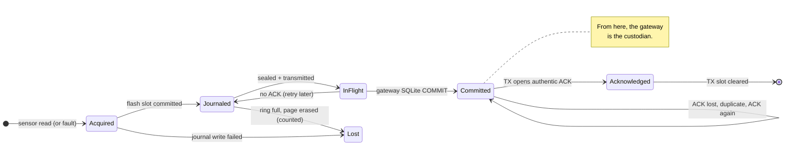
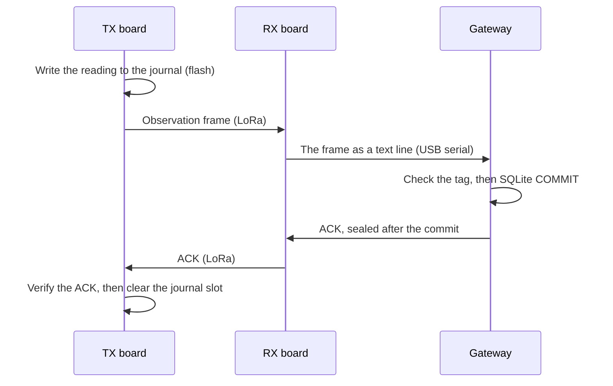
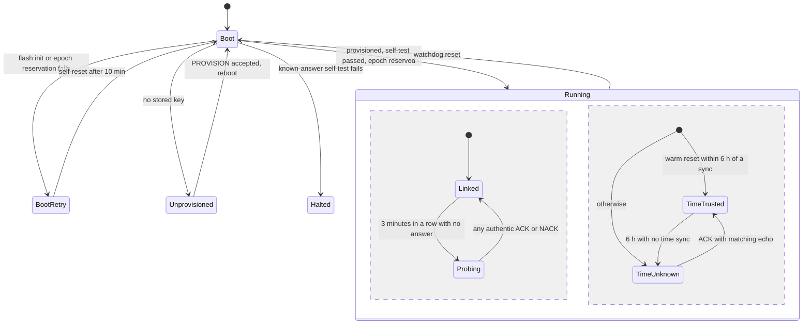
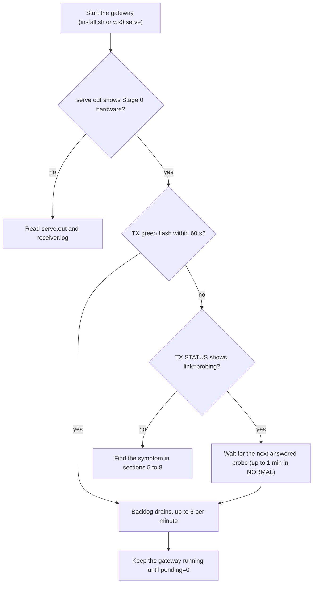
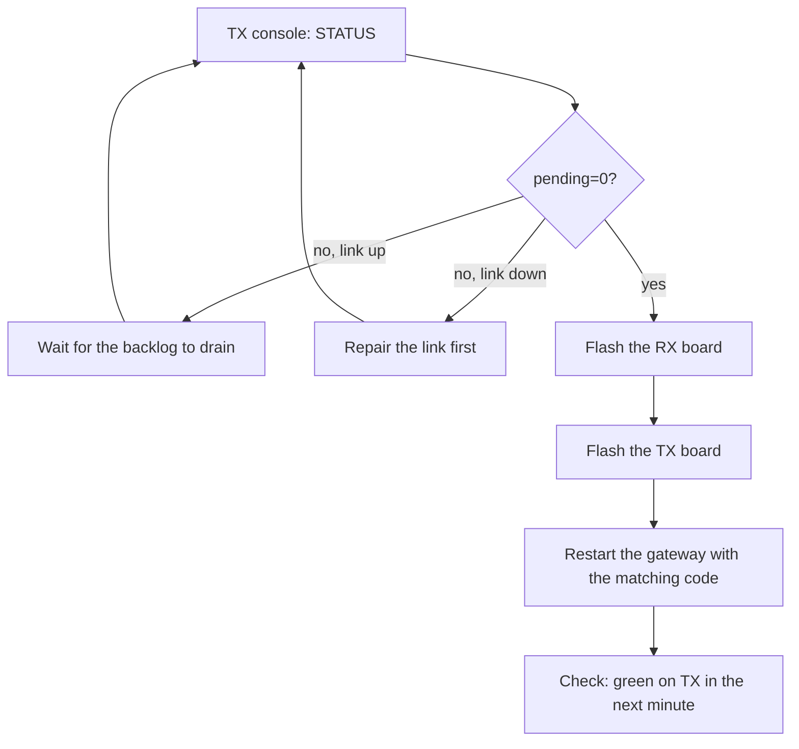
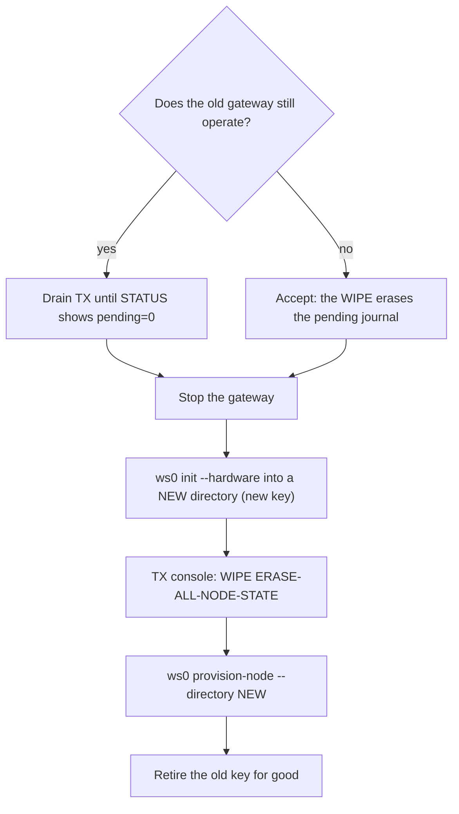

# Bench data path: failure modes, recovery, and loss budget

> **Document type:** Failure modes and effects analysis (FMEA) and recovery runbook.
> **Applies to:** the bench data path: transmitter board (TX) → LoRa radio → receiver board (RX) → USB → gateway (`ws0`) → SQLite. Protocol version 5.
> **Status:** Most behaviors exist in code. The **Verified** column tells you what has evidence. Section 10 lists the open issues. **The 24-hour delivery test (H01) is NOT RUN.**
> **Related:** [`protocol-stack.md`](protocol-stack.md) (how each layer operates) · [`protocol.md`](protocol.md) (byte formats) · [`H01-checklist.md`](H01-checklist.md).

---

## 1. Purpose and scope

The project is built in stages ([`next-stages-plan.md`](next-stages-plan.md)):

- **Stage 0** is the data path on the bench: two development boards on USB power, the bench sensor modules, and the gateway. The TX reads its sensors as WSMP local modules ([`module-protocol.md`](module-protocol.md)). The gate for Stage 0 is H01, the 24-hour delivery test.
- **Stage 1** adds the main battery pack, the charger and solar power.
- **Stage 2** adds one wired sensor module. **Stage 3** adds the complete unheated sensor set.

This document defines the behavior of the Stage-0 communication system when a part of it does not operate correctly. For each failure, it gives:

- how the system detects the failure,
- what the system does immediately,
- how the system recovers (automatically, by an operator, or not at all),
- what data the failure can delay or lose,
- the effect on H01,
- the evidence that the behavior is correct.

**In scope:** the TX board, the RX board, the radio link, the USB link, the gateway process, its SQLite files, and the host computer.
**Out of scope:** Stage 1 and later items (battery, solar, RS-485 modules, heaters), and MQTT/Home Assistant availability. These components are downstream of storage, so their failures cannot cause data loss.

"The PRD" below is the v0.2 product and technical requirements document (`weather-station-v0.2-prd-trd.html`).

### 1.1 Operating context: the bench is not the use case

The protocol exists for one job. **An unattended station on battery and solar power sends periodic readings over a long radio path to an indoor receiver.** Stage 0 runs on a desk with USB power. Many failures cost nothing on the bench but cost energy, airtime, or data in the field. This document classifies each failure for the **deployment**. It gives the bench evidence where it exists.

| Property | Stage-0 bench (now) | Deployment (design target) |
|---|---|---|
| TX power | USB, unlimited | Protected 4S battery pack + 20–40 W solar. **Average budget ≤ 0.25 W for the complete station** (PRD §4) |
| TX attendance | On the desk | Outdoors, unattended. A site visit is expensive |
| Distance | ~30 cm | Roof or yard to an indoor receiver through walls. H01 measures it. No range claim. |
| Radio settings | Spreading factor (SF) 7, 0 dBm, received signal strength (RSSI) ≈ −23 dBm | SF and power from the measured link budget: SF9–SF12, up to +22 dBm (FCC §15.247 allows +30 dBm) |
| Airtime, widest observation frame (77 bytes, bench WSMP field set) | 35 ms | 113 ms (SF9) to 699 ms (SF12) |
| Packet loss | Rare | **Routine.** Weather, snow on the antenna, interference, temperature |
| Gateway host | Mac desktop, kept on 24/7 | Always-on Linux computer or single-board computer on mains (PRD §1). It must not sleep. |
| Typical outage | Developer stops the gateway | **House power outage or storm.** The station keeps measuring on solar. The gateway is down. Store-and-forward exists for this case. |

**Design principle.** The node is the energy-limited and unattended side. The gateway is mains-powered and attended. Therefore:

1. The node must **fail cheaply.** A failure must not make it spend much more energy than normal operation.
2. Put decisions and extra work on the **gateway side** where possible (for example: NACKs, time checks, monitoring).
3. Never trade data safety for energy. Never trade energy for convenience.

### 1.2 Energy cost of a failed exchange

Each frame costs transmit energy plus the energy of the ACK receive window. The window closes early when the ACK arrives. It stays open for the full **2,000 ms** when no ACK arrives.

| SF (500 kHz) | Airtime, 77-byte observation | TX charge at ~100 mA (+20 dBm class) | RX charge, full 2 s window at ~5 mA |
|---|---:|---:|---:|
| SF7 | 35 ms | 3.5 mC | 10 mC |
| SF10 | 206 ms | 21 mC | 10 mC |
| SF12 | 699 ms | 70 mC | 10 mC |

The 77-byte frame is the widest record of the current bench build (`OBS_FRAME_MAX`, `App/tx_exchange.h`). A record carries only the fields of the modules present, so many frames are shorter. The airtimes come from `ws_lora_airtime_ms()`.

The outage arithmetic below uses the 56-byte frames of protocol version 4: 27 / 164 / 576 ms and 2.7 / 16 / 58 mC. The current widest frame is longer, so the real cost is about 20–30 % higher.

*The current values are datasheet-class assumptions for the STM32WL. Stage 1 must measure them in the pack energy accounting test (H02).*

The node has four energy states: SURPLUS, NORMAL, CONSERVE and CRITICAL ([`radio-energy-policy.md`](radio-energy-policy.md) §5). Stage 0 has no battery data, so the node always runs in NORMAL.

- In a **normal minute**, the node sends 1 frame. The ACK closes the window early.
- In a **failed minute**, the firmware sends **1 frame** and waits the **full 2 s**. The backlog drain stops at the first missed ACK.
- Exception: when backlog is pending, the node sends one more frame after the miss. The strike rule needs that frame to tell a refused record from a lost frame (`protocol-stack.md` 9.5).
- After *K* = 3 silent minutes, the node enters the PROBING link state. In PROBING the node sends only the live reading (a probe) and no backlog.
- In SURPLUS and NORMAL, the probe goes every minute. In CONSERVE, the node waits 2, 4, 8, then 15 min between probes. The minutes between probes have no radio activity (`radio-energy-policy.md` §6).

Why PROBING exists: assume a rule that sends 3 frames per failed minute (live + 2 backlog), each with the full 2 s window. At SF12 and +20 dBm, that rule costs about 3 × (58 + 10) ≈ 200 mC per minute. A normal minute costs about 60 mC. Over a one-day gateway outage, the rule costs about 290 C ≈ 80 mAh. At 3.3 V that is roughly **0.27 Wh/day**. That is about **4–5 % of the 6 Wh/day core budget**, spent on a link that is known to be down. PROBING with the CONSERVE back-off reduces this to about 100 probes, about 0.007 Wh/day. A timed ACK window would shorten each failed window further (§10, *Blind 2 s ACK window*).

---

## 2. Definitions

### 2.1 Recovery classes

| Class | Meaning |
|---|---|
| **AUTO** | The system recovers with no human action. No data is lost. Data can be late. |
| **AUTO-BOUNDED** | The system recovers with no human action. It can lose a defined, counted, small quantity of data. |
| **OPERATOR** | A person must do a procedure from section 9. Data is safe if the person acts before a stated deadline. |
| **UNRECOVERABLE** | Some data is lost permanently, or the system never acquired it. The system must make the loss visible. |

### 2.2 Data custody states

One observation goes through these states. At each state, **one** component is responsible for it.

| State | Custodian | Durable? | What destroys it |
|---|---|---|---|
| Acquired | TX RAM | No | TX reset before the journal write (a window of a few milliseconds) |
| Journaled / InFlight | TX flash | Yes | Journal overflow (counted), TX flash failure, `WIPE` |
| Committed | Gateway SQLite **and** TX flash | Yes (two copies) | Nothing, until the ACK arrives |
| Acknowledged | Gateway SQLite only | Yes (full flush on. See §6, *Host power cut during a SQLite commit*) | Loss or corruption of the gateway database |

**Key property:** an observation always has at least one durable custodian from the journal write to the end of its life. The TX board deletes its copy only after it verifies an authentic ACK. The gateway makes that ACK only after its commit. This sequence shows one exchange:

The RX board has no key. It forwards bytes in both directions and cannot make an ACK.

---

## 3. Guarantees and loss budget

### 3.1 Invariants (must hold in every failure)

| Invariant | Mechanism | Verified |
|---|---|---|
| The gateway never sends an ACK for an observation that it did not commit. | `Gateway.receive`: commit, then seal ACK | Simulation `storage-failure`. Unit `test_commit_failure_no_ack` |
| The TX board never deletes an observation without an authentic ACK for that identity. | `ws_open_reply` (`App/tx_exchange.c`) + `store_journal_find` | Unit `test_ack_tamper_keeps_pending` (simulator). Bench (firmware) |
| No (key, nonce) pair is used two times. | Durable counter blocks. The kind byte splits the two directions | Bench: reboot skips the block (8 → 257). Reset during flash writes: the counter never went back over 71 boots (`evidence/g7-reset-during-write-2026-10-13/`). True power removal not tested (§10, *Power-removal test not done*). Key reuse after a WIPE: see §8.2. |
| No two different observations have the same identity. | Durable epoch before the first sample | Bench: epochs 1 → 2 → 3 over reboots (`hardware/nucleo-wl55jc-bringup.md`, "Reboot behaviour"). Epochs always increased over 71 boots of the reset test. After `WIPE` + `provision-node`, the epoch floor keeps identities unique (§8.2, *WIPE then re-provision under the same station name*). |
| The database stores each identity once. The gateway rejects a changed payload with an old identity. | Primary key + payload comparison | Simulation `identity-collision`, `ack-loss` |
| The gateway never shows an invalid or stale reading as current. | Validity flag, impossible filler values, 180 s freshness, 5 s future quarantine | Unit + simulation `sensor-fault`, `clock-errors` |
| A replayed ACK cannot change the TX clock. | Counter echo in the ACK | Design + unit vectors. No adversarial bench test |

### 3.2 Loss budget

This is the data loss that the design accepts. **Items marked ⚠ need Clint's approval. They define how H01 and the 30-day storage test (H11) read a failure.**

| Category | Accepted loss | Rationale |
|---|---|---|
| **Never acceptable** | Loss of a committed observation. A duplicate row. Nonce reuse. An invalid or stale value shown as current | PRD §9, §11, H01, H11 |
| TX power cut during a journal write | **≤ 1 observation per power cut** (the slot in progress) | Flash cannot commit atomically faster than a power loss |
| TX unpowered (battery depleted, brown-out), or TX sensor absent | **All intervals while the TX board is down.** These readings never exist, so they are not "lost". They show as a time gap between two epochs. | No energy, no measurement. In deployment, the power system must prevent this (PRD requirement R03: 168 h without solar). |
| RX, gateway, or link down | **0 lost** if the outage is ≤ **28 h** (journal capacity: 69 usable pages × 25 slots = 1,725 one-minute records, about 28.7 h, bench WSMP field set. With every catalog field: 24.2 h). Data is late. | Store-and-forward. A winter storm outage at the house can exceed 28 h. The 30-day target is H11 (external flash). |
| Outage > about 28.7 h | **Oldest pending observations, 25 at a time** (one flash page of 80-byte slots). The TX board counts them as `lost`. | **Approved by Clint 2026-10-12:** drop oldest first (newest data is more valuable). |
| Time unknown after a TX boot | Warm reset: the board keeps time trust across the reset (backup registers). Power loss: after the first time sync, the gateway reconstructs the time of every reading in the epoch from the uptime field. Residual: an epoch that ends before its first sync stays `unknown`. | Approved by Clint 2026-10-12. Evidence: bench warm reset `#time restored`. Cold start reconstructed ±2 s. Simulation `reboot-during-outage`: 32/32 reconstructed. |
| Backlog drain | The backlog clears at up to **5 observations per minute** in NORMAL (`backlog_limit` in `firmware/common/ws_policy.c`), in addition to live data. The drain stops at the first missed ACK. An outage of *D* minutes takes about *D*/5 minutes to clear. | Live data has priority. ⚠ H11 must accept or raise this rate. |

### 3.3 H01 budget

H01 needs **≥ 1,426 of 1,440** one-minute intervals committed within 120 s of acquisition. So the run can miss **at most 14 intervals in 24 h**.

| Event during H01 | Intervals it costs |
|---|---|
| One lost frame or one lost ACK | **0.** The next minute resends the reading as the oldest backlog item. It commits at about t + 61 s, so it is still within 120 s. |
| Two lost exchanges in a row for one reading | 1 (it commits at about t + 121 s or later) |
| Outage of *N* minutes (any cause) | About *N* − 1 (live reading every minute in NORMAL. In CONSERVE up to 14 more, see below) |
| TX reboot (any cause) | Outage time only. Warm reset: no time loss. Power loss: the gateway reconstructs the first reading's time. |
| RX reboot | 0 to 1 |
| Gateway restart (a few seconds) | 0 |

**Probe back-off and H01 (Clint's decision, 2026-10-13).** In SURPLUS and NORMAL, the node sends the live reading every minute while it probes (`ws_link_may_send()`, `firmware/stage0.c`). Only CONSERVE backs off (2, 4, 8, then 15 min). In CONSERVE, one outage of 3 minutes or more can make up to 14 more readings late. That is the whole H01 budget. Stage 0 and H01 run in NORMAL.

---

## 4. Component behavior models

### 4.1 TX board

At boot the TX board checks its flash storage, its key and its self-test before it samples. In operation it tracks two independent states: the link state and the time trust.

The boot checks run in this order (`boot_ready()` in `App/app_tx.c`): flash init, key, self-test, epoch reservation. The board does the 10-minute self-reset only when the self-test passed. A board that fails the self-test stays halted.

| State | LED | Samples? | Transmits? | Exit |
|---|---|---|---|---|
| LINKED | Blue blip every 2 s. Blue then green each minute | Yes | Yes | — |
| LINKED, minute with a missed ACK (silent minutes 1–2) | Blue then **red** | Yes, journaled | 1 frame. The drain stops at the first miss | Next authentic ACK |
| PROBING (`link=probing`) | Blue then **red** at each probe. In CONSERVE, **no radio flash** in the minutes between probes | Yes, journaled | Live reading only. Every minute in SURPLUS and NORMAL. In CONSERVE at 2, 4, 8, then every 15 min (scheduled from the exchange start) | Any answered probe |
| Time unknown | As LINKED or PROBING | Yes, UTC = 0 | Yes | Next ACK with matching echo |
| Journal overflow (not a separate firmware state) | As PROBING | Yes. Erases the oldest page and counts `lost` | Probes only | Link returns. Backlog drains |
| Unprovisioned | **Red solid** | No | No | `ws0 provision-node` |
| Boot retry (`#error store-init` or `#error epoch-reserve`) | **Red solid** | No | No | Self-reset after 10 min |
| Halted (`#error self-test failed`) | **Red solid** | No | No | Operator (section 9) |

### 4.2 RX board

The RX board has one operating state: **continuous receive**. It leaves this state only to send one ACK, then it returns. It has no key and no stored data. A reset therefore loses only a frame or ACK that is in progress.

### 4.3 Gateway

| State | Detection | Behavior |
|---|---|---|
| Serving | `serve.out` "Stage 0 hardware; API …" | Normal |
| Rejecting | `receiver.log`: `rejected …` | No ACK. TX journals and retries |
| **Exited** | Process gone. No new lines in `receiver.log` | No ACKs. TX journals. launchd (`KeepAlive`) or systemd restarts the gateway. |

---

## 5. Failure catalogue — peer unavailable

*N* is the outage length in minutes.

| Scenario | Detection | Immediate behavior | Recovery | Data impact | H01 | Verified |
|---|---|---|---|---|---|---|
| **Gateway process stopped** (crash, Ctrl-C, update). launchd or systemd restarts it. | No `#ack` on TX. Red LED each minute. API down | RX prints frames. Nobody answers. TX journals. | AUTO after restart (§9.1). Backlog up to 5/min. | None if restarted within 28 h | *N* − 1 | **Bench, 2026-10-12:** gateway stopped during a protocol version change. The queued reading arrived the next minute. launchd restart after SIGKILL: discovery and `online` republished within 1 s (`evidence/mqtt-local-broker-2026-10-13/`) |
| **Host asleep** (Mac lid closed, sleep) | As *gateway process stopped*. The process is suspended | As *gateway process stopped*. The host loses the RX board's USB serial data while it sleeps. | AUTO on wake. | None if < 28 h | *N* − 1 | No. **Bench only.** The deployment host is always on (PRD §1). Disable sleep for H01. |
| **House power outage** (deployment) | Gateway, RX, and network down. The station runs on solar | TX journals every minute and retries (energy cost, §1.2) | AUTO when power returns | None if < 28 h. Oldest data lost beyond (§8.3, *TX journal full*) | *N* − 1 | No. This is the main store-and-forward case. |
| **RX USB disconnected** while the gateway runs | `receiver.log`: `#gateway serial-lost`, then `serial-open` | The gateway keeps serving its API. It looks for the RX board by **ST-LINK serial number** with back-off (1–15 s). It reopens the board under any port name. | AUTO | None (TX journals) | *N* − 1 | Unit tests (`tests/test_link.py`: unplug, replug under a new name, missing board, write failure). **Physical replug: pending.** |
| **RX board down** (unpowered, hung, wrong firmware) | Red each minute on TX. No `#rx` lines. No RX blue heartbeat. `#gateway receiver-silent` in `receiver.log` after 180 s without an RX `#alive` report (`receiver` in `/v1/status`) | TX journals | AUTO if power returns. OPERATOR if hung (§9.2) | None if < 28 h | *N* − 1 | Bench: RX reflashes (seconds). `receiver-silent` logged after an unplug (`evidence/soak-a07f498-2026-10-13/`) |
| **TX board down** | No new frames. API `available=false` after 180 s | Nothing is acquired | AUTO on power return: new epoch, backlog first | **The node never acquires readings during the outage** | *N* | Bench: TX reboots, epochs 1→8. Cold start reconstructed |
| **All down** (shared USB hub or building power) | Everything dark | Nothing acquired | AUTO on power return | As *TX board down* | As *TX board down* | No |

---

## 6. Failure catalogue — power events

"Reset test" below means `tools/power_cut_test.py --method reset`: 70 cycles, 71 boots, `evidence/g7-reset-during-write-2026-10-13/` (§10, *Power-removal test not done*). True power removal is not tested.

| Scenario | Immediate behavior | Recovery | Data impact | Verified |
|---|---|---|---|---|
| TX power cut **between** flash writes | RAM lost. Journal intact | AUTO: new epoch, counters skip to the next block, backlog first | Reading in RAM not yet journaled: ≤ 1 | Bench: resets (not cuts) |
| TX power cut **during** a journal slot write | Slot torn | AUTO: the boot scan counts the slot as `burned` | **≤ 1 observation** | Reset test: 21 boots found and handled torn double-words. True power cut not tested |
| TX power cut during an **ACK-word** write | ACK word torn | AUTO: the firmware treats an error-correction (ECC) fault as acknowledged (the gateway committed it first) | None | Reset test. True power cut not tested |
| TX power cut during a **counter or epoch** reservation | Entry torn | AUTO: the firmware ignores the torn entry and uses the maximum of the valid entries. Numbers can skip but cannot repeat. | None | Reset test: epochs always increased, counter never went back. True power cut not tested |
| TX power cut during **meta-page compaction** | New page has no header | AUTO: the old page stays authoritative | None | The reset-test workload includes compactions. No record shows a reset inside one. True power cut not tested |
| TX power cut during a **flash page erase** (ring advance) | Page partly erased | AUTO: the page has no valid header, so the firmware does not read its slots. Its pending entries were already counted `lost`. | Already counted | The reset-test workload includes ring-advance erases. No record shows a reset inside one. True power cut not tested |
| RX power cut | Frame or ACK in progress lost | AUTO: TX retries next minute | None | Bench (reflash resets) |
| Host power cut **during** a SQLite commit | The transaction rolls back or completes | AUTO: if it rolled back, the gateway sent no ACK and TX retries. If it completed, the ACK may be missing and TX resends a duplicate. | None (full flush on: `fullfsync` and `checkpoint_fullfsync` for the observation and nonce databases. 5.3 ms median / 16 ms max per commit, recorded in the `full_flush()` docstring in `gateway.py`. Simulations opt out with `WS0_UNSAFE_FAST_FSYNC=1`) | Simulation. Pragma unit test |
| Host power cut **after** commit, before ACK | Row committed. ACK not sent | AUTO: duplicate next minute, ACK again | None | Simulation `ack-loss` |
| USB brown-out / hub reset | Boards reset (as *TX power cut between flash writes* and *RX power cut*). The USB device may get a **new port name.** | AUTO for boards and gateway: with `--serial-number` the gateway finds the RX board under its new name. OPERATOR only when the gateway runs with `--serial <path>` (§9.8) | As *TX power cut between flash writes* | Bench: board A dropped off USB once |
| **TX battery near empty: brown-out cycling** (deployment. Example: at dawn, weak solar starts the board and a radio burst stops it again) | Each boot reserves a new epoch and skips the rest of a 256-counter block. After a power loss, the first readings have no time until a sync (the gateway reconstructs it later). A flash write can occur at marginal voltage | AUTO when energy recovers | Each cycle: ≤ 1 torn slot, ≥ 1 time-unknown reading. A fast cycle can repeat many times. | **Not tested.** Needs a low-voltage inhibit (§10, *No low-voltage inhibit*). |
| **USB dropout of about 1 s on a bench board** (cable moved or touched. Also an OpenOCD/debugger session) | The ST-LINK pulses the MCU reset pin when it re-enumerates. The board restarts with `reset=pin` (not `power`). TX: new epoch, counter block skipped, time trust restored. The gateway sees `serial-lost` / `serial-open` for RX | AUTO | ≤ 1 reading in RAM. The outage time counts against H01 | **Bench 2026-10-13:** TX 4 times, RX twice. `RCC_CSR` showed `PINRSTF` only. Two TX resets came from debugger sessions (`docs/hardware/nucleo-wl55jc-bringup.md`, "Office session"). Bench only (the field node has no ST-LINK). For H01: secure the cables, no debugger sessions |

---

## 7. Failure catalogue — radio link

| Scenario | Detection | Behavior | Recovery | Data impact | H01 | Verified |
|---|---|---|---|---|---|---|
| **Observation frame lost** | TX `#ack none`, red | Slot stays pending | AUTO: resent next minute (new counter) | None | 0 (single loss) | Bench, before the symbol-timeout fix |
| **ACK lost** | As *frame lost*. The gateway already has the row | Duplicate next minute. The gateway ACKs again | AUTO | None | 0 | Simulation `ack-loss` |
| **ACK late** (after the 2 s window) | As *frame lost* | TX ignores it (radio off). Duplicate later | AUTO | None | 0 | Design |
| **Asymmetric link: observations get through, ACKs never do** | First 3 minutes: the gateway receives every minute, TX shows red every minute. TX console `STATUS` then shows `link=probing`, and TX `pending` grows. In CONSERVE, the gateway then receives only probes (≤ 1 per 15 min). Health reports arrive with link state `probing` (the node sends them every 15 min and at each link-state change, also while PROBING) | The node decides the link state from ACKs only, so it enters PROBING: live reading only, no backlog. In SURPLUS and NORMAL (always in Stage 0), the live reading still goes every minute. In CONSERVE it goes only at 2, 4, 8, then 15 min. The backlog cannot drain without ACKs. | OPERATOR repairs the link. Both roles use the same `radio_cfg.h` power, SF and bandwidth. Check placement and antenna | NORMAL: the gateway gets every live reading on time. Unacknowledged copies fill the journal. After about 28.7 h the node overwrites the oldest and counts them `lost`, though the gateway already holds them. CONSERVE: only probes arrive | NORMAL: **0** (live readings commit on arrival). CONSERVE: most intervals missed | No |
| **Interference or jamming** | Both directions fail | As *RX board down* (§5) | AUTO when it stops | None if < 28 h | *N* − 1 | No |
| **Out of range / bad placement** | Low RSSI. Intermittent lost frames and ACKs | As *frame lost* / *ACK lost* | OPERATOR: placement, SF, power (the PRD's H01 failure branch) | None if ≥ 1 success per 28 h | Likely fail | Bench (30 cm): −23 / −24 dBm only (`protocol-stack.md` §8.5) |
| **TX frame during the RX ACK transmission** | Frame lost | As *frame lost* | AUTO | None | 0 | **Fixed:** symbol-timeout bug (2026-10-12) |
| **Foreign LoRa traffic on 915 MHz** | RX `#rx drop`. `#rx crc`/`#rx hdr` (bad receptions, stored in `rx_faults`, `tools/rx_faults.py`) | RX discards the frame (length, magic, version). The gateway counts bad receptions and warns above 30 an hour | AUTO | None | 0 | No |
| **Link margin changes** with weather, snow or ice on the antenna, wet foliage, and temperature (deployment) | RSSI and signal-to-noise ratio (SNR) trend in `receiver.log`. More lost frames and ACKs | Intermittent losses and duplicates. More TX energy per delivered reading | AUTO per exchange. OPERATOR if the trend continues (antenna, placement, SF) | None if ≥ 1 success per 28 h | Risk to the 14-interval budget | No. H01 must run at the real placement in real weather. |
| **Downlink weaker than uplink** (the ACK path) | The gateway receives frames. TX gets no ACKs (as *asymmetric link*) | As *asymmetric link* | OPERATOR gives the ACK the same link budget. Both roles configure the radio from the same `radio_cfg.h` constants (power, SF, bandwidth). RX prints `power=` at boot. The H01 checklist requires a measurement in both directions at the real placement. | As *asymmetric link* | As *asymmetric link* | No |

---

## 8. Failure catalogue — misbehaving devices and configuration

### 8.1 Misbehaving devices

| Scenario | Detection | Behavior | Recovery | Data impact | Verified |
|---|---|---|---|---|---|
| **TX firmware hang** | `#boot … reset=watchdog` | The supervised independent watchdog (IWDG) resets the board in ≤ 8 s in three cases: the main loop stops, sampling stops for > 150 s, an exchange runs past its time limit, or 10 journal writes or 10 transmissions fail in a row. The exchange limit is 5.05 s per queued frame and the health report, plus 5 s (`App/tx_exchange.c`). The board restores time trust. | AUTO | ≤ 1 interval per hang | **Bench 2026-10-12:** `TEST-HANG` → `reset=watchdog` after 7.9 s, time restored, next reading ACKed |
| **RX firmware hang** | `#boot … reset=watchdog` in `receiver.log` | The watchdog resets the board in ≤ 8 s if the main loop stops or the radio stops listening (one re-arm attempt first). After 16 min with no radio event, RX re-arms receive (`#relisten`, counted as `relistens=` in `#alive`). After 2 relistens in a row with no radio event, the watchdog resets the board (`firmware/stage0-node/App/app_rx.c`) | AUTO | None (TX retries) | **Bench 2026-10-12:** `TEST-HANG` → `reset=watchdog` after 7 s |
| **TX sends corrupt frames** | Gateway `rejected InvalidTag` | No ACK. TX retries | AUTO if transient | None if transient | Unit tests |
| **TX clock ahead** of host | The gateway quarantines the reading (`future_clock_at_receipt`) | Stored, not available | AUTO: the next ACK corrects the clock | Readings not current until corrected | Simulation `clock-errors` |
| **TX clock behind** host | Readings look old and may be stale | Stored. Availability by age | AUTO: next ACK | Readings not current until corrected | Simulation |
| **Host clock wrong** (no network time sync, NTP) | `host_clock.state=bad` in `/v1/status`. `#gateway host-clock bad` in `receiver.log` | `ws0/clock.py` checks the host offset by SNTP at start and hourly. Offset more than 1 s (allowing for half the round trip) → `bad`: ACKs carry no time. The node then keeps its own clock and marks samples unknown after 6 h. Server unreachable or round trip too slow → `unverified`: the gateway still issues time and checks again in 5 min | OPERATOR fixes the host time sync | Timestamps stay correct while the node clock holds. No wrong host time reaches the data | Unit tests (8 in `tests/test_clock.py`, including a real SNTP query) |
| **TX transmits continuously** ("babbling") | RX blue LED constant. `receiver.log` flood | The gateway deduplicates. Airtime used | OPERATOR resets or reflashes TX | None | No (the firmware cannot do this by design) |
| **RX drops, duplicates, or delays frames** | Gaps / duplicate log lines | Duplicates are idempotent. Delays reduce timeliness | AUTO | None (late only) | Simulation |
| **RX alters a frame** | Tag fails | Rejected. Retried | AUTO | None | Unit tests |
| **RX forges an ACK** | Impossible: the RX board has no key | — | — | None | Design |
| **A frame that the gateway always rejects** ("poison") | `receiver.log` `-> nack`. TX `#nack`. Gateway `rejections` table | The frame is authentic but unacceptable (identity collision, invalid record). The gateway stores the raw frame in `rejections` and sends an authenticated **NACK**. TX drops the record and counts `abandoned`. Safety net: after 10 unanswered tries while the gateway answers other frames, TX drops it (`#abandon`). An unauthenticated frame gets no NACK. | AUTO | None: `rejections` keeps the frame for recovery (§9.6) | **Bench 2026-10-12:** planted collision → `#nack reason=1`, `abandoned=1`. The reading was then recovered from `rejections`. Unit tests (5). Harness `identity-collision` (1 NACK) |

### 8.2 Configuration and provisioning errors

**Key-reuse detection** (applies to the last three rows). The gateway keeps a counter high-water mark per key in `gateway-nonces.sqlite3`. The first frame whose counter is at or below the mark gets this treatment:

- no reply and nothing stored,
- the frame goes to `rejections` (reason `counter_regression`),
- `/v1/status` `alarm` = "possible key reuse: re-key the node".

The alarm persists. Only re-keying into a new state directory clears it. `ws0 provision-node` refuses a board whose `ctr` is at or below the mark. Tests: `tests/test_counter_regression.py`.

| Scenario | Detection | Behavior | Recovery | Data impact | Verified |
|---|---|---|---|---|---|
| **Protocol version mismatch** (one board or the gateway not updated) | `#rx drop` or `rejected Unexpected frame header` | All traffic stops. TX journals | OPERATOR updates all three (§9.4). **Check TX `pending=0` first.** | None if the old pending plaintexts stay canonical. Otherwise they become poison frames (§8.1) | Bench: a protocol version change, 2026-10-12 |
| **Wrong key on TX** | Every frame `rejected InvalidTag` | TX journals until full | OPERATOR re-keys (§9.5) | Journal content is lost at the WIPE | Prevented by the key check value (KCV) check at provisioning |
| **Wrong station ID** | `Unexpected frame header` | As *wrong key* | OPERATOR (§9.5) | As *wrong key* | Unit tests |
| **Both boards flashed with the same role** | No `#rx` lines / no TX samples | As *RX board down* or *TX board down* (§5) | OPERATOR reflashes (README) | As *RX board down* / *TX board down* | No |
| **`WIPE` then re-provision under the same station name** | — | `provision-node` sends an epoch floor = 1 + the highest epoch stored in **that state directory's** database (observations, rejections, health reports). The node raises its epoch base before its first sample, so new identities do not collide. The floor does **not** raise the nonce counter (see *WIPE, then PROVISION with a key TX has used before*). | Use a **new key** after every WIPE (§9.5). A new state directory gives floor 0, and the history stays in the old directory | None for identity, if the same directory is used | Unit `test_epoch_floor_is_above_all_stored_epochs` |
| **Gateway nonce database lost** | The gateway refuses to start (`Missing nonce state`) | No ACKs | OPERATOR re-keys (§9.5). Draining TX first is impossible without the nonce database. | The TX journal is lost at the WIPE | Unit `test_nonce_restart_and_missing_state` |
| **Old backup of the nonce database or TX flash restored with the same key** | TX flash restore: detected on the first frame (key-reuse detection above). A nonce-database restore lowers the mark too, so the gateway cannot detect it. Never restore it (§9.7) | **Nonce reuse, a confidentiality and integrity break** | **UNRECOVERABLE for that key.** Re-key immediately. | Security, not data | Prohibited by procedure |
| **Two TX boards with the same key and station** | Identity collisions and nonce reuse. Detected on the first frame (key-reuse detection above) | Nonce reuse, a confidentiality and integrity break | UNRECOVERABLE for that key | Security, not data | Prohibited by procedure |
| **`WIPE`, then `PROVISION` with a key TX has used before** | Detected on the first frame (key-reuse detection above) | From release `0f456040fe54`, `store_wipe()` erases only the key page and the journal (`App/node_store.c`). The counter, epoch and lost/abandoned totals rise for the life of the board. Firmware before that release erased both meta pages, so the counter restarted at 1. A key used on that older firmware, or on another board, can therefore still collide. Every new frame then repeats an AES-CCM nonce (kind + station + counter) already sent on air: **a confidentiality and integrity break** | **UNRECOVERABLE for that key.** Re-key | Security, not data | Firmware behavior from `0f456040fe54` plus procedure: `docs/runbook-moving-boards.md` (prefer a new key). Lost counter state is not yet fail-closed (§10) |

### 8.3 Storage

| Scenario | Behavior | Recovery | Data impact | Verified |
|---|---|---|---|---|
| **TX journal full** | Erase the oldest page. Count `lost` (cumulative, persisted in flash before the erase, reported in the health report) | AUTO-BOUNDED | Oldest ≤ 25 per page | No |
| **TX journal write fails** | The sample identity is used. The slot is counted `burned`. The node does not send that reading | AUTO-BOUNDED | 1 per failure | No |
| **TX counter reservation fails** | That minute's exchange stops (no counter, no frame) | AUTO retry next minute. A persistent failure has the effect of a halt | Journals until full | No |
| **TX flash wear-out** | Program/erase errors (journal write or counter reservation fails) | OPERATOR replaces the board | — | Estimate: journal pages ≈ 1 erase / 1.2 days each (70 pages × 25 one-minute slots). Meta pages ≈ 1 compaction / 40 days. Far below 10,000 cycles. |
| **Host disk full** | Commit fails. No ACK | AUTO when space returns | None | Simulation `storage-failure` |
| **Gateway database corrupt or deleted** | Gateway errors / empty history | OPERATOR restores `observations.sqlite3` from backup (§9.7) | **Rows committed after the backup and already ACKed are lost permanently** | No |

---

## 9. Recovery procedures (runbook)

### 9.1 Restart the gateway

Normally launchd (`tools/deploy/macos/install.sh status`) or systemd restarts the gateway automatically.

1. Run `tools/deploy/macos/install.sh install run-d7`, or by hand `python -m ws0 serve --directory run-d7 --serial-number 0016001E4142500E20353451`. The current run directory is `run-d7`. Without a directory argument, `install.sh` uses `run-hw`, which does not exist.
2. Make sure `serve.out` shows `Stage 0 hardware`.
3. Make sure a TX green flash occurs within 60 s.
4. The backlog drains at up to 5 per minute (NORMAL). If TX is in PROBING, the drain starts after its next answered probe. That takes up to 1 min in NORMAL and up to 15 min in CONSERVE. Do not stop the gateway during the drain.

### 9.2 Reset the RX board

Push the black RESET button, or unplug and reconnect the USB cable. If the port name changes, do §9.8. RX holds no state.

### 9.3 Reset the TX board

Push RESET. The board reserves a new epoch and sends the backlog first. It restores its time trust (`#time restored`) if it synced in the last 6 hours.

### 9.4 Change the protocol version

1. On the TX console, send `STATUS`. Wait for `pending=0`. If the link is down, repair it first.
2. Flash the RX board.
3. Flash the TX board.
4. Restart the gateway with the matching code.
5. Make sure the next minute gives green on TX.

### 9.5 Re-key a station (destructive)

1. Drain the TX journal first (`pending=0`) with the **old** gateway, if it still operates.
2. Stop the gateway.
3. Make a new state directory with a **new key**: `python -m ws0 init --hardware --station <name> --station-id <id> --directory <new dir>`. `ws0 init` refuses an existing directory, so there is no in-place re-key.
4. On the TX console, send `WIPE ERASE-ALL-NODE-STATE`.
5. Run `python -m ws0 provision-node --directory <dir> --serial <TX port>`.
6. Never use the old key again.

**Never re-provision a key TX has used before.** It can repeat nonces (§8.2, `docs/runbook-moving-boards.md`). The epoch floor protects observation identities only. It protects them only against the history in the directory that `provision-node` reads. A new directory gives floor 0.

**Rejections with reason `counter_regression` are not readings to recover.** They mean a key was reused (§8.2, key-reuse detection). Re-key the node (§9.5). Never re-ingest them.

### 9.6 Recover a NACKed reading

The gateway keeps every NACKed frame in `observations.sqlite3`, table `rejections` (`frame_hex`). First correct the cause (for example, a wrong stored row). Then decode the frame with the station key and `Store.ingest` it. Example: the bench recovery in `docs/hardware/nucleo-wl55jc-bringup.md`.

### 9.7 Restore the gateway database

- You can restore `observations.sqlite3` from a backup. Both gateway databases use a write-ahead log. A database is the `.sqlite3` file **plus** its `-wal` and `-shm` files.
- Back up and restore all three together while the gateway is stopped, or use `sqlite3 <db> ".backup <file>"`. Never copy the `.sqlite3` file alone: recent commits live in the `-wal` file.
- **Never restore `gateway-nonces.sqlite3`.** If it is lost, do §9.5.
- Never delete only the `-wal` file of `gateway-nonces.sqlite3`. That loses the latest counters, which has the same effect as restoring an old copy.
- Rows that the TX board deleted after the backup time are lost. Record the loss window.

### 9.8 Port name changed

With `--serial-number`, no action is necessary: the gateway finds the board again. With `--serial <path>`, run `st-info --probe`, find the RX board (`0016001E4142500E20353451`), and restart with the new path.

### 9.9 Bench fault injection (never during an H01 placement run)

- **Watchdog:** send `TEST-HANG` on the TX or RX console. The main loop stops. Expect `#boot … reset=watchdog` within about 8 s.
- **Flash writes under reset:** `TEST-FLASH-STORM` on the TX console pauses sampling. It then writes journal slots and counter reservations continuously until the next reboot. The slots are acknowledged at once, use epoch 4294967295, and are never transmitted. The storm uses up journal slots and counter blocks. The boot scrub drops any storm slot left pending.
- **Automated:** `tools/power_cut_test.py --method reset --serial-number <TX ST-LINK serial> --cycles <n> --gateway-db <dir>/observations.sqlite3 --output evidence/<new dir>`.
  - It asserts the reset pin (NRST) through the ST-LINK (needs `openocd`) at a random time during the storm (`--min-run`/`--max-run`, default 0.3–4 s).
  - On every boot it checks four things. The epoch strictly increases. The counter never goes back. The self-test passes. The reset cause is `pin`.
  - At the end it checks the gateway database for storm records.
  - `--method power --hub <loc> --port <n>` removes the USB supply (VBUS) with `uhubctl` (the power-removal test). Run `--check` first, because the bench hubs do not really cut VBUS.
  - `--output` must not exist. The exit code is 0 for pass, 1 for fail.

---

## 10. Open issues

These issues are still open or partly open. "Needed by" gives the latest point at which the fix must exist.

| Issue | What is wrong | Effect | Proposed fix | Needed by |
|---|---|---|---|---|
| **Key in plain flash** | The key is in plain flash (read-out protection, RDP, level 0). | Physical access to the board gives the key. | Set RDP level 1. Document the recovery (a mass erase loses the journal). | Before field use |
| **Power-removal test not done** | The reset test passed: 70 cycles, 2026-10-13 (`evidence/g7-reset-during-write-2026-10-13/`, stopped early by Clint). Epochs always increased. The counter never went back. The self-test passed on all 71 boots. 21 boots found and handled torn double-words (double ECC errors). Up to 3 torn slots burned per boot. 0 storm records reached the gateway. A reset aborts a flash program or erase like a power cut does (STM32WL reference manual RM0453). The reset test therefore covers torn slots, ECC recovery, and counter and epoch monotonicity. True power removal, including slow supply decay, is not tested. The bench VIA Labs hubs advertise per-port power switching but do not cut VBUS (board reset cause `pin`, not `power`). | The TX power-cut rows in §6 have reset evidence only. | Run `tools/power_cut_test.py --method power` (§9.9) with a hub that really switches VBUS, for example Yepkit YKUSH. | Deferred by Clint 2026-10-13. No date set |
| **Backlog drain rate** | Design: [`radio-energy-policy.md`](radio-energy-policy.md) §5–6. The drain sends up to 5 per minute in NORMAL and 20 in SURPLUS, capped by airtime. It stops at the first missed ACK. | A long outage takes about one fifth of its own length to clear. | Review the 5/min NORMAL rate in H11. | Decide in H11 |
| **No low-voltage inhibit** | Nothing stops a journal write or a transmission at a marginal supply voltage. | A flash write can tear, and a radio burst can cause a brown-out loop (§6, *TX battery near empty*). | Set the brown-out reset (BOR) level in the option bytes. Do not start a journal write or a transmission below a measured voltage threshold (pack voltage from Stage 1 telemetry, the chip's VDD/VREFINT reading now). | Before field use (Stage 1 interface) |
| **Blind 2 s ACK window** | The receiver stays open for the full 2 s when no ACK arrives. | Each failed exchange costs a full 2 s of receive current (§1.2). | Use a timed receive slot. The gateway's turnaround is predictable, so open the receiver at a fixed delay after TxDone and close it with a symbol timeout sized for the SF. LoRaWAN Class A uses the same idea: RX1 delay + preamble timeout [[LoRaWAN]](https://resources.lora-alliance.org/technical-specifications). Measure the gateway turnaround first. **Recalculate the symbol timeout for each SF** (see the 1.3 ms bug in `protocol-stack.md` §8.4). | Before field use |
| **Lost counter state is not fail-closed** | WIPE keeps the counter from release `0f456040fe54` (§8.2). A key used on older firmware or on another board can still repeat nonces. The gateway detects it on the first such frame. If the node loses its counter state, it does not refuse to transmit. | The gateway detects nonce reuse after the fact. Nothing prevents it. | Fail closed when counter state is lost. `store_meta_init` reports "created fresh". A provisioned node with fresh meta then prints `#error counter-state-lost: re-key required`, shows solid red, does not transmit, and keeps feeding the watchdog (`docs/firmware-review-2026-10-13.md` §3). Meanwhile follow `docs/runbook-moving-boards.md` (prefer a new key). | Proposed, not scheduled |
| **Code space for the final station** (partly open) | Layout v2 (2026-10-16) grew the application region to 110 KB, pages 0–54 (`App/flash_layout.h`, `firmware/board/nucleo-wl55jc/STM32WL55JCIX_FLASH.ld`). The key and counter pages are at the top of flash (125–127), so a larger region moves only the journal start. TX release `04fcc656938d` uses 66.1 % (74,464 B, `firmware/stage0-node/RELEASES.md`). That leaves 26,912 B below the 90 % guard and 10,016 B below the 75 % target. `docs/firmware-budget.md` estimates 18–33 KB for Stage 1 and later features. That estimate predates the WSMP modules. If it still applies, the upper estimate passes the 90 % guard. | The final station may not fit the 75 % headroom target or the 90 % guard. | Watch: the Makefile flash guard (fails above 90 %) and the sizes in every release. LTO is a measured reserve (−6.6 KB). Never reset the counter on a layout change: give the board a WIPE and a new key. Target: final image ≤ 75 % of its region. | Before Stage 1 features |

---

## 11. Verification status

| Evidence | Covers |
|---|---|
| Unit tests (`tests/`, 82 test functions on 2026-10-13, including 21 for the range-test tool) | Frame agreement C ↔ Python, tamper/replay rejection, commit-failure no-ACK, nonce restart, canonical fillers, NACK, health reports, epoch floor, serial link, host clock, H01 scorer |
| Simulation harness (12 scenarios × 1,440 samples) | Outages, reboots, ACK loss, duplication, corruption, commit failure, clock faults, identity collision. **The node is the Python simulator, not the firmware.** The simulator drains up to 5 backlog records per minute but does not model PROBING or the drain stop at the first missed ACK (`ws0/simulator.py`). Its outage results therefore do not cover the current firmware link behavior. |
| Bench (2026-10-12) | Gateway down → journal → delivery. TX reboots → new epoch and counter skip. Version mismatch rejection. Reflash keeps state. Foreign LoRa frames dropped. Symbol-timeout failure and fix |
| Bench (2026-10-13) | Watchdog on TX and RX (§8.1). NACK for poison frames (§8.1). Reset during flash writes, 70 cycles (§6). 9 h soak (`evidence/soak-a07f498-2026-10-13/`: first health report at uptime 1 s, 550 RX `#alive` lines). Link outage with PROBING (`evidence/g13-outage-2026-10-13/`), details below |
| **Not yet tested** | True power removal (§10), journal overflow (§8.3), physical USB replug under load (§5, unit-tested), long RX outage (§5), asymmetric link (§7), host sleep (§5) |

The link-outage evidence (`evidence/g13-outage-2026-10-13/`) shows:

- 1 frame per silent minute, and PROBING after 3 silent minutes,
- journal-only minutes between probes, and live-only probes,
- the back-off doubled, and the node relinked on the first answered probe,
- the backlog drained 5 per minute, oldest first, with `lost=0`.

The log ends mid-drain at `pending=5`. It predates the probe-schedule fix, so it shows probes at +3 and +5 min instead of +2 and +4. No log of the current schedule exists yet.

Before the 24-hour H01 run starts, close every issue in §10 marked "Before H01", or get Clint's explicit acceptance. Do not run H01 and then remove failures from the denominator.

H01 runs on USB power, so it does not test the energy behavior. See §1.2, and §10 *No low-voltage inhibit* and *Blind 2 s ACK window*. Stage 1 verifies those behaviors with measured current, in the pack energy accounting test (H02) and the cold and solar endurance test (H03). PROBING is implemented, but its energy inputs come from Stage 1. Verify its energy effect with measured current (H02, H03) before the station first runs from a battery.

---

## 12. Change control

When a change affects a behavior in this document:

1. Update the row in sections 5–8.
2. Update the **Verified** column only when there is evidence: a test, a log, or a measurement. Give its location.
3. If the change closes an open issue, delete it from section 10 and record the evidence in the affected row.
4. If the change can lose data in a new way, add a row to the loss budget (3.2) and get approval.
