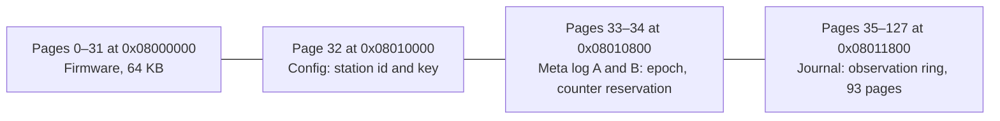
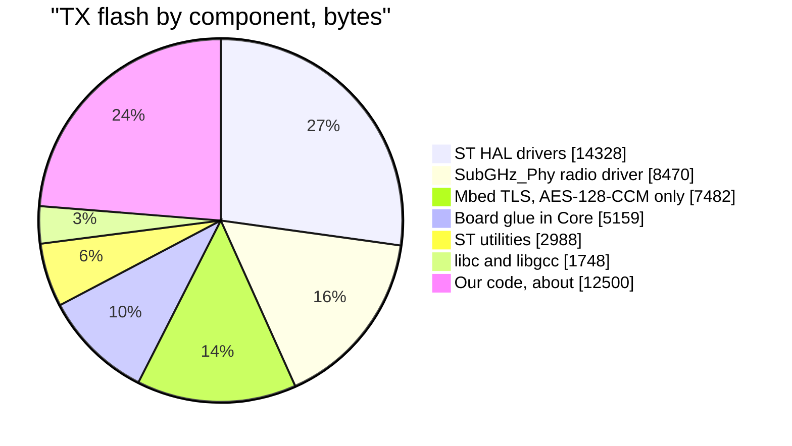
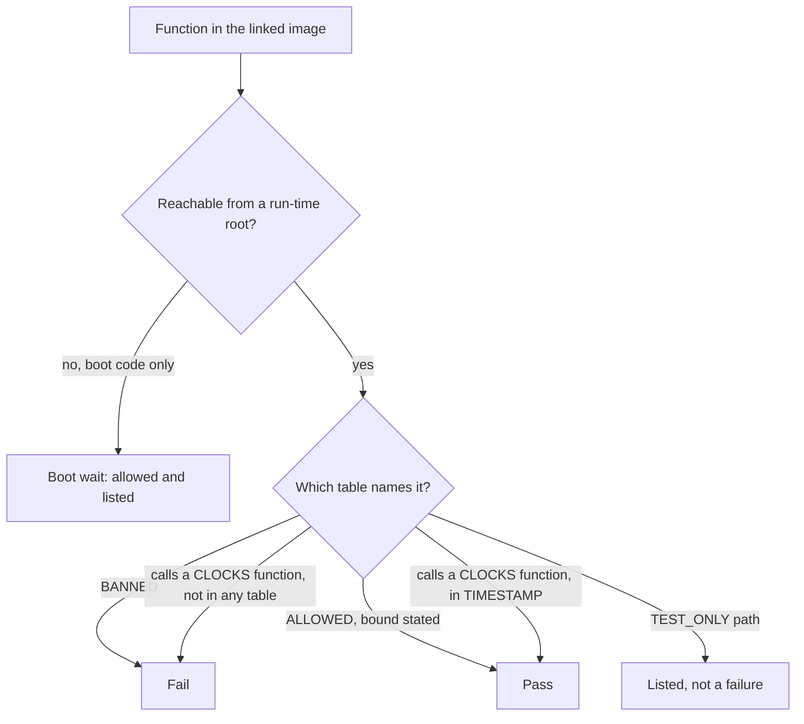
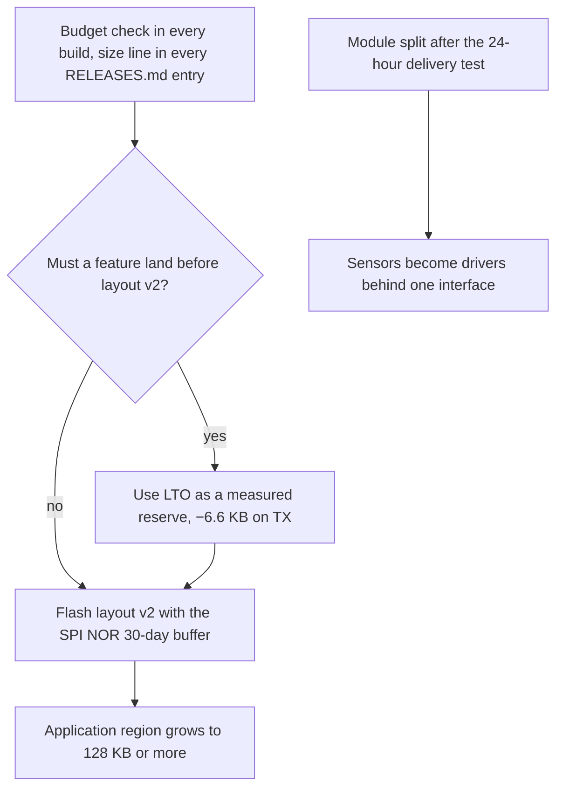
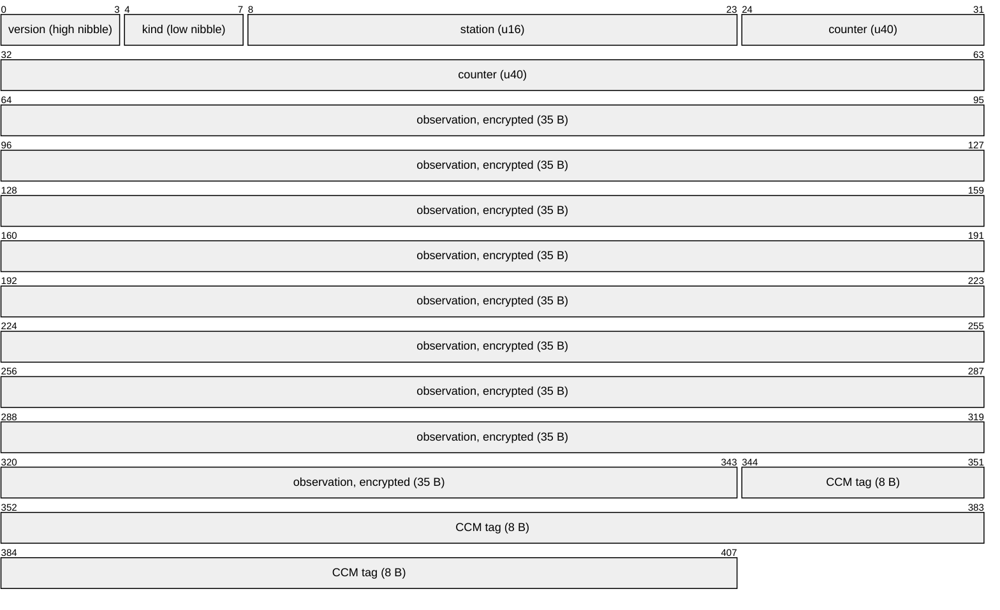

# Firmware budget: flash, RAM, CPU and radio

This page records how much flash, RAM, CPU time and radio payload the firmware uses. "TX" is the
transmitter, the station node with the sensors. "RX" is the receiver, the bridge on the gateway's
USB cable.

- The summary's flash and RAM figures were measured on 2026-10-16 on master (`f26bc3b`, after
  release `809230951ae1`).
- The stack table and the radio section were measured on release `bc5e6ede429c` (2026-10-14).
- Older rows name the release they were measured on (`firmware/stage0-node/RELEASES.md`).

Measured numbers come from the build (`arm-none-eabi-size`, the linker map) or from the firmware's
own airtime formula. Rows marked **estimate** are planning figures for future features. They are
not measurements.

## Summary

| Resource | Available | Used now | Status |
|---|---|---|---|
| Flash, application region | 64 KB (pages 0–31, enforced by the linker script) | TX 58,240 B (88.9 %), RX 34,840 B (53.2 %) | **TX is the constraint**: 7,296 B left, 742 B below the 90 % guard |
| Flash, node state | 192 KB (pages 32–127) | key 1 page, meta log 2 pages, journal 93 pages (3,348 slots of 56 B for the temperature and humidity build with the minute summary, about 2.3 days) | `App/flash_layout.h` fixes the pages. `App/node_fields.h` sets the slot size |
| RAM | 64 KB (RAM1 32 KB + RAM2 32 KB) | TX: about 6.0 KB static data + 8 KB reserved stack + 0.5 KB heap, all in RAM1. Worst-case stack estimate 5,784 B of 8,192 B (71 %) | Ample. RAM2 is unused |
| CPU | Cortex-M4 at 48 MHz (the Cortex-M0+ core is unused) | One sample and a few frames per minute | No constraint |
| Radio payload | 35-byte observation plaintext in a 51-byte frame (temperature and humidity with the minute summary). The field catalog allows up to 78 B in a 94-byte frame | Temperature and humidity only | No longer the limit: every catalog field fits in one frame (see [Radio payload](#radio-payload)) |

Sources:

- `firmware/board/nucleo-wl55jc/STM32WL55JCIX_FLASH.ld`. Every NUCLEO project shares this linker
  script. It sets FLASH 64K, RAM1 and RAM2 32K each, heap 0x200 and stack 0x2000. The stack was
  0x800 before the stack work below.
- `App/flash_layout.h`.
- `firmware/common/ws_frame.h` (`WS_HEADER_LEN 8`, `WS_TAG_LEN 8`).
- `firmware/common/ws_obs.h` and `App/node_fields.h` (`WS_OBS_PLAIN_MAX` = 35 for temperature and
  humidity with the minute summary).

### Flash map

The STM32WL55JC has 256 KB of single-bank flash in 128 pages of 2 KB (`App/flash_layout.h`):

The linker script limits the firmware to pages 0–31. Every project on this board shares that
script, so a bench-tool image cannot reach the node key or the journal.

### Budget check in the build

The build enforces a budget. `make` prints `flash budget: N of 65536 B`. It fails above
`FLASH_BUDGET_PCT` (default 90 %) of the application region (`firmware/stage0-node/Makefile`).

### Current build

The build includes the 15-second temperature and humidity sampling with a minute summary (catalog
fields 21–25, `ws_th_*` in `firmware/stage0.c`). It gives a 35 B plaintext, 51 B on air (25.7 ms at
SF7, 534.5 ms at SF12) and 56-byte journal slots.

### Efficiency review, unreleased (2026-10-14)

This review reduced TX from 54,832 B to 51,080 B (−3,752 B):

- AES without the decrypt direction (`MBEDTLS_BLOCK_CIPHER_NO_DECRYPT`, −2,208 B). AES-CCM
  (counter mode with CBC-MAC) and the key check value only encrypt.
- 128-bit keys only (−272 B). The AES context on the stack fell from 272 B to 176 B.
- Bitwise CRCs instead of GCC 15's lookup tables (`-fno-optimize-crc` on `node_store.o` and
  `stage0.o`, −752 B).
- A 32-bit minute mean (−208 B).
- Boot self-test vectors as byte arrays (−184 B).
- The field catalog as one X-macro (−88 B).
- The build ID computed at build time (−56 B), and smaller items.

The TX reply buffer is 33 B instead of 255 B (RAM −224 B). Stack bound: TX 6,056 B (74 %), RX
2,276 B (28 %).

## Where the TX flash goes

Linked sections from `build/tx/stage0-tx.map` (`.text`, `.rodata`, `.data`):

| Component | Bytes | Share |
|---|---:|---:|
| ST HAL drivers | 14,328 | 27 % |
| SubGHz_Phy radio driver | 8,470 | 16 % |
| Mbed TLS (AES-128-CCM only) | 7,482 | 14 % |
| Board glue (`Core/`: clocks, UART, RTC, IRQs, startup) | 5,159 | 10 % |
| ST utilities (sequencer, timer, trace, printf) | 2,988 | 6 % |
| libc + libgcc | 1,748 | 3 % |
| **Our code** (`app_tx`, `node_store`, `stage0`, `ws_frame`, `sensor`, console, LEDs, watchdog) | about 12,500 | about 24 % |

These figures were measured on the `a07f498` sources. Release 0f456040fe54 is the same size within
8 bytes (53,184 → 53,176 B). About 41 KB is platform cost that does not grow with features. New
features add mostly our own code and a few more HAL modules.

The multi-sensor observation format came with release `bc5e6ede429c`. Its encoder and catalog
table, `firmware/common/ws_obs.c`, link 676 B into the TX image (508 B code + 168 B table, from the
linker map). Against the previous release `45f43e78fe91`, the TX image grew by 856 B (52,896 →
53,752 B). The RX image grew by 112 B (31,584 → 31,696 B). The encoder is most of the TX growth.
The rest is the larger health report and the new self-test, less the removed packer of protocol
version 4 (not broken down).

## Stack

Measured on 2026-10-14 on release `bc5e6ede429c`.

| | TX | RX |
|---|---:|---:|
| Worst-case estimate (`make stack`, `tools/stack_report.py`) | 6,528 B (80 % of 8,192 B) | 2,212 B (27 %) |
| Deepest direct chain from `main` | 1,280 B (boot self-test through Mbed TLS CCM) | 276 B (`fault_report` through the trace printf) |
| Deepest callback chain | 1,256 B (`on_line`, console commands) | 428 B (`process`) |
| RAM the stack can grow into before it meets static data | 28,136 B | 29,568 B |

### How the estimate works

GCC writes each function's frame size and its direct calls (`-fcallgraph-info=su`, `.ci` files
beside the objects). The script then adds these parts:

- Any function whose address is taken counts as a possible pointer target.
- Prebuilt newlib and libgcc functions (`memcpy`, `memset`, the 64-bit divides) have no call-graph
  data and count 0 B. They are leaf functions with small frames.
- Unbounded recursion or a variable-size frame fails the check.
- CI runs the check on both roles.

### Changes made for the estimate

- The linker's reserved stack (`_Min_Stack_Size`) went from 2 KB to 8 KB. The old 2 KB was below
  the TX estimate. Nothing checks the real stack against this reservation at run time. The linker
  now refuses to link if static data plus 8 KB no longer fits.
- Our recursion `send_current` ↔ `next_item` (now in `App/tx_exchange.c`) became a loop.
- The firmware no longer uses Mbed TLS's generic cipher layer (`MBEDTLS_CIPHER_C` off). CCM now
  calls AES through the smaller block-cipher layer. This change removed a recursion cycle in the
  call graph, all `malloc` and `free` calls from the TX image, and 1.7 KB of flash.
- `sample()` keeps its 104-byte observation record (`ws_obs_t`) in static memory, not on the stack.
  The record is part of the deepest callback chain, which the estimate counts four times (about
  416 B). With the record on the stack, the TX estimate was 83 %.
- Run-time check: the start-up code fills the stack with a pattern (`App/stackmon.c`). `stack_peak`
  (TX `#counts`, RX `#alive`) reports the deepest byte ever overwritten. A field value near the 8 KB
  reservation would mean that the estimate is wrong.

## Blocking waits

Rule: the firmware is interrupt and event driven ([`docs/firmware-event-model.md`](firmware-event-model.md)).
After boot, no code may busy-wait or block for milliseconds. Only short hardware handshakes with a
stated bound are allowed. `make waits` (`tools/blocking_report.py`, CI on both roles) checks this
rule. It uses the same GCC call graphs as the stack bound.

- **Run-time roots**:
  - every interrupt handler (`*_IRQHandler`, `*_Handler`, not `Reset_Handler`).
  - every linked function whose address is taken: sequencer tasks, timer and radio callbacks,
    driver tables and the console line handler. A pointer call can reach any of them.
  - `MX_SubGHz_Phy_Process`, the body of `main`'s forever loop.
  - Exception: some functions have their address taken *only* in the SubGHz_Phy `Radio` table.
    The tool treats such a function as a direct call from each caller of `Radio.Slot(...)` in the
    compiled sources. Any other use of the slot or of `Radio` keeps it a root.
- **Boot code**: code that `main` reaches by direct calls and no root reaches. Waits there are
  allowed and listed: clock set-up, start-up of the 32 kHz external crystal (LSE), init of the
  independent watchdog (IWDG) and radio reset.
- **Tables in the tool**. Each entry has its reason and source reference:
  - `BANNED`: `HAL_Delay`, `TIMER_IF_DelayMs`, blocking HAL I2C/UART/SPI/DMA/ADC transfers and
    polls, `vcom_Trace`, `UTIL_SEQ_WaitEvt`, `RadioIsChannelFree`, `RFW_PollRxBytes`. If one is
    reachable at run time, the check **fails**.
  - `ALLOWED`: each entry states its bound.
    - Flash program and erase. The CPU stalls on the single bank anyway. Page erase is 24.5 ms
      maximum.
    - SUBGHZ BUSY-line and SPI byte handshakes. A counter bounds them (about 100 ms cap,
      microseconds in practice).
    - RTC sub-second double read and init and sync flags (≤ 2 RTCCLK).
    - UART TEACK and REACK after enable.
    - The boot RCC and IWDG waits.
  - `CLOCKS` (`HAL_GetTick`, `UTIL_TIMER_GetCurrentTime`, `UTIL_TIMER_GetElapsedTime`): every
    run-time function that calls one must be in a table. It goes in `TIMESTAMP` if it only reads
    the time. An unclassified caller **fails**. This rule catches a new HAL timeout loop or a
    hand-written delay.
  - `TEST_ONLY` (`fault_test`, `test_hang`): bench commands that hang or crash on purpose. The tool
    lists waits that only these commands reach. They are not failures.
- **Limits**: the tool sees only calls. It does not see an inline register poll
  (`while (!(REG & FLAG));`) or a counter loop that GCC inlined from a static function. `ALLOWED`
  therefore names the public functions that hold such loops. An example is `vcom_ReceiveInit`,
  whose BUSY and REACK loops have no counter. Review must catch new inline polls. The tool assumes
  that prebuilt newlib and libgcc do not wait.

Adding code:

- A new `HAL_GetTick` reader needs a `TIMESTAMP` entry (`'file.c:function'` for a static
  function).
- A new hardware wait needs an `ALLOWED` entry with its worst-case bound from the datasheet or the
  reference manual.

## Measured savings available

| Option | TX | RX | Cost |
|---|---:|---:|---|
| Link-time optimisation (`-flto`), measured in a scratch build | 53,176 → 46,584 B (**−6.6 KB, −12 %**) | 30,360 → 25,488 B (−16 %) | Changes inlining and code order. Needs a full bench check before any release uses it |
| Low-layer (LL) drivers instead of HAL for GPIO, I2C and UART | not measured | — | **estimate**: a large part of the 14 KB HAL share. Needs a rewrite of the board glue |
| Field build without the debug console text | not measured | — | **estimate**: 1–3 KB. Loses the bench diagnostics |

## Future features (estimates)

The project builds the station in stages ([`docs/next-stages-plan.md`](next-stages-plan.md)).
Stage 0 is the data path on the bench prototype. Stage 1 adds main power and battery pack state
(the battery and solar build). Stage 2 adds one wired sensor module. Stage 3 completes the unheated
sensing.

| Feature (stage) | Flash estimate | Notes |
|---|---|---|
| Power telemetry: INA228, BQ25798, NTCs (Stage 1) | 4–7 KB | Two I2C drivers plus the ADC HAL module |
| SPI NOR journal for the 30-day buffer (requirement H11, 30-day storage) | 6–10 KB | SPI HAL plus a journal backend |
| RS-485 and Modbus sensor modules (Stage 2) | 4–8 KB, plus a few KB per sensor type | The UART HAL is already linked |
| Low-power sleep, heater control, energy state machine | 4–8 KB | Mostly our code |
| Multi-sensor payload | **Done**: +856 B TX against release `45f43e78fe91` | `ws_obs.c` is 676 B. The decoder is on the gateway |
| **Total** | **about 18–33 KB** | **Does not fit in the 7,296 B left** |

## Requirement (Clint, 2026-10-13)

The STM32WL55JC stays. The firmware must **fully support the final station** with **room for
expansion**. The final station has all sensor types, power modules, the 30-day buffer and low-power
operation. These targets apply until the final design is sized:

- **Headroom:** the final TX image uses at most **75 %** of its application region. This leaves at
  least 25 % for later sensors and fixes. Until flash layout v2, every build also stays under the
  90 % guard in the Makefile.
- **Watch:** every `RELEASES.md` entry records the `.bin` sizes. Review this file at each stage
  gate and whenever a release grows by more than 2 KB.
- **Layout v2 before the region is outgrown:** the key and counter pages move to the top of flash,
  so they never move again. The boundary between code and journal becomes one shared constant. A
  one-time migration carries the counter and epoch across ([`docs/failure-modes.md`](failure-modes.md),
  §10 open issues: code space for the final station).

## The plan that makes it fit

1. **Flash layout v2 with the 30-day buffer (H11).** The 30-day buffer moves to SPI NOR flash. This
   frees most of the 186 KB internal journal. The application region can then grow to 128 KB or
   more. **Constraint:** the key and the transmission counter live in the node-state pages. A
   layout change must carry the counter and epoch across, or the board must get a new key.
   Otherwise the board repeats AES-CCM nonces ([`docs/runbook-moving-boards.md`](runbook-moving-boards.md)).
2. **Link-time optimisation (LTO) as a measured reserve** (−6.6 KB on TX), if a feature must land
   before layout v2.
3. **Budget check** in every build (above), and a size line in every `RELEASES.md` entry.
4. **Module split after the 24-hour delivery test** (H01, [`docs/H01-checklist.md`](H01-checklist.md)),
   as [`docs/firmware-review-2026-10-13.md`](firmware-review-2026-10-13.md) §4–5 describes. Sensors
   become drivers behind one interface instead of edits to `app_tx.c`.

## Radio payload

Each frame carries a fixed 16 bytes around the plaintext: an 8-byte authenticated header and an
8-byte tag. Protocol version 4 carried 32. The header holds the version and kind, the station and
the counter (`firmware/common/ws_frame.h`). This is the 51-byte observation frame of today's build
(35-byte plaintext), in bits from 0:

The design notes for this format are in [`docs/protocol-design.md`](protocol-design.md).

Airtime per frame comes from the firmware's formula (`ws_lora_airtime_ms()` in
`firmware/common/ws_policy.c`). The formula uses 500 kHz bandwidth, coding rate 4/5, an 8-symbol
preamble, explicit header and CRC on. The firmware rounds up to whole milliseconds.

| Frame | Plaintext | Frame | SF7 | SF9 | SF10 | SF12 |
|---|---:|---:|---:|---:|---:|---:|
| ACK / NACK | 17 B | 33 B | 18.0 ms | 61.7 ms | 113.2 ms | 411.6 ms |
| Observation, temperature and humidity with the minute summary (today's build) | 35 B | 51 B | 25.7 ms | 82.2 ms | 154.1 ms | 534.5 ms |
| Health report | 32 B | 48 B | 24.4 ms | 77.1 ms | 143.9 ms | 493.6 ms |
| Observation, Core weather set ([`protocol-design.md`](protocol-design.md) §2) | 40 B | 56 B | 26.9 ms | 87.3 ms | 164.4 ms | 575.5 ms |
| Observation, full proof-of-concept build | 62 B | 78 B | 34.6 ms | 112.9 ms | 205.3 ms | 698.4 ms |
| Observation, every catalog field | 78 B | 94 B | 41.0 ms | 133.4 ms | 236.0 ms | 821.2 ms |
| (Protocol version 4, every kind) | 24 B | 56 B | 26.9 ms | 87.3 ms | 164.4 ms | 575.5 ms |

- **One frame carries every field.** The largest possible observation frame (94 B) still fits in one
  frame. More sensors therefore never need a second frame or a second ACK window.
- **The airtime cap sets the backlog drain.** The firmware counts one exchange as observation
  airtime + ACK airtime + 300 ms (`exchange_ms`).
  - Temperature and humidity build (51-byte frame) at SF7: 26 + 18 + 300 = 344 ms. The 5 s `NORMAL` cap allows 14
    exchanges, so the `NORMAL` limit of 5 binds.
  - Same build at SF12: 535 + 412 + 300 = 1,247 ms (4 exchanges).
  - Full proof-of-concept frame at SF12: 699 + 412 + 300 = 1,411 ms (3 exchanges).
- **Energy follows airtime.** [`docs/radio-energy-policy.md`](radio-energy-policy.md) §3 gives the
  energy per frame and the spreading-factor choices.
