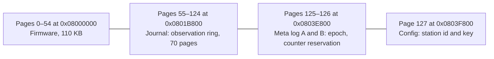
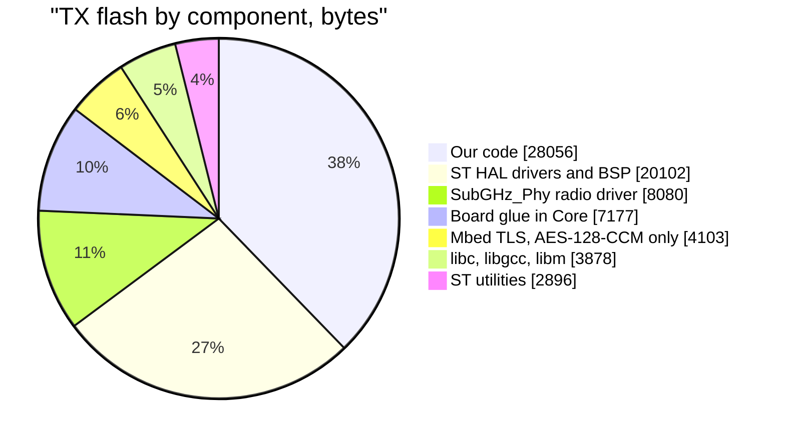
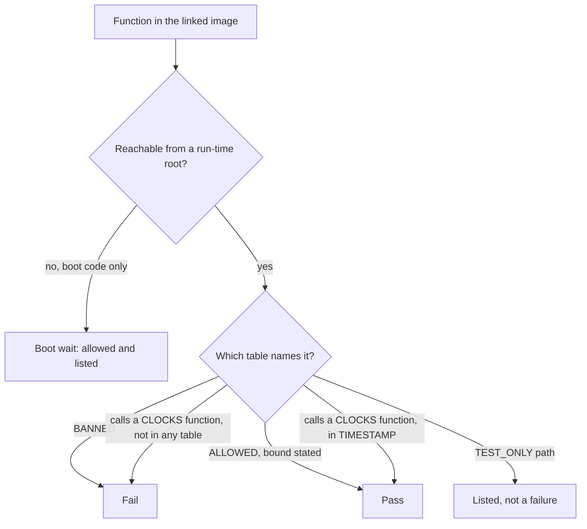
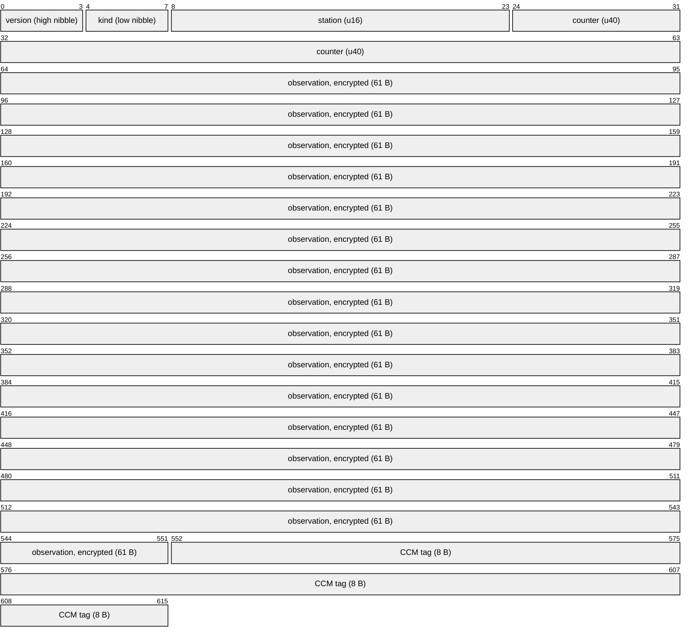

# Firmware budget: flash, RAM, CPU and radio

This page records how much flash, RAM, CPU time and radio payload the firmware uses. "TX" is the
transmitter, the station node with the sensors. "RX" is the receiver, the bridge on the gateway's
USB cable.

- The summary, the TX flash breakdown and the stack table were measured on 2026-10-19 at
  `04fcc65` (release `04fcc656938d`). Later commits do not change the firmware.
- Older rows name the release they were measured on (`firmware/stage0-node/RELEASES.md`).

Measured numbers come from the build (`arm-none-eabi-size`, the linker map) or from the firmware's
own airtime formula. Rows marked **estimate** are planning figures for future features. They are
not measurements.

## Summary

| Resource | Available | Used now | Status |
|---|---|---|---|
| Flash, application region | 110 KB = 112,640 B (pages 0–54, enforced by the linker script) | TX 74,464 B (66.1 %), RX 34,832 B (30.9 %) | TX has 38,176 B left: 26,912 B below the 90 % guard and 10,016 B below the 75 % headroom target |
| Flash, node state | 146 KB (pages 55–127) | journal 70 pages, meta log 2 pages, config 1 page. The journal keeps at least 1,725 slots of 80 B for the WSMP bench field set (28.7 h), and 24.2 h for a station with every catalog field | `App/flash_layout.h` fixes the pages. `App/node_fields.h` sets the slot size |
| RAM | 64 KB (RAM1 32 KB + RAM2 32 KB) | TX: about 8.0 KB static data (8,144 B) + 8 KB reserved stack + 0.5 KB heap, all in RAM1. Worst-case stack estimate 6,360 B of 8,192 B (78 %) | Ample. RAM2 is unused |
| CPU | Cortex-M4 at 48 MHz (the Cortex-M0+ core is unused) | A 250 ms module tick, one report and a few frames per minute | No constraint |
| Radio payload | Up to a 61-byte observation plaintext in a 77-byte frame (the WSMP bench field set, every module in the layout). The field catalog allows up to 78 B in a 94-byte frame | Temperature and humidity, pressure, wind, rain, UVA, battery and enclosure fields | Not the limit: every catalog field fits in one frame (see [Radio payload](#radio-payload)) |

Sources:

- `firmware/board/nucleo-wl55jc/STM32WL55JCIX_FLASH.ld`. Every NUCLEO project shares this linker
  script. It sets FLASH 110K, RAM1 and RAM2 32K each, heap 0x200 and stack 0x2000. The stack was
  0x800 before the stack work below.
- `App/flash_layout.h`.
- `firmware/common/ws_frame.h` (`WS_HEADER_LEN 8`, `WS_TAG_LEN 8`).
- `firmware/common/ws_obs.h` and `App/node_fields.h` (`WS_OBS_PLAIN_MAX` = 61 for the WSMP bench
  field set `WS_F_WSMP_BENCH`).

### Flash map

The STM32WL55JC has 256 KB of single-bank flash in 128 pages of 2 KB (`App/flash_layout.h`):

The linker script limits the firmware to pages 0–54. Every project on this board shares that
script, so a bench-tool image cannot reach the node key or the journal. One constant,
`WS_FIRMWARE_PAGES` in `App/flash_layout.h`, sets the boundary. The node state sits at the top of
flash, so a larger firmware region moves only the journal start. `tests/test_flash_layout.py`
checks that the header, the linker script and `board.mk` agree.

### Budget check in the build

The build enforces a budget. `make` prints `flash budget: N of 112640 B`. It fails above
`FLASH_BUDGET_PCT` (default 90 %) of the application region (`firmware/stage0-node/Makefile`).

### Current build

The TX reads its sensors as WSMP local modules (`App/wsmp_local.c`, `App/mod_*.c`, the station
host `App/wsmp_host.c`). `App/wsmp_catalog_map.c` maps their snapshots onto the observation
catalog. A reading carries the fields of the modules in the layout. With every module present the
plaintext is 61 B, 77 B on air (34.6 ms at SF7, 698.4 ms at SF12). The journal slot is 80 B.

The WSMP local modules came with release `cc2766a38c61`. Against the previous release
`260c9ccbe938`, the TX image grew by 15,712 B (58,264 → 73,976 B). The RX image did not change
size (34,832 B).

### Efficiency review (2026-10-14, in release 586001994b09)

This review reduced TX from 54,832 B to 51,080 B (−3,752 B):

- AES without the decrypt direction (`MBEDTLS_BLOCK_CIPHER_NO_DECRYPT`, −2,208 B). AES-CCM
  (counter mode with CBC-MAC) and the key check value only encrypt.
- 128-bit keys only (−272 B). The AES context on the stack fell from 272 B to 176 B.
- Bitwise CRCs instead of GCC 15's lookup tables (`-fno-optimize-crc` on `node_store.o` and
  `stage0.o`, −752 B).
- A 32-bit minute mean (−208 B).
- Boot self-test vectors as byte arrays (−184 B).
- The field catalog as one X-macro (−88 B).
- The build ID computed at build time (−56 B), and smaller items.

The TX reply buffer is 33 B instead of 255 B (RAM −224 B). Stack bound then: TX 6,056 B (74 %),
RX 2,276 B (28 %).

## Where the TX flash goes

Linked sections from `build/tx/stage0-tx.map` (`.isr_vector`, `.text`, `.rodata`, `.data`), at
`04fcc65`. They sum to 74,294 B. Alignment fills the rest of the 74,464 B image.

| Component | Bytes | Share |
|---|---:|---:|
| **Our code** (`App/` and `firmware/common`, `firmware/stage0.c`) | 28,056 | 38 % |
| ST HAL drivers and the NUCLEO radio BSP | 20,102 | 27 % |
| SubGHz_Phy radio driver (`radio.c`, `radio_driver.c`, `radio_fw.c`) | 8,080 | 11 % |
| Board glue (`Core/`: interrupt handlers, clocks, UART, RTC, timer interface, startup) | 7,177 | 10 % |
| Mbed TLS (AES-128-CCM only) | 4,103 | 6 % |
| libc, libgcc and libm (the float helpers and `atan2f` of the wind module) | 3,878 | 5 % |
| ST utilities (sequencer, timer, trace, printf, SysTime, low power) | 2,896 | 4 % |

The WSMP part of our code is 10,861 B: `i2c_bus` 1,510, `mod_power` 1,384, `wsmp` 1,334,
`wsmp_catalog_map` 1,054, `wsmp_host` 978, `mod_th` 841, `mod_wind` 784, `board_inputs` 766,
`wsmp_local` 702, `mod_reg` 696, `mod_mean` 428 and `mod_rain` 384. The modules also link the ADC
and LPTIM HAL modules (2,942 B) and the float routines.

The multi-sensor observation format came with release `bc5e6ede429c`. Its encoder and catalog
table, `firmware/common/ws_obs.c`, linked 676 B into the TX image then (508 B code + 168 B table,
from the linker map). Today it links 682 B. Against the previous release `45f43e78fe91`, the TX
image grew by 856 B (52,896 → 53,752 B). The RX image grew by 112 B (31,584 → 31,696 B). The
encoder is most of the TX growth. The rest is the larger health report and the new self-test, less
the removed packer of protocol version 4 (not broken down).

## Stack

Measured on 2026-10-19 at `04fcc65` (release `04fcc656938d`).

| | TX | RX |
|---|---:|---:|
| Worst-case estimate (`make stack`, `tools/stack_report.py`) | 6,360 B (78 % of 8,192 B) | 2,652 B (32 %) |
| Deepest direct chain from `main` | 1,080 B (boot self-test through Mbed TLS CCM) | 268 B (`fault_report` through the trace printf) |
| Deepest callback chain | 1,264 B (`console_task`, console commands) | 540 B (`process`) |
| Deepest interrupt | 80 B (`UTIL_TIMER_IRQ_Handler`) | 80 B (`UTIL_TIMER_IRQ_Handler`) |
| RAM the stack can grow into before it meets static data | 24,112 B | 26,216 B |

### How the estimate works

GCC writes each function's frame size and its direct calls (`-fcallgraph-info=su`, `.ci` files
beside the objects). The script then adds these parts:

- Any function whose address is taken counts as a possible pointer target.
- Prebuilt newlib and libgcc functions (`memcpy`, `memset`, the 64-bit divides) have no call-graph
  data and count 0 B. They are leaf functions with small frames.
- Unbounded recursion or a variable-size frame fails the check.
- CI runs the check on both roles.

### Changes made for the estimate

- The linker's reserved stack (`_Min_Stack_Size`) went from 2 KB to 8 KB. The old 2 KB was below
  the TX estimate. No hardware guard stops the stack at this reservation. The run-time check below
  only measures the peak. The linker now refuses to link if static data plus 8 KB no longer fits.
- Our recursion `send_current` ↔ `next_item` (now in `App/tx_exchange.c`) became a loop.
- The firmware no longer uses Mbed TLS's generic cipher layer (`MBEDTLS_CIPHER_C` off). CCM now
  calls AES through the smaller block-cipher layer. This change removed a recursion cycle in the
  call graph, all `malloc` and `free` calls from the TX image, and 1.7 KB of flash.
- `minute_encode()` (`App/app_tx.c`) keeps its observation record (`ws_obs_t`, 128 B with the
  26-field catalog) in static memory, not on the stack. The record is part of the deepest callback
  chain, which the estimate counts four times. With the record on the stack, the earlier, smaller
  record cost about 416 B, and the TX estimate was 83 %.
- Run-time check: the start-up code fills the stack with a pattern (`App/stackmon.c`). `stack_peak`
  (TX `#counts`, RX `#alive`) reports the deepest byte ever overwritten. A field value near the 8 KB
  reservation would mean that the estimate is wrong.

## Blocking waits

Rule: the firmware is interrupt and event driven ([`docs/firmware-event-model.md`](firmware-event-model.md)).
After boot, no code may busy-wait or block for milliseconds. Only short hardware handshakes with a
stated bound are allowed. `make waits` (`tools/blocking_report.py`, CI on both roles) checks this
rule. It uses the same GCC call graphs as the stack bound.

- **Run-time roots**:
  - every interrupt handler (`*_IRQHandler`, `*_Handler`, not `Reset_Handler`).
  - every linked function whose address is taken: sequencer tasks, timer and radio callbacks,
    driver tables and the console line handler. A pointer call can reach any of them.
  - `MX_SubGHz_Phy_Process`, the body of `main`'s forever loop.
  - Exception: some functions have their address taken *only* in the SubGHz_Phy `Radio` table.
    The tool treats such a function as a direct call from each caller of `Radio.Slot(...)` in the
    compiled sources. Any other use of the slot or of `Radio` keeps it a root.
- **Boot code**: code that `main` reaches by direct calls and no root reaches. Waits there are
  allowed and listed: clock set-up, start-up of the 32 kHz external crystal (LSE), init of the
  independent watchdog (IWDG) and radio reset.
- **Tables in the tool**. Each entry has its reason and source reference:
  - `BANNED`: `HAL_Delay`, `TIMER_IF_DelayMs`, blocking HAL I2C/UART/SPI/DMA/ADC transfers and
    polls, `vcom_Trace`, `UTIL_SEQ_WaitEvt`, `RadioIsChannelFree`, `RFW_PollRxBytes`. If one is
    reachable at run time, the check **fails**.
  - `ALLOWED`: each entry states its bound.
    - Flash program and erase. The CPU stalls on the single bank anyway. Page erase is 24.5 ms
      maximum.
    - SUBGHZ BUSY-line and SPI byte handshakes. A counter bounds them (about 100 ms cap,
      microseconds in practice).
    - RTC sub-second double read and init and sync flags (≤ 2 RTCCLK).
    - UART TEACK and REACK after enable.
    - ADC enable (ADRDY, at most 2 ms by the HAL timeout) for the wind vane. The ADC stays
      enabled, so later conversions find it ready. The ADC offset calibration (about 60 µs) runs
      once when the modules start.
    - The boot RCC and IWDG waits.
  - `CLOCKS` (`HAL_GetTick`, `UTIL_TIMER_GetCurrentTime`, `UTIL_TIMER_GetElapsedTime`): every
    run-time function that calls one must be in a table. It goes in `TIMESTAMP` if it only reads
    the time. An unclassified caller **fails**. This rule catches a new HAL timeout loop or a
    hand-written delay.
  - `TEST_ONLY` (`fault_test`, `test_hang`): bench commands that hang or crash on purpose. The tool
    lists waits that only these commands reach. They are not failures.
- **Limits**: the tool sees only calls. It does not see an inline register poll
  (`while (!(REG & FLAG));`) or a counter loop that GCC inlined from a static function. `ALLOWED`
  therefore names the public functions that hold such loops. An example is `vcom_ReceiveInit`,
  whose BUSY and REACK loops have no counter. Review must catch new inline polls. The tool assumes
  that prebuilt newlib and libgcc do not wait.

Adding code:

- A new `HAL_GetTick` reader needs a `TIMESTAMP` entry (`'file.c:function'` for a static
  function).
- A new hardware wait needs an `ALLOWED` entry with its worst-case bound from the datasheet or the
  reference manual.

## Measured savings available

| Option | TX | RX | Cost |
|---|---:|---:|---|
| Link-time optimisation (`-flto`), measured in a scratch build of release `0f456040fe54` | 53,176 → 46,584 B (**−6.6 KB, −12 %**) | 30,360 → 25,488 B (−16 %) | Changes inlining and code order. Needs a full bench check before any release uses it |
| Low-layer (LL) drivers instead of HAL for GPIO, I2C and UART | not measured | — | **estimate**: a large part of the 20 KB HAL share. Needs a rewrite of the board glue |
| Field build without the debug console text | not measured | — | **estimate**: 1–3 KB. Loses the bench diagnostics |

## Future features (estimates)

The project builds the station in stages ([`docs/next-stages-plan.md`](next-stages-plan.md)).
Stage 0 is the data path on the bench prototype. Stage 1 adds main power and battery pack state
(the battery and solar build). Stage 2 adds one wired sensor module. Stage 3 completes the unheated
sensing.

| Feature (stage) | Flash estimate | Notes |
|---|---|---|
| Power telemetry: BQ25798, NTCs (Stage 1) | 4–7 KB | The estimate dates from before the WSMP modules. The INA228 and MAX17048 drivers and the ADC HAL module are now linked (`mod_power.c`, 1,384 B) |
| SPI NOR journal for the 30-day buffer (requirement H11, 30-day storage) | 6–10 KB | SPI HAL plus a journal backend |
| RS-485 and Modbus sensor modules (Stage 2) | 4–8 KB, plus a few KB per sensor type | The UART HAL is already linked |
| Low-power sleep, heater control, energy state machine | 4–8 KB | Mostly our code |
| Multi-sensor payload | **Done**: +856 B TX against release `45f43e78fe91` | `ws_obs.c` was 676 B. The decoder is on the gateway |
| WSMP local modules of the bench station | **Done**: +15,712 B TX against release `260c9ccbe938` | Shared I2C bus, seven modules, station host and catalog map (release `cc2766a38c61`) |
| **Total still to come** | **about 18–33 KB** | The lower estimate fits below the 90 % guard (26,912 B left). The upper estimate does not. Both estimates pass the 75 % target (10,016 B left) |

## Requirement (Clint, 2026-10-13)

The STM32WL55JC stays. The firmware must **fully support the final station** with **room for
expansion**. The final station has all sensor types, power modules, the 30-day buffer and low-power
operation. These targets apply until the final design is sized:

- **Headroom:** the final TX image uses at most **75 %** of its application region. This leaves at
  least 25 % for later sensors and fixes. Every build also stays under the 90 % guard in the
  Makefile.
- **Watch:** every `RELEASES.md` entry records the `.bin` sizes. Review this file at each stage
  gate and whenever a release grows by more than 2 KB.
- **Layout v2 (released in `cc2766a38c61`, 2026-10-19):** the key and counter pages are at the top of flash, so they
  never move again. One constant sets the boundary between code and journal. The change erases the
  node state. Each board gets a WIPE and a new key, so no migration is necessary
  ([`docs/runbook-moving-boards.md`](runbook-moving-boards.md)).

## The plan that makes it fit

1. **Flash layout v2 (released in `cc2766a38c61`, 2026-10-19).** Firmware pages 0–54 (110 KB), journal 55–124 (70
   pages), meta log 125–126, provisioning 127. The internal journal keeps 24 hours for a full
   station. **Constraint:** the key and the transmission counter live in the node-state pages. A
   layout change erases them, so the board must get a new key. Otherwise the board repeats AES-CCM
   nonces ([`docs/runbook-moving-boards.md`](runbook-moving-boards.md)).
2. **The 30-day buffer (H11)** goes to SPI NOR flash. This frees most of the 140 KB internal
   journal, so the application region can grow again.
3. **Link-time optimisation (LTO) as a measured reserve** (−6.6 KB on TX), if a feature takes TX
   past the 75 % target.
4. **Budget check** in every build (above), and a size line in every `RELEASES.md` entry.
5. **Module split.** [`docs/firmware-review-2026-10-13.md`](firmware-review-2026-10-13.md) §4–5
   planned it for after the 24-hour delivery test (H01, [`docs/H01-checklist.md`](H01-checklist.md)).
   Release `cc2766a38c61` did it earlier, as WSMP local modules. Each sensor is a module behind one
   interface (`App/wsmp_local.h`). A new sensor no longer needs edits to `app_tx.c`.

## Radio payload

Each frame carries a fixed 16 bytes around the plaintext: an 8-byte authenticated header and an
8-byte tag. Protocol version 4 carried 32. The header holds the version and kind, the station and
the counter (`firmware/common/ws_frame.h`). This is the largest observation frame of today's
build, 77 bytes with a 61-byte plaintext (every WSMP bench module in the layout), in bits from 0:

The design notes for this format are in [`docs/protocol-design.md`](protocol-design.md).

Airtime per frame comes from the firmware's formula (`ws_lora_airtime_ms()` in
`firmware/common/ws_policy.c`). The formula uses 500 kHz bandwidth, coding rate 4/5, an 8-symbol
preamble, explicit header and CRC on. The firmware rounds up to whole milliseconds.

| Frame | Plaintext | Frame | SF7 | SF9 | SF10 | SF12 |
|---|---:|---:|---:|---:|---:|---:|
| ACK / NACK | 17 B | 33 B | 18.0 ms | 61.7 ms | 113.2 ms | 411.6 ms |
| Observation, WSMP bench field set with every module (today's build, at most) | 61 B | 77 B | 34.6 ms | 112.9 ms | 205.3 ms | 698.4 ms |
| Observation, temperature and humidity with the minute summary (release `260c9ccbe938` and before) | 35 B | 51 B | 25.7 ms | 82.2 ms | 154.1 ms | 534.5 ms |
| Health report | 32 B | 48 B | 24.4 ms | 77.1 ms | 143.9 ms | 493.6 ms |
| Observation, Core weather set ([`protocol-design.md`](protocol-design.md) §2) | 40 B | 56 B | 26.9 ms | 87.3 ms | 164.4 ms | 575.5 ms |
| Observation, full proof-of-concept build | 62 B | 78 B | 34.6 ms | 112.9 ms | 205.3 ms | 698.4 ms |
| Observation, every catalog field | 78 B | 94 B | 41.0 ms | 133.4 ms | 236.0 ms | 821.2 ms |
| (Protocol version 4, every kind) | 24 B | 56 B | 26.9 ms | 87.3 ms | 164.4 ms | 575.5 ms |

- **One frame carries every field.** The largest possible observation frame (94 B) still fits in one
  frame. More sensors therefore never need a second frame or a second ACK window.
- **The airtime cap sets the backlog drain.** The firmware counts one exchange as the airtime of
  the build's largest observation frame + ACK airtime + 300 ms (`exchange_ms`, `App/tx_policy.c`).
  - Today's build (77-byte frame) at SF7: 35 + 18 + 300 = 353 ms. The 5 s `NORMAL` cap allows 14
    exchanges, so the `NORMAL` limit of 5 binds.
  - Same build at SF12: 699 + 412 + 300 = 1,411 ms (3 exchanges).
  - The earlier temperature and humidity build (51-byte frame) at SF12: 535 + 412 + 300 = 1,247 ms
    (4 exchanges).
- **Energy follows airtime.** [`docs/radio-energy-policy.md`](radio-energy-policy.md) §3 gives the
  energy per frame and the spreading-factor choices.
