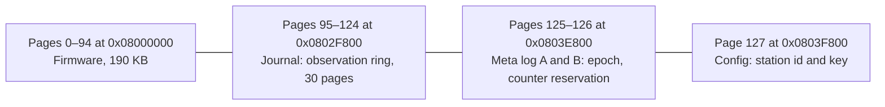
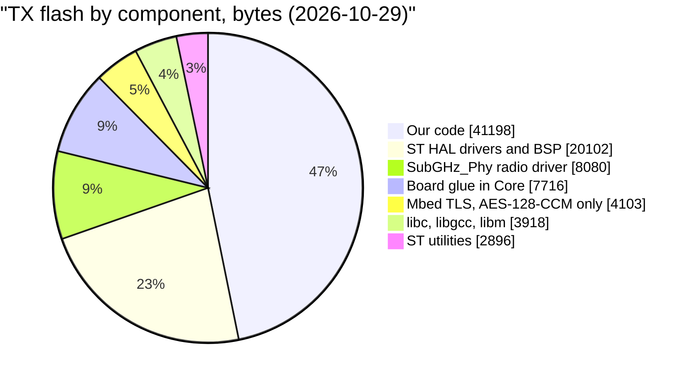
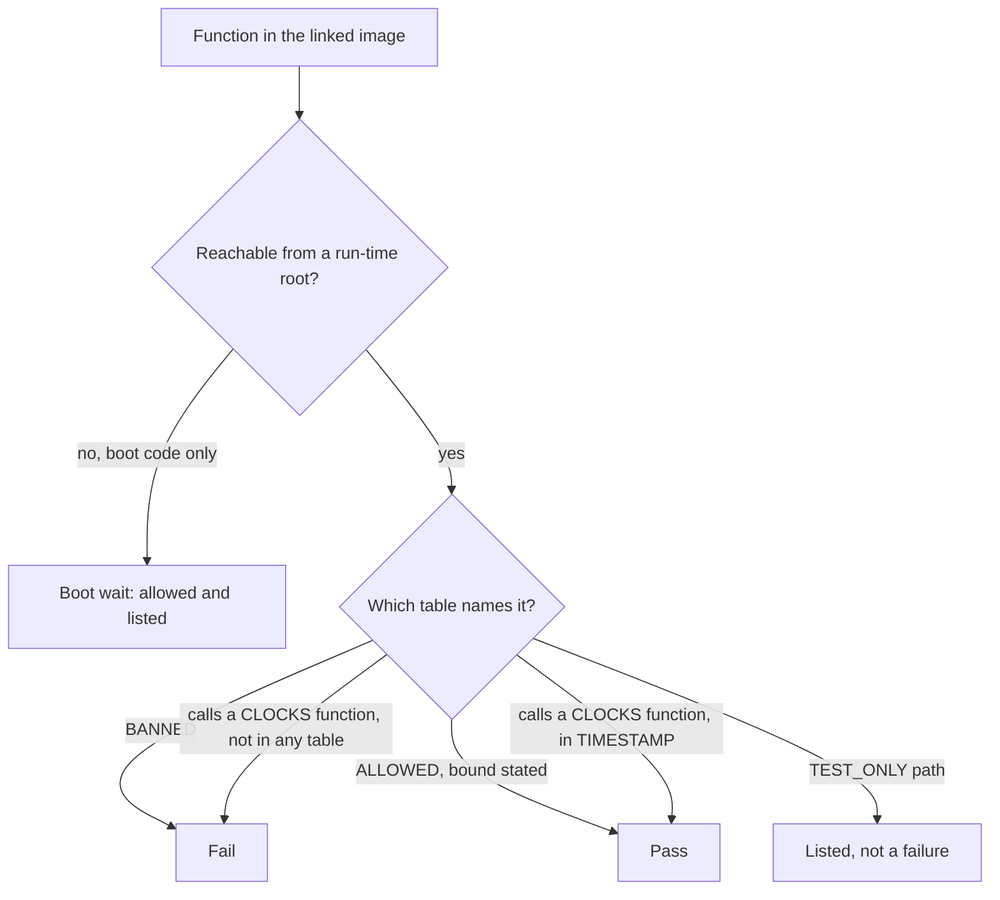
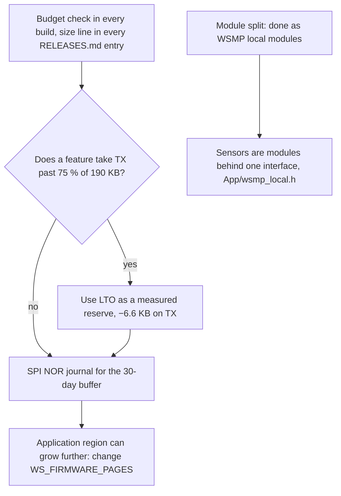
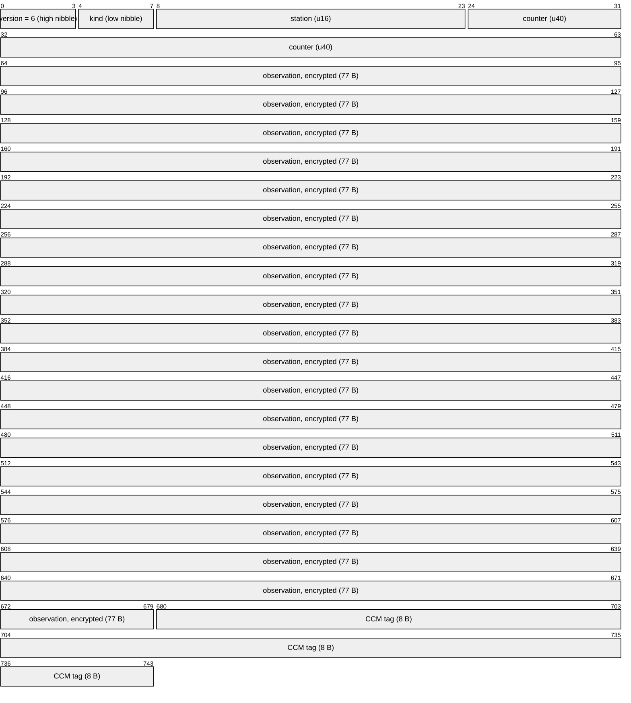

# Firmware budget: flash, RAM, CPU and radio

This page records how much flash, RAM, CPU time and radio payload the firmware uses. "TX" is the
transmitter, the station node with the sensors. "RX" is the receiver, the bridge on the gateway's
USB cable.

- The TX flash breakdown, the stack table and the radio payload table come from the 2026-10-29 tree
  on branch `feat/power-telemetry`. That tree is c7e8860 plus uncommitted power work
  (`fw=c7e88600a710-dirty`). The work is power telemetry, protocol version 6,
  [`docs/superpowers/specs/2026-10-29-power-telemetry-design.md`](superpowers/specs/2026-10-29-power-telemetry-design.md)
  ("the power spec").
- The flash row of the summary comes from a later build, 2026-11-04 at e890353, in the 190 KB
  region.
- None of this is a release. A release records its own sizes in `firmware/stage0-node/RELEASES.md`.
- "Before" numbers are a build of c7e8860 itself (the last commit before the power work, protocol
  version 5). We made it the same day with the same toolchain from a `git archive` export. Its
  version string is `unknown`, which is a few bytes shorter than a commit's. The power spec section
  9.10 quotes 83,792 B for a build inside the checkout.
- Older rows name the release they come from (`firmware/stage0-node/RELEASES.md`).

Here's how to measure these numbers. Build each one into its own directory, never the default `build/`:

```sh
cd firmware/stage0-node
make ROLE=tx BUILD=<dir>/tx && make ROLE=tx BUILD=<dir>/tx stack waits   # flash budget line, stack, waits
make ROLE=rx BUILD=<dir>/rx && make ROLE=rx BUILD=<dir>/rx stack waits
make ROLE=tx BUILD=<dir>/tx-b OPT='-Os -DWS_POWER_PROFILE=2'               # phase B (four INA228 rails)
```

CI also builds the phase B profile and the mux bus profile (`OPT='-Os -DWS_I2C_MUX=1'`) for the
target. Each one gets `ANALYZE=1`, the flash budget, `stack` and `waits`. That's the step "Board x
role x profile matrix (analyzer, stack bound, blocking waits, budgets)" in
`.github/workflows/ci.yml`, which runs `tools/board_matrix.py`. The release bins stay the default
profile. On 2026-10-29 the phase B build was 88,688 B (78.7 %) and the mux build 88,160 B (78.3 %),
both with a 6,056 B stack bound.

Per-object bytes are the linked `.isr_vector`, `.text`, `.rodata` and `.data` input sections of
each object in the linker map (`<dir>/tx/stage0-tx.map`).

Measured numbers come from the build (`arm-none-eabi-size`, the linker map) or from the firmware's
own airtime formula. Rows marked **estimate** are plans for future features. They aren't
measurements.

## Summary

| Resource | Available | Used now | Status |
|---|---|---|---|
| Flash, application region | 190 KB = 194,560 B (pages 0–94, enforced by the linker script) | Default profile (`WS_POWER_PROFILE` 1, phase A), measured 2026-11-04 at e890353 and unchanged by layout v3: TX 90,264 B, RX 34,904 B. In the 190 KB region that is 46.4 % and 17.9 %. The same code was 80.1 % in the 110 KB region. Phase B profile (`OPT='-Os -DWS_POWER_PROFILE=2'`): TX 90,784 B (46.7 %). At HEAD (2026-11-19) the default TX `.bin` is 90,864 B. The field build (the TX stack: `make ROLE=tx BOARD=wio-e5 WS_POWER_PROFILE=3 WS_I2C_MUX=1`) is 94,808 B at `ee8e008` (2026-11-23), 48.7 %: 80,296 B below the 90 % guard and 51,112 B below the 75 % target. The 2026-10-29 build (88,160 B, 78.3 % of 110 KB) is the older build behind the per-object tables below | Under the 90 % guard (`FLASH_BUDGET_PCT`, `firmware/stage0-node/Makefile:132`, 175,104 B): at e890353 TX has 104,296 B left, 84,840 B below the guard and 55,656 B below the 75 % headroom target (145,920 B). In the 110 KB region the same TX was 5,784 B over the 75 % target (84,480 B). The larger region removes that. See [The plan that makes it fit](#the-plan-that-makes-it-fit) |
| Flash, node state | 66 KB (pages 95–127) | journal 30 pages, meta log 2 pages, config 1 page. The journal keeps at least 609 slots of 96 B for the version 6 node field set (77 B, power spec section 7): 10.15 h. Before layout v3 (70 pages): 1,725 slots of 80 B (61 B, 28.75 h) | `App/flash_layout.h:20` fixes the pages. `App/node_fields.h` sets the slot size. `App/node_store.c:71-75` asserts 9.5 h of the build's widest record, so a field set above 80 B doesn't compile |
| RAM | 64 KB (RAM1 32 KB + RAM2 32 KB) | TX: 11,800 B static data at 66e5def and e890353 (`.data` 32 B + `.bss` 11,768 B), 11,832 B at HEAD (`.bss` 11,800 B). Before: 10,936 B. Plus 8 KB reserved stack + 0.5 KB heap, all in RAM1. Worst-case stack estimate 6,056 B of 8,192 B (74 %). RX: 6,040 B static data, stack estimate 2,780 B (34 %) | Ample. RAM2 is unused in the field build. The bench OLED build (`WS_BENCH_OLED=1`) puts about 4,960 B of display buffers there |
| CPU | Cortex-M4 at 48 MHz (the Cortex-M0+ core is unused) | A 250 ms module tick (it also starts the board ADC sequence, about 0.9 ms of interrupt-driven conversions), 1 s INA228 steps, 15 s gauge steps, one report and a few frames per minute | No constraint |
| Radio payload | Up to a 77-byte observation plaintext in a 93-byte frame (the version 6 node field set, every module and every power field). A node build may reach 80 B in a 96-byte frame (the per-build ceiling). The catalog (version 2) allows up to 94 B in a 110-byte frame, which only the RX bridge and the gateway accept. Health report: 64 B in an 80-byte frame | Temperature and humidity, pressure, wind, rain, UVA, enclosure, battery (voltage, current, energy and charge counters) and the power rails (load, charger input, solar, USB-C) | Not the limit: every catalog field fits in one frame (see [Radio payload](#radio-payload)) |

Sources:

- `firmware/board/nucleo-wl55jc/STM32WL55JCIX_FLASH.ld`. Every NUCLEO project shares this linker
  script. It sets FLASH 190K, RAM1 and RAM2 32K each, heap 0x200 and stack 0x2000. The stack was
  0x800 before the stack work below.
- `App/flash_layout.h`.
- `firmware/common/ws_frame.h` (`WS_HEADER_LEN 8`, `WS_TAG_LEN 8`).
- `firmware/common/ws_obs.h` and `App/node_fields.h` (`WS_OBS_PLAIN_MAX` = 77 for the version 6
  node field set `WS_F_WSMP_BENCH`. `node_fields.h` asserts the 77 B).

### Flash map

The STM32WL55JC has 256 KB of single-bank flash in 128 pages of 2 KB (`App/flash_layout.h`):



The linker script limits the firmware to pages 0–94 (190 KB). Every project on this board shares
that script, so a bench-tool image can't reach the node key or the journal. `WS_FIRMWARE_PAGES`
and `WS_JOURNAL_PAGES` in `App/flash_layout.h` set the boundary. The node state sits at the top of
flash, so a larger firmware region moves only the journal start. `tests/test_flash_layout.py`
checks that the header, the linker script and `APP_FLASH_BYTES` in
`firmware/board/stm32wl/rules.mk` agree.

**The journal** keeps 9.5 hours of the build's widest record (`WS_OBS_PLAIN_MAX`, from
`WS_NODE_FIELDS`, `App/node_store.c:71-75`, power spec section 7). A slot is the plaintext rounded
up to 8-byte double-words, plus a commit double-word and an ACK double-word. The firmware always
recycles one of the 30 pages, so 29 count:

| Field set | Plaintext | Slot | Slots a page | Records (29 pages) | Hours |
|---|---:|---:|---:|---:|---:|
| v5-size records on this 30-page ring (release `04fcc656938d` itself ran the 70-page ring: 1,725 records, 28.75 h) | 61 B | 80 B | 25 | 725 | 12.08 |
| **v6 node field set** (phases A–C, today's build) | 77 B | 96 B | 21 | **609** | 10.15 |
| per-build ceiling | 80 B | 96 B | 21 | 609 | 10.15 |
| every catalog v2 field (not a build: it would not compile) | 94 B | 112 B | 18 | 522 | 8.7 |

The slot size changed from 80 to 96 B, so the page magic changed (`"WSJ"` + 0x60). The first boot
of a version 6 image recycles every old page. Drain the journal (`pending=0`) before you flash it
(`firmware/stage0-node/RELEASES.md`, "How to cut a release").

### Budget check in the build

The build enforces a budget. `make` prints `flash budget (tx): N of 194560 B`. The line names the role and any flag that changes the image (`flash budget (tx, profile 2, bench OLED): ...`). It fails above
`FLASH_BUDGET_PCT` (default 90 %) of the application region (`firmware/stage0-node/Makefile`).

### Current build

The TX reads its sensors as WSMP local modules (`App/wsmp_local.c`, `App/mod_*.c`, the station
host `App/wsmp_host.c`). `App/wsmp_catalog_map.c` maps their snapshots onto the observation
catalog. A reading carries the fields of the modules in the layout.

A reading also carries the fields of the power slots that its power profile fits (`WS_POWER_PROFILE`, `App/power_config.h`). The node field set holds
every power field of every phase, so the journal slot fits the widest record: 77 B of plaintext,
93 B on air (41.0 ms at SF7, 821.2 ms at SF12), a 96 B slot. A phase A record with every module in
the layout is 65 B (81 B on air, 35.9 ms at SF7). The health report is 64 B (80 B on air).

**Power telemetry (phase A, protocol version 6), committed in 66e5def, against c7e8860:** TX about
+6,470 B (about 83,790 → 90,264 B), RX +64 B (34,832 → 34,896 B). The 88,160 B TX and 34,904 B RX
figures you may see elsewhere (`RELEASES.md`) come from the uncommitted 2026-10-29 tree. Per object
(linked bytes, c7e8860 archive build → 66e5def):

| Object | Before | After | Change | What |
|---|---:|---:|---:|---|
| `App/power_acq.c` | — | 2,614 | +2,614 | new: the rail table's INA228s, the MAX17048, the board ADC and the charger pins, each on its own step machine (power spec section 9.4). 2,726 B at HEAD |
| `App/mod_power.c` | 1,384 | 916 | −468 | now only the WSMP face: the battery (type 8) and rails (type 9) modules and the health cache (section 9.6) |
| `firmware/common/power_regs.c` | — | 482 | +482 | new: the INA228, MAX17048, ISET, divider and VREFINT conversions, shared with i2cscan and benchlink |
| **Power code** (the three above) | 1,384 | **4,012** | +2,628 | 4.4 % of the 90,264 B TX image |
| `App/board_inputs.c` | 768 | 1,862 | +1,094 | the four-channel interrupt-driven ADC sequence (vane, ISET, charger input, VREFINT) and the CHG edge count on EXTI10 |
| merged console strings | about 3,950 | 4,559 | about +600 | the linker merges every object's string constants into one input section. The map lists it under `Core/Src/stm32wlxx_it.o` (its code didn't change). It holds the longer `#diag sent` and `#counts` lines and the new `#modules` names |
| `firmware/common/ws_frame.c` | 842 | 1,066 | +224 | the 64-byte health report (version 6) |
| `App/tx_exchange.c` | 2,754 | 2,962 | +208 | `send_diag` fills the new health fields, and TX timeouts are counted. About +196 like for like (2,766 → 2,962 B with a commit version string) |
| `firmware/common/ws_obs.c` | 682 | 870 | +188 | catalog version 2: 33 fields (34 bitmap positions with EXT), the extension bitmap |
| `App/i2c_bus.c` | 2,377 | 2,616 | +239 | the hub profile (`WS_I2C_MUX` 0) and the recovery counter |
| other objects | | | +1,279 | `tx_console` (+624), `mod_wind` (+308), `wsmp` (+81), `fault` (+72, the DR12 boot counter), `wsmp_catalog_map` (+68), `mod_rain` (+64), `tx_policy` (+60, the health airtime reserve), `wsmp_local` (+50), `app_tx` (+36), `selftest` (+8). Less `node_store` (−76), `wsmp_host` (−12) and `ws_policy` (−4) |
| **Linked sections** | about 83,640 | about 90,090 | about +6,450 | alignment fills the rest of the image |

The mux profile (`OPT='-Os -DWS_I2C_MUX=1'`) links 48 B more than the hub profile (`WS_I2C_MUX` 0,
the default): 90,312 B against 90,264 B at 66e5def.

The WSMP local modules came with release `cc2766a38c61`. Against the previous release
`260c9ccbe938`, the TX image grew by 15,712 B (58,264 → 73,976 B). The RX image didn't change
size (34,832 B).

### Efficiency review (2026-10-14, in release 586001994b09)

This review cut TX from 54,832 B to 51,080 B (−3,752 B):

- AES without the decrypt direction (`MBEDTLS_BLOCK_CIPHER_NO_DECRYPT`, −2,208 B). AES-CCM
  (counter mode with CBC-MAC) and the key check value only encrypt.
- 128-bit keys only (−272 B). The AES context on the stack fell from 272 B to 176 B.
- Bitwise CRCs instead of GCC 15's lookup tables (`-fno-optimize-crc` on `node_store.o` and
  `stage0.o`, −752 B).
- A 32-bit minute mean (−208 B).
- Boot self-test vectors as byte arrays (−184 B).
- The field catalog as one X-macro (−88 B).
- The Makefile now computes the build ID at build time. An earlier note gave −56 B for this, but
  nothing backs that number: commit 96eb968 lists the change with no byte count.
- Smaller items.

The TX reply buffer is 33 B instead of 255 B (RAM −224 B). Stack bound then: TX 6,056 B (74 %),
RX 2,276 B (28 %).

## Where the TX flash goes

This breakdown is the linked sections (`.isr_vector`, `.text`, `.rodata`, `.data`) from the linker
map of the 2026-10-29 tree (88,160 B image). That tree was never committed, so you can't rebuild
its map. This page recorded that its sections summed to 88,013 B and alignment filled the rest. The
committed power-telemetry build (66e5def, 90,264 B image) links about 90,040–90,090 B.



The "Bytes" column is the uncommitted 2026-10-29 tree. The 66e5def figures that differ are in the
notes.

| Component | Bytes | Share | At `04fcc65` |
|---|---:|---:|---:|
| **Our code** (`App/` and `firmware/common`, `firmware/stage0.c`) | 41,198 (about 42,988 at 66e5def) | 47 % | 28,056 |
| ST HAL drivers and the NUCLEO radio BSP | 20,102 | 23 % | 20,102 |
| SubGHz_Phy radio driver (`radio.c`, `radio_driver.c`, `radio_fw.c`) | 8,080 | 9 % | 8,080 |
| Board glue (`Core/`: interrupt handlers, clocks, UART, RTC, timer interface, startup. Also the merged string constants of every object, 4,242 B, which is 4,810 B for all of `stm32wlxx_it.o` at 66e5def) | 7,716 (about 8,005 at 66e5def) | 9 % | 7,177 |
| Mbed TLS (AES-128-CCM only) | 4,103 | 5 % | 4,103 |
| libc, libgcc and libm (the float helpers, and the `atan2f` that `App/wsmp_catalog_map.c` uses for the wind direction) | 3,918 | 4 % | 3,878 |
| ST utilities (sequencer, timer, trace, printf, SysTime, low power) | 2,896 | 3 % | 2,896 |

The two library figures use different methods. 3,918 B matches HEAD only if you count every
`crt*.o` object (libc 278 + libgcc 2,520 + libm 1,020 = 3,818 B, plus 100 B of crt code). The
3,878 B at `04fcc65` counts only `crtbegin`. Re-measure both the same way before you compare them.

In the 2026-10-29 tree, our code grew by 13,142 B since `04fcc65`. 4,104 B of that came with the
power telemetry (above). The rest came with the module-port identity work between `04fcc65` and
c7e8860 (`port_id` 2,134, `wsmp_cal` 470, `wsmp_ident` 306 and the larger host and bus).

In the same tree the WSMP and power part of our code was 22,961 B: `wsmp_host` 3,692, `power_acq`
2,602, `i2c_bus` 2,518, `wsmp` 2,207, `port_id` 2,134, `mod_th` 1,378, `board_inputs` 1,260,
`wsmp_local` 1,218, `wsmp_catalog_map` 1,166, `mod_reg` 1,064, `mod_power` 916, `mod_wind` 784,
`mod_mean` 482, `wsmp_cal` 470, `mod_rain` 384, `power_regs` 380 and `wsmp_ident` 306. No commit
reproduces those power figures. At 66e5def they are `power_acq` 2,614, `i2c_bus` 2,616,
`board_inputs` 1,862, `mod_wind` 1,092 and `power_regs` 482. **The power telemetry share is
`power_acq` + `mod_power` + `power_regs` = 4,012 B at 66e5def** (4.4 % of the image). The 2026-10-29
tree had 3,898 B.

For phase B (four rails) the same tree gave 4,418 B of power code, with `power_acq` at 3,122 B.
Those two numbers exist only on this page, and the repo has no phase B map or log. A
`WS_POWER_PROFILE=2` rebuild of 66e5def shows the same +520 B difference, with different absolute
sizes. The modules also link the ADC and LPTIM HAL modules (2,942 B) and the float routines.

The multi-sensor observation format came with release `bc5e6ede429c`. Its encoder and catalog
table, `firmware/common/ws_obs.c`, linked 676 B into the TX image then (508 B code + 168 B table,
from the linker map). It linked 682 B at c7e8860 and links 870 B with catalog version 2 (33
fields, the extension bitmap). Against the previous release `45f43e78fe91`, the TX image grew by
856 B (52,896 → 53,752 B).

The RX image grew by 112 B (31,584 → 31,696 B). The encoder is most of
the TX growth. The rest is the larger health report and the new self-test, less the removed packer
of protocol version 4 (not broken down).

## Stack

We measured this on 2026-10-29 (the power telemetry tree, see the top of this page), with c7e8860
and release `04fcc656938d` for comparison. A few TX figures come from 66e5def and HEAD, as marked.

| | TX | RX | TX c7e8860 | TX `04fcc65` |
|---|---:|---:|---:|---:|
| Worst-case estimate (`make stack`, `tools/stack_report.py`) | 6,056 B (74 % of 8,192 B) | 2,780 B (34 %) | 5,816 B (71 %) | 6,360 B (78 %) |
| Deepest direct chain from `main` | 1,128 B (boot self-test `selftest_kat` through Mbed TLS CCM) | 268 B (`fault_report` through the trace printf) | 1,080 B | 1,080 B |
| Deepest callback chain | 1,176 B (`console_task_timed`, console commands) | 572 B (`process_timed`) | 1,128 B | 1,264 B |
| Deepest interrupt | 80 B (`UTIL_TIMER_IRQ_Handler`) | 80 B (`UTIL_TIMER_IRQ_Handler`) | 80 B | 80 B |
| RAM the stack can grow into before it meets static data | 20,456 B at 66e5def (20,424 B at HEAD) | 26,216 B | 21,320 B | 24,112 B |

GCC inlines **`send_diag`** (`App/tx_exchange.c:201`) into `process_timed` (`App/tx_exchange.c:463`,
`BUSYMON_TASK(process)`), the radio task. Its frame grew from 280 B to **400 B (+120 B)**, measured
at 66e5def and HEAD:

- The health report's plaintext and frame buffers grew from 32 + 48 B to 64 + 80 B. That's +64 B,
  the power spec section 9.10 estimate.
- The other 56 B are the larger `ws_diag_t` it fills and the locals of the inlined `diag_power` (a
  `power_health_t` copy).

The radio task isn't the deepest callback chain on TX (the console is), so the estimate grew by
less: +240 B against c7e8860. Most of that is the console chain (+48 B, counted four times) and the
self-test chain (+48 B). The phase B profile gives the same estimate (6,056 B).

### How the estimate works

GCC writes each function's frame size and its direct calls (`-fcallgraph-info=su`, `.ci` files
beside the objects). The script then adds these parts:


- Any function whose address is taken counts as a possible pointer target.
- Prebuilt newlib and libgcc functions (`memcpy`, `memset`, the 64-bit divides) have no call-graph
  data and count 0 B. `memcpy` and `memset` are leaf functions with small frames. The 64-bit
  divides aren't leaves: `__aeabi_(u)ldivmod` (16 B) calls `__udivmoddi4` (32 B). That's about
  48 B in total, which is still small.
- Unbounded recursion or a variable-size frame fails the check.
- CI runs the check on both roles.

### Changes made for the estimate

- The linker's reserved stack (`_Min_Stack_Size`) went from 2 KB to 8 KB. The old 2 KB was below
  the TX estimate. No hardware guard stops the stack at this reservation. The run-time check below
  only measures the peak. The linker now refuses to link if static data plus 8 KB no longer fits.
- Our recursion `send_current` ↔ `next_item` (now in `App/tx_exchange.c`) became a loop.
- The firmware no longer uses Mbed TLS's generic cipher layer (`MBEDTLS_CIPHER_C` off). CCM now
  calls AES through the smaller block-cipher layer. This removed a recursion cycle in the call
  graph, all `malloc` and `free` calls from the TX image, and 1.7 KB of flash.
- `minute_encode()` (`App/app_tx.c`) keeps its observation record in static memory, not on the
  stack. The record is a `ws_obs_t`: 168 B with the 34 bitmap positions of catalog version 2 (its
  33 fields and EXT) and its 64-bit field mask, or 128 B with the 26-field catalog version 1.
  GCC inlines `minute_encode()` into `sample_timed` (the minute report), so the record is on that
  callback chain.

  When we made the record static, that chain was the deepest one, which the
  estimate counts four times. Back then the smaller record on the stack cost about 416 B, and the
  TX estimate was 83 %. Today the console chain is the deepest (`console_task_timed`, 1,176 B). A record on the
  stack would add its size to the `sample_timed` chain and could make that chain the deepest again.
- Run-time check: the start-up code fills the stack with a pattern (`App/stackmon.c`). `stack_peak`
  (TX `#counts`, RX `#alive`) reports the deepest byte ever overwritten. If a field value gets near
  the 8 KB reservation, the estimate is wrong.

## Blocking waits

Rule: the firmware is interrupt and event driven ([`docs/firmware-event-model.md`](firmware-event-model.md)).
After boot, no code may busy-wait or block for milliseconds. Only short hardware handshakes with a
stated bound are allowed.

`make waits` (`tools/blocking_report.py`, CI on both roles) checks this
rule. It uses the same GCC call graphs as the stack bound. Result on 2026-10-29 (power telemetry
build): OK on both roles, no banned or unclassified wait reachable at run time.



- **Run-time roots**:
  - every interrupt handler (`*_IRQHandler`, `*_Handler`, not `Reset_Handler`).
  - every linked function whose address is taken: sequencer tasks, timer and radio callbacks,
    driver tables and the console line handler. A pointer call can reach any of them.
  - `MX_SubGHz_Phy_Process`, the body of `main`'s forever loop.
  - Exception: some functions have their address taken *only* in the SubGHz_Phy `Radio` table.
    The tool treats such a function as a direct call from each caller of `Radio.Slot(...)` in the
    compiled sources. Any other use of the slot or of `Radio` keeps it a root.
- **Boot code**: code that `main` reaches by direct calls and no root reaches. Waits there are
  allowed and listed: clock set-up, start-up of the 32 kHz external crystal (LSE), init of the
  independent watchdog (IWDG) and radio reset.
- **Tables in the tool**. Each entry has its reason and source reference:
  - `BANNED`: `HAL_Delay`, `TIMER_IF_DelayMs`, blocking HAL I2C/UART/SPI/DMA/ADC transfers and
    polls, `vcom_Trace`, `UTIL_SEQ_WaitEvt`, `RadioIsChannelFree`, `RFW_PollRxBytes`. If one is
    reachable at run time, the check **fails**.
  - `ALLOWED`: each entry states its bound.
    - Flash program and erase. The CPU stalls on the single bank anyway. The board measured a page
      erase at 22,057 µs (release 586001994b09, `firmware/stage0-node/RELEASES.md`). The tool uses
      24.5 ms as the maximum. That's the DS13293 value as recalled in review
      ([`docs/firmware-event-model.md`](firmware-event-model.md)), and nobody has checked it
      against the datasheet yet.
    - SUBGHZ BUSY-line and SPI byte handshakes. A counter bounds them (about 100 ms cap,
      microseconds in practice).
    - RTC sub-second double read and init and sync flags (≤ 2 RTCCLK). That bound comes from
      `tools/blocking_report.py`, which cites RM0461. We haven't checked it against RM0461 yet.
    - UART TEACK and REACK after enable.
    - ADC enable (`ADC_Enable`: ADRDY, at most 2 ms by the HAL timeout) for the board ADC
      sequence (`App/board_inputs.c`). The sequence is IN4 (PB2, the wind vane), IN5 (PB1, the
      bq24074 ISET), IN6 (PA10, the charger input divider) and VREFINT. Each one takes 160.5
      cycles with ×16 oversampling, about 0.9 ms a sequence. `HAL_ADC_Start_IT` starts it from
      `board_vane_mv` and `board_power_adc`, about once a second each, from the 250 ms module tick
      and the 1 s power step. The ADC stays enabled, so later starts find it ready. Each conversion
      ends in an interrupt (`HAL_ADC_ConvCpltCallback`). Nothing polls a conversion
      (`HAL_ADC_PollForConversion` is `BANNED`, `tools/blocking_report.py:92`). No code
      reconfigures a channel while ADSTART is set. Reasons and bounds:
      `tools/blocking_report.py:165-183`.
    - The ADC offset calibration (`HAL_ADCEx_Calibration_Start`, about 60 µs, and the
      `ADC_Disable` it calls) runs once in `board_inputs_init` and is a boot wait (measured
      2026-10-29: `make waits` lists both under "boot waits", path `main > … > SubghzApp_Init >
      board_inputs_init`).
    - The boot RCC and IWDG waits.
  - `CLOCKS` (`HAL_GetTick`, `UTIL_TIMER_GetCurrentTime`, `UTIL_TIMER_GetElapsedTime`): every
    run-time function that calls one must be in a table. It goes in `TIMESTAMP` if it only reads
    the time. An unclassified caller **fails**. This rule catches a new HAL timeout loop or a
    hand-written delay.
  - `TEST_ONLY` (`fault_test`, `test_hang`): bench commands that hang or crash on purpose. The tool
    lists waits that only these commands reach. They aren't failures.
- **Limits**: the tool sees only calls. It doesn't see an inline register poll
  (`while (!(REG & FLAG));`) or a counter loop that GCC inlined from a static function. So
  `ALLOWED` names the public functions that hold such loops. An example is `vcom_ReceiveInit`,
  whose BUSY and REACK loops have no counter. Review must catch new inline polls. The tool assumes
  that prebuilt newlib and libgcc don't wait.

When you add code:

- A new `HAL_GetTick` reader needs a `TIMESTAMP` entry (`'file.c:function'` for a static
  function).
- A new hardware wait needs an `ALLOWED` entry with its worst-case bound from the datasheet or the
  reference manual.

## Measured savings available

| Option | TX | RX | Cost |
|---|---:|---:|---|
| Link-time optimisation (`-flto`), measured in a scratch build of release `0f456040fe54` | 53,176 → 46,584 B (**−6.6 KB, −12 %**) | 30,360 → 25,488 B (−16 %) | Changes inlining and code order. Needs a full bench check before any release uses it |
| Low-layer (LL) drivers instead of HAL for GPIO, I2C and UART | not measured | — | **estimate**: a large part of the 20 KB HAL share. Needs a rewrite of the board glue |
| Field build without the debug console text | not measured | — | **estimate**: 1–3 KB. Loses the bench diagnostics |

## Future features (estimates)

These estimates cover features the station may still need beyond the breadboarded development
build. Only the power-telemetry rows are part of the breadboard build (phase A, and phase B for
step 1b's four rails).

| Feature | Flash estimate | Notes |
|---|---|---|
| Power telemetry, phase A: bq24074, battery INA228, MAX17048, ISET, charger input, CHG/PGOOD, VREFINT, health report v6 | **Done** (not yet released): about +6,470 B TX, +64 B RX at 66e5def against c7e8860 (+4,400 B and +80 B in the uncommitted 2026-10-29 tree) | See [Current build](#current-build). Power code 4,012 B at 66e5def (`power_acq` 2,614, `mod_power` 916, `power_regs` 482). `board_inputs` +1,094 B for the ADC sequence and CHG edges. The 2026-10-29 tree had 3,898 B and +492 B, which no commit reproduces |
| Power telemetry, phase B: load, solar and USB-C INA228s (`WS_POWER_PROFILE=2`) | **Measured** in a scratch build: +528 B over phase A (88,688 B, 78.7 % of the 110 KB region) | Same code, a four-row rail table (`App/power_config.h`). `power_acq` 2,602 → 3,122 B in that uncommitted scratch build. No protocol, catalog or journal change (the field set already holds every rail) |
| SPI NOR journal for the 30-day buffer (requirement H11, 30-day storage) | 6–10 KB | SPI HAL plus a journal backend |
| RS-485 and Modbus sensor modules | 4–8 KB, plus a few KB per sensor type | The UART HAL is already linked |
| Low-power sleep, heater control | 4–8 KB | Mostly our code. The energy state machine is **done** in the TX stack build (profile 3, thresholds from D1, settled 2026-11-22: `docs/radio-energy-policy.md` section 3) and is in its 94,808 B; the bench builds stay NORMAL |
| Multi-sensor payload | **Done**: +856 B TX against release `45f43e78fe91` | `ws_obs.c` was 676 B. The decoder is on the gateway |
| WSMP local modules of the bench station | **Done**: +15,712 B TX against release `260c9ccbe938` | Shared I2C bus, seven modules, station host and catalog map (release `cc2766a38c61`) |
| **Total still to come** | **about 15–27 KB** (phase B 0.5 KB measured, SPI NOR 6–10, RS-485 4–8, low power 4–8) | Both estimates fit in the 190 KB region. TX is 90,864 B (default profile, HEAD), so the 90 % guard (175,104 B) leaves 84,240 B and the 75 % target (145,920 B) leaves 55,056 B. Both still fit the 15–27 KB to come. The field build (`make ROLE=tx BOARD=wio-e5 WS_POWER_PROFILE=3 WS_I2C_MUX=1`, 94,808 B at `ee8e008`) leaves 80,296 B below the guard and 51,112 B below the target, which still fits them. In the 110 KB region (guard 101,376 B, target 84,480 B) neither fit. The LTO reserve below stays available |

## Requirement (Clint, 2026-10-13)

The STM32WL55JC stays. The firmware must **fully support the final station** with **room for
expansion**. The final station has all sensor types, power modules, the 30-day buffer and low-power
operation. These targets apply until we size the final design:

- **Headroom:** the final TX image uses at most **75 %** of its application region. This leaves at
  least 25 % for later sensors and fixes. Every build also stays under the 90 % guard in the
  Makefile.
- **Watch:** every `RELEASES.md` entry must record the `.bin` sizes. Every entry from
  `0f456040fe54` on does. The first entry, `a07f498273f7`, has only hashes. Review this file at each
  stage gate and whenever a release grows by more than 2 KB.
- **Layout v2 (released in `cc2766a38c61`, 2026-10-19):** the key and counter pages are at the top
  of flash, so they never move again. To move the code and journal boundary, change
  `WS_FIRMWARE_PAGES` and `WS_JOURNAL_PAGES` in `App/flash_layout.h`. Also change the linker script FLASH
  LENGTH and `APP_FLASH_BYTES` in `firmware/board/stm32wl/rules.mk`. The change erases the node state. Each board gets a WIPE
  and a new key, so you don't need a migration
  ([`docs/runbook-moving-boards.md`](runbook-moving-boards.md)).

## The plan that makes it fit



1. **Flash layout v3 (2026-11-04):** firmware pages 0–94 (190 KB), journal 95–124 (30 pages, about
   10 h), meta 125–126, provisioning 127. The 80 KB went from the journal to code for the bench
   OLED. The journal moves to SPI flash later (item 2). Layout v2 below was the previous layout.
1. **Flash layout v2 (released in `cc2766a38c61`, 2026-10-19).** Firmware pages 0–54 (110 KB),
   journal 55–124 (70 pages), meta log 125–126, provisioning 127. The internal journal kept 24
   hours for a full station. **Constraint:** the key and the transmission counter live in the
   node-state pages. A layout change erases them, so the board must get a new key. Otherwise the
   board repeats AES-CCM nonces ([`docs/runbook-moving-boards.md`](runbook-moving-boards.md)).
2. **The 30-day buffer (H11)** goes to SPI NOR flash. This frees most of the 140 KB internal
   journal, so the application region can grow again.
3. **Link-time optimisation (LTO) as a measured reserve** (−6.6 KB on TX), if a feature takes TX
   past the 75 % target. **The power telemetry did** (78.3 %, 2026-10-29). We measured the −6.6 KB
   on release `0f456040fe54` (53 KB). Re-measure it on the current image and bench-check it before
   a release uses it. Until then the 90 % guard is the binding limit: 84,240 B left in the 190 KB
   region of layout v3 (175,104 − 90,864 B).
4. **Budget check** in every build (above), and a size line in every `RELEASES.md` entry.
5. **Module split.** [`docs/firmware-review-2026-10-13.md`](firmware-review-2026-10-13.md) §4–5
   planned it for after the 24-hour delivery test (H01, [`docs/H01-checklist.md`](H01-checklist.md)).
   Release `cc2766a38c61` did it earlier, as WSMP local modules. Each sensor is a module behind one
   interface (`App/wsmp_local.h`). A new sensor no longer needs edits to `app_tx.c`.

## Radio payload

Each frame carries a fixed 16 bytes around the plaintext: an 8-byte authenticated header and an
8-byte tag. Protocol version 4 carried 32. The header holds the version and kind, the station and
the counter (`firmware/common/ws_frame.h`). Protocol version 6 (`WS_FRAME_VERSION 6`,
`ws_frame.h:10`) puts 0x61 (observation), 0x62 (ACK), 0x63 (NACK) or 0x64 (health report) in byte 0.
Here's the largest observation frame of today's build, in bits from 0. It's 93 bytes with a 77-byte
plaintext (the version 6 node field set: every module and every power field, with the 2-byte
extension bitmap):



The design notes for this format are in [`docs/protocol-design.md`](protocol-design.md) and the power
spec sections 4 to 6.

Airtime per frame comes from the firmware's formula (`ws_lora_airtime_ms()` in
`firmware/common/ws_policy.c`). The formula uses 500 kHz bandwidth, coding rate 4/5, an 8-symbol
preamble, explicit header and CRC on. The table gives the exact values. The firmware rounds down
and adds 1 ms (41.0 ms counts as 42 ms).

| Frame | Plaintext | Frame | SF7 | SF9 | SF10 | SF12 |
|---|---:|---:|---:|---:|---:|---:|
| ACK / NACK | 17 B | 33 B | 18.0 ms | 61.7 ms | 113.2 ms | 411.6 ms |
| **Observation, the version 6 node field set `WS_F_WSMP_BENCH`, every module and every power field (today's build, at most; `OBS_FRAME_MAX`)** | 77 B | 93 B | 41.0 ms | 128.3 ms | 236.0 ms | 821.2 ms |
| Observation, phase A record with every module in the layout (the rails phase A cannot fill are absent) | 65 B | 81 B | 35.9 ms | 118.0 ms | 215.6 ms | 739.3 ms |
| Observation, phase B record (every rail, with the extension word) | 77 B | 93 B | 41.0 ms | 128.3 ms | 236.0 ms | 821.2 ms |
| **Per-build ceiling** (the journal rule, power spec sections 5.4 and 7; a larger field set does not compile) | 80 B | 96 B | 41.0 ms | 133.4 ms | 246.3 ms | 821.2 ms |
| **Every catalog version 2 field** (33 fields; accepted by the RX bridge and the gateway, never a build) | 94 B | 110 B | 46.1 ms | 148.7 ms | 277.0 ms | 944.1 ms |
| **Health report, version 6** (fixed length) | 64 B | 80 B | 35.9 ms | 112.9 ms | 215.6 ms | 739.3 ms |
| Observation, WSMP bench field set with every module (protocol version 5, release `04fcc656938d`) | 61 B | 77 B | 34.6 ms | 112.9 ms | 205.3 ms | 698.4 ms |
| Health report, version 5 | 32 B | 48 B | 24.4 ms | 77.1 ms | 143.9 ms | 493.6 ms |
| Observation, full proof-of-concept build (catalog version 1) | 62 B | 78 B | 34.6 ms | 112.9 ms | 205.3 ms | 698.4 ms |
| Observation, every catalog version 1 field (26 fields, protocol version 5) | 78 B | 94 B | 41.0 ms | 133.4 ms | 236.0 ms | 821.2 ms |
| Observation, temperature and humidity with the minute summary (release `260c9ccbe938` and before) | 35 B | 51 B | 25.7 ms | 82.2 ms | 154.1 ms | 534.5 ms |
| Observation, Core weather set ([`protocol-design.md`](protocol-design.md) §2) | 40 B | 56 B | 26.9 ms | 87.3 ms | 164.4 ms | 575.5 ms |
| (Protocol version 4, every kind) | 24 B | 56 B | 26.9 ms | 87.3 ms | 164.4 ms | 575.5 ms |

- **One frame carries every field.** The largest possible observation frame (110 B, every catalog
  version 2 field) fits in one LoRa payload (at most 255 B, `WS_FRAME_MAX`). So more sensors never
  need a second frame or a second ACK window. The RX bridge forwards observation frames of 39 to
  110 B and health reports of exactly 80 B (`ws_air_frame_ok`, `firmware/common/ws_console.c`).
- **A node build stops at 96 B.** The journal keeps 9.5 hours of the build's widest record (power
  spec section 7), so a field set above 80 B of plaintext doesn't compile
  (`App/node_store.c:71-75`). The version 6 node field set is 77 B: 3 B below the ceiling.
- **The airtime cap sets the backlog drain.** The firmware counts one exchange as the airtime of
  the build's largest observation frame + ACK airtime + 300 ms (`exchange_ms`, `App/tx_policy.c:43`).
  In a minute when a health report is due, it first reserves the health frame's airtime from the
  cap (`reserve_ms`, `App/tx_policy.c:57`, power spec section 6.4).
  - Today's build (93-byte frame) at SF7: 42 + 18 + 300 = 360 ms. The 5 s `NORMAL` cap allows 13
    exchanges (13 in a health minute too: 5,000 − 36 ms), so the `NORMAL` limit of 5 binds.
  - Same build at SF12: 822 + 412 + 300 = 1,534 ms: 3 exchanges, 2 in a health minute
    (5,000 − 740 ms). In `CONSERVE` at SF12 the live exchange plus the health report is 2,274 ms.
    That's over the 2 s cap once per health report. It's a documented exception, and the energy
    state is `NORMAL` in this phase.
  - The protocol version 5 build (77-byte frame) at SF12: 699 + 412 + 300 = 1,411 ms (3 exchanges).
  - The earlier temperature and humidity build (51-byte frame) at SF12: 535 + 412 + 300 = 1,247 ms
    (4 exchanges).
- **Energy follows airtime.** [`docs/radio-energy-policy.md`](radio-energy-policy.md) §3 gives the
  airtime and energy per frame at SF7, SF10 and SF12.
