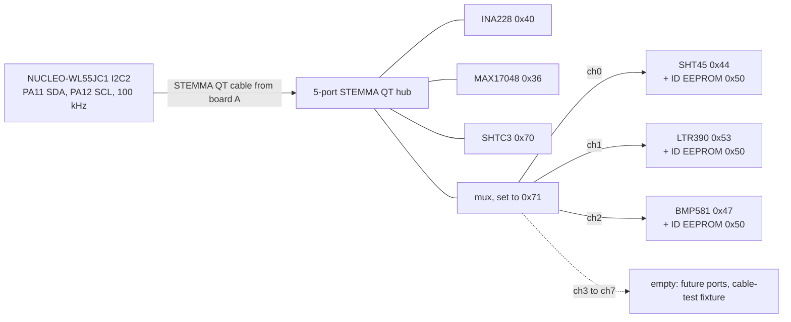
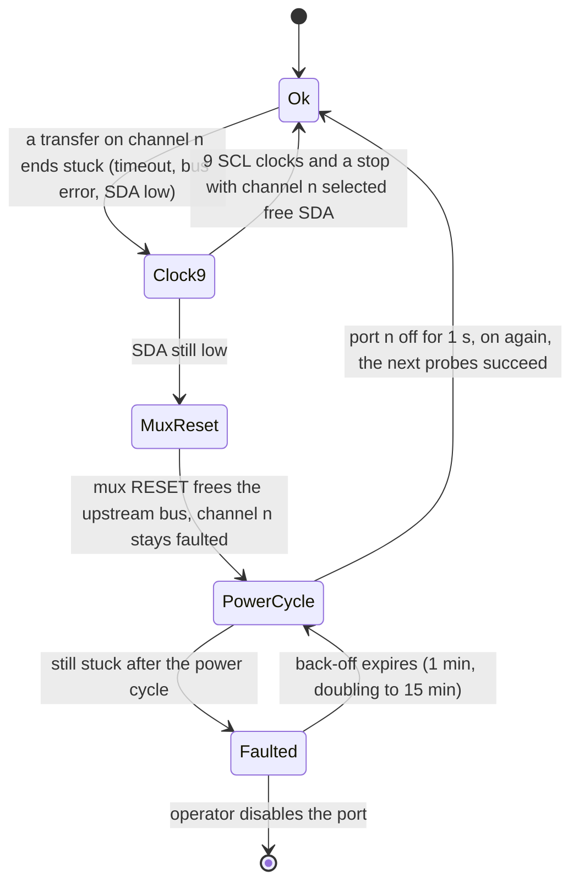
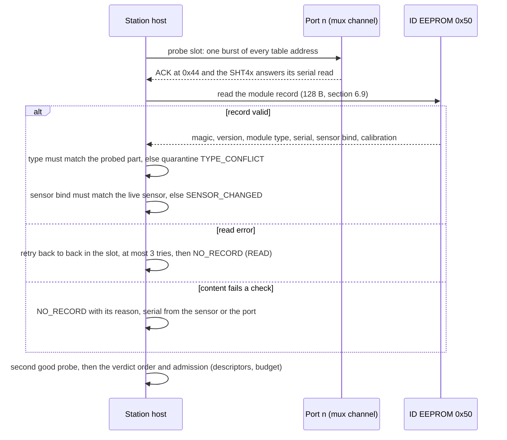
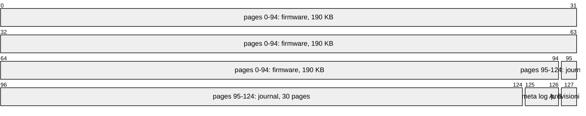

# Firmware: the current design

The sections below are the parts of two earlier design documents that the current firmware, gateway
and tests implement. They were copied verbatim on 2026-11-02, when the documents themselves were
removed from the repository with the rest of the later-stage material (git history has them, up to
commit `e44977f`):

- the sensor module ports design (`docs/superpowers/specs/2026-10-21-sensor-module-ports-design.md`,
  "the ports design"): sections 4.1 and 4.3 (the mux profile, `WS_I2C_MUX=1`, which `i2c_bus`
  implements), 6.5 and 6.6 (scheduling and recovery on the mux), 6.7 (module identity) and 6.9 (the
  module record);
- the sixteen-stations design (`docs/superpowers/specs/2026-10-16-sixteen-stations-design.md`):
  section 6.1 (the flash layout).

Each section keeps its original number, so a citation such as "ports design, section 6.7" or
"sixteen-stations section 6.1" in the code and tests resolves to the section of the same number
here. The only change to the copied text is the one relative link in section 4.1, re-pointed from
this file's new location. References inside the text to sections, requirements (PORT-n, OQ-n) or
sub-projects that are not copied here refer to the original documents in git history.

## Sensor module ports design (2026-10-21), the sections the firmware implements

### 4.1 Topology (from the ports design)

- The hub's five sockets take the NUCLEO cable, the INA228, the MAX17048, the SHTC3 and the mux.
  Daisy-chaining by the boards' second sockets also works. The topology is what matters: the three
  base-only parts and the mux are upstream; each external sensor is alone on a channel.
- The channel numbers above are my call. Any assignment works, but firmware and wiring must agree.
- **Every channel's sensor has its ID EEPROM from phase 1 on** (decision: identity is normalized).
  On the breadboard it is a STEMMA QT EEPROM breakout (a 24LC32-class part at 0x50, for example
  Adafruit's 24LC32 board; check its address and write-protect jumper), chained from the sensor
  board's second QT socket. All channels' EEPROMs share 0x50; only one channel is selected at a time,
  and nothing upstream uses 0x50. Each one is programmed once with its sensor's record (section 6.9),
  then write-protected: WP strapped to VCC (the breakout's default WP state is **TBD**; check it).
  When the sensor moves onto its v1 module board, the record is copied to that board's EEPROM, so the
  serial does not change, and the breakout's copy is invalidated (section 6.9, **Copying a record**):
  two live EEPROMs never carry one serial. On the breadboard each EEPROM breakout and its sensor
  board are a labelled pair; replacing the sensor board means a new record with a new serial.
- **The breadboard itself does not change.** Board A keeps one STEMMA QT cable to the hub
  ([`build-sheet.md`](../hardware/bench-breadboard-r0/build-sheet.md), part QT). The mux lives
  on the QT chain, off the breadboard. The meter circuits on board A stay as they are.
  *Amended 2026-10-30 (BP section 3, step 1; 4.4; 4.6):* at step 1 (breadboard v2) the breadboard
  does change. Power comes off it: no battery, charge, input or load current runs through a
  breadboard contact (BP P1). At change C a PA9 sensor load switch goes on board A, and the QT bus
  splits into an unswitched branch (the power monitors) and a switched branch (the sensor hub),
  mirroring PORT-9 for the monitors only: the bench's SHTC3 (and BMP581) stay on the hub, on the
  switched rail, where PORT-9 keeps the SHTC3 upstream and unswitched (BP 4.6 dated note: a bench
  difference, accepted; the carrier follows PORT-9). The mux still lives on the QT chain, off the
  breadboard. *Amended 2026-11-02 (BP 4.6 dated note):* the PA9 load switch is deferred to the
  carrier; on boards A (step 1) and the step 2 shield both QT branches take the unswitched 3V3 and
  PA9 is unconnected. Port power switching (PORT-5) is first built and tested on the carrier.
- **Mux RESET** (active low on the TCA9548A; check the PCA9548 board) goes to a free NUCLEO GPIO, so
  firmware can release a stuck channel (section 6.6). The pin is **TBD**: it must pass the UM2592
  checklist of the wiring guide (section 6 there), like every other pin. Until it is wired, the
  breadboard has no way out of a channel whose device holds SDA low, other than unplugging.
  *Amended 2026-10-30 (BP N5):* the pin is **PB14** (A4, CN8.5 / morpho CN7.36), a direct GPIO. It
  is wired when the mux is (`WS_I2C_MUX` 1), and only after the shield's incoming check shows A4 not
  tied to SDA. The firmware drives it through `i2c_bus_mux_reset_line`
  (`firmware/stage0-node/App/board_inputs.c`). In the hub profile (`WS_I2C_MUX` 0) it is not wired.

### 4.3 Firmware for phase 1 (from the ports design)

Smallest change: a **static channel map**.
- `i2c_bus` (`firmware/stage0-node/App/i2c_bus.lit.md`) gets a channel for each client. Before a
  transfer to a client on a channel, the bus writes the mux control register, and reads it back
  to check it. After the burst it deselects every channel (writes 0x00 and reads it back). Upstream
  clients (INA228, MAX17048, SHTC3) are served only with no channel selected (section 6.5).
- The stuck-bus recovery (WSMP-B3) runs with the failing channel still selected, then deselects all
  channels (section 6.6). The breadboard has no per-port power switch, so step 3 of the ladder (the
  power cycle) does not exist there: a channel still stuck after mux RESET stays faulted until
  unplugged.
- The module drivers stay as they are. Discovery (a port finds out which sensor it holds) is a v1
  step (section 6.7).
- The host test harness gets a register model of the mux.

Bench checks to add to the wiring guide's section 8 (each a few minutes):

| Check | Expected |
|---|---|
| `MODULES` after a minute | every module active, as today |
| Unplug the SHT45 from ch0 | `air_th` goes suspect, then absent. The others stay active |
| Short SDA to GND on ch0 for 10 s (a jumper on the QT breakout). **Only with mux RESET wired** | ch0's module goes suspect. INA228, MAX17048, SHTC3, LTR390 and BMP581 keep reading. No reset. Without RESET wired the upstream bus is held too, and every I2C module goes suspect until the short is removed: that is the expected result then, and it shows why RESET is needed |
| Plug the SHT45 into ch3 instead of ch0 | with the static map: absent (the expected result for phase 1). With discovery (v1): found on ch3 |

### 6.5 Scheduling on the mux (from the ports design)

- Only one channel is selected at a time. The bus queue of `i2c_bus` serves transfers in order. A
  transfer whose client is on a channel first writes the mux (one byte) and reads it back.
- **After every channel burst the bus deselects all channels** (writes 0x00 and reads it back).
  Upstream parts are served only with no channel selected. So a plug event or a latch-up on a port
  can never corrupt an INA228 or MAX17048 transfer, a foreign device on a port can never answer at an
  upstream address, and a bus stuck with no channel selected is an upstream fault, not a port fault.
- **A channel whose port power is off is never selected.** With its pull-ups unpowered, selecting it
  would load the upstream bus through the channel's pull-ups to a 0 V rail.
- The SHT45 does not answer during a measurement (WSMP-B2). That stays a per-module rule; the mux
  does not change it.
- Each channel switch, and each deselect, costs a few hundred microseconds at 100 kHz *(estimate)*.
  The station reads four ports in well under the 5 s read deadline (WSMP-T2).

### 6.6 Recovery, rescan and port faults (from the ports design)

- Step 1 is WSMP-B3 as it is today, run on the failing channel.
- Step 2 is new: if a device on channel n still holds SDA, the upstream bus is held too, because the
  mux joins them. The firmware cannot write the mux to deselect the channel. Mux RESET does it in
  hardware. The upstream parts (battery monitor, enclosure sensor) are back at once.
- Step 3 is new: switching the port's power off and on clears a latched-up sensor.
- The back-off times are my call. A faulted port costs no bus time between attempts.
- **Rescan.** Every 15 s (my call: the station's sample tick), an empty port probes every address in
  the probe table (section 6.7), as one burst of transfers in its probe slot (one burst per slot,
  every table address in it). Two good probes in
  a row admit the module (WSMP-P2), so admission takes 15–30 s, and the module joins the layout at the
  next latch (up to 60 s later). With a first probe lost to contact bounce (+15 s) and the
  identification and holder check (up to about 2.25 s, section 6.7), plus up to 3 s if that falls in
  a pre-latch slot, a newly plugged module is in the readings within about 111 s
  (15 + 15 + 15 + 2.25 + 3 + 60 s); PORT-7 allows 120 s.
- **Unknown-device scan** (my call). The probe table alone cannot see a device at another address,
  so a port that stays absent also gets a bounded scan: once at boot, then at most once every
  15 min, in its probe slot. It addresses 0x08–0x77 except the table addresses and every address on
  the upstream bus (the mux, the battery monitor, the enclosure sensor: they answer through any
  selected channel), a fixed list built from the board's upstream table, not learned, and except
  0x50. Each address gets a zero-length write, and the whole scan is about 110 address bytes, under
  15 ms at 100 kHz *(estimate)*. An ACK marks the port "unknown device at 0xNN". It is never admitted
  (WSMP-P3). Whether a zero-length write is harmless to every part we might meet is **TBD**. A port
  whose 0x50 answers with a valid record but whose probe finds no sensor reports "record present,
  sensor missing", with the module type the record names.
- **Boot order.** At boot, before any upstream transfer: pulse mux RESET, write mask 0x00 and read
  it back, then run the phantom check below, then start the upstream drivers.
- **No phantom modules** (PORT-15). No probe-table or scan address may answer with every channel
  deselected. At boot, with mux mask 0x00, the station probes every probe-table address and 0x50;
  any that answers is removed from the port probe table and the scan for that boot and reported as
  an upstream conflict. A build-time check asserts that the upstream table and the probe table share
  no address. Otherwise an upstream device (for example a BMP581 on the base, OQ-3) answers through
  every selected channel, and every empty port is admitted as that module.
- **Port faults are reported.** A faulted port, or a device the scan found at an address that is not
  in the table, shows in the `MODULES` line and later in the health report. A port fault never changes the
  descriptor set by itself (WSMP-P3).

### 6.7 Presence, identity and descriptors for a passive module (from the ports design)

A v1 external module is a WSMP **local** module: its driver runs on the station. WSMP rule 1 ("one
contract") holds unchanged. What is new is that a port no longer implies a module type. Today each
port is fixed to one type (`enum wsmp_port` in `firmware/stage0-node/App/wsmp_local.h`). On an I2C
port the station finds out what is plugged in.

**Probe table** (the module types already in the registry, WSMP section 4.4):

| Address | Check | Module type |
|---|---|---|
| 0x44 | the SHT4x serial-number read with a good CRC (verify the command in the datasheet) | 1, air temperature and humidity |
| 0x46 or 0x47 | BMP581 CHIP_ID = 0x50 (as `App/mod_reg.c` does today). **Only if the BMP581 is a port module** (OQ-3); if it goes on the base, upstream of the mux, type 2 leaves the port probe table and the phantom rule (section 6.6) would remove it anyway | 2, air pressure |
| 0x53 | LTR390 PART_ID register 0x06, high nibble = 0xB (part number). The low nibble is the revision and is not compared (`App/mod_reg.c` today compares the whole byte, 0xB2: change it, section 13.3; the nibble split is from memory of the datasheet, verify) | 3, UVA |

**Presence** (a proposed bullet for WSMP-P1): an I2C port shows presence by a successful probe of a
table address on its mux channel, with the part's ID check. NACK at every table address means
absent. SDA or SCL held low on the channel is a port fault (WSMP-P3). Two table parts on one port
are refused: one module per port. A module whose type is already admitted on another port is
refused with the port status `DUP_TYPE` (one module per type in v1, section 1) if the holder check
finds the holder present (below). **After a station reboot** with two modules of one type plugged in,
the station holds the boot verdicts for the first two station-wide probe rounds (two 15 s ticks; a Faulted or operator-disabled port, never probed, does not hold them), then
decides them in port order, so the lower port wins; a port whose probes bounced in those rounds
decides later and loses. The gateway then sees the role's
serial change if the other one held it before (the archive's role-serial alarm, section 13.3).

**Identity block**, filled by the station's driver as today, from these sources:

| Field | Source |
|---|---|
| magic, WSMP version | the station |
| module type, schema | the probe table gives the type; the schema is the one the station's registry (WSMP section 4.4) assigns to that type. The record carries the type only, never a schema: a schema is a property of the driver and registry, so a firmware schema change never invalidates fielded records. A valid record whose type differs is quarantined |
| serial | 1. the EEPROM record (namespace 0x01). 2. Else derived from the sensor's own serial number, if it has one (namespace 0x02; the SHT4x does; the BMP581 and LTR390: **TBD**). 3. Else `WSMP_LOCAL_SERIAL(port, type)`, as today (namespace 0x00). Sources 1 and 2 travel with the module; source 3 is bound to the port (see **Serial rules** below) |
| firmware version and build | the station's |
| boot ID | `(station boot epoch << 8) \| (admission count of the port, mod 256)`, u32, assuming the epoch stays below 2²⁴ (16.7 million station boots). The admission count goes up at each admission of the port, and at the latch where a port's sticky *possibly replugged* flag (set by a missed probe or a failed data read, not by a failed identity-check read) is cleared by a matching identity check at a latch whose data read is good (section 6.7). A passive module has no clock of its own, so a re-plug is its "boot". This keeps WSMP-I2's intent (a counter series never spans a power loss) for any future passive module with a counter. The snapshot carries the low 16 bits (8 bits of epoch, 8 of count). **Accepted limit:** a boot ID repeats only after 256 noticed replugs or admissions of one port within one station boot; WSMP-C1 also needs the same serial, and no v1 passive module has a counter. A passive module with a counter needs a wider field first. This replaces, for I2C ports, the identity table's "increases by one at each boot, kept in non-volatile memory" (section 13.1) |
| identity flags (register 0x000F, now reserved) | bits 0–1 serial source (0 port or station, 1 record, 2 sensor, 3 adapter UID); bits 2–3 reserved, 0; bits 4–7 the record status (0 applied, 1 READ, 2 BLANK, 3 NO_MAGIC, 4 VERSION, 5 MALFORMED, 6 CRC, 7 CAL_REJECTED, 8 SENSOR_CHANGED: valid but not applied; 1–6 are `NO_RECORD`; section 6.9); bits 8–15 0. A reader rejects nonzero reserved bits (2–3 and 8–15) as malformed (`wsmp_unpack_identity`; the descriptor-set parser for bits 2–3 of `id_flags`). The low byte is the descriptor set's `id_flags`, so the reason reaches the gateway. The flags describe an admitted module only: for a verdict that is not admitted (`TYPE_CONFLICT`, `DUP_SERIAL`, `DUP_TYPE`) they have no meaning and are not sent, and the console's `MODULES` line prints the verdict instead. Proposed WSMP edit, section 13.1 |
| capabilities | bit 0 set if the record is valid (it fills the metadata block: part number and calibration revisions). Bit 1 clear |
| descriptor digest | computed, as today |

**Descriptors** come from the driver and the registry, as today. They never come from the EEPROM.
Rule 3 of WSMP (codes, not text, carry meaning) and WSMP-X3 (no text as identity) hold.

**The module record** in the EEPROM is defined in section 6.9 (Module record v1.0). The station
parses it into a fixed structure and checks every length, code and character (WSMP-X2). The fuzz
target `wsmp` grows to cover it.

**Verdicts, in this order** (the first that applies decides; the same order for every serial
source, so the result is deterministic):

| Step | Verdict | When | Result |
|---|---|---|---|
| 1 | `NO_RECORD` (READ) | no ACK at 0x50, or a transfer error, on 3 tries back to back inside the probe slot (about 40 ms). A single read error is retried, not a verdict | go on to step 4 with the serial from source 2 or 3, no calibration |
| 2 | `NO_RECORD` (BLANK, NO_MAGIC, VERSION, MALFORMED, CRC) | the record was read but fails a structural check (section 6.9, **Checks** 2–6). A CRC failure is read once more first | go on to step 4 with the serial from source 2 or 3, no calibration |
| 3a | `TYPE_CONFLICT` quarantine | a valid record whose module type differs from the probed part | quarantined; stop |
| 3b | `SENSOR_CHANGED` | a valid record whose sensor bind differs from the live sensor's serial, **read** (a good CRC) and different (a sensor-board swap without reprogramming). A read error is not a verdict: the sensor serial (0x89) is tried 3 times back to back in the slot, like the record; if all 3 fail, the identification is incomplete: no verdict at all, the port stays Identifying, the incomplete identification is counted (console `MODULES` line), and the port is identified again at its next probe slot | go on with the source-2 serial, no calibration |
| 3c | `CAL_REJECTED` | a structurally valid record whose calibration fails only the calibration checks (section 6.9, **Checks** 7) | go on with the record's serial, no calibration |
| 4 | duplicate serial | the serial (any source) equals that of a module Admitted, Active or Suspect on another port | **check the holder now** (below) |
| 5 | duplicate type | the module type is Admitted, Active or Suspect on another port (one per type, section 1) | **check the holder now** (below) |
| 6 | admit | otherwise | admitted with its serial, its flags and, for an applied record (status 0), the record's calibration |

**Checking the holder** (steps 4 and 5; decided by the review crew, section 1). The holder check is
a step of the **holder driver's own step machine**, started only from its idle state (`mod_th`'s
ST_IDLE), so never between the SHT45's 0xFD and its read: the newcomer's verdict waits for it,
usually one or two driver ticks (250 ms each; `mod_reg` needs 2), and up to about 9 ticks (about
2.25 s) if the holder driver is in its own identity check or the holder check confirms a different
identity (4–6 steps). In the pre-latch slot it waits until after the latch (below). The step selects the holder's channel and reads the holder's
probe-table address with its ID check, its record serial at 0x50 if it was admitted with a record,
and its sensor serial if it has one.
- **Holder gone** only on (a) an address NACK at the holder's probe-table address on two tries back
  to back, or (b) a confirmed different identity (as the identity check confirms one, below), or (c)
  a holder port that is Faulted (section 6.6, after the power-cycle step failed) or disabled by the
  operator (it is never selected, so its module is unreadable and treated as gone). The 1 s off of a
  recovery power cycle is not "gone": the check waits for it. The holder is ended (Absent, new descriptor set at the next latch) and the
  newcomer goes on to admission; its driver's window is reset at the bind, so no sample of the old
  module is in the newcomer's first window. A moved module is therefore admitted within two probes
  of the plug, before the old port's next latch. This is a removal sooner than WSMP-P2's three missed
  latches, so §13.1 amends WSMP-P2.
- **Holder present** otherwise. An EEPROM or sensor-serial read that fails is not absence: the holder
  is present and its identity unverified. The newcomer is refused (`DUP_SERIAL` for a clone,
  `DUP_TYPE` for a second module of a type), never quarantined. A refusal is re-evaluated at every
  latch, after all ports' latches, in port order; the newcomer is admitted only once the holder is
  Absent.

A `TYPE_CONFLICT` quarantine is released only by removing the module (WSMP §7: Quarantined →
Absent; a WSMP-P6 flap quarantine still ends after its hour); the record is corrected off the station, on the programming fixture. **A quarantined or
refused port keeps its probe slot**: it probes the module's address each slot, and two missed probes
in a row make it Absent, so a removal is always seen. **Reporting:** the serial source and
the record status (including `SENSOR_CHANGED`) reach the gateway in the descriptor set (below).
`TYPE_CONFLICT`, `DUP_SERIAL` and `DUP_TYPE` are not admitted, so in v1 they show only on the console
(`MODULES` line); a radio health field for them is a later item.

**Accepted risk.** Only the SHT4x has a sensor serial to bind. A BMP581 or LTR390 sensor board
swapped under its module board without reprogramming keeps the old record and its calibration,
undetected. The programming procedure (section 6.1) is the only guard.

**Re-identification** (PORT-16, PORT-17). A module can be swapped between two reads without one
failed read, and an unplugged module stays Active until a latch read fails, so admission alone does
not see a swap. **Every latch is preceded by an identity check** of every Admitted, Active and
Suspect I2C module, on a fixed schedule:
- **The pre-latch slot** starts 3 s before each latch (my call: longer than a sample in progress, one
  250 ms tick, plus the worst-case check, about 9 ticks or 2.25 s for an SHT45 whose change is
  confirmed with full reads). Sampling is free-running (WSMP-T4) and the latch has its own timer, so
  the slot is defined from the latch time, not from a sample. The latch time is the one scheduled
  (the sample timer's, a minute after the latch before was due), not the moment the sample task runs:
  a latch whose task runs late does not move the next slot, and a latch that comes before its slot
  has no check (unverified). **The slot applies only to I2C
  port-module drivers** (ports 1–8); on-board drivers (power, wind, rain, enclosure) sample as today.
  In the slot a port-module driver starts no new sample: **a sample that falls due in the slot is
  deferred**, not dropped, to the driver's first tick after the latch, and its period keeps its
  phase (the next sample is due when it would have been), so the deferred sample lands in the new
  window and every window keeps its sample count. In the real code the sample phase is about 0 (each
  driver's first sample is due at boot, and the latch is every fourth 15 s tick), so a port module's
  sample is due at the latch every time; deferring keeps it. §13.1 amends WSMP-T4. The identity
  check has priority in the slot: a newcomer's identification or a holder check for the same driver
  waits until after the latch. A sample already in progress finishes, then the driver runs the check
  as a step of its own step machine from its idle state (`mod_th`'s ST_IDLE, section 13.3), never
  between the SHT45's 0xFD measure command and its 6-byte read. The
  0x89 reply has the same two-words-and-CRC form as a measurement, so the step, not the bytes, decides
  which parser reads it. Sampling resumes after the latch.
- The check re-observes the identity seen **at admission** and compares like with like:

| Admitted with | Re-observed | A confirmed change is |
|---|---|---|
| an applied or `SENSOR_CHANGED` record | the serial at 0x0C and the CRC at 0x7C (12 bytes, two short reads) | a different serial or CRC, confirmed by a full 128-byte CRC-checked read whose verdict (steps 2–3c) is redone on the new record. If that full read is not a valid record (blank, corrupt, or 0x50 NACKs: a module with a blank, corrupt or missing EEPROM), it is read once more, back to back: two full reads that agree with each other (the same image, compared by CRC-32C as in the image row, or both NACK at 0x50) both differ from the record admitted, a confirmed change; two that disagree are unverified, as in the image row. The short reads themselves must complete: a NACK on the 8-byte serial read is a failed part (unverified), so an EEPROM that dies after admission stays unverified (PORT-17) |
| `NO_RECORD` (READ): 0x50 did not answer | whether 0x50 answers. A NACK is a **completed, agreeing** part (it matches what admission saw) | 0x50 answering with a record that passes a full read. Allowed **once per admission**; a later NACK is never a change |
| `NO_RECORD` with a content reason (BLANK, NO_MAGIC, VERSION, MALFORMED, CRC), or `CAL_REJECTED` | the whole 128-byte record (one full read, about 12 ms), compared by the CRC-32C computed over the 128 bytes read against the one computed over the image read at admission (not the stored CRC at 0x7C, which a corrupt image need not match) | a different image on two full reads back to back in the slot that agree with each other (two that disagree: unverified), the second parsed as at admission (steps 2–3c): a change if its verdict, its record status or its serial differs from admission. A different image with the same verdict, status and serial agrees, so a corrupt tail that drifts is not a leave and a join at every latch |
| a sensor serial (SHT4x), with or without a record | the sensor's serial (command 0x89, its own CRC) | a different serial on two reads back to back in the slot |

- **Why the whole image for these** (Codex review of PR #18): a content fault or a rejected calibration may lie anywhere in the 128 bytes, past the serial. A module admitted as `NO_RECORD` (CRC) after a transient corruption, or MALFORMED by a field after 0x13, would otherwise keep a prefix that matches for ever, its fallback serial and no calibration, after the record reads valid again; a `CAL_REJECTED` record rewritten on the fixture is a new record. **Tick count:** the two full reads take one driver step each and replace the earlier compare's three (two 20-byte reads and a full read), so the worst case stays about 9 ticks (2.25 s) and the 3 s slot still fits.
- **Outcome of a check:** *changed* if any part confirms a difference (a confirmed difference wins
  over a part that NACKed or failed: an SHT45 replaced by an LTR390 module NACKs 0x89 but its record
  serial differs); *matched* if every part that completed agrees and at least one part completed;
  otherwise *unverified* (NACK, transfer error, CRC failure on a confirming read, a port fault, or
  the check not finished by the latch).
- **Changed: the port ends at that same latch.** The window that the latch closes is published as
  missing (the new module's samples are never published under the old serial, descriptors or
  coefficients), the port goes Absent (new descriptor set), and the new module is probed and
  admitted as any new module. A changed record CRC with the same serial is also a leave and a join
  (decided by the review crew, section 1): there is no in-place recalibration.
- **The sticky *possibly replugged* flag.** A missed probe or a failed data (sample) read sets it; a
  failed identity-check read does not. Only a *matched* check at a latch whose data read is also good
  clears it, and that latch gives the module a new boot ID: a latch with a missed probe or a failed
  read never counts as matched (it is unverified), so an unplugged `NO_RECORD` (READ) module, whose
  0x50 NACK agrees, keeps its flag and its boot ID until it is plugged back, then takes one new boot
  ID. While it is set and the check is not matched, **the window is published as
  missing**: a module that may have been swapped is never published unverified.
- **Timeout, in any state.** A port whose flag is set and whose check is unverified for 60 latches in
  a row (about 1 h; a matched check or a confirmed change resets the run) is ended (a leave) and
  rejoins as any new module, with whatever identity it then shows. This bounds the silence of a
  working sensor whose record has become unreadable (a BMP581 or LTR390 has no sensor serial to
  match on): it comes back within the hour as `NO_RECORD` (READ), whose NACK then matches. At most
  one descriptor-set change pair an hour, well inside WSMP-P6.
- **Suspect.** A Suspect module returns to Active only at a latch whose check matched. At a latch
  where its data read was good but its check is unverified, its missed-latch count (WSMP-P2) is
  neither raised nor reset, and its window is missing (the flag is set). So "three missed latches in
  a row" counts the missed latches with the good-but-unverified ones between them skipped: miss,
  good-unverified, miss, good-unverified, miss removes the module (amended WSMP-P2, section 13.1).
  The timeout above applies here too.
- **Unverified without the flag** (PORT-17): a module that missed nothing since the last latch keeps
  its state and is published normally; the per-port unverified counter shows on the console
  (`MODULES` line) after 3 latches in a row, and is never sent in the descriptor set. An unverified
  check never moves a port between Active, Suspect and Absent, except the one-hour timeout above;
  only the module's own data reads do that (WSMP-P2, P3), as today. An EEPROM that fails after
  admission therefore leaves a working, unmoved sensor admitted, unverified, its serial unchanged.
- **Order within a latch** (fixed): first the state transitions of every port, in port order; then
  the identity-check results, in port order; then the re-evaluation of refused ports, in port order;
  then the new descriptor set, if any.

**Why every module board has one** (OQ-6, decided 2026-10-21): it gives each physical sensor a serial that survives a move to
another port, and later to a v2 adapter, and it carries the sensor's calibration (section 1). The
gateway's planned calibration and siting archive (WSMP section 15) needs the serial. Without it, a
module's serial is its port, and a swap of two SHT45 modules is invisible.

**The serial reaches the gateway** (B1 of the 2026-10-22 review). Today no frame carries a module
serial: the WSMP section 11.1 descriptor-set entry is port, type, schema and channel count. Each
module entry gains `serial` (u64), `id_flags` (u8: the identity flags' low byte above: serial
source, `SENSOR_CHANGED`, record status) and `record_crc` (u32: the applied record's CRC-32C; 0
whenever no record is applied: `NO_RECORD`, `SENSOR_CHANGED`, `CAL_REJECTED`). A swap or a new
record gives a new set and generation, which is the gateway's series boundary for WSMP-C1 and C4.
The gateway keys calibration and siting history by serial and knows which coefficients were applied
by `record_crc`; the coefficients do not go over the radio: the serial ledger (section 6.9) holds
the whole 128-byte record image, from which the gateway can recompute the CRC and read the
coefficients. An entry grows from 5 to 18 bytes. WSMP-E4 becomes 8 + 8 × 18 + 24 × 6 = 296 bytes
(Calculated; 8 + 12 × 18 + 24 × 6 = 368 if P8 were raised to 12). The fragment payload is not
defined yet (WSMP-E9); with the same 58 bytes that a reading gets (WSMP-A1: a 78-byte plaintext less
a 20-byte header), a full set takes at least ⌈296 / 58⌉ = 6 fragments, against at least ⌈192 / 58⌉ = 4 today
(Calculated, before any fragment header; 7 for 368 B). *Amended 2026-10-29 (PT section 8.4): WSMP-A1
is now 60 bytes (the 80-byte per-build plaintext less the 20-byte header), so a full set takes at
least ⌈296 / 60⌉ = 5 fragments (⌈192 / 60⌉ = 4 today, ⌈368 / 60⌉ = 7 for 368 B).* The WSMP section 11.2 diagram's 3 fragments
illustrate the exchange, not a full set. The radio code has no frame kind for a descriptor set yet:
`ws_air_frame_ok` (`firmware/common/ws_console.c`) accepts only the observation and diagnostic
kinds (section 13.3). The WSMP edits are in section 13.1.

**Serial rules** (they hold for v1 ports and v2 adapters alike, section 7):
- One precedence everywhere: EEPROM record, then the sensor's own serial, then a binding-derived
  fallback. A v2 adapter uses the same order, so a module whose serial came from source 1 or 2 keeps
  it on any v1 port and behind a v2 adapter. The serial may change only at admission or at
  re-identification (a leave and a join), never silently between reads.
- **Namespaces.** The serial's top byte names its source, so the sources never collide:

  | Top byte | Source | Low 56 bits |
  |---|---|---|
  | 0x00 | station-bound fallback, `WSMP_LOCAL_SERIAL(port, type)` (its value `0x575300000000 \| port << 8 \| type` already has a zero top byte) | unique only within one station |
  | 0x01 | programmed record (source 1) | random, from the programming fixture's CSPRNG, never 0 and never all ones, logged in the serial ledger (section 6.9) |
  | 0x02 | the sensor's own serial (source 2) | bits 55–40 the module type, bits 39–32 0, bits 31–0 the sensor's serial (SHT4x: its 32-bit serial) |
  | 0x03 | v2 adapter MCU unique ID (fallback) | the low 56 bits of FNV-1a-64 over the 12 UID bytes (section 7) |

- **Duplicates.** A second module with an admitted serial on one station meets the holder check
  (above): refused (`DUP_SERIAL`) while the holder is present. One namespace-0x01 or 0x02 serial in
  the current descriptor sets of two stations that are both still reporting (heard within the last
  10 minutes) for more than 10 minutes is a gateway alarm (my call:
  the old station's 3 latches to drop the module plus the delivery of its new set; it covers a module
  moved between stations). Namespace-0x00 serials repeat across stations by design, so the gateway always pairs a
  serial with its station key.
- A fallback serial (v1: `WSMP_LOCAL_SERIAL(port, type)`; v2: from the adapter MCU's unique ID)
  names the binding, not the sensor. Moving such a module gives it a new serial, by design. Nobody
  aliases the old serial to the new one: the station and the gateway cannot tell a moved module from
  a swapped one, and a wrong alias would attach one sensor's calibration and siting record to another.
- Home Assistant history does not depend on the serial: the WSMP-H1 entity ID has no port and no
  serial in it, so it continues across moves for every module (section 2).
- A module whose calibration or siting record must follow it across ports or to v2 needs source 1
  or 2. This is why every v1 module board carries a programmed EEPROM (OQ-6).
- **No usable record is a fault, not a normal case.** The station still admits the module
  (its readings stay useful, and one bad part never stops a sensor), takes the serial from sources 2
  and 3, applies no record calibration, and raises the flag `NO_RECORD` with its reason in the
  identity flags, which reach the gateway in the descriptor set. There is no expected record-less
  case: the breadboard has an EEPROM per sensor (section 4.1) and an I2C sensor's v2 adapter takes
  only a v1 module board (section 7). The meter ports (12, 13) are not I2C module ports and are
  outside this rule: the SEN-15901 has no record in v1, by decision (section 1, "Meter identity"),
  and raises no `NO_RECORD`.
- **On an I2C module port, `NO_RECORD` always means a missing, blank, corrupt or unreadable
  EEPROM.** A valid record whose type disagrees is quarantined instead (the verdict table above).

**Port numbers.** Today a port number is a module type (1 = outside air … 7 = rain). In v1 a port
number is a place. Proposal (my call; it only has to be stable):

| Port numbers | What |
|---|---|
| 1–8 | I2C ports on mux channels 0–7, labelled SENSOR 1–8 |
| 9 | battery and charger (on the base). *Amended 2026-10-29: **battery** (module type 8: cell voltage, battery current, energy and charge counters)* |
| 10 | enclosure T/RH, SHTC3 (on the base) |
| 11 | air pressure, BMP581, if it goes on the base (OQ-3) |
| 12, 13 | meter ports: wind, rain |
| 14 and up | reserved for v2 remote ports. *Amended 2026-10-29: **14 = power rails** (module type 9, on the base: load, charger input, solar and USB-C voltages and currents); v2 remote ports from **15** and up* |

*Amended 2026-10-29 (PT sections 8.4 and 8.5):* ports 9 and 14 are base-board modules fixed by the
build's power profile (`WS_POWER_PROFILE`), not pluggable ports. **Both are present in every
profile, always**, whatever their parts answer: a missing part makes only its own channels missing,
a bus fault makes them fault, and a channel the profile has no source for carries the snapshot
quality "not fitted" (6). So a dead INA228 or gauge gives INVALID fields, never absent ones, and
never changes the descriptor set. Today's local ports (`wsmp_local.h`) are `P_BATTERY` (5) and
`P_RAILS` (8); the renumbering below moves them to 9 and 14.

**One-time serial change at the renumbering.** The base modules move (enclosure 4 → 10, battery
5 → 9, wind 6 → 12, rain 7 → 13; *added 2026-10-29:* power rails 8 → 14), so their namespace-0x00 serials change at the firmware upgrade
that brings in these numbers. Each starts a new counter series once (WSMP-C3); the entity IDs have
no port or serial, so Home Assistant history continues. The same release also changes the serials
of the phase-1 port modules: on the static channel map they had namespace-0x00 serials, and with
discovery they take their records' (namespace 0x01). Note both in that release's notes.

The station's limit stays 8 modules and 24 channels (WSMP-P8). With one module per type (section 1),
v1 has at most three port modules (types 1, 2 and 3), or two with the BMP581 on the base (OQ-3).
With four base modules (battery, enclosure, wind, rain) that is at most 7 modules, so P8 is not
reached in v1. A fourth sensor port is a spare: a free place to move a module to, or for a later
module type.

*Amended 2026-10-29 (PT section 8.4, risk R2):* the base now has five modules (battery, power rails,
enclosure, wind, rain), so v1 has **8 of 8 modules** (5 base + 3 port modules, or 6 + 2 with the
BMP581 on the base) and **24 of 24 minute channels** (the rails module has every rail from the
start, so no phase adds a channel), with 59 of the 60-byte WSMP-A1 budget. P8 is reached. The fourth
sensor port stays a place to move a module to; a later module type, or any further module or channel,
needs WSMP-P8 and A1 revised in sub-project 7 of the sixteen-stations design.

### 6.9 Module record v1.0 (proposed as WSMP section 10.1) (from the ports design)

The record in every v1 module board's 24LC32A (section 1). Section 13.1 proposes it as WSMP section
10.1's record. **All integers are big-endian** (as WSMP section 6). The record is exactly 128 bytes
at word address 0x000 (pages 0–3). Its length is fixed in format major 1: the station reads 128 bytes
in one transfer before it knows anything else, `i2c_bus` takes at most 255 bytes, and the CRC sits at
a fixed offset. A longer record needs a new major.

| Offset | Size | Field | Rule |
|---|---|---|---|
| 0x00 | 4 | magic | `57 53 4D 52` ("WSMR") |
| 0x04 | 1 | format major | 1. A station accepts only its own major |
| 0x05 | 1 | format minor | 0. A higher minor is accepted: it may only give meaning to bytes that are reserved here, covered by the CRC, and may only widen the calibration table; this station ignores reserved bytes it does not know, but its calibration check (**Checks** 7) is strict at any minor, so stations are upgraded before records that use a widened table are fielded |
| 0x06 | 2 | record length | 128; any other value is MALFORMED |
| 0x08 | 2 | module type | registry code (WSMP section 4.4). **No schema** (section 6.7) |
| 0x0A | 1 | module-board hardware revision | informational |
| 0x0B | 1 | flags | 0 in 1.0 (checked when the minor is 0) |
| 0x0C | 8 | serial | top byte 0x01; low 56 bits random, not 0, not all ones (section 6.7, **Namespaces**) |
| 0x14 | 1 | sensor-bind kind | 0 none; 1 SHT4x serial (command 0x89). Kind 1 is required for module type 1 and forbidden for any type whose part has no readable sensor serial (types 2 and 3 in v1) |
| 0x15 | 3 | reserved | 0 |
| 0x18 | 4 | sensor-bind value | the bound sensor's serial; 0 when the kind is 0 |
| 0x1C | 4 | programming time | UTC seconds; informational, never identity |
| 0x20 | 16 | part number | WSMP-M1 characters. Shorter than 16: padded with 0 bytes, and no non-zero byte after the first 0. Exactly 16 characters: no 0 byte. The station accepts an empty part number (16 zero bytes); the programming fixture requires a non-empty one |
| 0x30 | 16 | reserved | 0 |
| 0x40 | 48 | calibration, 3 entries of 16 B | see below |
| 0x70 | 12 | reserved | 0 |
| 0x7C | 4 | CRC-32C | over bytes 0x00–0x7B |

**Calibration entry** (16 B). Keyed by (quantity, kind), never by channel number, so a later schema
that adds or reorders channels does not move a coefficient.

| Offset | Size | Field |
|---|---|---|
| +0 | 2 | quantity (registry code) |
| +2 | 1 | kind (registry code); 0 means every kind of that quantity on this module |
| +3 | 1 | reserved, 0 |
| +4 | 2 | calibration revision (u16; it fills the metadata block's per-channel calibration revision, WSMP section 6.5). 0 is reserved for an uncorrected channel: a used entry with revision 0 is `CAL_REJECTED` |
| +6 | 2 | reserved, 0 |
| +8 | 4 | offset, s32, in units of the matching channel's descriptor scale (for example 0.01 °C at scale −2) |
| +12 | 4 | gain, u32, in ppm (1,000,000 = unity) |

An all-zero entry is unused and skipped before any check (WSMP-G2).

**Calibration table, frozen for major 1** (decided by the review crew, 2026-10-22, section 1). A
quantity not in the table takes no calibration: an entry for it is `CAL_REJECTED`, at any minor (**Checks** 7); this covers every
counter and sum channel. Later minors may only widen a bound, never tighten it. Bounds are integers
at the channel's scale; no floating point.

| Quantity (code) | Scale | Offset bound | Gain bound (ppm) | Physical range (registry) | Crop margin |
|---|---|---|---|---|---|
| air temperature (1) | −2 (0.01 °C) | ±200 (±2 °C) | 980,000–1,020,000 | −80 to 60 °C | 0 |
| relative humidity (2) | −2 (0.01 %RH) | ±1,000 (±10 %RH) | 900,000–1,100,000 | 0 to 100 % | 300 (3 %) each side |
| station air pressure (3) | −1 (0.1 hPa) | ±50 (±5 hPa) | 990,000–1,010,000 | 300 to 1100 hPa | 0 |
| UVA sensor counts (8) | 0 (counts) | ±16 counts | 100,000–10,000,000 | 0 to 1,048,576 | 16 below, 0 above |

The UVA offset bound (my call within the crew's decision): a dark-count correction of a few counts
is the only physical reason for an offset on a counting sensor; ±16 counts covers it and is far too
small, against a 0–1,048,576 range, to fake a reading. The UVA gain range is wide because a window
in front of the sensor can cut its signal by several times; a gain above 1 can push a bright reading
above the registry's 1,048,576, which is then suspect, not wrapped. The crop margins are my calls
(RH from the crew's decision).

**Applying it** (WSMP-G6):
- **Which entry.** For a channel (quantity q, kind k), an entry (q, k) wins over an entry (q, 0). A
  channel with neither is reported uncorrected, revision 0.
- **Rounding** (decided by the review crew): one shared helper,
  `ws_div_round(num, den) = floor((2·num + den) / (2·den))` for den > 0 (round half up), as
  `mod_mean.c`'s `mean_of` already computes the window mean. The window mean and calibration both use
  it, with one table of golden vectors for the C helper and the Python reference (which must not use
  Python's `round()`, which rounds half to even).
- **Order, on each sample:** the parser returns the raw value at the channel's scale (int32); then
  calibration, `v' = ws_div_round(v × gain, 10⁶) + offset`, in int64 (a sample of 6000 at scale −2
  times a gain of 1,100,000 is 6.6 × 10⁹: it does not fit 32 bits); then the crop and range check
  below; then the window sum (`mean_add`).
- **Crop and range check, for every channel of a port module** (I2C sensor ports 1–8, calibrated or
  not; on-board modules such as the SHTC3 enclosure sensor keep today's checks, whose cut-off is
  125 °C, not the registry's 60 °C). Each quantity has a physical range (the registry's) and a crop
  margin below and above it (the calibration table). The channel's metadata valid range (WSMP-M2) is
  the physical range widened by the margin, so WSMP-S2 holds as written. A value within the margin is
  cropped to the physical limit with good quality; a value beyond the margin is **suspect**: it is
  kept out of that channel's window sum. Each channel keeps its own sample count, so a suspect RH
  sample does not bias RH while temperature keeps its sample. A channel's window quality: missing if
  no sample entered its sum; otherwise suspect if any sample was suspect, which takes precedence over
  partial; otherwise as today. So a calibrated value never leaves the channel's unsigned or
  physical range: a UVA offset of −5 on a night reading of 0–2 gives 0, never a negative mean that
  would pack as 16,777,212 in 3 unsigned bytes.
- **Relative humidity:** margin 3.00 % each side: 100.00–103.00 % reports 100.00 % good, −3.00–0 %
  reports 0 % good, beyond is suspect. **This changes today's behaviour on purpose:** today
  `ws_sht45_parse` crops any raw value above 100 % to 100 % good; after this change a raw SHT45 value
  above 103 % is suspect.
- With `NO_RECORD`, `SENSOR_CHANGED` or `CAL_REJECTED`, no entry is applied.

**CRC.** `wsmp_crc32c` (`firmware/common/wsmp.c`): CRC-32C (Castagnoli), reflected polynomial
0x82F63B78, initial value and final XOR 0xFFFFFFFF. Check value: CRC-32C of the ASCII string
`123456789` = 0xE3069283 (computed with `wsmp_crc32c`, 2026-10-22). An all-zero or all-0xFF record
cannot pass it.

**Read.** One transfer: write the word address 0x0000 (2 bytes), repeated start, read 128 bytes,
about 12 ms at 100 kHz *(estimate)*. The bus guard must scale with the transfer length (section 13.3):
today's 30 ms is sized for a 0.8 ms transfer plus a 24.5 ms flash-erase stall. The identity check (section 6.7)
reads 8 bytes at 0x000C and 4 bytes at 0x007C and a full read to confirm (an applied or `SENSOR_CHANGED`
record), or the full 128 bytes twice (a content `NO_RECORD` or `CAL_REJECTED` record).

**Checks, in order** (the first failure decides; the record status goes in identity-flag bits 4–7:
0 applied, 1 READ, 2 BLANK, 3 NO_MAGIC, 4 VERSION, 5 MALFORMED, 6 CRC, 7 CAL_REJECTED, 8 SENSOR_CHANGED,
set by verdict step 3b). Checks 1–6
are steps 1 and 2 of the verdict order of section 6.7, check 7 is step 3c.
1. No ACK at 0x50, or a transfer error → retried back to back in the same probe slot; after 3 tries
   READ.
2. Every byte 0xFF → BLANK. Magic wrong → NO_MAGIC.
3. Major not 1 → VERSION.
4. Record length not 128 → MALFORMED.
5. CRC fails → read once more; still failing → CRC.
6. A structural check fails → MALFORMED: serial top byte not 0x01, or its low 56 bits 0 or all
   ones; module type not in the station's registry; sensor-bind kind unknown, value nonzero with
   kind 0, module type 1 without kind 1, or kind 1 on a type whose part has no readable sensor serial
   (types 2 and 3 in v1); part number not as the table says; flags or a reserved
   byte nonzero when the minor is 0 (including an entry's reserved bytes); a kind code unknown to
   the registry.
7. A calibration check fails → CAL_REJECTED (the record's serial is kept, no calibration applied):
   an entry whose quantity is not in the calibration table; an entry whose (quantity, kind) matches no
   channel of the module type (the registry's channel list for the type; kind 0 matches every channel
   of the quantity); a kind-0 entry over channels of different scales; two entries with the same
   (quantity, kind); an offset or gain outside the table's bounds; a calibration revision of 0 (it is
   reserved for an uncorrected channel). Check 7 is strict at any minor: an entry for a quantity
   unknown to this firmware's table is `CAL_REJECTED` even when the record's minor is above 0, so
   stations must be upgraded before records that use a widened table are fielded.

A record can at worst flag `NO_RECORD`, `CAL_REJECTED` or quarantine a port. Parsing happens only at
admission and at the identity check, and never resets the station.

**The station never writes 0x50.** `i2c_bus` has no write path to that address on a port channel;
WP holds the array in any case.

**Test page.** Page 127 (word addresses 0xFE0–0xFFF), outside the record and its CRC, is the cable
test's write-and-read-back page (section 5.2). It is written only on the cable-test fixture with WP
opened. On a fielded, write-protected module it is never written; H04a counts CRC-checked record
reads there instead.

**Programming fixture** (a host tool, section 13.3):
1. For an SHT4x module, read the sensor's serial (command 0x89, CRC-checked) and put it in the
   sensor bind (kind 1). Other types: kind 0 (kind 1 is refused on them).
2. Refuse to write a record that would fail any check above, the calibration table included (a
   used entry with revision 0, an entry matching no channel of the type), or whose part number is
   empty (the station accepts an empty one; the fixture does not).
3. WP pad pulled low. Write the record page by page (32-byte pages, 5 ms write cycle per page;
   24LC32A datasheet, verify).
4. Read back the whole record; byte-compare with what was written. Any difference: the board is
   rejected and the serial is not used.
5. Append a ledger row: serial, module type, sensor-bind value, board revision, the record CRC, the
   full 128-byte record image in hex, date and operator (a CSV in the repository, path chosen at
   implementation). A serial is never reused, even for a rejected board.
6. Release WP. Parse the record once more as the station does (**Checks** above): it must pass
   with status 0.

**Recalibration** keeps the serial: new coefficients, the changed entries' calibration revision
increased by one, a new record CRC, written and verified as above, and a new ledger row for the same
serial. On the station the new CRC is a leave and a join (section 6.7). A new serial is only for a
new sensor board or a new module board.

**Copying a record** (breadboard breakout to module board, section 4.1): write the record to the
new EEPROM, verify it as above, then **invalidate the source** by overwriting its magic with
`00 00 00 00` and reading that back. Two live EEPROMs never carry one serial. If the source cannot
be invalidated, the copy gets a new serial instead.

## Sixteen-stations design (2026-10-16), the flash layout

### 6.1 Flash layout (sub-project 1) (from the sixteen-stations design)

The node-state pages move to the top of flash. One boundary constant and the linker script set the
firmware region.

| Pages | Size | Contents |
|---|---|---|
| 0–94 | 190 KB | firmware. TX uses 58 KB today, so the 90 % guard leaves about 113 KB for this design and later sensor drivers. |
| 95–124 | 60 KB | journal: 30 pages |
| 125–126 | 4 KB | meta log A and B |
| 127 | 2 KB | provisioning record |

Journal capacity. Opening a page erases the oldest one, so 29 pages always hold records:

| Build | Plaintext | Slot | Slots a page | Records retained | Outage buffer |
|---|---:|---:|---:|---:|---:|
| full station (the 78-byte radio ceiling) | 78 B | 96 B | 21 | 609 | 10.1 h |
| temperature and humidity | 35 B | 56 B | 36 | 1,044 | 17.4 h |

*Amended 2026-10-29:* the journal asserts 24 hours of the build's widest record, not of every
catalog field (PT section 7). The version 6 node field set (77 B) and the 80-byte per-build ceiling
both take a 96-byte slot: 21 slots a page, 609 records, 10.15 h, as the full-station row. Every
catalog v2 field (94 B, a 112-byte slot, 8.7 h) is never a build.
