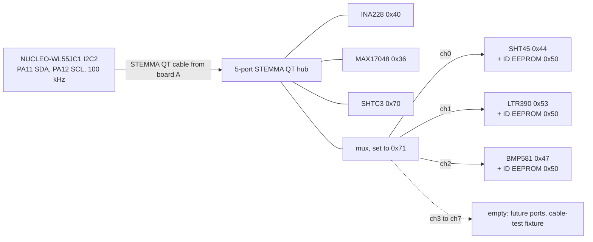
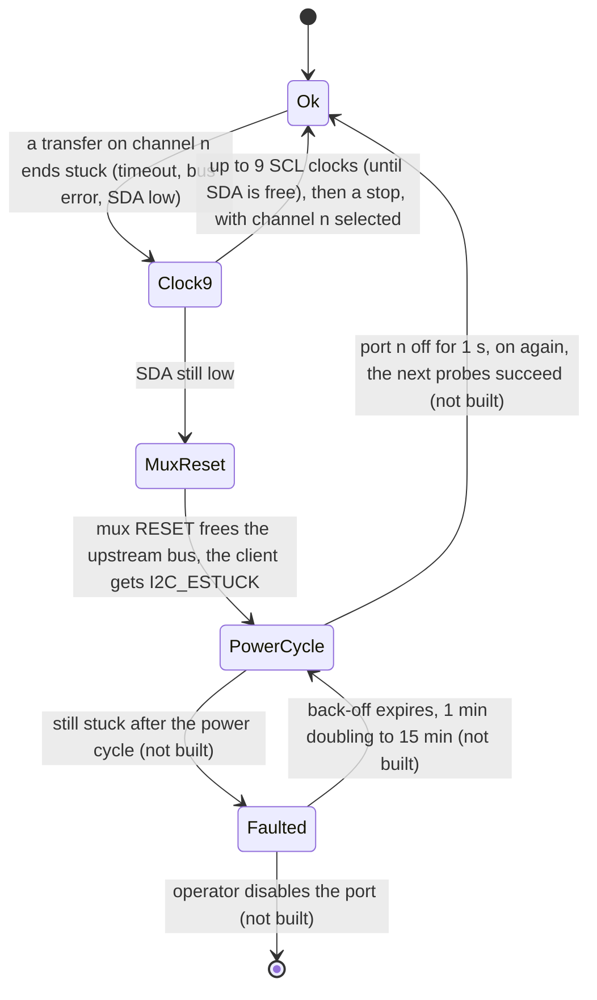
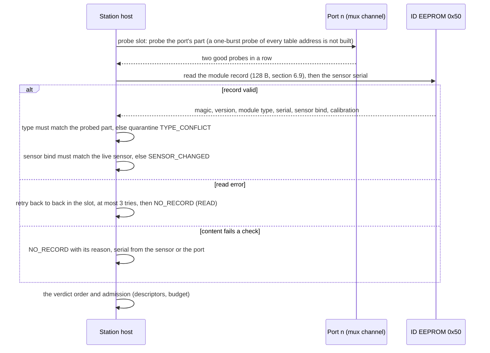
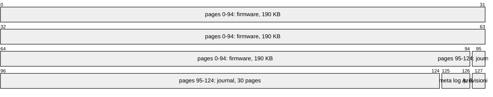

# Firmware: the current design

This file holds the parts of two earlier design documents that the firmware, gateway and tests build
on. We copied them here on 2026-11-02, when we removed the documents themselves from the repository
with the rest of the later-stage material. Git history still has them, up to commit `e44977f`:

- The sensor module ports design (`docs/superpowers/specs/2026-10-21-sensor-module-ports-design.md`,
  "the ports design"). We kept sections 4.1 and 4.3 (the mux profile, `WS_I2C_MUX=1`, which `i2c_bus`
  implements), 6.5 and 6.6 (scheduling and recovery on the mux), 6.7 (module identity) and 6.9 (the
  module record).
- The sixteen-stations design (`docs/superpowers/specs/2026-10-16-sixteen-stations-design.md`). We
  kept section 6.1 (the flash layout).

Each section keeps its original number. Code and tests mostly cite this file directly
("firmware-current-design.md section 6.7"). A few older citations name the ports design ("sensor
module ports design, section 6.9", "spec 2026-10-21 section 6.7"). Because the numbers didn't change,
both kinds point to the matching section here. No code cites the sixteen-stations spec.

At copy time the only change was the relative link in section 4.1, which we re-pointed to this file's
location. Section 6.1 was amended on 2026-11-04 and 2026-11-05 (`649412a`, `e1fba62`) for the 190 KB
firmware and the 30-page journal. On 2026-11-19 we rewrote the prose in plain English and checked it
against the code. Not every part of the design is built yet. Where the code doesn't do something,
the text says so ("not built yet"). References to sections, requirements (PORT-n, OQ-n) or
sub-projects that aren't copied here point to the original documents in git history.

## Sensor module ports design (2026-10-21), the sections the firmware implements

### 4.1 Topology (from the ports design)

- The diagram is the ports-design plan. In that plan the hub's five sockets took the NUCLEO cable,
  the INA228, the MAX17048, the SHTC3 and the mux. On the bench it's different. The INA228 (0x40) and
  the MAX17048 (0x36) sit on their own cable, QTM, from board A, and the hub takes the sensors
  ([`build-sheet.md`](../hardware/bench-breadboard-r0/build-sheet.md), parts QT and QTM).

  Daisy-chaining through the boards' second sockets works too. What matters is the topology. The
  three base-only parts and the mux are upstream, and each external sensor is alone on a channel.
- The channel numbers above are my call. Any assignment works, but the firmware and the wiring must
  agree.
- **Every channel's sensor gets its ID EEPROM from phase 1 on** (decision: identity is normalized).
  This part is still a plan. The bench build sheet has no EEPROM breakout yet, and the bench runs
  the hub profile, not the mux profile.

  The plan for the breadboard is a STEMMA QT EEPROM breakout, a 24LC32-class part at
  0x50 (Adafruit's 24LC32 board, for example). Check its address and its write-protect jumper. The
  plan chains it from the sensor board's second QT socket. Nothing in the repo confirms that chaining
  yet. The later `hardware/tx-stack-r1` schematic puts a 24LC32 on a Perma-Proto board next to the
  sensor instead.
- All channels' EEPROMs share 0x50. That's fine, because the bus selects only one channel at a time
  and nothing upstream uses 0x50.
- The plan is to program each EEPROM once with its sensor's record (section 6.9) and then
  write-protect it, with WP strapped to VCC. Adafruit's 24LC32 page says WP to VCC makes the part
  read-only. Nobody has programmed or strapped an EEPROM this way yet, and no programming fixture
  exists. The breakout's default WP state is **TBD**, so check it.
- When the sensor moves onto its v1 module board, you copy the record to that board's EEPROM, so the
  serial doesn't change.
  Then you invalidate the breakout's copy (section 6.9, **Copying a record**).
  Two live EEPROMs never carry one serial. On the breadboard each EEPROM breakout and its sensor board
  are a labelled pair. If you replace the sensor board, it gets a new record with a new serial.
- **The breadboard itself does not change.** Board A keeps one STEMMA QT cable to the hub
  ([`build-sheet.md`](../hardware/bench-breadboard-r0/build-sheet.md), part QT). The mux lives on
  the QT chain, off the breadboard. The meter circuits on board A stay as they are.

  *Amended 2026-10-30 (BP section 3 step 1, 4.4 and 4.6):* at step 1 (breadboard v2) the breadboard
  does change. Power comes off it, so no battery, charge, input or load current runs through a
  breadboard contact (BP P1).

  At change C a PA9 sensor load switch goes on board A. The QT bus then
  splits into an unswitched branch (the power monitors) and a switched branch (the sensor hub). That
  copies PORT-9 for the monitors only. The bench's SHTC3 (and BMP581) stay on the hub, on the
  switched rail, but PORT-9 keeps the SHTC3 upstream and unswitched. BP 4.6 (dated note) accepts
  this as a bench difference, and the carrier follows PORT-9. The mux still lives on the QT chain,
  off the breadboard.

  *Amended 2026-11-02 (BP 4.6 dated note):* the PA9 load switch moves to the
  carrier. On board A (step 1) and the step 2 shield, both QT branches take the unswitched 3V3, and
  PA9 isn't connected. Port power switching (PORT-5) is first built and tested on the carrier.
- **Mux RESET** (active low on the TCA9548A, check the PCA9548 board) goes to a free NUCLEO GPIO.
  Then the firmware can release a stuck channel (section 6.6). The pin is **TBD**. Like every other
  pin, it must pass the UM2592 checklist of the wiring guide (section 6 there). Until it's wired, the
  only way out of a channel whose device holds SDA low is to unplug it.

  *Amended 2026-10-30 (BP N5):* the pin is **PB14** (A4, CN8.5 / morpho CN7.36), a direct GPIO. You
  wire it when you wire the mux (`WS_I2C_MUX` 1), and only after the shield's incoming check shows A4
  isn't tied to SDA. The firmware drives it through `i2c_bus_mux_reset_line`
  (`firmware/stage0-node/App/board_inputs.c`). In the hub profile (`WS_I2C_MUX` 0) it isn't wired.

### 4.3 Firmware for phase 1 (from the ports design)

Smallest change: a **static channel map**.
- `i2c_bus` (`firmware/stage0-node/App/i2c_bus.lit.md`) gets a channel for each client. Before a
  transfer to a client on a channel, the bus writes the mux control register and reads it back to
  check it. After the burst it deselects every channel (it writes 0x00 and reads it back). The bus
  serves upstream clients (INA228, MAX17048, SHTC3) only with no channel selected (section 6.5).
- The stuck-bus recovery (WSMP-B3) runs with the failing channel still selected. Then it deselects
  all channels (section 6.6). The breadboard has no per-port power switch, so step 3 of the ladder
  (the power cycle) doesn't exist there. A channel that's still stuck after mux RESET stays stuck
  until you unplug it. The firmware keeps no fault state for it.
- The module drivers stay as they are. Discovery (a port finds out which sensor it holds) is a v1
  step (section 6.7).
- The host test harness gets a register model of the mux.

Bench checks to add to the wiring guide's section 8 (each takes a few minutes):

| Check | Expected |
|---|---|
| `MODULES` after a minute | every module active except `rain=absent` (until `SENSOR rain on`), as in the wiring guide's section 8 |
| Unplug the SHT45 from ch0 | `air_th` goes suspect, then absent. The others stay active |
| Short SDA to GND on ch0 for 10 s (a jumper on the QT breakout). **Only with mux RESET wired** | ch0's module stays active, but its readings carry quality "missing" (a bus fault, WSMP-P3), so `MODULES` shows no suspect. INA228, MAX17048, SHTC3, LTR390 and BMP581 keep reading. No reset. The I2C recovery and stuck counters go up. Without RESET wired, the upstream bus is held too. Every I2C module then reports bus faults (quality "missing") until you remove the short, and the modules stay active, not suspect. That's the expected result without RESET, and it shows why you need RESET |
| Plug the SHT45 into ch3 instead of ch0 | with the static map: absent (the expected result for phase 1). With discovery (v1): found on ch3 |

### 6.5 Scheduling on the mux (from the ports design)

- The bus selects only one channel at a time. The bus queue of `i2c_bus` serves transfers in order. A
  transfer whose client is on a channel first writes the mux (one byte) and reads it back.
- **After every channel burst the bus deselects all channels** (it writes 0x00 and reads it back).
  The bus serves upstream parts only with no channel selected. Because of this, a plug event or a
  latch-up on a port can't corrupt an INA228 or MAX17048 transfer. A foreign device on a port can't
  answer at an upstream address. And a bus that's stuck with no channel selected is an upstream
  fault, not a port fault.
- **A channel whose port power is off is never selected.** With its pull-ups unpowered, a selected
  channel would load the upstream bus through its pull-ups to a 0 V rail. The code doesn't do this
  yet. `plan_client` in `i2c_bus.c` selects the channel without looking at the port power. It doesn't
  matter on the breadboard, where PA9 isn't wired.
- The SHT45 doesn't answer during a measurement (WSMP-B2). That stays a per-module rule, and the mux
  doesn't change it.
- Each channel switch and each deselect costs a few hundred microseconds at 100 kHz *(estimate)*.
  The station reads four ports in well under the 5 s read deadline (WSMP-T2).

### 6.6 Recovery, rescan and port faults (from the ports design)

- Step 1 is WSMP-B3 as it is today, run on the failing channel. The firmware clocks SCL only while
  SDA reads low, up to 9 times, then sends a stop.
- Step 2 is new. If a device on channel n still holds SDA, it holds the upstream bus too, because the
  mux joins them. The firmware can't write the mux to deselect the channel, so mux RESET does it in
  hardware. The upstream parts (battery monitor, enclosure sensor) are back at once.

  This step is
  built. The firmware doesn't mark channel n as faulted, though. The client just gets `I2C_ESTUCK`.
- Step 3 is new: switching the port's power off and on clears a latched-up sensor. It isn't built.
  The breadboard has no port power switch, so the power-cycle step is a no-op
  (`i2c_bus.lit.md`, section 8).
- The Faulted state, its back-off (1 min, doubling to 15 min) and an operator command to disable a
  port aren't built either. The back-off times are my call. In the design, a faulted port costs no
  bus time between attempts.
- **Rescan.** Today each port probes every 15 s. The 15 s is my call: it's the station's sample
  tick (`WSMP_SAMPLE_MS`). The
  probe is the port's fixed driver taking its normal sample at the one address of its fixed type.

  The design has an empty port probe every address in the probe table (section 6.7) as one burst of
  transfers in its probe slot. That burst isn't built. Two good probes in a row admit the module
  (WSMP-P2), so admission takes 15–30 s.

  The module joins the layout at the next latch, up to 60 s
  later. Say the first probe is lost to contact bounce (+15 s). Add the identification and holder check,
  and up to 3 s if that falls in a pre-latch slot. Then a newly plugged module is in the readings within
  about 111 s (15 + 15 + 15 + 2.25 + 3 + 60 s), and PORT-7 allows 120 s. The 2.25 s for the
  identification and holder check is a design estimate (section 6.7). No code or test confirms it.
- **Unknown-device scan** (my call, not built yet). The probe table alone can't see a device at
  another address. So in the design a port that stays absent also gets a bounded scan, once at boot
  and then at most once every 15 min, in its probe slot. The scan addresses 0x08–0x77 and skips three
  sets:
  - the table addresses
  - every address on the upstream bus (the mux, the battery monitor, the enclosure sensor), because
    they answer through any selected channel. The list comes from the board's upstream table. The
    station doesn't learn it.
  - 0x50

  Each address gets a zero-length write. The whole scan is about 110 address bytes, under 15 ms at
  100 kHz *(estimate)*. An ACK marks the port "unknown device at 0xNN", and the station never admits
  it (WSMP-P3). Whether a zero-length write is harmless to every part we might meet is **TBD**.

  A port whose 0x50 answers with a valid record but whose probe finds no sensor reports "record
  present, sensor missing", with the module type the record names. None of this is in the code yet.
  The scan's address set and the upstream address table don't exist, and there's no unknown-device
  marking. The firmware also never reads a record without a sensor. It starts the record read only
  after two good sensor probes.
- **Boot order.** At boot, before any upstream transfer, the station pulses mux RESET, writes mask
  0x00 and reads it back. Then it runs the phantom check below. Then it starts the upstream drivers.
- **No phantom modules** (PORT-15). No probe-table or scan address may answer with every channel
  deselected. At boot, with mux mask 0x00, the station probes the probe-table addresses and 0x50
  (`phantom_addr` in `i2c_bus.c`: 0x44, 0x47, 0x53, 0x50). If one answers, port clients at that
  address get `I2C_ENACK_ADDR` for that boot. That part works.

  The design also reports it as an
  upstream conflict, but nothing reports it yet. `i2c_bus_phantoms()` exists, but only the host test
  harness calls it, not `STATUS` or `MODULES`. Without this check, an upstream device (for example a
  BMP581 on the base, OQ-3) would answer through every selected channel, and the station would admit
  every empty port as that module.
- **Build-time address check.** The design asserts at build time that the upstream table and the
  probe table share no address. Only part of that exists. `power_config.h` checks each INA228
  address against `POWER_ADDR_RESERVED`, which holds the probe-table and record addresses. There's no
  upstream table and no general check. The boot phantom probe catches other overlaps at run time.
- **Port faults are reported** (not built yet). In the design, two things show in the `MODULES`
  line and later in the health report. One is a faulted port. The other is a device the scan found
  at an address that isn't in the table. Neither exists in code, so `MODULES` shows neither. A port
  fault never changes the descriptor set by itself (WSMP-P3).

### 6.7 Presence, identity and descriptors for a passive module (from the ports design)

A v1 external module is a WSMP **local** module, so its driver runs on the station. WSMP rule 1 ("one
contract") holds unchanged. What's new is that a port no longer implies a module type. Today each
port is fixed to one type (`enum wsmp_port` in `firmware/stage0-node/App/wsmp_local.h`). In the
design, the station finds out what's plugged into an I2C port.

So the order is two good probes first, then the record read and the sensor serial, then the verdict
order and admission (`on_probe_presence` in `wsmp_host.c`).

**Probe table** (the module types already in the registry, WSMP section 4.4). The table is still a
proposal. Today each port probes only its one fixed part. The BMP581 driver checks CHIP_ID at 0x47,
the LTR390 driver checks PART_ID at 0x53, and the SHT45 shows presence by a good sample.

| Address | Check | Module type |
|---|---|---|
| 0x44 | the SHT4x serial-number read with a good CRC (verify the command in the datasheet). Today the SHT45 on port 1 shows presence by a good sample, and the CRC-checked 0x89 serial read is the identity step that follows. Using the serial read as the probe is still a proposal | 1, air temperature and humidity |
| 0x46 or 0x47 | BMP581 CHIP_ID = 0x50 (as `App/mod_reg.c` does today). **Only if the BMP581 is a port module** (OQ-3). If it goes on the base, upstream of the mux, type 2 leaves the port probe table, and the phantom rule (section 6.6) would remove it anyway | 2, air pressure |
| 0x53 | LTR390 PART_ID register 0x06, high nibble = 0xB (part number). The low nibble is the revision and isn't compared. `App/mod_reg.c` already compares only the high nibble (`PART_ID & 0xF0 == 0xB0`). The nibble split is from memory of the datasheet, so verify it | 3, UVA |

**Presence** (a proposed bullet for WSMP-P1). An I2C port shows presence by a successful probe of a
table address on its mux channel, with the part's ID check. A NACK at every table address means
absent. SDA or SCL held low on the channel is a port fault (WSMP-P3).

The design refuses two table parts on one port (one module per port). That isn't built, because it
needs the port probe table. Today each port probes only its own fixed part on the static channel
map.

A module whose type is already admitted on another port is refused with the port status `DUP_TYPE`
(one module per type in v1, section 1). That happens only if the holder check (below) finds the
holder present.

**After a station reboot** with two modules of one type plugged in, the station holds the boot
verdicts for a while. It waits until each port module (ports 1–3) has probed twice, which is two
15 s rounds. It waits at most 45 s (3 × 15 s), so a port that never probes can't hold them for ever.
The firmware has no Faulted or operator-disabled port state to leave out. Then the station decides
the verdicts in port order, so the lower port wins. A port whose probes bounced in those rounds
decides later and loses.

In the design, the gateway then sees the role's serial change, if the other module held the role
before, and the archive raises a role-serial alarm (section 13.3). That's planned, not built. The
gateway has no role-serial alarm, and descriptor sets don't reach it by radio yet (WSMP-E9).

**Identity block.** The station's driver fills it, as today, from these sources:

| Field | Source |
|---|---|
| magic, WSMP version | the station |
| module type, schema | the probe table gives the type. The schema is the one the station's registry (WSMP section 4.4) assigns to that type. The record carries the type only, never a schema. A schema belongs to the driver and the registry, so a firmware schema change never invalidates fielded records. A valid record whose type differs is quarantined |
| serial | 1. the EEPROM record (namespace 0x01). 2. Else derived from the sensor's own serial number, if it has one (namespace 0x02). The SHT4x has one. For the BMP581 and LTR390 it's **TBD**. 3. Else `WSMP_LOCAL_SERIAL(port, type)`, as today (namespace 0x00). Sources 1 and 2 travel with the module. Source 3 is bound to the port (see **Serial rules** below) |
| firmware version and build | fixed by the station's driver at 1.0, build 0 (`wsmp_local.c`). It isn't the station's release version (`WS_FW_VERSION`) or build ID (`WS_FW_BUILD_ID`) |
| boot ID | `(station boot epoch << 8) \| (admission count of the port, mod 256)`, u32, assuming the epoch stays below 2²⁴ (16.7 million station boots). See the notes below the table |
| identity flags (register 0x000F, now reserved) | bits 0–1 serial source (0 port or station, 1 record, 2 sensor, 3 adapter UID). Bits 2–3 reserved, 0. Bits 4–7 the record status (0 applied, 1 READ, 2 BLANK, 3 NO_MAGIC, 4 VERSION, 5 MALFORMED, 6 CRC, 7 CAL_REJECTED, 8 SENSOR_CHANGED: valid but not applied. 1–6 are `NO_RECORD`, section 6.9). Bits 8–15 0. See the notes below the table. Proposed WSMP edit, section 13.1 |
| capabilities | bit 0 set if the record is valid (it fills the metadata block: part number and calibration revisions). Bit 1 clear |
| descriptor digest | computed, as today |

Notes on the boot ID:
- The admission count goes up at each admission of the port. It also goes up at a latch where the
  station clears the port's sticky *possibly replugged* flag. A missed probe or a failed data read
  sets that flag. A failed identity-check read doesn't. A matching identity check clears it, at a
  latch whose data read is good (section 6.7).
- A passive module has no clock of its own, so a re-plug is its "boot". This keeps WSMP-I2's intent
  (a counter series never spans a power loss) for any future passive module with a counter.
- The snapshot carries the low 16 bits (8 bits of epoch, 8 of count).
- **Accepted limit:** a boot ID repeats only after 256 noticed replugs or admissions of one port
  within one station boot. WSMP-C1 also needs the same serial, and no v1 passive module has a
  counter. A passive module with a counter needs a wider field first.
- For I2C ports this replaces the identity table's "increases by one at each boot, kept in
  non-volatile memory" (section 13.1).

Notes on the identity flags:
- A reader rejects nonzero reserved bits (2–3 and 8–15) as malformed. `wsmp_unpack_identity` does
  this, and the descriptor-set parser does it for bits 2–3 of `id_flags`.
- The low byte is the descriptor set's `id_flags`, so the reason reaches the gateway.
- The flags describe an admitted module only. For a verdict that isn't an admission (`TYPE_CONFLICT`,
  `DUP_SERIAL`, `DUP_TYPE`) they mean nothing and the station doesn't send them. The console's
  `MODULES` line prints the verdict instead.

**Descriptors** come from the driver and the registry, as today. They never come from the EEPROM.
Rule 3 of WSMP (codes, not text, carry meaning) and WSMP-X3 (no text as identity) hold.

**The module record** in the EEPROM is defined in section 6.9 (Module record v1.0). The station
parses it into a fixed structure and checks every length, code and character (WSMP-X2). Its own
fuzz target, `record` (`fuzz_record.c`), covers it: `wsmp_record_parse`, `wsmp_record_pack`,
`wsmp_cal_check` and `wsmp_identify`. The `wsmp` target doesn't.

**Verdicts, in this order.** The first that applies decides. The order is the same for every serial
source, so the result is deterministic.

| Step | Verdict | When | Result |
|---|---|---|---|
| 1 | `NO_RECORD` (READ) | no ACK at 0x50, or a transfer error, on 3 tries back to back inside the probe slot (about 40 ms). The station retries a single read error. It isn't a verdict | go on to step 4 with the serial from source 2 or 3, no calibration |
| 2 | `NO_RECORD` (BLANK, NO_MAGIC, VERSION, MALFORMED, CRC) | the station read the record, but it fails a structural check (section 6.9, **Checks** 2–6). After a CRC failure the station reads it once more first | go on to step 4 with the serial from source 2 or 3, no calibration |
| 3a | `TYPE_CONFLICT` quarantine | a valid record whose module type differs from the probed part | quarantined, stop |
| 3b | `SENSOR_CHANGED` | a valid record whose sensor bind differs from the live sensor's serial, **read** (a good CRC) and different. That's a sensor-board swap without reprogramming. A read error isn't a verdict. The station tries the sensor serial (0x89) 3 times back to back in the slot, like the record. If all 3 fail, the identification is incomplete. There's no verdict at all, the port stays Identifying, the console counts the incomplete identification (`MODULES` line), and the station identifies the port again at its next probe slot | go on with the source-2 serial, no calibration |
| 3c | `CAL_REJECTED` | a structurally valid record whose calibration fails only the calibration checks (section 6.9, **Checks** 7) | go on with the record's serial, no calibration |
| 4 | duplicate serial | the serial (any source) equals that of a module Admitted, Active or Suspect on another port | **check the holder now** (below) |
| 5 | duplicate type | the module type is Admitted, Active or Suspect on another port (one per type, section 1) | **check the holder now** (below) |
| 6 | admit | otherwise | admitted with its serial, its flags and, for an applied record (status 0), the record's calibration |

**Checking the holder** (steps 4 and 5, decided by the review crew, section 1). The holder check is a
step of the **holder driver's own step machine**. It starts only from the driver's idle state
(`mod_th`'s ST_IDLE), so it never runs between the SHT45's 0xFD and its read. The newcomer's verdict
waits for it, usually one or two driver ticks (250 ms each, and `mod_reg` needs 2). The design
estimate for the worst case is about 9 ticks (about 2.25 s). That's when the holder driver is in its
own identity check, or when the holder check confirms a different identity (4–6 steps).

No code or test confirms that estimate. In the pre-latch slot the check waits until after the latch (below).

The step selects the holder's channel. It reads three things:
- the holder's probe-table address, with its ID check
- its record serial at 0x50, if the station admitted it with a record
- its sensor serial, if it has one

Then the station decides:

- **Holder gone.** The holder is gone only in these cases:
  - (a) an address NACK at the holder's probe-table address on two tries back to back, or an ID
    check that finds another chip (`I2C_EID`)
  - (b) a confirmed different identity: a full record that parses valid with another serial, or a
    different sensor serial read twice

  The design adds a case (c): a holder port that's Faulted (section 6.6, after the power-cycle step
  failed) or disabled by the operator. The station never selects such a port, so its module is
  unreadable and counts as gone.

  Case (c) isn't built, because no such port state exists. The
  current firmware has no recovery power cycle either (the step is a no-op on the breadboard,
  `i2c_bus.lit.md` section 8). So there's no 1 s off period for the check to wait out. On a future
  board with per-port power, the 1 s off of a power cycle wouldn't count as "gone", and the check
  would wait for it.

  When the holder is gone, the station ends it (Absent, new descriptor set at the next latch). The
  newcomer goes on to admission. Its driver's window is reset at the bind, so no sample of the old
  module is in the newcomer's first window. That's why a moved module is admitted within two probes
  of the plug, before the old port's next latch. This removal comes sooner than WSMP-P2's three
  missed latches, so §13.1 amends WSMP-P2.
- **Holder present** otherwise. An EEPROM or sensor-serial read that fails isn't absence. The holder
  is present and its identity is unverified. The station refuses the newcomer (`DUP_SERIAL` for a
  clone, `DUP_TYPE` for a second module of a type) but never quarantines it. The station re-checks a
  refusal at every latch, after all ports' latches, in port order. It admits the newcomer only once
  the holder is Absent.

Only removing the module releases a `TYPE_CONFLICT` quarantine (WSMP §7: Quarantined → Absent). A
WSMP-P6 flap quarantine still ends after its hour. You correct the record off the station, on the
programming fixture.

**A quarantined or refused port keeps its probe slot.** It probes the module's
address each slot, and two missed probes in a row make it Absent, so the station always sees a
removal. **Reporting:** the serial source and the record status (including `SENSOR_CHANGED`) reach
the gateway in the descriptor set (below). The station doesn't admit `TYPE_CONFLICT`, `DUP_SERIAL`
or `DUP_TYPE`, so in v1 they show only on the console (`MODULES` line). A radio health field for
them is a later item.

**Accepted risk.** Only the SHT4x has a sensor serial to bind. Say you swap a BMP581 or LTR390 sensor
board under its module board and don't reprogram it. Then it keeps the old record and its
calibration, and nothing detects it. The programming procedure (section 6.1) is the only guard.

**Re-identification** (PORT-16, PORT-17). Someone can swap a module between two reads without a
single failed read. An unplugged module stays Active until a latch read fails. So admission alone
doesn't see a swap. **Before every latch the station runs an identity check** of every Admitted,
Active and Suspect I2C module, on a fixed schedule:
- **The pre-latch slot** starts 3 s before each latch. That's my call: longer than a sample in
  progress (one 250 ms tick) plus the worst-case check. The design estimates that check at about 9
  ticks, or 2.25 s, for an SHT45 whose change full reads confirm. No code or test confirms that
  figure. Only the 3 s slot is enforced, and a check that isn't finished by the latch is unverified.
- Sampling is free-running (WSMP-T4), and the latch has its own timer. So the slot counts from the
  latch time, not from a sample. The latch time is the scheduled one (the sample timer's, a minute
  after the latch before was due), not the moment the sample task runs. A latch whose task runs late
  doesn't move the next slot. A latch that comes before its slot has no check (unverified).
- **The slot applies only to the I2C port-module drivers**, ports 1–3 (air T/RH, pressure, UVA). The
  on-board drivers (enclosure 4, battery 5, wind 6, rain 7, power rails 8) sample as today.
- In the slot a port-module driver starts no new sample. **A sample that falls due in the slot is
  deferred**, not dropped, to the driver's first tick after the latch. Its period keeps its phase
  (the next sample is due when it would have been). So the deferred sample lands in the new window,
  and every window keeps its sample count.

  In the real code the sample phase is about 0. Each
  driver's first sample is due at boot, and the latch is every fourth 15 s tick, so a port module's
  sample is due at the latch every time. Deferring keeps it. §13.1 amends WSMP-T4.
- The identity check has priority in the slot. A newcomer's identification or a holder check for the
  same driver waits until after the latch. A sample already in progress finishes. Then the driver
  runs the check from its idle state (`mod_th`'s ST_IDLE, section 13.3), as a step of its own step
  machine. It never runs it between the SHT45's 0xFD measure command and its 6-byte read.

  The 0x89 reply has the same two-words-and-CRC form as a measurement, so the step decides which parser reads it, not the
  bytes. Sampling resumes after the latch.
- The check re-observes the identity seen **at admission** and compares like with like:

| Admitted with | Re-observed | A confirmed change is |
|---|---|---|
| an applied or `SENSOR_CHANGED` record | the serial at 0x0C and the CRC at 0x7C (12 bytes, two short reads) | a different serial or CRC, confirmed by a full 128-byte read that passes record checks 2–6 (`wsmp_record_parse`: structure, CRC-32C, serial namespace, registered type, bind form, part number, reserved bytes) and names another serial or CRC. The check doesn't redo steps 3a–3c (type match, sensor bind, calibration check). The port ends, and the next identification judges the new record. If that full read isn't a valid record (blank, corrupt, or 0x50 NACKs: a module with a blank, corrupt or missing EEPROM), the station reads it once more, back to back. Two full reads that agree with each other (the same image, compared by CRC-32C as in the image row, or both NACK at 0x50) both differ from the record admitted, so that's a confirmed change. Two that disagree are unverified, as in the image row. The short reads themselves must complete. A NACK on the 8-byte serial read is a failed part (unverified), so an EEPROM that dies after admission stays unverified (PORT-17) |
| `NO_RECORD` (READ): 0x50 didn't answer | whether 0x50 answers. A NACK is a **completed, agreeing** part (it matches what admission saw) | 0x50 answering with a record that passes a full read. Allowed **once per admission**. A later NACK is never a change |
| `NO_RECORD` with a content reason (BLANK, NO_MAGIC, VERSION, MALFORMED, CRC), or `CAL_REJECTED` | the whole 128-byte record (one full read, about 12 ms). The station compares the CRC-32C it computes over the 128 bytes read with the one it computed over the image read at admission. It doesn't use the stored CRC at 0x7C, which a corrupt image need not match | a different image on two full reads back to back in the slot that agree with each other (two that disagree: unverified). The station parses the second as at admission (steps 2–3c). It's a change if its verdict, its record status or its serial differs from admission. A different image with the same verdict, status and serial agrees, so a corrupt tail that drifts isn't a leave and a join at every latch |
| a sensor serial (SHT4x), with or without a record | the sensor's serial (command 0x89, its own CRC) | a different serial on two reads back to back in the slot |

- **Why the whole image for these** (Codex review of PR #18). A content fault or a rejected
  calibration can sit anywhere in the 128 bytes, past the serial. Take a module admitted as
  `NO_RECORD` (CRC) after a short-lived corruption, or MALFORMED by a field after 0x13. Without a
  whole-image compare it would keep a matching prefix for ever, with its fallback serial and no
  calibration, after the record reads valid again. A `CAL_REJECTED` record rewritten on the fixture
  is a new record.
- **How the full reads run.** In code the two full reads are record-client bus reads (`rec_read` and
  `check_i2c_done` in `port_id.c`), chained on bus completion. They aren't driver steps. The design
  said they replace the earlier compare's three steps (two 20-byte reads and a full read), so the
  worst case stays about 9 ticks (2.25 s) and the 3 s slot still fits. That figure is a design
  estimate. No code or test confirms it.
- **Outcome of a check:**
  - *changed* if any part confirms a difference. A confirmed difference wins over a part that NACKed
    or failed. For example, an SHT45 replaced by an LTR390 module NACKs 0x89, but its record serial
    differs.
  - *matched* if every part that completed agrees and at least one part completed.
  - *unverified* otherwise: a NACK, a transfer error, a CRC failure on a confirming read, a port
    fault, or a check not finished by the latch.
- **Changed: the port ends at that same latch.** The station publishes the window that the latch
  closes as missing. It never publishes the new module's samples under the old serial, descriptors
  or coefficients. The port goes Absent (new descriptor set), and the station probes and admits the
  new module like any new module. A changed record CRC with the same serial is also a leave and a
  join (decided by the review crew, section 1). There's no in-place recalibration.
- **The sticky *possibly replugged* flag.** A missed probe or a failed data (sample) read sets it. A
  failed identity-check read doesn't. Only a *matched* check at a latch whose data read is also good
  clears it, and that latch gives the module a new boot ID.

  A latch with a missed probe or a failed
  read never counts as matched (it's unverified). So an unplugged `NO_RECORD` (READ) module, whose
  0x50 NACK agrees, keeps its flag and its boot ID until you plug it back in. Then it takes one new
  boot ID.

  While the flag is set and the check isn't matched, **the station publishes the window as
  missing**. It never publishes unverified data from a module that may have been swapped.
- **Timeout, in any state.** Take a port whose flag is set and whose check is unverified for 60
  latches in a row (about 1 h). A matched check or a confirmed change resets that run. The station
  ends the port (a leave), and it rejoins like any new module, with whatever identity it shows then.

  This limits how long a working sensor stays silent when its record becomes unreadable (a BMP581 or
  LTR390 has no sensor serial to match on). It comes back within the hour as `NO_RECORD` (READ),
  whose NACK then matches. That's at most one descriptor-set change pair an hour, well inside
  WSMP-P6.
- **Suspect.** A Suspect module returns to Active only at a latch whose check matched. Take a latch
  where its data read was good but its check is unverified. The station doesn't raise or reset its
  missed-latch count (WSMP-P2), and its window is missing (the flag is set). So "three missed
  latches in a row" counts the missed latches and skips the good-but-unverified ones between them.

  Miss, good-unverified, miss, good-unverified, miss removes the module (amended WSMP-P2, section
  13.1). The timeout above applies here too.
- **Unverified without the flag** (PORT-17). A module that missed nothing since the last latch keeps
  its state, and the station publishes it normally. After 3 latches in a row the per-port unverified
  counter shows on the console (`MODULES` line). The station never sends it in the descriptor set.

  An unverified check never moves a port between Active, Suspect and Absent, except for the one-hour
  timeout above. Only the module's own data reads do that (WSMP-P2, P3), as today. So an EEPROM that
  fails after admission leaves a working, unmoved sensor admitted and unverified, with its serial
  unchanged.
- **Order within a latch** (fixed):
  1. the state transitions of every port, in port order
  2. the identity-check results, in port order
  3. the re-evaluation of refused ports, in port order
  4. the new descriptor set, if any

**Why every module board has one** (OQ-6, decided 2026-10-21). The EEPROM gives each physical sensor
a serial that survives a move to another port, and later to a v2 adapter. It also carries the
sensor's calibration (section 1). The gateway's planned calibration and siting archive (WSMP section
15) needs the serial. Without it, a module's serial is its port, and you can't see a swap of two
SHT45 modules.

**The serial reaches the gateway** (B1 of the 2026-10-22 review). Before B1, no frame carried a
module serial. The WSMP section 11.1 descriptor-set entry was port, type, schema and channel
count (5 bytes). WSMP 11.1 and `wsmp.c` now use an 18-byte entry. Each module entry gained three
fields:
- `serial` (u64)
- `id_flags` (u8): the identity flags' low byte above (serial source, `SENSOR_CHANGED`, record
  status)
- `record_crc` (u32): the applied record's CRC-32C. It's 0 whenever no record is applied
  (`NO_RECORD`, `SENSOR_CHANGED`, `CAL_REJECTED`).

No radio frame carries a module serial yet, because the descriptor set has no frame kind (WSMP-E9).
A swap or a new record gives a new set and generation. That's the gateway's series boundary for
WSMP-C1 and C4.

The calibration and siting archive is planned (WSMP section 15, open item). It will key history by
serial and identify the applied coefficients by `record_crc`. Today ws0 only shows each module's
serial and `record_crc` from the current descriptor set (`module_view` in `ws0/descsets.py`). The
coefficients don't go over the radio. The serial ledger (section 6.9) holds the whole 128-byte
record image, so the gateway can recompute the CRC and read the coefficients from it.

An entry grew from 5 to 18 bytes. WSMP-E4 becomes 8 + 8 × 18 + 24 × 6 = 296 bytes (Calculated, and
8 + 12 × 18 + 24 × 6 = 368 if P8 were raised to 12).

The fragment payload isn't defined yet (WSMP-E9). With the same 58 bytes that a reading gets (WSMP-A1: a 78-byte plaintext less a 20-byte
header), a full set takes at least ⌈296 / 58⌉ = 6 fragments, against at least ⌈192 / 58⌉ = 4 before
(Calculated, before any fragment header, and 7 for 368 B). *Amended 2026-10-29 (PT section 8.4):
WSMP-A1 is now 60 bytes (the 80-byte per-build plaintext less the 20-byte header). So a full set
takes at least ⌈296 / 60⌉ = 5 fragments (⌈192 / 60⌉ = 4 today, ⌈368 / 60⌉ = 7 for 368 B).*

The WSMP section 11.2 diagram's 3 fragments show the exchange, not a full set. The radio code has no
frame kind for a descriptor set yet. `ws_air_frame_ok` (`firmware/common/ws_console.c`) accepts only
the observation and diagnostic kinds (section 13.3). The WSMP edits are in section 13.1.

**Serial rules.** They hold for v1 ports and v2 adapters alike (section 7).
- One precedence everywhere: the EEPROM record, then the sensor's own serial, then a
  binding-derived fallback. A v2 adapter uses the same order. So a module whose serial came from
  source 1 or 2 keeps it on any v1 port and behind a v2 adapter. The serial can change only at
  admission or at re-identification (a leave and a join), never silently between reads.
- **Namespaces.** The serial's top byte names its source, so the sources never collide:

  | Top byte | Source | Low 56 bits |
  |---|---|---|
  | 0x00 | station-bound fallback, `WSMP_LOCAL_SERIAL(port, type)` (its value `0x575300000000 \| port << 8 \| type` already has a zero top byte) | unique only within one station |
  | 0x01 | programmed record (source 1) | station-checked: neither 0 nor all ones (`serial_ok` in `wsmp.c`). Planned: the programming fixture (not built yet) draws them at random and logs each serial in the serial ledger (section 6.9). The CSPRNG is a design intent with no code behind it |
  | 0x02 | the sensor's own serial (source 2) | bits 55–40 the module type, bits 39–32 0, bits 31–0 the sensor's serial (SHT4x: its 32-bit serial) |
  | 0x03 | v2 adapter MCU unique ID (fallback) | the low 56 bits of FNV-1a-64 over the 12 UID bytes (section 7) |

- **Duplicates.** A second module with an admitted serial on one station meets the holder check
  (above). The station refuses it (`DUP_SERIAL`) while the holder is present.

  Take a namespace-0x01
  or 0x02 serial in the current descriptor sets of two stations. If both stations are still
  reporting (heard within the last 10 minutes) and that lasts more than 10 minutes, the gateway
  raises an alarm. The 10 minutes are my call: the old station's 3 latches to drop the module, plus
  the delivery of its new set. It covers a module moved between stations. Namespace-0x00 serials
  repeat across stations by design, so the gateway always pairs a serial with its station key.
- A fallback serial (v1: `WSMP_LOCAL_SERIAL(port, type)`, v2: from the adapter MCU's unique ID)
  names the binding, not the sensor. If you move such a module, it gets a new serial, by design.
  Nobody aliases the old serial to the new one. The station and the gateway can't tell a moved module
  from a swapped one, and a wrong alias would attach one sensor's calibration and siting record to
  another.
- Home Assistant history doesn't depend on the serial. The WSMP-H1 entity ID has no port and no
  serial in it, so it continues across moves for every module (section 2).
- A module whose calibration or siting record must follow it across ports or to v2 needs source 1
  or 2. That's why every v1 module board carries a programmed EEPROM (OQ-6).
- **No usable record is a fault, not a normal case.** The station still admits the module, because
  its readings stay useful and one bad part never stops a sensor. It takes the serial from sources 2
  and 3 and applies no record calibration. It raises the flag `NO_RECORD` with its reason in the
  identity flags, which reach the gateway in the descriptor set.

  We expect no case without a record. The breadboard has an EEPROM per sensor (section 4.1), and an I2C sensor's v2 adapter
  takes only a v1 module board (section 7). The meter ports (12, 13) aren't I2C module ports, so this
  rule doesn't cover them. By decision the SEN-15901 has no record in v1 (section 1, "Meter
  identity"), and it raises no `NO_RECORD`.
- **On an I2C module port, `NO_RECORD` always means a missing, blank, corrupt or unreadable
  EEPROM.** The station quarantines a valid record whose type disagrees instead (the verdict table
  above).

**Port numbers.** Today each port is fixed to one module (1 = outside air … 7 = rain, 8 = power
rails). Ports 1–4, 6 and 7 equal their module type codes. Since protocol version 6, port 5 carries
type 8 (battery) and port 8 carries type 9 (power rails). So a port number is no longer exactly a
module type.

In v1 a port number is a place. Here's the proposal (my call, it only has to be
stable). None of it is built yet. The right-hand column shows what the firmware uses today
(`wsmp_local.h`).

| Port numbers | What | Today |
|---|---|---|
| 1–8 | I2C ports on mux channels 0–7, labelled SENSOR 1–8 | proposed v1 numbering, not built. Ports 1–3 are the SHT45, BMP581 and LTR390 on the static mux channel map (section 4.1: ch0, ch2, ch1). No SENSOR 1–8 labels exist |
| 9 | battery and charger (on the base). *Amended 2026-10-29: **battery** (module type 8: cell voltage, battery current, energy and charge counters)* | port 5 (`P_BATTERY`) |
| 10 | enclosure T/RH, SHTC3 (on the base) | port 4 (`P_ENCL_TH`) |
| 11 | air pressure, BMP581, if it goes on the base (OQ-3) | port 2 (`P_PRESSURE`), a mux port module |
| 12, 13 | meter ports: wind, rain | port 6 (`P_WIND`) and port 7 (`P_RAIN`). The build-progression decisions (H5) use 12 and 13 as the planned product numbers |
| 14 and up | reserved for v2 remote ports. *Amended 2026-10-29: **14 = power rails** (module type 9, on the base: load, charger input, solar and USB-C voltages and currents). v2 remote ports from **15** and up* | power rails are port 8 (`P_RAILS`) |

*Amended 2026-10-29 (PT sections 8.4 and 8.5):* ports 9 and 14 are base-board modules that the
build's power profile (`WS_POWER_PROFILE`) fixes. They aren't pluggable ports. **Both are present in
every profile, always**, whatever their parts answer:
- A missing part makes only its own channels missing.
- A bus fault makes them fault.
- A channel the profile has no source for carries the snapshot quality "not fitted" (6).

So a dead INA228 or gauge gives INVALID fields, never absent ones, and never changes the descriptor
set. Today's local ports (`wsmp_local.h`) are `P_BATTERY` (5) and `P_RAILS` (8). The renumbering
below moves them to 9 and 14.

**One-time serial change at the renumbering.** The base modules move (enclosure 4 → 10, battery
5 → 9, wind 6 → 12, rain 7 → 13, and *added 2026-10-29:* power rails 8 → 14). So their
namespace-0x00 serials change at the firmware upgrade that brings in these numbers. Each starts a
new counter series once (WSMP-C3). The entity IDs have no port or serial, so Home Assistant history
continues.

The same release also changes the serials of the phase-1 port modules. On the static
channel map they had namespace-0x00 serials, and with discovery they take their records' serials
(namespace 0x01). Note both in that release's notes.

The station's limit stays 8 modules and 24 channels (WSMP-P8). With one module per type (section 1),
v1 has at most three port modules (types 1, 2 and 3), or two with the BMP581 on the base (OQ-3).
With four base modules (battery, enclosure, wind, rain) that's at most 7 modules, so v1 doesn't
reach P8. A fourth sensor port is a spare: a free place to move a module to, or for a later module
type.

*Amended 2026-10-29 (PT section 8.4, risk R2):* the base now has five modules (battery, power rails,
enclosure, wind, rain). So v1 has **8 of 8 modules** (5 base + 3 port modules, or 6 + 2 with the
BMP581 on the base) and **24 of 24 minute channels**. The rails module has every rail from the
start, so no phase adds a channel. That uses 59 of the 60-byte WSMP-A1 budget, and P8 is reached.
The fourth sensor port stays a place to move a module to. A later module type, or any further module
or channel, needs WSMP-P8 and A1 revised in sub-project 7 of the sixteen-stations design.

### 6.9 Module record v1.0 (proposed as WSMP section 10.1) (from the ports design)

The record lives in the 24LC32-class ID EEPROM on every v1 module board (section 1). That's the
Adafruit #5146 breakout, which uses a CAT24C32 or equivalent (4 KB, address 0x50). Section 13.1
proposes it as WSMP section 10.1's record. **All integers are big-endian** (as WSMP section 6). The
record is exactly 128 bytes at word address 0x000 (pages 0–3). Its length is fixed in format major
1, for three reasons:
- The station reads 128 bytes in one transfer before it knows anything else.
- `i2c_bus` takes at most `I2C_RX_MAX` = 128 bytes per read (`i2c_bus.h`), exactly one record.
- The CRC sits at a fixed offset.

A longer record needs a new major.

| Offset | Size | Field | Rule |
|---|---|---|---|
| 0x00 | 4 | magic | `57 53 4D 52` ("WSMR") |
| 0x04 | 1 | format major | 1. A station accepts only its own major |
| 0x05 | 1 | format minor | 0. A station accepts a higher minor. A higher minor may only give meaning to bytes that are reserved here (the CRC covers them), and may only widen the calibration table. This station ignores reserved bytes it doesn't know. Its calibration check (**Checks** 7) is strict at any minor, so you upgrade stations before you field records that use a widened table |
| 0x06 | 2 | record length | 128. Any other value is MALFORMED |
| 0x08 | 2 | module type | registry code (WSMP section 4.4). **No schema** (section 6.7) |
| 0x0A | 1 | module-board hardware revision | informational |
| 0x0B | 1 | flags | 0 in 1.0 (checked when the minor is 0) |
| 0x0C | 8 | serial | top byte 0x01. Low 56 bits random, not 0, not all ones (section 6.7, **Namespaces**) |
| 0x14 | 1 | sensor-bind kind | 0 none. 1 SHT4x serial (command 0x89). Kind 1 is required for module type 1 and forbidden for any type whose part has no readable sensor serial (types 2 and 3 in v1) |
| 0x15 | 3 | reserved | 0 |
| 0x18 | 4 | sensor-bind value | the bound sensor's serial. 0 when the kind is 0 |
| 0x1C | 4 | programming time | UTC seconds. Informational, never identity |
| 0x20 | 16 | part number | WSMP-M1 characters. Shorter than 16: padded with 0 bytes, and no non-zero byte after the first 0. Exactly 16 characters: no 0 byte. The station accepts an empty part number (16 zero bytes). The planned programming fixture will require a non-empty one (no fixture code exists yet) |
| 0x30 | 16 | reserved | 0 |
| 0x40 | 48 | calibration, 3 entries of 16 B | see below |
| 0x70 | 12 | reserved | 0 |
| 0x7C | 4 | CRC-32C | over bytes 0x00–0x7B |

**Calibration entry** (16 B). Entries are keyed by (quantity, kind), never by channel number. So a
later schema that adds or reorders channels doesn't move a coefficient.

| Offset | Size | Field |
|---|---|---|
| +0 | 2 | quantity (registry code) |
| +2 | 1 | kind (registry code). 0 means every kind of that quantity on this module |
| +3 | 1 | reserved, 0 |
| +4 | 2 | calibration revision (u16. It fills the metadata block's per-channel calibration revision, WSMP section 6.5). 0 is reserved for an uncorrected channel: a used entry with revision 0 is `CAL_REJECTED` |
| +6 | 2 | reserved, 0 |
| +8 | 4 | offset, s32, in units of the matching channel's descriptor scale (for example 0.01 °C at scale −2) |
| +12 | 4 | gain, u32, in ppm (1,000,000 = unity) |

An all-zero entry is unused, and the station skips it before any check (WSMP-G2).

**Calibration table, frozen for major 1** (decided by the review crew, 2026-10-22, section 1). A
quantity that isn't in the table takes no calibration. An entry for it is `CAL_REJECTED`, at any
minor (**Checks** 7). That covers every counter and sum channel. Later minors may only widen a
bound, never tighten it. Bounds are integers at the channel's scale, with no floating point.

| Quantity (code) | Scale | Offset bound | Gain bound (ppm) | Physical range (registry) | Crop margin |
|---|---|---|---|---|---|
| air temperature (1) | −2 (0.01 °C) | ±200 (±2 °C) | 980,000–1,020,000 | −80 to 60 °C | 0 |
| relative humidity (2) | −2 (0.01 %RH) | ±1,000 (±10 %RH) | 900,000–1,100,000 | 0 to 100 % | 300 (3 %) each side |
| station air pressure (3) | −1 (0.1 hPa) | ±50 (±5 hPa) | 990,000–1,010,000 | 300 to 1100 hPa | 0 |
| UVA sensor counts (8) | 0 (counts) | ±16 counts | 100,000–10,000,000 | 0 to 1,048,576 | 16 below, 0 above |

The UVA offset bound is my call, within the crew's decision. A counting sensor needs an offset only for a dark-count
correction of a few counts. An offset bound of ±16 counts covers that. Against a 0–1,048,576 range
it's far too small to fake a reading.

The UVA gain range is wide because a window
in front of the sensor can cut its signal by several times. A gain above 1 can push a bright reading
above the registry's 1,048,576. That reading is then suspect, not wrapped. The crop margins are my
calls (RH comes from the crew's decision).

**Applying it** (WSMP-G6):
- **Which entry.** For a channel (quantity q, kind k), an entry (q, k) wins over an entry (q, 0). A
  channel with neither is reported uncorrected, revision 0.
- **Rounding** (decided by the review crew). One shared helper does it:
  `ws_div_round(num, den) = floor((2·num + den) / (2·den))` for den > 0 (round half up). That's how
  `mod_mean.c`'s `mean_of` already computes the window mean. The window mean and calibration both use
  it.

  One table of golden vectors covers the C helper and the Python reference. The Python reference
  must not use Python's `round()`, which rounds half to even.
- **Order, on each sample:**
  1. The parser returns the raw value at the channel's scale (int32).
  2. Calibration: `v' = ws_div_round(v × gain, 10⁶) + offset`, in int64. A sample of 6000 at scale
     −2 times a gain of 1,100,000 is 6.6 × 10⁹, which doesn't fit 32 bits.
  3. The crop and range check below.
  4. The window sum (`mean_add`).
- **Crop and range check, for every channel of a port module** (I2C sensor ports 1–8, calibrated or
  not). On-board modules such as the SHTC3 enclosure sensor keep today's checks, whose cut-off is
  125 °C, not the registry's 60 °C. Each quantity has a physical range (the registry's) and a crop
  margin below and above it (the calibration table). A value within the margin is cropped to the
  physical limit with good quality.

  A value beyond the margin is **suspect**, and the station keeps
  it out of that channel's window sum. Each channel keeps its own sample count, so a suspect RH
  sample doesn't bias RH while temperature keeps its sample. A channel's window quality is missing if
  no sample entered its sum. Otherwise it's suspect if any sample was suspect, which takes precedence
  over partial. Otherwise it's as today.

  So a calibrated value never leaves the channel's unsigned or
  physical range. A UVA offset of −5 on a night reading of 0–2 gives 0, never a negative mean that
  would pack as 16,777,212 in 3 unsigned bytes.
- **Metadata valid range** (design rule, not built yet). No WSMP metadata block exists yet. When we
  build it, a channel's valid range (WSMP-M2) should be the registry's physical range widened by the
  crop margin (`range_min`, `range_max`, `margin_below`, `margin_above` in `wsmp_registry.h`). Then
  WSMP-S2 holds as written.
- **Relative humidity:** the margin is 3.00 % each side. 100.00–103.00 % reports 100.00 % good,
  −3.00–0 % reports 0 % good, and anything beyond is suspect. **This changed the old behaviour on
  purpose.** Before commit `df13c32`, `ws_sht45_parse` clamped raw RH to 0–100 % with good quality.
  Now it returns the raw value (−6.00 to 119.00 %). `wsmp_cal_crop` marks an SHT45 RH beyond 103 %
  (or below −3 %) as suspect, and it crops 100–103 % (and −3–0 %) to the limit as good.
- With `NO_RECORD`, `SENSOR_CHANGED` or `CAL_REJECTED`, the station applies no entry.

**CRC.** `wsmp_crc32c` (`firmware/common/wsmp.c`): CRC-32C (Castagnoli), reflected polynomial
0x82F63B78, initial value and final XOR 0xFFFFFFFF. Check value: CRC-32C of the ASCII string
`123456789` = 0xE3069283 (computed with `wsmp_crc32c`, 2026-10-22). An all-zero or all-0xFF record
can't pass it.

**Read.** The station reads the record in one transfer: it writes the word address 0x0000 (2 bytes),
sends a repeated start and reads 128 bytes. That's about 12 ms at 100 kHz *(estimate)*. The bus guard
must scale with the transfer length (section 13.3). Today's 30 ms is sized for a 0.8 ms transfer plus
a 24.5 ms flash-erase stall.

The identity check (section 6.7) reads differently by record kind:
- An applied or `SENSOR_CHANGED` record: 8 bytes at 0x000C, then 4 bytes at 0x007C. It does a full
  128-byte read only when the serial or CRC differs, and a second one only if the first isn't a
  valid record.
- A content `NO_RECORD` or `CAL_REJECTED` record: the full 128 bytes once, and a second time only
  when the image CRC differs.

**Checks, in order.** The first failure decides. The record status goes in identity-flag bits 4–7:
0 applied, 1 READ, 2 BLANK, 3 NO_MAGIC, 4 VERSION, 5 MALFORMED, 6 CRC, 7 CAL_REJECTED, 8
SENSOR_CHANGED (set by verdict step 3b). Checks 1–6 are steps 1 and 2 of the verdict order of
section 6.7, and check 7 is step 3c.
1. No ACK at 0x50, or a transfer error → retried back to back in the same probe slot. After 3 tries:
   READ.
2. Every byte 0xFF → BLANK. Magic wrong → NO_MAGIC.
3. Major not 1 → VERSION.
4. Record length not 128 → MALFORMED.
5. CRC fails → read once more. Still failing → CRC.
6. A structural check fails → MALFORMED. These are the structural checks:
   - serial top byte not 0x01, or its low 56 bits 0 or all ones
   - module type not in the station's registry
   - sensor-bind kind unknown, a value nonzero with kind 0, module type 1 without kind 1, or kind 1
     on a type whose part has no readable sensor serial (types 2 and 3 in v1)
   - part number not as the table says
   - flags or a reserved byte nonzero when the minor is 0 (including an entry's reserved bytes)
   - a kind code unknown to the registry
7. A calibration check fails → CAL_REJECTED. The station keeps the record's serial and applies no
   calibration. These are the calibration checks:
   - an entry whose quantity isn't in the calibration table
   - an entry whose (quantity, kind) matches no channel of the module type (the registry's channel
     list for the type. Kind 0 matches every channel of the quantity)
   - a kind-0 entry over channels of different scales
   - two entries with the same (quantity, kind)
   - an offset or gain outside the table's bounds
   - a calibration revision of 0 (it's reserved for an uncorrected channel)

   Check 7 is strict at any minor. An entry for a quantity unknown to this firmware's table is
   `CAL_REJECTED` even when the record's minor is above 0. So you must upgrade stations before you
   field records that use a widened table.

At worst a record can flag `NO_RECORD`, flag `CAL_REJECTED` or quarantine a port. The station parses
it only at admission and at the identity check, and parsing never resets the station.

**The station never writes 0x50.** Its only use of the record clients (`port_id.c`) is the
word-address-then-read form. `i2c_bus` itself doesn't block a write to 0x50, but WP holds the array
in any case.

**Test page.** Page 127 (word addresses 0xFE0–0xFFF) sits outside the record and its CRC. It's the
cable test's write-and-read-back page (section 5.2). It's written only on the cable-test fixture with
WP opened. On a fielded, write-protected module nobody writes it. H04a counts CRC-checked record
reads there instead.

**Programming fixture** (a host tool, section 13.3). It isn't built yet. Here's the planned
procedure:
1. For an SHT4x module, read the sensor's serial (command 0x89, CRC-checked) and put it in the
   sensor bind (kind 1). For other types use kind 0 (the fixture refuses kind 1 on them).
2. Refuse to write a record that would fail any check above, including the calibration table (a
   used entry with revision 0, an entry matching no channel of the type). Also refuse one whose part
   number is empty (the station accepts an empty one, the fixture doesn't).
3. Pull the WP pad low. Write the record page by page (32-byte pages, 5 ms write cycle per page,
   from the EEPROM's datasheet, CAT24C32 or equivalent, verify).
4. Read back the whole record and byte-compare it with what you wrote. If anything differs, reject
   the board and don't use the serial.
5. Append a ledger row: serial, module type, sensor-bind value, board revision, the record CRC, the
   full 128-byte record image in hex, date and operator. The ledger is a CSV in the repository, and
   its path gets chosen when the fixture is built. Never reuse a serial, even for a rejected board.
6. Release WP. Parse the record once more as the station does (**Checks** above). It must pass with
   status 0.

**Recalibration** keeps the serial. You write new coefficients and raise the changed entries'
calibration revision by one, which gives a new record CRC. You write and verify it as above, and you
add a new ledger row for the same serial. On the station the new CRC is a leave and a join (section
6.7). A new serial is only for a new sensor board or a new module board.

**Copying a record** (breadboard breakout to module board, section 4.1). Write the record to the new
EEPROM and verify it as above. Then **invalidate the source**: overwrite its magic with
`00 00 00 00` and read that back. Two live EEPROMs never carry one serial. If you can't invalidate
the source, the copy gets a new serial instead.

## Sixteen-stations design (2026-10-16), the flash layout

### 6.1 Flash layout (sub-project 1) (from the sixteen-stations design)

The node-state pages move to the top of flash. One boundary constant and the linker script set the
firmware region.

| Pages | Size | Contents |
|---|---|---|
| 0–94 | 190 KB | firmware. TX uses about 89 KB today (90,264 B measured at `e890353`, 90,864 B in the current build), about 46 % of the 190 KB region. The 90 % guard (175,104 B) leaves about 83 KB (84,840 B at the measured 90,264 B) for this design and later sensor drivers. |
| 95–124 | 60 KB | journal: 30 pages |
| 125–126 | 4 KB | meta log A and B |
| 127 | 2 KB | provisioning record |

Journal capacity. Opening a page erases the oldest one, so 29 pages always hold records:

| Build | Plaintext | Slot | Slots a page | Records retained | Outage buffer |
|---|---:|---:|---:|---:|---:|
| full station (version 6 node field set) | 77 B | 96 B | 21 | 609 | 10.1 h |
| temperature and humidity | 35 B | 56 B | 36 | 1,044 | 17.4 h |

*Amended 2026-10-29:* the journal asserts its hours for the build's widest record, not for every
catalog field (PT section 7). That's 9.5 h since flash layout v3, and it was 24 h on the 70-page ring
before it. The version 6 node field set (77 B) and the 80-byte per-build ceiling both take a 96-byte
slot. That's 21 slots a page, 609 records and 10.15 h, the same as the full-station row. Every
catalog v2 field (94 B, a 112-byte slot, 8.7 h) is never a build.
