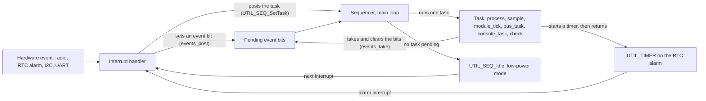
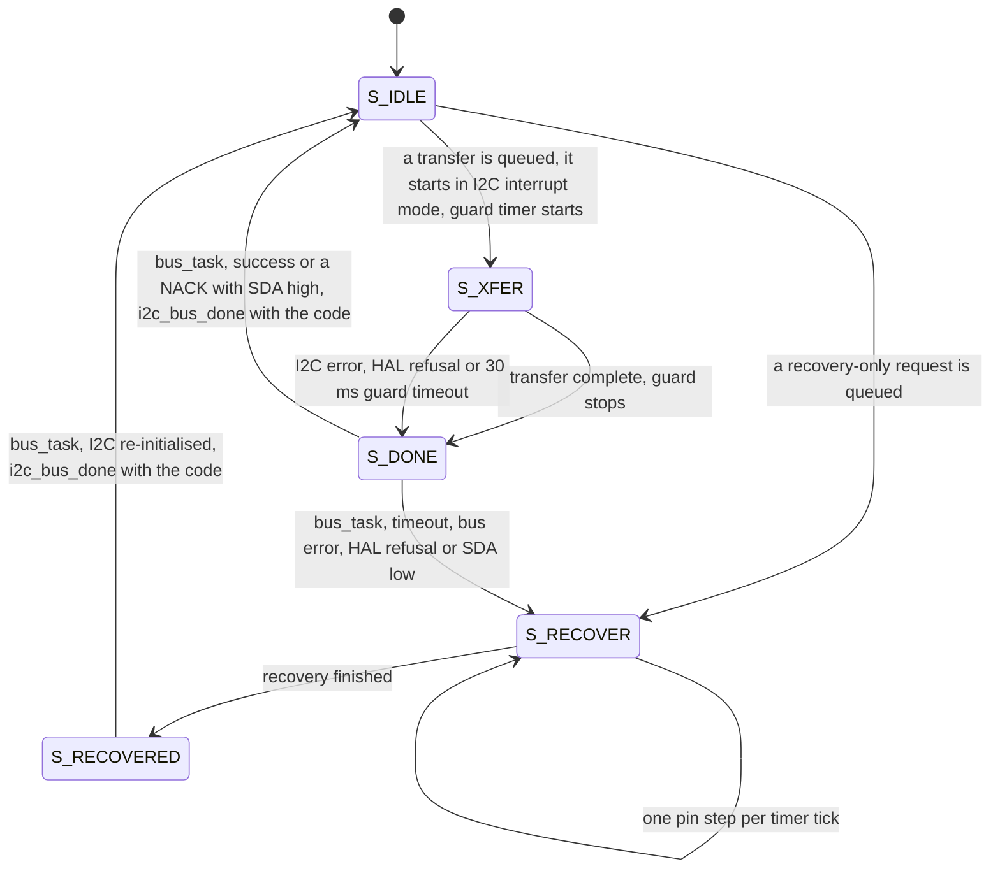
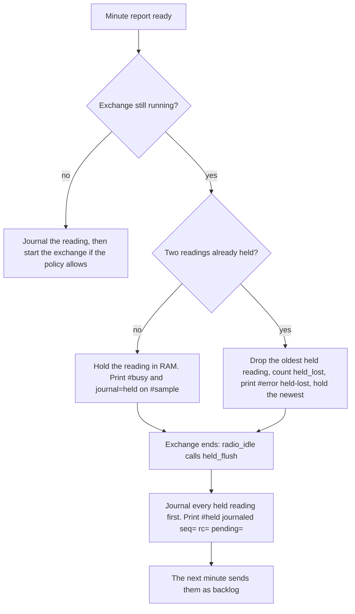
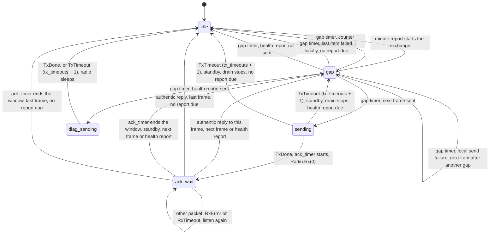
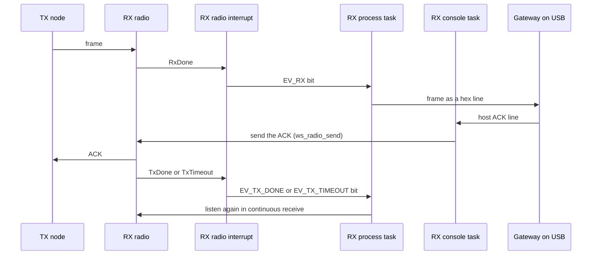

# Firmware event model (both board roles)

This page covers how the firmware in `firmware/stage0-node` runs on both boards. The
transmitter (TX) is the station node with the sensors. The receiver (RX) is the bridge on the
gateway's USB cable. The code comments point here.

On 2026-10-15 Clint decided the firmware runs on interrupts and events all the way through. At run
time no code makes a millisecond-scale or unbounded timed wait. The firmware bans `HAL_Delay`
and polled I2C/UART/SPI, and `make waits` (`tools/blocking_report.py`) checks this. A few short
hardware polls remain, each with a bound, and
[What still stalls the CPU](#what-still-stalls-the-cpu) lists them:

- flash erase/program BSY (up to about 24.5 ms per page erase)
- the radio BUSY line and SPI bytes
- the RTC sub-second double read
- the UART start-up flags

Five independent reviewers checked this page the same day, and it includes their findings.

## How the firmware runs

The firmware has no real-time operating system (RTOS). Three kinds of code run:

| Kind | Examples | Runs until |
|---|---|---|
| Interrupt handler | radio (`SUBGHZ_Radio`, priority 0), RTC alarm (all `UTIL_TIMER` callbacks, priority 0, run with interrupts masked), I2C2, USART2, direct memory access (DMA), and on TX (priority 2, `App/board_inputs.c`): the ADC, whose one regular sequence is the wind vane (IN4, PB2), the bq24074 ISET (IN5, PB1), the charger input divider (IN6, PA10) and VREFINT, one end-of-conversion interrupt a channel, 160.5 cycles and ×16 oversampling each, started from the 250 ms vane tick; the rain gauge on EXTI4 (PB4, falling edge; its own handler, line 4; EXTI9_5 now serves only button B3, line 6); and the bq24074 CHG pin on EXTI15_10 (PB10, both edges; the handler serves lines 10 to 15), which only counts edges for the 2 Hz fault rule (`board_charger_edges`) | it returns. A handler copies data, starts the next hardware step or timer, and posts an event or a task. A handler never formats console lines. The main loop prints the RX `#alive` report |
| Sequencer task (main loop) | `process` (radio events), `sample`, `module_tick`, `bus_task` (I2C), `console_task`, `check` (watchdog), and the bench-only flash storm | it returns. One task runs at a time. A task is never re-entered |
| Idle | `UTIL_SEQ_Idle` → low-power mode | the next interrupt |

A task never waits for time. If something has to happen later, the task starts a timer and
returns. The timer's interrupt then posts the next task.

Events are bits (`App/events.h`). Two events that arrive before `process` runs are both handled.

ST's timer server counts real-time clock (RTC) ticks of 1/1024 s. It rounds a period down to whole
ticks and makes it at least 3 ticks (`timer_if.c`). A timer can also fire up to one tick early:
ST's timer server counts the period from the start of the current tick (`stm32_timer.c`
`UTIL_TIMER_Start`). The periods on this page are the values the code asks for. `HAL_GetTick()`
also counts these ticks, not milliseconds, so the firmware measures time with
`SysTimeGetMcuTime()`.

## TX: sampling (`App/app_tx.c`, `App/wsmp_host.c`, `App/i2c_bus.c`)

Two periodic timers drive the sampling. Neither task waits for a measurement:

- A 250 ms module timer posts the `module_tick` task (`CFG_SEQ_Task_Sensor`). This task calls
  `wsmp_host_tick()`. The station host gives each local module one tick and then reads its probe
  result.
- A 15-second sample timer posts the `sample` task. `sample` counts the ticks. The 4th tick latches
  every module and makes the minute's report.

The `sample` task also runs once at boot, so the first report comes at 45,000 ms. The report
uses the snapshots that the latch froze. It doesn't wait for an I2C transfer.

Each part has at most one transfer queued or running at a time (`i2c_bus.h`: one per client). The
TH and register modules start at most one step a tick. The power module runs each of its parts (up
to 4 INA228s and the MAX17048) on its own step machine. So one tick can start several transfers,
and some steps chain the next transfer straight from the completion.

The temperature and humidity modules (`App/mod_th.c`) start a sample every 15 s. The SHT45 module
writes the measure command on one tick. It reads the reply on a later tick, at least 250 ms after
the command. The SHT45 needs at most 8.3 ms.

The modules share one I2C bus (`App/i2c_bus.c`). A module submits a transfer. The bus queues the
transfers and runs one at a time, in submission order:

- The 30 ms guard timer ends a transfer that never completes (`I2C_ETIMEOUT`, -6). The guard is
  longer than a flash page erase, because an erase delays the I2C interrupt.
- Only an acknowledge failure is a NACK (`I2C_ENACK_ADDR` -2, `I2C_ENACK_DATA` -3). A bus error,
  lost arbitration or a HAL refusal is `I2C_EBUS` (-7), a bus fault (`App/i2c_bus.h`).
- The stuck-bus recovery runs only when the bus can be stuck. These are a timeout, `I2C_EBUS`, or
  SDA low after a failure. An address NACK from an absent sensor costs no recovery.
- A module can also ask for the recovery alone. The temperature and humidity modules do this after
  a bad CRC.
- The recovery (`ws_i2c_recover_step`) runs one pin step per timer tick. One tick is about 2 to
  3 ms. The whole recovery takes about 15 to 70 ms.
- `bus_task` (`CFG_SEQ_Task_I2c`) gives the code to `i2c_bus_done()`. `App/wsmp_local.c` passes it
  to the module that owns the transfer. The bus then starts the next queued transfer.
- The TH and register modules turn a failed sample into their probe result. An address NACK
  (or, for a register part, another chip ID) means absent. Any other failure is a bus fault.
- The power modules always probe present. They mark a part absent on any NACK or a wrong ID, and
  as a bus fault otherwise.

`minute_report()` in `App/app_tx.c` journals the report in flash. If the transmit policy allows a
send this minute, it then starts the exchange.

## TX: flash is written only with the radio idle

The firmware writes flash only while the radio is idle, with no exceptions (2026-10-15). The
previous minute's exchange can still run when a report is ready. In that case the firmware
keeps the encoded reading in RAM and doesn't journal it yet:

A normal exchange ends well within its minute. Only a hung radio holds a reading. The exchange
then outlasts its bound (at most 116 s), and the independent watchdog (IWDG) resets the board
about 8 s later. At most two readings can pile up in that time, and the firmware has room for
two.

A watchdog reset for a stuck exchange loses no held reading. The watchdog check first stops the
radio and journals the held readings (see the exchange bound below). Other resets (power loss, a
fault) do lose the held readings. Those sequence numbers never arrive, and the gateway sees the
gap.

## TX: the minute's exchange (`App/tx_exchange.c`)

The exchange is one explicit state machine. An event that is certain to come ends every state.
The events are the radio's TxDone and TxTimeout, the gap timer and the acknowledgement (ACK)
window timer.

The code names the states `idle`, `gap`, `sending`, `ack-wait` and `diag-sending`. The diagram
writes `diag_sending` and `ack_wait` because Mermaid state names cannot contain a hyphen. The table
gives the detail of each transition:

| State | Left by | Next |
|---|---|---|
| `idle` | the 4th sample's report | `gap`. The first frame also waits 50 ms. The radio can have gone to sleep moments earlier and needs time to enter sleep before the firmware wakes it. ST's `RadioSleep` waited 2 ms instead |
| `gap` | gap timer (50 ms) | `sending` (next frame) or `diag-sending` (health report). A local send failure (journal read, seal, radio busy) moves to the next item after another gap. A refused counter reservation ends the exchange (`idle`) |
| `sending` | radio TxDone | `ack-wait`. The firmware's 2 s `ack_timer` starts. The radio listens with no driver timeout (`Radio.Rx(0)`) |
|  | TxTimeout (3 s, a software timer in ST's radio driver) | The firmware puts the radio in standby, because the driver leaves it transmitting, and adds one to `tx_counts.tx_timeouts` (saturating at 0xFFFF; `tx_timed_out`), which the health report carries as `tx_timeouts_since_boot`. The drain stops: `gap` if a health report is due, else `idle` |
| `ack-wait` | RxDone with the authentic reply to this frame | `ack_timer` stops. Then `gap` (next frame) or end of exchange |
|  | RxDone with any other packet (foreign, forged, another frame's ACK), RxError (payload CRC failed), RxTimeout (ST's `radio.c` reports a header error this way) | The radio listens again (`Radio.Rx(0)`) in the same window |
|  | `ack_timer` (the window is over) | The firmware puts the radio in standby. No reply: the drain ends after one more frame, or at once after a second miss in a row. Then `gap` or end of exchange |
| `diag-sending` | TxDone, or TxTimeout (the firmware puts the radio in standby and counts it in `tx_timeouts`, as in `sending`) | `idle` (radio sleeps) |

The firmware uses its own timer for the ACK window, for two reasons. First, in ST's driver a
packet that fails its cyclic redundancy check (CRC) arrives as RxDone then RxError. RxDone stops
`RxTimeoutTimer` (and puts the radio in standby when it isn't in continuous receive). So any
damaged packet would end the driver's window, and the firmware couldn't keep listening for the
real ACK. Second, the driver's timeout leaves the radio receiving.

The reviews on 2026-10-15 found that these driver behaviours caused stray timeouts in later
states. They also let the next flash write overlap a listening radio. With `Radio.Rx(0)` the
driver arms no timer. The chip's own single-reception timeout is about 65 s.

ST's HAL raises RxDone for a packet whose payload CRC failed, then RxError in the same
interrupt. In both roles the RxDone callback spots such a packet with `ws_radio_take_crc_error`
(the HAL's CRC flag) and leaves it to RxError.

End of exchange: the firmware updates the link state. It then goes to `gap` and the health report
if one is due, else to `idle`.

The health report (`send_diag`, `App/tx_exchange.lit.md` section 9) is the 64-byte version 6
report (power telemetry design section 6.1). It reads cached values only: `mod_power_health()`
(the slow power values the last latch cached), the fault and boot-count accessors (`fault_last_pc`,
`fault_boots`), `tx_counts.tx_timeouts` and `i2c_bus_recoveries()`. Nothing in the radio path
touches I2C or the ADC, so sending it never waits for a bus or a conversion.

The firmware drops two races without counting them:

- a TxTimeout that fires in the same pass as its TxDone. The frame left.
- an ack-end that the timer posted while the firmware handled the reply that closed the window.

The firmware counts every other (state, event) pair that the table doesn't list (`unexpected=` on
`#timing`). It prints `#error unexpected event=… state=…` and otherwise ignores the event.

### Exchange bound

The watchdog check requires a busy exchange to end within its worst case:

(frames + 1) × (3 s transmit timeout + 2 s window + 50 ms gap) + 5 s

If the exchange runs past this bound, the check does these steps:

1. It stops sampling. `sampling_stop()` stops the 15-second sample timer and the 250 ms module
   timer, so no module starts another bus transfer.
2. It stops the gap and ACK timers, puts the radio in standby and ends the exchange.
3. It journals any held reading, because the radio is now idle.
4. It keeps failing, so the watchdog resets the board (`#watchdog radio exchange stuck; …`).

### Console commands during an exchange

The console refuses the commands that write flash (WIPE, PROVISION, `SENSOR rain on/off`,
TEST-FLASH-STORM) during an exchange or a pending reboot. The reply is `#error busy …; retry`.

A commanded reboot (WIPE, PROVISION) stops sampling (both timers) and resets from a 200 ms timer.
The firmware creates this timer once at boot. The delay lets the console send the reply first. The
console refuses a second reboot command while one is pending.

TEST-FLASH-STORM is a bench command, and a field build doesn't include it. It writes at most
24 000 journal slots per boot, in about 30 s, which is nowhere near enough to wear out the journal.
It stops sampling, so no exchange starts.

If storage init or the epoch reservation fails at boot (with the self-test passed), the firmware
retries. It resets the board after 10 minutes.

## RX (`App/app_rx.c`)

The RX is always in continuous receive. Radio interrupts post event bits (`EV_RX`, `EV_RX_CRC`,
`EV_RX_HDR`, `EV_TX_DONE`, `EV_TX_TIMEOUT`). The `process` task forwards frames to the gateway. It
also logs failed receptions with every byte that the radio kept (`#rx crc … data=`,
`#rx hdr rssi=`).

- The radio stays in continuous receive through both kinds of failed reception (ST's `radio.c`),
  so nothing re-arms it.
- One capture waits for `process` at a time. The firmware counts failures that arrive meanwhile
  (`fault_overruns` on `#alive`). It also counts a forwarded frame that a newer frame replaced
  before `process` printed it.
- The console task puts a host ACK line on air. Its TxDone or TxTimeout returns the radio to
  listening. After a TxTimeout the firmware first puts the radio in standby, because the chip can
  still send.
- Only one ACK is on air at a time. The console refuses a second line meanwhile (`#tx busy`).
- The 60 s `#alive` timer only requests the report. `process` prints it.

The watchdog runs the RX health test every second. The test fails when one of these checks fails:

- Console receive stays armed. If it isn't, the test re-arms it once before it fails.
- Console output keeps flowing. A trace DMA transfer that doesn't finish for 3 s fails the test.
- An ACK is not on air for longer than the 3 s transmit timeout plus 2 s.
- The radio is heard from. After 16 minutes with no radio event, the firmware puts the radio in
  standby and listens again. 16 minutes is longer than the node's longest silence. Two such
  relistens in a row with no radio event fail the check, and the watchdog resets the board.

The firmware prints at most 20 failure lines a minute and counts the rest.

## Radio commands and the radio interrupt

ST's HAL lets one radio (SUBGHZ) command hold the driver at a time. A radio interrupt can arrive
while a main-loop command holds the driver. The HAL then refuses the interrupt's own commands
(HAL_BUSY). The interrupt can't clear the radio's interrupt flag, so it re-enters at once and
starves the main loop.

So every radio command the main loop makes after start-up runs with the radio interrupt masked in
the nested vectored interrupt controller (NVIC). These commands are `ws_radio_send`,
`ws_radio_rx`, `ws_radio_standby`, `ws_radio_sleep` and `ws_radio_rx_full_length` in
`App/radio_cfg.*`. The interrupt waits and runs right after. The start-up `Radio.Init` and
`ws_radio_configure` run unmasked, before any radio operation can raise an interrupt. The host
harnesses count every radio command made with the interrupt unmasked, and every test requires a
count of zero.

## What still stalls the CPU

These stalls come from the hardware, and the firmware can't avoid them.

| Stall | Bound | When it happens |
|---|---|---|
| Flash page erase | STM32WL55 datasheet (DS13293) t_ERASE: about 22 ms typical, about 24.5 ms maximum (the datasheet values as recalled in review). Measured on the board: 22,057 µs (`erase_peak_us`, release 586001994b09). The CPU cannot fetch from flash during an erase, so interrupts start late by up to that time | Start of a journal page (every 21 readings: the WSMP bench field set's 77-byte plaintext gives 96-byte slots, and (2048 - 8) / 96 = 21 per page), meta-page compaction (which any meta write can trigger, a PROVISION epoch floor included), meta-log creation at boot when no meta page is valid, WIPE and TEST-FLASH-STORM. Always with the radio idle (see below). PROVISION itself only programs an already-erased config page |
| Flash double-word program | DS13293 t_PROG: about 82 µs typical, about 91 µs maximum (same caveat) | Journal append, ACK mark, counter reservation and the other meta-log writes (boot epoch, epoch floor, abandoned and lost totals, rain setting, compaction), plus PROVISION's config write. Always with the radio idle |
| Radio SPI and BUSY handshakes in ST's driver | ST's loop counters bound them (`stm32wlxx_hal_subghz.c`). Microseconds per command, about 3.5 ms on wake with calibration (`tools/blocking_report.py` table) | Every radio command. Included in `task_peak_us` and `isr_peak_us` |
| RTC sub-second double read, UART start-up flags | `timer_if.c` reads the sub-second register until two reads agree. The register changes every 1/1024 s, about 977 µs (LSE 32.768 kHz divided by PREDIV_A+1 = 32). The UART waits for TEACK and REACK at start | Timer reads, console start |

Flash writes always happen with the radio idle. Journal and counter writes happen before an
exchange or between frames. A reading made during an exchange waits in RAM until the exchange
ends. The console refuses the flash-writing commands during an exchange. The host harness checks
this in every test, a hung radio included.

The board measures these stalls. `#timing` reports `erase_peak_us`, `prog_peak_us`, the longest
task and the longest interrupt handler. The data watch and trace unit (DWT) cycle counter gives
the times (`App/busymon.h`). `isr_peak_us` times how long a handler runs. It doesn't include an
interrupt's late start during an erase.

`firmware/stage0-node/RELEASES.md` records the measured values of each release. For example,
release 586001994b09 measured erase 22,057 µs and program 93 µs.

## How we know

| Check | What it proves | Where |
|---|---|---|
| Host state-machine harness | Runs the real `app_tx.c` and its modules (`tx_exchange.c`, `tx_policy.c`, `tx_time.c`, `tx_console.c`, `selftest.c`) over a simulated clock, timers, sequencer, flash and radio. The real WSMP modules run on the I2C bus model in the hub profile, with a simulated SHT45, battery INA228 and MAX17048. The simulated radio follows ST's driver: a CRC failure is RxDone + RxError, and driver timeouts leave the radio transmitting or receiving. The tests prove these points: gaps are timers. Every state ends. Damaged packets do not end the window early. Flash commands wait for the exchange. Every (state, event) pair outside the table is only counted. Two events pending together are handled in bit order. Only the ACK for the frame just sent ends a window or sets the clock. A counter reservation swept across a whole exchange never meets a busy radio. The drain, link, health-report, strike and watchdog policies (transmit-failure run, exchange bound) behave as documented. A reading made while an exchange hangs is held in RAM, journaled when the radio goes idle and sent as backlog. A third held reading replaces the oldest and is counted. 3-hour randomised links with 5 fixed seeds include lost ACKs whose windows run out, NACKs, junk, CRC and header failures, another frame's ACK, transmit timeouts and send failures. These runs give no unexpected event. The radio state matches the exchange state, the watchdog check stays healthy, and no flash write happens while the radio transmits or receives. Timers and sequencer have ST's semantics. The suite builds with UBSan and reruns under ASan where the runtime can be preloaded | `firmware/host/tx_harness.c` over `firmware/host/sim_core.c`, `tests/test_tx_machine.py` |
| Host RX bridge harness | Runs the real `app_rx.c` and `console.c` over 1/1024 s ticks with ST's timer server, the sequencer, a continuous-receive radio that follows ST's driver, the console UART interrupt, the trace FIFO and the watchdog's health check. The tests prove these points: every valid frame is forwarded once as hex. CRC-failed packets are never forwarded and are logged whole. Header failures are logged. Nothing re-arms the radio after a failure. Only a valid host ACK or NACK is transmitted, and the radio listens again after it. The main loop prints `#alive`. Relisten and watchdog recovery behave as documented. A reference model checks a 6-hour randomised run line by line. A mutation pass plants 47 bugs and the tests catch all but one equivalent mutant | `firmware/host/rx_harness.c` over `firmware/host/sim_core.c`, `tests/test_rx_machine.py` |
| Host I2C bus harness | Runs the real `i2c_bus.c` over ST-rounded timers and a host model of ST's HAL I2C with many devices, in both bus profiles: the mux profile (`WS_I2C_MUX=1`, the ports board) and the firmware default, the passive STEMMA QT hub (`WS_I2C_MUX=0`, `I2cBusHub`: the INA228, the MAX17048 and the SHT45 upstream with no mux). Each transfer gives one `i2c_bus_done()` with the documented code for success, NACKs, hangs and a held SDA line. The recovery clocks a held SDA line free or reports it stuck, and `i2c_bus_recoveries()` (the health report's `i2c_recoveries_since_boot`) counts one per recovery, saturating. An absent device costs no recovery. A completion at the guard's instant counts once. Clients are served in order, one at a time, and a busy client's second submit is refused. The timing register's data hold (SDADEL) meets the INA228's SDA-strap requirement (`BusTiming`) | `firmware/host/wsmp_harness.c` and `firmware/host/i2c_sim.c` over `firmware/host/sim_core.c`, `tests/test_i2c_bus.py` |
| Host power acquisition harness | Runs the real `power_acq.c` on the bus model in the hub profile, with the INA228 and MAX17048 models and the board ADC and CHG-edge seams of `sim_core.c`, for power profiles A and B (four INA228 rails). The tests prove these points: a current from VIN+ to VIN− is a discharge (sign −1), burst means are exact from the CHARGE accumulator, a part reset mid-window gives partial, not wrong, OUT and the cell are kept apart, energy is ΔQ × VCELL and missing with a stale VCELL, a bus fault is fault and an absent part missing, ISET is VDDA-scaled and 0 mA without PGOOD, a partially clipped ADC result is out of range, CHG flashing is a fault that clears after 4 s, and the schedule survives the clock wrap | `firmware/host/power_harness.c` over `firmware/host/sim_core.c` and `firmware/host/i2c_models.c`, `tests/test_power_acq.py` |
| Host crash-record and boot-count test | Compiles `fault.c` unchanged against a stand-in for the TAMP backup registers: no crash gives last crash PC 0, the PC outlives the report, an untrusted frame reads as all ones, DR12 counts one boot per `fault_boot_note()`, restarts on a power-on and saturates at 0xFFFF, and each role notes exactly one boot before `fault_report()` | `tests/test_fault.py` |
| Host WSMP module and station-host harness | Runs the real local modules (`wsmp_local.c`, `mod_*.c`), the station host (`wsmp_host.c`) and the catalog map (`wsmp_catalog_map.c`) on the same bus model. The tests check the module conformance cases, the mean windows and the latch. They also check presence, admission, the flap limit and the map round trip through the gateway's decoder | `firmware/host/wsmp_harness.c`, `firmware/host/i2c_models.c`, `tests/test_modules.py`, `tests/test_wsmp_host.py`, `tests/test_wsmp_map.py` |
| Build-time wait check | No interrupt handler or task in the linked image can reach a blocking call (`HAL_Delay`, blocking HAL I2C/UART/SPI, …). Every user of a timeout loop is classified | `tools/blocking_report.py`, `make ROLE=… waits`, CI |
| Run-time timing | TX `#timing` reports the peaks of tasks, handlers and flash stalls since boot. RX `#alive` reports tasks and handlers, and the gateway stores them. A task's peak is its own time, with the time of interrupts that ran meanwhile taken out. Interrupt time is summed once per outermost handler. The peak is named after the task's slowest timed step. `task_wall_us` gives the wall time with interrupts included (TX `#timing`, RX STATUS). SysTick, NMI and HardFault are not timed. `firmware/test_busymon.c` tests this on the host | `App/busymon.c` |
| Run-time checks | The board checks invariants of our own code: state-machine preconditions, indexes before buffers, flash writes inside the node-state pages, and timer starts that must not be refused. Each site has a recovery. The firmware counts failures and records the first site (TX `#counts`, RX `STATUS`). Every host harness test requires zero failed checks, except the few tests that make a check fail on purpose and then require exactly that count and site | `WS_CHECK`, `firmware/common/ws_check.h`, [`docs/power-of-ten.md`](power-of-ten.md) rule 5 |
| Console never blocks | The firmware drops and counts a line that does not fit the 2 KB output queue (`trace_drops`). Lines stay under the 640-byte line buffer, which would cut a longer line without a count | `sys_app.h` `APP_PRINTF` |

## Deliberate hangs

Only bench commands hang on purpose:

- TEST-HANG runs an endless loop. It shows that the watchdog resets the board.
- TEST-FAULT waits 50 ms for the console, then faults. The fault handler resets the board.

`Error_Handler` (an init failure) also loops forever, with interrupts off. The watchdog only ends
it if the watchdog has already started.
