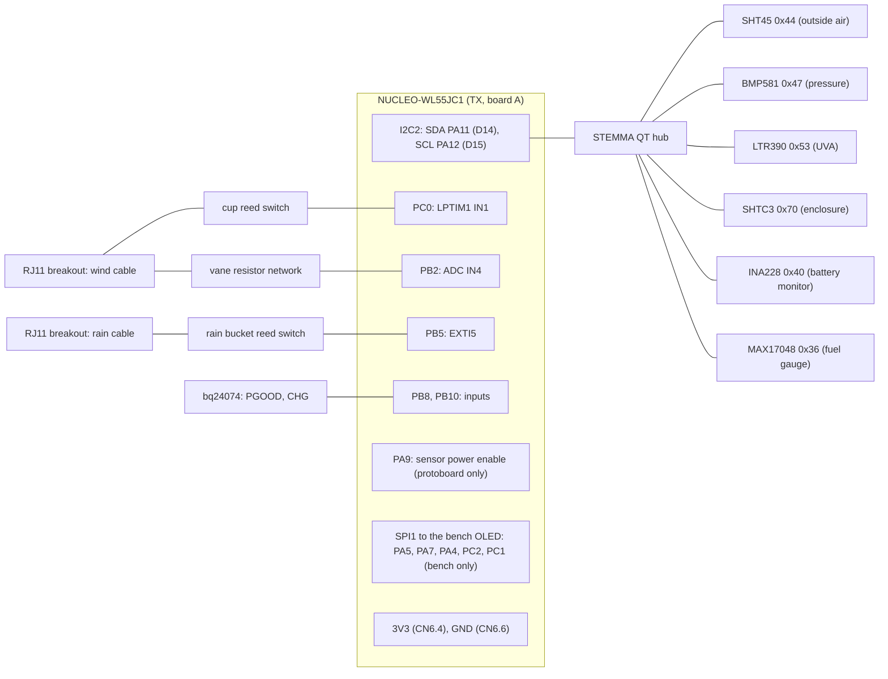

# Bench station wiring

This guide connects every "Plan B" part ([`docs/poc-shopping-list.md`](../poc-shopping-list.md)) to the
TX board (board A, NUCLEO-WL55JC1). The firmware reads them as DATAVANE5K local modules
([`docs/module-protocol.md`](../module-protocol.md)). The design is
[`docs/superpowers/specs/2026-10-18-wsmp-bench-station-design.md`](../superpowers/specs/2026-10-18-wsmp-bench-station-design.md).

**Do the UM2592 check (section 6) before you solder anything.** The pin map comes from ST's example
projects. Some of those examples disagree about header positions.

## 1. Build steps

1. **Breadboard and jumper wires.** Prove the pin map and the readings. Not for the 24-hour run:
   jumpers work loose. The hole-by-hole map is
   [`hardware/bench-breadboard-r0/build-sheet.md`](../../hardware/bench-breadboard-r0/build-sheet.md), with
   [renders](../../hardware/bench-breadboard-r0/README.md) of both boards.
2. **Soldered protoboard** (for example Adafruit Perma-Proto). The same circuit, plus the sensor
   power switch and the power shunt header. The 24-hour acceptance run uses this build.
3. **Custom PCB.** A later revision of the sensor-interface board. A separate project.

## 2. The connections



| Function | Pin | Header (from ST examples: check, section 6) | Wiring |
|---|---|---|---|
| I2C SDA, SCL | PA11, PA12 | CN5.9 (D14), CN5.10 (D15) | to the STEMMA QT hub. The breakouts have the pull-ups |
| Hub power | 3V3, GND | CN6.4, CN6.6 | 3.3 V only. Never the 5 V pin (CN7.18 is next to CN7.16) |
| Anemometer | PC0 | morpho CN10.14 | the circuit of section 3 |
| Wind vane | PB2 | CN7.30 (A1 in most examples, A0 in one) | the circuit of section 3 |
| Rain gauge | PB5 | CN9.5 or morpho CN10.29 | the circuit of section 3 |
| bq24074 PGOOD | PB8 | D5, CN9.6 or morpho CN10.27 | direct. The internal pull-up does the rest. Check 5 V tolerance first (section 6) |
| bq24074 CHG | PB10 | morpho CN10.25 | direct. Check 5 V tolerance first (section 6) |
| Sensor 3.3 V switch | PA9 | D9, CN5.2 or morpho CN10.19 | protoboard only: the enable of a high-side load switch, high = on. Not on the breadboard |
| Bench OLED SCLK | PA5 | D13, CN5.6 or morpho CN10.11 | bench only (board C): SPI1 clock to OLED pin 7. `firmware/i2cscan/App/oled.h` |
| Bench OLED DIN | PA7 | D11, CN5.4 or morpho CN10.15 | bench only: SPI1 data to OLED pin 8 |
| Bench OLED CS | PA4 | D10, CN5.3 or morpho CN10.17 | bench only: chip select to OLED pin 15, low while sending |
| Bench OLED DC | PC2 | D8, CN5.1 or morpho CN10.21 | bench only: data/command to OLED pin 4 |
| Bench OLED RST | PC1 | D7, CN9.8 or morpho CN10.23 | bench only: reset to OLED pin 16, low = reset |
| Bench charge current | PB1 | A0, CN8.1 | bench only (the bench link, `firmware/benchlink`): the bq24074 ISET pin, direct |
| Bench charger input | PA10 | A2, CN8.3 | bench only (the bench link): the bq24074 VBUS through a 20 kohm / 10 kohm divider (VBUS / 3) |

Keep these pins free:

| Pins | Use |
|---|---|
| PB15, PB9, PB11 | LEDs |
| PA0, PA1, PC6 | buttons |
| PB12, PB13 | radio debug outputs |
| PA2, PA3 | console |
| PC3, PC4, PC5 | RF switch |
| PB0 | TCXO supply |
| PA13, PA14 | SWD |
| PC14, PC15 | LSE crystal |

## 3. The weather meter circuits

The SparkFun SEN-15901 has two RJ11 cables. The wind cable comes from the vane and carries both the
vane and the cups (the cups plug into the vane). The rain cable comes from the gauge. Use the SparkFun
RJ11 breakout (BOB-14021) for each. One BOB-14021 is a panel of two boards, so one order gives
both breakouts. **Check which RJ11 conductors carry which switch against the
SparkFun datasheet and the breakout's silkscreen before you wire.**

The reed switches and the vane resistors are inside the SEN-15901. You add only the pull-ups and
the capacitors in the table below.

| Input | Circuit |
|---|---|
| Cups to PC0 | one side of the reed switch to GND. The other side to PC0, with a 10 kΩ pull-up to 3.3 V and 100 nF from PC0 to GND (a 1 ms filter against contact bounce) |
| Rain to PB5 | the same: 10 kΩ pull-up to 3.3 V, 100 nF to GND. The firmware also ignores an edge within 100 ms of the previous edge, so a chattering contact counts once |
| Vane to PB2 | one side of the vane to GND. The other side to PB2, with a 10 kΩ pull-up to 3.3 V. No capacitor |

A 75 m/s wind gives about 112 cup pulses a second. The 1 ms filter passes that easily. The vane and
its pull-up form a divider on the same 3.3 V supply as the ADC reference, so supply drift cancels.
An unplugged vane reads near 3.3 V, and the firmware treats that as "no vane".

## 4. The battery chain

| Part | Connection |
|---|---|
| bq24074 charger breakout | input from its own USB charger (mode A) or solar later. Its LIPO pin (the chip's BAT) to the cell, through the INA228 shunt |
| 6,600 mAh Li-ion cell | through the INA228 shunt: the shunt sits in the cell's positive lead |
| INA228 | on the STEMMA QT hub. Its shunt in the cell's positive lead |
| MAX17048 | on the STEMMA QT hub. Its cell input across the cell |
| Grounds | the battery chain's ground to the NUCLEO's ground. The I2C bus needs it |

The cell ends in a JST PH plug. On the breadboard, plug it into a JST PH 2-pin pigtail. Pigtail
colours vary, so check + and − with a meter before you connect it.

## 5. Power modes

**Mode A, daily: the board on USB, the battery chain beside it.** The board runs from the ST-LINK USB.
The console and flashing work. The bq24074 output drives a fixed test load of 100 Ω, ½ W (about
40 mA). Remove the charger's input to see a discharge. Connect it to see a charge.

**Mode B, power tests: the battery powers the station.** The power goes from the cell through the
bq24074 to the Pololu S7V8F3 3.3 V regulator. The regulator feeds the board's 3V3 pin (CN7.16) and
the sensors. Unplug the ST-LINK USB. Watch the
station through the radio and the gateway. An optional 3.3 V USB-serial adapter on PA2 and PA3 gives
the console: connect only its ground and data lines, never its power pin.

**Never connect the USB cable and the battery supply at the same time.**

| From A to B | From B to A |
|---|---|
| 1. Unplug the board's USB cable. | 1. Remove the power shunt. |
| 2. Remove the 100 Ω test load. | 2. Fit the 100 Ω test load. |
| 3. Fit the power shunt (regulator output to the 3V3 pin). | 3. Connect the board's USB cable. |

On the protoboard, the regulator output goes through a two-pin header with one shunt, labelled
"BATTERY POWER: USB UNPLUGGED". On the breadboard it is one labelled jumper wire.

## 6. Checklist against UM2592 (do this first)

Check each item in ST's NUCLEO-WL55JC1 user manual (UM2592) and tick it here. A pin that does not
match is moved before any soldering, and the firmware pin constants (`App/board_inputs.c`,
`App/i2c_bus.lit.md`) change with it.

- [x] PA11 and PA12 on CN5.9 and CN5.10 (D14, D15), no solder bridge in the path. Checked
  against UM2592 Rev 4 Table 17 on 2026-10-12, with CN6.4 = 3V3 and CN6.6 = GND
  ([bring-up log](nucleo-wl55jc-bringup.md#verified-on-hardware)).
- [ ] PC0 on morpho CN10.14, free of any board function.
- [ ] PB2 header position (CN7.30 and whether it is A0 or A1), no solder bridge in the path.
- [ ] PB5 header position, free of any board function.
- [ ] PB8 and PB10 header positions, free of any board function.
- [x] PB8 and PB10 are 5 V tolerant (FT) in the STM32WL55 datasheet: FT_f in DS13293 Rev 5 Table 20,
  checked 2026-10-28. Above VDD + 0.3 V the internal pull-up must be off (Table 26, note 3). CHG and
  PGOOD measured at most 2.9 V on the bench (their LEDs pull them up from OUT), below that limit. The
  breadboard build sheet's bench checks give the reason for the check.
- [ ] PA9 header position, free of any board function.
- [ ] The jumper settings that let CN7.16 power the board in mode B, with the ST-LINK off.
- [ ] No other solder bridge connects any of these pins to an on-board part.

## 7. The vane voltages

The firmware decodes the 16 vane positions from voltages computed from the SparkFun resistor table
(`App/mod_wind.c`, `vane_mv`). Measure the real ones on the bench:

1. Wire the vane as section 3 says, with the board on USB.
2. Turn the vane to north (position 0). Measure the voltage from PB2 to GND with a multimeter.
3. Turn the vane 22.5 degrees clockwise and measure again. Repeat for all 16 positions.
4. Put the 16 values (in mV) into `vane_mv` in `App/mod_wind.c`, with a test that pins them, and
   commit.

## 8. Bench checks

Run these on the breadboard after the UM2592 check. The console is the ST-LINK virtual COM port
(115200 8N1). To send one line and print the replies, find the TX board by its ST-LINK serial number:

```sh
.venv/bin/python tools/console.py 003B00194142500E20353451 MODULES
```

| Check | How | Expected |
|---|---|---|
| Every module | send `MODULES` after a minute | `#modules air_th=active pressure=active uva=active encl_th=active power=active wind=active rain=absent` |
| Rain | send `SENSOR rain on`, wait 3 s, send `MODULES` | `#sensor rain=on`, then `rain=admitted` (active after the next minute) |
| Plausible values | compare the gateway's readings with a room thermometer and the local pressure report | within the parts' accuracy |
| Hot-plug | unplug a STEMMA sensor, wait 3 minutes, plug it in, wait 1 minute | the module goes `suspect`, then `absent`, then `active` again. No reset |
| Wind | turn the cups, turn the vane through its positions | a speed and a gust; the direction follows the vane |
| Rain | tip the bucket 20 times by hand | 20 more tips |
| Mode A | remove and connect the charger input | the charge counters move in each direction |
| Mode B | run on the battery for one hour | readings reach the gateway every minute |

**A vane input with nothing wired floats.** Without the vane circuit, PB2 has no pull-up, and its
reading can look like a vane position. Then `MODULES` shows `wind=active` with no vane. The
firmware cannot tell this from a real vane. Fit the 10 kΩ pull-up from PB2 to 3.3 V (section 3),
and the input reads "no vane" until the vane is connected.

The 24-hour acceptance run follows on the protoboard. The spec's section 6 gives its criteria.
