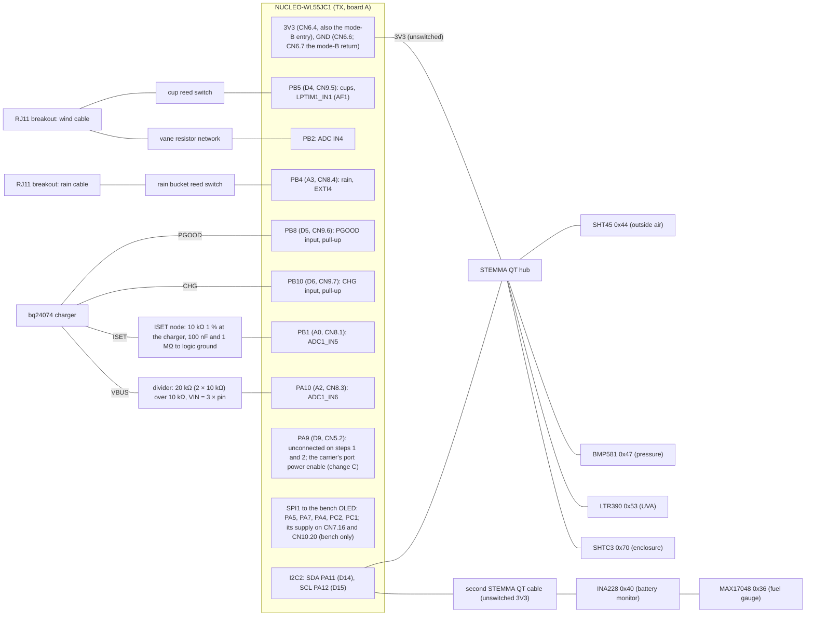

# Bench station wiring

This guide connects every "Plan B" part ([`docs/poc-shopping-list.md`](../poc-shopping-list.md)) to the
TX board (board A, NUCLEO-WL55JC1). The firmware reads them as DATAVANE5K local modules
([`docs/module-protocol.md`](../module-protocol.md)). The design is
[`docs/superpowers/specs/2026-10-18-wsmp-bench-station-design.md`](../superpowers/specs/2026-10-18-wsmp-bench-station-design.md).
The power chain (section 4) is the official phase A design of
[`docs/superpowers/specs/2026-10-29-power-telemetry-design.md`](../superpowers/specs/2026-10-29-power-telemetry-design.md);
[`power-metering.md`](power-metering.md) covers the rails, the monitors and the later phases.

**Do the UM2592 check (section 6) before you solder anything.** The pin map first came from ST's
example projects, which disagree about some header positions; section 6 records each pin checked
against UM2592 Rev 4 Tables 17-19.

## 1. Build steps

**Prove before solder** (build-progression record 1.2). Every connection that is soldered
(protoboard) or laid out in copper (carrier PCB) is first proven on the no-solder bench, with its
numbers recorded. Nothing that failed there is carried forward; what passed carries forward
unchanged: the same nets, sense points, MCU pins, addresses and checks. Soldering jacks, headers or
address jumpers onto a bought breakout is module preparation, not circuit wiring (record H5,
7.1 Q1, Q6).

The build steps follow the record's steps (S1), in the order decided on 2026-10-30 (7.1 Q8):
1 → 2 (H01) → 1b → 2c → 3 → 4 → 5.

| Guide build step | Record steps | What is built |
|---|---|---|
| 1. Breadboard v2, no solder | 1 | Changes A and B (record 4.4, 4.5): the force path off the breadboard on JST PH sockets, WAGO 222 lever connectors and the INA228 screw terminal (section 4); the cups and rain remap (PB5, PB4); the two QT cables (both on the unswitched 3V3) and the mode-B hour. *2026-11-02:* change C, the PA9 sensor switch, is deferred to the carrier board (record 4.6 dated note), so steps 1 and 2 have no sensor power switch and PA9 stays unconnected. **No battery, charge, input or load current through any breadboard contact, header pin or Dupont contact** (record P1); the one exception is the mode-B regulator chain (section 5). Not for the 24-hour run. The hole-by-hole map is the [build sheet](../../hardware/bench-breadboard-r0/build-sheet.md) (`bench-bb-r0.3`), with [renders](../../hardware/bench-breadboard-r0/README.md) of the boards |
| 2. Soldered protoboard | 2, then 1b, then 2c | Step 2: the Adafruit #196 shield on the NUCLEO and a Perma-Proto module board, signals only, with the three phase-B INA228 positions left empty; the step 1 force harness moves to the plate unchanged (record S2). The 24-hour H01 acceptance run uses this build. Then step 1b: the three extra INA228s on the plate's small breadboard and the same harness, after H01 (7.1 Q1, Q8); they are soldered into the module board only after 1b exits. Then step 2c: the BQ25798EVM on the step 2 harness (record S3) |
| 3. Carrier PCB and beyond | 3, 4, 5 | The carrier under the NUCLEO on the morpho underside pins (OQ-14, decided 2026-10-30, 7.1 Q7; record N7, S4), with change C (PA9 switching each sensor port, PORT-5, PORT-9; from 2026-11-02; requirements in `docs/superpowers/specs/2026-11-02-carrier-board-requirements.md`); its layout waits for the morpho grid from ST's drawing and the chassis outline (*2026-10-30:* the underside pin length and clearance condition is satisfied by Clint's fit test, record 7.1 N7: a standard-height 2.54 mm female socket works). Then the carrier in the enclosure (step 4) and the custom STM32WL55 board (step 5) |

## 2. The connections



Nothing on steps 1 and 2 is switched: the hub (with the SHTC3 and the BMP581) and the power monitors
all run from the unswitched 3V3. *2026-11-02:* change C, the PA9 sensor switch, moved to the carrier
board (record 4.6 dated note), which follows PORT-9 (ports design): each sensor port switched by PA9,
the SHTC3 and the power monitors upstream and unswitched. `TEST-SENSOR-POWER` is a carrier test; on
the breadboard PA9 drives nothing, so firmware that toggles it is harmless.

| Function | Pin | Header (UM2592 Tables 17, 18; section 6) | Wiring |
|---|---|---|---|
| I2C SDA, SCL | PA11, PA12 | CN5.9 (D14), CN5.10 (D15) | to the STEMMA QT hub (cable QT) and to the power monitors (cable QTM: the battery INA228, daisy-chained to the MAX17048). The breakouts have the pull-ups |
| Hub power | 3V3, GND | CN6.4, CN6.6 | 3.3 V only. Never the 5 V pin (CN6.5 is next to CN6.4). 3V3 from CN6.4 only (record N4), on two cables: the hub's (QT) and the power monitors' (QTM), both on the unswitched board-A 3V3 (change C, the PA9 switch, is deferred to the carrier: record 4.6, 2026-11-02). GND, SDA and SCL are shared |
| Mode-B 3V3 entry | 3V3 | CN6.4 (morpho alias CN7.16) | the regulator's output reaches the board-A 3V3 node through the BATTERY POWER shunt and the lead L_REG_3V3, which lands in the hub cable's V+ strip itself (QT.V+, column 41 on board A; never the A:L+ rail); the CN6.4 jumper from that strip (LK_3V3_CN6_4) carries it in. So the whole chain is REG.VOUT, LK_REG_SHUNT, SHUNT, L_REG_3V3, the QT.V+ strip, LK_3V3_CN6_4, CN6.4: no planner jumper and no rail contact in it (record P1). Dead in mode A with the shunt open (record P1, N3) |
| Mode-B supply return | GND | CN6.7 | 22 AWG solid lead L_NUC_RET into the regulator GND strip on board B, fitted in both modes (record N4) |
| Anemometer | PB5 | D4, CN9.5 (morpho alias CN10.29) (LPTIM1_IN1, AF1) | the circuit of section 3. Solid 22 AWG jumper into the Arduino header (record N2, N3; change B, record 4.5) |
| Wind vane | PB2 | A1, CN8.2 (morpho alias CN7.30) (ADC1_IN4) | the circuit of section 3. Solid 22 AWG jumper into the Arduino header (record N3) |
| Rain gauge | PB4 | A3, CN8.4 (morpho alias CN7.34) (EXTI4) | the circuit of section 3. Solid 22 AWG jumper into the Arduino header (record N2, N3; change B, record 4.5) |
| bq24074 PGOOD | PB8 | D5, CN9.6 (morpho alias CN10.27) | station: direct, internal pull-up, solid 22 AWG jumper into the Arduino header (record N3). FT_f; with the pull-up on, the pin stays below min(VDD, VDDA) + 0.3 V (section 4.4) |
| bq24074 CHG | PB10 | D6, CN9.7 (morpho alias CN10.25) | station: direct, internal pull-up, solid 22 AWG jumper into the Arduino header (record N3). FT_f; the same limit as PGOOD (section 4.4) |
| Sensor power enable | PA9 | D9, CN5.2 (morpho CN10.19) | carrier only (change C, deferred 2026-11-02, record 4.6): unconnected on steps 1 and 2; on the carrier it switches each sensor port (PORT-5), high = on. The firmware may drive it on the bench: harmless |
| Bench OLED SCLK | PA5 | morpho CN10.11 (Arduino alias D13, CN5.6, stays empty) | bench only (board C): SPI1 clock to OLED pin 7. `firmware/i2cscan/App/oled.h` |
| Bench OLED DIN | PA7 | morpho CN10.15 (alias D11, CN5.4, stays empty) | bench only: SPI1 data to OLED pin 8 |
| Bench OLED CS | PA4 | morpho CN10.17 (alias D10, CN5.3, stays empty) | bench only: chip select to OLED pin 15, low while sending |
| Bench OLED DC | PC2 | morpho CN10.21 (alias D8, CN5.1, stays empty) | bench only: data/command to OLED pin 4 |
| Bench OLED RST | PC1 | morpho CN10.23 (alias D7, CN9.8, stays empty) | bench only: reset to OLED pin 16, low = reset |
| Bench OLED supply | 3V3, GND | VCC CN7.16, GND CN10.20 | bench only: two female-to-male jumpers (L_OLED_VCC, L_OLED_GND) straight to the OLED's 3V3 and GND strips on board C (columns 23 and 22), on no breadboard rail. Unplug the VCC lead in mode B (record N3) |
| bq24074 ISET (charge current) | PB1 | A0, CN8.1 (morpho alias CN7.28) | station, read by `firmware/stage0-node` and the bench link: the ISET node, fed from the bq24074 ISET pin through 10 kohm 1 % at the charger, with 100 nF and 1 Mohm to logic ground (record M2; ADC1_IN5, analog, no pull) |
| bq24074 VBUS (charger input voltage) | PA10 | A2, CN8.3 (morpho alias CN7.32) | station, read by `firmware/stage0-node` and the bench link: VIN_SENSE, the bq24074 VBUS through 20 kohm (two 10 kohm in series) over 10 kohm, its bottom to the board-B logic ground rail (ADC1_IN6, VIN = 3 x the pin; each resistor measured, record M2) |

Every station signal lands on an ARDUINO female header (CN5, CN6, CN8, CN9) with a solid 22 AWG
jumper, the positions the step 2 shield uses (record N3). Since change B (record N2, 4.5; model
`bench-bb-r0.2`) that includes the cups, on D4 (PB5), and the rain gauge, on A3 (PB4); no station
signal is on a morpho pin. PA9 (D9, CN5.2) stays empty on steps 1 and 2: change C, the sensor switch,
is on the carrier (record 4.6, 2026-11-02). Only the bench OLED uses female Dupont on morpho pins. A morpho alias is the same MCU pin (UM2592 Tables 17, 18); the build sheet never puts a
jumper on one.

- **NO 5V.** Kapton labelled "NO 5V" over CN6.5 and CN6.8 (sockets) and CN7.18, CN7.24, CN7.6 and
  CN10.8 (pins). CN6.2 (IOREF) and CN5.8 (AVDD) stay empty.
- **Never used for a station signal** (record N1): D0/D1 (PB7/PB6, USART1 by default; reserved for the
  v2 RS-485 ports), D2/PB12 and A5/PB13 (probe lines, `sys_debug.h`), D3/PB3 (T_SWO).

### 2.1 Pin budget

Every MCU pin that reaches a NUCLEO header, and what it does. "Reserved" pins have a board or firmware
function; "free" pins have none. Headers from UM2592 Tables 17 and 18; board functions from Table 19.

| Pin | Header | Status | Use | Source |
|---|---|---|---|---|
| PA0 | CN10.1 | reserved | button B1 | UM2592 Table 19 |
| PA1 | CN10.36 | reserved | button B2 | UM2592 Table 19 |
| PA2, PA3 | VCP (CN10.35, CN10.37 only through SB2/SB4) | reserved | console, LPUART1 to the ST-LINK VCP | UM2592 Table 12 |
| PA4 | D10, CN5.3; CN10.17 | allocated, bench only | bench OLED CS | section 2 |
| PA5 | D13, CN5.6; CN10.11 | allocated, bench only | bench OLED SCLK | section 2 |
| PA6 | D12, CN5.5; CN10.13 | free | (SPI1 MISO) | — |
| PA7 | D11, CN5.4; CN10.15 | allocated, bench only | bench OLED DIN | section 2 |
| PA8 | CN10.16 | free | candidate: a port enable | — |
| PA9 | D9, CN5.2; CN10.19 | allocated, carrier only | sensor port power enable (change C, on the carrier from 2026-11-02); unconnected on steps 1 and 2 | section 2 |
| PA10 | A2, CN8.3; CN7.32 | **power ADC (station)** | charger VBUS divider (VIN_SENSE), ADC1_IN6 | section 4 |
| PA11, PA12 | D14, CN5.9; D15, CN5.10 (CN10.5, CN10.3) | allocated | I2C2 SDA, SCL | section 2 |
| PA13, PA14 | CN7.13, CN7.15 | reserved | SWD | UM2592 Table 18 note 3 |
| PA15 | CN7.17 | reserved (debug line) | T_JTDI, wired to the MIPI10/STDC14 debug connector CN16 pin 10. Usable as GPIO only while debugging is SWD-only (the on-board STLINK-V3E supports only SWD) and no external JTAG probe is on CN16. Last-resort port enable | UM2592 Table 19 (B3), Table 15 |
| PB0 | CN10.22 | reserved | TCXO supply | UM2592 Table 19 |
| PB1 | A0, CN8.1; CN7.28 | **power ADC (station)** | bq24074 ISET through the ISET node (record M2), ADC1_IN5 | section 4 |
| PB2 | A1, CN8.2; CN7.30 | allocated | wind vane, ADC1_IN4 | section 3 |
| PB3 | D3, CN9.4; CN10.31 | reserved (debug line) | ARD_D3 - TIM2_CH2/T_SWO; SB8 ON joins it to the ST-LINK T_SWO line (also CN16 pin 8). Usable as GPIO only with SWD and no SWO trace, and after checking SB8 on the board (open SB8 to isolate it). Last-resort port enable | UM2592 Table 19 (C1), Table 13 (SB8), Table 15 |
| PB4 | A3, CN8.4; CN7.34 | allocated | rain gauge, EXTI4 (record N2). Its reset function NJTRST is released when the firmware configures the pin; debug is SWD only | section 3 |
| PB5 | D4, CN9.5; CN10.29 | allocated | anemometer cups, LPTIM1_IN1 (AF1) (record N2) | section 3 |
| PB6, PB7 | D1 CN9.2, D0 CN9.1 (USART1, by default); CN10.35, CN10.37 only through SB7/SB9 | reserved, never used | USART1; kept for the v2 RS-485 ports (record N1) | UM2592 Table 11, the note under Table 17's figure (p. 36) |
| PB8 | D5, CN9.6; CN10.27 | allocated | bq24074 PGOOD (phase C: BQ25798 /INT) | section 4 |
| PB9 | CN10.26 | reserved | LED2 | UM2592 Table 19 |
| PB10 | D6, CN9.7; CN10.25 | allocated | bq24074 CHG (phase C: released; the BQ25798 status is read over I2C) | section 4 |
| PB11 | CN10.30 | reserved | LED3 | UM2592 Table 19 |
| PB12 | D2, CN9.3; CN10.33 | **probe output** | driven push-pull by `DBG_Init` (`sys_debug.c:83-104`, PROBE_LINE1). Not free | `sys_debug.h:49` |
| PB13 | A5, CN8.6; CN7.38 | **probe output** | driven push-pull by `DBG_Init` (`sys_debug.c:83-104`, PROBE_LINE2). Not free | `sys_debug.h:70` |
| PB14 | A4, CN8.5; CN7.36 | allocated | mux RESET, a direct GPIO, wired when the mux is (`WS_I2C_MUX=1`) (record N5) | record N5 |
| PB15 | CN10.28 | reserved | LED1 | UM2592 Table 19 |
| PC0 | CN10.14 | free (morpho only) | the cups input before change B (record N2); not on the UFQFPN48 package | — |
| PC1 | D7, CN9.8; CN10.23 | allocated, bench only | bench OLED RST | section 2 |
| PC2 | D8, CN5.1; CN10.21 | allocated, bench only | bench OLED DC | section 2 |
| PC3, PC4, PC5 | CN10.38, CN10.2, CN10.4 | reserved | RF switch (FE_CTRL3, 1, 2) | UM2592 Table 19 |
| PC6 | CN10.12 | reserved | button B3 | UM2592 Table 19 |
| PC13 | CN7.23 | free | candidate for a slow signal only (backup-domain pin) | — |
| PC14, PC15 | CN7.25, CN7.27 (only through SB11/SB14) | reserved | LSE crystal | UM2592 section 6.5.2 |
| PH3 | CN7.7 | reserved | BOOT0 | UM2592 Table 18 |

The mux RESET and the port enables belong to the ports board (`WS_I2C_MUX=1`). PB14 is allocated to
the mux RESET (record N5) and PB4 to the rain gauge (record N2). The port enables are not allocated
yet: the candidates above are free pins, nothing more. Take PA8 first; PA15 and PB3
are ST-LINK debug lines (T_JTDI, T_SWO), not free pins, and come last, under the conditions in their rows. The bench OLED pins are free again in a field
build. In phase C ISET, the divider and CHG go away: PB1, PA10 and PB10 are released, and PB8 becomes
the BQ25798 /INT (power telemetry design section 2, build-progression record N8; amended 2026-10-29:
this said PB10 = BQ25798 STAT and PB1, PA10 reserved).

## 3. The weather meter circuits

The SparkFun SEN-15901 has two RJ11 cables. The wind cable comes from the vane and carries both the
vane and the cups (the cups plug into the vane). The rain cable comes from the gauge. Each lands on
a SparkFun RJ11 breakout (BOB-14021) with a PRT-00132 jack; the meter cables are never cut
(record H5).

1. **Prepare each BOB-14021** (module preparation, record H5, decided 2026-10-30, 7.1 Q6): the
   BOB-14021 comes as a panel of two boards; separate it into its two boards first (one per meter
   cable). Then solder one PRT-00132 jack and the 6-pin header onto each board. Step 1 then uses the BOB-14021s
   directly, with solid 22 AWG jumpers.
2. **Check each conductor** with the meter cable plugged into the jack: wind, pins 3/4 the cups and
   2/5 the vane; rain, pins 3/4 the bucket. The build sheet's "Bench checks" (BOBW, BOBR and
   "BOB-14021 preparation") give the readings.

The reed switches and the vane resistors are inside the SEN-15901. You add only the pull-ups and
the capacitors in the table below. **They sit at the jack end, beside the BOB-14021s, in every
step** (record M7): on board A at step 1, on the module board at step 2 (not on the shield), next to
the jacks on the carrier. A link from the jack-end pull-up to the MCU then reads high when intact
and low when open, which is what the counter link probe (section 8) tests.

| Input | Circuit |
|---|---|
| Cups to PB5 | one side of the reed switch to GND. The other side to PB5 (D4, CN9.5; LPTIM1_IN1), with a 10 kΩ pull-up to 3.3 V and 100 nF from PB5 to GND (a 1 ms filter against contact bounce) |
| Rain to PB4 | the same, to PB4 (A3, CN8.4; EXTI4): 10 kΩ pull-up to 3.3 V, 100 nF to GND. The firmware also ignores an edge within 100 ms of the previous edge, so a chattering contact counts once |
| Vane to PB2 | one side of the vane to GND. The other side to PB2, with a 10 kΩ pull-up to 3.3 V. No capacitor |

A 75 m/s wind gives about 112 cup pulses a second. The 1 ms filter passes that easily. The vane and
its pull-up form a divider on the same 3.3 V supply as the ADC reference, so supply drift cancels.
An unplugged vane reads near 3.3 V, and the firmware treats that as "no vane".

## 4. The battery chain

This is the official phase A power design (power telemetry spec, sections 2 and 11, as amended by
the build-progression record P1-P9), read by the node firmware (`firmware/stage0-node`) and by the
bench link on the same MCU pins. The build sheet is the source for every hole, lead and joint; this
section says what the parts do and points at it:

| For | Build sheet ([`build-sheet.md`](../../hardware/bench-breadboard-r0/build-sheet.md)) |
|---|---|
| what changed since the last revision, by end point | "Changes from the previous revision" |
| each lead off the breadboard: role, wire, length, ends, net, segment | section 3, "Leads" |
| each lever connector and what sits in each position | section 4, "Joints" |
| the battery-path segments, their budgets and the measured columns | section 5, "Power path" |
| the pre-run checklist C1-C23 | section 6 (and section 6b below) |
| the mode A and mode B steps | section 7 (and section 5 below) |

[`power-metering.md`](power-metering.md) has the rail table, the signs and phases B and C.

### 4.1 The force path

**Force current never passes through a breadboard contact, a header pin or a Dupont contact**
(record P1). It leaves the bq24074 breakout only through its own JST PH sockets, BATT and SYSOUT
(record P2), and every splice is a WAGO 222 lever connector (record P7):

| Path | Route (record) |
|---|---|
| Battery + | pack plug → the pack-mating half of a cut Adafruit #1131 pigtail → WAGO **CELL+** → INA228 screw terminal VIN+ → the 15 mΩ shunt → VIN− → WAGO **BATT** → the board-mating half of the same #1131 → the charger's **BATT** socket (P3; decided 2026-10-30, 7.1 P3). The pack's own lead is never cut, and the pack never plugs into the charger's BATT socket while the INA228 meters the battery |
| Load | the charger's **SYSOUT** socket → a board-mating #1131 half → WAGO **OUT**, which takes the 100 Ω test load (mode A), the INA228 VBUS sense lead and the regulator lead L_REG_VIN (P6) |
| Ground | one WAGO **STAR** at pack negative: the pack's black lead, the charger BATT socket's black lead, the load return, the **TIE** and one spare (P4). The TIE (L_TIE, into the regulator GND strip) is the only conductor between STAR and logic ground, in both power modes. The SYSOUT pigtail's black lead and the gauge pigtail's black lead are insulated and folded back; the INA228 and the gauge take power and ground over STEMMA QT |

**Force and sense.** Every lead has a role in the model (record D2): a **force** lead carries
battery, charge, input or load current and ends in a lever clamp, a screw terminal or a JST socket;
a **sense** lead carries microamps to a measuring input and lands in its own position, never in a
force lead's clamp. The sense leads are: the MAX17048 pigtail's red lead at CELL+ (the gauge reads
the cell side of the shunt, record P5); the INA228 VBUS lead from its screw terminal to OUT, with the
breakout's SJ1 (VBUS to VIN+) open (check C1); and the NTC's two leads. The build sheet's section 3
gives each lead's role and length; no length is repeated here.

**Test points.** The charger's header LIPO, OUT and GND pins carry no current: each sits alone in
its breadboard strip as a zero-current test point for BAT, OUT and VSS (record P2, check C3). The
11-pin header stays in the breadboard only for CHG, PGOOD, ISET, THERM (the NTC lead) and VBUS (to
the divider).

**The NTC** (#372, 10 kΩ B3950, taped to the pack) is off the breadboard: its THERM lead runs into
the charger's THERM strip and its return to the board-B **logic ground** rail, not STAR (record D2).
The TS offset this causes (STAR up to 40 mV above the charger's VSS during a 1 A charge) is accepted
in record D2.

**The charger input** is the breakout's own USB-C from a **floating USB-C wall adapter**, 5 V
≥ 2 A, never the Mac or a hub that shares the NUCLEO's ground (record P4). Its cable carries the
supply and its return into the receptacle, so it adds no ground tie (section 4.5).

**The 2026-10-28/29 runs (F5).** On those runs the pack sat in the charger's BATT socket, which is
the same node as LIPO, so the INA228 shunt was bypassed and read about zero (record 1.1, F5). Their
INA228 current and charge counters are invalid; the runs are kept as evidence, not repeated, and
the force path above replaces that topology (record D1, 7.1 P3).

### 4.2 The battery-path limits

The battery path is limited span by span at a 1 A charge (record P8; spec section 11.2, amended
2026-10-29), not as one loop total. The spans are the model's segments PATH_POS, PATH_NEG,
PATH_PACK_POS and PATH_PACK_NEG, plus each JST PH mating, lever clamp and screw. Their budgets are
in the build sheet's section 5 ("Power path"), measured by checklist rows C12-C14 (its section 6)
and power check 7; the sum of the two pack-side spans is R_pack (record M4, P9). The live metric
PATH_CELL_OUT covers CELL+ to OUT only, not the pack mating (the build sheet's coverage note).

**Why:** the bq24074's BAT pin is both its output and its voltage sense. About 0.2 Ω of
breadboard contacts in the battery path (2026-10-28) put 0.2 V between the pin and the cell at
1 A: the charger reached constant voltage early and ended the charge low (record F1).
`tests/test_breadboard.py` and the model's D3 checks fail any force lead in a breadboard hole.

### 4.3 Charger settings: ISET, timer, thermistor

| Item | Setting |
|---|---|
| Charge current | the #4755's 1.0 A jumper (closed as shipped) puts R9 (1 kΩ in the schematic) from ISET to GND: I_CHG = K_ISET ÷ R_ISET, K_ISET = 890 A·Ω (797-975, SLUS810), about 0.89 A typ (0.80-0.98 A) at 1 kΩ (record 1.4). `power_config.h` holds `POWER_R_ISET_OHM 1000` and `tools/benchlink_log.py` `R_ISET_OHM = 1000.0`; build-sheet power check 2 measures ISET to GND (charger unpowered, pack unplugged); any other reading goes into the model first, as the charger's `iset_ohms` in `hardware/bench-breadboard-r0/source/wiring.toml`, then into `POWER_R_ISET_OHM` and `R_ISET_OHM`, with the sheet regenerated, in one commit (record M2 dated note; D3 check 8 holds the firmware to the model). Charge currents logged before with 890 Ω read 12 % high. Never the 1.5A setting on this pack (record P3) |
| ISET reading | I = 400 × V_ISET ÷ R_ISET (SLUS810 eq. 3). The ISET monitor is 1/400 of the charge current ±10 % (section 9.3.5.1), plus R_ISET's tolerance. At full fast charge V_ISET is about K_ISET ÷ 400 = 2.2 V. PB1 reads it through the ISET network (record M2): 10 kΩ 1 % at the charger, then 100 nF and 1 MΩ to logic ground at the node, so the firmware gain is 1 MΩ ÷ 1.01 MΩ (`POWER_ISET_GAIN_PPM`) until the one-time per-board fit against the INA228 during a CC charge. The fit goes into the model first, as the charger's `iset_gain_ppm`, then into `POWER_ISET_GAIN_PPM` and `benchlink_log.py`'s `ISET_GAIN`, in one commit (record 4.4 step 11). The ISET current is a cross-check (C16), never the battery current |
| Safety timer (TMR) | the #4755 schematic ties TMR to GND: all safety timers are **disabled** (SLUS810 section 9.3.5.6); confirm on the board in hand (build-sheet power check 10). If TMR floats on your board (default t_MAXCHG 4-6 h, shorter than a 1 A charge of 6.6 Ah from empty), record it and start the charge at a cell voltage of 3.85 V or more. No R_TMR is fitted: changing TMR needs solder on the breakout for no gain (record P9) |
| Thermistor | the 10 kΩ NTC (Adafruit #372) on THERM, taped to the pack. **Cut the THERM solder jumper first** (it puts the breakout's fixed 10 kΩ R10 on TS): in parallel TS never exceeds 10 kΩ, the cold trip never fires and the hot trip moves to about 35 °C. TS reads about 0.75 V at 25 °C (check 5). A B = 3950 part stops charging below about +3.5 °C and above about +47 °C, not 0 and 50 °C (spec D3) |

### 4.4 Analog and pin notes

| Item | Note |
|---|---|
| Divider | R4 + R5 (two 10 kΩ, 1 % if available, in series) from the charger's VBUS to PA10, R6 (10 kΩ) from PA10 to the board-B logic ground. Each resistor is measured; the readings go into the model first, as R4–R6's `measured_ohms` in `wiring.toml`, then the ratio into `POWER_VIN_DIVIDER_PPM` and benchlink's `VIN_DIVIDER_PPM`, in one commit (3000000 until measured; record M2, 4.4 step 12; D3 check 9 holds both to the model). Full scale is VDDA at the pin, so the reading spans **3 × VDDA** (9.9 V at VDDA = 3.3 V). It draws VBUS ÷ 30 kΩ from the source (0.2 mA at 6 V), nothing from the pack |
| ADC sampling | the divider's source resistance is 20 kΩ ∥ 10 kΩ = 6.67 kΩ: at 12 bits it needs **at least 19.5 cycles** (DS13293 table 82: 12.5 cycles allow 4.7 kΩ, 19.5 allow 8.2 kΩ). The firmware samples every channel at 160.5 cycles (50 kΩ allowed). ISET's source at PB1 is the ISET network (record M2, section 4.3): R_ISER (10 kΩ) plus the charger's ISET pin (about R_ISET, 1 kΩ), in parallel with R_IPD (1 MΩ), about 11 kΩ, held up by C_ISET (100 nF), which supplies the sample charge (the ADC's hold capacitor is 5 pF, DS13293 table 81) |
| Clipping | the firmware oversamples ×16. A result of 4080 or more (99.6 % of full scale, about 9.86 V at VDDA = 3.3 V) is out of range: `charger_input_mv` is INVALID that minute, never "about 9.9 V" |
| Tolerance | with the measured ratio stored, VIN_SENSE agrees with a meter on VBUS within 1 % (build-sheet power check 4). The ADC is a ±1 % cross-check, never the record for a battery voltage or current (record M3). ISET ±10 % plus R_ISET (section 4.3) |
| VDDA | the firmware measures VDDA from VREFINT (VREFINT_CAL is taken at 3.3 V on this part, DS13293 table 14) and scales PB1 and PA10 by it. The vane stays ratiometric |
| Input voltage limit | the source's cold open-circuit voltage stays at or below about 10.2 V (the charger's OVP, 10.2-10.8 V). PA10 (FT_fa) allows min(VDD, VDDA) + 3.6 V and at most 5.5 V (DS13293 table 26): through the 3:1 divider that is VBUS ≤ 16.5 V with the MCU powered and about 10.8 V unpowered. A higher-voltage source needs another divider ratio or a clamp ([`power-metering.md`](power-metering.md) section 6) |
| Pull-up rule (PB8, PB10) | both are FT_f (DS13293 table 20), but **with the internal pull-up on, the pin must stay below min(VDD, VDDA) + 0.3 V** (table 26 note 3); the firmware turns the pull-ups on. The #4755's CHG and PGOOD LEDs are on OUT (schematic), so a released pin sits near OUT − Vf: the bench measured at most 2.9 V on USB. Build-sheet check 6 measures the worst case |
| Pin modes | PB1 and PA10 analog, no pull; PB8 and PB10 inputs with pull-up. The same pins on the bench and in the field |

### 4.5 The charger input

The source comes in on its own cable, never through breadboard strips (1.5 A through strip contacts
would sag IN). In step 1 it is a floating USB-C wall adapter on the breakout's own USB-C (section
4.1), and USB-C is never connected together with solar. The breakout's USB-C (X2) and DC jack (X3) reach VBUS through its own Schottky diodes
(D2, D4, SK34A), so VBUS and the divider read the source minus that drop, and VBUS under load is not
the source's open-circuit voltage. In phase A nothing tells solar from USB-C: the charger input
voltage is reported as such. Phase B adds a monitor in each source's lead
([`power-metering.md`](power-metering.md) section 5).

## 5. Power modes

**Mode A, daily: the board on USB, the battery chain beside it.** The board runs from the ST-LINK
USB. The console and flashing work. The bq24074 output drives the fixed 100 Ω, ½ W test load at the
OUT and STAR connectors (about 40 mA). Remove the charger's input to see a discharge; connect it to
see a charge. The BATTERY POWER shunt is open, so the mode-B feed is dead.

**Mode B, power tests: the battery powers the station.** The power goes from the pack through the
bq24074 to the Pololu S7V8F3 3.3 V regulator: OUT → L_REG_VIN → the regulator's VIN. Its output
feeds **CN6.4** through the BATTERY POWER **SHUNT** header, the lead **L_REG_3V3** and the
unswitched **board-A 3V3 node**, which LK_3V3_CN6_4 joins to CN6.4 (record N3, P1). CN6.4 is the
pin the step 2 shield's 3V3 uses; it is the same 3V3 net as CN7.16 (UM2592 Tables 17-18). The
station's return runs on L_NUC_RET from CN6.7 into the regulator GND strip. This regulator chain is
the one tolerated exception to "no current through a breadboard contact" (record P1); checklist rows
C15 and C20-C23 measure it during radio TX. Unplug the ST-LINK USB and watch the station through the
radio and the gateway. An optional 3.3 V USB-serial adapter on PA2 and PA3 gives the console:
connect only its ground and data lines, never its power pin.

**Never connect the USB cable and the battery supply at the same time.**

A mode change never touches ground: **the TIE (L_TIE) and the CN6.7 lead (L_NUC_RET) never move**,
in either direction. The build sheet's section 7 has the same steps by lead id.

| From A to B | From B to A (the shunt out before the USB goes in) |
|---|---|
| 1. Unplug the NUCLEO's USB cable. | 1. Take the BATTERY POWER shunt out. |
| 2. Open the load's two levers (OUT and STAR) and take the 100 Ω load out. | 2. Plug the OLED's VCC lead (L_OLED_VCC) back into CN7.16. |
| 3. Unplug the OLED's VCC lead (L_OLED_VCC) from CN7.16, or the display's current rides the regulator chain. | 3. Refit the 100 Ω load and close its two levers. |
| 4. Fit the BATTERY POWER shunt. | 4. Plug the NUCLEO's USB cable in. |

On the breadboard the shunt is the SHUNT header on board B; on the step 2 shield it is a two-pin
header with one shunt, labelled "BATTERY POWER: USB UNPLUGGED", feeding the same CN6.4 entry
(record S2).

## 6. Checklist against UM2592 (do this first)

Check each item in ST's NUCLEO-WL55JC1 user manual (UM2592) and tick it here. A pin that does not
match is moved before any soldering, and the firmware pin constants (`App/board_inputs.c`,
`App/i2c_bus.lit.md`) change with it.

- [x] PA11 and PA12 on CN5.9 and CN5.10 (D14, D15), no solder bridge in the path. Checked
  against UM2592 Rev 4 Table 17 on 2026-10-12, with CN6.4 = 3V3 and CN6.6 = GND
  ([bring-up log](nucleo-wl55jc-bringup.md#verified-on-hardware)).
- [x] PB1 on A0, CN8.1 (and morpho CN7.28), ADC1_IN5; PA10 on A2, CN8.3 (and morpho CN7.32),
  ADC1_IN6. UM2592 Rev 4 Tables 17 and 18; Table 19 gives them as ARD_A0 and ARD_A2 with no other
  board function. PB1 is FT_a and PA10 FT_fa (DS13293 Rev 5 Table 20); their input limits are in
  section 4.4. Checked 2026-10-29; the bench link read both on 2026-10-28/29
  ([bring-up log](nucleo-wl55jc-bringup.md#power-wiring-on-the-bench-2026-10-2829)).
- [x] PB2 (vane): **A1**, CN8.2 (not A0; A0 is PB1), and morpho CN7.30, ADC1_IN4 (UM2592 Tables 17
  and 18; Table 19 "ARD_A1"). FT_a. The `_Static_assert` on `DEBUG_RF_SMPSRDY_ENABLED == 0`
  (`board_inputs.c:63`) keeps the RF debug line off it. Checked 2026-10-29.
- [x] PB5 (cups, since change B): D4, CN9.5, and morpho CN10.29 (UM2592 Tables 17 and 18), free of
  any board function (Table 19: "ARD_D4 - I/O"). **LPTIM1_IN1 on AF1**, the same alternate function
  the cups used on PC0 (DS13293 alternate-function table, port B). FT_a. Checked 2026-10-29; the
  remap approved 2026-10-30 (record N2, 7.1 N2).
- [x] PB4 (rain, since change B): A3, CN8.4, and morpho CN7.34 (UM2592 Tables 17 and 18), free of
  any board function (Table 19: "ARD_A3 - ADC1_IN3"), used as **EXTI4**. Its reset function NJTRST (DS13293 alternate-function table, AF0) is released when the
  firmware configures the pin; debug is SWD only. The `_Static_assert` on
  `DEBUG_RF_LDORDY_ENABLED == 0` (`board_inputs.c:64`) keeps the RF debug line LDORDY
  (`sys_debug.c`) off it. Checked 2026-10-30 (record N2).
- [x] PB8 (PGOOD): **D5, CN9.6**, and morpho CN10.27; PB10 (CHG): **D6, CN9.7**, and morpho CN10.25
  (UM2592 Tables 17 and 18). Neither has a board function (Table 19: ARD_D5, ARD_D6). The jumpers
  land on CN9.6 and CN9.7; the morpho aliases stay empty. Checked 2026-10-29.
- [x] PB8 and PB10 are 5 V tolerant (FT) in the STM32WL55 datasheet: FT_f in DS13293 Rev 5 Table 20,
  checked 2026-10-28. Above min(VDD, VDDA) + 0.3 V the internal pull-up must be off (Table 26, note 3).
  CHG and PGOOD measured at most 2.9 V on the bench (their LEDs pull them up from OUT), below that
  limit. Build-sheet power check 6 measures the worst case.
- [x] PB14 (mux RESET, wired with the mux, `WS_I2C_MUX=1`): A4, CN8.5, and morpho CN7.36 (UM2592
  Tables 17 and 18), free of any board function (Table 19: "ARD_A4 - ADC1_IN1/I2C3_SDA"). FT_fa
  (record N5). Checked 2026-10-30.
- [x] PA9 (sensor port power enable, change C, carrier only from 2026-11-02): D9, **CN5.2**, and morpho CN10.19 (UM2592 Tables 17 and
  18), free of any board function (Table 19: "ARD_D9 - TIM1_CH2"). FT_fa. Checked 2026-10-29.
- [x] The NO-5V pins (record N1, N3): CN6.5 (5V) and CN6.8 (VIN) on the Arduino header; CN7.18 (5V),
  CN7.24 (VIN), CN7.6 (E5V) and **CN10.8 (5V_USB_CHGR)** on morpho (UM2592 Tables 17 and 18). Each
  is under Kapton labelled "NO 5V"; CN6.2 (IOREF) and CN5.8 (AVDD) stay empty. Checked 2026-10-30.
- [x] PC0 (morpho CN10.14 only) is no longer a station pin: the cups moved to PB5 in change B
  (record N2). It stays free (section 2.1).
- [x] Powering the board in mode B from **CN6.4** (record N3): UM2592 section 6.4 and Table 9 allow
  an external 3.3 V (3 to 3.6 V, 1.3 A at most) on CN6.4 or CN7.16 (the same 3V3 net) with no
  jumper change; the ST-LINK is then unpowered and cannot be used. The regulator reaches CN6.4
  through the SHUNT, L_REG_3V3 and the QT.V+ strip, the board-A 3V3 node (section 5); CN7.16 carries only the OLED's
  VCC lead in mode A, unplugged in mode B. Checked in the manual 2026-10-29; tried on the board by
  step 1 exit 10 (section 8).
- [ ] No other solder bridge connects any of these pins to an on-board part. UM2592 Table 19 names
  no solder bridge for PA9, PA10, PA11, PA12, PB1, PB2, PB4, PB5, PB8, PB10 or PB14. **Left open for a visual inspection of the board** (the
  manual lists only the default fit).

## 6b. Power-path acceptance

The power path is accepted by measurement, not by inspection (record M5, D5, D6). The procedure and
its pass limits are the build sheet's, and this section only points at them:

| What | Where |
|---|---|
| the pre-run checklist C1-C23, with when each row runs (mode A, mode B, after a rewire and at a step exit) | build sheet section 6, "Pre-run checklist (C1-C23)"; record section 4.3 |
| the battery-path segments, their budgets and the measured columns | build sheet section 5, "Power path" (record P8, M6) |
| the ten power checks in order | build sheet "Power checks" (section 8.1 below) |

**The meter** is the Fluke 87V on its **600 mV DC range in high-resolution mode** (0.01 mV), read
directly (record 4.3, 7.1 Q2). Every mV drop and every wiggle step is read on that range; the 1 A
limits are in mΩ (the mV reading over the INA228 current in amperes). The meter's current range goes
in the battery path once only: power check 3 (section 8.1; record M1), with the 87V's A or mA input in
series in the pack + lead at CELL+ position 1 for a short steady window. Never during a termination
run, a charge, or the battery-path drop checks (C12-C14, power check 7): its shunt and leads add tens
to hundreds of mΩ (the 0.2 Ω lesson).

**The preflight block.** Every run's notes begin with a fenced `toml preflight` block: the model
and build-sheet hashes, the power mode, the checklist readings by joint, lead and segment id, dV0,
the wiggle result and any deviation (record D6). Check it with:

```sh
.venv/bin/python tools/preflight.py NOTES.md
```

The result is one of four: **valid**, **stale** (the model or the build sheet changed since the
readings), **failing** (a reading outside its limit, an unknown id or a missing row) or **missing**
(no block). No status stops the run. Only a **missing** or **failing** block marks the run
**"wiring unverified"** (record D6); a **stale** block is not failing, its readings are still
held to their limits, and it says only that the model or the build sheet changed since the
readings. The tool's docstring (`tools/preflight.py`) gives the block's keys.

## 7. The vane voltages

The firmware decodes the 16 vane positions from voltages computed from the SparkFun resistor table
(`App/mod_wind.c`, `vane_mv`). Measure the real ones on the bench:

1. Wire the vane as section 3 says, with the board on USB.
2. Turn the vane to north (position 0). Measure the voltage from PB2 to GND with a multimeter.
3. Turn the vane 22.5 degrees clockwise and measure again. Repeat for all 16 positions.
4. Put the 16 values (in mV) into `vane_mv` in `App/mod_wind.c`, with a test that pins them, and
   commit.

## 8. Bench checks

Run these on the breadboard after the UM2592 check and a valid preflight (section 6b). The console
is the ST-LINK virtual COM port (115200 8N1). To send one line and print the replies, find the TX board by its ST-LINK serial number:

```sh
.venv/bin/python tools/console.py 003B00194142500E20353451 MODULES
```

| Check | How | Expected |
|---|---|---|
| Every module | send `MODULES` after a minute | `#modules air_th=active pressure=active uva=active encl_th=active battery=active wind=active rain=absent rails=active` |
| Rain | send `SENSOR rain on`, wait 3 s, send `MODULES` | `#sensor rain=on`, then `rain=admitted` (active after the next minute) |
| Plausible values | compare the gateway's readings with a room thermometer and the local pressure report | within the parts' accuracy |
| Hot-plug | unplug a STEMMA sensor, wait 3 minutes, plug it in, wait 1 minute | the module goes `suspect`, then `absent`, then `active` again. No reset |
| Wind | turn the cups, turn the vane through its positions | a speed and a gust; the direction follows the vane |
| Cups pulse count (change B; step 1 exit 6) | spin the cups through a counted rotation of 100 pulses; wiggle the CN9.5 jumper while spinning (C11) | the PB5 (LPTIM1_IN1) count agrees with the hand count within ± 1 pulse in 100; vane positions unchanged |
| Rain on PB4 (change B; step 1 exit 6) | rain on (`SENSOR rain on`); tip the bucket 20 times by hand | 20 more tips, counted on PB4 (EXTI4) |
| Counter link probe (record M7) | send `STATUS`; then pull the rain jumper at CN8.4 (rain on) and wait for three probes (at boot and every 15 minutes); refit it | `#status ... meter_link=ok`; with the link open, `meter_link=rain-open` and the rain slot's quality fault; `ok` again once the link is refitted. An open cups link in calm air reads `meter_link=cups-suspect`, not a fault. The field is `meter_link=`; `link=` on the same line is the radio link |
| PA9 power cycle (change C) | carrier only (*2026-11-02*: change C and the old step 1 exit 9 moved to the carrier's bench test, `docs/superpowers/specs/2026-11-02-carrier-board-requirements.md`). Not run on steps 1 and 2: PA9 is unconnected there | — |
| Mode A | remove and connect the charger input | the battery current is negative (discharge into the test load) without input and positive while charging; the charge counters move in each direction |
| Mode B hour (step 1 exit 10) | on the breadboard, change to mode B (section 5), pass C15 and C20-C23, and run on the battery for one hour | the station runs from the regulator through the CN6.4 entry, readings reach the gateway every minute, and no reset is logged |

**A vane input with nothing wired floats.** Without the vane circuit, PB2 has no pull-up, and its
reading can look like a vane position. Then `MODULES` shows `wind=active` with no vane. The
firmware cannot tell this from a real vane. Fit the 10 kΩ pull-up from PB2 to 3.3 V (section 3),
and the input reads "no vane" until the vane is connected.

### 8.1 Power checks

The same ten checks as the build sheet's "Power checks"
([`build-sheet.md`](../../hardware/bench-breadboard-r0/build-sheet.md); power telemetry spec section
11.1), in the same order. Check 2 gives a value for `firmware/stage0-node/App/power_config.h`, and
check 3 only if the shunt fails its check; commit a measured value before flashing the build that
carries it (a dirty-tree build reports firmware build ID 0).
Read every drop on the Fluke 87V's 600 mV range (section 6b); never put a meter's current range in
the battery path during a termination run (its 10 A range adds tens to hundreds of mΩ, the 0.2 Ω
lesson again).

| # | Check | How | Pass |
|---|---|---|---|
| 1 | INA228 back jumper open | before power, no VBUS lead fitted: ohms from VBUS to VIN+ and from VBUS to VIN− | both open; then fit the VBUS lead to OUT |
| 2 | R_ISET | charger unpowered, pack unplugged: ohms from ISET to GND | a value near 1 kΩ (R9). Another value goes into the charger's `iset_ohms` in `wiring.toml` first, then `POWER_R_ISET_OHM` and the logger's `R_ISET_OHM` (D3 check 8 holds the firmware to the model) |
| 3 | Shunt (verified, not measured; spec section 8.6) | a steady current (about 1 A, or the 38 mA load) through the Fluke 87V in series in the pack + lead at CELL+ position 1 (record M1: its A or mA input, only for a short steady window, never during a termination run or the battery-path checks; no shunt or clamp meter is bought) | the INA228 battery current agrees with the meter within 2 % + 2 mA; the nominal 15 mΩ stays. Only on a fail: shunt = DMM mV across its Kelvin points ÷ reference A goes into `POWER_SHUNT_UOHM_BATTERY`. Never an ohm range |
| 4 | ISET and VIN_SENSE before the cell | source on, pack unplugged: CN8.3 × the measured ratio (`POWER_VIN_DIVIDER_PPM` ÷ 10⁶; R4–R6 measured into `wiring.toml`'s `measured_ohms` first, record M2) against a meter on VBUS; CN8.1 | VIN within 1 %; ISET near 0 V with no charge current |
| 5 | TS | input power present: THERM to GND | about 0.75 V at 25 °C. About 0.375 V: the THERM jumper (R10) is still closed |
| 6 | CHG and PGOOD released | the charge done, and the input removed for a moment (C17), firmware pull-ups on: PB10 (CHG, CN9.7; morpho alias CN10.25) and PB8 (PGOOD, CN9.6; morpho alias CN10.27) to GND | both below min(VDD, VDDA) + 0.3 V (section 4.4) |
| 7 | Battery path | first 10 minutes of a CC charge, INA228 current 0.8–1.0 A: each span's mV drop ÷ that current (C12-C14; section 4.2) | each span within its budget in the build sheet's section 5 (record P8); R_pack recorded |
| 8 | Gauge (step 1 exit 5) | (a) at rest or at the 38 mA load: gauge VCELL against the meter at the pack plug (C10); (b) during the 1 A charge: gauge VCELL against the meter at the gauge's own sense points (the CELL+ clamp to the STAR clamp), and (gauge VCELL − the meter at the pack plug) recorded | (a) within 10 mV; (b) within 10 mV at the sense points, and the pack-plug difference ≤ I × R_pack + 10 mV (R_pack from C14) |
| 9 | INA VBUS = OUT, back jumper really open | charge with the cell below 4.1 V: `load_mv` (the INA228 VBUS) against the gauge VCELL | OUT 4.3-4.5 V and at least 100 mV above VCELL. A closed back jumper ties the cell to OUT and fails this |
| 10 | TMR and termination | charger unpowered: ohms from TMR to GND; then a 1 A charge to the end (spec section 2, exit criterion 4) | TMR 0 Ω to GND (timers disabled). If your board's TMR floats, record it and start the charge at 3.85 V or more; no R_TMR is fitted (record P9). CHG releases (off and steady, not flashing at about 2 Hz, a timer fault) while the INA228 battery current is 0.20–0.40 A (ITERM about 0.3 A) and the cell (gauge VCELL − I × R_pack) is at 4.12 V or more (record P9) |

Step 1b (the load, solar and USB-C INA228s and the D2/D4 join; after H01, on the step 2 plate's
small breadboard, 7.1 Q1, Q8) adds the build sheet's checks B1-B6 before the node runs profile B: EN2 high and EN1 low recorded, the rail addresses and the 0x48 hold
time, each rail's shunt verified like check 3, the bus pull-up, one source at a time, and a weak
source with EN2 high ([`power-metering.md`](power-metering.md) sections 5 and 7).

### 8.2 USB topology (record H8)

Both NUCLEOs were on one hub when the RX's serial port stalled on 2026-10-28/29 (record F6, 7.1 Q5).
From now on:

| Rule | |
|---|---|
| (a) | The RX gateway NUCLEO alone on a **direct Mac port**, never plugged or unplugged during a run. |
| (b) | The TX and any other bench board on another port or hub; replug them only there, at the board end. |
| (c) | Each USB cable labelled with its ST-LINK serial. |
| (d) | Acceptance (step 1 exit 8): log both boards, unplug and replug the TX 5 times, no gap in the RX log. A failure buys a powered hub; it does not block step 1. |

The gateway's reopen of an open-but-silent port (record H8 (f)) is required before H01.

### 8.3 The 24-hour acceptance run

The 24-hour H01 acceptance run is at **step 2** (the soldered shield and module board), before any
four-rail work (7.1 Q8), under the H01 preconditions ([`docs/H01-checklist.md`](../H01-checklist.md)):
step 1's exit (including the mode-B hour on the CN6.4 entry), a valid preflight including the 1 A
spans, H8(d) passed, the gateway's silent-port reopen deployed and the counter link probe running.
The 10-18 bench-station spec's section 6 gives its criteria.
