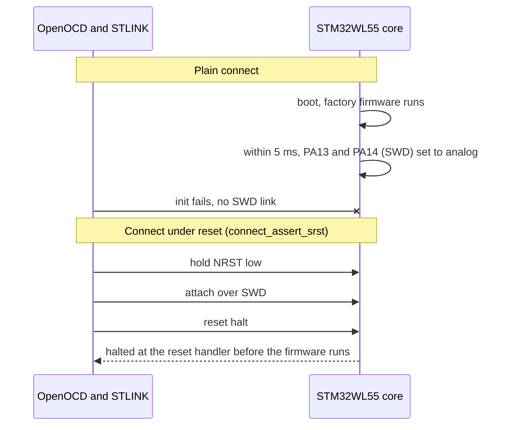
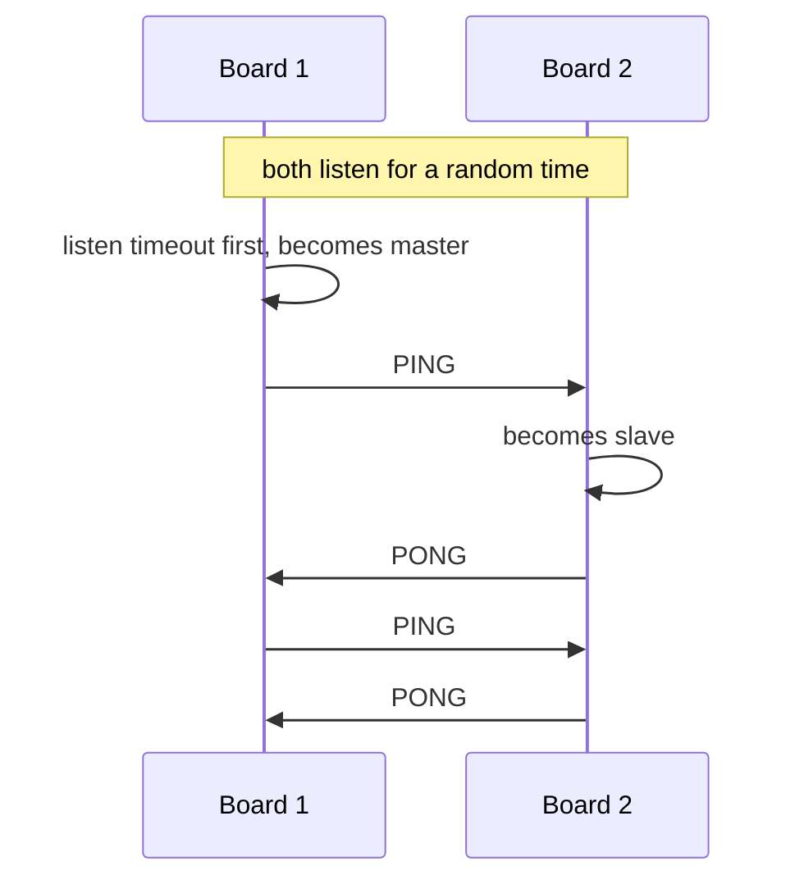
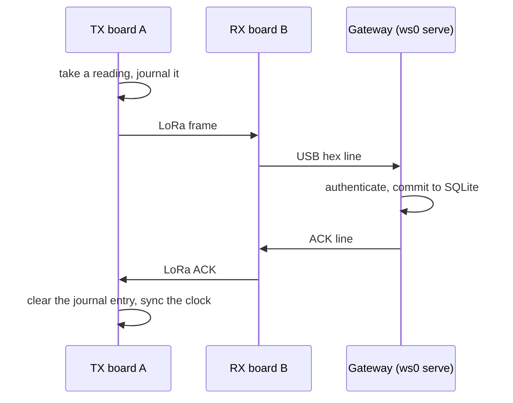
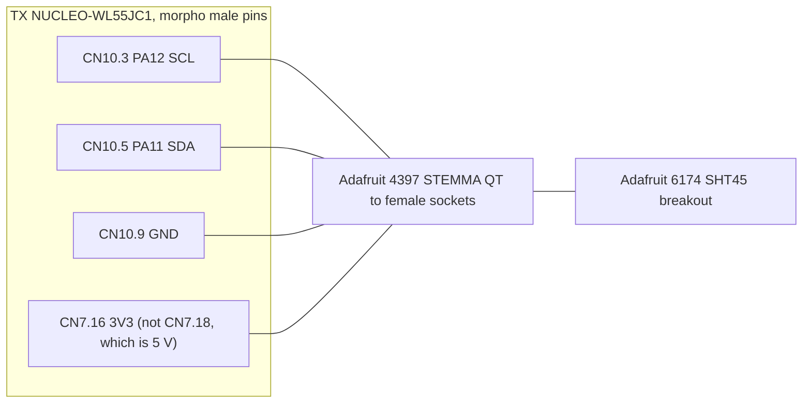

# NUCLEO-WL55JC1 bring-up log

Date: 2026-10-12 · Host: macOS (Apple Silicon), Homebrew 7.0.9

Two new NUCLEO-WL55JC1 boards came straight from ST, with default jumpers and factory firmware.

## Summary

- **State on 2026-10-13: the boards ran the bench prototype firmware, release `9e3d38f08e8b`.** Board A is the TX (transmitter), board B is the RX (receiver). This log stops on 2026-10-14, apart from the [power wiring entry of 2026-10-28/29](#power-wiring-on-the-bench-2026-10-2829). [`firmware/stage0-node/RELEASES.md`](../../firmware/stage0-node/RELEASES.md) records what each board runs now. On 2026-10-19 that was `04fcc656938d` on TX and `cc2766a38c61` on RX.
- During the office range walk, the boards ran the bench tool `firmware/rangetest` instead. See [Office session](#office-session-2026-10-13).
- PingPong was the first smoke test (2026-10-12, 915.0 MHz, LoRa SF7 / 500 kHz, 0 dBm). At about 30 cm it gave an RSSI of about −27 dBm and an SNR of 12 dB. See [PingPong link test](#pingpong-link-test).
- `docs/hardware/factory-firmware/` holds the factory firmware backups. The two boards' images are byte-identical.
- Both boards are healthy. These all work: the STLINK-V3 debug probe, SWD (Serial Wire Debug), NRST (the reset pin), the 3.3 V target supply and the VCP (the virtual COM port over USB).
- **No jumper changes are needed.** The default configuration is correct for development on USB power (evidence below).
- The factory firmware is ST's **"Concentrator" v1.0** AT-command application. Its console runs at **9600 8N1**, not 115200.
- The factory firmware **switches the SWD pins to analog within milliseconds of boot**. A plain debugger connect fails. Always **connect under reset** (OpenOCD configuration below).
- A **red** COM LED is normal and means idle. The COM LED is LED6, the two-colour STLINK LED. It blinks red and green during a debug session. UM2592 says that it turns green after a successful communication. Here, both boards settled on red after OpenOCD sessions (see [LED meanings](#led-meanings-led6-stlink-com)). This is not a fault. Do not confuse it with LED4, the red USB overcurrent fault LED.

## Board inventory

Identify the boards by **STLINK serial number**, never by the `/dev/cu.usbmodem*` name. The port name comes from the USB location ID. It changes when a cable moves to another port. Example: `usbmodem122303` belonged to board A, and to board B after a cable swap.

| Label | Role | STLINK serial | MCU UID (96-bit) | Port at time of writing |
|---|---|---|---|---|
| A | **TX** (sensor node) | `003B00194142500E20353451` | `003a0011 4c42500d 20363552` | `/dev/cu.usbmodem1122303` |
| B | **RX** (indoor USB receiver) | `0016001E4142500E20353451` | `000b0016 4c42500d 20363552` | `/dev/cu.usbmodem122303` |

Roles assigned 2026-10-12. Put physical TX and RX labels on the boards.

Both boards:

| Item | Value |
|---|---|
| STLINK | V3J7M3, USB `0483:374e` |
| Target voltage | 3.276–3.290 V |
| MCU | STM32WL55JC, DBGMCU_IDCODE `0x10036497` (dev `0x497`, rev `0x1003`) |
| Flash | 256 KB, 128 × 2 KB pages, no write protection |
| FLASH_OPTR | `0x3FFFF0AA` → read-out protection (RDP) Level 0 (unprotected) |
| Firmware | identical on both, SHA-256 `d6365d91…5cf5f8c`, 57,836 bytes used |

`docs/hardware/factory-firmware/nucleo-wl55jc-factory-concentrator-v1.0.bin` is a backup of the factory image. It is a full 256 KB (262,144-byte) flash dump. A restore therefore also overwrites pages 55–127, where the weather-station firmware keeps its node state (`App/flash_layout.h`). **That erases the node state of the weather-station firmware: the key, the counters and the journal.** After a restore, provision the TX board with a **new** key. Never reuse a key after its counter was reset (see `docs/runbook-moving-boards.md`). Restore the image with:

```sh
openocd -f interface/stlink.cfg -c "adapter serial <SERIAL>" -f target/stm32wlx.cfg \
  -c "reset_config srst_only srst_nogate connect_assert_srst" \
  -c "program docs/hardware/factory-firmware/nucleo-wl55jc-factory-concentrator-v1.0.bin 0x08000000 verify reset exit"
```

## Tools installed

| Tool | How | Version | Verdict |
|---|---|---|---|
| stlink (`st-info`, `st-flash`) | `brew install stlink` | v1.9.0 | Lists probes and target voltage. **Cannot attach** to the factory firmware (`st-info --probe` has no connect-under-reset). |
| OpenOCD | `brew install open-ocd` | 0.12.0 | **Works** with `connect_assert_srst`. Main tool. |
| pyOCD | `uv tool install pyocd` | 0.45.1 | Lists both boards as NUCLEO-WL55JC. It needs `pyocd pack install stm32wl55jcix` before it can attach (not done yet). |

STM32CubeProgrammer is not installed, because it needs a download with an ST account. No step so far needed it.

## Working OpenOCD invocation

```sh
openocd -f interface/stlink.cfg -c "adapter serial <SERIAL>" -f target/stm32wlx.cfg \
  -c "reset_config srst_only srst_nogate connect_assert_srst" \
  -c "init" -c "reset halt" ...
```

`connect_assert_srst` holds NRST low while the debugger attaches. The debugger therefore catches the core before the firmware disables SWD. OpenOCD reports "Unable to match requested speed 500 kHz, using 200 kHz". That message is harmless.



## Trial-and-error log

These are the steps in order, including the dead ends.

### 1. "Can you see the boards?": no ST device at all

- `system_profiler SPUSBDataType` and `ioreg -p IOUSB` showed no vendor `0x0483` and no `NOD_WL55JC` volume.
- The only USB serial port was `/dev/cu.usbmodem21201`. It is a **WCH CH34x adapter (`1a86:fe0c`), not a Nucleo**. Do not mistake it for one.
- **Cause:** cables or ports. New cables made board A appear, then board B. One of the original cables seems to be charge-only. Mark it or throw it away.

### 2. Only one `NOD_WL55JC` mass-storage drive

- With both boards attached, only board B's STLINK showed a mounted mass-storage (MSC) volume (`disk8`). Board A had shown its drive earlier, when it was the only board on a different hub.
- This does not affect SWD or the VCP. Only drag-and-drop flashing needs the drive. **Open item:** plug board A directly into the Mac and check whether its drive returns.

### 3. `st-info --probe` → `ENTER_SWD error (0x09)` on both boards

- The probes, the probe firmware V3J7 and the target voltage were all correct, but the chip ID read as `0x000`.
- At first I suspected cabling or jumpers on one board. The failure on **both** boards pointed to a shared cause: the firmware.

### 4. OpenOCD plain `init` → `init mode failed (unable to connect to the target)` on both

- The same symptom came from a different tool, so it was not a bug in the stlink tool.

### 5. OpenOCD with `connect_assert_srst` → **success** on both

- Both halt at the reset handler, `pc=0x0800014c`, `msp=0x20000aa0`.
- I read the IDCODE, flash size, UID, OPTR and flash SR. See the inventory table.
- Caution: OpenOCD stops all remaining `-c` commands after the first error. It does not say which command failed. Wrap commands in a Tcl `catch` (see `tools/nucleo/trace-swd-disable.tcl`).

### 6. Dumped and hashed both flash images

- Both boards have the same SHA-256, so they carry the same factory image. Its strings show an AT-command application named "Concentrator" with LoRa/FSK, region, subregion and beacon commands.

### 7. Serial console at 115200 → silence

- I opened both VCPs at 115200 and sent `AT`, `AT+VER`, `AT?`. No bytes came back.
- I opened the port, then reset the MCU through NRST to catch a boot banner. Still nothing.

### 8. Tried to find why: halting the running firmware

- I set `DBGMCU_CR = 0x7` (keep debug alive in Sleep, Stop and Standby), resumed, and halted after 3 s. The result was `jtag status contains invalid mode value - communication failure`. Debug was lost even with the low-power debug bits set.
- A halt after 5, 100 or 1000 ms also failed. Debug is gone within 5 ms of reset release.
- **Watchpoint on `GPIOA_MODER` (0x48000000) writes**, run with `tools/nucleo/trace-swd-disable.tcl`:
  - Hit 0 (`pc=0x08002f58`): MODER set to its reset value `0xABFFFFFF`.
  - Hit 13: `0xABFFFFFF → 0xEBFFFFFF` (PA15 → analog).
  - Hit 14: link lost. The next pins configured were PA14 and PA13 (SWCLK and SWDIO), set to analog.
  - No USART1, USART2 or LPUART1 was enabled at that point.
- **Conclusion:** the firmware sets every unused GPIO to analog for low power, the SWD pins included. This is the STM32CubeWL `DEBUGGER_ENABLED=0` pattern. It is normal factory behaviour, not a fault.

### 9. Baud-rate sweep → **9600 baud works**

- I tried 9600, 19200, 38400, 57600, 115200 and 230400, with a reset through NRST each time.
- At 9600 the board printed:
  ```
  --------------------------
      Concentrator Reset
       v1:0
  --------------------------
  ```
- The other rates gave framing garbage (19200–57600) or nothing.

### 10. AT console works on both boards

- Syntax: `AT+<CMD>=?` gets a value and `AT+<CMD>?` shows help. So `AT+VER` → `AT_ERROR`, but `AT+VER=?` → `v1:0`.
- Both boards returned the full help listing and `v1:0`.
- **I sent no transmit commands** (`AT+BEACON_ON`, `AT+MOD_TEST_*`). Attach an antenna before you key the radio.

## LED meanings (LED6, STLINK COM)

UM2592 Rev 4 §6.6.1 names the two-colour STLINK COM LED as LED6. LED4 is the red USB overcurrent fault LED. LED5 is the green 5V_PWR LED.

| Observed | Meaning |
|---|---|
| Solid red | STLINK enumerated with the PC, no debug session active (idle) |
| Blinking red/green | Debug or programming session talking to the target |
| Solid green | Last target communication succeeded |

Timeline: at plug-in, one board was green after its STLINK talked to the target. The other board was red (idle). After my OpenOCD sessions, both blinked red and green and settled on red. That is expected, although UM2592 says green after a successful communication.

## Jumpers

The jumpers stay at the factory default. This evidence shows that the defaults are correct:

- STLINK measures 3.28 V on the target. So the board takes power from the STLINK USB, and the IDD measurement jumper is fitted.
- SWD and the NRST connect-under-reset work. So the STLINK-to-MCU debug and reset links are connected.
- The VCP carries the MCU's UART. So the STLINK-to-MCU UART links are connected.

Change a jumper only for a specific reason, for example to measure MCU current on the IDD header or to power the board from an external supply. Check the exact jumper in ST user manual UM2592 before you move anything.

## Helpers

- `tools/nucleo/at.py` sends AT commands at 9600 baud: `python3 tools/nucleo/at.py /dev/cu.usbmodemXXXX "AT+VER=?"`
- `tools/nucleo/trace-swd-disable.tcl` is the OpenOCD watchpoint script from step 8.
- List probes: `st-info --probe` or `pyocd list`.

## PingPong link test

### What and why

Goal: make the two boards talk to each other. The factory Concentrator firmware cannot do this by itself, because it expects ST's `LocalNetwork` Sensor firmware on the other node. I used ST's standard two-node test instead: `Projects/NUCLEO-WL55JC/Applications/SubGHz_Phy/SubGHz_Phy_PingPong` from STM32CubeWL **v1.6.0**.

The same firmware goes on both boards. Each board listens for a random time. The board that times out first becomes master and sends `PING`. The other board becomes slave and answers `PONG`.



### Where things live

| Path | What |
|---|---|
| `firmware/pingpong/` (deleted 2026-10-15; recover it from git history) | Copy of ST's application sources plus our `Makefile`. The vendor tree is not modified. Since 2026-10-14, the board code (`Core/`, `startup/`, `SubGHz_Phy/Target/`) and the linker script come from `firmware/board/nucleo-wl55jc`, shared with the node. That linker script limits the image to 64 KB. The original PingPong linker script allowed 256 KB. |
| `vendor/STM32CubeWL` (git-ignored) | STM32CubeWL v1.6.0 (`--depth 1`) with the HAL, CMSIS-device, Nucleo-BSP and SubGHz_Phy submodules. `tools/fetch-vendor.sh` creates and verifies it. At the time of this test it was in `~/code/vendor/STM32CubeWL`. It moved later (see item 6 of the trial and error in [Weather-station firmware bring-up](#weather-station-firmware-bring-up-2026-10-12)). |
| `~/.local/opt/xpack-arm-none-eabi-gcc-15.2.1-1.1` | Arm GCC 15.2.1 (xPack) |

Build and flash:
```sh
cd firmware/pingpong
make -j8
make flash SERIAL=003B00194142500E20353451   # board A
make flash SERIAL=0016001E4142500E20353451   # board B
```

### Changes from ST's example (all marked `weather-station-2026` in source)

| Setting | ST default | Ours | Why |
|---|---|---|---|
| `RF_FREQUENCY` | 868 MHz (EU) | **915 MHz** | US location (America/Chicago). 868 MHz is not a US ISM band. |
| `TX_OUTPUT_POWER` | 14 dBm | **0 dBm** | Desk test. The boards are about 30 cm apart, so they need no more power, and it is gentler on the power amplifier. |
| `DEBUGGER_ENABLED` | 0 | **1** | Keeps SWD alive, so OpenOCD can attach without connect-under-reset (verified: plain `halt` worked). |
| LEDs | Master toggles red, slave toggles green, on every packet | **Blue LD1 = "I have the ball"** (`CatchBall()` on RX, off at `OnTxDone`). Red and green still blink together while the board searches for a partner. | Lets you watch the rally. |
| `BALL_HOLD_MS` | n/a | **400 ms** extra hold before the board returns the ball | Slows the rally to about 1.46 s per round trip. Each blue LED is on for about 0.7 s, in turn. Keep it well under `RX_TIMEOUT_VALUE` (3000 ms). |
| `LORA_BANDWIDTH` | 0 (125 kHz) | **2 (500 kHz)** | US regulatory class, see [RF configuration decision](#rf-configuration-decision). |

The rest is ST's default: LoRa, SF7, coding rate 4/5, 8-symbol preamble, 64-byte payload.

### RF configuration decision

Decided 2026-10-12, approved by Clint: **LoRa, 500 kHz bandwidth, 915.0 MHz, under FCC §15.247(a)(2) (digital modulation, 6 dB bandwidth ≥ 500 kHz).**

| Rule | 902–928 MHz allowance | Fixed-channel 125 kHz LoRa at 0 dBm |
|---|---|---|
| §15.249 | ≤ 50 mV/m at 3 m ≈ −1.25 dBm EIRP | About −1 to +2 dBm EIRP with an unknown 0–2 dBi antenna. **Probably over by up to 3 dB.** The first PingPong runs (125 kHz) used this setting. They were desk-only and lasted minutes. |
| §15.247(a)(1) hopping | ≥ 50 channels if 20 dB bandwidth < 250 kHz | Not applicable (one channel) |
| §15.247(a)(2) digital modulation | 6 dB bandwidth ≥ 500 kHz; ≤ +30 dBm conducted (≤ 6 dBi); PSD ≤ 8 dBm/3 kHz | **500 kHz LoRa fits this class.** At 0 dBm the power spectral density (PSD) is about −22 dBm/3 kHz. |

Not yet verified: the measured 6 dB bandwidth of these boards' 500 kHz LoRa signal (this needs a spectrum analyser) and the gain of the supplied antenna. This is an engineering reading of Part 15, not a compliance certification.

The cost is about 6 dB less receive sensitivity than at 125 kHz. Recover it with a higher spreading factor (SF) or more power during the link-budget work for the 24-hour delivery test (H01, [`docs/H01-checklist.md`](../H01-checklist.md)).

Smoke test at 500 kHz: the rally formed again at once. RSSI −26 to −28 dBm, SNR 12–13 dB, no timeouts, about 1.28 s per round trip.

### Pinned build inputs (smoke test)

| Input | Version |
|---|---|
| STM32CubeWL | `v1.6.0` @ `f934cd298bf82d45f96aac2f335c0bbd26d0b946` |
| ↳ STM32WLxx_HAL_Driver | `v1.6.0` @ `5c87cf00992c6e4ecf56c7c129b8dcfc6aa6f88e` |
| ↳ CMSIS Device STM32WLxx | `v1.4.0` @ `71a0b7860e700f7ca11afe4c4afd6cef684ad9bb` |
| ↳ BSP STM32WLxx_Nucleo | `v1.3.1` @ `90cb4924568890bce20cf5ed701f67486619cd6f` |
| ↳ SubGHz_Phy middleware | `v1.5.0` @ `7dc059f353f359ec65c60a0549d53c1ebeaafa79` |
| Toolchain | xPack arm-none-eabi-gcc `15.2.1-1.1` (tarball SHA-256 `574082d3…aad870`) |
| Programmer | OpenOCD 0.12.0 (Homebrew `open-ocd`) |
| Host | MacBookPro18,4 (M1 Max), macOS 26.7.1, Apple clang 17.0.0, Python 3.12.7, Node 22.22.2 |
| `build/pingpong.bin` (500 kHz, blue-LED build) | SHA-256 `baed948b7377ab6f01eb14a1841328c0c2cbcb96d36416fab45452ef8af7151f`, flashed to A and B |

This is a diagnostic smoke test only. It is **not the H01 test** and does not use the weather-station protocol. The console is **115200 8N1**. That differs from the factory firmware's 9600.

### Result (captured 20 s after resetting both)

- Board A (`003B…`) won the election and became **master** (`Master Tx start` → `OnRxDone` → `...PING`).
- Board B (`0016…`) became **slave** (`...PONG`, `Slave Tx start`).
- About one round trip every 1.3–1.5 s (see the `BALL_HOLD_MS` row and the 500 kHz smoke test above). No receive timeouts after the link formed. RSSI −26 to −28 dBm, SNR 12–13 dB.
- The random listen time at boot (`rand=` in the log) decides which board becomes master. The roles can swap after a reset.

### Trial and error during the build

1. **`brew install --cask gcc-arm-embedded` failed its checksum check.** The download's SHA-256 (`779972fa…`) did not match the cask's expected value (`284f16b9…`). I **did not bypass the check**. I used the xPack build of the same GNU Arm toolchain from GitHub releases instead. It matched its published `.sha` (`574082d3…`, `OK`).
2. **Build error: `stm32wlxx_hal.h: No such file`.** STM32CubeWL keeps its drivers in **git submodules**, and a `--depth 1` clone leaves them empty. I fetched only the necessary ones: `Drivers/STM32WLxx_HAL_Driver`, `Drivers/CMSIS/Device/ST/STM32WLxx`, `Drivers/BSP/STM32WLxx_Nucleo`.
3. **Build error: `radio.h: No such file`.** `Middlewares/Third_Party/SubGHz_Phy` is also a submodule. After I fetched it, the build succeeded: 33,864 bytes of code, no warnings.
4. **Shell trap:** in zsh, `for pair in "A B"; do set -- $pair` does not split words, so the serial and the port arrived as one argument. I ran those loops under `bash -c`.

## Next steps (as of the PingPong test, 2026-10-12)

1. ~~Move from PingPong toward real weather-station traffic.~~ **Done 2026-10-12:** raw SubGHz_Phy with our own packet format, see [Weather-station firmware bring-up](#weather-station-firmware-bring-up-2026-10-12). The options were ST's `LocalNetwork` Concentrator + Sensor demo, raw SubGHz_Phy, and LoRaWAN.
2. Check the range with more TX power and real placement. Stay within the FCC Part 15.247 limits for 902–928 MHz. **Started 2026-10-13** with `firmware/rangetest`, see [Office session](#office-session-2026-10-13). The placement work remains.
3. Open: investigate the missing mass-storage drive on board A (step 2 of the log above). This log has no later entry on it.
4. To return to the factory firmware, run the restore command in [Board inventory](#board-inventory). This erases the key, counters and journal of the weather-station firmware.

## Weather-station firmware bring-up (2026-10-12)

[`firmware/stage0-node`](../../firmware/stage0-node/README.md) replaced the PingPong smoke test: TX on board A, RX on board B. The host runs `python -m ws0 serve` against the RX port.

### Verified on hardware

- **Sensor wiring checked against UM2592 Rev 4 (Nov 2025), Table 17** (Clint supplied it): CN5.9 = D14 = PA11 = I2C2_SDA, CN5.10 = D15 = PA12 = I2C2_SCL, CN6.4 = 3V3, CN6.6 = GND. No solder bridge is in the path. ST's I2C example uses PA15 for SDA. That was the example's own choice, and PA15 is not the Arduino D14 pin.
- **Board variant checked against data brief DB3933 Rev 1:** NUCLEO-WL55JC1 = high band, 865–928 MHz, so 915.0 MHz is in band.
- **End-to-end link** (diagram below). Epoch 2 delivered seq 0–12 with `pending=0`. Every reading after the first ACK carried synchronized UTC. RSSI −23/−24 dBm, SNR 12–13 dB.
- **Reboot behaviour:** the epoch advanced 1 → 2 → 3. The counter skipped the unused reservation (8 → 257). The firmware delivered the backlogged readings of the previous epoch first-in-first-out, at most two per minute. The provisioning survived a reflash.
- **Crypto:** the TX boot self-test passes on the target. The C frame code matches Python on fixed vectors and on 200 random frames per direction (`tests/test_frame.py`).



### Trial and error

1. **The ACK window closed after 1.3 ms.** The first run showed `sent=9 acked=0 no_ack=9`. Backlog frames were lost while RX was busy sending ACKs. Cause: ST's default `LORA_SYMBOL_TIMEOUT` of 5 symbols. At SF7/500 kHz a symbol takes 0.256 ms. So a single receive window ended after about 1.3 ms unless a preamble had already started. Fix: symbol timeout 0, so the 2 s window timer bounds the receive. After the fix: `sent=3 acked=3 no_ack=0`.
2. **`%lu` printed literally.** ST builds its `tiny_vsnprintf` with `TINY_PRINTF`. That build drops the `l` length modifier (widths and zero-padding still work). All console formats now use `%u` with `(unsigned)` casts.
3. **Board A dropped off USB once** while it was still powered and transmitting. The RX bridge kept hearing its 64-byte PingPong packets. A replug fixed it. During the replug, one TX flash failed mid-verify (`jtag status contains invalid mode value`). A retry verified correctly.
4. **ACK design change during implementation:** protocol version 2 first added only the host UTC (48-byte ACK). A recorded ACK could then be replayed to move the clock. So the ACK now also echoes the counter of the observation frame. The node accepts time only from the reply to the frame it just sent (56-byte ACK).
5. **Mbed TLS choice:** ST's pinned `mbed-crypto` submodule is Mbed TLS **3.6.6 LTS**. The target uses it for AES-CCM. The host compiles it for the agreement tests. There is no hand-written AES. The firmware does not use the STM32WL hardware AES.
6. **The vendor checkout moved** into `vendor/` (git-ignored). `tools/fetch-vendor.sh` creates it again and verifies every pinned commit.

### Build record

| Artifact | SHA-256 |
|---|---|
| `build/rx/stage0-rx.bin` | `37d79f7b05b60ca007b99b533087e931d69c97129aeb5181477d95eaab7d58c4` |
| `build/tx/stage0-tx.bin` | `508677c7811de80975705b23d5bc2368b0d1d2e4cb0c95e57f5faaf71e4c1298` |

These images were built from working tree `6dd6b54-dirty`. The commit that adds this section is the source of record. Rebuild from that commit and compare the hashes. The embedded version string changes the hashes.

### Protocol version 3: impossible fillers for invalid readings (2026-10-12)

Clint asked whether a 0 filler is wise for a sensor fault, because 0.00 °C is a real Chicago temperature. The decision: the validity flag stays authoritative. An invalid reading now carries `0x8000` (−327.68 °C) and `0xFFFF` (655.35 % RH). A reader that ignores the flag can no longer see a plausible value. The version byte went from 2 to 3.

Switch-over order on the live bench:


1. Confirm TX `pending=0`. Then no version-2 plaintext with a 0 filler stays in the journal.
2. Flash RX, then TX.
3. Restart the gateway.

As expected, TX's first version-3 frame reached the old gateway, and the gateway rejected it (`Unexpected frame header`). The frame stayed in the journal. The next minute delivered it and the live reading, both with `8000ffff` on air and stored as `null`/`sensor_fault`.

| Artifact | SHA-256 |
|---|---|
| `build/rx/stage0-rx.bin` (protocol version 3) | `1d859a309dde70317cb323a6a31f2cb78d94a76d913dffd9befedc055c15fc1f` |
| `build/tx/stage0-tx.bin` (protocol version 3) | `4d7f3c7a5fb5ed8f238804820762c5cb87cdeeee8fef02d241b6ecd55b74bdf4` |

### Protocol version 4: reconstructed time and time across resets (2026-10-12)

Clint approved two changes: the gateway reconstructs the time of a reading taken before the clock was synchronized, and the node keeps its time trust across a reset. He agreed that a reconstructed time counts toward the H01 test when it meets the 5 s tolerance.

- **Wire:** UTC is a u32 of seconds plus a u32 **uptime** (seconds since boot, always present). The version byte is 4. The gateway keeps the payload unchanged and stores `effective_at`, `time_basis` and `time_uncertainty_s` in derived columns. It migrated the existing bench database (version 2 and 3 rows) in place.
- **Firmware:** the uptime and the 6 h trust window now use RTC seconds (`SysTimeGetMcuTime`), not `HAL_GetTick`. Time trust survives a reset through the RTC backup registers DR3 and DR4. Finding: ST's `TIMER_IF_Init` sets the RTC high tick count to zero at every boot. That matters only after about 48.5 days of uptime, and the trust check rejects it (the RTC must count forward).
- **Bench, warm reset (NRST):** `#time restored utc=1791861315 sync_age=11`. Epoch 7 reading 0 was synchronized. The board clock differed from the host clock by −1.0 s (whole-second truncation plus serial latency).
- **Bench, simulated power loss** (the debugger pulsed `RCC_BDCR.BDRST`, then reset): no restore. Epoch 8 reading 0 was `time=unknown uptime=0`. After reading 1 synchronized, the gateway reconstructed reading 0 as **03:15:34Z ± 2.009 s**. The board log shows 03:15:35Z.
- **Residual case seen:** epoch 6 ended before its first sync (my warm-reset test). Its 2 readings stay `unknown`, because they have no reference. protocol-stack.md 11.3.2 documents this.
- **Switch-over:** the same order as for version 3 (`pending=0` → RX → TX → gateway). Again, the first version-4 frame reached the old gateway, the gateway rejected it, and the next minute delivered it.

| Artifact | SHA-256 |
|---|---|
| `build/rx/stage0-rx.bin` (protocol version 4) | `a919c177d0bc6eb5820f5b9251bf3a00dd14f05a71cce8a11abe0725e109e220` |
| `build/tx/stage0-tx.bin` (protocol version 4) | `5bb7690fcdbc85288643a5ccd46528cabaeac462a4d642b71c48bf8d96cfebfd` |

### Watchdog and NACK on hardware (2026-10-12)

- **Watchdog:** `TEST-HANG` on TX gave `#boot … reset=watchdog` after 7.9 s. The time trust came back from the backup registers, and the gateway ACKed the next reading. On RX, `reset=watchdog` came after 7 s. The first boot after the update showed `reset=power`, because the old firmware never cleared the reset flags. The new firmware clears them.
- **NACK for a permanently rejected record:** I planted a conflicting database row for TX's next identity (epoch 11, seq 1). The gateway authenticated the frame, stored it in `rejections` (112 hex characters) and sent a NACK. TX: `#nack epoch=11 seq=1 reason=1 abandoned=1`, `pending=0`. Cleanup: I deleted the planted row. I recovered the genuine reading from `rejections.frame_hex` with `Store.ingest` (it returned `True`). The rejection row stays as evidence.

## Office session (2026-10-13)

### Office setup

- Fresh Mac: a venv through `uv`, `tools/fetch-vendor.sh` (without `vendor/`, the 7 C-against-Python crypto tests skip), `brew install open-ocd` (0.12.0), xPack arm-none-eabi-gcc 15.2.1-1.1 (tarball SHA-256 matched `574082d3…aad870`).
- I wiped TX (`WIPE ERASE-ALL-NODE-STATE`, which discarded 18 office-time readings). I provisioned it with a fresh office key: key check value (KCV) `b7142e`, run directory `run-office/`. **The home gateway now rejects TX.**
- Do **not** provision TX again with the `run-hw` key. The WIPE reset the transmission counter, and the firmware builds the nonce from that counter. A reused key would therefore repeat nonces (corrected the same day). Move the gateway or the run directory, or use a new key: `docs/runbook-moving-boards.md`.
- I rebuilt release `a07f498` here from a worktree at that commit. Both `.bin` hashes matched `RELEASES.md`. A build from a later commit does not match, because the firmware embeds the commit.

### Range walks

- Walk 1 (weather-station firmware, 1 reading per minute, SF7 / 0 dBm, boards hanging loose): `evidence/range-walk-office-2026-10-13/`. A 2-minute dropout lost nothing, because the journal filled the gap. But the first backfilled reading arrived after 121.6 s, over the 120 s limit of the H01 test.
- Walk 2 (new bench tool `firmware/rangetest`, both directions about every 1 s, SF and power selected by button): `evidence/rangetest-office-2026-10-13/`.
  - SF12 / +22 dBm reached the far side of the building.
  - The noise floor was about −100 dBm at both ends.
  - Losses came in bursts and started near 0 dB SNR, far above the −20 dB limit of SF12.
  - One window showed RSSI up and SNR down together, which means in-band interference.
  - Hypothesis, not confirmed: bursty 902–928 MHz sources such as UHF RFID.

### Trial and error

- **`firmware/rangetest` v1 settings gap:** a restarted board came back at the defaults while the other board kept its settings. The boards then ran at different power, or could not hear each other at all if the SF differed. Version 2 fixed it: a restarted board adopts the first settings it hears. After about 30 s without contact, both boards return to the defaults.
- **The v2 defaults were the weakest setting (SF7 / 0 dBm).** At SF12 / +22, a walk out of range dropped both boards to the setting with the shortest reach. They then could not reconnect from the place where the link was lost (Clint found this). In version 3, boot and fallback are SF12 / +22 dBm, and the buttons step down. Version 3 is built and tested on the host but **not yet flashed** (as of 2026-10-13, about 17:00Z).
- The packet version byte (`RT_VERSION`) is still 1 in versions 1–3. So boards with different tool versions work together without any warning. Flash both boards with the same build.
- **Logger crashes:** a mark went through a code path that assumed settings fields (KeyError). The logger also stopped on a USB disconnect, and it logged the wrong board after the port names swapped. Fixed: the logger finds the board by ST-LINK serial number and reconnects.
- **Spontaneous restarts are USB dropouts.** Both boards restarted when their USB port went away for about 1 s (TX 4 times, RX twice, one episode during handling). `RCC_CSR` after clearing showed `PINRSTF` only, no `BORRSTF`, so there was no power loss. The ST-LINK pulses the target's reset pin when it enumerates again. Earlier I blamed board A alone, but RX did the same. This happens only on the bench, because the field node has no ST-LINK. But an H01 test on USB needs secured cables.
- **My own debugger sessions reset TX twice** (16:22:02 and 16:22:18) while I read and cleared `RCC_CSR` with OpenOCD. A later read-only session did not reset it. Do not start debugger sessions during runs that count restarts.
- **Readings at close range are unreliable at higher power**, because the receiver overloads with the antennas a few cm apart. Compare power settings only with the boards apart.

### SHT45 parts arrived and wiring plan (2026-10-13)

- Delivered: Adafruit 6174 (SHT45 with PTFE), 4397 (STEMMA QT to female sockets, 150 mm), 1954 (female/male jumpers), 592 (USB A to Micro-B, 3 ft).
- **Connector mismatch found before wiring:** the 4397 ends in female sockets, and the Nucleo Arduino headers (CN5, CN6) are also female. The 1954 jumpers do not bridge that either.
- So I chose the ST morpho male pins (diagram below), from UM2592 Rev 4 Table 18 and Figure 24. Clint supplied the PDF, because ST's site timed out for automated downloads. PA11 and PA12 have no solder bridges. `docs/protocol-stack.md` §3.1 has the full table.
- Hazard: CN7.18 (5 V) sits directly below CN7.16 (3V3).
- Hardware verification still to do: a CRC-checked reading, an unplug while running (expect `sensor_fault`, then recovery), then a release.
- The spare 592 cable allows the planned USB cable-swap test for the reset dropouts.
- Later note: the bench station does not use these morpho pins for I2C. Its STEMMA QT hub connects to
  CN5.9, CN5.10, CN6.4 and CN6.6 ([`bench-station-wiring.md`](bench-station-wiring.md), section 2).



### Release 0f456040fe54 (2026-10-13 evening)

- I built the release twice from a clean tree (identical `.bin` hashes) and flashed RX, then TX. The flash kept TX's node state: `kcv=b7142e`, counter 7427, `kat=pass` (the boot self-test with known-answer test vectors passed).
- Trial and error: `make clean` removes the builds of both roles. So the release loop must clean once and then build both roles. A clean per role deleted the other role's binary.
- First minute on the bench: `#sample … valid=0 rc=-2` (no sensor wired: address NACK with the new internal pull-ups). The gateway ACKed both pending readings: 2 accepted, 0 rejected.
- Not yet tested on hardware: the new WIPE (keeps the counter and the epoch), the path that probes every minute, health reports while probing, and bus recovery with a real stuck sensor.

### SHT45 first light and anomaly review (2026-10-14)

- I wired the sensor on the morpho pins (CN10.3/5/9, CN7.16) with TX unplugged. First sample after power-up: `valid=1 rc=0 t=2611 rh=4733` (26.11 °C, 47.33 %), `sensor_faults=0`.
- The RX board was unplugged from 2026-10-13 21:42:57Z (`serial-lost`). So the first three TX samples got no ACK. They stayed in the TX journal (`pending` rose, `lost=0`). When the RX came back (15:18:22Z), the gateway stored all of session 34, seq 0–9, with no gaps. The TX sampled seq 0–3 before it had time from an ACK. So the gateway reconstructed their timestamps (about ±2 s). From seq 4, the time is `synchronized`.
- **Gateway bug: the serve log showed the wrong reading.** After each ACK it printed the newest stored observation. So the backlog burst (live seq 4, then seq 0–2) logged "seq 4" four times. It now prints the observation in the frame just ACKed (key `observation`, with `duplicate`).
- **Gateway bug: the host clock check timed the DNS lookup.** `sendto()` resolved `pool.ntp.org` after the start timestamp. So the check read the lookup time as offset = rtt/2: +0.554 s (rtt 1.104 s) on 10-13 17:01Z, and +1.114 s (rtt 2.099 s) at 20:44Z. The second reading wrongly marked the clock `bad` for an hour, and the ACKs carried no time. Fixes:
  - the check resolves the name first
  - it calls a clock bad only when the clock is wrong by more than 1 s even at the edge of the rtt/2 uncertainty
  - it tries again after 5 min when a check fails or cannot decide.
  The two hourly `TimeoutError`s overnight were single lost UDP queries. They now retry sooner.
- **Gateway bug: traceback on a second stop signal.** A repeated SIGTERM during shutdown raised an error inside `server.shutdown()` (seen in `serve.log` on 10-13). Now only the first SIGINT, SIGTERM or SIGBREAK interrupts.
- **Not bugs:**
  - `node_diagnostics.journal_pending=3` in `/v1/status` for several minutes after the backlog drained. The TX sends its health report every 15 min (`DIAG_PERIOD_S`). The report at 15:18:50Z correctly counted seq 0–2 as pending. Check `received_at` for its age.
  - A `#sample` line cut off at `utc=…` in a console read. These were stale bytes that the ST-LINK buffered while no program had the TX port open, not a firmware fault.
- **RX `uart_errors=1`** (first time nonzero): it appeared within the first minute after the RX was plugged in. A gateway restart closes and reopens the port, and it did not increase the count (still 1 at 15:31:09Z). So opening the port is not the cause. Most likely, the line glitched while the ST-LINK and the target powered up. The error handler armed the receiver again, and ACKs kept flowing (16 of 16 delivered). Watch whether the count rises during the H01 test. An unchanged 1 is harmless.

### Release bc5e6ede429c (protocol version 5) on the bench (2026-10-14)

- Clint wiped TX after he checked `pending=0`. The counter was kept (8622 → 8705). Both boards were flashed at 17:58Z, with a fresh run directory `run-d5` and a new key `kcv=5618eb`. The boot self-test gave `kat=pass` on hardware.
- On air: 42 B observations, 33 B ACKs. The reading taken before the gateway started arrived from the backlog.
- **Sensor unplug test:** the SHT45 STEMMA cable was unplugged at about 18:01:30Z and plugged in again at about 18:13Z.
  - Readings seq 4–14 (11 minutes) arrived as `temperature_c`/`humidity_pct` null with `quality=sensor_fault`. The gateway ACKed each one.
  - The frames stayed 42 B, because a fault does not change the length.
  - The epoch stayed 35, so there was no reboot.
  - seq 15 was valid again (29.13 °C, probably warmed by handling).
  - TX: `sensor_faults=11`, `pending=0`, `lost=0`. No sequence gaps, also across a gateway restart at 18:12Z (dashboard deployed).

## Power wiring on the bench (2026-10-28/29)

On 2026-10-28/29 the TX board ran the bench link (`firmware/benchlink`) with the charger's analog and
status lines wired to it. The wiring and its limits are in
[`firmware/benchlink/README.md`](../../firmware/benchlink/README.md), sections "Wiring" and "What it
measures" ("Known limits"). On 2026-10-29 that wiring became the official phase A power design
([`docs/superpowers/specs/2026-10-29-power-telemetry-design.md`](../superpowers/specs/2026-10-29-power-telemetry-design.md)
sections 1 and 2; [`bench-station-wiring.md`](bench-station-wiring.md) section 4;
[`power-metering.md`](power-metering.md)). The run logs belong to Clint and are not copied here.

### Verified

This table is the dated history of the 2026-10-28 wiring. Three rows are superseded (build-progression
decision record, 2026-10-29): ISET now reaches PB1 through the M2 network (10 kΩ series, 100 nF and
1 MΩ to logic ground, gain 990099 ppm), not a direct wire; the PA10 divider ratio is measured and stored
as `POWER_VIN_DIVIDER_PPM` (M2), not taken as 3; and the INA228 VBUS is a sense lead on the OUT
connector (P5), not a breadboard jumper. The gauge now reads the CELL+ node (M4).

| Item | Result | Reference |
|---|---|---|
| ISET on PB1 | the charger's ISET pin, direct, on A0 = CN8.1 (ADC1_IN5), read by the bench link | UM2592 Rev 4 Table 17; benchlink README "Wiring" |
| Charger input on PA10 | the charger's VBUS through 20 kΩ (two 10 kΩ in series) over 10 kΩ, on A2 = CN8.3 (ADC1_IN6); the bench link multiplies the pin by 3 | UM2592 Rev 4 Table 17; benchlink README "Wiring" |
| PB8 and PB10 pin type | FT_f (5 V tolerant, Fm+), checked 2026-10-28; with the internal pull-up on, a pin must stay below min(VDD, VDDA) + 0.3 V | DS13293 Rev 5 Table 20, Table 26 note 3 |
| CHG and PGOOD levels | released, with the firmware's pull-ups on and the charger on USB: at most 2.9 V, below the pull-up limit. Their LEDs pull them up from OUT | benchlink README "Wiring" |
| Battery path resistance | a battery lead through the breadboard, about 0.2 Ω, made the charger end 1 A charges early. The cell then went into the charger's own LIPO socket as a workaround | benchlink README "Known limits" |
| Gauge sense point | the MAX17048 must sense the cell itself (its pigtail on the charger's LIPO terminal), not OUT | benchlink README "Wiring" |
| INA228 VBUS | jumpered to the charger's OUT: its bus voltage is OUT, the load voltage. The jumper must go to the intended net | benchlink README "Wiring" |

The lessons are now rules of the official wiring: the battery path is change A's lead-and-joint path
off the breadboard (build-progression record P3, 4.4; 7.1 P3, "change A as written"): the pack through
the cut #1131 pigtail into the WAGO 222 CELL+ joint, 22 AWG solid leads to the INA228's X1 screw
terminal and on to the BATT joint, then the board-mating pigtail half into the charger's BATT socket,
with no solder and no breadboard contact. Its pigtail halves, solid leads and lever joints are held to
record P8's span limits (+ span at most 75 mΩ, − span at most 40 mΩ, each pack-side span at most
28 mΩ; build-sheet power check 7, pre-run checks C12–C14); the gauge reads the CELL+ node on its own sense lead (record M4: it includes the pack-lead drop); the
INA228's VBUS lead goes to OUT with its back jumper open (wiring guide section 4).

### Not verified

| Item | Why | Closed by |
|---|---|---|
| The shunt in the battery path at 1 A | the cell sat in the charger's LIPO socket, so the INA228's shunt carried no current: its shunt current and the charge counters of those runs mean nothing | spec section 2, exit criteria 3 and 4; build-sheet power checks 3, 7, 9 and 10 |
| The safety timer | whether an early end was a termination or a timer fault was not established. The #4755 schematic ties TMR to GND (timers disabled); not yet confirmed on the board in hand | wiring guide section 4.3; build-sheet power check 10 |
| The board's 3V3 in modes A and B | not measured. UM2592 Table 9 allows 3 to 3.6 V on CN6.4 or CN7.16 | a meter on CN6.4 in each mode (wiring guide section 5) |
| R_ISET and the shunt value | the 1 kΩ and 15 mΩ in the firmware are nominal. *Dated note (2026-10-30):* R_ISET is R9 = 1 kΩ behind the #4755's closed 1A jumper (build-progression record 1.4; ICHG 0.89 A typ): `POWER_R_ISET_OHM 1000U` in `firmware/stage0-node/App/power_config.h` and `R_ISET_OHM = 1000.0` in `tools/benchlink_log.py`, adopted with change A as this workflow reads record 7.1 P3; Clint to confirm (power-telemetry design D4/D5). The runs above were logged with 890 Ω, so their ISET currents read 12 % high | build-sheet power checks 2 and 3 |
| The node firmware reading the power chain | the bench ran the bench link, not the node; the node releases up to master `c7e8860` read neither ISET nor the divider, and none read the shunt with the official sign | spec section 12.2, the acceptance drill |
