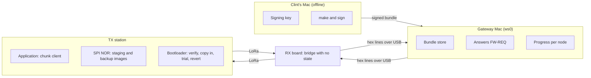
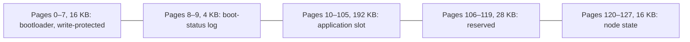
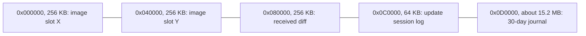
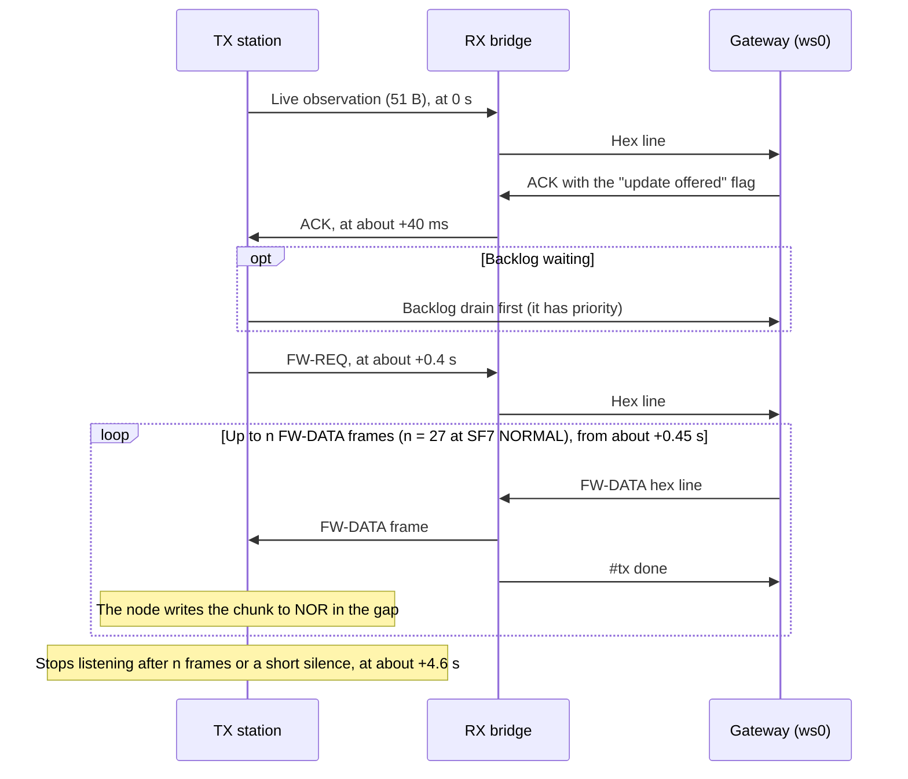
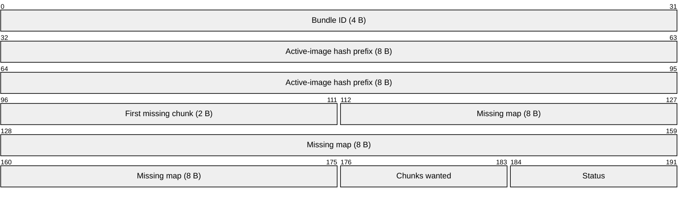
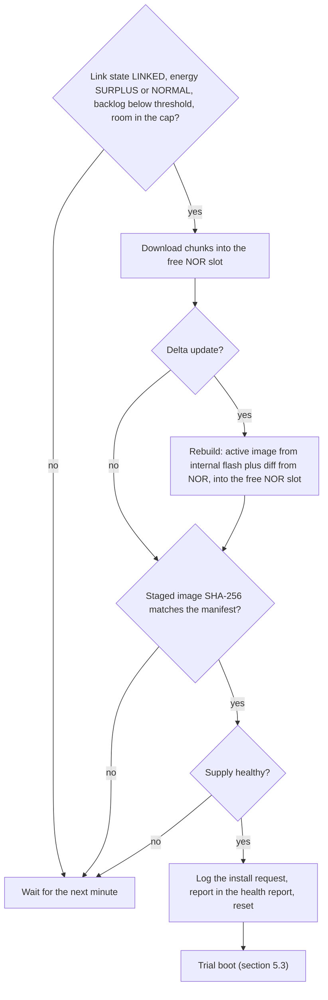
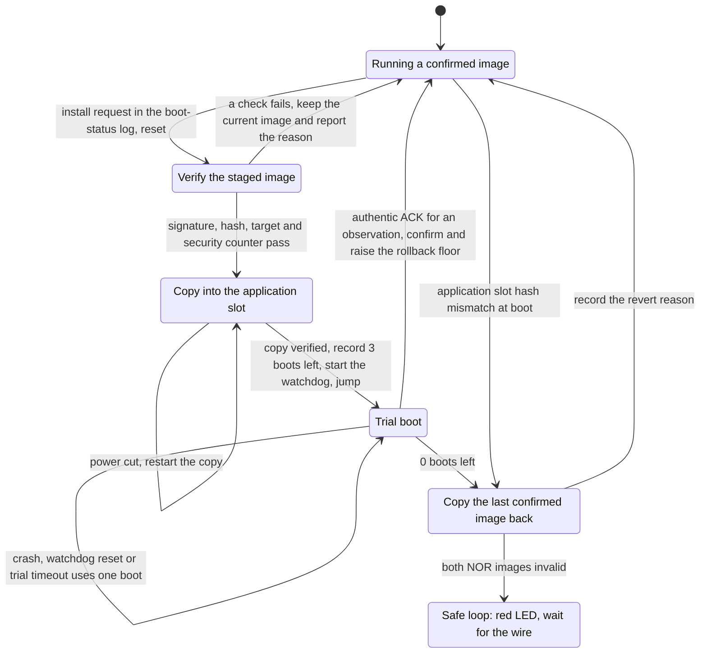
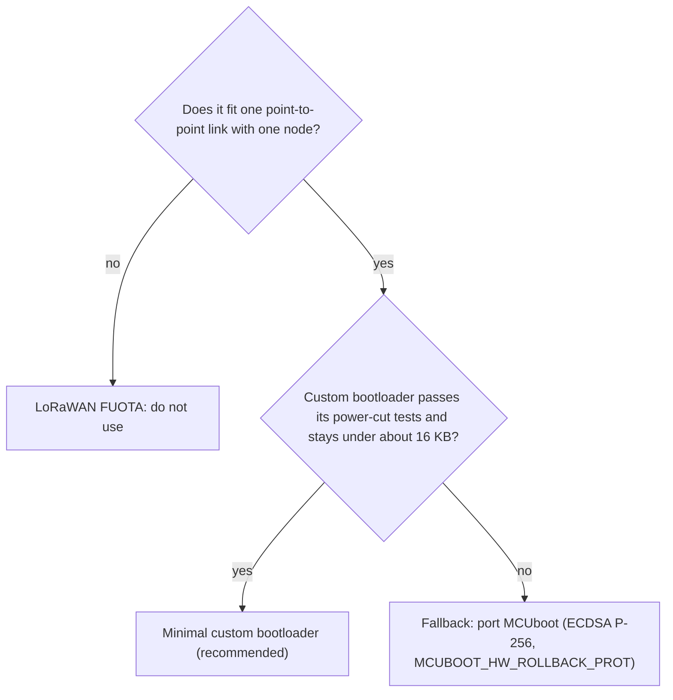
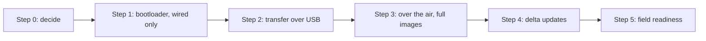

# Firmware updates over LoRa: design study

This page is a design study, written 2026-10-14. **Nothing here is built. This study changed nothing
in the firmware or the gateway.** It answers Clint's question: *"Once both ends of the system have
their 16 MB flash, can we remotely reprogram units over LoRa somehow?"*

> **Dated note, 2026-10-29: protocol version numbers.** This study was written when version 6 was
> free. Power telemetry now takes **version 6** (the catalog v2 and the 64-byte health report,
> [`superpowers/specs/2026-10-29-power-telemetry-design.md`](superpowers/specs/2026-10-29-power-telemetry-design.md)
> section 4), and the sixteen-stations time sync moves to **version 7** under its "one change per
> version" rule. The firmware-update kinds of this study (the ACK flag, kinds 5 and 6) therefore take
> **the next free version after those two (version 8 if both ship first)**, each change getting its
> own version. Every "version 6" below means "the firmware-update version". The release procedure
> is the power design's section 4 (drain the journal, WIPE, flash RX and TX from one release, a new
> run directory, a new key).

Two kinds of number appear here:

- **Measured** numbers come from this repository's builds or from the firmware's own air-time formula.
  The formula is `ws_lora_airtime_ms()` in `firmware/common/ws_policy.c`. It matches
  [`protocol-stack.md`](protocol-stack.md) §8.2 to the tenth of a millisecond.
- **Estimate** numbers are planning figures. Check them on the bench.

The diagrams on this page show the proposal. They do not show built code.

> **Note, 2026-10-19:** some facts changed after this study. Flash layout v2 is built (2026-10-16): firmware pages 0–54 (110 KB) from `0x08000000`, journal 55–124, node state 125–127 (`App/flash_layout.h`). It does not reserve pages for a bootloader, so the layout below needs one more wired layout change. The TX image is now 74,464 B (release `04fcc656938d`, `firmware/stage0-node/RELEASES.md`). That is about 333 chunks, so the full-image times in §3.4 are about 1.4 times longer. The size figures of 2026-10-14 below are kept as the study measured them.

## 0. Short answer

**Yes, for the station.** The station is the transmitting board (TX). It can fetch a signed image over
the existing LoRa link and store it in its SPI flash. A small bootloader then installs it.

The receiver board (RX) does not need any of this. The RX is on a USB cable to the gateway Mac. The
gateway Mac reflashes it by wire through the board's ST-LINK debug probe, as it does today. This also
works over SSH.

| Question | Answer |
|---|---|
| Is it legal at our radio settings? | Yes. We transmit as a §15.247(a)(2) "digital modulation" system (500 kHz bandwidth). That class has **no dwell-time or duty-cycle limit**. The rules limit only power and power density (§3) |
| How long does a full image take? | The TX image of 2026-10-14 was 54 KB (74,464 B on 2026-10-19). It needs **about 40 s of radio time at SF7** and about 8 min at SF12. Inside the existing per-minute air-time cap it takes **about 9 min at SF7**, 40 min at SF10 and 4 h at SF12 (§3.4) |
| How much do delta updates save? | A **binary diff** holds only the changes. Between real releases it measured **1.0–7.4 KB** instead of 54 KB (§3.5). A typical fix then takes seconds of air time |
| Does the RX need the 16 MB flash for this? | **No.** The gateway keeps the image. It streams the image through the RX, a few chunks per request (§4.3) |
| Energy | A full update uses less than 0.01 Wh. The core budget is 6 Wh/day (§4.6) |
| What protects against bad or hostile code? | Every image carries an ECDSA P-256 signature. The STM32WL has a hardware unit that checks it. A bootloader checks the signature, and nobody updates that bootloader over the air. The new image must prove itself: the gateway must acknowledge an observation from it. Otherwise the bootloader puts the old image back (§5) |
| Off-the-shelf? | The LoRaWAN standard for firmware updates over the air (FUOTA) does not fit a single point-to-point link. ST removed its FUOTA examples from STM32CubeWL in v1.5.0. The MCUboot bootloader fits, but it has no bare-metal STM32WL port. **Recommendation: a minimal custom bootloader and a chunk transfer that the node requests, inside our own protocol** (§6) |
| Is it in scope? | **Not today.** The product requirements (PRD) say *"Wired programming and recovery … No over-radio firmware updates in the required implementation."* Clint must expand the scope before anyone builds it (scope decision, §9) |

Three things come first:

- The 24-hour delivery test passes (H01, [`H01-checklist.md`](H01-checklist.md)).
- Flash layout v2 is built ([`firmware-budget.md`](firmware-budget.md)). Done 2026-10-16.
- The SPI NOR flash for the 30-day buffer is built (requirement H11, [`next-stages-plan.md`](next-stages-plan.md)).

Updates over the air come after those three.

## 1. Terms used here

| Term | Plain meaning |
|---|---|
| Image | The firmware file that is programmed into the chip (`stage0-tx.bin`) |
| Bootloader | A small, separate program that runs first after every reset. It checks the image and starts it, or it installs a new one |
| Slot | A fixed area of flash that holds one image |
| Staging area | A slot in the external SPI flash. A downloaded image waits there until the bootloader copies it in |
| SPI NOR flash | The external 16 MB memory chip (Winbond W25Q128JV) on a 4-wire SPI bus. You can read NOR flash at any address. It erases in 4 KB sectors |
| Chunk | One piece of the image that fits in one LoRa packet |
| Delta update | An update that sends only the differences between the old and the new image. The node rebuilds the new image from its current image plus the differences |
| Signature | A cryptographic proof that an image is genuine. Only the holder of the private key (Clint) can make one. Anyone with the public key can check one |
| Rollback protection | The node refuses an older signed image, which can contain a known weakness |
| Trial boot, confirm | A new image runs "on probation". If it does not confirm itself in time, the bootloader puts the old image back |
| Air time | How long one packet occupies the radio channel |
| SF, BW | LoRa spreading factor and bandwidth. A higher SF reaches further. Each SF step makes a packet take about twice as long |
| Observation, health report | The two frames the station sends today. An observation carries the readings. A health report (kind DIAG) carries the station's status |
| Energy state | The station's power budget level: SURPLUS, NORMAL, CONSERVE or CRITICAL (`radio-energy-policy.md`) |

## 2. What the system has today

| Fact | Value | Source |
|---|---|---|
| Microcontroller | STM32WL55JC: a Cortex-M4 at 48 MHz plus an unused Cortex-M0+. 256 KB flash in 128 pages of 2 KB. 64 KB RAM | `App/flash_layout.h`, [`firmware-budget.md`](firmware-budget.md) |
| TX image | **74,464 B** (release `04fcc656938d`), 66.1 % of its 110 KB region. At the time of the study: 53,752 B (release `bc5e6ede429c`), 82.0 % of the 64 KB region of that time | [`RELEASES.md`](../firmware/stage0-node/RELEASES.md), [`firmware-budget.md`](firmware-budget.md) |
| RX image | 34,832 B (releases `cc2766a38c61` and `04fcc656938d`). 31,696 B at the time of the study | [`RELEASES.md`](../firmware/stage0-node/RELEASES.md) |
| Final TX image budget | The features of the later build stages (Stages 1–3 in [`next-stages-plan.md`](next-stages-plan.md)) add an estimated 18–33 KB. Layout v2 (2026-10-16) grew the application region to 110 KB. The target is at most 75 % used | [`firmware-budget.md`](firmware-budget.md) |
| Flash map now | Pages 0–54 code (110 KB), 55–124 journal, 125–126 counter and epoch log, 127 key. "A firmware update programs only pages 0–54" | [`protocol-stack.md`](protocol-stack.md) §5.1 |
| Radio | 915.0 MHz, LoRa, **500 kHz**, SF7, coding rate 4/5, 8-symbol preamble, explicit header, CRC on, 0 dBm (bench). "Never bandwidth below 500 kHz" | `App/radio_cfg.h` |
| Largest LoRa packet | 255 B (radio limit) | SubGHz_Phy |
| Frame envelope | An 8-byte header, then AES-128-CCM ciphertext, then an 8-byte tag. Kinds 1–4 are in use. Each direction has its own counter space | [`protocol.md`](protocol.md) §1–2 |
| Exchange pattern | The node sends. Then it listens up to 2,000 ms for the reply. The gateway can reach the node only right after the node transmits | [`protocol.md`](protocol.md) §9 |
| Per-minute air-time cap | 15 s in SURPLUS, 5 s in NORMAL, 2 s in CONSERVE, 0 s in CRITICAL | `firmware/common/ws_policy.c` `airtime_cap_ms` |
| RX bridge | It holds no key. It forwards node frames as hex lines. It transmits one 33-byte ACK or NACK line from the host. Lines are at most 256 B. It drops input while it holds a complete line | `App/app_rx.c`, [`protocol.md`](protocol.md) §8 |
| Watchdog | Independent watchdog (IWDG), about 8 s. The firmware starts it | `App/watchdog.c` |
| Read-out protection | Read-out protection (RDP) is at level 0. A debugger can read the key | [`failure-modes.md`](failure-modes.md) |
| Planned external flash | Winbond **W25Q128JVSIM** (16 MB, rated to −40 °C). The bench uses the Adafruit 5643 breakout. It holds the 30-day buffer (H11) | [`next-stages-plan.md`](next-stages-plan.md) §4, [`poc-shopping-list.md`](poc-shopping-list.md) |
| Scope | PRD: *"Firmware delivery: Wired programming and recovery … No over-radio firmware updates in the required implementation."* Scope rule: *"Future features receive documented … accommodation where cheap, but not speculative firmware"* | PRD/TRD v0.2 §1 |

## 3. Feasibility and air-time arithmetic

### 3.1 Payload per packet

A LoRa packet carries at most 255 bytes. A firmware chunk frame in our envelope has these parts:

| Part | Bytes |
|---|---:|
| Header (version and kind, station, counter) | 8 |
| Plaintext: bundle ID (4) + chunk index (2) | 6 |
| Plaintext: image data | **224** |
| CCM tag | 8 |
| **Frame** | **246** |

224 data bytes is 7 × 32. So each chunk lines up with the 8-byte internal flash program unit and the
256-byte NOR program page. A 54 KB image is 240 chunks. A 96 KB image is 439 chunks. 96 KB is the
75 % target of a 128 KB region.

**Why encrypt the chunks?** The image itself is not secret, because the source is published. But
AES-CCM authenticated encryption proves that the chunk came from the gateway. So a stranger cannot
fill the staging area with junk or stall an update. It costs 16 bytes per frame and reuses existing
code.

### 3.2 Air time per packet (measured with the firmware's formula)

The settings are coding rate 4/5, an 8-symbol preamble, an explicit header and CRC on. Low-data-rate
optimisation applies only at 125 kHz, SF11–12.

| SF | 500 kHz, 246-B chunk | 500 kHz, 33-B request or ACK | 125 kHz, 246-B chunk | 125 kHz, 33-B frame |
|---:|---:|---:|---:|---:|
| 7 | **96 ms** | 18 ms | 384 ms | 72 ms |
| 8 | 169 ms | 33 ms | 676 ms | 134 ms |
| 9 | 302 ms | 62 ms | 1,209 ms | 247 ms |
| 10 | 554 ms | 113 ms | 2,214 ms | 453 ms |
| 11 | 1,005 ms | 206 ms | 4,837 ms | 987 ms |
| 12 | 1,845 ms | 412 ms | 8,856 ms | 1,810 ms |

At the same SF, 125 kHz is 4 times slower and about 6 dB more sensitive. So SF7 at 125 kHz reaches
about as far as SF9 at 500 kHz. SF9 at 500 kHz is faster: 302 ms per chunk against 384 ms. **500 kHz
is never worse for bulk transfer.**

### 3.3 US 915 MHz rules (FCC Part 15.247) against what the code does

The rules below come from the text of 47 CFR §15.247 [FCC247].

| Rule | What it says | Our system |
|---|---|---|
| (a)(1)(i) frequency hopping, 902–928 MHz | Channels under 250 kHz wide need at least 50 channels and **at most 0.4 s on any one frequency in 20 s**. Channels of 250 kHz or more allow 0.4 s in 10 s | **Not used.** We stay on one frequency |
| (a)(2) digital modulation | "The minimum 6 dB bandwidth shall be at least 500 kHz." **No dwell or duty-cycle limit** | **Used.** 500 kHz LoRa (`radio_cfg.h`, approved 2026-10-12) |
| (b)(3) | Digital modulation: up to 1 W (+30 dBm) conducted | 0 dBm on the bench. The plan allows up to +22 dBm |
| (b)(4) | Reduce power for antenna gain above 6 dBi | Antenna gain not yet known |
| (e) | Power spectral density at most 8 dBm in any 3 kHz band | About −22 dBm/3 kHz at 0 dBm ([`protocol-stack.md`](protocol-stack.md) §8.3). At +22 dBm the margin depends on the measurement method. Check it when the power goes up |
| §15.249 (other option) | At most 50 mV/m at 3 m (about −1.25 dBm EIRP) | Not used |

What this means for updates:

1. **At 500 kHz a long burst of chunks is legal.** In the digital-modulation class, no rule limits
   how long or how often we transmit. Our own per-minute air-time cap is the real limit. It comes
   from goal 6, "be a good neighbor", in [`radio-energy-policy.md`](radio-energy-policy.md). This
   design keeps the cap.
2. **125 kHz on one channel is not an option.** It needs hopping over at least 50 channels, with each
   packet under 400 ms. A 246-byte chunk at SF7 and 125 kHz takes 384 ms, which is just inside. At
   SF8 or higher no full chunk fits. For this reason LoRaWAN US915 caps its SF10, 125 kHz uplink
   payload at 11 bytes [RP002]. Hopping also needs both boards to follow a hop sequence. It gives us
   no benefit.
3. **Two open items from the bring-up remain.** Nobody has measured the 6 dB bandwidth of these
   boards with a spectrum analyzer. The antenna gain is unknown
   ([`nucleo-wl55jc-bringup.md`](hardware/nucleo-wl55jc-bringup.md)). This section is an engineering
   reading of Part 15, not a compliance certificate. An update does not change these items, but it
   adds air time.

### 3.4 How long a full update takes

There are two ways to schedule the download:

- **Trickle mode (recommended).** Each minute the node first sends the live reading and receives its
  ACK, then drains any backlog. Then it asks for as many chunks as fit in the rest of that minute's
  air-time cap. Live data always goes first. So the update does not affect the 24-hour delivery test
  (H01), which requires each reading committed within 120 s.
- **Session mode.** The node stays in receive mode until the whole image arrives. This is faster. But
  it holds the radio for minutes, outside the per-minute cap. Use it only on the bench.

The table uses these assumptions:

- 246-byte chunks.
- A 60 ms gap between chunks. The 492-character hex line takes about 43 ms on the 115,200-baud USB
  link to the RX. The rest is margin.
- One 33-byte request plus 300 ms turnaround per burst.
- 16 chunks per burst in session mode.
- In trickle mode, the live reading comes off the cap first: a 51-byte frame, its ACK and 300 ms.

| Image | SF7 | SF9 | SF10 | SF12 |
|---|---:|---:|---:|---:|
| **Session mode: radio time** | | | | |
| 54 KB (today) | 42 s | 92 s | 2.6 min | 7.8 min |
| 96 KB (75 % of a 128 KB region) | 79 s | 2.9 min | 4.8 min | 14.6 min |
| 128 KB | 104 s | 3.8 min | 6.3 min | 19.2 min |
| **Trickle mode, NORMAL (5 s cap)** | 27 chunks/min | 11/min | 6/min | 1/min |
| 54 KB | **9 min** | 22 min | 40 min | 4 h |
| 96 KB | 17 min | 40 min | 74 min | 7.3 h |
| **Trickle mode, SURPLUS (15 s cap)** | 91 chunks/min | 39/min | 22/min | 6/min |
| 54 KB | 3 min | 7 min | 11 min | 40 min |
| 96 KB | 5 min | 12 min | 20 min | 74 min |

Lost packets add retries in proportion. With 10 % chunk loss, add about 10 %.

The slowest case is 4 h at SF12 in NORMAL. That is acceptable, because the station keeps measuring
and sending during the download. The bootloader installs the image only when it is complete and
verified.

### 3.5 Delta updates (measured on our own builds)

A delta update sends a compressed binary diff. This study measured diffs with `detools` 0.53.0
[DETOOLS]. It used the sequential patch type, because its C library can apply that type on a
microcontroller. The inputs were pairs of real TX `.bin` files from this repository and the scratch
area.

| Change between two TX builds | New image | Diff, heatshrink | Diff, LZMA |
|---|---:|---:|---:|
| Adjacent builds (`483bb3…` → release `45f43e78fe91`) | 52,896 B | **1,017 B** | 383 B |
| Two 2026-10-13 scratch builds, small source change | 53,177 B | 1,073 B | 419 B |
| Two scratch builds, about 300 B of new code | 53,480 B | 3,136 B | 2,312 B |
| **Release to release: `45f43e78fe91` → `bc5e6ede429c`** (protocol version 5, +856 B) | 53,752 B | **7,415 B** | 5,801 B |
| Toolchain change: same source, link-time optimisation on | 46,584 B | 32,728 B | 24,446 B |
| No diff: whole image compressed | 53,752 B | 50,431 B | 36,028 B |

Nobody recorded the exact commits of the scratch builds. Their sizes and hashes are in the scratch
directory.

Conclusions:

- **Use heatshrink on the node.** It needs only a few hundred bytes of RAM. LZMA is 20–60 % smaller,
  but it needs a large dictionary in RAM. 64 KB of RAM rules out useful LZMA settings.
- **Delta updates shrink an update 7–50 times.** A whole protocol release shrinks 7 times. A small
  fix shrinks 50 times. The protocol version 5 release is 34 chunks as a diff. That is about 6 s of
  radio time at SF7, or 34 min in trickle mode at SF12 NORMAL.
- **Whole-image compression with heatshrink gains almost nothing** (54 → 50 KB). Send whole images
  uncompressed. Spend the effort on deltas.
- **A compiler or option change produces a near-full diff.** Ship those as full images.
- **A delta needs the exact base image.** The release process already makes bit-identical `.bin`
  files ([`RELEASES.md`](../firmware/stage0-node/RELEASES.md)). So the gateway can rebuild any base.
  The node must report the hash of the image it runs. The diff must name the hash of its base image.
  The node refuses a diff for another base.

## 4. Architecture

### 4.1 Where things live

### 4.2 Bootloader: two internal slots, or staging in external flash?

| | Two slots (A and B) in internal flash | **Staging in SPI NOR, then copy in (recommended)** |
|---|---|---|
| How it works | The bootloader runs one of two internal slots, or swaps them | One internal slot runs the image. The download goes to NOR. The bootloader verifies it and copies it in. The previous image stays in NOR for a revert |
| Room for the application | 256 KB minus the bootloader and the node state, then halved: about **110 KB per slot**. The final budget (about 72–87 KB before link-time optimisation) fills about 75–80 % of a slot. Tight | About **192 KB** for the application |
| Needs the NOR chip | No | Yes. The bootloader also needs a small SPI read driver |
| Install risk | Low with swapping | A power cut during the copy is safe. The source in NOR is untouched, so the bootloader restarts the copy. Repeating the copy gives the same result |
| Install time | A swap of up to 110 KB | A copy of up to 192 KB takes about 4 s. That is 96 page erases at about 23 ms each (measured by WIPE), plus about 2 s of 8-byte programming (an estimate) |
| Zephyr's default for this board | 48 KB MCUboot + 98 KB + 100 KB slots, all internal [ZEPHYR-DTS] | — |

Two internal slots squeeze the firmware budget that flash layout v2 (built 2026-10-16) grew to 110 KB. The NOR chip
arrives anyway for the 30-day buffer (H11). Its 16 MB is far more than needed. **Recommended: staging
in NOR, then copy in.**

Proposed internal flash map. Flash layout v2 did not include it, so it needs a later wired layout change.

| Pages | Size | Contents |
|---|---|---|
| 0–7 | 16 KB | Bootloader. Write-protected (option-byte write protection, area A). Holds the signing public key |
| 8–9 | 4 KB | Boot-status log in two pages. It is append-only, like today's counter log. It holds the install request, the trial state, the boots left and the rollback floor |
| 10–105 | 192 KB | Application slot: a signed header (manifest and signature), then the image. Vector table at `0x08005000` (`VECT_TAB_OFFSET`) |
| 106–119 | 28 KB | Reserved |
| 120–127 | 16 KB | Node state at the top of flash, as in flash layout v2 (which uses pages 125–127: counter and epoch log A/B and the key page). **The bootloader never writes here** |

Proposed NOR map (16 MB):

| Offset | Size | Contents |
|---|---|---|
| `0x000000` | 256 KB | Image slot X |
| `0x040000` | 256 KB | Image slot Y. X and Y alternate. One holds the last confirmed image, which is the revert source. The other receives the next download |
| `0x080000` | 256 KB | Received diff (delta updates only) |
| `0x0C0000` | 64 KB | Update session log: which chunks arrived. The node uses it to resume after a reset |
| `0x0D0000` | about 15.2 MB | 30-day journal (H11): about 2.4 MB at one 56-byte record per minute |

The update uses 5 % of the chip. The W25Q128JV datasheet [W25Q] gives the NOR timing. A 256-byte page
programs in under 3 ms (maximum). A 4 KB sector erases in about 45 ms typical and 400 ms maximum.
Erase the target slot before the download starts. Then no erase happens between chunks. Re-check
these values in the current datasheet revision.

### 4.3 The RX side: the gateway streams, the RX needs no flash

The RX stays a bridge with no state. The gateway keeps the bundle. It sends chunks as hex lines when
the node asks. The RX transmits each line once, as it does with ACKs today. The RX does not need the
NOR chip. **Only the station needs the 16 MB flash.**

RX bridge changes (estimate: under 1 KB of code):

| Change | Why |
|---|---|
| Accept the new downlink kind and its length in `ws_host_reply_ok()`. Accept the request kind in `ws_air_frame_ok()` | Today only 33-byte ACK and NACK frames go down, and only observations and health reports go up |
| Raise the C line limit `WS_LINE_MAX` (`firmware/common/ws_console.h`) from 256 to at least 512 characters. The Python side (`ws0/link.py`, `MAX_LINE`) already accepts 1,024 | A 246-byte chunk is 492 hex characters |
| Print `#tx done` after each transmission | The RX drops input while it holds a line. So the gateway sends the next chunk only after this line. The host keeps control of the pace |

Nobody updates the RX over the air. It sits next to the gateway Mac on USB with its ST-LINK. So
`make ROLE=rx flash` over SSH already reprograms it remotely.

### 4.4 The node requests, the gateway answers

The node listens only right after it transmits ([`protocol.md`](protocol.md) §9). The battery and
solar build (Stage 1 of the staged plan) will also sleep between minutes. So the gateway cannot reach
the node at other times. Therefore **the node asks, and the gateway answers**. The ACK follows the
same rule. It also keeps the radio policy in the node.

One minute in trickle mode, SF7, NORMAL (proposed):

| Time | Direction | Frame |
|---|---|---|
| 0 | node → gateway | Live observation (51 B) |
| +40 ms | gateway → node | ACK, with a new "update offered" flag |
| … | | Backlog drain, if any. It has priority |
| +0.4 s | node → gateway | **FW-REQ**: bundle ID, active-image hash, first missing chunk, a 64-bit map of the missing chunks after it, how many chunks fit in this minute's cap, node status |
| +0.45 s | gateway → node | Up to *n* **FW-DATA** frames back to back (*n* = 27 at SF7 NORMAL). The node writes each one to NOR in the gap |
| about +4.6 s | | The node stops listening after *n* frames or a short silence |

**Resume** follows from the design. The node writes each verified chunk to NOR and records it in the
session log. After a reset, a link outage or a gateway restart, the next FW-REQ names what is still
missing. The gateway keeps no session state that matters. It only serves "send me chunks *i…j* of
bundle *B*".

A proposed wire sketch follows. It needs a new protocol version (written "version 6" in 2026-10-14;
now the next free version after power telemetry's 6 and the time sync's 7, see the dated note at the
top). Like every format change, it is a wired release of both ends with a new key
([`protocol.md`](protocol.md) §2).

| Kind | Direction | Counter space | Plaintext |
|---|---|---|---|
| 2 ACK | gateway → node | gateway | Today's 17 B + **1 flags byte**. Bit 0 means that an update bundle waits for this node |
| 5 FW-REQ | node → gateway | node | Bundle ID (4), active-image hash prefix (8), first missing chunk (2), missing map (8), chunks wanted (1), status (1): 24 B in a 40-byte frame |
| 6 FW-DATA | gateway → node | gateway | Bundle ID (4), chunk index (2), data (at most 224): a 246-byte frame |

FW-REQ plaintext (proposed):

The bundle is the update file. Its first chunks hold the **manifest**. The manifest holds:

- the format version,
- the target: board role `tx`, protocol version and node-state layout version,
- the image size and the image SHA-256,
- the security counter,
- the base-image hash (diffs only),
- an ECDSA signature over all of these.

The node checks the target fields first. It stops at once if they do not match its own.

### 4.5 Node behaviour (application side)

1. **Gate.** The node asks for chunks only when all four conditions hold:
   - the link state is LINKED,
   - the energy state is SURPLUS or NORMAL,
   - the journal backlog is below a threshold,
   - the per-minute cap has room.

   A download never takes air time from live readings or the backlog. In the priority ladder of
   [`radio-energy-policy.md`](radio-energy-policy.md), the update goes below "backlog drain".
2. **Download** into the free NOR slot. AES-CCM already authenticates each chunk.
3. **Delta:** read the active image from internal flash and the diff from NOR. Write the rebuilt
   image into the free NOR slot.
4. **Check:** the SHA-256 of the staged image must equal the manifest hash. The node can also check
   the signature. The bootloader checks it in any case.
5. **Install** only on a healthy supply: the brown-out reset level is set, and the measured voltage is
   above a threshold. Append "install slot X" to the boot-status log. Report it in the health report.
   Reset.
6. **Trial:** see §5.3.

The text does not say what the node does after a failed check or an unhealthy supply. The diagram
shows "wait for the next minute" as the simplest reading.

### 4.6 Energy

The node's added cost is receive time, a few short request transmissions, NOR writes and one copy.
Receive draws about 5 mA, the datasheet-class value in
[`radio-energy-policy.md`](radio-energy-policy.md) §3.

| Case | Added radio time | Charge (estimate) | Energy at 3.7 V |
|---|---:|---:|---:|
| 54 KB image, SF7 | about 45 s | under 0.15 mAh with the microcontroller awake | under 0.001 Wh |
| 54 KB image, SF12 | about 8 min | about 1.5 mAh | about 0.005 Wh |
| 7 KB diff, SF12 | about 70 s | about 0.2 mAh | under 0.001 Wh |
| Copy at reset | about 4 s of flash work | about 0.01 mAh | negligible |

The core budget is 6 Wh/day. The proof-of-concept cell holds about 24 Wh. **Energy does not limit
updates.** Air time and link quality do. One energy rule matters: the install gate in step 5. Never
start a flash copy on a sagging battery.

## 5. Security and recovery from a bad update

### 5.1 Two keys with two jobs

| Key | Where it lives | What it protects | If it leaks |
|---|---|---|---|
| Link key (AES-128-CCM, one per station, exists today) | Node key page and the gateway state directory | **Transport:** who may talk to the node, and the privacy of readings. Also who may send chunks | An attacker can forge readings and ACKs and send chunks. **The attacker still cannot make the node run their code** |
| Signing private key (ECDSA P-256, new) | **Offline**, on Clint's Mac, outside the ws0 state directory. Protected by a passphrase, with a backup | **Code:** which images may run | An attacker can sign code. To deliver it, the attacker also needs the link key or physical access. Fix: reflash the bootloader with a new public key, by wire |
| Signing public key | Inside the write-protected bootloader | — | It is public |

The gateway stores only bundles that are already signed. It never holds the signing key. The
signature covers the image, not the chunks or the diff. The node checks the final rebuilt image, so a
bad diff cannot pass.

### 5.2 Signature algorithm

| Option | Code in the bootloader | Notes |
|---|---|---|
| **ECDSA P-256 with the STM32WL's public-key accelerator (PKA) (recommended)** | HAL PKA plus software SHA-256 (Mbed TLS `sha256`, already vendored): **estimate 3–5 KB** | The STM32WL55 has a public-key accelerator. `HAL_PKA_ECDSAVerif()` is in the pinned HAL (`stm32wlxx_hal_pka.h`). The host signs with Python `cryptography`, which ws0 already uses. The chip has no SHA hardware |
| Ed25519 in software (for example Monocypher) | estimate 6–10 KB | Simple and well reviewed. No hardware help. Needs SHA-512 |
| ECDSA P-256 in software (Mbed TLS bignum and ECP) | estimate 15–20 KB | Too large for a 16 KB bootloader |

Check the STM32WL errata sheet for PKA notes before you choose it.

### 5.3 How a bad update undoes itself

The bootloader's states (proposed):

| Layer | Mechanism |
|---|---|
| 1. Nobody updates the bootloader over the air | Only a wired update changes it. Option-byte write protection (area A) covers it. It stays small. It gets host tests like `node_store.c`, with the `sim_flash` power-cut harness |
| 2. Verify before the copy | Manifest signature, image hash, target fields, and a security counter at or above the rollback floor. On any failure the bootloader keeps the current image and reports the reason |
| 3. Verify after the copy and at every boot | The bootloader checks the SHA-256 of the internal application slot against its signed header. This takes about 30–60 ms at 48 MHz (an estimate). On a mismatch it copies the last confirmed image back from NOR |
| 4. Trial boot | The bootloader records "trial, 3 boots left". It starts the independent watchdog before it jumps. Once started, the watchdog cannot stop. Three events each use up one boot: a crash, a hang (watchdog reset), or the application's own trial timeout. An example timeout: 30 min without a confirm, then a deliberate reset |
| 5. Confirm on proof of work | The new image confirms itself **only after it receives an authentic ACK for an observation it sent**. That proves that the sensor path, the key, the counter store, the radio and the gateway all work with the new code. The confirm also raises the rollback floor. It makes this image's NOR slot the new revert source |
| 6. Automatic revert | At 0 boots left, the bootloader copies the last confirmed image back and records "reverted". The next health report shows the old build ID and a revert reason |
| 7. Last resort | Wired recovery through the Serial Wire Debug (SWD) port and the ST-LINK, as the PRD requires. If both NOR images are invalid, the bootloader stays in a safe loop (red LED) and waits for the wire |

A useful side effect: a release that cannot talk to the gateway never gets an ACK. A protocol
mismatch is one example. Such a release reverts by itself.

**Node state is outside the update.** The trial image uses the same key, counter log and epoch pages.
Counter reservations made during a failed trial stay in the log. So the reverted image continues
above them, and no nonce repeats. This works only if **an over-the-air release never changes the
protocol version or the node-state layout**. The manifest carries both versions, and the node refuses
a mismatch. Such changes stay wired releases of both ends with a new key, as today. That fits the
project rule for a proof of concept: no migration code.

### 5.4 Rollback protection

The manifest carries a security counter. The bootloader refuses an image below the floor in the
boot-status log. The floor rises only when an image **confirms**. So a revert to the previous image
still works. To downgrade on purpose, re-sign the old code with a higher counter.

The 1 KB one-time-programmable (OTP) area (`OTP_AREA_BASE`, `0x1FFF7000`) can hold a hardware floor
later. Do not use it in the proof of concept: nobody can clear an OTP bit.

### 5.5 STM32WL dual core, option bytes and read-out protection

| Item | Recommendation for the proof of concept |
|---|---|
| Cortex-M0+ (CPU2) | Keep it off, as now. ST's secure designs run the secure boot, the key store and the radio stack on CPU2 in "secure mode". These designs are SBSFU (Secure Boot and Secure Firmware Update) and KMS (Key Management Services). Secure mode uses option bytes ESE and SFSA (`OPTIONBYTE_SECURE_MODE`), with optional secure sub-GHz SPI access. That means a complete redesign of the radio side. It is not worth it here |
| Write protection (WRP) | Area A over the bootloader pages 0–7. Then the application cannot overwrite the bootloader by mistake |
| Read-out protection (RDP) | Level 1 before field use. This is already an open item in [`failure-modes.md`](failure-modes.md). At level 1 a debugger cannot read flash. It can still mass-erase and reflash, so wired recovery keeps working. A return to level 0 erases everything, **including the key and the counters**. So re-key afterwards: a fresh counter under the old key repeats nonces. **Never set level 2.** It is permanent and ends wired recovery, against the PRD |
| Brown-out reset (BOR) level | Set it before any field install |
| Watchdog option bits | `IWDG_STOP` and `IWDG_STDBY` decide whether the watchdog counts in low-power modes. Choose them when the battery and solar build adds sleep. Then the trial timer counts the right time |
| `BOOT_LOCK`, `nBOOT0`, `nSWBOOT0` | Leave as now. Read the STM32WL reference manual (RM0453) before you set `BOOT_LOCK`. It changes how the chip boots and can block recovery paths |

Without read-out protection level 1, physical access defeats every software measure. An attacker can
read the link key or reflash the chip. Signed updates protect the radio path, not the box on the
mast.

## 6. Off-the-shelf options compared

| | LoRaWAN FUOTA (TS003, TS004, TS005) and ST's example | MCUboot | **Minimal custom (recommended)** |
|---|---|---|---|
| What it is | LoRa Alliance packages. TS004 splits a file into fragments with forward error correction (FEC): redundant fragments rebuild lost ones without a request. TS005 sets up a multicast group, so one transmission reaches many devices. TS003 synchronises clocks [LORA-FUOTA] | A widely used open-source secure bootloader. It has signed images, test, confirm and revert, and a security counter [MCUBOOT] | Our bootloader (verify, copy in, trial, revert) plus FW-REQ and FW-DATA in our protocol |
| Fits a point-to-point link with one node? | **No.** It needs a LoRaWAN stack on the node and a LoRaWAN gateway. That gateway is an 8-channel concentrator, not one SX126x. It also needs a network server (ChirpStack or similar) and a FUOTA server. US915 uplinks hop over 125 kHz channels. It replaces our protocol version 5 entirely. Multicast and FEC help fleets, and we have one station | Yes. It is only the bootloader. The transport stays ours | Yes |
| STM32WL status | ST's AN5554 (Rev 6, 2026) describes single-core, dual-core, and dual-core with external flash FUOTA [AN5554]. **But STM32CubeWL v1.5.0 (Feb 2026) "Remove[d] all LoRaWAN projects based on legacy LoRaWAN Mac-Node middleware". The pinned v1.6.0 has no FUOTA or SBSFU project for this board** (`vendor/STM32CubeWL/Release_Notes.html`, `Projects/`). Older notes say the dual-core SBSFU builds needed IAR EWARM 9.30.1 or later "due to flash size constraints". The external-flash FUOTA project disables low power. Community reports show end-of-transfer and image-swap problems [ST-COMM]. Actility has a third-party FUOTA v1 project for this Nucleo, on Cube 1.3.0 [ACTILITY] | This study found no bare-metal STM32WL port. Zephyr supports `nucleo_wl55jc` with an MCUboot partition map: a 48 KB bootloader and two internal slots of about 100 KB [ZEPHYR-DTS]. Signing keys: RSA-2048, RSA-3072, ECDSA P-256, Ed25519 [IMGTOOL] | Uses only the pinned HAL (flash, SPI, PKA, watchdog) |
| Size | Large: the LoRaWAN stack plus SBSFU and KMS | Estimate 24–48 KB (Zephyr reserves 48 KB) | Estimate 12–16 KB |
| Fit with external staging and a copy | Built in (external-flash variant) | Its swap modes move data between both slots. They have sector-size rules (2 KB internal pages, 4 KB NOR sectors). Revert depends on swapping. "Overwrite-only" mode has no revert [MCUBOOT] | Designed for it. The NOR keeps both the new and the last good image, so a revert is "copy the other one" |
| Work | Highest: a new radio protocol and new infrastructure | A port: a flash-map back end for internal flash and SPI NOR, configuration, Makefile integration, and learning about 10k lines | About 800–1,200 lines of C (estimate), with our host power-cut tests |
| Main risk | Everything | Integration surprises in an unfamiliar codebase | Bugs in our own bootloader. Small size, host tests, write protection and wired recovery reduce this risk |

**Recommendation: minimal custom.** The project already owns its envelope, its power-cut test harness
and reproducible builds. The bootloader has a narrow job here: check a signature, copy one slot,
count trial boots. Take three ideas from MCUboot:

- a signed header in front of the image,
- the image-OK (confirm) flag,
- a security counter separate from the version.

**Fallback:** port MCUboot (ECDSA P-256, `MCUBOOT_HW_ROLLBACK_PROT`) if the custom bootloader fails
its power-cut tests or grows past about 16 KB. Do not use LoRaWAN FUOTA.

## 7. Staged plan

Every step needs three things first: the 24-hour delivery test (H01) passed, flash layout v2 built,
and the NOR journal for the 30-day buffer (H11) built.

**Accommodation, at no code cost:** reserve pages 0–9 for a future bootloader and boot-status log.
Put the application vector table at `0x08005000`. This matches the PRD rule "documented
accommodation where cheap". Flash layout v2 (2026-10-16) did not make this reservation. Its
application starts at `0x08000000`. Updates added later therefore need one more wired layout change.

| Step | Content | Bench pass criterion |
|---|---|---|
| **0** Decide | The decisions in §9. A runbook for custody of the signing key | Clint's decisions recorded. PRD amended or not |
| **1** Bootloader, wired only | Bundle format. `tools/fw_sign.py` (Python `cryptography`). The Makefile adds the signed header. Bootloader (verify, copy in, trial, revert, write protection). A wired console command puts test bundles into NOR | Host tests: a power cut at every erase and program step of the copy and of the boot-status log always ends in a valid image. Bench: a genuine bundle installs. **One flipped byte, a wrong key, a lower security counter and a wrong target are each refused.** 20 resets (reset pin) at random points during the copy always end in a boot. A trial image that hangs (`TEST-HANG`) or never confirms reverts after 3 boots. The key page and the counter log are byte-identical before and after |
| **2** Transfer over USB | The same FW-REQ and FW-DATA frames. The host sends them over the TX's USB console instead of the radio | A transfer cut at 10 random points, then resumed, finishes with the right hash. AES-CCM refuses a corrupted chunk, and the node fetches it again. The confirm happens on the first acknowledged observation |
| **3** Over the air, full images | The firmware-update protocol version (ACK flag, kinds 5 and 6; written "version 6" in 2026-10-14, now the next free version after 6 and 7) on both ends, as a wired release with a new key. RX `#tx done` and 512-character lines. ws0 `fw stage`, `fw status`, and progress in `/v1/status`. Trickle mode inside the cap | 54 KB at SF7 NORMAL in at most 12 min. **Every live reading committed within 120 s during the update** (the H01 rule). The update still completes when the gateway drops 20 % of chunks on purpose. A transfer resumes after the RX is unplugged mid-transfer. A deliberately broken signed image never gets an ACK, reverts by itself, and the health report shows it |
| **4** Delta updates | The gateway makes diffs from released `.bin` files (detools sequential + heatshrink). A diff applier on the node. A base-hash check | The real `45f43e78fe91 → bc5e6ede429c` diff (7.4 KB) rebuilds the exact release hash on the node. The node refuses a diff for the wrong base before the download |
| **5** Field readiness | Read-out protection level 1, write protection, brown-out reset level. A written runbook for key custody and recovery. Repeat the tests at the H01 radio settings (SF and power) | A 24 h soak with 3 updates and 1 forced revert, while the H01 criterion still passes |

Costs (estimates unless marked):

| Item | Internal flash | RAM |
|---|---:|---:|
| Bootloader (custom) | 12–16 KB, in its own pages | Its own, during boot only |
| Application: update client (requests, map, resume, staging, SHA-256, confirm) | 3–5 KB | about 1 KB |
| Application: delta applier (detools + heatshrink) | 3–5 KB | 2–3 KB |
| SPI NOR driver | Shared with H11 (already in the 6–10 KB H11 estimate) | — |
| RX bridge | under 1 KB | +0.5 KB line buffer |
| Boot-status log | 4 KB (2 pages) | — |
| NOR | 832 KB of 16 MB | — |

The application grows by an estimated 6–10 KB. It did not fit in the 64 KB region of the time,
which had 11.5 KB left when this study was written. It fits in the 110 KB region of layout v2
(2026-10-16).

## 8. Risks

| Risk | Effect | Mitigation |
|---|---|---|
| Bootloader bug | A dead board that needs a ladder and a laptop | Wired-only bootloader updates, small code, host power-cut tests, write protection, the step 1 bench tests |
| A release over the air changes the protocol or the node-state layout | Lost link, or nonce reuse | The manifest carries both versions, and the node refuses a mismatch. Such releases stay wired with a new key. An image that does not confirm reverts by itself |
| Install on a weak battery | Torn flash, brown-out loop | Brown-out reset level, a voltage gate before install, energy state NORMAL or better |
| Scope creep against the PRD | Work before the gates pass | Before H01, flash layout v2 and H11, only the free layout accommodation. Step 1 onward only with an explicit PRD change |
| Loss of the signing key | No more updates until a wired bootloader reflash with a new key | An encrypted offline backup |
| Theft of the signing key | The thief can sign code. Delivery still needs the link key or physical access | Keep it off the gateway. Read-out protection level 1 in the field |
| More air time on a transmitter that nobody has measured (6 dB bandwidth and antenna gain unknown) | Doubt about compliance | The same open item as today. Measure before the field. Trickle mode keeps the per-minute cap |
| NOR or internal-flash wear | — | Negligible: an update writes each sector once |
| Debugging gets harder | A field unit runs code that nobody can attach a debugger to | The health report shows the build ID, the update status and the revert reason. The RX logs every FW-REQ |

## 9. Decisions for Clint

The recommendation is first in each list.

| Decision | Options |
|---|---|
| Scope | Recommended: reserve the layout now, and build steps 1–5 after H01, flash layout v2 and H11, with a PRD amendment. Or keep wired-only updates (PRD as written). Or take a cheaper middle way: a sealed external SWD or USB service port on the enclosure |
| Bootloader | Recommended: minimal custom. Or an MCUboot port |
| Signature | Recommended: ECDSA P-256 with the PKA. Or Ed25519 in software |
| Custody of the signing key | Where the private key lives and how it is backed up: a file on the Mac with a passphrase, or a hardware token. Never in the ws0 state directory |
| Confirm rule | Recommended: the first authentic ACK for an observation from the new image. Or also require a valid sensor reading, but then a broken sensor reverts good code. Or also require a "commit" command from the gateway |
| Scheduling | Recommended: trickle mode inside the existing per-minute cap, in NORMAL and SURPLUS only. Or also allow session mode outside the cap. Or allow full images only in SURPLUS when SF is 10 or higher |
| Delta updates | Recommended: a later step (step 4), after full images work. Or include them in the first release over the air |
| Rollback | Recommended: the floor rises at confirm, and a downgrade needs a re-signed image with a higher counter. Or no rollback protection in the proof of concept |
| Read-out protection | Level 1 before field use (already an open item). Confirm it, and accept that a return to level 0 erases the key |

## Sources

- [FCC247] 47 CFR §15.247 — <https://www.law.cornell.edu/cfr/text/47/15.247> (also eCFR:
  <https://www.ecfr.gov/current/title-47/chapter-I/subchapter-A/part-15/subpart-C/section-15.247>).
  Read 2026-10-14: (a)(1)(i) 0.4 s in 20 s or 10 s for hopping. (a)(2) 6 dB bandwidth at least
  500 kHz, with no dwell limit. (b)(3) 1 W. (b)(4) antenna above 6 dBi. (e) 8 dBm/3 kHz.
- [RP002] LoRa Alliance, *RP002 Regional Parameters* (US915 data rates, and the 400 ms dwell limit
  behind the 11-byte DR0 payload) — <https://resources.lora-alliance.org/technical-specifications>
- [LORA-FUOTA] LoRa Alliance FUOTA building blocks (TS003, TS004 v2.0.0, TS005 v2.0.0, TS006) —
  <https://lora-alliance.org/event/lora-alliance-building-block-specifications-of-firmware-updates-over-the-air-fuota/>.
  AWS IoT Core for LoRaWAN FUOTA overview —
  <https://docs.aws.amazon.com/iot-wireless/latest/developerguide/lorawan-mc-fuota-overview.html>
- [AN5554] ST AN5554, *LoRaWAN firmware update over the air with STM32CubeWL* —
  <https://www.st.com/resource/en/application_note/an5554-lorawan-firmware-update-over-the-air-with-stm32cubewl-stmicroelectronics.pdf>
  (the PDF timed out here. The content comes from the search summary of Rev 6, March 2026.)
- STM32CubeWL v1.6.0 release notes, pinned in `tools/fetch-vendor.sh` —
  `vendor/STM32CubeWL/Release_Notes.html` (v1.5.0 removed the legacy LoRaWAN projects. IAR and
  low-power notes for the SBSFU and FUOTA projects). HAL headers `stm32wlxx_hal_pka.h` and
  `stm32wlxx_hal_flash.h`. CMSIS `stm32wl55xx.h` (`OTP_AREA_BASE`, 1 KB).
- [ST-COMM] ST community, *STM32WL FUOTA firmware swapping issue* —
  <https://community.st.com/stm32-mcus-wireless-35/stm32wl-fuota-firmware-swapping-issue-152460>
- [ACTILITY] Actility, `nucleo-stm32wl55jc-fuotav1` — <https://github.com/actility/nucleo-stm32wl55jc-fuotav1>
- [MCUBOOT] MCUboot design — <https://docs.mcuboot.com/design.html> (upgrade modes, image trailer and
  confirm, `MCUBOOT_HW_ROLLBACK_PROT`)
- [IMGTOOL] MCUboot imgtool — <https://docs.mcuboot.com/imgtool> (rsa-2048, rsa-3072, ecdsa-p256, ed25519)
- [ZEPHYR-DTS] Zephyr `nucleo_wl55jc.dts` —
  <https://github.com/zephyrproject-rtos/zephyr/blob/main/boards/st/nucleo_wl55jc/nucleo_wl55jc.dts>.
  Board page <https://docs.zephyrproject.org/latest/boards/st/nucleo_wl55jc/doc/nucleo_wl55jc.html>
- [DETOOLS] detools — <https://detools.readthedocs.io/en/latest/> (version 0.53.0, used for §3.5)
- [W25Q] Winbond W25Q128JV datasheet — <https://cdn.sparkfun.com/assets/7/2/4/9/e/w25q128jv.pdf>
  (re-check the timing values against the current revision)
- Repository: [`protocol.md`](protocol.md), [`protocol-stack.md`](protocol-stack.md) §5.1 and §8,
  [`firmware-budget.md`](firmware-budget.md), [`radio-energy-policy.md`](radio-energy-policy.md),
  [`failure-modes.md`](failure-modes.md) (open issues), [`next-stages-plan.md`](next-stages-plan.md),
  [`poc-shopping-list.md`](poc-shopping-list.md),
  [`RELEASES.md`](../firmware/stage0-node/RELEASES.md), `App/radio_cfg.h`, `App/flash_layout.h`,
  `App/app_rx.c`, `App/app_tx.c`, `App/watchdog.c`, PRD/TRD v0.2.
