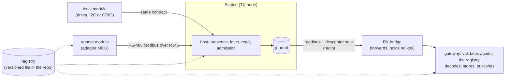
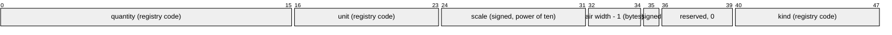
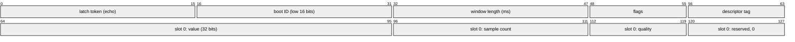
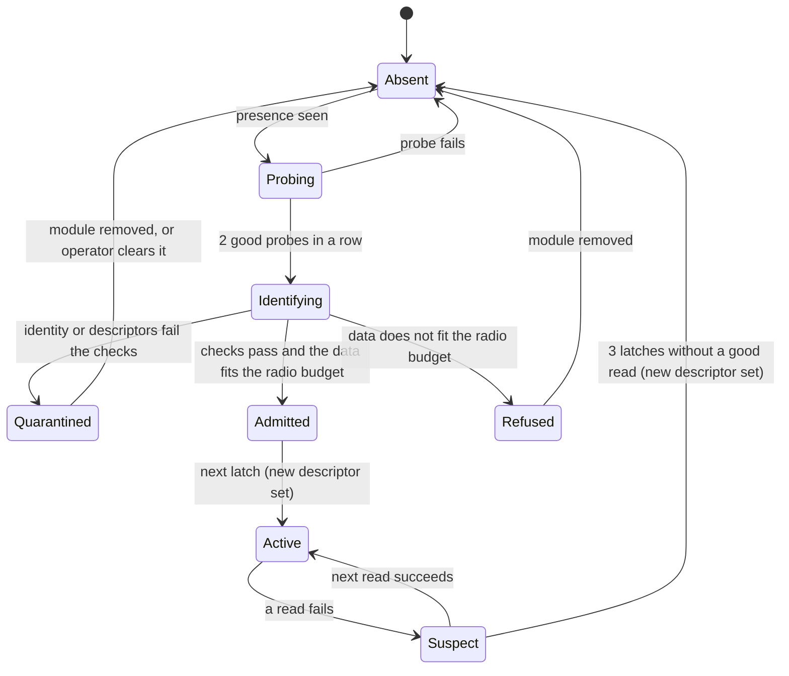
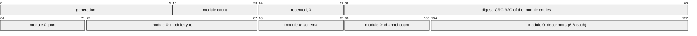
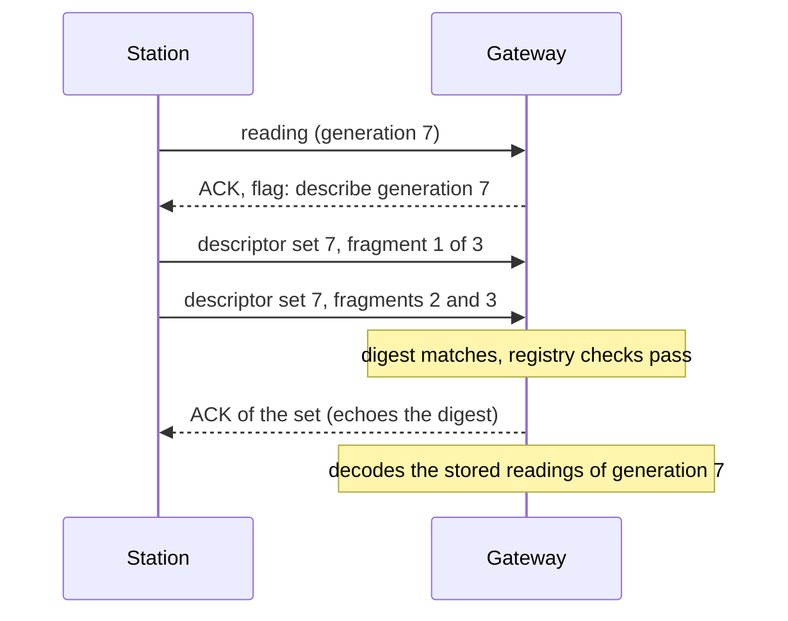

# WSMP: the Weather Station Module Protocol

Version 1.0, draft of 2026-10-18. Status: normative design, not implemented yet.

WSMP is the contract between a weather station and its sensor modules. It also defines how the
station tells the gateway what the module data means. Every module must conform to it. This applies
to a driver on the station's own microcontroller and to a module board behind an RJ45 port alike.

This text is normative. When code exists, the code must follow this text. A difference is a bug in
the code or an error in this document. Fix one of them in the same change.

Other documents:
- [`protocol.md`](protocol.md) is the radio protocol between the station and the gateway.
- [`next-stages-plan.md`](next-stages-plan.md) and the PRD give the RJ45 port hardware.
- [`superpowers/specs/2026-10-16-sixteen-stations-design.md`](superpowers/specs/2026-10-16-sixteen-stations-design.md)
  gives the 16-station radio budget that limits the data size.

## 1. Words used in this document

The key words MUST, MUST NOT, SHOULD, SHOULD NOT and MAY have the meanings of RFC 2119.

| Term | Meaning |
|---|---|
| Station | The TX node: the controller that polls modules and sends readings by radio. Also called the host. |
| Module | A unit that measures and gives one or more channels. Example: the air temperature and humidity module. |
| Channel | One stream of values with one meaning. Example: the minute mean of air temperature. |
| Port | The place where a module attaches. A local port is a bus address on the station. A remote port is an RJ45 socket. |
| Local module | A module that runs as a driver on the station's microcontroller. The bench station uses local modules. |
| Remote module | A module board with its own adapter microcontroller, behind an RJ45 port, reached by Modbus. |
| Window | The time over which a module aggregates one snapshot. Nominally one minute. |
| Latch | The station's command that closes a window, freezes its snapshot and starts the next window. |
| Snapshot | The fixed-size result of one window: a header and eight channel slots. |
| Descriptor | Six bytes that tell how to decode one channel. Descriptors use registry codes only. |
| Descriptor set | All descriptors of all present modules of one station, with a generation number. |
| Registry | The versioned list of codes for quantities, units, kinds and module types (section 4). |
| Generation | A number that the station gives to each different descriptor set. |
| Report class | How often a module's channels go to the gateway: every minute in the reading, or every 15 minutes in the health report. The module type sets it. |

## 2. Overview

The design has seven rules:

1. **One contract.** A local and a remote module give the same identity, descriptors, snapshot and
   metadata. The station handles them the same way.
2. **Modules sample, the station polls.** Each module samples and aggregates by itself. The station
   latches every module at the same time each minute and then reads one fixed-size snapshot from
   each module.
3. **Codes, not text, carry meaning.** A descriptor holds only registry codes. Free text is display
   metadata. It never decodes a value and never becomes an identifier.
4. **Decoding never depends on metadata.** The gateway decodes a reading with the descriptor set of
   its generation and the registry. Labels, ranges and part numbers are optional extras.
5. **Nothing is lost by a change.** The station keeps every descriptor set that a pending journal
   record uses. The gateway can therefore decode every record, also after a database restore.
6. **Modules aggregate only what needs their samples.** A module computes a value only if the value
   needs the samples inside one window. Examples are a mean of 4 samples and a 3-second gust. Every
   other statistic is the gateway's work: means over several minutes, extremes, rates and totals.
   Counts travel raw. The gateway keeps the raw values, so it can compute the statistics again
   with better rules later.
7. **Each channel goes as often as it changes.** Weather goes every minute. Slow data (the battery)
   goes in the 15-minute health report. The station still latches and reads every module every
   minute, so the polling stays uniform.

## 3. Versioning

- **WSMP-V1.** The identity block carries the WSMP version as major and minor bytes. This document
  is version 1.0.
- **WSMP-V2.** The station MUST refuse a module with a different major version. It MUST accept a
  higher minor version and ignore registers that it does not know.
- **WSMP-V3.** The project is greenfield. A major change reflashes every module, station and gateway
  together. There is no translation between major versions.

## 4. The registry

The registry is one machine-readable file in the repository. A tool generates the C header for the
station and the module firmware, and the Python module for the gateway, from that file. The
generated files are committed, as `tools/tangle.py` does for literate sources. The tables in this
section are the initial content.

- **WSMP-G1.** Codes are append-only. A code is never reused. A change of meaning, unit or scale
  basis gets a new code.
- **WSMP-G2.** Code 0 means "none" in every table.
- **WSMP-G3.** Every quantity has exactly one canonical unit. A module MUST report that unit.
- **WSMP-G4.** The registry has a version number. The gateway records the registry version with each
  descriptor set that it stores.

### 4.1 Quantities

| Code | Quantity | Canonical unit | Physical range | Notes |
|---:|---|---|---|---|
| 1 | air temperature | Cel | −80 to +60 | |
| 2 | relative humidity | % | 0 to 100 | with respect to water, also below 0 °C |
| 3 | station air pressure | hPa | 300 to 1100 | at the barometer height, not reduced to sea level |
| 4 | wind speed | m/s | 0 to 75 | |
| 5 | wind gust speed | m/s | 0 to 100 | maximum of a running mean, see kind 7 |
| 6 | wind from direction | deg | 0 to 360 | clockwise from true north, the direction the wind comes from |
| 7 | rain gauge tips | {tip} | 0 to 2³²−1 | raw tips, the module type gives mm per tip |
| 8 | UVA sensor counts | {count} | 0 to 2²⁰ | raw, never reported as UV index |
| 9 | battery voltage | V | 0 to 30 | |
| 10 | battery current | A | −20 to +20 | positive while charging |
| 11 | energy into the battery | W.h | 0 to 2³²−1 | counter |
| 12 | energy out of the battery | W.h | 0 to 2³²−1 | counter |
| 13 | charge into the battery | A.h | 0 to 2³²−1 | counter |
| 14 | charge out of the battery | A.h | 0 to 2³²−1 | counter |
| 15 | battery state of charge | % | 0 to 100 | |
| 16 | charger state | {state} | 0 to 255 | the module type lists the states |
| 17 | anemometer pulses | {pulse} | 0 to 2³²−1 | raw cup pulses, the module type gives m/s per Hz |

### 4.2 Units

| Code | UCUM | Dimension |
|---:|---|---|
| 1 | Cel | temperature |
| 2 | % | ratio |
| 3 | hPa | pressure |
| 4 | m/s | speed |
| 5 | deg | plane angle |
| 6 | {tip} | count |
| 7 | {count} | count |
| 8 | V | voltage |
| 9 | A | current |
| 10 | W.h | energy |
| 11 | A.h | charge |
| 12 | {state} | enumeration |
| 13 | {pulse} | count |

### 4.3 Kinds

| Code | Kind | Meaning of the value |
|---:|---|---|
| 1 | point | one sample, taken at the end of the window |
| 2 | mean | arithmetic mean of the samples in the window |
| 3 | minimum | smallest sample in the window |
| 4 | maximum | largest sample in the window |
| 5 | sum | sum over the window, set to zero at each latch |
| 6 | counter | cumulative since the module booted. Never set to zero at a latch (section 8) |
| 7 | gust | maximum, over the window, of a running mean. The module type gives the running-mean length (3 s for wind) |
| 8 | vector east sum | sum over the samples of sin θ for a direction θ, at the descriptor's scale |
| 9 | vector north sum | sum over the samples of cos θ for a direction θ, at the descriptor's scale |
| 10 | state | an enumerated state at the end of the window |

The mean direction of a window is atan2(east sum, north sum), in degrees from 0 to 360. The gateway
adds the sums of several windows to get a mean over a longer time. It never averages angles.

### 4.4 Module types

A module type entry fixes four things: the channels that a module of that type gives, its report
class, the default role, and the factors that the gateway needs. The role tells where the quantity is measured (outside air,
enclosure). The station owner can change the role in the gateway configuration.

| Code | Module type | Part | Schema | Channels (quantity / kind) | Report class | Role | Factors |
|---:|---|---|---:|---|---|---|---|
| 1 | air temperature and humidity | SHT45 | 1 | 1/mean, 2/mean | minute | outside air | — |
| 2 | air pressure | BMP581 | 1 | 3/mean | minute | enclosure | — |
| 3 | UVA | LTR390 | 1 | 8/mean | minute | outside | — |
| 4 | enclosure temperature and humidity | SHTC3 | 1 | 1/mean, 2/mean | minute | enclosure | — |
| 5 | battery and charger | INA228, MAX17048, bq24074 | 1 | 9/mean, 11/counter, 12/counter, 13/counter, 14/counter, 15/point, 16/state | health | battery | charger states: 0 off, 1 charging, 2 done, 3 fault |
| 6 | wind | SparkFun SEN-15901 | 1 | 17/counter, 5/gust, 6/vector east sum, 6/vector north sum | minute | outside | 0.667 m/s per Hz, gust running mean 3 s |
| 7 | rain | SparkFun SEN-15901 | 1 | 7/counter | minute | outside | 0.2794 mm per tip |

The registry keeps the codes that no module type uses now, for example battery current (10) and the
kinds minimum, maximum and sum. The gateway derives them (WSMP-H8). A later module type can use
them, for example a sensor that measures faster than the station polls.

- **WSMP-G5.** A module MUST give the channels of its module type entry, in that order.
- **WSMP-G6.** A module MUST apply its own calibration before it reports a value. The calibration
  revision in its metadata identifies the coefficients. The gateway keeps the coefficients in its
  calibration archive.
- **WSMP-G7.** A module computes only values that need its samples inside one window (rule 6). It
  uses the factors of its module type for them, for example for the gust. A count travels raw: rain
  tips and cup pulses. The gateway converts a count with the module type's factor.
- **WSMP-G8.** The report class of the module type decides where the channels go. A minute-class
  channel goes in every reading. A health-class channel goes in the health report, from the latest
  snapshot.

## 5. The descriptor

A descriptor is 6 bytes. It decodes one channel. A module gives one descriptor for each of its
channels, in channel order.

- **WSMP-D1.** The decoded value is the integer value × 10^scale, in the unit.
- **WSMP-D2.** The scale MUST be in the range −6 to +6.
- **WSMP-D3.** The air width is the number of bytes that the value takes in a radio reading: 1, 2, 3
  or 4. The module MUST choose the smallest width that holds its whole valid range at its scale.
- **WSMP-D4.** The unit MUST be the canonical unit of the quantity (WSMP-G3).
- **WSMP-D5.** A counter wraps at 2^(8 × air width) on the radio. The gateway unwraps it.
- **WSMP-D6.** Descriptors MUST NOT change while a module runs. A module gives new descriptors only
  after it boots again (a new boot ID).
- **WSMP-D7.** The station and the gateway MUST check each descriptor against the registry. These
  descriptors fail the check:
  - an unknown code;
  - a unit that is not the canonical unit;
  - a scale out of range;
  - a reserved bit that is set;
  - a channel list that differs from the module type entry.

  A module whose descriptors fail is quarantined (section 7).

## 6. Register map and data blocks

A remote module gives its data as Modbus registers. A register is 16 bits. A value of more than 16
bits takes consecutive registers, high word first. Every integer is big-endian. A local module gives
the same blocks, byte for byte, through the driver interface of section 10.

| Block | Registers | Modbus function | Size | Read when |
|---|---|---|---:|---|
| Identity | 0x0000–0x000F | 0x04 read input registers | 32 B | at admission |
| Status | 0x0010–0x001F | 0x04 | 32 B | when the station needs diagnostics |
| Descriptors | 0x0040–0x0057 | 0x04 | 48 B | at admission |
| Snapshot | 0x0100–0x0123 | 0x04 | 72 B | after each latch |
| Metadata | 0x0200–0x028F | 0x04 | 288 B | at admission, low priority |
| Latch | 0x1000–0x1002 | 0x10 write multiple registers | 6 B | each minute |
| Command | 0x1010 | 0x06 write single register | 2 B | operator action |
| Module configuration | 0x1020–0x103F | 0x03 and 0x10 | — | defined by the module type |

- **WSMP-R1.** The station MUST read each block in one transaction. A module MUST answer a read
  from one consistent copy of the block.
- **WSMP-R2.** A read of an address that is not in the map gets Modbus exception 0x02, illegal data
  address.
- **WSMP-R3.** A remote module has Modbus address 1. The station does not use broadcast.

This map replaces the register map in PRD §11. It keeps the PRD's identity range at 0x0000 and its
configuration range at 0x1000.

### 6.1 Identity block

| Register | Field | Value |
|---|---|---|
| 0x0000 | magic | 0x5753 ("WS") |
| 0x0001 | WSMP version | major in the high byte, minor in the low byte: 0x0100 |
| 0x0002 | module type | registry code (section 4.4) |
| 0x0003 | schema and channel count | schema in the high byte, channel count (1–8) in the low byte |
| 0x0004–0x0007 | serial number | u64, unique for the module, never 0 |
| 0x0008 | firmware version | major in the high byte, minor in the low byte |
| 0x0009 | firmware build | u16 |
| 0x000A–0x000B | boot ID | u32, increases by one at each boot, kept in non-volatile memory |
| 0x000C | capabilities | bit 0: metadata block present. Bit 1: counters survive power loss. Other bits 0 |
| 0x000D–0x000E | descriptor digest | CRC-32C of the descriptor block (48 bytes) |
| 0x000F | reserved | 0 |

- **WSMP-I1.** The station MUST refuse a module whose magic or major version is wrong.
- **WSMP-I2.** The boot ID MUST change at every boot, including a boot after a power loss or a
  watchdog reset. A local module uses the station's own boot epoch.

### 6.2 Status block

| Register | Field |
|---|---|
| 0x0010–0x0011 | uptime in seconds, u32 |
| 0x0012 | last latch token received, u16 |
| 0x0013 | state: 0 booting, 1 sampling, 2 fault |
| 0x0014 | fault code, defined by the module type, 0 for none |
| 0x0015 | windows that ended without a latch, u16, saturating |
| 0x0016 | Modbus frames with a bad CRC, u16, saturating |
| 0x0017 | sensor read errors, u16, saturating |
| 0x0018–0x001F | reserved, 0 |

### 6.3 Descriptor block

Registers 0x0040–0x0057 hold eight descriptors of 6 bytes (section 5), in channel order. The
descriptors after the last channel are all zero.

### 6.4 Snapshot block

The snapshot is 72 bytes: an 8-byte header and eight slots of 8 bytes. Slot *i* belongs to channel
*i*. The header and the first slot are:

| Field | Meaning |
|---|---|
| latch token | the token of the latch that froze this snapshot |
| boot ID | the low 16 bits of the boot ID in the identity block |
| window length | the real length of the window in ms. It saturates at 65,535 and then sets flag bit 1 |
| flags | bit 0: first window after boot. Bit 1: long window (no latch in time). Bit 2: a sensor fault happened in the window. Other bits 0 |
| descriptor tag | the low 8 bits of the descriptor digest |
| value | the channel value: signed or unsigned as its descriptor says, at its descriptor's scale |
| sample count | the number of valid samples behind the value. 0 means no valid sample |
| quality | section 9 |

- **WSMP-S1.** A slot after the last channel is all zero.
- **WSMP-S2.** A module MUST hold its value within the physical range of the quantity. A sample out
  of the module's valid range sets the quality to suspect.
- **WSMP-S3.** A value that does not fit its air width saturates at the largest value of that width,
  and its quality becomes suspect. A long window can cause this for a sum. Counters wrap instead
  (WSMP-D5).

### 6.5 Metadata block

Metadata helps people. It never changes how a value decodes.

| Registers | Field |
|---|---|
| 0x0200–0x0207 | part number, 16 bytes, ASCII, padded with 0 |
| 0x0210 + 16 × *i* | channel *i*: label (12 bytes), valid minimum (s32), valid maximum (s32), resolution (u32), sample period in ms (u32), calibration revision (u16), reserved (u16) |

- **WSMP-M1.** Text uses only the characters `A–Z a–z 0–9 space . _ -`. The station and the gateway
  MUST refuse other bytes before the first 0 pad byte.
- **WSMP-M2.** The valid range and the resolution use the channel's scale and unit.
- **WSMP-M3.** The resolution is the true resolution of the sensor. The SEN-15901 vane has 16
  positions, so its resolution is 22.5°.

### 6.6 Latch and command registers

The latch is one write of three registers: the latch token (u16) and the UTC time of the latch in
seconds (u32).

- **WSMP-L1.** The module MUST freeze the snapshot within 1 ms after the end of the latch frame. It
  then starts the next window.
- **WSMP-L2.** The module MUST keep the frozen snapshot until the next latch. A repeated read gets
  the same bytes.
- **WSMP-L3.** A latch with the same token as the previous latch is a retry. The module MUST NOT
  start a new window for it.

The command register accepts: 1 = reboot, 2 = run the self-test. Other values get exception 0x03.

## 7. The station: presence and admission

The station keeps a state for each port:

- **WSMP-P1. Presence.**
  - A remote port shows presence by its module-present loop (a 10 kΩ resistor across pins 3 and 6).
  - A local I2C module shows presence by an acknowledgment at its address and a correct chip ID register.
  - The local wind module shows presence by a vane reading inside the vane's voltage band.
  - The local rain module cannot show presence, so the operator enables it by a stored console setting.
- **WSMP-P2. Debounce.** The station MUST see two good probes in a row before it identifies a module.
  It MUST miss three latches in a row before it removes a module.
- **WSMP-P3. Bus faults.** A bus fault (for example SDA held low) sets the quality of the affected
  channels to missing. It MUST NOT change the descriptor set by itself.
- **WSMP-P4. Layout changes at the latch only.** A new descriptor set takes effect at a latch. A
  reading always uses one descriptor set from start to end.
- **WSMP-P5. Admission control.** All active modules together must fit the radio value budget
  (section 11.3). The station admits a new module only if the packed values and quality bits still fit. Otherwise it refuses
  the module and reports which module is over the budget in its health report.
- **WSMP-P6. Flap limit.** If one port causes more than 4 descriptor-set changes in one hour, the
  station quarantines that port for one hour and reports it.
- **WSMP-P7. Remote power.** A remote port gets power only after its presence loop is valid. The port
  loses power when the loop opens or a port fault occurs. There is no live mating.
- **WSMP-P8. Module limit.** A station has at most 8 modules and 24 channels.

## 8. Counters and module identity

A counter value is cumulative since the module booted. The station or the gateway gets the increment
of a window from two snapshots.

- **WSMP-C1.** The increment is valid only between two snapshots with the same module serial and the
  same boot ID.
- **WSMP-C2.** Look at the first snapshot after a new boot ID. If flag bit 0 (first window after
  boot) is set, the increment is equal to the value. Otherwise the increment is unknown, and that window
  has no increment.
- **WSMP-C3.** A module that moves to another station or port starts a new series. Its counter
  history never adds to the new port.
- **WSMP-C4.** The gateway keeps its own running total for each counter series. It adds only valid
  increments. It publishes that total, so a module reboot or swap does not cause a jump.

## 9. Time and quality

- **WSMP-T1. Windows on UTC.** The station latches at second 50 of each UTC minute. A window
  therefore runs from :50 to :50. The reading of the minute carries the UTC time of the end of the
  window.
- **WSMP-T2. Read deadline.** The station MUST read all snapshots within 5 s after the latch. A
  remote module MUST answer a request within 20 ms.
- **WSMP-T3. Missed latch.** A module without a latch for more than 90 s keeps aggregating. Its next
  snapshot sets flag bit 1 and shows the real window length.
- **WSMP-T4. Free-running sampling.** A module samples on its own clock at the sample period in its
  metadata. The latch sets only the window boundaries.

Quality in the snapshot is one byte. The radio carries 2 bits:

| Snapshot | Radio | Meaning |
|---:|---:|---|
| 0 | 0 | good: the full window with the expected number of samples |
| 1 | 1 | partial: fewer samples than expected, or the first window after boot |
| 2 | 2 | suspect: a sample was outside the valid range, or the sensor reported a warning |
| 3 | 3 | missing: no valid sample. The value is not used |
| 4 | 1 | warming up: the sensor is not stable yet |
| 5 | 3 | sensor fault |

- **WSMP-Q1.** A partial or missing minute is never counted as a good minute in the 24-hour delivery
  test.

## 10. Local modules (the bench binding)

A local module is a driver on the station's microcontroller. It gives the same blocks as a remote
module, through one interface:

| Operation | Does |
|---|---|
| `probe()` | checks presence (WSMP-P1) without changing the sensor state |
| `identify(identity, descriptors, metadata)` | fills the three blocks, byte for byte as section 6 defines |
| `latch(token, utc)` | freezes the snapshot and starts the next window (WSMP-L1 to L3) |
| `read_snapshot(snapshot)` | copies the frozen snapshot |

- **WSMP-B1.** The station code that polls a local module and the code that polls a remote module are
  the same above this interface. A remote module is one implementation of the interface that sends
  Modbus requests.
- **WSMP-B2.** A local I2C driver probes only in its own probe slot, never while its sensor measures.
  (The SHT45 does not acknowledge its address during a measurement. That is not an absence.)
- **WSMP-B3.** After a bus fault, the station frees the bus with nine SCL clocks and a stop
  condition. Then it probes each module again.

## 11. From the station to the gateway

### 11.1 The descriptor set

The station builds one descriptor set from all active modules, in increasing port order:

- **WSMP-E1. Generation.** The station gives a new descriptor set the next generation number. The
  number MUST NOT be reused under the same station key. The station keeps it in flash, as it keeps
  the counter.
- **WSMP-E2. Reuse.** If a new set is byte-identical to a set that the station still keeps, the
  station reuses that set's generation. A module that flaps between two sets therefore gives two
  generations, not one for each flap.
- **WSMP-E3. Persistence.** The station stores each set as a record in its journal. It keeps every
  set that a pending journal record uses. Before it erases a journal page that holds a set still in
  use, it writes that set again. It keeps at most 8 sets in use. If a change needs a ninth, the
  station refuses the change until the journal drains, and reports it.
- **WSMP-E4. Size.** A full set is at most 8 + 8 × 5 + 24 × 6 = 192 bytes.

### 11.2 Delivery to the gateway

- **WSMP-E5.** The gateway accepts a set only when it has every fragment and the digest matches.
- **WSMP-E6.** A second, different set with a generation that the gateway already holds for that
  station key is an alarm, like key reuse. The gateway keeps the first set.
- **WSMP-E7.** The gateway checks the set against the registry (WSMP-D7). A failed set is stored for
  diagnosis but not used, and the gateway raises an alarm.
- **WSMP-E8.** The gateway stores a reading of an unknown generation raw and asks for the set. It
  keeps at most 1,440 raw readings for each station and raises an alarm when the limit is near.
- **WSMP-E9.** The radio protocol carries the set in its own frame kind, and the request flag in the
  ACK. The health report also carries the generation, because it holds the health-class channels. The radio protocol specification defines those frames. This is a later step, after the radio
  time sync.

### 11.3 The reading on the radio

A radio reading carries the generation in place of today's field bitmap. The values of the
minute-class channels follow in descriptor-set order. Each value takes its descriptor's air width, big-endian. Then come the
quality codes, 2 bits for each channel, most significant bits first, padded with 0 to a whole byte.

- **WSMP-A1.** The values and quality bits of one reading MUST fit the radio value budget. The budget
  is 58 bytes in the planned radio format: a 78-byte plaintext less a 20-byte header. The
  health-class channels MUST fit the space that the radio protocol gives them in the health report.
- **WSMP-A2.** A channel with quality "missing" still takes its place, so the positions never shift.

The bench station with every module of section 4.4 has 18 channels. The minute reading carries 11
of them: 23 bytes of values and 3 bytes of quality (22 bits). That is 26 of 58 bytes:

| Module | Channels | Scale and air width | Bytes |
|---|---|---|---:|
| air temperature and humidity | temperature mean, humidity mean | −2, 2 bytes each | 4 |
| air pressure | 1 | −1, 2 bytes (0.1 hPa) | 2 |
| UVA | 1 | 0, 3 bytes | 3 |
| enclosure temperature and humidity | 2 | −2, 2 bytes each | 4 |
| wind | pulse counter, gust, east sum, north sum | 0, −2, −2, −2, 2 bytes each | 8 |
| rain | tip counter | 0, 2 bytes | 2 |
| **Total** | 11 | | **23** |

The 2-byte pulse counter wraps at 65,536. A 75 m/s wind gives about 6,700 pulses a minute, so one
missed reading never loses a wrap. Sixty vane samples give vector sums within ±6,000 at scale −2.

The health report carries the 7 battery channels: 16 bytes of values and 2 bytes of quality.

| Module | Channels | Scale and air width | Bytes |
|---|---|---|---:|
| battery and charger | voltage | −3, 2 bytes | 2 |
| | 4 energy and charge counters | −2, 3 bytes each | 12 |
| | state of charge, charger state | 0, 1 byte each | 2 |
| **Total** | 7 | | **16** |

The margin in the minute reading is 32 bytes. That is room for later sensors.

### 11.4 The gateway: decoding and publishing

- **WSMP-H1. Identity.** A published entity has the ID `<station>_<role>_<quantity>_<kind>`. The
  ID never contains a module serial, a port or a label. A module swap keeps the history.
- **WSMP-H2. Units and classes.** The registry entry of the quantity gives the unit, the Home
  Assistant device class and the state class. The module never gives them.
- **WSMP-H3. Counters.** The gateway publishes its running total (WSMP-C4), not the raw counter.
- **WSMP-H4. Direction.** The gateway publishes a direction from the vector sums (section 4.3).
- **WSMP-H5. Text.** Labels and part numbers are display text only. The dashboard inserts them as
  text, never as markup. A CSV export escapes a leading `= + - @`.
- **WSMP-H6. Duplicates.** Two active channels with the same station, role, quantity and kind are an
  alarm. The gateway publishes the one on the lower port.
- **WSMP-H7. Removal.** A removed module makes its entities unavailable. The gateway never deletes
  their discovery records, so their history stays.
- **WSMP-H8. Derived values.** The gateway derives the statistics that modules do not send:

  | Derived value | From |
  |---|---|
  | mean wind speed over a reading | pulse increment × factor ÷ elapsed time |
  | mean wind direction over any period | the added vector sums (section 4.3) |
  | rain in mm, hourly and daily totals | tip increments × factor |
  | hourly and daily extremes of temperature and humidity | the extremes of the minute means |
  | battery current and power | charge and energy increments ÷ elapsed time |

  The gateway stores the raw values. It records the version of each derivation rule with the derived
  value, so it can compute the value again with a later rule.

## 12. Security

- **WSMP-X1. Trust.** The station key proves only that the station sent a frame. It does not prove
  that a module tells the truth. A module can give false values within the registry ranges. WSMP 1.0
  accepts this risk. There is no module authentication.
- **WSMP-X2. Bounded parsing.** The station parses module blocks into fixed-size structures and
  checks every length and every code. A fuzz test MUST cover the station's parser of every block.
- **WSMP-X3. No text as identity.** Nothing that a module supplies becomes a file name, a database
  key, an MQTT topic or a template. Identifiers use only station, role, quantity and kind codes.
- **WSMP-X4. Read-out protection.** Before a remote port is used outdoors, the station MUST run with
  flash read-out protection level 1. A fault in the parser must not expose the station key.
- **WSMP-X5. Rate limits.** The flap limit (WSMP-P6) and the raw-reading limit (WSMP-E8) stop a bad
  module from using up the radio time or the gateway storage.

## 13. Remote modules (the RJ45 binding)

| Item | Requirement |
|---|---|
| Electrical | RS-485 half duplex, one transceiver for each port, the transmitter off outside a transaction |
| Serial | 19,200 baud, 8 data bits, even parity, 1 stop bit (8E1), Modbus RTU |
| Topology | point to point, one module for each port, module address 1 |
| Cable | four-pair Cat5e or Cat6, straight through |
| Pins 1, 2 | data D+ and D−, one twisted pair |
| Pins 3, 6 | module-present loop, 10 kΩ 1 % in the module |
| Pins 4, 5 | module supply, 10–18 V, at most 100 mA for each port |
| Pins 7, 8 | supply return and data reference |
| Shell | shield, never the supply return |
| Module input | operates from 8 V to 20 V after its connector protection |
| Protection | every contact protected. The supply blocked against reverse current |
| Boot | the module answers Modbus within 2 s after it gets power |

The STM32WL55 has three UARTs, and the console uses one. On the NUCLEO-WL55JC1 only USART1 has
free pins (PB6 and PB7): LPUART1 shares its pins with the console or the anemometer counter. A
station without a UART multiplexer therefore has one remote port.

## 14. Conformance

A module conforms when it passes every test in this table. The conformance tool runs the same tests
on two kinds of module. It reaches a remote module through a USB to RS-485 adapter. It runs a local
driver in the host build of the station firmware. A module release MUST include its test report.

| Area | Requirements | Test |
|---|---|---|
| Identity | V1, V2, I1, I2 | read the identity block, check each field, reboot the module and check that the boot ID changed |
| Registry | G3, G5, D2–D7 | check each descriptor against the registry file |
| Register map | R1–R3 | read every block, read unmapped addresses, check the exceptions |
| Snapshot | S1, S2 | inject samples through a test hook, check each slot and flag |
| Latch | L1–L3, T2, T3 | latch, read twice, repeat a token, stop latching for 120 s, measure the reply time |
| Counters | C1, C2 | count test pulses across reboots and a missed latch, check the increments |
| Quality | Q1 and the quality table | remove the sensor, force out-of-range samples, check the codes |
| Metadata | M1–M3 | read the metadata block, check the text and the ranges |
| Fuzzing | X2 | random and malformed blocks into the station parser, one million cases, no fault |
| Station behaviour | P1–P8, E1–E3 | bench and simulator: plug and unplug modules, flap a presence loop, cut the power during a set change |
| Gateway behaviour | E5–E8, H1–H8 | simulator: lose fragments, restore a database during a backlog, move a module between stations, check every derived value against a reference computation |

## 15. Open items

| Item | Status |
|---|---|
| Wind direction on the radio | The module MUST give both vector sums (section 4.4). Whether the radio reading also carries a mean direction is not decided. |
| Rain tips across a power loss | A local rain module loses the tips of an unfinished window at a power cut. Capability bit 1 shows whether counters survive. Persistent counting is a later step (PRD test H06, FRAM is the fallback). |
| Siting and calibration archive | The gateway will keep a dated record of each module's installation: height, shield, vane north offset, barometer height. It will also keep each module's calibration coefficients. This is needed before outdoor use. |
| Remote ports beyond one | Needs a UART multiplexer or a different station microcontroller. |
| Module authentication | Not in WSMP 1.0 (WSMP-X1). |
| Health-class data is best effort | The health report has no journal entry and no reply. A lost report loses that report's voltage, state of charge and charger state. The energy and charge counters are cumulative, so the totals stay exact. Journaling the health report is possible if this proves too lossy. |
