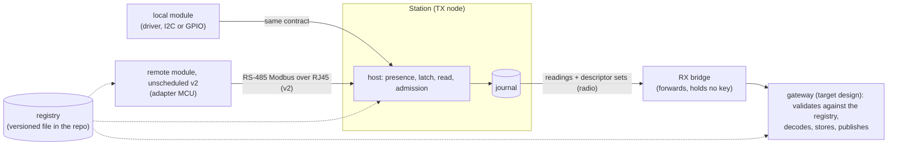
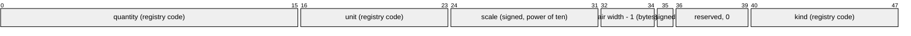
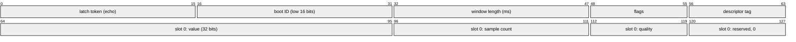
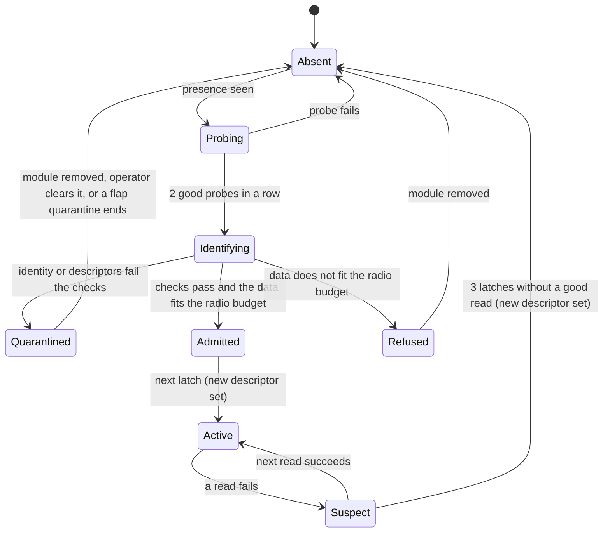
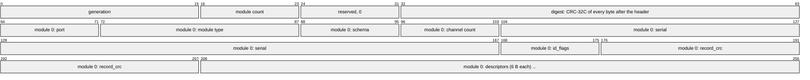
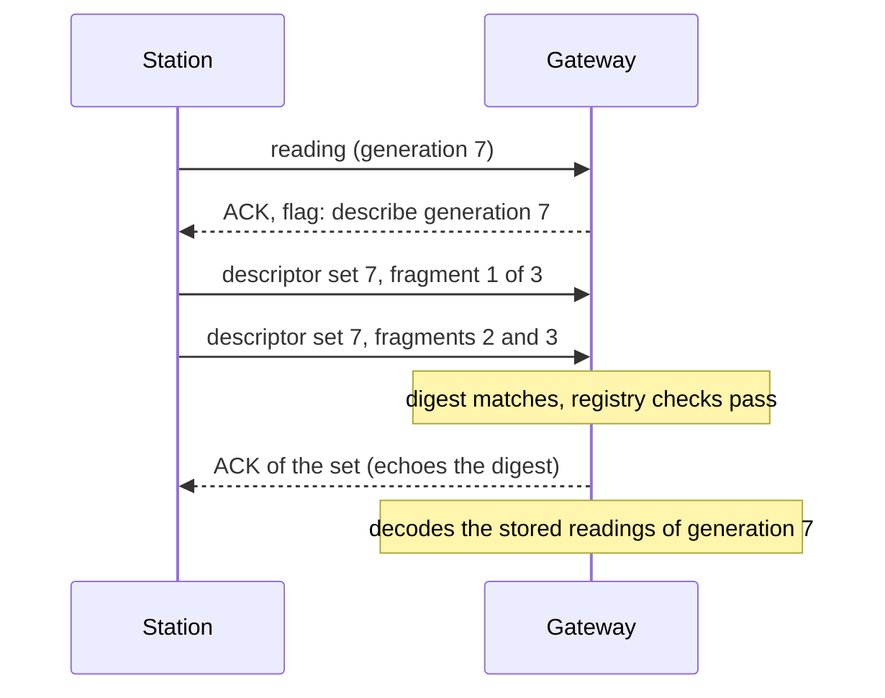

# DATAVANE5K: the Weather Station Module Protocol (WSMP)

Version 1.1, draft of 2026-10-18. We amended it on 2026-10-29 for power telemetry: registry version 2
and snapshot quality 6, "not fitted" ([power-telemetry design](superpowers/specs/2026-10-29-power-telemetry-design.md)
section 8). Status: normative design. The bench station implements the station side for local
modules (`firmware/stage0-node/App/wsmp_host.lit.md`). These parts aren't implemented yet: the radio
part (section 11), descriptor-set generations (WSMP-E1 to E3), remote modules, and the UTC latch time
(WSMP-T1).

DATAVANE5K is the trade name of WSMP, the Weather Station Module Protocol. The technical name stays
WSMP: in the code, in the requirement IDs (WSMP-L1 and so on) and in the registry.

WSMP is the contract between a weather station and its sensor modules. It also defines how the
station tells the gateway what the module data means. Every module must conform to it. That goes for
a driver on the station's own microcontroller and for a module board on a station port.

**Ports in v1 and v2.** Version 1 of the station hardware has two kinds of module. Base-board modules
are drivers on the station's microcontroller, for example the battery and power-rails modules. STEMMA
QT sensor modules plug into RJ11 (6P6C) I2C ports. There's no RJ45 anywhere in v1.

Both kinds are
local modules (section 10). A remote module is the **unscheduled v2**: an adapter microcontroller
that talks RS-485 Modbus over RJ45 (section 13). This document keeps the v2 binding so the contract
stays the same if v2 gets built. No v1 station has an RJ45 port.

This text is normative. When code exists, the code must follow this text. A difference is a bug in
the code or an error in this document. Fix one of them in the same change.

Other documents:
- [`protocol.md`](protocol.md) is the radio protocol between the station and the gateway.
- [`firmware-current-design.md`](firmware-current-design.md) gives the module identity (section
  6.7) and the module record (section 6.9) that the station implements, and the mux profile of the
  I2C bus (sections 4.1, 4.3, 6.5 and 6.6).
- [`superpowers/specs/2026-10-29-power-telemetry-design.md`](superpowers/specs/2026-10-29-power-telemetry-design.md)
  gives the power modules (types 8 and 9), the power phases and their fill table.

## 1. Words used in this document

The key words MUST, MUST NOT, SHOULD, SHOULD NOT and MAY have the meanings of RFC 2119.

| Term | Meaning |
|---|---|
| Station | The TX node: the controller that polls modules and sends readings by radio. Also called the host. |
| Module | A unit that measures and gives one or more channels. Example: the air temperature and humidity module. |
| Channel | One stream of values with one meaning. Example: the minute mean of air temperature. |
| Port | The place where a module attaches. A local port is a bus address on the station (in v1 a base-board part, or a sensor module on an RJ11 I2C port). A remote port is an RJ45 socket (the unscheduled v2). |
| Local module | A module that runs as a driver on the station's microcontroller. The bench station and every v1 station use only local modules. |
| Base-board module | A local module whose parts sit on the station's own board, fixed by the build (for example the battery and power-rails modules, fixed by `WS_POWER_PROFILE`), not plugged into a port. |
| Remote module | A module board with its own adapter microcontroller, behind an RJ45 port, reached by Modbus. The unscheduled v2 only. |
| Window | The time over which a module aggregates one snapshot. One minute by default. |
| Latch | The station's command that closes a window, freezes its snapshot and starts the next window. |
| Snapshot | The fixed-size result of one window: a header and eight channel slots. |
| Descriptor | Six bytes that tell how to decode one channel. Descriptors use registry codes only. |
| Descriptor set | The descriptors of every module in the station's layout (Admitted, Active or Suspect), in port order, each with its identity entry, under one generation number. Present modules that are probing, quarantined or refused are left out. |
| Registry | The versioned list of codes for quantities, units, kinds and module types (section 4). |
| Generation | A number that the station gives to each different descriptor set. |
| Report class | How often a module's channels go to the gateway: every minute in the reading, or every 15 minutes in the health report. The module type sets it. |

## 2. Overview

The gateway box shows the target design. Today the gateway can check a descriptor set against the
registry and store it (`ws0/descsets.py`). But no radio frame delivers sets yet. The gateway decodes
readings from the fixed catalog fields, not through WSMP descriptors (section 14).

The design has these seven rules:

1. **One contract.** A local and a remote module give the same identity, descriptors, snapshot and
   metadata. The station handles them the same way.
2. **Modules sample, the station polls.** Each module samples and aggregates by itself. The station
   latches every module at the same time each minute. Then it reads one fixed-size snapshot from
   each module.
3. **Codes, not text, carry meaning.** A descriptor holds only registry codes. Free text is display
   metadata. It never decodes a value and never becomes an identifier.
4. **Decoding never depends on metadata.** The gateway decodes a reading with the descriptor set of
   its generation and the registry. Labels, ranges and part numbers are optional extras.
5. **Nothing is lost by a change.** The station keeps every descriptor set that a pending journal
   record uses. So the gateway can decode every record, even after a database restore.
6. **Modules aggregate only what needs their samples.** A module computes a value only if the value
   needs the samples inside one window. Examples are a mean of 4 samples and a 3-second gust. Every
   other statistic is the gateway's work: means over several minutes, extremes, rates and totals.
   Counts travel raw. The gateway keeps the raw values, so it can compute the statistics again
   with better rules later.
7. **Each channel goes as often as it changes.** Weather and the power rails go every minute. That
   includes voltages, currents and the battery's energy and charge counters. Slow station data goes
   in the 15-minute health report of the radio protocol. In this phase no built module type is
   health class (type 5, the only health-class type, is frozen and kept only to decode old
   descriptor sets).

   The slow power items and the station counters are fields of the radio
   protocol's health report, not WSMP channels. The slow power items are state of charge and its
   rate, charger status, power-monitor die temperature, MCU supply voltage and the charger's own
   measurements. The station's accessors fill those fields (`mod_power_health()`,
   `firmware/stage0-node/App/mod_power.c:180`). We haven't decided if they become health-class
   channels on the radio. The station still latches and reads every module every minute, so the
   polling stays uniform.

## 3. Versioning

- **WSMP-V1.** The identity block carries the WSMP version as major and minor bytes. This document
  is version 1.1 (`WSMP_VERSION_MAJOR` 1, `WSMP_VERSION_MINOR` 1, `firmware/common/wsmp.h:11-12`).
- **WSMP-V2.** The station MUST refuse a module with a different major version. It MUST accept a
  higher minor version and ignore registers that it does not know.
- **WSMP-V3.** The project is greenfield. A major change reflashes every module, station and gateway
  together. There is no translation between major versions. **Deployment order:** the gateway's
  generated registry (`ws0/wsmp_registry.py`) ships with or before the station firmware that uses a
  new registry version, never after it. That way the gateway never meets a code it doesn't know.

| WSMP version | Date | Change |
|---|---|---|
| 1.0 | 2026-10-18 | first version |
| 1.1 | 2026-10-29 | snapshot quality 6, "not fitted" (section 9); a compatible addition under WSMP-V2. Registry version 2 (section 4) |

## 4. The registry

The registry is one machine-readable file in the repository: `firmware/common/wsmp_registry.toml`.
The tool `tools/wsmp_registry.py` generates two files from it:
- `firmware/common/wsmp_registry.h` is the C header for the station and the module firmware.
- `ws0/wsmp_registry.py` is the Python module for the gateway.

We commit the generated files, the same way `tools/tangle.py` output gets committed for literate
sources. The header holds the code tables as initializers only. `firmware/common/wsmp.c` holds the
one copy of each table. The tables in this section are the initial content.

- **WSMP-G1.** Codes are append-only. A code is never reused. A change of meaning, unit or scale
  basis gets a new code. The lock file `tools/wsmp_registry.lock` enforces this rule.

  It records
  each code with its name, the unit of each quantity, and the channels of each (module type, schema)
  pair. `tools/wsmp_registry.py --check` fails if someone removes or changes a locked entry. A new
  schema of a module type can have new channels.
- **WSMP-G2.** Code 0 means "none" in every table.
- **WSMP-G3.** Every quantity has exactly one canonical unit. A module MUST report that unit.
- **WSMP-G4.** The registry has a version number. The gateway records the registry version with each
  descriptor set that it stores. The version increments with every release that appends a code. The
  lock file also records each module type's report class, role and state names (`type_meta
  <type>.<schema> <class> <role> [states]` lines), so they can't change silently either.

| Registry version | Release | Appended |
|---:|---|---|
| 1 | protocol version 5 | quantities 1–17, units 1–13, kinds 1–10, module types 1–7 |
| 2 | protocol version 6 (power telemetry) | quantities 18–24, module types 8 and 9; quantity 9 is now documented as the cell terminal voltage, and quantity 10 is used for the first time (neither code's meaning or unit changes) |

### 4.1 Quantities

| Code | Quantity | Canonical unit | Physical range | Notes |
|---:|---|---|---|---|
| 1 | air temperature | Cel | −80 to +60 | |
| 2 | relative humidity | % | 0 to 100 | with respect to water, also below 0 °C |
| 3 | station air pressure | hPa | 300 to 1100 | at the barometer height, not reduced to sea level |
| 4 | wind speed | m/s | 0 to 75 | |
| 5 | wind gust speed | m/s | 0 to 100 | maximum of a running mean, see kind 7 |
| 6 | wind from direction | deg | 0 to 360 | clockwise from true north, the direction the wind comes from |
| 7 | rain gauge tips | {tip} | 0 to 2³²−1 | raw tips, the module type gives mm per tip |
| 8 | UVA sensor counts | {count} | 0 to 2²⁰ | raw, never reported as UV index |
| 9 | battery voltage | V | 0 to 30 | the cell voltage, sensed on its own lead on the cell side of the battery path, not at the charger output (on the bench the CELL+ node, which includes the pack-lead drop; build-progression record M4) |
| 10 | battery current | A | −20 to +20 | positive while charging (into the cell); measured by the battery module (type 8) |
| 11 | energy into the battery | W.h | 0 to 2³²−1 | counter |
| 12 | energy out of the battery | W.h | 0 to 2³²−1 | counter |
| 13 | charge into the battery | A.h | 0 to 2³²−1 | counter |
| 14 | charge out of the battery | A.h | 0 to 2³²−1 | counter |
| 15 | battery state of charge | % | 0 to 100 | used only by the frozen type 5; from protocol version 6 a health-report field of the radio protocol |
| 16 | charger state | {state} | 0 to 255 | the module type lists the states. Used only by the frozen type 5, as quantity 15 |
| 17 | anemometer pulses | {pulse} | 0 to 2³²−1 | raw cup pulses, the module type gives m/s per Hz |
| 18 | load voltage | V | 0 to 30 | the system rail that supplies the station: the charger output (registry version 2) |
| 19 | load current | A | −20 to +20 | positive into the load |
| 20 | charger input voltage | V | 0 to 30 | after the sources join; the source (solar or USB-C) is not identified |
| 21 | solar input voltage | V | 0 to 30 | upstream of the join |
| 22 | solar input current | A | −20 to +20 | positive into the station |
| 23 | USB-C input voltage | V | 0 to 30 | upstream of the join |
| 24 | USB-C input current | A | −20 to +20 | positive into the station |

Quantities 18 to 24 are one code per power rail. That keeps the WSMP-H1 entity IDs of the rails
distinct without a per-channel role (section 4.4, "A multi-rail module"). Their Home Assistant
classes are voltage or current, state class measurement (WSMP-H2).

### 4.2 Units

| Code | UCUM | Dimension |
|---:|---|---|
| 1 | Cel | temperature |
| 2 | % | ratio |
| 3 | hPa | pressure |
| 4 | m/s | speed |
| 5 | deg | plane angle |
| 6 | {tip} | count |
| 7 | {count} | count |
| 8 | V | voltage |
| 9 | A | current |
| 10 | W.h | energy |
| 11 | A.h | charge |
| 12 | {state} | enumeration |
| 13 | {pulse} | count |

### 4.3 Kinds

| Code | Kind | Meaning of the value |
|---:|---|---|
| 1 | point | one sample, taken at the end of the window |
| 2 | mean | arithmetic mean of the samples in the window |
| 3 | minimum | smallest sample in the window |
| 4 | maximum | largest sample in the window |
| 5 | sum | sum over the window, set to zero at each latch (spec only: no module uses kind 5 yet) |
| 6 | counter | cumulative since the module booted. Never set to zero at a latch (section 8) |
| 7 | gust | maximum, over the window, of a running mean. The module type gives the running-mean length (3 s for wind) |
| 8 | vector east sum | sum over the samples of sin θ for a direction θ, at the descriptor's scale |
| 9 | vector north sum | sum over the samples of cos θ for a direction θ, at the descriptor's scale |
| 10 | state | an enumerated state at the end of the window |

The mean direction of a window is atan2(east sum, north sum), in degrees from 0 to 360. The gateway
adds the sums of several windows to get a mean over a longer time. It never averages angles.

### 4.4 Module types

A module type entry fixes four things:
- the channels that a module of that type gives,
- its report class,
- the default role,
- the factors that the gateway needs.

The role tells where the module measures the quantity (outside air, enclosure). The plan is that the
station owner can change the role in the gateway configuration. That override isn't built in ws0
yet.

| Code | Module type | Part | Schema | Channels (quantity / kind) | Report class | Role | Factors |
|---:|---|---|---:|---|---|---|---|
| 1 | air temperature and humidity | SHT45 | 1 | 1/mean, 2/mean | minute | outside air | — |
| 2 | air pressure | BMP581 | 1 | 3/mean | minute | enclosure | — |
| 3 | UVA | LTR390 | 1 | 8/mean | minute | outside | — |
| 4 | enclosure temperature and humidity | SHTC3 | 1 | 1/mean, 2/mean | minute | enclosure | — |
| 5 | battery and charger (**frozen**) | INA228, MAX17048, bq24074 | 1 | 9/mean, 11/counter, 12/counter, 13/counter, 14/counter, 15/point, 16/state | health | battery | charger states: 0 off, 1 charging, 2 done, 3 fault |
| 6 | wind | SparkFun SEN-15901 | 1 | 17/counter, 5/gust, 6/vector east sum, 6/vector north sum | minute | outside | 0.66698 m/s per Hz, gust running mean 3 s |
| 7 | rain | SparkFun SEN-15901 | 1 | 7/counter | minute | outside | 0.2794 mm per tip |
| 8 | battery (`BATTERY`) | INA228, MAX17048 (display only) | 1 | 9/mean, 10/mean, 11/counter, 12/counter, 13/counter, 14/counter | minute | battery | — |
| 9 | power rails (`POWER_RAILS`) | INA228, charger input divider (display only) | 1 | 18/mean, 19/mean, 20/mean, 21/mean, 22/mean, 23/mean, 24/mean | minute | power | — |

The registry file gives each factor as an integer in a small unit: `ums_per_hz = 666980` (µm/s per
Hz) and `gust_ms = 3000` for wind, and `nm_per_tip = 279400` (nm per tip) for rain.

**Type 5 is frozen.** It stays in the registry so that schema 1 keeps decoding old descriptor sets
(protocol version 5 and earlier). A station from protocol version 6 on doesn't build it. Types 8 and
9 replace it.

Its health-class channels 15 (state of charge) and 16 (charger state) have no successor
channel. Those values are health-report fields of the radio protocol (rule 7, WSMP-G8). We froze the
type and appended new ones so the registry doesn't need multi-schema support.

**Module names are functions.** We name a module type by what it measures (battery, power rails),
never by a chip. The "Part" column and the registry's `part` text are display metadata only
(rule 3, WSMP-H5). A later phase can measure the same rail with another part without a new type.

The power modules' descriptors (`firmware/stage0-node/App/mod_power.c:79-100`):

| Type | Channels | Scale | Air width | Signed | Resolution |
|---|---|---:|---:|---|---|
| 8 | 9 (V) | −3 | 2 | no | 1 mV |
| 8 | 10 (A) | −3 | 2 | yes | 1 mA, ±32.767 A |
| 8 | 11, 12 (W.h), 13, 14 (A.h) | −3 | 3 | no | 1 mWh, 1 mAh; counters wrap at 16,777 Wh or Ah (WSMP-D5) |
| 9 | 18, 20, 21, 23 (V) | −3 | 2 | no | 1 mV |
| 9 | 19, 22, 24 (A) | −3 | 2 | yes | 1 mA |

**A multi-rail module.** A module that measures several rails of the same physical kind gives one
quantity code per rail (18 to 24), not one quantity with a role per channel. The role belongs to the
module type. The WSMP-H1 entity ID `<station>_<role>_<quantity>_<kind>` stays unique because the
quantity differs per rail. So the descriptor format (section 5), `wsmp_unpack_desc` and WSMP-H6
don't change. A new rail needs a new quantity code (WSMP-G1).

**Which source fills each power channel.** The power modules have every rail from the start. Each
hardware phase ([power-telemetry design](superpowers/specs/2026-10-29-power-telemetry-design.md)
sections 2 and 3.2) fills the channels it has a source for. It marks the rest "not fitted"
(quality 6, section 9). The build sets the phase (`WS_POWER_PROFILE`,
`firmware/stage0-node/App/power_config.h:29-39`).

Phase A has these parts:
- the bq24074 charger,
- one INA228 (0x40), with its shunt in the battery path and its VBUS sense on the charger output (OUT),
- a MAX17048 (0x36) on the CELL+ node,
- the charger input divider on PA10.

Phase B adds a load INA228 on OUT, plus a solar INA228 and a USB-C INA228. The solar and USB-C
INA228s each sit upstream of the point where the sources join.

| Channel (quantity) | Net | Phase A | Phase B |
|---|---|---|---|
| battery voltage (9) | the cell | MAX17048 VCELL | as phase A |
| battery current (10) | the battery path | battery INA228, charge delta ÷ window time, sign −1 (positive into the cell) | as phase A |
| energy and charge counters (11–14) | the battery path | battery INA228 charge delta (A.h) and charge delta × VCELL (W.h), split by sign; energy missing in a window where a step had no fresh VCELL | as phase A |
| load voltage (18) | charger output (OUT, the system rail) | battery INA228 VBUS (its own sense lead to OUT) | load INA228 VBUS |
| load current (19) | OUT to the load | not fitted | load INA228 |
| charger input voltage (20) | charger VBUS, after the sources join | PA10 × the stored divider ratio (`POWER_VIN_DIVIDER_PPM`, 3 nominal); the source is not identified | as phase A |
| solar input voltage (21) | solar, upstream of the join | not fitted | solar INA228 VBUS |
| solar input current (22) | solar, upstream of the join | not fitted | solar INA228 |
| USB-C input voltage (23) | USB-C, upstream of the join | not fitted | USB-C INA228 VBUS |
| USB-C input current (24) | USB-C, upstream of the join | not fitted | USB-C INA228 |

Phase A can't tell solar from USB-C. The bq24074 has one input, and no monitor sits upstream of the
join. So the charger input voltage (20) is the only input channel that phase A fills.

USB-C is for
bench work and occasional backup charging only. It's never connected together with solar. The
battery voltage stays on the gauge in every phase. If the gauge fails, the channel is missing, with
no fallback source.

The registry keeps the codes that no module type uses now, for example the kinds minimum, maximum
and sum. A later module type can use them, for example a sensor that measures faster than the
station polls. Types 8 and 9 don't cover per-rail energy counters (other than the battery's) or
window minimum and maximum of the rail currents.

- **WSMP-G5.** A module MUST give the channels of its module type entry, in that order.
- **WSMP-G6.** A module MUST apply its own calibration before it reports a value. The calibration
  revision in its metadata identifies the coefficients. The gateway will keep the coefficients in a
  calibration archive. That archive isn't built yet (see the open item "Siting and calibration
  archive").

  **Base-board power parts** (types 8 and 9) get their calibration from build constants in
  `firmware/stage0-node/App/power_config.h`. The constants are each rail's shunt in µΩ and its
  current step (`current_lsb_ua`), R_ISET in Ω, and the charger input divider ratio. Each measured
  constant names, beside it, the check that measures or verifies it.

  That's a build-sheet check or
  a build-progression record step. The constant stays "nominal" until then. The current step
  (`current_lsb_ua`) is a design choice, not a measured value. The firmware build ID in the health
  report identifies the constants a build used. Record calibration (the registry's calibration
  table for module records) doesn't apply to them.
- **WSMP-G7.** A module computes only values that need its samples inside one window (rule 6). It
  uses the factors of its module type for them, for example for the gust. A count travels raw: rain
  tips and cup pulses. The gateway converts a count with the module type's factor.

  The gateway
  doesn't do that yet. Today the station's catalog map converts wind speed, and rain goes out as
  raw tips.
- **WSMP-G8.** The report class of the module type decides where the channels go. A minute-class
  channel goes in every reading. A health-class channel goes in the health report, from the latest
  snapshot. In this phase no built module type is health class (type 5, the only health-class type,
  is frozen).

  The radio protocol's health report carries the slow power items as its own fields
  ([`protocol.md`](protocol.md)), not as WSMP channels. The health class stays defined for a later
  protocol revision.

## 5. The descriptor

A descriptor is 6 bytes. It decodes one channel. A module gives one descriptor for each of its
channels, in channel order.

- **WSMP-D1.** The decoded value is the integer value × 10^scale, in the unit.
- **WSMP-D2.** The scale MUST be in the range −6 to +6.
- **WSMP-D3.** The air width is the number of bytes that the value takes in a radio reading: 1, 2, 3
  or 4. The module MUST choose the smallest width that holds its whole valid range at its scale.
- **WSMP-D4.** The unit MUST be the canonical unit of the quantity (WSMP-G3).
- **WSMP-D5.** A counter wraps at 2^(8 × air width) on the radio. The gateway unwraps it. Nothing
  does this yet, because the WSMP radio reading isn't built. Today the catalog map wraps rain tips
  modulo the field range instead (`wsmp_catalog_map.c`). The gateway tags counters for Home
  Assistant as `total_increasing` and doesn't unwrap them.
- **WSMP-D6.** Descriptors MUST NOT change while a module runs. A module gives new descriptors only
  after it boots again (a new boot ID).
- **WSMP-D7.** The station and the gateway MUST check each descriptor against the registry. These
  descriptors fail the check:
  - an unknown code
  - a unit that is not the canonical unit
  - a scale out of range
  - a reserved bit that is set
  - a channel list that differs from the module type entry

  The station quarantines a module whose descriptors fail (section 7).

## 6. Register map and data blocks

A remote module gives its data as Modbus registers. A register is 16 bits. A value of more than 16
bits takes consecutive registers, high word first. Every integer is big-endian. A local module gives
the identity, descriptor and snapshot blocks, byte for byte, through the driver interface of section
10. It has no status block and (on the bench) no metadata block.

The Modbus map below is the design for the remote module of v2, which isn't built. Only the
identity, descriptor and snapshot blocks exist in code, as the local blocks. No code builds the
status, metadata, latch, command or module configuration registers yet. The sizes add up (for
example 0x90 registers × 2 = 288 B), but nothing tests them yet.

| Block | Registers | Modbus function | Size | Read when |
|---|---|---|---:|---|
| Identity | 0x0000–0x000F | 0x04 read input registers | 32 B | at admission |
| Status | 0x0010–0x001F | 0x04 | 32 B | when the station needs diagnostics |
| Descriptors | 0x0040–0x0057 | 0x04 | 48 B | at admission |
| Snapshot | 0x0100–0x0123 | 0x04 | 72 B | after each latch |
| Metadata | 0x0200–0x028F | 0x04 | 288 B | at admission, low priority |
| Latch | 0x1000–0x1002 | 0x10 write multiple registers | 6 B | each minute |
| Command | 0x1010 | 0x06 write single register | 2 B | operator action |
| Module configuration | 0x1020–0x103F | 0x03 and 0x10 | — | defined by the module type |

- **WSMP-R1.** The station MUST read each block in one transaction. A module MUST answer a read
  from one consistent copy of the block.
- **WSMP-R2.** A read of an address that is not in the map gets Modbus exception 0x02, illegal data
  address.
- **WSMP-R3.** A remote module has Modbus address 1. The station doesn't use broadcast.

This map replaces the register map in PRD §11. It keeps the PRD's identity range at 0x0000 and its
configuration range at 0x1000.

### 6.1 Identity block

| Register | Field | Value |
|---|---|---|
| 0x0000 | magic | 0x5753 ("WS") |
| 0x0001 | WSMP version | major in the high byte, minor in the low byte: 0x0101 (version 1.1) |
| 0x0002 | module type | registry code (section 4.4) |
| 0x0003 | schema and channel count | schema in the high byte, channel count (1–8) in the low byte |
| 0x0004–0x0007 | serial number | u64, unique for the module, never 0 |
| 0x0008 | firmware version | major in the high byte, minor in the low byte |
| 0x0009 | firmware build | u16 |
| 0x000A–0x000B | boot ID | u32, increases by one at each boot, kept in non-volatile memory |
| 0x000C | capabilities | bit 0: metadata block present. Bit 1: counters survive power loss. Other bits 0 |
| 0x000D–0x000E | descriptor digest | CRC-32C of the descriptor block (48 bytes) |
| 0x000F | identity flags | serial source in bits 0–1, record status in bits 4–7; bits 2–3 and 8–15 reserved, 0 |

- **WSMP-I1.** The station MUST refuse a module whose magic or major version is wrong.
- **WSMP-I2.** The boot ID MUST change at every boot. That includes a boot after a power loss or a
  watchdog reset. A fixed local module uses the station's boot epoch as its boot ID. A port module
  uses the epoch shifted left 8 bits, OR its admission count
  ([`firmware-current-design.md`](firmware-current-design.md), section 6.7).

### 6.2 Status block

This block is design only, for the v2 remote module. No code builds it yet.

| Register | Field |
|---|---|
| 0x0010–0x0011 | uptime in seconds, u32 |
| 0x0012 | last latch token received, u16 |
| 0x0013 | state: 0 booting, 1 sampling, 2 fault |
| 0x0014 | fault code, defined by the module type, 0 for none |
| 0x0015 | windows that ended without a latch, u16, saturating |
| 0x0016 | Modbus frames with a bad CRC, u16, saturating |
| 0x0017 | sensor read errors, u16, saturating |
| 0x0018–0x001F | reserved, 0 |

### 6.3 Descriptor block

Registers 0x0040 to 0x0057 hold eight descriptors of 6 bytes (section 5), in channel order. The
descriptors after the last channel are all zero.

### 6.4 Snapshot block

The snapshot is 72 bytes: an 8-byte header and eight slots of 8 bytes. Slot *i* belongs to channel
*i*. The header and the first slot are:

| Field | Meaning |
|---|---|
| latch token | the token of the latch that froze this snapshot |
| boot ID | the low 16 bits of the boot ID in the identity block |
| window length | the real length of the window in ms. It saturates at 65,535 and then sets flag bit 1 |
| flags | bit 0: first window after boot. Bit 1: long window (no latch in time). Bit 2: a sensor fault happened in the window. Other bits 0 |
| descriptor tag | the low 8 bits of the descriptor digest |
| value | the channel value: signed or unsigned as its descriptor says, at its descriptor's scale |
| sample count | the number of valid samples behind the value. 0 means no valid sample |
| quality | section 9 |

- **WSMP-S1.** A slot after the last channel is all zero.
- **WSMP-S2.** A module MUST hold its value within the physical range of the quantity. A sample out
  of the module's valid range sets the quality to suspect.
- **WSMP-S3.** A value that doesn't fit its air width saturates at the largest value of that width,
  and its quality becomes suspect. A long window can cause this for a sum. Counters wrap instead
  (WSMP-D5). This is a requirement for the radio reading, which isn't built yet. No code packs a
  value to its air width today.

### 6.5 Metadata block

Metadata helps people. It never changes how a value decodes. No module has a metadata block yet.

| Registers | Field |
|---|---|
| 0x0200–0x0207 | part number, 16 bytes, ASCII, padded with 0 |
| 0x0210 + 16 × *i* | channel *i*: label (12 bytes), valid minimum (s32), valid maximum (s32), resolution (u32), sample period in ms (u32), calibration revision (u16), reserved (u16) |

- **WSMP-M1.** Text uses only the characters `A–Z a–z 0–9 space . _ -`. The station and the gateway
  MUST refuse other bytes before the first 0 pad byte.
- **WSMP-M2.** The valid range and the resolution use the channel's scale and unit.
- **WSMP-M3.** The resolution is the true resolution of the sensor. The SEN-15901 vane has 16
  positions, so its resolution is 22.5°.

### 6.6 Latch and command registers

The latch is one write of three registers: the latch token (u16) and the UTC time of the latch in
seconds (u32). That's the v2 register design. On the bench, the latch is a function call,
`local_latch(p, token, utc, now_ms)` (`wsmp_local.h`), and the station calls it every minute.

- **WSMP-L1.** The module MUST freeze the snapshot within 1 ms after the end of the latch frame. It
  then starts the next window. The local modules freeze the snapshot and start the next window
  (`mod_mean.c`). Nothing measures the 1 ms bound yet, because no latch frame exists.
- **WSMP-L2.** The module MUST keep the frozen snapshot until the next latch. A repeated read gets
  the same bytes.
- **WSMP-L3.** A latch with the same token as the previous latch is a retry. The module MUST NOT
  start a new window for it.

The command register accepts 1 = reboot and 2 = run the self-test. Other values get exception 0x03.
No code builds the command register yet.

## 7. The station: presence and admission

The station keeps a state for each port:

The diagram shows the design. Here's what the bench station builds for the last two exits:
- A refused module goes to Absent after two missed probes (removal).
- An identity quarantine goes to Absent after two missed probes (removal).
- A flap quarantine goes to Absent when its hour runs out. Removal doesn't end it early.
- There's no operator clear yet. No console command clears a quarantine.

In Identifying, the station checks three things:
1. The identity block must pass WSMP-I1.
2. The descriptor digest in the identity block must equal the CRC-32C of the descriptor block.
3. The descriptors must pass WSMP-D7.

The station quarantines a module that fails one check. The admission check changes no port state.
The station records the module's share of the radio budget only when it admits the module.

- **WSMP-P1. Presence.**
  - A remote port (the unscheduled v2, section 13) shows presence by its module-present loop (a
    10 kΩ resistor across pins 3 and 6).
  - A local I2C module shows presence by a successful sample. An address NACK means absent. Any
    other failure is a bus fault (WSMP-P3). The BMP581, LTR390 and INA228 drivers also check a chip
    ID register. Another chip at the address counts as absent.
  - The local wind module shows presence by a vane voltage of 3.2 V or less. A higher voltage is an
    open vane.
  - The local rain module can't show presence, so the operator enables it with a stored console
    setting.
  - The base-board power modules are battery (port 5, type 8) and power rails (port 8, type 9). The
    build fixes them (`WS_POWER_PROFILE`). They don't plug into a port. **Both are present in every
    profile, always**, whatever their parts answer. A missing part (an address NACK or a wrong chip
    ID) makes only its own channels missing. A bus fault (WSMP-P3) makes them sensor fault
    (quality 5, `firmware/stage0-node/App/power_acq.c:403`, `quality()`). A channel that the profile
    has no source for is "not fitted" (section 9). So a dead part gives missing channels (INVALID
    fields through the catalog map), never an absent module.
- **WSMP-P2. Debounce.** The station MUST see two good probes in a row before it identifies a module.
  It MUST miss three latches in a row before it removes a module. On an I2C port the station also
  removes a module in these cases:
  - The holder check of another port's duplicate finds it gone. That means two address NACKs (or
    another chip ID), or a confirmed different identity. A third case is a Faulted or
    operator-disabled port, but that's design only: no Faulted state or operator disable exists yet.
  - Its pre-latch identity check confirms a change.
  - 60 latches in a row pass with its possibly-replugged flag set and its identity unverified
    ([`firmware-current-design.md`](firmware-current-design.md), section 6.7).

  In Suspect, a latch with a good read but an unverified identity doesn't count as missed. It
  doesn't break the run either.
- **WSMP-P3. Bus faults.** A bus fault (for example SDA held low) sets the quality of the affected
  channels to missing. It MUST NOT change the descriptor set by itself.
- **WSMP-P4. Layout changes at the latch only.** A new descriptor set takes effect at a latch. A
  reading always uses one descriptor set from start to end.
- **WSMP-P5. Admission control.** All active modules together must fit the radio value budget
  (section 11.3). The station admits a new module only if the packed values and quality bits still
  fit. Otherwise it refuses the module and reports which module is over the budget in its health
  report.

  The refusal is built. The health-report part isn't: today the refusal shows only as
  "refused" on the console `#modules` line.
- **WSMP-P6. Flap limit.** If one port causes more than 4 descriptor-set changes in one hour, the
  station quarantines that port for one hour and reports it.
- **WSMP-P7. Remote power (v2).** A remote port gets power only after its presence loop is valid. The
  port loses power when the loop opens or a port fault occurs. There is no live mating.
- **WSMP-P8. Module limit.** A station has at most 8 modules and 24 channels.
- **WSMP-P10. Re-identification.** The station checks an I2C module's identity in a pre-latch slot
  before each latch, from the driver's idle state. The identity is the record serial and CRC and the
  sensor serial, as seen at admission.
  - A confirmed change ends the port at that latch with the window missing. Then the station admits
    the new module.
  - A record that no longer parses, or an EEPROM that no longer answers, counts as confirmed only
    after two full reads that agree with each other.
  - After a missed probe or a failed data read, windows are missing until a check matches at a latch
    with a good data read.
  - An unverified check never changes the port's state, except for the timeout. If 60 latches in a
    row pass with the flag set and no check matches, the port ends in any state, and it rejoins.

  A module with its own identity block (remote, or behind a v2 adapter) works differently. If a
  snapshot's boot ID differs from the one admitted, the station re-reads the identity and descriptor
  blocks. A changed serial, type or descriptor digest is a leave and a join.

  The station admits at
  most one module of each type (v1). A duplicate runs the holder check in the holder driver's step
  machine. The bench station implements the I2C part (`App/wsmp_host.lit.md` section 5.1,
  `App/port_id.c`). The remote part isn't built.

## 8. Counters and module identity

A counter value is cumulative since the module booted. The station or the gateway gets the increment
of a window from two snapshots.

- **WSMP-C1.** The increment is valid only between two snapshots with the same module serial and the
  same boot ID.
- **WSMP-C2.** Check the first snapshot after a new boot ID. If flag bit 0 (first window after boot)
  is set, the increment equals the value. Otherwise the increment is unknown, and that window has no
  increment.
- **WSMP-C3.** A module that moves to another station or port starts a new series. Its counter
  history never adds to the new port.
- **WSMP-C4.** The gateway keeps its own running total for each counter series. It adds only valid
  increments. It publishes that total, so a module reboot or swap doesn't cause a jump.

  This isn't
  built yet. Today ws0 keeps no per-series total. It publishes the station's counters as they arrive
  and relies on Home Assistant's `total_increasing` reset handling (`ws0/service.py:525-526`).

## 9. Time and quality

- **WSMP-T1. Windows on UTC.** The station latches at second 50 of each UTC minute. So a window
  runs from :50 to :50. The reading of the minute carries the UTC time of the end of the window.

  The
  bench station doesn't do this yet. It latches every fourth 15-second sample tick of its own clock
  (`app_tx.c`).
- **WSMP-T2. Read deadline.** The station MUST read all snapshots within 5 s after the latch. A
  remote module MUST answer a request within 20 ms. No code or test checks either bound yet. Local
  snapshots sit in memory, and there's no remote module.
- **WSMP-T3. Missed latch.** A module without a latch for more than 90 s keeps aggregating. Its next
  snapshot sets flag bit 1. The length field shows 65,535 ms (saturated), not the real window length
  (section 6.4).

  A module sets flag bit 1 for every window longer than 65,535 ms. That includes
  every window of more than 90 s.
- **WSMP-T4. Free-running sampling.** A module samples on its own clock at the sample period in its
  metadata. The latch sets only the window boundaries.

  There's one exception. An I2C port module's
  driver starts no sample in the 3 s before a latch. It moves a sample that falls due then to just
  after the latch, and keeps the sampling phase. So every window keeps its sample count
  ([`firmware-current-design.md`](firmware-current-design.md), section 6.7).

Quality in the snapshot is one byte. The radio carries 2 bits:

| Snapshot | Radio | Meaning |
|---:|---:|---|
| 0 | 0 | good: the full window with the expected number of samples |
| 1 | 1 | partial: fewer samples than expected, or the first window after boot |
| 2 | 2 | suspect: a sample was outside the valid range, or the sensor reported a warning |
| 3 | 3 | missing: no valid sample. The value is not used |
| 4 | 1 | warming up: the sensor is not stable yet |
| 5 | 3 | sensor fault |
| 6 | 3 | not fitted (WSMP 1.1): this hardware build has no source for the channel. The value is not used |
| 7 to 255 | 3 | unknown code: the radio carries it as missing |

The radio mapping is `wsmp_quality_air()` (`firmware/common/wsmp.c:191-196`). It maps codes 0 to 5
by the table and every other code as missing. So code 6 needed no change there.

**"Not fitted" and its limit.** A not-fitted channel keeps its place (WSMP-A2) and its descriptor.
Only its quality says that the build has no source for it (section 4.4, the fill table). The
difference between "not fitted" and "missing" holds **locally** (in the snapshot). It also holds
**through the interim catalog map** (`firmware/stage0-node/App/wsmp_catalog_map.c`). There a
not-fitted channel becomes an absent observation field, and a missing or faulted one becomes
INVALID.

It does **not** survive the 2-bit radio quality. A receiver of a WSMP radio reading
(section 11.3) sees a not-fitted channel as missing. It can't tell a part that the build lacks from
a part that failed.

- **WSMP-Q1.** A partial or missing minute is never counted as a good minute in the 24-hour delivery
  test. Not-fitted channels don't count where the station's own snapshots get evaluated: on the
  station, and through the catalog map in the observation, where they're absent fields. A WSMP radio
  reading can't make this exclusion, because its quality shows them as missing.

  Today the code
  doesn't meet the partial part of Q1. The catalog map passes partial T/RH values through, and
  `tools/h01_report.py` counts any non-null T and RH as valid. So the H01 score counts a partial
  minute as good.
- **WSMP-Q2. Set-level not-fitted marker.** Before WSMP readings travel on the radio, the descriptor
  set MUST gain a set-level marker for not-fitted channels. Examples are a per-channel flag in the
  descriptor set or a profile-dependent channel list. Then the gateway can tell "not fitted" from
  "missing" (power telemetry design, section 8.3, risk R10).

## 10. Local modules (the bench binding)

A local module is a driver on the station's microcontroller. It gives the same blocks as a remote
module, through one interface:

| Operation | Does |
|---|---|
| `probe()` | checks presence (WSMP-P1) without changing the sensor state |
| `identify(identity, descriptors)` | fills the identity and descriptor blocks, byte for byte as section 6 defines. A module that sets capability bit 0 also fills its metadata block. The bench station's local modules have no metadata block |
| `latch(token, utc)` | freezes the snapshot and starts the next window (WSMP-L1 to L3) |
| `read_snapshot(snapshot)` | copies the frozen snapshot |

In the bench station these operations are `local_probe_result`, `local_identity`, `local_latch` and
`local_snapshot` (`firmware/stage0-node/App/wsmp_local.h`). `local_tick` runs each module's own
schedule every 250 ms (`WSMP_TICK_MS`).

- **WSMP-B1.** The station code that polls a local module and the code that polls a remote module are
  the same above this interface. A remote module is one implementation of the interface that sends
  Modbus requests.
- **WSMP-B2.** A local I2C driver probes only in its own probe slot, never while its sensor measures.
  (The SHT45 doesn't acknowledge its address during a measurement. That isn't an absence.)
- **WSMP-B3.** After a transfer that can leave the bus stuck, the station frees the bus. Such a
  transfer ends in a timeout, a bus error, a HAL refusal, or SDA held low. The station clocks SCL
  until SDA is free, at most nine times, and then sends a stop condition. A clean NACK gets no
  recovery. The modules then probe again on their own schedules
  (`firmware/stage0-node/App/i2c_bus.lit.md`).

## 11. From the station to the gateway

### 11.1 The descriptor set

The station builds one descriptor set from the modules in its layout, in increasing port order:

Each module entry is 18 bytes, then its descriptors. The entry carries the module's identity
([`firmware-current-design.md`](firmware-current-design.md), section 6.7):
- `serial` (u64)
- `id_flags` (u8): the identity flags' low byte. The serial source is in bits 0 to 1 and the record
  status in bits 4 to 7. Bits 2 to 3 are reserved, 0.
- `record_crc` (u32): the applied record's CRC-32C, 0 if the module has no applied record.

The digest is the CRC-32C of every byte after the 8-byte header: the entries and their descriptors.
A changed serial or record CRC gives a different set and a different digest (the WSMP-C1 boundary).
By design it also gives a new generation, but generations aren't implemented yet. Today the station
builds the set only for the console, with generation 0 (section 14).

A reader refuses these sets (`firmware/common/wsmp.lit.md` section 9, and the gateway's twin
`ws0/wsmp_set.py`):
- a set with a reserved bit or byte that is set
- an undefined record status
- a length that differs from what the entries give
- ports that aren't strictly increasing

- **WSMP-E1. Generation.** The station gives a new descriptor set the next generation number. The
  station MUST NOT reuse a number under the same station key. The station keeps it in flash, as it
  keeps the counter.

  This isn't implemented yet. No firmware assigns, stores or protects set
  generations.
- **WSMP-E2. Reuse.** If a new set is byte-identical to a set that the station still keeps, the
  station reuses that set's generation. So a module that flaps between two sets gives two
  generations, not one for each flap.
- **WSMP-E3. Persistence.** The station stores each set as a record in its journal. It keeps every
  set that a pending journal record uses. Before it erases a journal page that holds a set still in
  use, it writes that set again.

  It keeps at most 8 sets in use. If a change needs a ninth set, the
  station refuses the change until the journal drains, and reports it.
- **WSMP-E4. Size.** A full set is at most 8 + 8 × 18 + 24 × 6 = 296 bytes. That's at least 5
  fragments if a fragment carries the 60 bytes a reading gets, before any fragment header. The
  fragment payload isn't defined yet (WSMP-E9).

### 11.2 Delivery to the gateway

- **WSMP-E5.** The gateway accepts a set only when it has every fragment and the digest matches.
- **WSMP-E6.** A second, different set with a generation that the gateway already holds for that
  station key is an alarm, like key reuse. The gateway keeps the first set.
- **WSMP-E7.** The gateway checks the set against the registry (WSMP-D7). The gateway stores a failed
  set for diagnosis but doesn't use it, and it raises an alarm.
- **WSMP-E8.** The gateway stores a reading of an unknown generation raw and asks for the set. It
  keeps at most 1,440 raw readings for each station and raises an alarm when the limit is near.
- **WSMP-E9.** The radio protocol carries the set in its own frame kind, and the request flag in the
  ACK. If a later revision introduces health-class channels, the health report also carries the
  generation. The radio protocol specification defines those frames. This is a later step, after
  the radio time sync.

### 11.3 The reading on the radio

The radio reading isn't built yet. This section is the design.

A radio reading carries the generation in place of today's field bitmap. The values of the
minute-class channels follow in descriptor-set order. Each value takes its descriptor's air width,
big-endian. Then come the quality codes, 2 bits for each channel, most significant bits first,
padded with 0 to a whole byte.

Two parts of that exist in code: `wsmp_values_bytes` adds up the
descriptor widths, and `wsmp_quality_bytes` gives 2 bits per channel rounded up to a byte
(`firmware/common/wsmp.c`). The descriptor-set order and the bit order of the quality codes have no
code or test yet.

- **WSMP-A1.** The values and quality bits of one reading MUST fit the radio value budget. The budget
  is 60 bytes (`WSMP_RADIO_BUDGET`, `firmware/common/wsmp.h:20`). That's the planned plaintext less
  a 20-byte header. The planned plaintext is the journal's 80 B per build of protocol version 6
  (power telemetry design, sections 7 and 8.4). Under version 5 the budget was 58 B, from a 78 B plaintext.

  Health-class channels, if a later revision introduces them, MUST fit the space that the radio
  protocol gives them in the health report.
- **WSMP-A2.** A channel with quality "missing" still takes its place, so the positions never shift.

The bench station with every built module of section 4.4 has 24 channels, all minute class. Those
are types 1 to 4 and 6 to 9 (type 5 is frozen). They take 53 bytes of values and 6 bytes of quality
(48 bits). That's 59 of 60 bytes:

| Module | Channels | Scale and air width | Bytes |
|---|---|---|---:|
| air temperature and humidity | temperature mean, humidity mean | −2, 2 bytes each | 4 |
| air pressure | 1 | −1, 2 bytes (0.1 hPa) | 2 |
| UVA | 1 | 0, 3 bytes | 3 |
| enclosure temperature and humidity | 2 | −2, 2 bytes each | 4 |
| battery | voltage, current | −3, 2 bytes each (1 mV; 1 mA signed) | 4 |
| | 4 energy and charge counters | −3 (1 mWh, 1 mAh), 3 bytes each, wrapping at 16,777 Wh or Ah | 12 |
| wind | pulse counter, gust, east sum, north sum | 0, −2, −2, −2, 2 bytes each | 8 |
| rain | tip counter | 0, 2 bytes | 2 |
| power rails | 4 voltages (load, charger input, solar, USB-C), 3 currents (load, solar, USB-C) | −3, 2 bytes each (1 mV; 1 mA signed) | 14 |
| **Total** | 24 | | **53** |

The 2-byte pulse counter wraps at 65,536. A 75 m/s wind gives about 6,700 pulses a minute, so one
missed reading never loses a wrap. Sixty vane samples give vector sums within ±6,000 at scale −2.

The station is at the limits: 8 modules and 24 channels (WSMP-P8), and 1 byte under WSMP-A1. The
power phases add no channels. The rails module has every rail from the start, and a phase without a
source marks the channel not fitted. So the station stays at these limits in every phase. Any more
modules or channels need WSMP-P8 and WSMP-A1 revised in a later protocol revision (power telemetry
design, risk R2).

The health report carries no WSMP channels in this phase. The slow power items and the station
counters are fields of the radio protocol's 64-byte health report ([`protocol.md`](protocol.md)).
`mod_power_health()` and the station accessors fill them (rule 7). The slow power items are state of
charge and its rate, charger status, power-monitor die temperature, MCU supply voltage and the
charger's own measurements. The station counters are reset cause, boot count, crash count and last
crash PC, radio TX timeouts, and I2C bus recoveries.

### 11.4 The gateway: decoding and publishing

- **WSMP-H1. Identity.** A published entity has the ID `<station>_<role>_<quantity>_<kind>`. The
  ID never contains a module serial, a port or a label. A module swap keeps the history.
- **WSMP-H2. Units and classes.** The registry entry of the quantity gives the unit, the Home
  Assistant device class and the state class. The module's descriptor repeats the unit code. The
  station and the gateway refuse it unless it matches the registry (`WSMP_EUNIT`). The module never
  gives the device class or the state class.
- **WSMP-H3. Counters.** The gateway publishes its running total (WSMP-C4), not the raw counter.
  Like C4, this isn't built yet.
- **WSMP-H4. Direction.** The gateway publishes a direction from the vector sums (section 4.3).
- **WSMP-H5. Text.** Labels and part numbers are display text only. The dashboard inserts them as
  text, never as markup. A CSV export escapes a leading `= + - @`.
- **WSMP-H6. Duplicates.** Two active channels with the same station, role, quantity and kind are an
  alarm. The gateway publishes the one on the lower port.
- **WSMP-H7. Removal.** A removed module makes its entities unavailable. The gateway never deletes
  their discovery records, so their history stays.
- **WSMP-H8. Derived values.** The gateway derives the statistics that modules don't send:

  | Derived value | From |
  |---|---|
  | mean wind speed over a reading | pulse increment × factor ÷ elapsed time |
  | mean wind direction over any period | the added vector sums (section 4.3) |
  | rain in mm, hourly and daily totals | tip increments × factor |
  | hourly and daily extremes of temperature and humidity | the extremes of the minute means |
  | battery power | energy increments ÷ elapsed time |

  Battery current isn't derived. The battery module (type 8) measures it and sends it as a minute
  mean (quantity 10). The rail currents work the same way (quantities 19, 22 and 24).

  The gateway stores the raw values. It records the version of each derivation rule with the derived
  value, so it can compute the value again with a later rule.

## 12. Security

- **WSMP-X1. Trust.** The station key proves only that the station sent a frame. It doesn't prove
  that a module tells the truth. A module can give false values within the registry ranges.

  WSMP 1.0
  accepts this risk. There's no module authentication.
- **WSMP-X2. Bounded parsing.** The station parses module blocks into fixed-size structures and
  checks every length and every code. A fuzz test MUST cover the station's parser of every block.
- **WSMP-X3. No text as identity.** Nothing that a module supplies becomes a file name, a database
  key, an MQTT topic or a template. Identifiers use only station, role, quantity and kind codes.
- **WSMP-X4. Read-out protection.** Before anyone uses a remote port outdoors, the station MUST run
  with flash read-out protection level 1. A fault in the parser must not expose the station key.
- **WSMP-X5. Rate limits.** The flap limit (WSMP-P6) and the raw-reading limit (WSMP-E8) stop a bad
  module from using up the radio time or the gateway storage.

## 13. Remote modules (the RJ45 binding, unscheduled v2)

This binding is the **unscheduled v2** of the module ports. No v1 station has an RJ45 port. v1 uses
the base-board modules and STEMMA QT sensor modules on RJ11 (6P6C) I2C ports. All of them are local
modules (section 10). We keep the binding so that a v2 module gives the same contract.

| Item | Requirement |
|---|---|
| Electrical | RS-485 half duplex, one transceiver for each port, the transmitter off outside a transaction |
| Serial | 19,200 baud, 8 data bits, even parity, 1 stop bit (8E1), Modbus RTU |
| Topology | point to point, one module for each port, module address 1 |
| Cable | four-pair Cat5e or Cat6, straight through |
| Pins 1, 2 | data D+ and D−, one twisted pair |
| Pins 3, 6 | module-present loop, 10 kΩ 1 % in the module |
| Pins 4, 5 | module supply, 10–18 V, at most 100 mA for each port |
| Pins 7, 8 | supply return and data reference |
| Shell | shield, never the supply return |
| Module input | operates from 8 V to 20 V after its connector protection |
| Protection | every contact protected. The supply blocked against reverse current |
| Boot | the module answers Modbus within 2 s after it gets power |

The STM32WL55 has three UARTs, and the console uses one. On the NUCLEO-WL55JC1 only USART1 has free
pins (PB6 and PB7). LPUART1's pins are all taken:
- PA2/PA3 by the console,
- PB10/PB11 by the charger CHG input and LED3,
- PC1 by the OLED reset (PC1 pairs with PC0).

The anemometer counter moved to PB5 and no longer conflicts. So a station without a UART multiplexer
has one remote port.

## 14. Conformance

A module conforms when it passes every test in this table. The conformance tool runs the same tests
on two kinds of module. It reaches a remote module through a USB to RS-485 adapter. It runs a local
driver in the host build of the station firmware. A module release MUST include its test report.

| Area | Requirements | Test |
|---|---|---|
| Identity | V1, V2, I1, I2 | read the identity block, check each field, reboot the module and check that the boot ID changed |
| Registry | G3, G5, D2–D7 | check each descriptor against the registry file |
| Register map | R1–R3 | read every block, read unmapped addresses, check the exceptions |
| Snapshot | S1, S2 | inject samples through a test hook, check each slot and flag |
| Latch | L1–L3, T2, T3 | latch, read twice, repeat a token, stop latching for 120 s, measure the reply time |
| Counters | C1, C2 | count test pulses across reboots and a missed latch, check the increments |
| Quality | Q1 and the quality table | remove the sensor, force out-of-range samples, check the codes; build a profile without a source and check "not fitted" |
| Metadata | M1–M3 | read the metadata block, check the text and the ranges |
| Fuzzing | X2 | random and malformed blocks into the station parser, one million cases, no fault |
| Station behaviour | P1–P8, E1–E3 | bench and simulator: plug and unplug modules, flap a presence loop, cut the power during a set change |
| Gateway behaviour | E5–E8, H1–H8 | simulator: lose fragments, restore a database during a backlog, move a module between stations, check every derived value against a reference computation |

**Status (2026-10-19, amended 2026-10-29).** The conformance tool doesn't exist yet. For the bench
station's local modules, these host tests cover part of the table:

| Area | Covered by | Not covered yet |
|---|---|---|
| Identity | `tests/test_modules.py`, `Conformance.test_identity_fields`; `tests/test_wsmp_host.py`, `test_a_noticed_replug_is_missing_until_a_matched_check_then_a_new_boot_id` and `test_an_unplugged_read_module_takes_one_new_boot_id_per_replug` (a replug gives a new boot ID) | a remote module's own reboot (no remote module yet) |
| Registry | `test_identity_fields` (WSMP-D7), `tests/test_wsmp_core.py`, `tests/test_wsmp_registry.py` (registry version 2: quantities 18–24, types 8 and 9, `type_meta` lines, type 5 still decodes) | |
| Register map | | all: no remote module yet |
| Snapshot, Latch | the `Conformance` latch tests, each module's own tests | the reply time |
| Counters | the wind and rain tests | counts across a reboot (C1, C2) |
| Quality | each module's absent and out-of-range tests; the power modules' not-fitted, dead-part and bus-fault tests (`tests/test_wsmp_map.py`, `tests/test_modules.py`, `tests/test_power_acq.py`) | Q2, the set-level not-fitted marker: a later protocol revision |
| Metadata | | all: no local module has a metadata block |
| Fuzzing | `firmware/fuzz/fuzz_wsmp.c` | |
| Station behaviour | `tests/test_wsmp_host.py`, `tests/test_wsmp_map.py`, `tests/test_i2c_bus.py` | descriptor sets and generations (E1–E3, not implemented yet), the budget report in the health report (P5), remote presence and power (P1, P7) |
| Gateway behaviour | `tests/test_wsmp_set.py` and `tests/test_descsets.py` (descriptor-set decode and check, WSMP-E5 to E7) | the radio frame that carries sets and readings (WSMP-E9), WSMP readings themselves, E8 and H1–H8 |

## 15. Open items

| Item | Status |
|---|---|
| Wind direction on the radio | The module MUST give both vector sums (section 4.4). Whether the radio reading also carries a mean direction is not decided. |
| Rain tips across a power loss | A local rain module loses the tips of an unfinished window at a power cut. Capability bit 1 shows whether counters survive. Persistent counting is a later step (PRD test H06, FRAM is the fallback). |
| Siting and calibration archive | The gateway will keep a dated record of each module's installation: height, shield, vane north offset, barometer height. It will also keep each module's calibration coefficients. This is needed before outdoor use. |
| Remote ports beyond one (v2) | Needs a UART multiplexer or a different station microcontroller. |
| Module authentication | Not in WSMP 1.0 (WSMP-X1). |
| Slow power data is best effort | No built module type is health class in this phase (rule 7). The battery voltage, current and energy and charge counters are minute channels and are journaled with the reading. The slow items (state of charge and its rate, charger status, die temperature, MCU supply voltage) are health-report fields of the radio protocol: the health report has no journal entry and no reply, so a lost report loses that report's values (power telemetry design, risk R1). Whether they become WSMP health-class channels is not decided. |
| "Not fitted" on the radio | The 2-bit radio quality carries "not fitted" as "missing" (section 9). A later protocol revision adds the set-level marker of WSMP-Q2 before WSMP readings travel (power telemetry design, risk R10). |
| Module and channel limits | The station is at WSMP-P8 (8 modules, 24 channels) and 1 byte under WSMP-A1 (section 11.3). Any further module or channel needs both revised in a later protocol revision (power telemetry design, risk R2). |
| Remote modules (RJ45) | The unscheduled v2 (section 13). v1 uses RJ11 I2C ports and base-board modules. |
