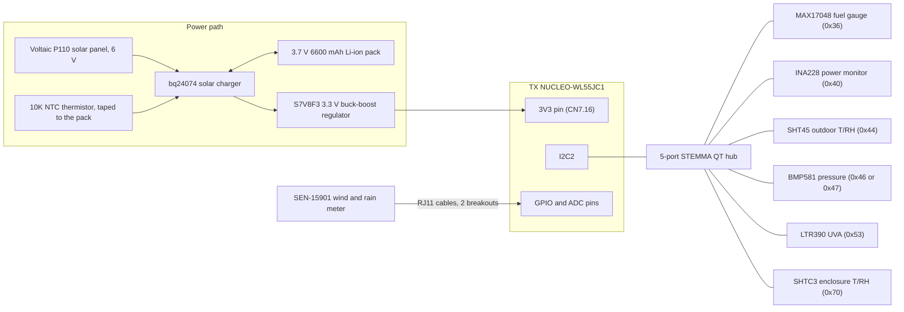

# Proof-of-concept shopping list

This list holds off-the-shelf parts for building the critical modules now (2026-10-14). Prices and stock come from each store's own product page on that day. **Nothing has been ordered.** The long-term design in the product requirements document (PRD) uses a 4-cell series pack, RS-485 sensor modules and qualified instruments. [`next-stages-plan.md`](next-stages-plan.md) describes it.

Everything wires to the TX (transmitter) NUCLEO-WL55JC1. The sensors and power monitors share the I2C2 bus through a STEMMA QT hub. The weather meter uses a few GPIO and ADC pins.

[`docs/hardware/bench-station-wiring.md`](hardware/bench-station-wiring.md) gives the meter's GPIO and ADC pins and the place of the INA228 shunt. No document yet says how the W25Q128 flash connects.

## Power (one Li-ion cell, solar charged)

| Part | Product | Price | Stock | Notes |
|---|---|---:|---|---|
| Solar charger | [Adafruit bq24074 #4755](https://www.adafruit.com/product/4755) | $14.95 | In stock | 5–10 V input (28 V protected), 1 A charge (0.5 or 1.5 A by jumper), power path |
| Charger thermistor | [Adafruit 10K NTC #372](https://www.adafruit.com/product/372) | $4.00 | In stock | **Needed:** no pack has one. Tape it to the pack, so the charger stops charging in the cold |
| Solar panel | Voltaic P110 10 W 6 V ([Voltaic direct](https://voltaicsystems.com/10-watt-panel/), or [Adafruit #5369](https://www.adafruit.com/product/5369)) | $65.00 / $64.95 | In stock | Open-circuit voltage 6.94 V, about 8.7 V when cold, under the charger's 10 V limit. Adafruit no longer makes its own 6 V panels |
| Battery | [Adafruit 3.7 V 6600 mAh #353](https://www.adafruit.com/product/353) | $24.50 | In stock | About 24 Wh (normal shipping), protected, 69 × 54 × 18 mm. JST PH plug: the breadboard needs a JST PH 2-pin pigtail |
| 3.3 V regulator | [Pololu S7V8F3 #2122](https://www.pololu.com/product/2122) | $9.95 | Active (backorders allowed) | Buck-boost, 2.7–11.8 V in, < 0.1 mA quiescent current. Feeds the Nucleo's 3V3 pin (CN7.16) |
| Fuel gauge | [Adafruit MAX17048 #5580](https://www.adafruit.com/product/5580) | $5.95 | In stock | I2C 0x36, about 3–23 µA |
| Power monitor | [Adafruit INA228 #5832](https://www.adafruit.com/product/5832) | $14.95 | In stock | I2C 0x40, 15 mΩ shunt |

## Sensors

| Part | Product | Price | Stock | Notes |
|---|---|---:|---|---|
| Wind + rain | [SparkFun Weather Meter Kit SEN-15901](https://www.sparkfun.com/products/15901) | $79.95 | In stock | Cups (reed, 1.492 mph per Hz), vane (resistor network, 8 directions reliably), rain 0.2794 mm per tip |
| RJ11 breakouts | [SparkFun BOB-14021](https://www.sparkfun.com/products/14021) + 2× [RJ11 jack PRT-00132](https://www.sparkfun.com/products/132) | $2.75 + 2 × $1.75 | In stock | One BOB-14021 is a panel of two boards: one per meter cable. One jack per board |
| Pressure | [Adafruit BMP581 #6407](https://www.adafruit.com/product/6407) | $9.95 | In stock | ±0.3 hPa absolute. Substitute for the out-of-stock BMP390 |
| UV | [Adafruit LTR390 #4831](https://www.adafruit.com/product/4831) | $4.95 | In stock | **UVA only, not a UV index.** A stand-in until a real UV-index part is chosen ([DFRobot SEN0636](https://www.dfrobot.com/product-2903.html) claims a UV index; its page does not show stock) |
| Enclosure T/RH | [Adafruit SHTC3 #4636](https://www.adafruit.com/product/4636) | $6.95 | In stock | I2C 0x70. **Not the SHT40:** it shares address 0x44 with the outdoor SHT45 |
| Outdoor T/RH | [Adafruit 6174 SHT45 (PTFE)](https://www.adafruit.com/product/6174) | — | **Have** | Sensirion SHT45-AD1F |

## Storage and wiring

| Part | Product | Price | Stock |
|---|---|---:|---|
| 16 MB SPI flash | [Adafruit W25Q128 #5643](https://www.adafruit.com/product/5643) | $4.95 | In stock |
| I2C hub | [Adafruit 5-port STEMMA QT hub #5625](https://www.adafruit.com/product/5625) | $2.50 | In stock |
| STEMMA QT cables | [Adafruit #4210](https://www.adafruit.com/product/4210) (100 mm), [#4401](https://www.adafruit.com/product/4401) (200 mm) | $0.95, $1.25 | In stock |

## Breadboard build

The first build step is on breadboards ([`hardware/bench-breadboard-r0/README.md`](../hardware/bench-breadboard-r0/README.md)).
It also needs these parts. The list has no prices or product numbers for them yet:

- three 830-point breadboards (the third stays spare for the W25Q128)
- three 10 kΩ resistors, two 100 nF capacitors, one 100 Ω ½ W resistor
- male-male and male-female jumper wires
- a STEMMA QT to male header cable
- a JST PH 2-pin pigtail for the battery

## Housing

| Part | Product | Price | Stock |
|---|---|---:|---|
| Electronics box | [Adafruit IP66 enclosure #905](https://www.adafruit.com/product/905) (175 × 125 × 75 mm) | $19.95 | 35 in stock |
| Cable glands | Adafruit [PG-7 #762](https://www.adafruit.com/product/762), [PG-9 #761](https://www.adafruit.com/product/761) | $1.95 each | In stock |
| Radiation shield | **Printed:** `hardware/poc-enclosure-r1/` (or buy an [Ambient Weather SRS100LX](https://www.ambientweather.com/amwesrpatean.html), $54.99) | — | — |
| Printed-part hardware | Rods, nuts, inserts, hose clamps, SMA bulkhead pigtail: see `hardware/poc-enclosure-r1/README.md` | — | — |

**Total for the electronics and sensors above:** about $290, before shipping, the printed parts and
their hardware.

## I2C addresses on I2C2

The diagram above shows the same addresses.

| Address | Device |
|---|---|
| 0x36 | MAX17048 |
| 0x40 | INA228 |
| 0x44 | SHT45 (outdoor) |
| 0x46 or 0x47 | BMP581 (check the jumper). The firmware uses 0x47 (`App/mod_reg.c`) |
| 0x53 | LTR390 |
| 0x70 | SHTC3 (enclosure) |

## Caveats

- **Cable glands:** the meter cables end in RJ11 plugs. These plugs do not pass through a PG-7 or
  PG-9 gland. Cut the cables and fit new plugs inside the box, or use a larger gland.
- **Battery cut-off:** the pack cuts off at about 3.0 V. The S7V8F3 runs down to 2.7 V, so the
  regulator is not the limit.
- **Console on battery:** when the 3V3 pin powers the Nucleo, the on-board ST-LINK (USB console and
  programmer) is off. **Never connect USB and the 3.3 V supply at the same time.**
