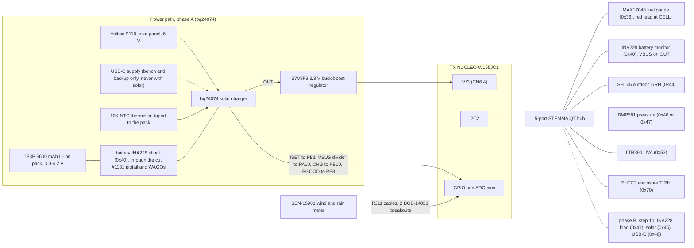

# Proof-of-concept shopping list

This list holds off-the-shelf parts for building the critical modules now (2026-10-14). Prices and stock come from each store's own product page on that day. The list was written before any order; rows marked **Have** were on the bench by 2026-10-29 (`firmware/benchlink/README.md`). The station's pack is **1S3P**: three 2,200 mAh Li-ion cells in parallel, 6,600 mAh, 3.0-4.2 V, 3.7 V nominal (Clint, 2026-10-29). The product requirements document (PRD) still names a 4-cell series pack, RS-485 sensor modules and qualified instruments; whether the 1S3P pack meets the PRD's energy reserve is open (power telemetry spec, risk D1). Prices of rows added on 2026-10-29 are marked **unverified**: they were not checked against a store page that day.

The build steps and their parts come from the build-progression decision record
([`2026-10-29-build-progression-decisions.md`](superpowers/specs/2026-10-29-build-progression-decisions.md),
section 3 for the steps, section 5 for the merged shopping list). Clint answered its survey on
2026-10-30 (its section 7.1). This list covers the breadboard build: step 1 and step 1b (the four
INA228 rails), both on the breadboard; later stages were removed from the repository on 2026-11-02.

Everything wires to the TX (transmitter) NUCLEO-WL55JC1. The sensors and power monitors share the I2C2 bus through a STEMMA QT hub. The weather meter uses a few GPIO and ADC pins.

[`docs/hardware/bench-station-wiring.md`](hardware/bench-station-wiring.md) gives the meter's GPIO and ADC pins and the phase A power chain (section 4). [`docs/hardware/power-metering.md`](hardware/power-metering.md) gives the monitor positions of every phase: in phase B the load INA228 sits between the charger's OUT and the load, and the solar and USB-C INA228s each sit in their source's lead, before the join. No document yet says how the W25Q128 flash connects.

## Power (1S3P Li-ion pack, solar charged)

| Part | Product | Price | Stock | Notes |
|---|---|---:|---|---|
| Solar charger | [Adafruit bq24074 #4755](https://www.adafruit.com/product/4755) | $14.95 | **Have** | 5–10 V input (28 V protected, OVP 10.2–10.8 V), power path. 1.0 A charge jumper (closed as shipped): R_ISET is R9, 1 kΩ in the schematic (0.89 A typ, K_ISET 890 A·Ω); the firmware uses 1 kΩ (`POWER_R_ISET_OHM 1000`, record section 1.4) and build-sheet check 2 confirms it. Charge current read on ISET: I = 400 × V_ISET ÷ R_ISET. TMR is tied to GND in the schematic (safety timers disabled; confirm on the board). Its USB-C and DC jack reach VBUS through Schottky diodes |
| Charger thermistor | [Adafruit 10K NTC #372](https://www.adafruit.com/product/372) | $4.00 | In stock | **Needed:** no pack has one. Tape it to the pack, so the charger stops charging in the cold |
| Solar panel | Voltaic P110 10 W 6 V ([Voltaic direct](https://voltaicsystems.com/10-watt-panel/), or [Adafruit #5369](https://www.adafruit.com/product/5369)) | $65.00 / $64.95 | In stock | Open-circuit voltage 6.94 V, about 8.7 V when cold, under the charger's 10 V limit. Adafruit no longer makes its own 6 V panels. *2026-10-30:* Clint replaced its original 3.5 × 1.1 mm plug with a barrel plug that fits the bq24074's DC jack directly (confirmed: it plugs straight in). The jack is 5.5 × 2.1 mm by inference from Adafruit's #4755 page (it sells a 3.5/1.1 → 5.5/2.1 adapter for the board), not measured: confirm with calipers. Without metering (step 1) the panel plugs straight into the charger. At step 1b its plug goes into an Adafruit #368 screw-terminal jack (step 1b list below; record P10); the panel lead is never cut |
| Battery | [Adafruit 3.7 V 6600 mAh #353](https://www.adafruit.com/product/353) | $24.50 | **Have** | **1S3P**: three 2,200 mAh cells in parallel, 6,600 mAh, 3.0–4.2 V, 3.7 V nominal, about 24.4 Wh (normal shipping), protected, 69 × 54 × 18 mm. Its JST PH plug mates with the pack-mating half of a cut Adafruit #1131 extension into WAGO **CELL+**, then the INA228 shunt, WAGO **BATT** and the board-mating half into the charger's BATT socket (record P3, decided 2026-10-30, 7.1 P3). The pack's own lead is never cut; it never goes through breadboard strips, and **while the INA228 meters the battery the pack never plugs into the charger's BATT socket** |
| 3.3 V regulator | [Pololu S7V8F3 #2122](https://www.pololu.com/product/2122) | $9.95 | Active (backorders allowed) | Buck-boost, 2.7–11.8 V in, < 0.1 mA quiescent current. Feeds the NUCLEO's 3V3 at **CN6.4** (record N3); CN6.4 and CN7.16 are the same 3V3 net |
| Fuel gauge | [Adafruit MAX17048 #5580](https://www.adafruit.com/product/5580) | $5.95 | **Have** | I2C 0x36, about 3–23 µA. Senses the cell voltage at the **CELL+ node**: the board-mating half of a second cut #1131 in one of its JST PH sockets, its red lead in its own CELL+ position, its black lead insulated and unconnected; ground over STEMMA QT (record P4, P5). Never on OUT |
| Power monitor | [Adafruit INA228 #5832](https://www.adafruit.com/product/5832) | $14.95 | **Have** | Battery rail, I2C 0x40. Shunt: 15 mΩ, 1 %, 2 W (2512) nominal; **shunt: verified, not measured** (build-sheet check 3: the battery current agrees with a series reference within 2 % + 2 mA; only on a fail does a reference-derived value replace 15 mΩ). VBUS on its own 22 AWG solid sense lead into the OUT connector; from step 1b it moves to CELL+. Back jumper SJ1 (VBUS to VIN+) open (record P5) |

## Sensors

| Part | Product | Price | Stock | Notes |
|---|---|---:|---|---|
| Wind + rain | [SparkFun Weather Meter Kit SEN-15901](https://www.sparkfun.com/products/15901) | $79.95 | In stock | Cups (reed, 1.492 mph per Hz), vane (resistor network, 8 directions reliably), rain 0.2794 mm per tip |
| RJ11 breakouts | [SparkFun BOB-14021](https://www.sparkfun.com/products/14021) + 2× [RJ11 jack PRT-00132](https://www.sparkfun.com/products/132) | $2.75 + 2 × $1.75 | In stock | One BOB-14021 is a panel of two boards: one per meter cable. One jack per board. The jack and the header pins are **soldered onto each board now, as module preparation** (record H5, decided 2026-10-30, 7.1 Q6); step 1 uses the BOB-14021s directly with solid-core jumpers. The meter cables are never cut |
| Pressure | [Adafruit BMP581 #6407](https://www.adafruit.com/product/6407) | $9.95 | In stock | ±0.3 hPa absolute. Substitute for the out-of-stock BMP390 |
| UV | [Adafruit LTR390 #4831](https://www.adafruit.com/product/4831) | $4.95 | In stock | **UVA only, not a UV index.** A stand-in until a real UV-index part is chosen ([DFRobot SEN0636](https://www.dfrobot.com/product-2903.html) claims a UV index; its page does not show stock) |
| Enclosure T/RH | [Adafruit SHTC3 #4636](https://www.adafruit.com/product/4636) | $6.95 | In stock | I2C 0x70. **Not the SHT40:** it shares address 0x44 with the outdoor SHT45 |
| Outdoor T/RH | [Adafruit 6174 SHT45 (PTFE)](https://www.adafruit.com/product/6174) | — | **Have** | Sensirion SHT45-AD1F |

## Storage and wiring

| Part | Product | Price | Stock |
|---|---|---:|---|
| 16 MB SPI flash | [Adafruit W25Q128 #5643](https://www.adafruit.com/product/5643) | $4.95 | In stock |
| I2C hub | [Adafruit 5-port STEMMA QT hub #5625](https://www.adafruit.com/product/5625) | $2.50 | In stock |
| STEMMA QT cables | [Adafruit #4210](https://www.adafruit.com/product/4210) (100 mm), [#4401](https://www.adafruit.com/product/4401) (200 mm) | $0.95, $1.25 | In stock |

## Purchasing status (2026-11-05)

From DigiKey: the cart Clint built on 2026-10-30 was ordered on 2026-11-02 (nothing was ordered before
that date) and arrived, at home, on 2026-11-05 (not yet counted against the order). Quantities are the quantities ordered, not the rows' needs.

| Part | Qty | Status | Row it covers |
|---|---:|---|---|
| BusBoard BB830 | 5 | **received 2026-11-05** (ordered 2026-11-02; at home) | the conditional BB830 (record H2) |
| 1 Ω 2 W resistor, CPF21R0000FKE36 | 10 | **received 2026-11-05** (ordered 2026-11-02; at home) | step 1, injection test |
| 100 Ω ½ W resistor, MFR50SFTE52-100R | 30 | **received 2026-11-05** (ordered 2026-11-02; at home) | step 1b, the deliberate load step (exit g) |
| 1 MΩ resistor, MFR-25FBF52-1M | 25 | **received 2026-11-05** (ordered 2026-11-02; at home) | step 1, ISET pull-down |
| 0.1 µF ceramic capacitor, C320C104K5R5TA | 5 | **received 2026-11-05** (ordered 2026-11-02; at home) | step 1, ISET node (100 nF) |
| Adafruit #1131 JST PH pigtail | 5 | **received 2026-11-05** (ordered 2026-11-02; at home) | step 1, the cut #1131 halves |
| WAGO 222-413 (3-way) | 20 | **received 2026-11-05** (ordered 2026-11-02; at home) | step 1 and 1b lever connectors |
| WAGO 222-415 (5-way) | 20 | **received 2026-11-05** (ordered 2026-11-02; at home) | step 1 and 1b lever connectors |
| Adafruit #1311 hook-up wire (6 × 25 ft) | 1 | **received 2026-11-05** (ordered 2026-11-02; at home) | step 1, 22 AWG solid hook-up wire |
| Adafruit #4209 STEMMA QT to male header cable | 5 | **received 2026-11-05** (ordered 2026-11-02; at home) | the STEMMA QT to male header cables (the QTM branch) and spares |
| 220 µF 16 V radial electrolytic, 2.5 mm pitch, Rubycon 16YXJ220MT16.3X11 | 20 | **received 2026-11-05** (ordered 2026-11-02; at home) | the bench OLED; no row in this list names it |
| 220 µF 16 V radial electrolytic, Panasonic EEU-FC1C221 | 10 | **received 2026-11-05** (ordered 2026-11-02; at home) | spare bulk capacitors |
| Adafruit INA228 #5832 | 5 | **received 2026-11-05** (ordered 2026-11-02; at home) | step 1b, the three extra INA228s, and spares |
| Adafruit #368 female 2.1 mm DC jack to screw terminal | 5 | **received 2026-11-05** (ordered 2026-11-02; at home) | step 1b, the panel's plug into SOLAR_IN |
| Adafruit #369 male 2.1 mm barrel plug to screw terminal | 4 | **received 2026-11-05** (ordered 2026-11-02; at home) | step 1b, the solar INA228 into the charger's DC jack |
| Adafruit #4090 USB-C female breakout (5.1 kΩ CC resistors) + Adafruit #5978 USB-C male plug breakout | 5 each | **received 2026-11-05** (ordered 2026-11-02; at home) | step 1b USB-C metering: no inline USB-C screw-terminal pair was found on DigiKey; both breakouts need soldering |
| Wire stripper/cutter, 11057 | 1 | **received 2026-11-05** (ordered 2026-11-02; at home) | tool |
| high-side load-switch breakout (change C) | 0 | **not bought** | *2026-11-02:* change C no longer has a sensor power switch (record 4.6 dated note), so no breakout is needed |

A dash means the quantity was not recorded. The screw-terminal RJ11
breakout is not bought (7.1 Q6), and no breadboard is bought for step 1b (2026-11-02): it uses one of the full-size breadboards already
owned (three Elegoo, plus two spare BB830s), on the plate (record S1).

## Build step 1: breadboard v2 (buy now)

Step 1 keeps the signals on the breadboards ([`hardware/bench-breadboard-r0/README.md`](../hardware/bench-breadboard-r0/README.md))
and takes every force current off them: pack, INA228 shunt, charger and load meet on JST PH pigtails and
WAGO lever connectors (record section 4, change A). This is the record's "Buy now (step 1)" list (section 5).
It has no prices or product numbers yet; none is verified (*2026-10-30:* the purchasing status above names the parts in the cart). Rows marked "skip if owned" are bought only
if the bench lacks them.

| Qty | Item | Note |
|---:|---|---|
| 4 | Adafruit #1131 JST-PH battery extension cable, 500 mm | 3 cut, 1 spare: the pack-mating half for the pack, board-mating halves for the charger BATT and SYSOUT sockets and the gauge (record P3, P5) |
| 10 | WAGO 222-413 (3-way) | BATT now; SOLAR_IN, USB_IN at step 1b; the injection-test splice; spares. Confirm the 0.08 mm² fine-stranded rating on WAGO's own data sheet before ordering (record P7) |
| 6 | WAGO 222-415 (5-way) | CELL+, OUT, STAR now; LOAD at step 1b; spares |
| 1 set | 22 AWG solid hook-up wire, red, black, yellow | force links, TIE, regulator leads, sense leads, NUCLEO jumpers; skip colours already owned. Screw terminals take solid 22 AWG only (record P7) |
| 1 | pre-cut / pre-formed 22 AWG solid jumper kit (140–350 pieces) | record H3 |
| 2 | 10 kΩ 1 % resistor | ISET series; one spare |
| 4 | 10 kΩ 1 % resistor | charger VBUS divider (VIN = PA10 × (R4 + R5 + R6) ÷ R6, 3 nominal), if today's are 5 %; measured either way, the ratio stored as `POWER_VIN_DIVIDER_PPM` (record M2) |
| 2 | 1 MΩ resistor | ISET pull-down; one spare |
| 2 | 100 nF ceramic capacitor | ISET node; one spare |
| 2 | 1 Ω 2 W resistor | injection test (step 1 exit 4, both cases); one spare |
| 1 | STEMMA QT to male header cable | change C, the branch to the power monitors (unswitched; *2026-11-02:* the hub's branch is unswitched too, change C has no PA9 load switch, so no load-switch breakout is listed) |
| 2 | female-to-male jumper, about 30 cm | the bench OLED's own supply pair (VCC CN7.16, GND CN10.20); skip if owned |
| 1 | USB-C wall adapter, 5 V ≥ 2 A (5.1–5.25 V output preferred) | the charger input, floating from the Mac; skip if one is owned |
| 1 | plywood or MDF, about 30 × 40 cm, 6–9 mm | the base plate (record H1); scrap is fine |
| 1 | nylon standoff kit, M2.5 and M3 | |
| 1 | double-sided foam mounting tape | |
| 1 pack (20) | adhesive cable-tie mounts | |
| 1 pack (100) | small cable ties | |
| 1 | Kapton tape | "NO 5V" covers (record N3); skip if owned |
| 1 | heat-shrink assortment | skip if owned |
| 1 | cable labels or label tape | ST-LINK serials (record H8) |
| 1 | wire stripper for 22–26 AWG | skip if owned |

Not on this list, on purpose:

- **A meter:** none is bought. The bench meter is a Fluke 87V (600 mV DC range, 0.01 mV in
  high-resolution mode), and the 38 mA screen and the 1 A checks read it directly (7.1 Q2). The shunt
  checks (build-sheet power check 3, B3; step 1b exit a) use the same 87V in series, on its A or mA
  input, for a short steady window only (record M1): no calibrated shunt or DC clamp meter is bought.
- **A screw-terminal RJ11 breakout:** none is bought. Step 1 uses the BOB-14021s, with their jack and
  header pins soldered now as module preparation (7.1 Q6).
- **Battery wire and soldered sockets:** the pack is never soldered to and its lead is never cut; the
  cut #1131 halves and the WAGO connectors above replace the earlier soldered JST PH socket and heavy
  battery leads (record P3, P7).

## Build step 1b: four rails, phase B (on the breadboard)

Step 1b is part of the breadboard build: on the same plate and the same lever-connector harness as
step 1 (record step 1b). Its parts were ordered on 2026-11-02 and arrived on 2026-11-05 (purchasing status above). Closing the A0/A1 jumpers and fitting the 0x48 rework wire on the three extra INA228s is
allowed module preparation (7.1 Q1). **USB-C and solar are never connected at the same time, in any
test.** Each source joins on the charger board through its own Schottky diode, D2 (USB-C) or D4 (DC
jack), with EN2 high and EN1 low ([`power-metering.md`](hardware/power-metering.md) section 5.1;
record P10).

| Part | Quantity | Use | Price | Notes |
|---|---:|---|---|---|
| [Adafruit INA228 #5832](https://www.adafruit.com/product/5832) | 3 more | load rail 0x41 (A0 jumper), solar rail 0x45 (A0 and A1 jumpers), USB-C rail 0x48 (a rework wire from the ADDR1 pad to SDA, A0 default) | $14.95 each, unverified | 15 mΩ, 1 %, 2 W shunt on board: verify each against a series reference (step 1b exit a). **SJ1 (VBUS to VIN+) open** on every board; each VBUS on its own sense lead: load at LOAD, solar at SOLAR_IN, USB-C at USB_IN (record P5). No pull-up jumper to cut: measure the bus pull-up, at least 0.97 kΩ (step 1b exit f) |
| WAGO 222-413 (3-way) | 2 | **SOLAR_IN** and **USB_IN**: each source lead and its INA228 VBUS lead | — | already in the step 1 quantity (10) |
| WAGO 222-415 (5-way) | 1 | **LOAD**: the load INA228's VIN−, the 100 Ω load, the regulator VIN lead (moved from OUT), the load INA VBUS lead and, for exit g only, the second 100 Ω | — | already in the step 1 quantity (6) |
| 22 AWG solid hook-up wire | as needed | every link between a WAGO, an INA228 screw terminal and an adapter's screw terminal | — | from the step 1 set; screw terminals take solid 22 AWG only (record P7); never breadboard strips |
| [Adafruit 2.1 mm barrel plug to screw terminal #369](https://www.adafruit.com/product/369) | 1 | the solar INA228's VIN− into the charger's DC jack (X3, then its Schottky D4) | unverified | in DigiKey cart 2026-10-30 (4). Power-metering section 5.1 |
| [Adafruit female 2.1 mm DC jack to screw terminal #368](https://www.adafruit.com/product/368) | 1 | takes the panel's 2.1 mm barrel plug (the panel lead is never cut) into SOLAR_IN and the solar INA228's VIN+ | unverified | in DigiKey cart 2026-10-30 (5). Replaces the female 3.5 × 1.1 mm adapter (2026-10-30: Clint swapped the panel's plug; record R-20 superseded). Power-metering section 5.1 |
| Inline USB-C screw-terminal adapter pair (female and male) | 1 pair | the USB-C INA228 between the wall adapter's VBUS (female, into USB_IN) and a male USB-C plug into the charger's own USB-C (X2, then D2); GND female to male directly | unverified | model not chosen; confirm assembled and 5 V only. *2026-10-30:* no inline USB-C screw-terminal pair was found on DigiKey; **chosen, ordered 2026-11-02 (5 each):** Adafruit #4090 (USB-C female breakout with 5.1 kΩ CC resistors) + Adafruit #5978 (USB-C male plug breakout), both need soldering. **5.1 kΩ Rd from CC1 and from CC2 to GND** on the female (sink) side, fitted if the adapter has none (without Rd a USB-C source never turns VBUS on); no USB PD; data pins unconnected |
| 5.1 kΩ resistor | 2 | the Rd pair on the female USB-C adapter, if it has none | unverified | |
| 100 Ω ½ W resistor | 1 | the deliberate load step at LOAD (exit g): its other lead goes to STAR position 5 | unverified | |
| 10 kΩ resistor and two clip leads | 1 | the back-feed test load across each idle source's adapter terminals (exit e) | unverified | skip if owned |

Not bought (record section 5, P10): ideal-diode modules, a USB-C sink breakout and external Schottky
diodes. The board's own D2/D4 pair is the join. Only if the board in hand has EN2 low, or the step 1b
input-margin check (exit d) fails, does power-metering section 5.1 describe a fallback stage; it is
not on any list.

## Conditional

One powered USB hub only if the USB acceptance test H8(d) fails; one BusBoard BB830 only if signal
strips fail repeatedly (record H2; *2026-11-02:* 5 ordered from DigiKey); WAGO 221-413/415, 0.25 mm² insulated ferrules and a ratchet crimper
only if WAGO's sheet does not cover 26 AWG on the 222 (record P7).

**Total for the electronics and sensors above:** about $290, before shipping. It leaves out the step
lists (step 1 and 1b), which are unpriced and unverified.

## I2C addresses on I2C2

The diagram above shows the same addresses. INA228 straps from the INA228 datasheet's address table
(A1, A0); never put an INA228 on 0x44, 0x46 or 0x47.

| Address | Device | Phase |
|---|---|---|
| 0x36 | MAX17048 | A |
| 0x40 | INA228, battery rail (A1 = GND, A0 = GND, as shipped) | A |
| 0x41 | INA228, load rail (A1 = GND, A0 = VS) | B, step 1b |
| 0x44 | SHT45 (outdoor) | A |
| 0x45 | INA228, solar rail (A1 = VS, A0 = VS) | B, step 1b |
| 0x46 or 0x47 | BMP581 (check the jumper). The firmware uses 0x47 (`App/mod_reg.c`) | A |
| 0x48 | INA228, USB-C rail (A1 = SDA, A0 = GND; a rework) | B, step 1b |
| 0x53 | LTR390 | A |
| 0x70 | SHTC3 (enclosure) | A |

## Caveats

- **Meter cables:** the meter cables end in RJ11 plugs and are **never cut** (record H5).
- **Battery cut-off:** the pack cuts off at about 3.0 V. The S7V8F3 runs down to 2.7 V, so the
  regulator is not the limit.
- **ST-LINK USB caveat:** when the 3V3 pin powers the Nucleo (mode B), the on-board ST-LINK (USB
  console and programmer) is off. **Never connect the ST-LINK USB cable and the 3.3 V supply at the
  same time.** This is the board's ST-LINK USB, not the charger's USB-C input.
- **USB-C rule:** the charger's USB-C input is for bench work and occasional backup charging only.
  It is **never connected at the same time as the solar panel**.
