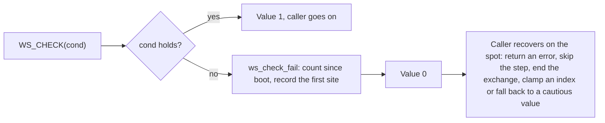
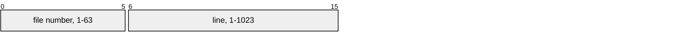

# Power of Ten: our firmware against NASA/JPL's ten rules

On 2026-10-15 Clint asked us to apply Holzmann's "The Power of Ten: Rules for Developing
Safety-Critical Code" (IEEE Computer, June 2006) to our firmware C "where it makes sense". This page
gives the status of each rule. It lists what complies, the deviations we keep and why, and what CI
enforces. It describes the tree as of the commit that last changed this page.

"TX" is the transmitter, the station node with the sensors. "RX" is the receiver, the bridge on the
gateway's USB cable. Both roles build from `firmware/stage0-node`.

**Scope.** The rules apply to our C in both roles:

- `firmware/stage0-node/App/*`, `firmware/common/*`, `firmware/stage0.c` and `.h`.
- Our edits in the ST-generated board files (`Core/Src/stm32wlxx_it.c`, `sys_app.h`).

The rules don't apply to:

- `vendor/` (ST's HAL, SubGHz_Phy and utilities, and Mbed TLS).
- The rest of the ST-generated board code (`firmware/board/nucleo-wl55jc`).
- The host harnesses and test programs (`firmware/host`, `firmware/test_*.c`, `firmware/fuzz`).
  These run on the PC and may allocate, recurse or use `longjmp`.

Size of the scope: 38 C files and 501 functions, counted by lizard 1.24.1 with headers included.
That's 4,475 non-comment lines of code (lizard NLOC). We counted on 2026-10-19 at `04fcc65`.

The power telemetry work (2026-10-29, [spec](superpowers/specs/2026-10-29-power-telemetry-design.md))
came after that count. It added `App/power_acq.c`, `App/power_config.h` and
`firmware/common/power_regs.c` and `.h`. It also reshaped `App/mod_power.c` and
`App/board_inputs.c`. So a count on this page that carries a date is from before that work, unless
it says otherwise.

## Summary

| # | Rule (short) | Status | Enforced by |
|---|---|---|---|
| 1 | Simple control flow: no `goto`, `setjmp`/`longjmp`, recursion | **Complies** (two bounded vendor cycles, outside our code) | `tools/stack_report.py` fails on recursion (`make stack`, CI). No `goto` or `setjmp` in scope (grep, below) |
| 2 | A fixed upper bound on every loop | **Complies with documented deviations** (the deliberate hangs: TEST-HANG in `bench.c`, the unreachable loop after the faulting read in `fault.c`, and ST's four fault-handler loops in `stm32wlxx_it.c`) | `tools/loop_bounds.py` (in `tools/code_shape.sh`, CI host job) |
| 3 | No dynamic allocation after initialisation | **Complies** (none at all) | The link fails if an allocator is linked (`NO_HEAP=1`, CI firmware job). `-Wvla -Walloca` |
| 4 | No function longer than 60 lines | **Complies** (also cyclomatic complexity ≤ 10) | `tools/code_shape.sh` (lizard), CI host job |
| 5 | Assertions: at least two per function, with an explicit recovery | **Partial**: a check facility with a defined recovery at 41 sites (about 0.08 per function, below the target, argued below) | Every host harness test requires zero failed checks. Tests make checks fail on purpose |
| 6 | Data at the smallest possible scope | **Complies** (one shared variable left, set by an interrupt) | Review. `-Wmissing-declarations`, `-Wredundant-decls`, Cppcheck `variableScope` |
| 7 | Check every non-void result and check parameters | **Complies with documented deviations** (`memcpy`/`memset`, `APP_PRINTF`, ST's void radio API) | `(void)` casts with reasons, `WS_CHECK` at module boundaries, review |
| 8 | Preprocessor: includes and simple macros only | **Complies with documented deviations** (two X-macros, `WS_OBS_CATALOG` and `mod_wind.c`'s `VANE_OHMS`; one token-pasting wrapper, `BUSYMON_TASK`; `__LINE__` in `WS_CHECK`; 16 of our own conditional-compilation switches plus ST's `DEBUGGER_ENABLED` in `watchdog.c`) | Review. `-Wundef`, `-Wunused-macros` |
| 9 | One level of dereference and no function pointers | **Complies with documented deviations** (ST's callback APIs; `ws_i2c_pins`, the pin interface that the stuck-bus recovery drives on the board and in its host test; and the bench OLED's own function pointers, the `scr_defs[].draw` screen table in `scr_screens.h` and `oled_fit`'s `oled_form_fn` callback in `oled_row.h`) | Review. `tools/stack_report.py` accounts for every pointer call |
| 10 | All warnings on, zero warnings, static analysis every day | **Complies** (every push, not daily) | `-Werror` strict set, GCC `-fanalyzer`, Cppcheck, all in CI |

## Rule 1: simple control flow

**Complies.**

- There's no `goto`, `setjmp` or `longjmp` in scope. `grep -n "goto\|setjmp\|longjmp"` over the
  scope finds none. The host power-cut driver `firmware/test_store.c` uses `setjmp` to model a power
  cut. It's out of scope.
- No recursion. `tools/stack_report.py` (`make ROLE=tx|rx stack`, CI) builds the call graph from
  GCC's `-fcallgraph-info=su`. It fails on any cycle except the listed bounded ones
  (`BOUNDED_RECURSION`). Both listed cycles are in vendor code:
  - ST's `RadioSetPublicNetwork` ⇄ `RadioSetModem`. It runs at most once.
  - Mbed TLS's CCM ⇄ cipher-layer cycles. They can't run, because our configuration has no cipher
    layer (`MBEDTLS_CIPHER_C` off, `common/ws_mbedtls_config.h`).

The `for (;;)` loops in `App/bench.c` (TEST-HANG) and `App/fault.c` (after the faulting read) are
deliberate ends of execution, not control flow. ST's `while (1)` loops in the fault handlers are the same kind. Rule 2
lists them all.

## Rule 2: every loop has a fixed upper bound

**Complies with documented deviations.** The scope has 84 loops. We counted them with
`tools/loop_bounds.py`'s own rules on 2026-10-19:

- 66 are counting loops whose header states the bound (`for (i = 0; i < n; i++)`). The bound is a
  constant or a parameter whose maximum the caller fixes.
- The other 18 carry a `bound:` comment that says what bounds them. Two examples:
  - the journal scrub (`App/node_store.c`, `store_journal_scrub`). It makes at most
    `JOURNAL_CAPACITY` passes, and each match moves the index past its slot.
  - `ws_hex_decode` (`common/ws_console.c`). It makes at most `max + 1` passes.

`tools/loop_bounds.py` checks the loops by their syntax:

- A counting loop's step must move toward its bound.
- Its body must not assign the loop variable.
- A literal bound must fit a declared 8-bit or 16-bit counter.
- Any other loop needs a `bound:` comment.

The tool doesn't prove anything about a symbolic bound (a parameter, a constant). Review decides
what it's worth. Review also decides if a `bound:` comment is true. A loop that fails the check
fails `tools/code_shape.sh`, so it fails CI. `tests/test_loop_bounds.py` tests the checker, and the
review's counterexamples are part of those tests.

The check covers `App/`, `firmware/common`, `firmware/stage0.c` and `stage0.h`, and the node's
`Core/Src/stm32wlxx_it.c`. The deviation list below names the fault-handler loops in that last
file as deliberate hangs.

Changes for this rule (commit "every loop has a stated upper bound"):

- `App/tx_exchange.c` `process()`: the event loop now counts at most `EV_COUNT` bits. Before, it
  shifted until the batch was empty. So a stray bit would get an event name past the end of
  `ev_name`. Now a stray bit is also a `WS_CHECK` failure (rule 5).
- `firmware/stage0.c` `ws_i2c_recover` (host tests): at most `WS_I2C_RECOVER_STEPS` (23) steps. On
  the board, the same sequence runs one step per timer tick (`App/i2c_bus.c` `on_step`), with the
  same bound.

The console line bounds `parse_u32` in `stage0.c`. `ws_line_feed` always ends the line with a NUL
within `WS_LINE_MAX` (256) characters. In `ws_cmd_find`, the constant command names bound `strlen`
and `strncmp`. `strncmp` also stops at the line's NUL.

Deviations, which are deliberate unbounded loops:

- `App/bench.c` `test_hang`: TEST-HANG stops the main loop, so the watchdog has to reset the board.
  That's what it's for. A field build leaves it out (`-DWS_FIELD_BUILD`).
- `App/fault.c` `fault_test`: the code never gets to this loop, because the read before it faults
  (TEST-FAULT, bench only).
- ST's `while (1)` loops in `Core/Src/stm32wlxx_it.c`:
  - after `fault_record`, which never returns.
  - in the stock MemManage, BusFault and UsageFault handlers. Those faults aren't enabled, so they
    escalate to HardFault.
- ST's `while (1)` in `Error_Handler` (an init failure). It's in the board's `Core/Src/main.c`
  (`firmware/board/<board>/`), not in `stm32wlxx_it.c`.
  [`docs/firmware-event-model.md`](firmware-event-model.md) lists it.

## Rule 3: no dynamic memory allocation after initialisation

**Complies: the firmware has no dynamic allocation at all**, not even at start-up. Every buffer is
static or on the stack, with a size fixed at compile time.

- We configure Mbed TLS without the generic cipher layer. That layer allocated a context with
  `calloc` for every seal and open. With no `MBEDTLS_CIPHER_C`, CCM keeps its AES context inline
  (`common/ws_mbedtls_config.h`). Our configuration also leaves out `MBEDTLS_PLATFORM_C`.
- The link enforces the rule. With `NO_HEAP=1` (`firmware/stage0-node/Makefile`, rule in
  `firmware/board/stm32wl/rules.mk`), the link fails if it pulls in `malloc`, `calloc`, `realloc`,
  `free`, their `_r` forms or `_sbrk`. Both images pass ("no heap: no allocator linked").
- `-Wvla` and `-Walloca` (strict set) forbid stack allocation of run-time size.
- `tools/stack_report.py` bounds the stack statically: TX 6,360 B, RX 2,652 B of the 8,192 B that
  the linker reserves (2026-10-19, `04fcc65`). The firmware also measures it at run time
  (`stack_peak` on `#counts` and `#alive`).
- Note: the shared linker script still reserves 512 B of heap (`_Min_Heap_Size`) that nothing
  uses. It's board code shared with `firmware/rangetest`, so we leave it alone.

## Rule 4: no function longer than 60 lines

**Complies.** `tools/code_shape.sh` runs lizard with `-L 60` (lines per function) and `-C 10`
(cyclomatic complexity, stricter than the rule asks). It runs over the scope and the host
harnesses. It also runs jscpd, which finds copied code. The check runs in the CI host job. The 501
functions average 7.0 lines (NLOC) and a cyclomatic complexity of 2.9.

## Rule 5: assertions with an explicit recovery

**Partial.** The facility, its reporting and its tests comply. The density (41 sites over 501
functions, 0.08 per function) is far below Holzmann's 2 per function. We chose that on purpose.

### The facility

`firmware/common/ws_check.h` and `ws_check.c` give us `WS_CHECK(cond)`:

- `WS_CHECK` is an expression. It never halts or resets the board.
- The caller writes the recovery right next to the check.
- Unlike `assert()`, `WS_CHECK` is never compiled out. So a condition can be the call whose result
  it checks (rule 7).
- Cost: no strings. A failure records the count since boot and the first site. The site is a
  16-bit value, `(file number << 10) | line`:

`ws_check.h` lists the file numbers. `tests/test_check.py` keeps them unique and keeps every user
file under 1024 lines.

How the firmware reports a failed check:

- TX prints `check_fails=N check_first=F:L` on `#counts`.
- RX prints the same fields on its `STATUS` reply, not on `#alive`, because the gateway stores the
  `#alive` fields.

Any nonzero count is a firmware bug to report.

### What a check is and is not

A check states an invariant of our own code. A failure is a bug.

`WS_CHECK` doesn't check input that can legitimately be bad: a received frame, a console line, or
flash read back after a power cut. Our code validates that input. Its failures are normal events
with their own counters (`ack_rejects`, `#rx drop`, `#host reject`, `burned`,
`#error journal-read`). There's plenty of this code, and it's already "an assertion with a
recovery" in Holzmann's sense. This page doesn't count it.

### The 41 sites

TX has 40 sites and RX has 7. Some files are in both roles. These counts are from `04fcc65`.

On 2026-10-29 `grep -n 'WS_CHECK('` over the scope's `.c` files finds 45 lines at `c7e8860`. It
finds 52 with the power telemetry changes: `power_acq.c` 6, `mod_power.c` 1, `tx_exchange.c` 11,
and a second `tx_console.c` check (the bench sensor-power test timer). The table below names every
kind, the newer ones too.

| Kind | Sites (file, function) | Recovery |
|---|---|---|
| State-machine preconditions | `tx_exchange.c`: `exchange_start` (no exchange running), `handle` (an unknown state is idle), `process` (only `EV_*` bits). `i2c_bus.c` `bus_task` (posted only in `S_DONE`, `S_RECOVERED` or `S_END`) | refuse the start, back to idle, drop the stray bits, or do nothing |
| Index and length bounds before a buffer is used | `tx_exchange.c` `send_current` (`qi < qn`), `mark_replied` (`qi`), `exchange_start` (backlog fits the queue). `tx_policy.c` `policy_exchange_end` (`n` fits `struck[]`). `app_tx.c` `held_count`. `node_store.c` `store_journal_read` and `_ack` (the ref is a journal slot, checked before it indexes the pending bitmap). `busymon.c` `busymon_end` (`kind`), `busymon_isr_exit` (an exit has its enter). `console.c` `hex_print` (frame length). `ws_policy.c` `ws_strike_note` (table size), `ws_link_probe_interval` (`probe_step`) | end the exchange, skip the write, clamp, or refuse (-1) |
| Flash writes stay in the node-state pages | `node_store.c` `prog64`, `erase_page`: every program and erase lies inside pages 95–127 (never the firmware) and is double-word aligned | refused like a failed flash operation, which every caller already handles |
| Our own data must encode or seal | `app_tx.c` `minute_report` (`ws_obs_encode`). `tx_exchange.c` `send_obs`, `send_diag` (`ws_seal_kind` with a provisioned station and a reserved counter), `diag_power` (the cached charger status is a canonical health-report value: no reserved stage or input code) | `journal=ERROR`, or the item is skipped as for a local send failure; a non-canonical charger status goes out as "none" |
| ST timer starts that must not be refused | `tx_exchange.c` gap and ACK-window timers. `i2c_bus.c` guard and step timers, and the guard timer's `UTIL_TIMER_SetPeriod`. `tx_console.c` reboot timer, and the sensor-power test timer (bench only). `app_rx.c` `#alive` timer. `watchdog.c` check timer. ST refuses a start only for a running timer | the running timer still delivers its event. The reboot timer resets at once instead. A refused sensor-power test timer aborts the test |
| HAL results that should not fail for our arguments | `i2c_bus.c` `i2c_start` (`HAL_I2C_Init`, analog filter). `watchdog.c` `HAL_IWDG_Init`, which can return `HAL_TIMEOUT` if the internal low-speed oscillator (LSI) never settles. `console.c` `console_init` (`vcom_ReceiveInit`) | the next transfer fails and the bus recovery re-initialises. The independent watchdog (IWDG) takes the values when its update completes. The console re-arms the receive once, and the RX health check also re-arms it |
| Local module steps | `mod_th.c`, `mod_reg.c`: the bus takes each submitted transfer (`i2c_bus_submit` returns 0: one step at a time), and a completion arrives in a step that expects one. `wsmp_local.c` `i2c_bus_done`: the completion belongs to a known client. `port_id.c` (the port modules' identity reads): the bus takes a record read, a completion arrives in a step that expects one (`port_id_i2c_done`), and `port_id_check` does not start a second identity check while one runs | `mod_th`, `mod_reg`: a failed check is only counted (the sample is not marked failed), and a stray completion is ignored. `port_id`: a stray identity completion is ignored, and a second check request is dropped (the running check completes) |
| Power acquisition steps | `power_acq.c` (the INA228 rails, the MAX17048 and the board ADC; file 18): `rail_submit` and `gauge_read` (the bus takes the transfer), `rail_done` and `gauge_done` (a completion arrives in a step that expects one), `power_acq_init` (every rail's SHUNT_CAL from `power_config.h` is nonzero), `power_acq_i2c_done` (a completion comes from a client this power profile has a rail for). `mod_power.c` `known` (a module number is the battery or the rails module) | a refused rail transfer fails like a bus error (the rail's window gets a gap and the rail re-calibrates); a refused gauge read or an unexpected completion sends that step back to idle; a stray completion is ignored; an unknown module gets an all-zero identity. The SHUNT_CAL check has no recovery of its own: a wrong `power_config.h` constant would read zero current, and the count on `#counts` names it |
| Policy inputs | `ws_policy.c` `ws_lora_airtime_ms` (spreading factor, bandwidth, coding rate) | a whole minute: the live reading only, no division by zero |

### Tests

Every test of the TX, RX, I2C bus and WSMP module harnesses requires zero failed checks. So does
every power-cut sweep. That means the harnesses check the invariants on every simulated step. This
covers the 3-hour randomised TX links and the 6-hour RX run too.

Some tests make a check fail on purpose. They confirm that the firmware counts it, reports its site
and recovers:

- TX (`test_a_failed_check_is_counted_reported_and_recovered`): the gap timer is already running
  when the exchange starts it. The exchange goes on, and `#counts` shows `check_fails=1` and the
  site.
- RX: the console receive doesn't start at boot. The firmware re-arms it once, the downlink works,
  and `STATUS` shows the site.
- The store (`firmware/test_store.c` `checks()`): the store refuses and counts refs outside the
  journal. The pending set doesn't change.
- The facility itself (`tests/test_check.py`).

### Why the density is lower than 2 per function

- **Cost.** A check costs about 10 to 14 B of flash, plus its recovery. That's the test and branch,
  a `movw` of its site and a `bl` to `ws_check_fail`. We measured 35 sites at about 660 B, with the
  facility and its reporting. Holzmann's density over the 481 functions in the TX files would be
  about 960 checks, roughly 15 KB.
- **Headroom.** The numbers are in [`docs/firmware-budget.md`](firmware-budget.md):
  - At `04fcc65`, TX used 66.1 % (74,464 B) of its 110 KB region of that time. Only 10,016 B
    remained below the 75 % headroom target, so 15 KB of checks didn't fit.
  - Today TX is 90,264 B, 46.4 % of the 190 KB region (190 KB since 2026-11-04). That leaves
    55,656 B below the 75 % target. The final station's features still need an estimated 15 to
    27 KB.
- **Small functions.** Most of the 501 functions are too small to have an invariant worth a
  run-time check. Examples are one-line accessors, timer and radio callbacks that post an event
  bit, and the timed task wrappers.
  - 266 functions are non-trivial (cyclomatic complexity ≥ 3 or ≥ 8 lines), and 29 of them hold a
    check.
  - 38 functions hold a check in all. The other 9 are small wrappers.
  - The functions with a check are the ones that index arrays, write flash, submit bus transfers
    or move a state machine.
- **Pure code validates its input.** The portable pure code (`ws_frame.c`, `ws_obs.c`,
  `ws_console.c`, `stage0.c`, and the power conversions in `power_regs.c`) validates every input.
  It returns an error or a defined value (`power_regs.c`: 0 for a zero divisor, saturation past
  int32). That's its recovery. A `WS_CHECK` in this code would count legitimate bad input as bugs.
  - CI fuzzes `ws_frame.c`, `ws_obs.c`, `ws_console.c` and `stage0.c` with libFuzzer
    (`firmware/fuzz`), and unit tests cover them.
  - `power_regs.c` has unit tests only.
- **Free checks.** We check many invariants where a check costs no flash:
  - `_Static_assert`s (layouts, table sizes, the journal geometry): 25 at `04fcc65`, 54 in the
    current tree.
  - The host harnesses' per-step invariants: no flash write while the radio is busy, no radio
    command with its interrupt unmasked, no refused timer start, no task that never settles, no
    interrupt mask left set. These run the real firmware C on every test.

## Rule 6: data at the smallest possible scope

**Complies.** Each module keeps its state `static`. Every file-scope variable in scope is private
to its file, except one (below).

Changes for this rule (commit "narrow the shared node state"):

- `tx_node` was one writable global that every TX module could read and change, and that included
  the AES key. Now `app_tx.c` owns this boot's identity and run state. The other modules get a
  `const` view (`node_state()`, `App/tx_node.h`).
- The key and station live in `tx_exchange.c` (`exchange_load_identity`). It's the only module that
  holds the node's key and seals and opens its frames. The boot self-test (`selftest.c`) seals and
  opens fixed known-answer vectors with its own test key. The console sees only the station and
  the key check value (`exchange_identity()`, read-only).
- `rebooting` and `storming` became `tx_console.c` statics. The behaviour didn't change.
- `tx_counts` is static in `tx_exchange.c`. Other modules read it through `exchange_counts()`.
- We narrowed the variables in Cppcheck's two `variableScope` findings (in `ws_line_feed` and
  `ws_key_check`).

The board ADC sequence (`App/board_inputs.c`) shares its results between the ADC interrupt and its
two readers (`board_vane_mv`, `board_power_adc`). It does that through `done[]` and `done_seq`,
which are `static volatile` in that file. `board_power_adc` masks the ADC interrupt while it copies
one sequence, so it never mixes two. The CHG edge count (`chg_edges`) is the same kind. None of
them leaves its file.

Kept and documented: `ws_flash_ecc_fault` (`Core/Src/stm32wlxx_it.c`) is the one variable shared
across files. The NMI handler sets it and the flash read checks it. An interrupt can only report
through shared state. The board's `ws_trace_drops` (console drops) is the same kind.

## Rule 7: check every result and every parameter

**Complies with documented deviations.** Every non-void call in scope either uses its result or
casts it to `(void)`. The reason is next to the cast or listed here:

- ST's `UTIL_TIMER_Create`, `Stop` and `SetPeriod` fail only for a NULL object or callback
  (`stm32_timer.c`). `Start` also fails for a running timer. Our timers are static objects with
  named callbacks, so those calls are `(void)`. We check the starts that a state machine relies on
  with `WS_CHECK` (rule 5).
- `HAL_FLASH_Unlock` and `Lock` (`App/flash_stm32wl.c`): if the flash stays locked, it refuses the
  next program or erase, and that call returns the status.
- `HAL_RCCEx_PeriphCLKConfig` for I2C2 only selects a clock.
- `HAL_IWDG_Refresh` always returns `HAL_OK`.
- `HAL_I2C_DeInit` fails only for a NULL handle.
- The board ADC sequence (`App/board_inputs.c`):
  - `HAL_ADCEx_Calibration_Start`: if it fails, the inputs read with the factory offset.
  - `HAL_ADC_Start_IT`: the HAL refuses a start while a sequence runs, harmlessly, with
    `HAL_BUSY`. A start that the HAL refused or lost shows as no new sequence. `adc_fresh` then
    starts again after `ADC_RESTART_CALLS` calls.
  - If the ADC didn't initialise or configure its four channels, the firmware never starts it.
    `board_power_adc` then reports no reading, so the power slots are missing, not wrong.
- `store_note_abandoned` (twice): a total that failed to persist is only a count. The firmware
  acknowledges the record either way.
- The bench storm load ignores the results of its writes on purpose.
- The exchange checks every flash, journal and counter call. With no counter reservation, the node
  doesn't transmit.

Deviations:

- `memcpy`, `memset` and `memmove` return their destination argument. Our code doesn't use or cast
  their results. That's the common reading of the rule, and a cast adds nothing.
- `APP_PRINTF` (`sys_app.h`) checks its own result. The console drops and counts a line that its
  queue can't take (`trace_drops` on `#timing` and `#alive`). It never waits. We designed the
  console that way so it never blocks
  ([`docs/firmware-event-model.md`](firmware-event-model.md)).
- ST's radio API returns nothing for `Init`, `Rx`, `Standby`, `Sleep` and the configuration calls
  (`radio.h`). Only `Send` reports a result, and our code checks it. A command that fails silently
  shows up as a missing event. These mechanisms recover from it:
  - the TX exchange's ACK-window and transmit timeouts and its watchdog bound.
  - the RX health check (no radio event for 16 minutes, or a transmission longer than 5 s).

Parameters at module boundaries:

- The store refuses a journal ref outside the journal. It also refuses every flash write or erase
  outside the node-state pages. It doesn't range-check flash reads.
- `exchange_start` clamps the backlog to the queue. `policy_exchange_end` clamps its count.
- The pure functions validate their inputs (`ws_seal_kind`, `ws_open_reply`, `ws_obs_encode`,
  `ws_parse_provision`, `ws_hex_decode`).
- Our code doesn't NULL-check pointers that it passes itself (addresses of static or stack
  objects).

## Rule 8: limited use of the preprocessor

**Complies with documented deviations.** Most of our macros are constants and short expressions. A
few aren't, and the deviation list below names them.

Changes for this rule: `node_store.c`'s `BIT()` and `ws_check.h`'s site accessors became static
functions.

Deviations kept, with the reason:

- `WS_OBS_CATALOG` (`common/ws_obs.h`) is an X-macro. The field catalog's widths and maxima exist
  once. `ws_obs.c` generates its tables and the constant-expression record lengths from it, so
  they can't drift apart. `WS_OBS_PLAIN_LEN` sizes buffers and the journal slot. A
  `_Static_assert` checks one entry per field. `tests/test_obs.py` checks the catalog against the
  gateway's `ws0/fields.py`.
- `VANE_OHMS(X)` (`App/mod_wind.c`) is a second X-macro.
- `BUSYMON_TASK(fn)` (`App/busymon.h`) uses token pasting and stringising. It generates each task's
  one-line timed wrapper (`fn_timed`). So the busy monitor times every task the same way, and each
  wrapper carries its task's name. `BUSYMON_ISR(name, body)` wraps a handler body in the same
  timing as one statement. The generated functions are ordinary C that GCC, lizard and the stack
  and blocking reports see.
- `WS_CHECK` must be a macro, because it records its caller's `__LINE__`.
- `APP_PRINTF` (board `sys_app.h`) is variadic. It came from ST.
- `SCR_HIST(cap)` (`App/scr_view.h`) defines an anonymous struct type.
- The generated board headers (`gen/board_pins.h`, `gen/board_caps.h`) have macros that span
  several statements in `do { } while (0)`.
- Conditional compilation uses 16 of our own switches, plus ST's `DEBUGGER_ENABLED` and the
  generated `board_caps.h` guards. Each is a build variant or a guard:
  - `WS_FIELD_BUILD` leaves out the bench commands (`bench.c`, `tx_console.c`).
  - `WS_NODE_FIELDS` selects the build's field set (`node_fields.h`).
  - `WS_JOURNAL_PAGES` lets host tests shrink the journal (`flash_layout.h`). Without it,
    `flash_layout.h` defines `WS_JOURNAL_DEFAULT`. `node_store.c` then checks the 9.5-hour capacity
    (570 records) of the board's ring.
  - `WSMP_HOST_BUDGET` lets a test build make the station host's radio budget smaller
    (`wsmp_host.c`). `WSMP_HOST_SLOT_MS` lets a test build shrink the pre-latch slot (default
    3000 ms, `wsmp_host.c`).
  - `WSMP_HOST`, defined only by the host test builds, adds one test seam to `wsmp_host.c` and
    `wsmp_host.h`. That seam is `wsmp_host_worst_line`. It puts every port in its longest
    `#modules` state, so `tests/test_wsmp_host.py` can check that the longest line fits
    `WSMP_MODULES_LINE_MAX`.
  - `WS_I2C_MUX` selects the I2C bus profile (`App/i2c_bus.h`). 0, the default, is the official
    phase A STEMMA QT hub. 1 is the ports board's mux, which the existing host tests build
    (`tests/README.md`, Host build variants). The code uses it only as a value, never in `#if`.
    It's in `i2c_bus.c`'s `PORT` and `RECORD` macros and in plain C `if`s (`i2c_bus.c:385,423`,
    `board_inputs.c:250,404`). So both profiles always compile.
  - `WS_POWER_PROFILE` selects the power build (`App/power_config.h`). 1 is phase A (the default)
    and 2 is phase B with four INA228 rails. Any other value stops the build with `#error`. It
    picks the rail table only. `power_acq.c` has no `#if` of its own.
  - `WS_FW_BUILD_ID` and `WS_CHECK_FILE` cause `#error` if the build or the file didn't define
    them.
  - `WS_BENCH_OLED` selects the bench OLED build.
  - `SCR_NAMES` (`scr_screens.h`) and `SCR_UTC_OFFSET_MIN` (`scr_view.h`) configure the bench OLED
    screens.
  - `OLED_APP_RAM2` (`oled_app.c`) and `OLED_DMA_RAM2` (`oled_dma.c`) are RAM2 section attributes.
  - `DEBUGGER_ENABLED` (`watchdog.c`) is ST's switch.

`-Wundef` and `-Wunused-macros` are on.

## Rule 9: restricted pointers and no function pointers

**Complies with documented deviations.**

Changes for this rule (commits "link-time seams instead of our own function pointers" and "one level
of indirection in the PROVISION parser"):

- Our own function pointers had one implementation per build. They became named functions that the
  linker resolves:
  - the flash primitives (`ws_flash_read64`, `prog64`, `erase` in `App/flash_layout.h`). These were
    a table of three pointers.
  - the console line handler (`console_line`).
  - the completion of an I2C transfer (`i2c_bus_done`, defined in `App/wsmp_local.c`).
  - the watchdog health test (`watchdog_healthy`).
- The PROVISION parser no longer advances a cursor through a `const char **`.

Deviations kept:

- **ST's callback APIs**, which we can't avoid: `UTIL_TIMER` callbacks, `UTIL_SEQ` tasks
  (registered as their `BUSYMON_TASK` wrappers), SubGHz_Phy's `RadioEvents_t` and its `Radio`
  function table, and the board's `vcom_ReceiveInit` character callback. ST's HAL weak callbacks,
  such as `HAL_I2C_MasterTxCpltCallback`, are link-time overrides. They aren't pointers.
- **`ws_i2c_pins`** (`stage0.h`) is a `const` table of pin functions behind the I2C stuck-bus
  recovery waveform. With this table, the host tests run the same `ws_i2c_recover_step` with
  simulated pins (`firmware/test_policy.c`), and `i2c_bus.c` uses it to drive the real pins. A
  link-time seam would force every build that links `stage0.c` (the fuzzers, the host tests) to
  define pin stubs.
- **The bench OLED's own function pointers**: the `scr_defs[].draw` screen table
  (`scr_draw_fn`, `App/scr_screens.h`) and `oled_fit`'s `oled_form_fn` callback
  (`common/oled_row.h`).

How the stack bound treats indirect calls: `tools/stack_report.py` follows direct calls exactly. It
assumes a call through a pointer can reach any linked function whose address is taken. It finds
those functions in the object files' relocations. The bound allows at most two pointer hops on one
stack and two nested interrupts:

The changes above replaced four of our own pointer seams. That removed six address-taken targets
from that conservative set: the three flash primitives, the console handler, the sensor callback
and the health test. The tool now computes those paths exactly.

Pointer dereference: our code uses one level wherever we can choose. Our code reaches struct
members through one pointer (`p->x`). `held[i][k]` is a two-dimensional array, not a pointer to
pointers. One deliberate exception: `ws_cmd_find(const char *const names[])` takes the
command-name table, an array of string pointers.

## Rule 10: all warnings, zero warnings, static analysis

**Complies.** CI runs these checks on every push and pull request (`.github/workflows/ci.yml`):

- **Compiler**, our C only (`STRICT` in `firmware/board/stm32wl/rules.mk`). ST's code builds
  with `-Wall` only. Here are our flags:
  - The base set: `-Wall -Wextra -Wshadow -Wconversion -Wsign-conversion -Wcast-qual
    -Wstrict-prototypes -Wmissing-prototypes -Wundef -Wdouble-promotion -Wformat=2
    -Wnull-dereference`.
  - This rule added `-Wpedantic -Wformat-signedness -Wformat-overflow=2 -Wformat-truncation=2
    -Wvla -Walloca -Wcast-align -Wpointer-arith -Wredundant-decls -Wold-style-definition
    -Wmissing-declarations -Wwrite-strings -Wjump-misses-init -Wlogical-op -Wduplicated-cond
    -Wduplicated-branches -Wswitch-default -Wfloat-equal -Wunused-macros -Wstack-usage=512`.
  - All flags run with `-Werror`. Both roles build with zero warnings, and so does
    `firmware/rangetest`'s strict file.
- **Console formats.** ST's `UTIL_ADV_TRACE_COND_FSend` has no `format` attribute. So GCC never
  compared `APP_PRINTF`'s formats with their arguments on the target. Now `sys_app.h` also passes
  the same arguments to a never-called function with the `printf` attribute. This adds no code.
  - It found three `int` constants printed with `%u`. They were harmless, and they're unsigned now.
- **GCC's static analyser** (`-fanalyzer`) on our C for both roles: zero findings.
- **Cppcheck 2.22.0** (`tools/cppcheck.sh`, from the pinned `cppcheck==1.5.3` wheel in
  `requirements-dev.txt`): warning, style, performance and portability checks, exhaustive, with
  zero findings.
  - It runs without the HAL and ST utility include paths (`--suppress=missingInclude`). So it
    analyses our code without ST's types and doesn't cover the board files. It's a lighter check
    than the compiler's, which sees everything.
  - Its first run found 14 issues: two variables whose scope could shrink, a pointer that could be
    const, a static assert that it misread (now `!= 0`), and ST callback signatures that we can't
    make const. We suppress those signatures inline with the reason
    (`/* cppcheck-suppress … ; ST's … signature */`).
- **Our own analyses**:
  - worst-case stack (`make stack`).
  - no blocking call reachable at run time (`make waits`, `tools/blocking_report.py`). The board ADC
    sequence (vane, ISET, charger input, VREFINT) runs by interrupt. Its only waits are the HAL's
    bounded enable handshake and the one offset calibration at start. Both are in `ALLOWED`.
  - function size and duplication, loop bounds, no heap, and the flash budget.
  - reproducible builds.
  - libFuzzer on seven input parsers in `firmware/fuzz`: console, observation, PROVISION, reply,
    WSMP, WSMP record and WSMP set.
  - the host harnesses under UBSan, and under ASan where CI can preload it.

Deviation: "daily" becomes "every push". We pin every tool, so a run on unchanged code repeats the
last result. A schedule would add nothing. CI analyses every change before we merge it.

## What this cost

We measured from clean trees (same version-string length) before (`1947b40`) and after this work.
The percentages are of the 64 KB firmware region of that time:

| | Before | After | Change |
|---|---|---|---|
| TX flash (code + data) | 57,136 B (87.2 %) | 57,744 B (88.1 %) | +608 B (approximate split): the checks and their reporting +664, the narrower node state +72 (`88eef3b`), the loop and macro changes +16, the link-time seams −120, the parser −32 |
| RX flash | 34,072 B (52.0 %) | 34,152 B (52.1 %) | +80 B: the checks and their reporting +128, the link-time seams −48 |
| TX worst-case stack (`make stack`) | 5,648 B | 5,744 B | +96 B (of 8,192 B) |
| RX worst-case stack | 2,588 B | 2,588 B | 0 |

Only part of the TX row has a written record. Commit `56b43f0` records "TX +608 B to 88.1 %". The
exact TX byte counts aren't recorded anywhere. A later clean rebuild with the same pinned xPack
15.2.1 gives 57,160 B before and 57,760 B after (+600 B). That's 16 to 24 B off, probably from the
version string and build ID.

The split is approximate too. `f72ff2f` records the parser's −32 B, and `88eef3b` records +72 B
for the node state accessors. Nothing records the +664 B for the checks, and the rebuild gives
+656 B.

After this work, TX stayed 1,238 B below the 90 % guard of the 64 KB region.
