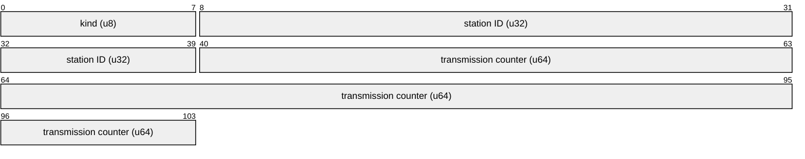
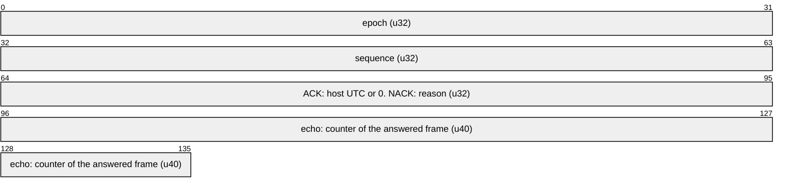
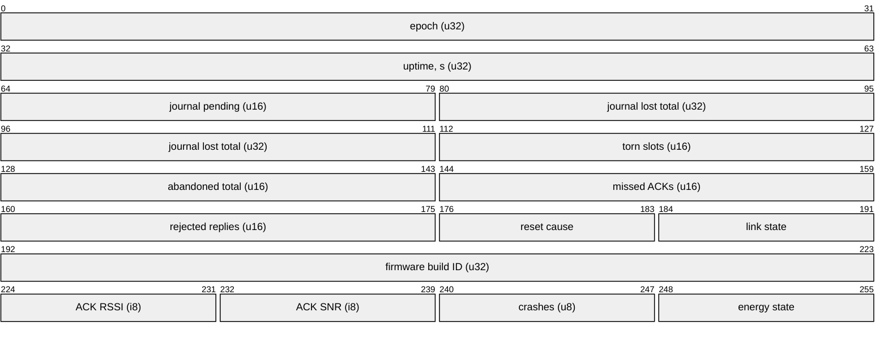
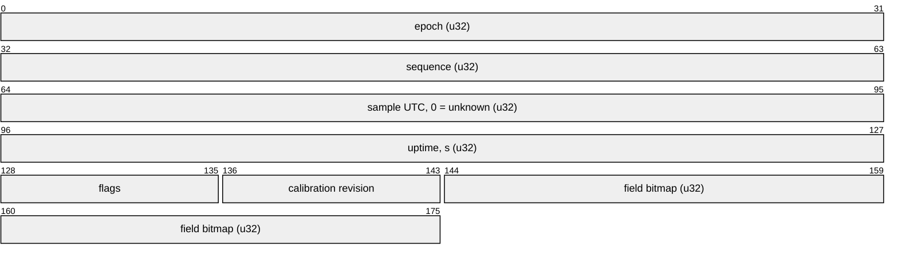

# Wire protocol: design rationale

This document tells why the wire protocol has its current form. The normative specification is
[`protocol.md`](protocol.md). It has every byte layout and rule. If the code and this text
disagree, the code and `protocol.md` are correct.

The protocol version is 5. The design was implemented on `master` in these commits:
- `6f52a51`: the field catalog
- `0d5ebc2`: the envelope
- `5dbe2d9`: gateway decoding
- `51ae971`: the node encoder and journal
- `a4f1d08`: the 32-byte health report
- `dd49609`: replay and key reuse told apart
- `bc5e6ed`: Home Assistant discovery per field

Release `bc5e6ede429c` put it on both boards on 2026-10-14, with a new key
([`RELEASES.md`](../firmware/stage0-node/RELEASES.md)).

Four parallel reviews checked the design: security, encoding, implementation fit, and
requirements and simplicity. The project owner then made these decisions:
- Introduce this format **before** the 24-hour delivery test (H01, [`H01-checklist.md`](H01-checklist.md)).
- Use an **8-byte** CCM tag.
- Use a **compact 8-byte header**.
- Align the fields to whole bytes. Bit packing saved no airtime, because LoRa sends whole symbol
  blocks.
- Put the battery and solar telemetry **inside the observation**, not in a separate frame kind.
- Keep **no backward compatibility**. All boards are reflashed together.

H01 runs on this format. When H01 passes, the product requirements document (PRD) freezes the
identity, time and quality contract (PRD section 12).

## 1. Goals

1. One frame per minute carries everything that the full proof-of-concept station measures. Later,
   it also carries the PRD's Core measurement set (requirement R01), with room to spare.
2. The fixed overhead is small. The previous format (protocol version 4) spent 32 of its 56 bytes
   on the header and the tag, on every frame, ACKs included.
3. Each value has a time, a unit and a validity (requirement R10). One dead sensor never hides the
   others.
4. The identity, time and quality contract is correct now, because H01 freezes it.
5. The security properties of the previous format stay. The one deliberate weakening is the
   forgery bound of the shorter tag (section 3.3).

## 2. Sizes and airtime

The radio uses LoRa at 500 kHz, coding rate 4/5, an 8-symbol preamble, an explicit header and CRC
on (`protocol-stack.md` section 8.2). Airtime increases in steps: about every 3–4 bytes at
spreading factor 7 (SF7), and every 6 bytes at SF12.

| Frame | Previous format | This format | SF7 | SF12 |
|---|---:|---:|---:|---:|
| Observation, temperature and humidity with the minute summary (the current build) | — | **51 B** | 25.7 ms | 534.5 ms |
| Observation, temperature and humidity only (the first build of this format) | 56 B | 42 B | 21.8 ms | 452.6 ms |
| Observation, PRD Core weather set | — | 56 B | 26.9 ms | 575.5 ms |
| Observation, full proof-of-concept station (weather, battery and enclosure, section 5.5) | — | 78 B | 34.6 ms | 698.4 ms |
| ACK and NACK | 56 B | **33 B** | 18.0 ms | 411.6 ms |
| Health report | 56 B | 48 B | 24.4 ms | 493.6 ms |

At SF12, one exchange of the full station costs 698.4 + 411.6 + 300 ms, about 1.4 s. That is less
than the 2 s airtime cap of the CONSERVE energy state (`radio-energy-policy.md`).

## 3. Envelope

### 3.1 Layout


The header is 8 bytes. The ciphertext follows it, then an 8-byte tag. `protocol.md` section 1 has
the full table.

- The header is the additional authenticated data (AAD) of the CCM mode. Every integer is
  big-endian.
- The receiver drops any version other than 5 silently. It also drops any unassigned kind (0 and
  5–15). A frame of the previous format starts with `0x57` ('W'). It reads as version 5, kind 7,
  so the receiver drops it.
- The previous header was 16 bytes: the magic `WS`, a version byte, a kind byte, a u32 station
  and a u64 counter. A u16 station ID is sufficient for one gateway. A u40 counter lasts more than
  100,000 years (section 3.2). These two changes save 5 bytes. One byte for version and kind, and
  no magic, save 3 more.

### 3.2 Nonce and counter



- **Nonce (13 bytes):** the kind, the station ID as a u32, and the counter as a u64. The code
  builds it **from the integers**. It never copies it from the header bytes. Thus the nonce does
  not depend on how the header packs the values. The construction did not change from the previous
  format.
- **Two counter spaces:**
  - the node's flash counter, for observations and health reports,
  - the gateway's nonce database, for ACKs and NACKs.

  The kind byte keeps the two spaces apart.
- **Counter range: 1 to 2^40 − 1.** Each side enforces it in three places:
  1. The node's allocator `store_next_counter` and the gateway's `Nonces.next` refuse to issue a
     counter at or past 2^40.
  2. The seal routine (`ws_seal_kind` in C, `seal()` in Python) rejects an out-of-range counter
     itself.
  3. Python writes the counter with `to_bytes(5, 'big')`. This call raises on overflow. The code
     never masks the counter.

  **Why all three:** a 5-byte header field truncates silently. Without these checks, a counter at
  or past 2^40 would go on air as a small counter. That is nonce reuse, a total loss of security.
- **Lifetime:** 2^40 frames last more than 100,000 years at 20 frames per minute. A reboot loop
  once a second skips a 256-counter block each time. Even that loop lasts about 136 years.
- **New key at release:** the first release of this format used a **new key and fresh state**: a
  new run directory, a new gateway nonce database, and a WIPE and PROVISION on the node. The CCM
  keystream blocks encode only the nonce length L, not the tag length M. Thus a counter overlap
  across formats under one key would reuse keystream. A new key prevents that at no cost.

### 3.3 Tag length

M = 8 gives a forgery probability of 2^-64 per attempt. RFC 3610 permits M from 4 to 16. NIST SP
800-38C permits 64-bit tags. Its Appendix B relates the tag length to the number of forgery
attempts that an attacker gets.

Here, each attempt is online, and airtime limits the attempts. Continuous jamming at SF7 permits
about 50 attempts per second. 2^64 attempts would take about 10^10 years. The node also listens
only in short ACK windows. Truncated CBC-MAC has no GCM-style attack on short tags.

### 3.4 Length checks

| Kind | Before decryption (silent drop) | After decryption (NACK reason 2 for an observation) |
|---|---|---|
| Observation | 39 to 94 bytes: at least one 1-byte field, at most every catalog field | The exact length that the field bitmap gives (section 5.4) |
| Health report | 48 bytes | — |
| ACK and NACK | 33 bytes | — |

The gateway never answers a frame that fails before authentication. The check before decryption
permits any catalog length, not only the length of the current build. The gateway and the RX
filter thus need no build configuration.

### 3.5 RX bridge

The bridge holds no key. It forwards upstream:
- frames whose first byte is `0x51` (observation) with a length in the observation range,
- frames whose first byte is `0x54` (health report) with a length of 48.

It accepts downstream exactly 33 bytes with a first byte of `0x52` or `0x53`. The filter is in
`ws_console.c` (`ws_air_frame_ok`, `ws_host_reply_ok`). Thus host tests and the `console` fuzz
target cover it.

### 3.6 What an eavesdropper sees

An eavesdropper sees the kind, the station ID, the counter, the frame length and the timing. A
reading never changes which fields are present (section 5.1). Thus the length does not show sensor
faults. The kind byte tells a NACK from an ACK. The previous format also showed this.

## 4. Fixed plaintexts

The ACK and the NACK share one 17-byte plaintext. A u32 holds the host UTC (ACK) or the reason
(NACK). A u40 echo holds the counter of the answered observation frame. The echo has the width of
the header counter, so it holds any counter.



- **ACK (kind 2):** the UTC is 0 when the gateway measured its own clock as wrong.
- **NACK (kind 3):** reason 1 is an identity collision, reason 2 an invalid record. The node stops
  its retries of that record and counts it as `abandoned`.

The node's reply API is `ws_open_reply(…, uint32_t *epoch, uint32_t *seq, uint32_t *word,
uint64_t *echo)`. `word` is the UTC or the reason.

**Health report (kind 4), 32 bytes.** The node sends it every 15 minutes and at each link-state
change. The previous report had 24 bytes. This one adds four fields that an operator needs to
diagnose a node remotely:
- the **firmware build ID**: the first 4 bytes of the release commit hash,
- the **RSSI and SNR of the last ACK**, as the node heard it. The RX board reports the uplink
  signal. These fields report the downlink, which can be different.
- the **crash record count** (`fault.c`, RTC backup register DR11, saturating),
- the **energy state** (section 5.2).



The 16-bit counts saturate at `0xFFFF`. −128 in the RSSI or SNR field means "no ACK yet".
`protocol.md` section 4 has the codes.

## 5. Observation (kind 1)

### 5.1 Layout



The present fields follow the 22-byte header, in increasing bit order. The flags byte has bit 0
"time known" (it must equal UTC ≠ 0) and bits 1–2 the energy state at sampling (section 5.2). Bits
3–7 are zero. `protocol.md` section 5.1 has the full table.

**Presence rule:**
- Only the build configuration decides which fields are present. A later build can add a fixed
  schedule keyed on the sequence number. For example, it can send the power fields with every 5th
  sequence.
- A reading never changes which fields are present. The node sends a faulted field with its
  INVALID code and never leaves it out. "Absent" means "not sent in this record by design".
- The gateway rejects a bitmap of 0.

**Every observation covers exactly one minute**, in every energy state:
- **NORMAL and SURPLUS:** the node transmits each minute's record and drains the backlog.
- **CONSERVE:** the node journals every minute. It transmits only the latest record, every 300 s.
- **CRITICAL:** the node journals and does not transmit.

The energy-state bits record the **reporting mode** (requirement R02: the published reporting
interval). The gateway takes the current mode from the newest record by identity order. It does
not take it from backfilled records.

### 5.2 Energy-state codes

The codes are the firmware's `energy_t` numbering, which `ws_link_may_send` also uses:

| Code | State |
|---:|---|
| 0 | SURPLUS |
| 1 | NORMAL |
| 2 | CONSERVE |
| 3 | CRITICAL |

The bench prototype runs on USB power. It always sends 1 (NORMAL).

### 5.3 Field catalog, version 1

**Encoding rules for every field:**
- The code is `round_half_up((x − min) / step)`. The firmware computes it in integer arithmetic
  from the sensor's raw counts where possible. Thus C and Python cannot disagree on half-way values.
- The **all-ones code is INVALID**. It means no sample, a sensor fault, or a value out of range.
- **A reading out of range becomes INVALID. It is never clamped.** The only exception is relative
  humidity, which is clamped to 0–100 %. This follows Sensirion practice.
- The gateway rejects codes above the field's maximum, except the field's special codes.
- **Decoding is exact:** `(code − offset_code) / scale`, with an integer offset in code units.
  Every code makes the round trip unchanged. Thus no floating-point noise reaches the stored JSON.
- **Counters** (`rain_tips` and the energy and charge counters) count **since boot**. Each starts
  at 0 when its epoch starts.
  - The gateway totals them across epochs: the sum of the last value of each epoch.
  - Within one epoch, a counter must not decrease **in sequence order**. The gateway compares each
    record with its stored neighbours by sequence, never by arrival order. Thus backfill is safe. A
    decrease gives NACK reason 2.
  - Rain tips are not yet durable per tip across a power cut. The PRD's rain acceptance test (H06)
    needs this later firmware change. Until then, a power cut can lose the tips counted after the
    last journaled minute (up to about 59 s of tips).

The "First build" column names the hardware that first carries each field. "Bench prototype" is
the current USB-powered build. "Full station" is the full proof-of-concept station.

| *i* | Field | Bytes | Unit and step | Range (codes) | Special codes | First build |
|---:|---|---:|---|---|---|---|
| 0 | `temperature_c` | 2 | 0.01 °C, offset −40.00 | −40.00 to 125.00 (0–16500) | 0xFFFF INVALID | **bench prototype** (SHT45) |
| 1 | `humidity_pct` | 2 | 0.01 % | 0 to 100.00 (0–10000) | 0xFFFF INVALID | **bench prototype** (SHT45) |
| 2 | `pressure_hpa` | 2 | 0.1 hPa, offset 300.0 | 300.0 to 1100.0 (0–8000) | 0xFFFF INVALID | full station (BMP581) |
| 3 | `wind_speed_ms` | 2 | 0.1 m/s | 0 to 75.0: scalar mean over the minute | 0xFFFF INVALID | full station (SEN-15901) |
| 4 | `wind_gust_ms` | 2 | 0.1 m/s | 0 to 75.0: highest rolling 3-s mean in the minute | 0xFFFF INVALID | full station |
| 5 | `wind_dir_deg` | 2 | 1° | 0 to 359: unit-vector mean, wraps modulo 360 | 0xFFFE CALM (mean speed < 0.5 m/s). 0xFFFF INVALID, also required whenever the speed is INVALID. | full station |
| 6 | `rain_tips` | 3 | tips since boot | 0 to 16,777,214 | 0xFFFFFF INVALID | full station (0.2794 mm per tip, set in the gateway configuration) |
| 7 | `uv_index` | 1 | 0.1 UVI | 0 to 25.0 (0–250) | 0xFF INVALID | Only from a sensor qualified for UV index (PRD test H07) |
| 8 | `irradiance_wm2` | 2 | 1 W/m² | 0 to 2000 | 0xFFFF INVALID | optional module |
| 9 | `uva_raw` | 3 | sensor counts (gain and integration time fixed per build, set in the gateway configuration) | 0 to 2^20 − 1 | 0xFFFFFF INVALID | full station (LTR390). **Never reported as UV index** (PRD section 9, test H07) |
| 10 | `qualifiers` | 4 | 2 bits per field 0–15: 0 ok, 1 suspected icing, 2 delayed melt, 3 outside the qualified envelope | — | none (never INVALID) | the complete unheated sensing stage (Stage 3 of the plan, requirement R10) |
| 11 | `batt_mv` | 2 | 1 mV | 0 to 65534 | 0xFFFF INVALID | full station (INA228) |
| 12 | `batt_current_ma` | 2 | 0.1 mA, offset binary (`code = I + 32768`), **positive = into the cells**, mean over the minute | −3276.8 to +3276.6 mA | 0xFFFF INVALID | full station (INA228) |
| 13 | `energy_in_mwh` | 3 | mWh since boot. The firmware integrates **signed** V × I, because the INA228 ENERGY register is unsigned. | 0 to 16,777,214 | 0xFFFFFF INVALID | full station |
| 14 | `energy_out_mwh` | 3 | as above, discharge | as above | 0xFFFFFF INVALID | full station |
| 15 | `charge_in_mah` | 3 | mAh since boot | as above | 0xFFFFFF INVALID | full station |
| 16 | `charge_out_mah` | 3 | mAh since boot | as above | 0xFFFFFF INVALID | full station |
| 17 | `soc_gauge_pct` | 1 | 1 %, **fuel-gauge estimate** (MAX17048 voltage model, not a calibrated state of charge, PRD section 5) | 0 to 100 | 0xFF INVALID | full station |
| 18 | `charger_pins` | 1 | raw bq24074 pins: bit 0 PGOOD (input power good), bit 1 CHG (charging), bits 2–7 zero | 0 to 3 | 0xFF INVALID | full station |
| 19 | `enclosure_temp_c` | 2 | as `temperature_c` | as field 0 | 0xFFFF INVALID | full station (SHTC3) |
| 20 | `enclosure_rh_pct` | 2 | as `humidity_pct` | as field 1 | 0xFFFF INVALID | full station (SHTC3) |
| 21–24 | `temperature_min_c`, `temperature_max_c`, `humidity_min_pct`, `humidity_max_pct` | 2 each | as fields 0 and 1: extrema of the minute's valid 15-s samples | as fields 0 and 1 | 0xFFFF INVALID | **bench prototype** |
| 25 | `th_samples` | 1 | count of valid samples behind fields 0, 1 and 21–24 (metadata) | 0 to 60 | 0xFF INVALID | **bench prototype** |
| 26–31 | reserved | — | — | must be zero | — | — |

The node samples temperature and humidity every 15 s. Fields 0 and 1 carry the mean of the
minute's valid samples. Fields 21–24 carry their extrema. Field 25 tells how many samples were
valid (PRD section 9: coverage and extrema). The calibration revision maps to the sampling
description in the gateway configuration.

### 5.4 One valid encoding per reading

The gateway rejects an authenticated observation with NACK reason 2 if it:
- has a length other than 22 + the sum of the widths of the present fields,
- has a reserved flag bit or reserved bitmap bit (26–31) that is not zero, or a bitmap of 0,
- has a code above its field's maximum that is not one of that field's special codes,
- has a `wind_dir_deg` that is not INVALID while `wind_speed_ms` is INVALID,
- has time known ≠ (UTC ≠ 0),
- has a counter that decreases in sequence order within its epoch (section 5.3).

The identity and time checks also apply. An identity collision gives NACK reason 1. A sample more
than 5 s ahead of its receipt is quarantined.

The gateway and the node share one catalog and ship together. Thus an unknown bit is a bug, not a
newer node.

### 5.5 Builds

The node's configuration header (`firmware/stage0-node/App/node_fields.h`) names the build's
fields with one constant:

```c
#define WS_NODE_FIELDS (WS_F_TEMPERATURE_C | WS_F_HUMIDITY_PCT | WS_F_TH_SUMMARY)
```

`WS_OBS_PLAIN_MAX` = 22 + the sum of the widths of those fields.

The journal stores `WS_OBS_PLAIN_MAX` bytes per slot, plus the commit word and the ACK word:
`SLOT_BYTES = roundup8(WS_OBS_PLAIN_MAX) + 16`. When the node reads a record back, it takes the
record's length from the record's own bitmap.

| Build | Plaintext | Frame | Slot | Records (69 of 70 pages) | Outage buffer |
|---|---:|---:|---:|---:|---:|
| Bench prototype (temperature and humidity with the minute summary) | 35 B | 51 B | 56 B | 2,484 | 41.4 h |
| Full station (fields 0–6, 9, 11–20) | 62 B | 78 B | 80 B | 1,725 | 28.8 h |
| Every catalog field | 78 B | 94 B | 96 B | 1,449 | 24.2 h |

One journal page is always being recycled, so the counts use 69 of the 70 pages. A compile-time
check in `node_store.c` keeps the 24-hour floor for every catalog field. The proof of concept
accepts this buffer. The 30-day buffer comes with an external SPI NOR
flash journal (PRD test H11).

The journal page magic is `"WSJ"` + the slot size in its low byte. A build with another field set
has another slot size. Thus the node ignores and recycles pages from a build with a different
layout.

### 5.6 Calibration revision

Each station has one revision. It starts at 0 and only increases (it never wraps). It names a
calibration and sampling set in the gateway configuration. The node applies the calibration. The
design says that the gateway accepts any revision up to the highest one configured. The gateway
does not check this yet: it accepts any revision from 0 to 255. The current build sends 0.

### 5.7 Gateway record

The stored JSON has `version: 5`, `station`, `session`, `sequence`, `sampled_at`, `uptime_s`,
`time_quality`, `energy_state` (`surplus`, `normal`, `conserve` or `critical`),
`calibration_revision`, `quality`, and each present field:
- An INVALID field is `null`.
- A CALM direction is `null`, with `wind_calm: true`. `wind_calm` is present, true or false,
  whenever `wind_dir_deg` is present.
- The qualifiers become a `qualifiers` object that holds only the fields that are not ok.

**Quality is per field.** The record-level `quality` is only a convenience:
- `valid`: every present field is valid. CALM counts as valid.
- `partial`: some present fields are INVALID.
- `sensor_fault`: all present fields are INVALID.

`/v1/observations/latest` and MQTT decide availability per field. Thus a dead UV sensor never hides
the temperature. **H01 scores the validity of the temperature and humidity fields.**

`gateway.validate` takes its rules from the catalog. Units and CSV columns also come from the
catalog. The code for the older record versions and their table migrations is deleted, because the
project keeps no backward compatibility.

## 6. Where the design lives in the code

- **One hand-written table per side.** Tests cross-check the two tables. No tool generates them
  from a shared file.
  - C, `firmware/common/ws_obs.{c,h}`: the catalog widths, maxima and INVALID codes, and the
    encoder.
  - Python, `ws0/fields.py`: the same table, the unit and Home Assistant metadata, and the decoder.
- **Cross-check tests.** `tests/test_obs.py` checks the observation:
  - The C encoder and the Python decoder agree on random readings for every field and bitmap
    subset, including INVALID, CALM and the range edges.
  - Every code decodes and encodes again exactly.
  - The gateway rejects every non-canonical form in section 5.4.

  `tests/test_frame.py` checks the envelope, the replies and the health report byte for byte.
- **Known-answer vectors.** C and Python share an encoding vector without encryption (temperature
  −12.34 °C, humidity 45.67 %). The node's boot self-test also has an encryption vector with
  M = 8.
- **Fuzzing** (`firmware/fuzz/`): `fuzz_reply` has 33-byte ACK and NACK vectors. `fuzz_console`
  covers `ws_air_frame_ok`. `fuzz_obs` covers the encoder. `fuzz_provision` covers the PROVISION
  parser. A seeded random-bytes test checks the Python decoder
  (`test_whatever_decodes_reencodes_byte_for_byte` in `tests/test_obs.py`).
- **Node:** `ws_frame.{c,h}` (envelope), `ws_obs.{c,h}` (encoder), `node_store.c` (journal slot
  size, page magic, counter limit), `stage0.c` (PROVISION accepts station 1–65535 only).
- **Gateway:** `ws0/protocol.py` (envelope, replies, health report, observation decoder),
  `gateway.py` (catalog-driven `validate`, availability per field, the counter rule),
  `ws0/service.py` (station limit, Home Assistant discovery per field, units and CSV).
- **Replay and key reuse:** the gateway keeps a digest of each node frame, by counter
  (counter → SHA-256 of the frame). A repeat with identical bytes is a replay. The gateway counts
  it and raises no alarm. A repeat with different bytes is real nonce reuse. The gateway raises the
  key-reuse alarm. The previous format raised the alarm for a plain replay too.

## 7. Release procedure for a format change

1. WIPE the node.
2. Flash the RX board and the TX board.
3. `init` a new run directory.
4. Run `provision-node` with the new key.
5. Start the gateway.

Record the release in `RELEASES.md` and the image size in `firmware-budget.md`.

## 8. Not in this design

- Drivers for fields other than temperature and humidity. The catalog is fixed now. Each sensor's
  driver comes with its hardware.
- Rain tips that are durable per tip (test H06), the qualifier logic (requirement R10 detection),
  and calibration sets other than revision 0.
- Delta or cross-record compression. Each record must stand alone, because any record can be lost
  or arrive out of order.
