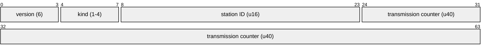
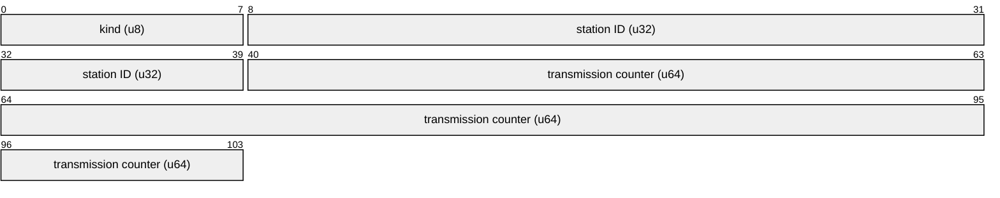
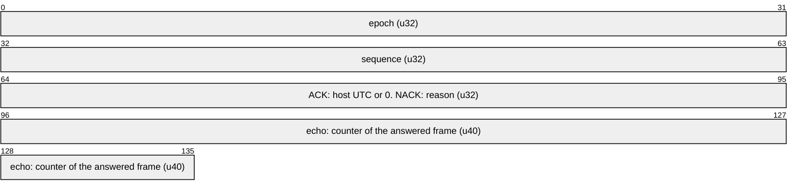
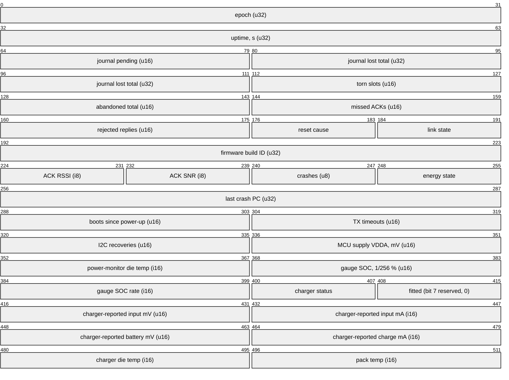
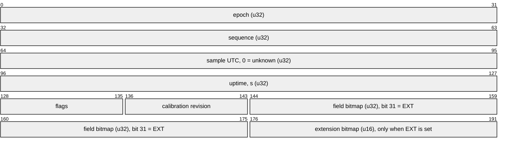

# Wire protocol: design rationale

This document tells why the wire protocol has its current form. The normative specification is
[`protocol.md`](protocol.md). It has every byte layout and rule. If the code and this text
disagree, the code and `protocol.md` are correct.

The protocol version is **6**. Version 6 is version 5 with observation catalog version 2 and the
64-byte health report, from the power telemetry design
([`2026-10-29-power-telemetry-design.md`](superpowers/specs/2026-10-29-power-telemetry-design.md),
"the power design" below; its section 4 has the reasons for the bump). The envelope, the nonce, the
counters, the tag and the ACK/NACK plaintext did not change. Version 5 was implemented on `master`
in these commits:
- `6f52a51`: the field catalog
- `0d5ebc2`: the envelope
- `5dbe2d9`: gateway decoding
- `51ae971`: the node encoder and journal
- `a4f1d08`: the 32-byte health report
- `dd49609`: replay and key reuse told apart
- `bc5e6ed`: Home Assistant discovery per field

Release `bc5e6ede429c` put version 5 on both boards on 2026-10-14, with a new key
([`RELEASES.md`](../firmware/stage0-node/RELEASES.md)). Version 6 ships by the release procedure of
section 7, with a new key and a new run directory; `RELEASES.md` records its release.

Four parallel reviews checked the design: security, encoding, implementation fit, and
requirements and simplicity. The project owner then made these decisions:
- Introduce this format **before** the 24-hour delivery test (H01, [`H01-checklist.md`](H01-checklist.md)).
- Use an **8-byte** CCM tag.
- Use a **compact 8-byte header**.
- Align the fields to whole bytes. Bit packing saved no airtime, because LoRa sends whole symbol
  blocks.
- Put the battery and solar telemetry **inside the observation**, not in a separate frame kind.
  Version 6 keeps that rule for the fast power values (voltages and currents every minute) and puts
  the slow ones (every 15 minutes) in the health report (power design decision, 2026-10-29).
- Keep **no backward compatibility**. All boards are reflashed together.

H01 runs on this format. When H01 passes, the product requirements document (PRD) freezes the
identity, time and quality contract (PRD section 12).

## 1. Goals

1. One frame per minute carries everything that the full proof-of-concept station measures. Later,
   it also carries the PRD's Core measurement set (requirement R01), with room to spare.
2. The fixed overhead is small. The previous format (protocol version 4) spent 32 of its 56 bytes
   on the header and the tag, on every frame, ACKs included.
3. Each value has a time, a unit and a validity (requirement R10). One dead sensor never hides the
   others.
4. The identity, time and quality contract is correct now, because H01 freezes it.
5. The security properties of the previous format stay. The one deliberate weakening is the
   forgery bound of the shorter tag (section 3.3).

## 2. Sizes and airtime

The radio uses LoRa at 500 kHz, coding rate 4/5, an 8-symbol preamble, an explicit header and CRC
on (`protocol-stack.md` section 8.2). Airtime increases in steps: about every 3–4 bytes at
spreading factor 7 (SF7), and every 6 bytes at SF12.

| Frame | Previous format | This format | SF7 | SF12 |
|---|---:|---:|---:|---:|
| Observation, phase A power set with every module in the layout (the current hardware) | — | **81 B** | 35.9 ms | 739.3 ms |
| Observation, phase B (every rail, with the extension word) | — | 93 B | 41.0 ms | 821.2 ms |
| Observation, the node's field set `WS_F_WSMP_BENCH` (the widest record of the current build, `OBS_FRAME_MAX`) | — | **93 B** | 41.0 ms | 821.2 ms |
| Observation, **per-build ceiling** (the journal rule, section 5.5) | — | 96 B | 41.0 ms | 821.2 ms |
| Observation, every catalog version 2 field (accepted only by the RX bridge and the gateway; never a build) | — | 110 B | 46.1 ms | 944.1 ms |
| Observation, the version 5 bench build (for comparison) | — | 77 B | 34.6 ms | 698.4 ms |
| Observation, temperature and humidity with the minute summary (the previous bench build) | — | 51 B | 25.7 ms | 534.5 ms |
| Observation, temperature and humidity only (the first build of this format) | 56 B | 42 B | 21.8 ms | 452.6 ms |
| Observation, PRD Core weather set | — | 56 B | 26.9 ms | 575.5 ms |
| ACK and NACK | 56 B | **33 B** | 18.0 ms | 411.6 ms |
| Health report, version 6 (64-byte plaintext) | 56 B | **80 B** | 35.9 ms | 739.3 ms |
| Health report, version 5 (for comparison) | — | 48 B | 24.4 ms | 493.6 ms |

Airtimes use the firmware's formula (`ws_lora_airtime_ms`, `firmware/common/ws_policy.c:43-56`).
The phase A record is the version 5 bench set (61 B of plaintext) less the retired fields 17 and 18
(2 B) plus fields 12, 26 and 28 (6 B): 65 B. Section 5.3 names the fields of each phase.

**One exchange** is the observation airtime + the ACK airtime + 300 ms, with the build's widest
observation (`exchange_ms`, `firmware/stage0-node/App/tx_policy.c:43-45`). At SF7 it is
41.0 + 18.0 + 300 = 359 ms (13 exchanges in NORMAL's 5 s). At SF12 it is
821.2 + 411.6 + 300 = **1,532.8 ms**: NORMAL allows 3 exchanges a minute, and the live exchange
alone fits the 2 s cap of the CONSERVE energy state (`radio-energy-policy.md`).

**The health reserve saturates.** In a minute whose health report is due, the backlog allowance
first reserves the health frame's airtime from the energy state's cap (`ws_minute_backlog`,
`firmware/common/ws_policy.c:88-99`):

```
by_airtime = cap_ms > reserve_ms ? (cap_ms - reserve_ms) / exchange_ms : 0
backlog    = by_airtime > 1 ? min(backlog, by_airtime - 1) : 0     (never below 0)
```

The live reading and a due health report always go. The earlier form, `backlog = by_airtime - 1`,
wrapped when `by_airtime` was 0 (unsigned); this form cannot. At SF7 nothing changes. At SF12
NORMAL allows 2 exchanges in a health minute. In CONSERVE at SF12 the live exchange plus the health
report is 2,272 ms (2,274 ms with the firmware's whole-millisecond rounding: 1,534 + 740), over the
2 s cap **once per health report**: every 15 minutes, plus once after each link-state change.
CONSERVE sends only every 5th minute, so its average stays far below the cap. That is a documented
exception (power design risk R3). The energy state is NORMAL in this phase.

## 3. Envelope

### 3.1 Layout



The header is 8 bytes. The ciphertext follows it, then an 8-byte tag. `protocol.md` section 1 has
the full table.

- The header is the additional authenticated data (AAD) of the CCM mode. Every integer is
  big-endian.
- The receiver drops any version other than 6 silently. It also drops any unassigned kind (0 and
  5–15). Byte 0 is `0x61` to `0x64`. A version 5 frame (`0x51` to `0x54`) reads as another version,
  so a version 6 receiver drops it, and a version 5 receiver drops a version 6 frame. A frame of
  the format before version 5 starts with `0x57` ('W'). It reads as version 5, kind 7, and is
  dropped too.
- **Why version 6 is a bump** (power design section 4). Under version 5 a gateway that was not
  updated would NACK the new bitmap bits (reason 2, `fields.decode`), and the node would abandon
  those records: a permanent loss. An RX bridge that was not updated would drop the longer health
  report silently. With version 6 a mismatched end drops the frames as another version, so the
  records stay in the journal until both ends match. No new frame kind was added.
- The previous header was 16 bytes: the magic `WS`, a version byte, a kind byte, a u32 station
  and a u64 counter. A u16 station ID is sufficient for one gateway. A u40 counter lasts more than
  100,000 years (section 3.2). These two changes save 5 bytes. One byte for version and kind, and
  no magic, save 3 more.

### 3.2 Nonce and counter



- **Nonce (13 bytes):** the kind, the station ID as a u32, and the counter as a u64. The code
  builds it **from the integers**. It never copies it from the header bytes. Thus the nonce does
  not depend on how the header packs the values. The construction did not change from the previous
  format.
- **Two counter spaces:**
  - the node's flash counter, for observations and health reports,
  - the gateway's nonce database, for ACKs and NACKs.

  The kind byte keeps the two spaces apart.
- **Counter range: 1 to 2^40 − 1.** Each side enforces it in three places:
  1. The node's allocator `store_next_counter` and the gateway's `Nonces.next` refuse to issue a
     counter at or past 2^40.
  2. The seal routine (`ws_seal_kind` in C, `seal()` in Python) rejects an out-of-range counter
     itself.
  3. Python writes the counter with `to_bytes(5, 'big')`. This call raises on overflow. The code
     never masks the counter.

  **Why all three:** a 5-byte header field truncates silently. Without these checks, a counter at
  or past 2^40 would go on air as a small counter. That is nonce reuse, a total loss of security.
- **Lifetime:** 2^40 frames last more than 100,000 years at 20 frames per minute. A reboot loop
  once a second skips a 256-counter block each time. Even that loop lasts about 136 years.
- **New key at release:** the first release of this format used a **new key and fresh state**: a
  new run directory, a new gateway nonce database, and a WIPE and PROVISION on the node. Every
  later format change does the same (section 7), so version 6 gets its own key. The CCM
  keystream blocks encode only the nonce length L, not the tag length M. Thus a counter overlap
  across formats under one key would reuse keystream. A new key prevents that at no cost.

### 3.3 Tag length

M = 8 gives a forgery probability of 2^-64 per attempt. RFC 3610 permits M from 4 to 16. NIST SP
800-38C permits 64-bit tags. Its Appendix B relates the tag length to the number of forgery
attempts that an attacker gets.

Here, each attempt is online, and airtime limits the attempts. Continuous jamming at SF7 permits
about 50 attempts per second. 2^64 attempts would take about 10^10 years. The node also listens
only in short ACK windows. Truncated CBC-MAC has no GCM-style attack on short tags.

### 3.4 Length checks

| Kind | Before decryption (silent drop) | After decryption (NACK reason 2 for an observation) |
|---|---|---|
| Observation | 39 to 110 bytes: at least one 1-byte field, at most every catalog version 2 field with the extension word | The exact length that the field bitmap and the extension bitmap give (section 5.4) |
| Health report | 80 bytes | — |
| ACK and NACK | 33 bytes | — |

The gateway never answers a frame that fails before authentication. The check before decryption
permits any catalog length, not only the length of the current build. The gateway and the RX
filter thus need no build configuration. The 110-byte bound is accepted only by the RX bridge and
the gateway (`WS_OBS_PLAIN_ALL`, `firmware/common/ws_obs.h:111`; `PLAIN_LENGTHS`,
`ws0/protocol.py:255-256`). No node build sends it: a node build's ceiling is a 96-byte frame
(section 5.5).

### 3.5 RX bridge

The bridge holds no key. It forwards upstream:
- frames whose first byte is `0x61` (observation) with a length in the observation range, 39 to
  110 bytes,
- frames whose first byte is `0x64` (health report) with a length of 80.

It accepts downstream exactly 33 bytes with a first byte of `0x62` or `0x63`. The filter is in
`ws_console.c` (`ws_air_frame_ok`, `firmware/common/ws_console.c:77-83`; `ws_host_reply_ok`).
Thus host tests and the `console` fuzz target cover it. A bridge of another version drops every
frame of this one, which is why both boards are flashed from the same release (section 7).

### 3.6 What an eavesdropper sees

An eavesdropper sees the kind, the station ID, the counter, the frame length and the timing. A
sensor fault never changes which fields are present (section 5.1). Thus the length does not show
sensor faults. The length does show which modules are in the layout and which power phase the
build has (section 5.3, "Power telemetry"). The health report has a fixed length, so its length
shows nothing. The kind byte tells a NACK from an ACK. The previous format also showed this.

## 4. Fixed plaintexts

The ACK and the NACK share one 17-byte plaintext. A u32 holds the host UTC (ACK) or the reason
(NACK). A u40 echo holds the counter of the answered observation frame. The echo has the width of
the header counter, so it holds any counter.



- **ACK (kind 2):** the UTC is 0 when the gateway measured its own clock as wrong.
- **NACK (kind 3):** reason 1 is an identity collision, reason 2 an invalid record. The node stops
  its retries of that record and counts it as `abandoned`.

The node's reply API is `ws_open_reply(…, uint32_t *epoch, uint32_t *seq, uint32_t *word,
uint64_t *echo)`. `word` is the UTC or the reason.

**Health report (kind 4), 64 bytes.** The node sends it after boot, every 15 minutes and at each
link-state change, after that minute's exchange. The version 5 report had 32 bytes; it added four
fields to the 24-byte report before it, which an operator needs to diagnose a node remotely:
- the **firmware build ID**: the first 4 bytes of the release commit hash (0 for a build from a
  dirty tree or without a commit hash: "not identified"),
- the **RSSI and SNR of the last ACK**, as the node heard it. The RX board reports the uplink
  signal. These fields report the downlink, which can be different.
- the **crash record count** (`fault.c`, RTC backup register DR11, saturating),
- the **energy state** (section 5.2).

Version 6 keeps those 32 bytes unchanged and adds 32 more (power design section 6.1): the slow
values that change over hours, not minutes, at a 15-minute cadence:
- **station items**: the PC of the last crash, boots since power-up, radio TX timeouts and I2C bus
  recoveries since boot;
- **power items**: the MCU supply (VDDA from VREFINT), the hottest power-monitor die temperature,
  the gauge's state of charge (1/256 %) and its rate, the charger status byte (input power good,
  charging, fault, charge stage, active input), and the charger's own measurements (input voltage
  and current, battery voltage, charge current, die and pack temperature).



The 16-bit counts saturate at `0xFFFF`. −128 in the RSSI or SNR field means "no ACK yet".
`protocol.md` section 4 has the codes, the none codes, the gateway keys and the fill per power
phase.

Why this shape:
- **A fixed length.** Every slot is always on the wire, with a none code (the type's minimum for a
  signed value, all-ones for an unsigned one) when the build or phase has no source or the source
  failed. A fixed length keeps the RX bridge's exact-length check (`ws_console.c:82`) and the
  gateway's `PLAIN_LENGTHS`, and a charger with its own ADC could fill the charger-reported
  slots without a format change. In phase A they are none, except the ISET charge current.
- **Source-agnostic names.** The keys say what is measured (`charger_reported_input_mv`), not which
  chip measures it. The charger-reported keys are named apart from the observation field
  `charger_input_mv` (field 28), a separate measurement, so one name has one meaning everywhere.
- **Canonical rules without a NACK.** A health report is never answered. So the gateway keeps every
  value of a report that breaks a rule: fitted bit 7 set gives a warning; a charger status with
  stage 7 gives a warning and `null` charger keys (`diag_problems`, `ws0/protocol.py:102-108`).
  The node never sends either. Active input 3 is canonical: it means "no input" (amended
  2026-10-29, it was reserved), so a charger that reports its input can say it has none.
- **"Not measured" and "sensor fault" kept apart.** One none code a slot cannot say why a value is
  missing, so byte 51 (the fitted byte, amended 2026-10-29) carries one bit a group of slots: set
  means the build has a source, so a none code is a fault. The gateway turns it into
  `power_not_measured` and `power_sensor_faults`; Home Assistant gets entities only for measured
  keys, as observation entities exist only for fields the record carries.
- **Not WSMP channels.** The slow values reach the report through `mod_power_health()` and the
  station accessors, not through WSMP health-class channels (power design section 8.2). Sub-project 7
  decides whether they become health-class channels on the radio.

**Health reports are not journaled** (power design section 6.4, risk R1). A report goes once, with
no receive window and no retry. An outage therefore loses the slow values of the reports due during
it: the state of charge and its rate, the charger status, the die temperatures, VDDA and the
charger-reported values have gaps for that time. The counters (crashes, boots, TX timeouts, I2C
recoveries, the journal counts) lose nothing for good, because the next report carries their
current totals. Every fast value, including the battery voltage and current and the energy and
charge counters, travels in the journaled observation. The loss is accepted.

## 5. Observation (kind 1)

### 5.1 Layout



The present fields follow the 22-byte header, or the 24 bytes of header and extension word, in
increasing field order. The flags byte has bit 0 "time known" (it must equal UTC ≠ 0) and bits 1–2
the energy state at sampling (section 5.2). Bits 3–7 are zero. `protocol.md` section 5.1 has the
full table.

**The extension word (catalog version 2).** Catalog version 1 used bits 0–25 and reserved 26–31,
so six slots were left, and the rails need seven new fields (26–30, 32, 33). Bit 31 of the bitmap
becomes **EXT**: it is not a field, and when it is set a u16 extension bitmap follows the header,
bit *j* for field 32 + *j* (fields 32–47). The header stays 22 bytes for every record that does not
need the extension, and fields 0–30 keep their bits. A record with field 32 or 33 pays 2 bytes. In
C the field mask is a 64-bit logical mask (`WS_F(i)` is `(uint64_t)1 << i`,
`firmware/common/ws_obs.h:55`), which also removes the undefined shift `WS_F(WS_FI_COUNT)` at 32
fields; `WS_FI_EXT` = 31 is a placeholder of width 0, and `_Static_assert(WS_FI_COUNT <= 48)`
bounds the catalog (`ws_obs.h:53-59`).

**Presence rule:** "absent" means that this build has no source for the field; INVALID means a
fault. The two never mix.
- The build configuration decides which fields a record can carry. On the WSMP bench, the modules
  in the layout decide which of them a record carries (`App/wsmp_catalog_map.c`).
- **Absent = no source in this build**: the field's module is not in the layout, or the build's
  power phase (`WS_POWER_PROFILE`, `App/power_config.h`) does not fit that rail. The WSMP slot
  behind it carries the snapshot quality "not fitted", and the catalog map leaves the field out of
  the bitmap. Absence is a property of the build, never of a part's state.
- **INVALID = a fault**: a fitted source failed, or its reading is out of range (a clipped ADC, a
  current outside −32,768 to +32,766 mA, energy without a battery voltage). A sensor fault never
  changes which fields are present. The node sends a faulted field with its INVALID code and never
  leaves it out.
- **The power modules are always present.** The battery module (fields 11–16) and the rails module
  (fields 26–30, 32, 33) are base-board modules fixed by `WS_POWER_PROFILE`, not pluggable ones
  (power design section 8.5). A station whose INA228 and gauge are both dead sends fields 11–16 as
  INVALID, never absent, and the dashboard says "sensor fault", not "not measured in this build".
- A later build can add a fixed schedule keyed on the sequence number. For example, it can send
  some fields with every 5th sequence.
- The gateway rejects a record with no field.

**Every observation covers exactly one minute**, in every energy state:
- **NORMAL and SURPLUS:** the node transmits each minute's record and drains the backlog.
- **CONSERVE:** the node journals every minute. It transmits only the latest record, every 300 s.
- **CRITICAL:** the node journals and does not transmit.

The energy-state bits record the **reporting mode** (requirement R02: the published reporting
interval). The gateway takes the current mode from the newest record by identity order. It does
not take it from backfilled records.

### 5.2 Energy-state codes

The codes are the firmware's `energy_t` numbering, which `ws_link_may_send` also uses:

| Code | State |
|---:|---|
| 0 | SURPLUS |
| 1 | NORMAL |
| 2 | CONSERVE |
| 3 | CRITICAL |

The energy-state thresholds are deferred (power design section 9.9). The firmware always sends 1
(NORMAL).

### 5.3 Field catalog, version 2

Catalog version 2 ships with protocol version 6 (power design section 5). It keeps every field of
version 1 at its index, corrects the meaning of the battery fields 11 and 13–16, changes the step of
field 12, retires fields 17 and 18, and adds the rail fields 26–30, 32 and 33.

**Encoding rules for every field:**
- The code is `round_half_up((x − min) / step)`. The firmware computes it in integer arithmetic
  from the sensor's raw counts where possible. Thus C and Python cannot disagree on half-way values.
- The **all-ones code is INVALID**. It means no sample, a sensor fault, or a value out of range.
- **A reading out of range becomes INVALID. It is never clamped.** The only exception is relative
  humidity, which is clamped to 0–100 %. This follows Sensirion practice.
- The gateway rejects codes above the field's maximum, except the field's special codes.
- **Decoding is exact:** `(code − offset_code) / scale`, with an integer offset in code units.
  Every code makes the round trip unchanged. Thus no floating-point noise reaches the stored JSON.
- **Counters** (`rain_tips` and the energy and charge counters) count **since boot**. Each starts
  at 0 when its epoch starts.
  - The gateway totals them across epochs: the sum of the last value of each epoch.
  - Within one epoch, a counter must not decrease **in sequence order**. The gateway compares each
    record with its stored neighbours by sequence, never by arrival order. Thus backfill is safe. A
    decrease gives NACK reason 2.
  - Rain tips are not yet durable per tip across a power cut. The PRD's rain acceptance test (H06)
    needs this later firmware change. Until then, a power cut can lose the tips counted after the
    last journaled minute (up to about 59 s of tips).
- **No index is ever reused.** A retired field stays in the catalog: a version 6 gateway still
  decodes it, and a later build may send it again with the same meaning. No catalog name is
  renamed.

The "First build" column names the hardware that first carries each field. "Bench prototype" is
the first USB-powered build, with the SHT45 only. "Full station" is the full proof-of-concept
station. "Phase A" and "phase B" are the power phases of the power design (section "Power
telemetry" below). The current WSMP bench build already carries most "full station" fields from
hobby breakout modules (see below).

| *i* | Field | Bytes | Unit and step | Range (codes) | Special codes | First build |
|---:|---|---:|---|---|---|---|
| 0 | `temperature_c` | 2 | 0.01 °C, offset −40.00 | −40.00 to 125.00 (0–16500) | 0xFFFF INVALID | **bench prototype** (SHT45) |
| 1 | `humidity_pct` | 2 | 0.01 % | 0 to 100.00 (0–10000) | 0xFFFF INVALID | **bench prototype** (SHT45) |
| 2 | `pressure_hpa` | 2 | 0.1 hPa, offset 300.0 | 300.0 to 1100.0 (0–8000) | 0xFFFF INVALID | full station (BMP581) |
| 3 | `wind_speed_ms` | 2 | 0.1 m/s | 0 to 75.0: scalar mean over the minute | 0xFFFF INVALID | full station (SEN-15901) |
| 4 | `wind_gust_ms` | 2 | 0.1 m/s | 0 to 75.0: highest rolling 3-s mean in the minute | 0xFFFF INVALID | full station |
| 5 | `wind_dir_deg` | 2 | 1° | 0 to 359: unit-vector mean, wraps modulo 360 | 0xFFFE CALM (mean speed < 0.5 m/s). 0xFFFF INVALID, also required whenever the speed is INVALID. | full station |
| 6 | `rain_tips` | 3 | tips since boot | 0 to 16,777,214 | 0xFFFFFF INVALID | full station (0.2794 mm per tip, set in the gateway configuration) |
| 7 | `uv_index` | 1 | 0.1 UVI | 0 to 25.0 (0–250) | 0xFF INVALID | Only from a sensor qualified for UV index (PRD test H07) |
| 8 | `irradiance_wm2` | 2 | 1 W/m² | 0 to 2000 | 0xFFFF INVALID | optional module |
| 9 | `uva_raw` | 3 | sensor counts (gain and integration time fixed per build, set in the gateway configuration) | 0 to 2^20 − 1 | 0xFFFFFF INVALID | full station (LTR390). **Never reported as UV index** (PRD section 9, test H07) |
| 10 | `qualifiers` | 4 | 2 bits per field 0–15: 0 ok, 1 suspected icing, 2 delayed melt, 3 outside the qualified envelope | — | none (never INVALID) | the complete unheated sensing stage (Stage 3 of the plan, requirement R10) |
| 11 | `batt_mv` | 2 | 1 mV: battery terminal (cell) voltage, mean over the minute | 0 to 65,534 | 0xFFFF INVALID | phase A (MAX17048 on the cell) |
| 12 | `batt_current_ma` | 2 | 1 mA, offset binary (`code = I + 32768`), **+ = into the cell**, mean over the minute | −32,768 to +32,766 mA (0–65,534) | 0xFFFF INVALID | phase A (battery INA228) |
| 13 | `energy_in_mwh` | 3 | mWh since boot: Σ ΔQ × battery voltage over the steps with a positive battery current | 0 to 16,777,214 | 0xFFFFFF INVALID, also in any minute with a step that had no fresh battery voltage | phase A |
| 14 | `energy_out_mwh` | 3 | as 13, negative steps (discharge) | as above | as 13 | phase A |
| 15 | `charge_in_mah` | 3 | mAh since boot, into the cell | as above | 0xFFFFFF INVALID | phase A |
| 16 | `charge_out_mah` | 3 | mAh since boot, out of the cell | as above | 0xFFFFFF INVALID | phase A |
| 17 | `soc_gauge_pct` | 1 | 1 %, fuel-gauge estimate | 0 to 100 | 0xFF INVALID | **retired** in catalog version 2: the health report carries SOC at 1/256 % and its rate |
| 18 | `charger_pins` | 1 | raw bq24074 pins: bit 0 PGOOD, bit 1 CHG, bits 2–7 zero | 0 to 3 | 0xFF INVALID | **retired** in catalog version 2: the health report carries the source-agnostic charger status |
| 19 | `enclosure_temp_c` | 2 | as `temperature_c` | as field 0 | 0xFFFF INVALID | full station (SHTC3) |
| 20 | `enclosure_rh_pct` | 2 | as `humidity_pct` | as field 1 | 0xFFFF INVALID | full station (SHTC3) |
| 21–24 | `temperature_min_c`, `temperature_max_c`, `humidity_min_pct`, `humidity_max_pct` | 2 each | as fields 0 and 1: extrema of the minute's valid 15-s samples | as fields 0 and 1 | 0xFFFF INVALID | **bench prototype** (the WSMP bench does not send them) |
| 25 | `th_samples` | 1 | count of valid samples behind fields 0, 1 and 21–24 (metadata) | 0 to 60 | 0xFF INVALID | **bench prototype** |
| 26 | `load_mv` | 2 | 1 mV: load (system rail) voltage, the charger output that supplies the station | 0 to 65,534 | 0xFFFF INVALID | phase A |
| 27 | `load_current_ma` | 2 | 1 mA, offset binary, **+ = into the load** | −32,768 to +32,766 mA | 0xFFFF INVALID | phase B |
| 28 | `charger_input_mv` | 2 | 1 mV: charger input voltage after the sources join, under load; **the source is not identified** | 0 to 65,534 | 0xFFFF INVALID | phase A |
| 29 | `solar_mv` | 2 | 1 mV: solar input voltage, upstream of the join | 0 to 65,534 | 0xFFFF INVALID | phase B |
| 30 | `solar_current_ma` | 2 | 1 mA, offset binary, **+ = into the station** | −32,768 to +32,766 mA | 0xFFFF INVALID | phase B |
| 31 | — | — | **EXT**, not a field (section 5.1) | — | — | — |
| 32 | `usb_mv` | 2 | 1 mV: USB-C input voltage, upstream of the join (extension bit 0) | 0 to 65,534 | 0xFFFF INVALID | phase B |
| 33 | `usb_current_ma` | 2 | 1 mA, offset binary, **+ = into the station** (extension bit 1) | −32,768 to +32,766 mA | 0xFFFF INVALID | phase B |
| 34–47 | reserved | — | — | must be zero | — | — |

The node samples temperature and humidity every 15 s. Fields 0 and 1 carry the mean of the
minute's valid samples. Fields 21–24 carry their extrema. Field 25 tells how many samples were
valid (PRD section 9: coverage and extrema). The calibration revision maps to the sampling
description in the gateway configuration.

The WSMP bench station (`firmware/stage0-node/App/wsmp_catalog_map.c`, from 2026-10-18) fills this
catalog from its local modules. A reading carries the fields of the modules in the layout. It does
not send fields 21–24: WSMP-H8 ([`module-protocol.md`](module-protocol.md)) gives the gateway the
task to derive extremes from the minute means, which the gateway does not do yet. It sends field
12, the battery current, as a mean over the minute from the INA228's CHARGE accumulator (power
design section 9.4).

#### Power telemetry

**Goal.** Measure the voltage and current of four rails: the battery (signed), the solar input, the
USB-C input and the load (the system rail). Every later hardware phase fills the same fields, so no
phase needs a format change (power design section 1). The phases are:

| Phase | Charger | Monitors |
|---|---|---|
| **A** (current) | Adafruit bq24074 (#4755), one VBUS input | battery INA228 at 0x40 (shunt in the battery path, VBUS on its own sense lead to the charger OUT), MAX17048 at 0x36 on the CELL+ node; the MCU reads ISET (PB1), the charger input divider (PA10), CHG (PB10), PGOOD (PB8) and VREFINT |
| **B** (four rails) | bq24074 | phase A plus a load INA228 (0x41, on OUT), a solar INA228 (0x45) and a USB-C INA228 (0x48), each upstream of the point where the sources join |

The pack is a 1S3P Li-ion pack in both phases (three
2,200 mAh cells in parallel, 6,600 mAh, 3.0 to 4.2 V).

**Fields, units, signs and ranges.** Every voltage is 2 bytes at 1 mV (0 to 65,534 mV); every
current is 2 bytes at 1 mA, offset binary, −32,768 to +32,766 mA; both are means over the minute,
with 0xFFFF INVALID. A current outside the range is INVALID: the node uses the codec's own range
check (`ws_obs_code_ok`), never a separate clamp. The encoding is wider than any monitor: an INA228
rail measures ±5.24 A at its 10 µA current step. Field 12 moved from 0.1 mA (±3.27 A) to 1 mA so
that every current has one encoding; it was never sent before, so no stored value changes.

| Rail | Voltage field | Current field | Positive means |
|---|---|---|---|
| Battery | 11 `batt_mv` (the cell) | 12 `batt_current_ma` | current into the cell (charging) |
| Load (system rail, the charger OUT) | 26 `load_mv` | 27 `load_current_ma` | current into the load |
| Charger input, after the sources join | 28 `charger_input_mv` | — | — |
| Solar input, upstream of the join | 29 `solar_mv` | 30 `solar_current_ma` | current into the station |
| USB-C input, upstream of the join | 32 `usb_mv` | 33 `usb_current_ma` | current into the station |

The battery INA228 in phase A has the cell (the CELL+ node) on VIN+ and the charger's BATT socket on VIN−, through the BATT joint (build-progression record P3; the header LIPO pin is only a test point). The part
counts VIN+ → VIN− as positive, which is out of the cell, so the firmware's rail table gives it
sign −1 (`App/power_config.h:101-127`). The version 5 release counted a discharge as charge;
version 6 fixes the sign. The names say what is measured; none names a chip.

**Which source fills each field, per phase** (power design section 3.2). "Absent" = the field is
not in the record; "INVALID" = the source is fitted but failed.

| Field | Phase A | Phase B |
|---|---|---|
| 11 battery voltage | MAX17048 VCELL at the CELL+ node (includes the pack-lead drop; build-progression record M4), mean of the minute's 4 reads | as A |
| 12 battery current | battery INA228 CHARGE delta ÷ the window's time, sign −1 | as A |
| 13–16 battery energy and charge | ΔQ of the battery INA228 × VCELL, split by sign; energy INVALID in a minute where a step had no fresh VCELL | as A |
| 26 load voltage | battery INA228 VBUS (its own sense lead to OUT) | load INA228 VBUS |
| 27 load current | absent | load INA228 |
| 28 charger input voltage | PA10 × the stored divider ratio (`POWER_VIN_DIVIDER_PPM`, 3 nominal); the source is not identified | as A (a cross-check of the source rails) |
| 29 solar voltage | absent | solar INA228 VBUS |
| 30 solar current | absent | solar INA228 |
| 32 USB-C voltage | absent | USB-C INA228 VBUS |
| 33 USB-C current | absent | USB-C INA228 |

- **The battery voltage stays on the gauge in every phase.** The MAX17048 reads the CELL+ node on
  its own sense lead, which carries no load current, with its ground over STEMMA QT; whenever
  current flows that node differs from the cell by the pack-lead drop, I × R_pack (build-progression
  record M4 and P8; the power design's dated note: "Kelvin" is not literal). An INA228 VBUS is referenced to system ground at the charger, so it would include the negative
  lead's drop and would change sensor across a phase change. With no gauge, field 11 is INVALID;
  there is no fallback source.
- **Phase A cannot identify the source.** The bq24074 has one VBUS input, and no monitor sits
  upstream of the point where solar and USB-C join. Field 28 exists for exactly that reason: it
  measures the joined input and says nothing about which source feeds it. The firmware never
  guesses the source (the benchlink dashboard's panel-specific heuristic stays a bench tool).
  Field 28 is measured while the charger draws current, so it is not the source's open-circuit
  voltage either: with the bq24074's EN2 low it can sit at the VIN-DPM threshold (4.35–4.63 V,
  SLUS810) while the charger limits its input current; with EN2 high (phase B) VIN-DPM does not act
  and a weak source is pulled down towards the cell voltage (`hardware/power-metering.md` section
  5.4).
- **Phase B** puts one monitor upstream of the join on each source, so solar and USB-C current are
  told apart.
- **The USB-C rule.** USB-C is for bench work and occasional backup charging only, and is never
  connected at the same time as solar. So at most one source rail carries current. Two source
  rails with current at the same time are a broken operating rule, visible in the data in phases B
  and C; phase A cannot see it. Analysing it is gateway work outside this design.
- **Slow values go to the health report.** The state of charge and its rate, the charger status,
  the die temperatures, VDDA and the charger's own measurements change over hours, so they travel
  every 15 minutes (section 4), not in the observation. That is why fields 17 and 18 retired.

The firmware: the rail table and the profile are in `App/power_config.h`, the acquisition in
`App/power_acq.c`, the two WSMP modules (battery, type 8; rails, type 9) in `App/mod_power.c`, and
the map to the catalog in `App/wsmp_catalog_map.c:8-27, 154-190`.

### 5.4 One valid encoding per reading

The gateway rejects an authenticated observation with NACK reason 2 if it:
- has a length other than 22 + 2 when EXT is set + the sum of the widths of the present fields,
- has a reserved flag bit that is not zero,
- has EXT set with an extension bitmap of 0, or EXT set in a plaintext too short for the
  extension word,
- has an extension bitmap bit for an undefined field (today bits 2–15, fields 34–47),
- has no field: base bits 0–30 all zero and EXT clear (a record whose only fields are extension
  fields, bitmap `0x80000000` with a non-zero extension bitmap, is legal),
- has a code above its field's maximum that is not one of that field's special codes,
- has a `wind_dir_deg` that is not INVALID while `wind_speed_ms` is INVALID,
- has time known ≠ (UTC ≠ 0),
- has a counter that decreases in sequence order within its epoch (section 5.3).

Bits 0–30 of the base bitmap all name defined fields in catalog version 2, so none of them can be
reserved; the reserved fields are 34–47. The identity and time checks also apply. An identity
collision gives NACK reason 1. A sample more than 5 s ahead of its receipt is quarantined.

The gateway and the node share one catalog and ship together. Thus an unknown bit is a bug, not a
newer node.

### 5.5 Builds

The node's configuration header (`firmware/stage0-node/App/node_fields.h:15-29`) names the
build's fields with one constant:

```c
#define WS_NODE_FIELDS WS_F_WSMP_BENCH   /* the fields the WSMP local modules can fill */
```

`WS_OBS_PLAIN_MAX` = 22 + the extension word when a field 32–47 is in the set + the sum of the
widths of those fields. `WS_F_WSMP_BENCH` holds every power field of every phase (fields 0–6, 9,
11–16, 19, 20, 25–30, 32, 33): **77 B**, asserted at compile time (`node_fields.h:29`). Moving
between power phases therefore changes neither the journal slot nor the page magic; a phase A
record is shorter (65 B) but uses the same slot.

The journal stores `WS_OBS_PLAIN_MAX` bytes per slot, plus the commit word and the ACK word:
`SLOT_BYTES = roundup8(WS_OBS_PLAIN_MAX) + 16`. When the node reads a record back, it takes the
record's length from the record's own bitmap and extension word.

**The journal rule: 24 hours of the build's widest record** (power design section 7). The
compile-time check in `node_store.c:71-76` asserts that the ring keeps 24 hours of
`WS_OBS_PLAIN_MAX`, the build's widest record. Version 5 asserted 24 hours of every catalog field
(`WS_OBS_PLAIN_ALL`); catalog version 2 makes that 94 B, a 112 B slot, 18 slots a page and 1,242
records, so the build would fail. A build whose field set exceeds **80 B of plaintext (a 96 B
frame) does not compile**: that is the per-build ceiling. The 110 B bound of every catalog field
exists only so that the RX bridge and the gateway accept any canonical record.

| Field set | Plaintext | Frame | Slot | Slots a page | Records (69 of 70 pages) | Outage buffer |
|---|---:|---:|---:|---:|---:|---:|
| Version 6 node field set (phases A to C, the current build) | 77 B | 93 B | 96 B | 21 | 1,449 | 24.15 h |
| Per-build ceiling | 80 B | 96 B | 96 B | 21 | 1,449 | 24.15 h |
| Version 5 bench build (fields 0–6, 9, 11, 13–20, 25) | 61 B | 77 B | 80 B | 25 | 1,725 | 28.75 h |
| Previous bench build (temperature and humidity with the minute summary) | 35 B | 51 B | 56 B | 36 | 2,484 | 41.4 h |
| Every catalog version 2 field (not a build; does not compile) | 94 B | 110 B | 112 B | 18 | 1,242 | 20.7 h |

One journal page is always being recycled, so the counts use 69 of the 70 pages. The proof of
concept accepts this buffer. The 30-day buffer comes with an external SPI NOR flash journal (PRD
test H11); more pages or SPI NOR is also the answer for a field set above the ceiling (power design
risk R6).

The journal page magic is `"WSJ"` + the slot size in its low byte. A build with another field set
has another slot size. Thus the node ignores and recycles pages from a build with a different
layout. The version 6 slot (96 B) differs from the version 5 slot (80 B), so the first boot of the
version 6 image recycles every old page: the release procedure drains the journal first (section
7).

### 5.6 Calibration revision

Each station has one revision. It starts at 0 and only increases (it never wraps). It names a
calibration and sampling set in the gateway configuration. The node applies the calibration. The
design says that the gateway accepts any revision up to the highest one configured. The gateway
does not check this yet: it accepts any revision from 0 to 255. The current build sends 0. The
power constants (shunts, R_ISET, the divider ratio) are build constants in `App/power_config.h`,
identified by the firmware build ID in the health report, not by the calibration revision.

### 5.7 Gateway record

The stored JSON has `version: 6` (`RECORD_VERSION`, `gateway.py:26`), `station`, `session`,
`sequence`, `sampled_at`, `uptime_s`, `time_quality`, `energy_state` (`surplus`, `normal`,
`conserve` or `critical`), `calibration_revision`, `quality`, and each present field:
- An INVALID field is `null`.
- An absent field (no source in this build) has no key.
- A CALM direction is `null`, with `wind_calm: true`. `wind_calm` is present, true or false,
  whenever `wind_dir_deg` is present.
- The qualifiers become a `qualifiers` object that holds only the fields that are not ok.

**Quality is per field.** The record-level `quality` is only a convenience:
- `valid`: every present field is valid. CALM counts as valid.
- `partial`: some present fields are INVALID.
- `sensor_fault`: all present fields are INVALID.

A present INVALID power field makes the record `partial`; an absent one never does. A healthy
phase A record is `valid`.

`/v1/observations/latest` and MQTT decide availability per field. Thus a dead UV sensor never hides
the temperature. **H01 scores the validity of the temperature and humidity fields.**

`gateway.validate` takes its rules from the catalog. Units and CSV columns also come from the
catalog. The code for the older record versions and their table migrations is deleted, because the
project keeps no backward compatibility.

**Old data across a format change** (power design section 4). The rules for version 5 data after
version 6 ships:
- **One record version per run directory.** A run directory, its database and its key belong to
  one record version. The gateway accepts only `RECORD_VERSION` (`gateway.py:69-70`). The version 6
  release starts a new run directory; the version 5 run directory and its database stay with the
  version 5 release, which can still read them. Nothing is migrated.
- **No renames.** No catalog name is renamed in catalog version 2, so a name means the same thing
  across runs, and an analysis that joins runs by field name stays valid. Retired fields (17, 18)
  keep their names and meanings.
- **Exception: the corrected battery fields.** In version 5 data, `batt_mv` (field 11) is the
  INA228 VBUS of whatever net its jumper sensed (the official wiring puts it on the charger OUT,
  not on the cell); `energy_in_mwh` and `energy_out_mwh` (13, 14) are the INA228 ENERGY register,
  OUT voltage × current; and `charge_in_mah` and `charge_out_mah` (15, 16) count with the wrong
  sign in the official orientation (a discharge counted as charge in). Read version 5 values of
  these fields with that meaning; never join them with version 6 values as one series.
- **Home Assistant.** Retained discovery configs of `soc_gauge_pct` and `charger_pins` from version
  5 runs stay in the broker; the release note says to remove the two entities. The new health-report
  entities use their own unique-ID namespace (`<station>_diag_<key>`), so they never collide with
  observation entities.

## 6. Where the design lives in the code

- **One hand-written table per side.** Tests cross-check the two tables. No tool generates them
  from a shared file.
  - C, `firmware/common/ws_obs.{c,h}`: the catalog widths, maxima and INVALID codes, and the
    encoder.
  - Python, `ws0/fields.py`: the same table, the unit and Home Assistant metadata, and the decoder.
- **Cross-check tests.** `tests/test_obs.py` checks the observation:
  - The C encoder and the Python decoder agree on random readings for every field and bitmap
    subset, including INVALID, CALM and the range edges.
  - Every code decodes and encodes again exactly.
  - The gateway rejects every non-canonical form in section 5.4, including the EXT rules (an
    empty extension bitmap, a reserved extension bit, an extension-only record) and the current
    edges −32,768 and +32,766 mA (valid) and −32,769 and +32,767 mA (INVALID).

  `tests/test_frame.py` checks the envelope (version 6 byte 0), the replies and the 64-byte health
  report byte for byte, C against Python, with the none codes, the extremes and the non-canonical
  vectors (fitted bit 7 set, stage 7) of `diag_problems`, and active input 3 decoded as `no_input`.
- **Known-answer vectors.** C and Python share an encoding vector without encryption (temperature
  −12.34 °C, humidity 45.67 %). The node's boot self-test also has an encryption vector with
  M = 8.
- **Fuzzing** (`firmware/fuzz/`): `fuzz_reply` has 33-byte ACK and NACK vectors. `fuzz_console`
  covers `ws_air_frame_ok`. `fuzz_obs` covers the encoder. `fuzz_provision` covers the PROVISION
  parser. A seeded random-bytes test checks the Python decoder
  (`test_whatever_decodes_reencodes_byte_for_byte` in `tests/test_obs.py`).
- **Node:** `ws_frame.{c,h}` (envelope), `ws_obs.{c,h}` (encoder), `node_store.c` (journal slot
  size, page magic, counter limit), `stage0.c` (PROVISION accepts station 1–65535 only).
- **Gateway:** `ws0/protocol.py` (envelope, replies, health report, observation decoder),
  `gateway.py` (catalog-driven `validate`, availability per field, the counter rule),
  `ws0/service.py` (station limit, Home Assistant discovery per field, units and CSV).
- **Replay and key reuse:** the gateway keeps a digest of each node frame, by counter
  (counter → SHA-256 of the frame). A repeat with identical bytes is a replay. The gateway counts
  it and raises no alarm. A repeat with different bytes is real nonce reuse. The gateway raises the
  key-reuse alarm. The previous format raised the alarm for a plain replay too.

## 7. Release procedure for a format change

This procedure applies to version 6 and to every later format change (power design section 4).

| Step | Action | Why |
|---:|---|---|
| 0 | **Drain the journal**: wait for `pending=0` on the TX console. | A WIPE discards pending records, and the version 6 image recycles every journal page of the old slot size at its first boot (section 5.5). Records sent before the drain finish are stored under the old release. |
| 1 | WIPE the node. | It erases the key and the journal; it keeps the counter and the epoch. |
| 2 | Flash the RX board and the TX board **from the same release**. | The TX and RX roles share `WS_FRAME_VERSION`, and the boot known-answer vectors change with the version byte. |
| 3 | `init` a new run directory. The old run directory and its database stay with the old release. | One record version per run directory (section 5.7). |
| 4 | Run `provision-node` with the new key. | A key from the previous format could repeat keystream (section 3.2). |
| 5 | Start the gateway (`RECORD_VERSION` 6 for this release). | The gateway accepts one record version. |
| 6 | Record the release in `RELEASES.md`: the protocol version, the field set, the power wiring phase and the monitored rails. Record the image size in `firmware-budget.md`. | The release names what its data means. |

## 8. Not in this design

- Drivers for fields 7 and 8. The WSMP bench has drivers for the other measured fields. It does
  not send fields 21–24 (section 5.3). The catalog is fixed now. Each sensor's driver comes with
  its hardware.
- The phase B hardware (step 1b): the catalog and the health report already have its slots
  (section 5.3, "Power telemetry"); a power profile other than A or B stops the build with
  `#error` (`App/power_config.h:35-36`).
- Gateway analysis and alerts on the power data (two source rails with current, early
  termination, SOC trends), rail energy counters other than the battery's, the window minimum and
  maximum of the currents, and derived rail power.
- Journaling the health report (section 4).
- Rain tips that are durable per tip (test H06), the qualifier logic (requirement R10 detection),
  and calibration sets other than revision 0.
- Delta or cross-record compression. Each record must stand alone, because any record can be lost
  or arrive out of order.
