# Stage-0 protocol stack: from sensor to database

> **Document type:** Technical description. **Language:** ASD-STE100 Simplified Technical English (STE) [[STE]](#STE).
> **Applies to:** protocol draft 5, firmware `firmware/stage0-node`, gateway `ws0/`. Text synchronized with commit `bc5e6ed` (draft 5: 8-byte header and tag, field catalog, 32-byte DIAG, replay vs key reuse). Both boards run draft-5 release `bc5e6ede429c` since 2026-10-14 (`firmware/stage0-node/RELEASES.md`).
> **Status:** Bench data path operates. The SHT45 is wired and gives valid readings (2026-10-14). **H01 is NOT RUN.**
> **Short reference:** [`protocol.md`](protocol.md) is the normative wire specification (byte tables and rules). This document tells how each layer operates and why.
> **Failures and recovery:** [`failure-modes.md`](failure-modes.md) defines every non-happy-path behavior, the loss budget, and the known gaps, for the battery/solar deployment.

---

## 1. Purpose

This document describes how one weather observation moves from the sensor to the database, and how the acknowledgment (ACK) moves back. It describes each layer. For each layer, it gives:

- the data format,
- the rules that each component must obey,
- the failure modes and the recovery,
- links to the source documents.

Read section 2 first. It gives the full picture. Then read the section for the layer that you must change.

---

## 2. The full picture

The system has three physical units:

| Unit | Hardware | Function |
|---|---|---|
| **TX board** | NUCLEO-WL55JC1, board A, ST-LINK serial `003B00194142500E20353451` | Reads the sensor. Stores each observation. Encrypts and transmits it. Keeps it until an ACK arrives (or a NACK, or the strike limit, abandons it; section 9.5). |
| **RX board** | NUCLEO-WL55JC1, board B, ST-LINK serial `0016001E4142500E20353451` | Receives radio frames and sends them to the host. Transmits ACKs and NACKs from the host. It has no key. It cannot read or make frames. |
| **Gateway** | Host computer (Mac), Python service `ws0` | Authenticates frames. Stores observations in SQLite. Makes the ACK **after** the database commit. Supplies the time. |

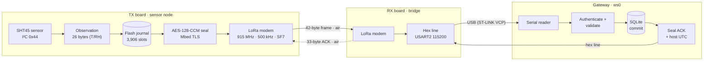

### 2.1 The layers

Each layer has one job. A layer does not depend on the internal details of a different layer.

| # | Layer | Format | Where | Section |
|---|---|---|---|---|
| 1 | Sensor bus | I²C, 6-byte reply with CRC-8 | TX | [3](#3-layer-1--sensor-bus-i2c) |
| 2 | Observation record | 22-byte head + catalog fields (26 bytes for T/RH), big-endian | TX, gateway | [4](#4-layer-2--observation-record) |
| 3 | Journal | 48-byte flash slots (T/RH build) | TX | [5](#5-layer-3--flash-journal) |
| 4 | Identity and counters | Epoch, sequence, 40-bit counter | TX, gateway | [6](#6-layer-4--identity-and-counters) |
| 5 | Secure frame | 8 + 26 + 8 bytes for T/RH, AES-128-CCM | TX, gateway | [7](#7-layer-5--secure-frame-aes-128-ccm) |
| 6 | Radio | LoRa packet, 915 MHz | TX, RX | [8](#8-layer-6--radio-lora) |
| 7 | Exchange | Send, ACK window, retry | TX, RX, gateway | [9](#9-layer-7--exchange-and-retry) |
| 8 | USB serial | Hex text lines | RX, gateway | [10](#10-layer-8--usb-serial-link) |
| 9 | Storage and time | SQLite, freshness, time sync | Gateway, TX | [11](#11-layer-9--gateway-storage-and-time) |

### 2.2 The three rules that keep data safe

These three rules apply to the full stack. Do not break them.

1. **Store before send.** The TX board writes the observation to flash before it transmits. A power loss after the write does not lose the observation.
2. **Commit before ACK.** The gateway makes an ACK only after SQLite commits the observation. The RX board never makes an ACK.
3. **Never repeat a nonce.** Each frame that the TX board seals uses a new 40-bit counter. The board records each counter block in flash **before** it uses a counter from that block.

---

## 3. Layer 1 — Sensor bus (I2C)

### 3.1 Wiring

The SHT45 breakout (Adafruit 6174) connects to I2C2 of the STM32WL55. The pins come from ST UM2592 Rev 4, Table 17 [[UM2592]](#UM2592).

| Signal | Nucleo connector | Arduino name | MCU pin | Function |
|---|---|---|---|---|
| SDA | CN5 pin 9 | D14 | PA11 | I2C2_SDA (AF4) |
| SCL | CN5 pin 10 | D15 | PA12 | I2C2_SCL (AF4) |
| 3.3 V | CN6 pin 4 | 3V3 | — | Sensor supply |
| GND | CN6 pin 6 | GND | — | Ground |

**Same signals on the ST morpho headers** (UM2592 Rev 4, Table 18 and Figure 24; no solder bridges in the
path). Use these with the Adafruit 4397 cable, whose female sockets cannot plug into the female Arduino
headers. Board component side up, SMA antenna connector at the top; pins count from the top.

| Signal | Morpho pin | Position | 4397 wire (STEMMA QT colors) |
|---|---|---|---|
| SCL (PA12) | CN10 pin 3 | right edge, inner column, 2nd from top | yellow |
| SDA (PA11) | CN10 pin 5 | right edge, inner column, 3rd from top | blue |
| GND | CN10 pin 9 | right edge, inner column, 5th from top | black |
| 3.3 V | CN7 pin 16 | left edge, inner column, 8th from top | red (not CN7 pin 18, which is 5 V) |

On CN10 the odd pins are the inner column; on CN7 the odd pins are the outer column (board edge).

The bus speed is 100 kHz (standard mode). The timing register value is `0x20303E5D` at PCLK1 = 48 MHz. The breakout's 10 kΩ resistors are the bus pull-ups. The MCU's internal pull-ups (about 40 kΩ) are also on, so that an unplugged breakout leaves the lines defined and the read fails as a clean address NACK (`App/sensor.c`, changed 2026-10-13).

### 3.2 Measurement transaction

The firmware uses the code in `firmware/stage0.c`. This code is the same code that the host tests use.

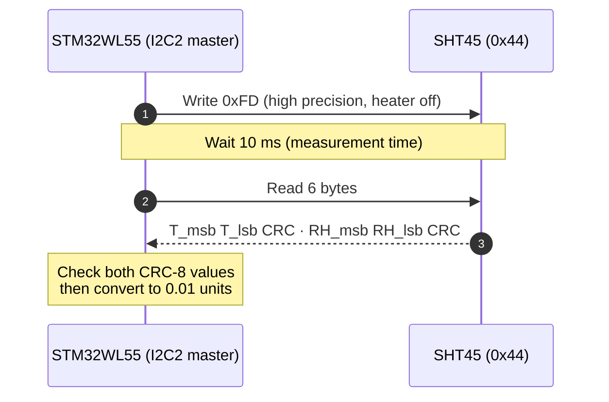

The sensor gives two 16-bit raw values. Each value has its own CRC-8. The CRC uses polynomial `0x31`, initial value `0xFF`, and no final XOR [[SHT4x]](#SHT4x).

The firmware converts the raw values to integers. It does not use floating point:

- Temperature, in 0.01 °C: `T = −4500 + (17500 × S_T + 32767) / 65535`
- Relative humidity, in 0.01 %: `RH = −600 + (12500 × S_RH + 32767) / 65535`, then limited to the range 0 to 10000.

### 3.3 Faults

If the write, the read, or a CRC check fails, the function returns an error. The function does not change the output values. The codes (`App/sensor.h`) are printed as `rc=` on every `#sample` line: 0 ok, −2 address NACK (sensor absent or wiring), −3 read NACK, −4 CRC mismatch, −5 bus still stuck after recovery. At boot, TX prints `#sensor ok t=… rh=…` or `#sensor fault rc=…` from one test reading. The observation then carries the **INVALID** code for both temperature and humidity (section 4.2). The gateway stores them as `null`, with `quality=sensor_fault`. The system never shows an invalid reading as a real value.

After a bus fault, the firmware does a bus recovery. A sensor can hold SDA low if it resets during a byte. The recovery does these steps:

1. Release both lines (output latch high), then make SCL and SDA GPIO open-drain outputs, so the takeover never drives SCL low.
2. Give up to 9 clock pulses on SCL until the sensor releases SDA.
3. Make a STOP condition: SDA low while SCL is low, SCL high, then SDA high.
4. Start the I²C peripheral again. If SDA was still held low, the read reports −5.

The pin sequence is `ws_i2c_recover()` in `firmware/stage0.c`, tested on the host against a model of the open-drain bus (`firmware/test_policy.c`: exactly one STOP, no accidental START, bus left idle, for a free bus and for a device holding SDA for 1 to 9 clocks). Before 2026-10-13 the routine left SCL low when SDA was not stuck, so its STOP was not a real STOP.

> **Note:** The SHT45 was wired on 2026-10-14 and gave valid readings ([`hardware/nucleo-wl55jc-bringup.md`](hardware/nucleo-wl55jc-bringup.md), "SHT45 first light"). Before that, all observations were `sensor_fault`, which was the correct behavior.

**More information:** Sensirion SHT4x datasheet [[SHT4x]](#SHT4x) · I²C specification, NXP UM10204 [[I2C]](#I2C) · bus recovery, UM10204 section 3.1.16.

---

## 4. Layer 2 — Observation record

The observation record is the **plaintext** payload. Its length depends on the fields that the build measures. All integers are big-endian (network byte order). The byte-exact rules are in [`protocol.md`](protocol.md) section 5.

### 4.1 Head (22 bytes)

| Offset | Size | Field | Rule |
|---:|---:|---|---|
| 0 | 4 | Epoch | Boot epoch. Increases on each TX boot. Stored durably. |
| 4 | 4 | Sequence | Sample number in this epoch. Starts at 0. |
| 8 | 4 | UTC | Unix seconds at sample time (u32, valid to 2106). **0 if the time is unknown.** |
| 12 | 4 | Uptime | Seconds since the TX board booted. **Always present.** Time sync does not change it. Section 11.3 uses it. |
| 16 | 1 | Flags | Bit 0: time known (must equal UTC ≠ 0). Bits 1–2: energy state (0 SURPLUS, 1 NORMAL, 2 CONSERVE, 3 CRITICAL). Bits 3–7: 0. |
| 17 | 1 | Calibration revision | 0 in Stage 0. |
| 18 | 4 | Field bitmap | Bit *i* set = catalog field *i* follows. Stage 0: `0x00000003` (temperature and humidity). |

### 4.2 Fields

The present fields follow the head, in increasing bit order. Each field has a fixed width from the **field catalog** (`firmware/common/ws_obs.c`, `ws0/fields.py`; full table in [`protocol.md`](protocol.md) section 5.3). The Stage-0 build sends two fields:

| Bit | Field | Bytes | Code | Valid range | INVALID |
|---:|---|---:|---|---|---|
| 0 | `temperature_c` | 2 | 0.01 °C + 4000 (so −40.00 °C = 0) | 0–16500 = −40.00 to 125.00 °C | `0xFFFF` |
| 1 | `humidity_pct` | 2 | 0.01 % | 0–10000 = 0 to 100.00 % | `0xFFFF` |

So the Stage-0 record is 22 + 2 + 2 = **26 bytes**.

- **Every field has its own INVALID code**: its all-ones value. A sensor fault, a missing sample, or an out-of-range reading gives INVALID. The node never leaves a field out because of a fault: which fields are present depends only on the build (`App/node_fields.h`). Thus a fault does not change the frame length.
- **Out of range is INVALID, not clamped.** A temperature outside −40.00 to 125.00 °C becomes INVALID (`ws_code_temp_centi`). Relative humidity is the exception: it is clamped to 0–100 % (`ws_code_rh_centi`), as Sensirion recommends.
- **One SHT45 fault invalidates both fields.** The two values come from one I²C reply.
- **INVALID codes are impossible values.** A reader that forgets to check gets 615.35 °C (`0xFFFF` − 4000 in 0.01 °C) or 655.35 %. Range checks reject both. Draft 3 introduced this idea with fillers and a separate validity flag; draft 5 replaces the flag with the per-field codes.

The gateway rejects a record that is not canonical. Each reading has only one correct byte form: the length must match the bitmap, reserved bits must be 0, each code must be in range or INVALID, and the time-known flag must match the UTC field. Section 11.1 and [`protocol.md`](protocol.md) section 5.5 list the rules.

The gateway stores an INVALID field as `null`. The record's `quality` is `valid` (all present fields have values), `partial` (some are `null`) or `sensor_fault` (all are `null`).

The pair **(station, epoch, sequence)** is the **observation identity**. Section 6 explains why this identity cannot repeat.

**Source:** `ws_obs_encode()` in `firmware/common/ws_obs.c` · `fields.encode()` / `fields.decode()` in `ws0/fields.py`.

---

## 5. Layer 3 — Flash journal

The TX board keeps each observation in internal flash until an authentic ACK arrives. This layer gives the **store before send** rule.

### 5.1 Flash map

The STM32WL55JC has 256 KB of flash in 128 pages of 2 KB. The flash programs 64 bits (one double-word) at a time. You cannot program a double-word two times without an erase. The firmware uses this property.

| Pages | Size | Contents |
|---|---|---|
| 0–31 | 64 KB | Firmware. The linker script enforces this limit. |
| 32 | 2 KB | Configuration: station ID, key, key check value (KCV) |
| 33–34 | 4 KB | Monotonic log, two pages (A/B): epochs, counter reservations, lost total, abandoned total |
| 35–127 | 186 KB | Journal ring: 93 pages × 42 slots (T/RH build) |

A firmware update programs only pages 0–31. The configuration, the counters, and the journal stay. (Verified 2026-10-12.)

### 5.2 Slot format

The slot size follows from the fields that the build measures (`App/node_fields.h`, section 4): a slot is the observation plaintext rounded up to whole double-words, plus a commit double-word and an ACK double-word (`JOURNAL_SLOT_BYTES` in `App/node_store.h`).

For the Stage-0 T/RH build the plaintext is 26 bytes, which rounds up to 4 double-words (32 bytes), so a slot is 32 + 8 + 8 = **48 bytes**.

| Double-word | Bytes | Contents | Programmed |
|---:|---:|---|---|
| 0–3 | 32 | Observation plaintext (26 bytes), padded with `0x00` | First |
| 4 | 8 | Commit word: magic `0x4A53` + CRC-16/CCITT of the 26 plaintext bytes | Second |
| 5 | 8 | ACK word: all `0xFF` = pending, all `0x00` = acknowledged | When the ACK arrives |

Each journal page starts with an 8-byte header: a 32-bit magic and a 32-bit page sequence number. Then the page has (2048 − 8) / 48 = 42.5, so **42 slots**. The magic is `"WSJ"` plus the slot size in its low byte: `0x57534A30` (`WSJ0`, because 48 = `0x30` = ASCII `0`). A page with another magic (for example a draft-4 `WSJ1` page with 40-byte slots, or a page from a build whose field set gives another slot size) is ignored at boot and recycled by the normal erase-before-reuse. It is never read as data. A record's length when it is read back comes from its own field bitmap (`ws_obs_plain_len`).

### 5.3 Slot life cycle

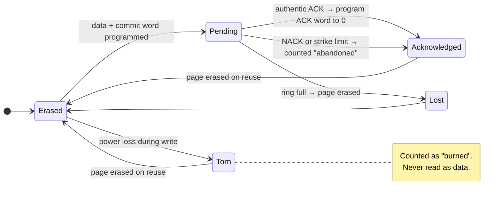

### 5.4 Power-loss behavior

A power loss can stop a flash write at any time. The firmware reads a partly written slot in one of three ways. All three are safe.

| What the scan finds | Cause | Result |
|---|---|---|
| All `0xFF` | Write did not start | Free slot |
| Data present, commit word bad or `0xFF` | Write stopped before the commit word | Counted as `burned`. Not used. |
| Double ECC error on read | Double-word write stopped in the middle | `NMI_Handler` catches it, sets `ws_flash_ecc_fault`, and returns. The slot is not used. |

If the ECC error is in the ACK word only, the firmware counts the slot as acknowledged. The gateway made that ACK after its commit, so the gateway already has the observation.

### 5.5 Capacity

The journal holds 93 pages × 42 slots = **3,906 observations**. At one observation each minute, this is 3,906 / 60 = **65 hours (approximately 2.7 days)** without an ACK. (Draft 4 had 40-byte slots and 4,743 observations, about 3.3 days. A build with more fields has larger slots and fewer of them: the full proof-of-concept field set needs 80-byte slots, 25 per page, 2,325 records, about 1.6 days.) When the ring is full, the firmware erases the oldest page. It counts each pending observation on that page as `lost`.

> **Caution:** The 30-day buffer requirement (H11) needs external SPI NOR flash. The internal journal does not satisfy H11.

> **Warning:** The power-loss behavior agrees with the design, but **nobody has tested it with real power cuts yet**. Do this test before H01.

**More information:** STM32WL5x reference manual RM0453, flash chapter (ECC and programming rules) [[RM0453]](#RM0453) · `firmware/stage0-node/App/node_store.c`.

---

## 6. Layer 4 — Identity and counters

Two different numbers prevent two different failures:

| Number | Size | Prevents | Where it is in the frame |
|---|---|---|---|
| **Epoch + sequence** | 32 + 32 bits | Two different observations with the same identity (a database collision) | Inside the encrypted plaintext |
| **Transmission counter** | 40 bits (1 to 2^40 − 1) | Two frames with the same CCM nonce (a total loss of security) | Clear header, authenticated |

A retry of one observation uses the **same identity** and a **new counter**. Thus the gateway can find duplicates, and the radio never repeats a nonce.

### 6.1 Durable reservation

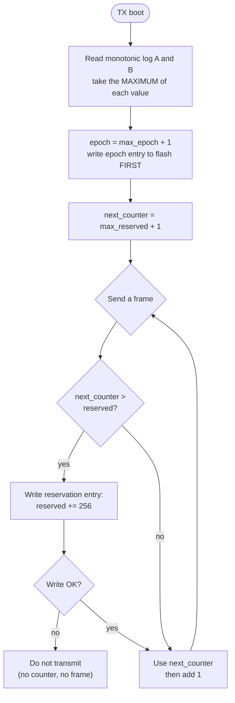

Each log entry is one double-word: an 8-bit type and a 56-bit value. The counter allocator `store_next_counter` refuses to issue a counter above 2^40 − 1, because the 5-byte header field would truncate it and repeat a nonce (2^40 frames last more than 100,000 years at 20 frames a minute). The recovery takes the maximum value of each type from both pages. A torn entry reads as an ECC error or a bad value. The firmware ignores that entry. Because the values only increase, an ignored entry can only make the firmware skip numbers. It cannot make the firmware use a number again.

When a log page is full, the firmware writes the current maximum values to the other page. It writes the page header **last**. If power stops during this step, the old page stays valid.

**Example (observed 2026-10-12):** The TX board used counters 1 to 8. Then the board restarted ([`hardware/nucleo-wl55jc-bringup.md`](hardware/nucleo-wl55jc-bringup.md), "Reboot behaviour"). The next counter was **257**, because the board skips the rest of the reserved block (9 to 256). This is correct.

### 6.2 Why counter reuse is dangerous

AES-CCM uses counter mode for encryption. If two frames use the same key and nonce, an attacker can XOR the two ciphertexts and get the XOR of the two plaintexts. The authentication guarantee is also lost. RFC 3610 section 2.1 ("destroys the security properties of this mode") and NIST SP 800-38C describe this risk [[RFC3610]](#RFC3610) [[SP800-38C]](#SP800-38C).

> **Warning:** Do not restore an old copy of the TX flash state or the gateway nonce database while you keep the same key. If counter state is lost, provision a **new key** for both ends.

> **Warning:** before release `0f456040fe54`, `WIPE ERASE-ALL-NODE-STATE` reset the node's 64-bit counter to 1; from `0f456040fe54` on it keeps the counter (gap G17). The `PROVISION` epoch floor raises only the epoch (the observation identity), **not** the counter. A key used before `0f456040fe54`, or on another board, can therefore repeat nonces already sent on air. Prefer a new key. See [`runbook-moving-boards.md`](runbook-moving-boards.md).

---

## 7. Layer 5 — Secure frame (AES-128-CCM)

### 7.1 Frame format

Every frame has an 8-byte clear header and an 8-byte tag around the ciphertext. The ciphertext has the same length as the plaintext of the kind.

| Offset | Size | Field | Protection |
|---:|---:|---|---|
| 0 | 1 | High 4 bits: version = `5`. Low 4 bits: kind (`1` observation, `2` ACK, `3` NACK, `4` health report). So `0x51`, `0x52`, `0x53` or `0x54`. | Authenticated, clear |
| 1 | 2 | Station ID, 1 to 65,535 | Authenticated, clear |
| 3 | 5 | Transmission counter, 1 to 2^40 − 1 | Authenticated, clear |
| 8 | *n* | Ciphertext | Encrypted and authenticated |
| 8 + *n* | 8 | CCM authentication tag | — |

| Kind | Plaintext *n* | Frame |
|---|---:|---:|
| Observation, Stage-0 T/RH build | 26 | **42 bytes** |
| Observation, any build | 23 to 69 | 39 to 85 bytes |
| ACK, NACK | 17 | **33 bytes** |
| Health report (DIAG) | 32 | **48 bytes** |

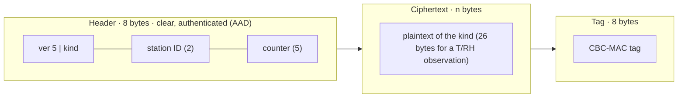

### 7.2 Nonce and associated data

- **Nonce (13 bytes)** = kind (1) + station ID as a 4-byte integer + counter as an 8-byte integer. The firmware and the gateway build it **from the integers**, not by copying the header bytes. This is the same construction as draft 4. The node's counter space is used by kinds 1 and 4. The gateway's counter space is used by kinds 2 and 3. The kind byte keeps every (kind, counter) pair distinct. Thus all kinds can use the same key and never share a nonce.
- **Associated data (AAD)** = all 8 header bytes. An attacker cannot change the version, the kind, the station, or the counter without a tag failure.
- **Key** = 128 bits. Each station has a different key. The gateway and the TX board share it.
- **Tag** = 64 bits (8 bytes). A forgery attempt succeeds with probability 2^−64. Attempts are online and limited by airtime: at about 50 attempts per second, 2^64 attempts take about 10^10 years. RFC 3610 allows tags of 4 to 16 bytes; NIST SP 800-38C allows 64-bit tags.
- **Limits.** The seal function (`ws_seal_kind` in C, `seal()` in Python) refuses a station of 0 or above 65,535, a counter of 0 or above 2^40 − 1, and a kind outside 1–4. It does not truncate them. The C function then wipes its output buffer.
- **Length checks.** The gateway checks the frame length for the kind **before** it decrypts (observation 39–85 bytes, ACK/NACK 33, DIAG 48). A frame that fails is dropped with no reply. After decryption, an observation must have exactly the length that its own field bitmap gives; if not, the gateway sends a NACK.

### 7.3 ACK plaintext (17 bytes)

| Offset | Size | Field |
|---:|---:|---|
| 0 | 4 | Acknowledged epoch |
| 4 | 4 | Acknowledged sequence |
| 8 | 4 | Host UTC at commit (Unix seconds). **0** if the gateway measured its own clock as wrong (section 11.3). |
| 12 | 5 | **Echo**: transmission counter of the observation frame that this ACK answers |

Section 11.3 explains the echo.

### 7.3.1 NACK plaintext (kind 3, 17 bytes)

The gateway sends a NACK only for an **authentic** frame that it must reject permanently. It first stores the raw frame in its `rejections` table. A NACK uses the gateway's ACK counter space.

| Offset | Size | Field |
|---:|---:|---|
| 0 | 4 | Epoch of the rejected observation |
| 4 | 4 | Sequence of the rejected observation |
| 8 | 4 | Reason: `1` identity collision, `2` invalid record |
| 12 | 5 | **Echo**: counter of the observation frame |

### 7.3.2 Health report plaintext (DIAG, kind 4, 32 bytes)

Node → gateway, fire-and-forget: no journal entry, no receive window, no reply. It uses the node's counter space. The gateway stores it in its `diagnostics` table, ordered by (epoch, uptime), not by arrival.

| Offset | Size | Field |
|---:|---:|---|
| 0 | 4 | Epoch |
| 4 | 4 | Uptime, seconds |
| 8 | 2 | Journal pending |
| 10 | 4 | Journal lost total (cumulative, persisted) |
| 14 | 2 | Torn (burned) slots |
| 16 | 2 | Abandoned total (cumulative, persisted) |
| 18 | 2 | Missed ACKs since boot |
| 20 | 2 | Rejected replies since boot |
| 22 | 1 | Reset cause: 0 unknown, 1 power, 2 pin, 3 brownout, 4 software, 5 watchdog, 6 lowpower, 7 option-bytes |
| 23 | 1 | Link state: 0 linked, 1 probing |
| 24 | 4 | Firmware build ID: the first 8 hex digits of the firmware version (the release commit) |
| 28 | 1 | RSSI of the last authentic reply, as the TX board heard it, signed dBm. −128 = none yet. |
| 29 | 1 | SNR of that reply, signed dB. −128 = none yet. |
| 30 | 1 | Crashes since power-up (`App/fault.c`, RTC backup register DR11), stops at 255 |
| 31 | 1 | Energy state (section 4.1) |

The 16-bit fields stop at `0xFFFF`. The RSSI and SNR show the downlink (gateway → node). The `#rx obs` line of the RX board shows the uplink. The two can be different (gap G15). The node sends a report every 15 minutes and after each link-state change, after that minute's exchange, also while probing (changed 2026-10-13; before that it was sent only while LINKED, so the link field always read 0).

### 7.4 Implementations

| Side | Library | Version | Pinned by |
|---|---|---|---|
| TX board | Mbed TLS (`mbedtls_ccm_*`) | 3.6.6 LTS | `tools/fetch-vendor.sh`: `STM32CubeWL` submodule `mbed-crypto` @ `7ee7e20` |
| Gateway | `cryptography` (`AESCCM`, OpenSSL) | 50.0.1 | `requirements.txt` |

The project does not have its own AES code. The test file `tests/test_frame.py` compiles the C frame code on the host. It makes sure that C and Python give the **same bytes**: known-answer vectors made directly with the `cryptography` library from the specified header and nonce, and 300 random frames over the full station and counter ranges. It also does rejection tests (bad tag, wrong station, wrong key, wrong length, other version bytes) and limit tests (counter 2^40 − 1 accepted, 2^40 refused; station 65,535 accepted, 65,536 refused). `tests/test_obs.py` checks the observation encoder: a known-answer record, every code round-trips exactly, and C and Python give identical bytes for 3,000 random records.

The TX board runs a self-test at each boot (`kat=pass`): it encodes the known-answer observation with the draft-5 encoder, seals it and compares the frame with the stored vector, opens a known ACK and NACK, checks that a changed tag fails, and checks that counter 2^40 is refused. If the test fails, the board does not transmit.

**Key check value (KCV):** The first 3 bytes of AES-128(key, 16 zero bytes). It identifies a key and does not show the key. Example: the FIPS-197 test key `000102…0f` has the KCV `c6a13b`.

**More information:** RFC 3610 (CCM) [[RFC3610]](#RFC3610) · NIST SP 800-38C [[SP800-38C]](#SP800-38C) · Mbed TLS CCM API [[MBEDTLS]](#MBEDTLS) · Python `cryptography` AESCCM [[PYCA]](#PYCA).

---

## 8. Layer 6 — Radio (LoRa)

### 8.1 Configuration

| Parameter | Value | Note |
|---|---|---|
| Frequency | 915.0 MHz | NUCLEO-WL55JC1 is the high-band board (865–928 MHz) [[DB3933]](#DB3933) |
| Modulation | LoRa (chirp spread spectrum) | — |
| Bandwidth | **500 kHz** | Gives the FCC §15.247(a)(2) digital-modulation class (see 8.3) |
| Spreading factor | SF7 | Bench value. Tune it for the H01 location. |
| Coding rate | 4/5 | — |
| Preamble | 8 symbols | — |
| Header | Explicit | The packet header contains the length |
| PHY CRC | On (16-bit) | The radio discards packets with a CRC error |
| Sync word | `0x1424` (private network) | SubGHz_Phy default; LoRaWAN uses `0x3444` |
| IQ | Normal, both directions | — |
| TX power | 0 dBm | Bench value |
| Symbol timeout | **0 (off)** | See 8.4 |

All values are in `firmware/stage0-node/App/radio_cfg.h`. **The two boards must use the same values.**

### 8.2 Time on air

The symbol time is `Ts = 2^SF / BW = 128 / 500 kHz = 0.256 ms`. The number of header + payload + CRC symbols for a payload of PL bytes (explicit header, CRC on, CR 4/5, no low-data-rate optimization) is:

`n = 8 + ceil((8 × PL − 4 × SF + 28 + 16) / (4 × SF)) × 5`

| Frame | PL | ceil(…) | n | Preamble (8 + 4.25) | **Total** |
|---|---:|---|---:|---:|---:|
| Observation (T/RH) | 42 | ceil(352 / 28) = 13 | 73 | 12.25 symbols | 85.25 × 0.256 = **21.8 ms** |
| ACK / NACK | 33 | ceil(280 / 28) = 10 | 58 | 12.25 symbols | 70.25 × 0.256 = **18.0 ms** |
| Health report | 48 | ceil(400 / 28) = 15 | 83 | 12.25 symbols | 95.25 × 0.256 = **24.4 ms** |
| (Draft 4, any kind) | 56 | ceil(464 / 28) = 17 | 93 | 12.25 symbols | 105.25 × 0.256 = 26.9 ms |

At SF12 the same frames take 452.6 ms (observation), 411.6 ms (ACK) and 493.6 ms (DIAG). Airtime moves in steps of 4 × SF bits: about every 3–4 bytes at SF7. The firmware uses the same formula (`airtime_ms()` in `App/app_tx.c`, rounded up to whole milliseconds: 22 ms and 18 ms at SF7).

The formula is in Semtech AN1200.13 and the SX1261/2 datasheet [[SX126X]](#SX126X). You can also use an online calculator [[AIRTIME]](#AIRTIME).

### 8.3 Regulatory basis (US)

| Rule | Limit at 902–928 MHz | Stage-0 status |
|---|---|---|
| 47 CFR §15.249 | 50 mV/m at 3 m (approximately −1.25 dBm EIRP) | Not used. A 125 kHz signal at 0 dBm is near or above this limit. |
| 47 CFR §15.247(a)(1) | Frequency hopping: 50 or more channels if the 20 dB bandwidth is less than 250 kHz | Not used (one channel) |
| 47 CFR §15.247(a)(2) | Digital modulation: 6 dB bandwidth of 500 kHz or more. Up to +30 dBm. Power density 8 dBm/3 kHz or less. | **Used.** At 0 dBm, the density is approximately −22 dBm/3 kHz. |

> **Caution:** Nobody has measured the 6 dB bandwidth of these boards with a spectrum analyzer. The antenna gain is also not known. This section is an engineering reading of Part 15. It is not a compliance certificate.

**More information:** eCFR §15.247 [[FCC247]](#FCC247) · eCFR §15.249 [[FCC249]](#FCC249) · LoRa Alliance regional parameters (US915 uses 500 kHz channels) [[RP002]](#RP002).

### 8.4 Lesson: the symbol timeout

The first firmware used ST's default symbol timeout of 5 symbols. At SF7 and 500 kHz, 5 symbols is **1.3 ms**. The radio stopped the ACK window after 1.3 ms if no preamble had started. Thus the TX board missed all ACKs. It also sent backlog frames while the RX board was busy with an ACK, so those frames were lost.

The firmware now sets the symbol timeout to 0 (off). The 2-second window timer stops the receive operation. **If you change the SF or the bandwidth, calculate the symbol time again.**

### 8.5 Measured link (bench, 2026-10-12)

Boards approximately 30 cm apart, 0 dBm. Source: [`hardware/nucleo-wl55jc-bringup.md`](hardware/nucleo-wl55jc-bringup.md), "Stage-0 firmware bring-up" (end-to-end link, epoch 2, seq 0–12; trial-and-error item 1).

| Measure | Value |
|---|---|
| Readings delivered | seq 0–12, `pending=0` |
| RSSI | −23 / −24 dBm |
| SNR | 12 to 13 dB |
| After the symbol-timeout fix | `sent=3 acked=3 no_ack=0` |

This is a bench result. It is not a range result. H01 requires a test at the real locations.

---

## 9. Layer 7 — Exchange and retry

### 9.1 One minute of operation

This diagram shows one minute in the LINKED state. Section 9.4 gives the transmission policy that limits the backlog and the PROBING state.

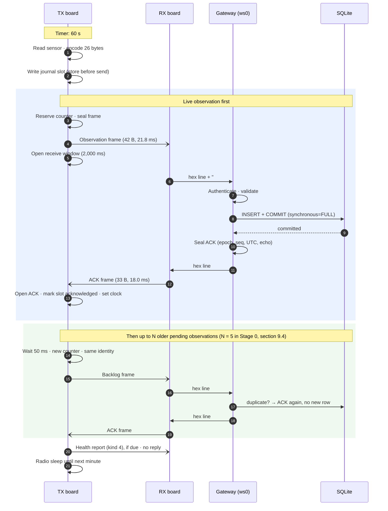

### 9.2 TX state machine

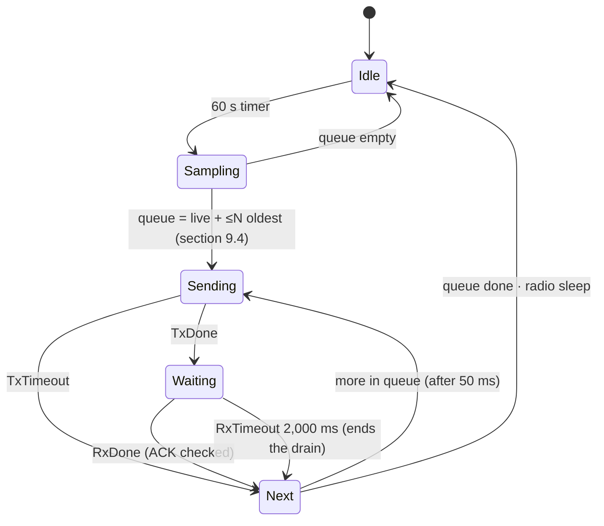

### 9.3 Rules

- **Live first.** The current observation goes first. The backlog cannot delay new data.
- **Bounded backlog.** Each minute sends N old observations at most (section 9.4). At NORMAL (N = 5) a full 2.7-day journal (3,906 records) clears in approximately 13 hours (3,906 / 5 = 781 minutes). In CONSERVE (N = 0) the backlog does not clear. H11 must examine this rate.
- **Retry is the same data.** A retry has the same identity and a new counter. The gateway stores it once and sends the ACK again.
- **The RX board does not decide.** It forwards frames with the correct version, kind and length: up, an observation of 39–85 bytes or a 48-byte health report (`ws_air_frame_ok`); down, a 33-byte ACK or NACK (`ws_host_reply_ok`). It does not check the tag. It has no key.
- **Any authentic ACK clears its own slot.** An ACK can arrive late. It still clears the correct slot.

### 9.4 Transmission policy

Source: [`radio-energy-policy.md`](radio-energy-policy.md) and `App/app_tx.c`. The stricter of the energy state and the link state applies.

| Energy state | Backlog per minute | Radio time per minute | Note |
|---|---:|---:|---|
| SURPLUS | 20 | 15 s | — |
| NORMAL | 5 | 5 s | **Stage 0 is fixed at NORMAL** (USB power) |
| CONSERVE | 0 | 2 s | Live reading only, at most every 300 s |
| CRITICAL | 0 | 0 | Nothing is sent. Readings stay in the journal. |

- **Airtime cap.** One answered exchange is estimated at observation air time + ACK air time + 300 ms = 22 + 18 + 300 = 340 ms (SF7, 500 kHz; `exchange_ms` in `App/app_tx.c`). The number of frames in a minute is limited to the radio time ÷ 340 ms: 14 for the 5 s NORMAL cap, so the NORMAL backlog limit of 5 applies. The live reading always fits.
- **Drain stops at the first miss.** If a frame gets no reply (or a TX timeout occurs), the node sends nothing more in that minute.
- **PROBING.** After 3 consecutive minutes with no answer, the link state becomes PROBING: live reading only, no backlog. In SURPLUS and NORMAL (so always in Stage 0) the live reading still goes every minute; only CONSERVE waits 120 s, 240 s, 480 s, then every 900 s (`ws_link_may_send()` in `firmware/stage0.c`, changed 2026-10-13). Any answer to a sent frame makes the link LINKED again. The health report is also sent while probing, with link state 1.
- **Simulator.** The Python simulator (`ws0/simulator.py`, `BACKLOG_PER_MINUTE = 5`) drains 5 records per minute, like NORMAL. It sends the live reading every minute and does not model the drain stop or PROBING; that matches the firmware's timeliness in NORMAL.

### 9.5 NACK and abandoned records

A record leaves the journal without an ACK in three cases. Each case is counted, and the counts go into the health report (section 7.3.2).

1. **NACK.** The gateway authenticated the frame but must reject it permanently (identity collision or invalid record). The node accepts a NACK only if its echo, epoch and sequence match the frame just sent. It marks the slot done and adds 1 to the persisted `abandoned` total.
2. **Strike limit.** A record that stays unanswered in 10 exchanges in which the gateway answered other frames is abandoned and counted (`STRIKE_LIMIT` 10, 6 tracking slots). An exchange with no answer at all does not count. Thus a link or gateway outage never abandons data.
3. **Ring overflow.** The oldest page is erased and its pending records are counted as `lost` (section 5.5).

### 9.6 Failure cases

| Failure | Result | Recovery |
|---|---|---|
| Observation frame lost on air | No ACK in 2 s. Red LED on TX. | Next minute: sent again as backlog |
| ACK lost on air | Gateway has the row. TX keeps the slot. | Next minute: duplicate. Gateway gives the ACK again. No second row. |
| Gateway not running | RX prints the frame. Nobody answers. | TX keeps observations for 2.7 days |
| Database commit fails | No ACK | TX keeps the slot and sends it again |
| Authentic frame, identity collision or invalid record | Gateway stores the frame in `rejections`. It sends a NACK. | TX abandons the record (section 9.5) |
| Gateway silent for 3 minutes | TX goes to PROBING | Probes at 120/240/480/900 s. The backlog drains after the link returns. |
| TX power loss | Unsent slots stay in flash | After boot: new epoch, backlog sent first-in, first-out |
| RX power loss | Frames are lost while RX is off | TX backlog |
| Forged or changed frame | Tag fails | Gateway rejects it and logs it. No ACK. |
| Replayed old frame | Tag is valid, counter at or below the gateway's mark, same bytes as the frame first accepted | No reply. Stored in `rejections` as `replay` and counted. No alarm (section 11.1). |

---

## 10. Layer 8 — USB serial link

### 10.1 Physical path

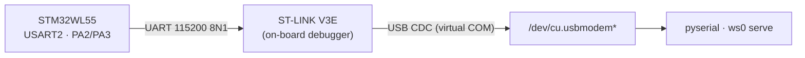

The ST-LINK on each Nucleo board makes the USB virtual COM port. The port name changes when you move the cable. **Identify a board by its ST-LINK serial number, not by its port name.**

### 10.2 Line format

| Direction | Line | Meaning |
|---|---|---|
| RX → host | Lowercase hex digits + `\n`: 84 for a T/RH observation (42 bytes), 96 for a health report (48 bytes); any observation of 39–85 bytes is forwarded | One observation or health-report frame (kind 1 or 4) |
| RX → host | `#rx obs rssi=-23 snr=13` | Diagnostic for the line before (also printed for kind 4) |
| RX → host | `#rx drop …`, `#rx crc …`, `#rx hdr …`, `#tx timeout`, `#tx busy`, `#host reject …`, `#boot …`, `#status …`, `#watchdog radio not listening; re-arming` | Diagnostics |
| RX → host | `#alive uptime=… forwarded=… dropped=… acks=… diag=… listening=…` | Every 60 s. The gateway marks the receiver silent after 180 s without it. |
| host → RX | 66 hex digits + `\n` (33 bytes) | One ACK or NACK frame (kind 2 or 3) to transmit once, with the uplink radio settings |
| host → RX | `STATUS` | Ask for counters |

Rules:

- A line is 256 bytes or less. The gateway discards a longer line.
- A line that starts with `#` is a diagnostic. The gateway writes it to `receiver.log` in its run directory (`--directory`, for example `run-hw/` at home or `run-office/` at the office). It never decodes it as a frame. It reads the fields of `#alive` and `#boot role=rx` only for receiver liveness.
- The gateway writes each frame and its ACK or NACK to `receiver.log`, with UTC time (`frame <hex> -> ack <hex>` or `-> nack <hex>`; health reports as `diag <hex>`). This file is evidence for H01.
- The serial read timeout is 50 ms. The gateway answers a frame immediately. (The TX ACK window is 2 s.)
- While the RX console holds a complete line for processing, it drops more input. The host sends one line for each exchange.

### 10.3 TX console (not part of the data path)

The TX board also has a console. It is for provisioning and diagnostics. All lines from the TX board start with `#`.

| Command | Function |
|---|---|
| `STATUS` | Shows provisioning, KCV, self-test, epoch, sequence, time quality, and journal counters |
| `KAT` | Runs the boot self-test again: draft-5 observation encoding and sealing, ACK, tampered ACK, NACK, and the refusal of counter 2^40 |
| `PROVISION <id> <32 hex> [epoch_floor]` | Writes the station ID (1 to 65,535) and the key. Only on an empty board. The optional epoch floor raises the next epoch above every epoch that the gateway stored, so a wiped board never repeats an **observation identity**. It does not change the transmission counter. |
| `WIPE ERASE-ALL-NODE-STATE` | Erases the key and the journal. Keeps the counter, the epoch, and the `lost`/`abandoned` totals (gap G17). **You must then provision a new key** (section 6.2, [`runbook-moving-boards.md`](runbook-moving-boards.md)). |
| `TEST-HANG` | Bench only. Stops the main loop. The watchdog must reset the board in approximately 8 s. |
| `TEST-FLASH-STORM` | Bench only. Writes flash continuously for power-cut tests. Its slots use epoch `0xFFFFFFFF`. The next boot removes any of them that a cut left pending. |

Use `python -m ws0 provision-node`. Do not type the key by hand. The tool calculates the epoch floor from the gateway database and compares the KCV of the board with the KCV of the gateway key.

**More information:** UM2592 section on the STLINK-V3E virtual COM port [[UM2592]](#UM2592) · pyserial [[PYSERIAL]](#PYSERIAL).

---

## 11. Layer 9 — Gateway, storage, and time

### 11.1 Frame processing

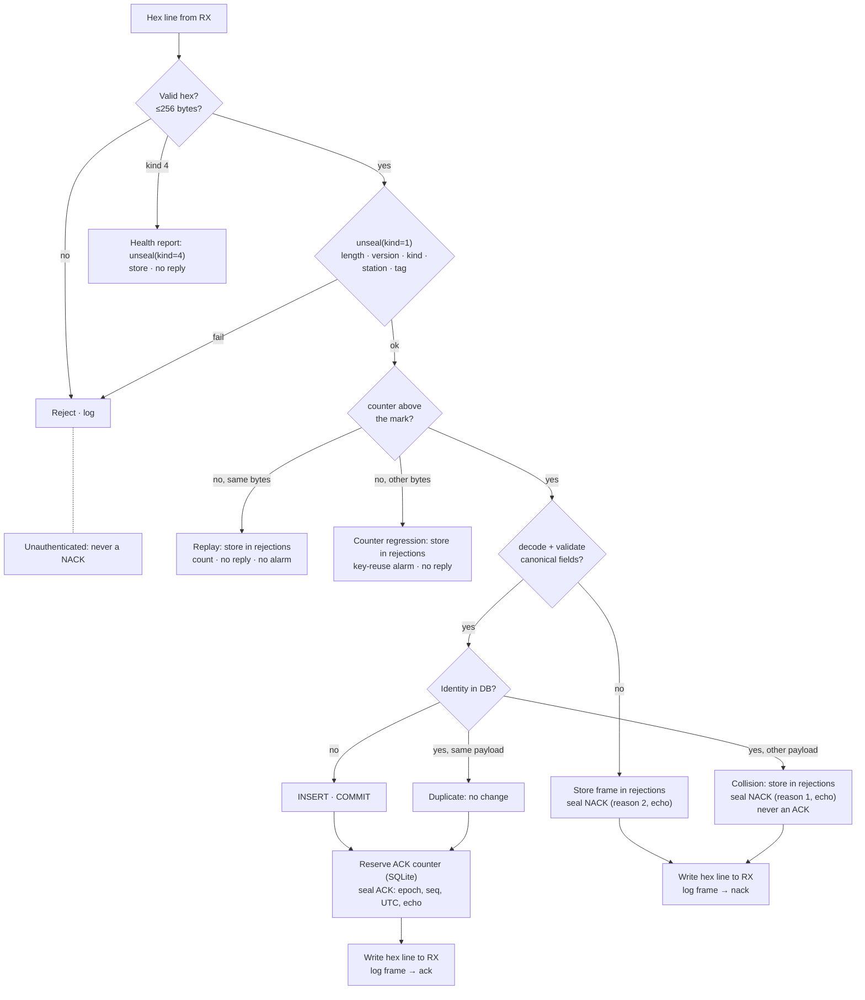

**Replay or key reuse.** The gateway keeps a high-water mark of the node counter and the SHA-256 of each authentic node frame that it accepted as fresh, by counter (nonce database, tables `node_counter` and `node_frames`). An authentic frame at or below the mark is never answered and never stored as data:

- **Same bytes** as the frame accepted under that counter: a **replay**. Anyone who recorded a frame can do this. It is harmless. The gateway counts it (`replays`) and keeps it in `rejections` with reason `replay`. No alarm.
- **Different bytes** under a counter that was used, or a counter that was never accepted: a **counter regression**. The node never repeats a counter, and a direct LoRa link cannot reorder frames, so this means a repeated nonce (a reused key). The gateway keeps it in `rejections` with reason `counter_regression` and raises the persistent `/v1/status` alarm "possible key reuse: re-key the node".

Draft 4 raised the alarm for a plain replay too.

### 11.2 Storage rules

- SQLite uses `PRAGMA synchronous=FULL` [[SQLITE]](#SQLITE), plus `PRAGMA fullfsync=ON` and `checkpoint_fullfsync=ON`. On macOS, `fsync()` does not flush the drive cache, but `F_FULLFSYNC` does. Thus the commit is on stable storage before the ACK exists (`gateway.py`, `full_flush`). Both databases use a write-ahead log (WAL). Simulations and unit tests can switch durability off with `WS0_UNSAFE_FAST_FSYNC=1` (`synchronous=OFF`, no `fullfsync`). Results made that way do not show power-loss durability.
- The gateway ACK counters use a `BEGIN IMMEDIATE` transaction. The counter is in the database before the gateway seals the ACK.
- The nonce database is bound to the key fingerprint, the station, and the direction. A different key cannot use it by accident.
- An authentic frame that the gateway must reject permanently goes into the `rejections` table (station, session, sequence, received_at, reason, detail, frame_hex) **before** the NACK is sealed.
- A sample time more than 5 s after the receipt time is **quarantined** (`future_clock_at_receipt`). Waiting does not make it valid.
- An observation is **available** for 180 s after its sample time, only if its clock is known. Availability is decided **per field**: a field is available only if its own value is not `null` (`fields_available` in `/v1/observations/latest`; one Home Assistant entity per field). A dead sensor does not hide the other fields. After 180 s, Home Assistant and the API show the fields as unavailable.
- Since-boot counters (rain tips, energy, charge) must not decrease **in sequence order** within one epoch. The gateway compares a new record with its stored neighbours by sequence, not by arrival, so a late backlog record is accepted. A decrease is an invalid record (NACK reason 2).

### 11.3 Time synchronization

The TX board has no clock source at boot. It gets the UTC time from the ACK.

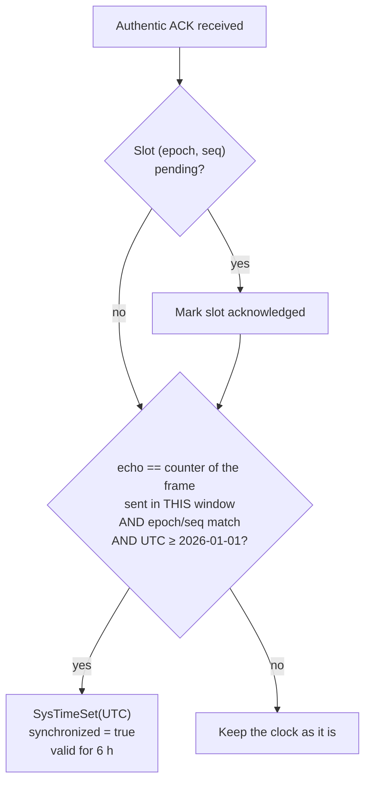

**Host clock check.** The gateway is the only time source. It measures its own clock with SNTP at start and every hour (`ws0/clock.py`). If the offset is more than 1 s, every ACK carries UTC **0**. The TX board then does not change its clock, because 0 is before 2026-01-01. If no measurement is possible, the gateway still sends its time and shows `unverified` in `/v1/status`.

**Why the echo is necessary.** An attacker can record an authentic ACK. Later, the attacker can jam the real ACK and send the recorded ACK. Without the echo, the TX board accepts the old time. With the echo, the old ACK has an old counter. The TX board uses a new counter for each frame, so the old ACK does not match. The attacker cannot make a new valid echo without the key.

**Accuracy.** The gateway writes its time at the commit. The TX board sets its clock when the ACK arrives. The TX clock is late by the time between these two events. This time is normally much less than 1 s (two air times + USB + commit). Nobody has measured it exactly yet.

**Drift.** The RTC uses the 32.768 kHz LSE crystal. A tuning-fork crystal drifts approximately 20 ppm at room temperature, but its error increases with the square of the temperature difference. At −35 °C it can be more than 120 ppm. After 6 hours without an ACK, the TX board marks new samples `time unknown` (UTC = 0).

#### 11.3.1 Time across a reset (option D)

A system reset (RESET button, NRST, software reset, future watchdog) does not stop the RTC or clear its backup registers. The TX board keeps a trust marker in two backup registers: a magic value and the RTC second of the last sync. At boot, the board trusts its clock again only if all of these are true:

- the marker is present,
- the RTC counted forward since the sync,
- the sync is less than 6 hours old,
- the clock shows a plausible date.

If a power loss clears the backup domain, the marker is gone and the board starts with `time unknown`. **Open:** whether a real power loss clears the backup domain on this board (VBAT supply) is not checked; to be checked against the board schematic and by a true power-removal test (G7 part B). A simulated loss (debugger pulsed `RCC_BDCR.BDRST`) gave no restore and `time=unknown` ([`hardware/nucleo-wl55jc-bringup.md`](hardware/nucleo-wl55jc-bringup.md), draft 4). **Bench result (2026-10-12):** after a warm reset the board printed `#time restored … sync_age=11`. Its first reading in the new epoch was synchronized; board−host difference −1.0 s (same log).

#### 11.3.2 Reconstructed time (option C, draft 4)

Every observation carries **uptime**: whole seconds since the TX board booted. Time sync does not change uptime. Thus all readings of one epoch share one monotonic time line. When the gateway has at least one **synchronized** reading of an epoch, it calculates the time of every unsynchronized reading of the same epoch:

`effective_time = ref_utc + (uptime − ref_uptime)`, using the synchronized reading nearest in uptime.

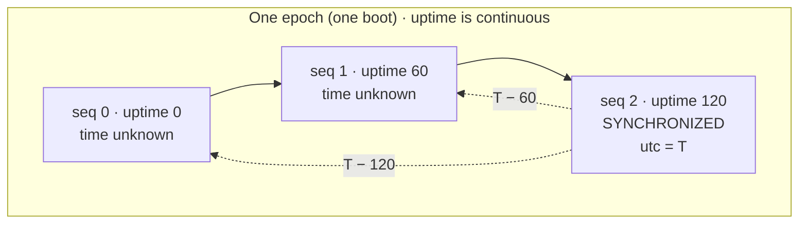

Rules:

- The raw payload does not change. It stays immutable and stays the deduplication authority. The result goes into separate columns: `effective_at`, `time_basis` (`synchronized`, `reconstructed`, or `unknown`), and `time_uncertainty_s`.
- **Uncertainty** = 2 s (whole-second quantization of two fields) + 150 ppm × |uptime − ref_uptime|. Example: 2 s after one minute; about 41 s after a 3-day outage.
- A reference that was quarantined (its clock was ahead of its receipt time) is never used.
- A reading with an uncertainty above 10 s is never shown as **current**. It stays in the history with its error bound.
- **H01:** a reconstructed time counts as a known acquisition time when it meets the same 5 s tolerance (decision by Clint, 2026-10-12). Reports give the reconstructed count separately.
- **Limit:** an epoch that ends (reboot) before its first synchronized reading has no reference. Its readings stay `unknown`. With option D, only a power loss followed by a reboot before the first ACK causes this.

**Bench result (2026-10-12):** a simulated power loss (backup-domain reset) started epoch 8 with no time. One minute later the gateway reconstructed reading 0 as 03:15:34Z ± 2.0 s. The board log shows the sample at 03:15:35Z.

**Simulation:** scenario `reboot-during-outage` reboots the node in the middle of a 60-minute link outage. All 32 buffered unsynchronized readings got a correct time. None stayed unresolved.

### 11.4 Upward interfaces (summary)

| Interface | Address | Notes |
|---|---|---|
| HTTP API | `127.0.0.1:8088`, bearer token | `/v1/status`, `/v1/observations/latest`, `/v1/observations` (JSON or CSV) |
| MQTT | `weatherstation/v1/{station}/…` | Off by default. Home Assistant discovery is available. Verified against a local Mosquitto broker on 2026-10-13 (`evidence/mqtt-local-broker-2026-10-13/`). Not yet tested against the real Home Assistant broker. |

See [`openapi.json`](openapi.json) and the stage-0 README.

---

## 12. Worked example: one real exchange

This exchange is **historical**. It occurred on 2026-10-13 at 02:11:25 UTC, **under draft 2**. Later drafts change it. Draft 3 changes the invalid temperature and humidity to `8000 ffff` instead of `0000 0000`. Draft 4 makes the version byte `04`, and changes the 8-byte UTC field into a 4-byte UTC field and a 4-byte uptime field. Draft 5 replaces the 16-byte header with the 8-byte header and the 16-byte tag with an 8-byte tag (section 7), and the plaintext with the head + field catalog (section 4). Thus every byte below is different in draft 5; the layout shown is the draft-2 layout. For a draft-5 example, see the known-answer vector in [`protocol.md`](protocol.md) section 5.1. It comes from `run-hw/receiver.log`. The key is not shown.

### 12.1 Observation frame (TX → gateway)

```text
5753 02 01 00000001 00000000 00000104 | ed6e99446b30922f0b0e656e51f928f3e6eccfbbeeac799a | e7a5903526cb3fc821319ff0e1942e20
WS   v2 obs station=1 ctr_hi ctr_lo=260 | ciphertext (24 bytes)                               | tag (16 bytes)
```

The gateway opens it with the station key. The plaintext is:

```text
00000002 00000001 000000006acd934c 0000 0000 00 01 0000
epoch=2  seq=1    utc=1791857484   T=0  RH=0 v=0 t=1 cal=0
                  = 2026-10-13T02:11:24Z     sensor_fault, time synchronized
```

Note:
- The counter is 260, not 10. A reboot skipped the rest of the reserved block (section 6.1).
- Validity is 0, because the sensor is not connected. Temperature and humidity are 0, as the draft-2 rule required. Drafts 3 and 4 required `8000 ffff`; draft 5 sends each field's INVALID code (`ffff ffff` for T/RH).
- Time quality is 1. An earlier ACK set the clock.

### 12.2 ACK frame (gateway → TX)

```text
5753 02 02 00000001 00000000 00000009 | 7589657bf540d9ce79d2a5d005e52a81a9b07617df6de10b | 316dc77436634b4174e9c08f938c7a52
WS   v2 ack station=1 ctr_hi ctr_lo=9   | ciphertext (24 bytes)                               | tag (16 bytes)
```

Plaintext:

```text
00000002 00000001 000000006acd934d 0000000000000104
epoch=2  seq=1    utc=1791857485   echo=260
                  = 2026-10-13T02:11:25Z (commit time)
```

The echo (260) is equal to the counter of the observation frame. The TX board accepts the time. The commit time is 1 s after the sample time, so the observation was in the database 1 s after the TX board read the sensor.

### 12.3 Try it yourself

The script opens draft-5 frames only. It skips lines from earlier drafts, such as the example above. Give the run directory as the argument.

```sh
# Decode the logged exchanges (needs the key in <run dir>/gateway.json; prints no key)
.venv/bin/python - run-hw <<'EOF'
import json, re, sys
from pathlib import Path
from ws0.protocol import unseal, frame_counter, frame_kind, unpack_reply, decode_observation, KIND_OBS
run = Path(sys.argv[1] if len(sys.argv) > 1 else 'run-hw')
cfg = json.loads((run/'gateway.json').read_text())
key, sid = bytes.fromhex(cfg['radio_key']), cfg['station_id']
for line in open(run/'receiver.log'):
    m = re.search(r'(\S+) frame (\w+) -> (ack|nack) (\w+)', line)
    if not m:
        continue
    f, a = bytes.fromhex(m[2]), bytes.fromhex(m[4])
    if frame_kind(f) != KIND_OBS:
        continue  # frames of earlier drafts cannot be opened by this code
    record = decode_observation(unseal(key, sid, KIND_OBS, f), cfg['station'])
    reply = unpack_reply(unseal(key, sid, frame_kind(a), a))  # (epoch, sequence, UTC or reason, echo)
    print(m[1], frame_counter(f), record, m[3], reply)
EOF
```

---

## 13. Security summary

| Threat | Protection | Limit |
|---|---|---|
| Read observations on air | AES-128-CCM encryption | — |
| Change or forge a frame | 64-bit CCM tag over header and payload | 2^−64 per attempt; attempts are limited by airtime (section 7.2) |
| Replay an old observation | Counter mark + SHA-256 of each accepted frame: an exact copy is a replay, never answered. Identity deduplication. Freshness uses identity, not arrival. | Replays are counted (`replays`) and kept in `rejections`; no alarm |
| Replay an old ACK to move the clock | Counter echo (section 11.3) | — |
| Replay an old ACK to clear a slot | Clears only the slot that the gateway already committed | No data loss |
| Nonce reuse after reset | Durable counter reservation (section 6); counter refused past 2^40 − 1 | Do not clone or roll back flash state |
| Nonce reuse after a key is used again | The gateway raises the key-reuse alarm when an authentic frame at or below its counter mark has different bytes from the frame it accepted under that counter (section 11.1) | Detected, not prevented: re-key |
| RX board is compromised | RX has no key. It can only drop or delay frames. | Drop = backlog; delay = late data |
| Key extraction from the TX board | **None in Stage 0.** RDP level 0 (`FLASH_OPTR` = `0x3FFFF0AA` on both boards, [`hardware/nucleo-wl55jc-bringup.md`](hardware/nucleo-wl55jc-bringup.md), board inventory). The key is in plain flash. | Use RDP level 1 or higher before field use |
| Radio jamming | None (physical layer) | Backlog survives 2.7 days |

---

## 14. Change control

When you change the protocol, do these steps:

1. Increase the version (the high 4 bits of byte 0). Old frames must fail at the header check. A change of the frame format also needs a **new key** (protocol.md section 2).
2. Update [`protocol.md`](protocol.md) and this document.
3. Update `ws0/protocol.py` and `firmware/common/ws_frame.{c,h}` together, and `ws0/fields.py` and `firmware/common/ws_obs.{c,h}` together.
4. Make new known-answer vectors directly with the `cryptography` library from the specified header and nonce (not with `ws0/protocol.py`). Put them in `tests/test_frame.py` **and** `App/app_tx.c`.
5. Run `WS0_UNSAFE_FAST_FSYNC=1 .venv/bin/python -m unittest discover -s tests` and `make -C firmware/fuzz check`. All must pass.
6. Run the harness into a **new** output directory. Do not overwrite old evidence.
7. Build both roles. Record the binary SHA-256 values. Flash **both** boards. A version mismatch stops all traffic.

---

## 15. Glossary

| Term | Meaning |
|---|---|
| AAD | Additional authenticated data. Data that the tag protects but does not encrypt. |
| ACK | Acknowledgment. Here: an encrypted frame from the gateway that confirms a database commit. |
| CCM | Counter with CBC-MAC. An AEAD mode: it encrypts and authenticates. |
| ECC | Error-correcting code. The flash adds it to each double-word. |
| Epoch | A number that increases at each TX boot. |
| H01 | The Stage-0 acceptance test: 24 hours at the real locations. |
| KAT | Known-answer test. Fixed input, fixed expected output. |
| KCV | Key check value. Identifies a key and does not show it. |
| LoRa | A chirp spread-spectrum modulation by Semtech. |
| Nonce | A number used once. CCM fails if a nonce repeats with the same key. |
| RSSI / SNR | Received signal strength / signal-to-noise ratio. |
| SF | Spreading factor. Higher SF = longer range, longer air time. |
| VCP | Virtual COM port. A USB serial port. |

---

## 16. References

| Key | Source |
|---|---|
| <a id="STE"></a>STE | ASD-STE100 Simplified Technical English — <https://www.asd-ste100.org/> |
| <a id="UM2592"></a>UM2592 | ST, *STM32WL Nucleo-64 board (MB1389)*, user manual, Rev 4 — <https://www.st.com/resource/en/user_manual/um2592-stm32wl-nucleo64-board-mb1389-stmicroelectronics.pdf> |
| <a id="DB3933"></a>DB3933 | ST, *NUCLEO-WL55JC* data brief — <https://www.st.com/en/evaluation-tools/nucleo-wl55jc.html> |
| <a id="RM0453"></a>RM0453 | ST, STM32WL5x reference manual (flash, ECC, SUBGHZ radio) — <https://www.st.com/en/microcontrollers-microprocessors/stm32wl55jc.html> (Documentation tab) |
| CubeWL | ST, STM32CubeWL v1.6.0 (HAL, SubGHz_Phy, Mbed TLS) — <https://github.com/STMicroelectronics/STM32CubeWL> |
| <a id="SX126X"></a>SX126X | Semtech SX1261/2 (the radio core in STM32WL): time-on-air formula, sync word, symbol timeout — <https://www.semtech.com/products/wireless-rf/lora-connect/sx1262> |
| <a id="AIRTIME"></a>AIRTIME | LoRa air-time calculator (select US915, 500 kHz, SF7, 42 bytes) — <https://avbentem.github.io/airtime-calculator/> |
| <a id="RP002"></a>RP002 | LoRa Alliance, *RP002 Regional Parameters* — <https://resources.lora-alliance.org/technical-specifications> |
| <a id="FCC247"></a>FCC247 | 47 CFR §15.247 — <https://www.ecfr.gov/current/title-47/chapter-I/subchapter-A/part-15/subpart-C/section-15.247> |
| <a id="FCC249"></a>FCC249 | 47 CFR §15.249 — <https://www.ecfr.gov/current/title-47/chapter-I/subchapter-A/part-15/subpart-C/section-15.249> |
| <a id="RFC3610"></a>RFC3610 | *Counter with CBC-MAC (CCM)* — <https://www.rfc-editor.org/rfc/rfc3610> |
| <a id="SP800-38C"></a>SP800-38C | NIST, *Recommendation for Block Cipher Modes: CCM* — <https://csrc.nist.gov/pubs/sp/800/38/c/upd1/final> |
| <a id="MBEDTLS"></a>MBEDTLS | Mbed TLS project and docs — <https://github.com/Mbed-TLS/mbedtls> · <https://mbed-tls.readthedocs.io/> |
| <a id="PYCA"></a>PYCA | `cryptography` AESCCM — <https://cryptography.io/en/latest/hazmat/primitives/aead/#cryptography.hazmat.primitives.ciphers.aead.AESCCM> |
| <a id="SHT4x"></a>SHT4x | Sensirion SHT4x datasheet (commands, CRC, conversion) — <https://sensirion.com/resource/datasheet/sht4x> |
| <a id="I2C"></a>I2C | NXP UM10204, *I²C-bus specification* (bus clear, 3.1.16) — <https://www.nxp.com/docs/en/user-guide/UM10204.pdf> |
| <a id="SQLITE"></a>SQLITE | SQLite `PRAGMA synchronous` — <https://www.sqlite.org/pragma.html#pragma_synchronous> |
| <a id="PYSERIAL"></a>PYSERIAL | pyserial — <https://pyserial.readthedocs.io/> |

Project sources: [`protocol.md`](protocol.md) · [`hardware/nucleo-wl55jc-bringup.md`](hardware/nucleo-wl55jc-bringup.md) · [`../firmware/stage0-node/README.md`](../firmware/stage0-node/README.md) · [`../ws0/protocol.py`](../ws0/protocol.py) · [`../firmware/common/ws_frame.c`](../firmware/common/ws_frame.c) · [`../tests/test_frame.py`](../tests/test_frame.py)

> **Link check (2026-10-12):** All links returned HTTP 200, with two exceptions. The `st.com` links timed out for scripts, and `nxp.com` returned 404 to all scripted requests (including its search page). These two sites block automated requests. The UM2592 link is the URL of the PDF that the project used.
