# Protocol stack: from sensor to database

> **Document type:** Technical description. **Language:** ASD-STE100 Simplified Technical English (STE) [[STE]](#STE).
> **Applies to:** protocol version 5, the firmware in `firmware/stage0-node`, and the gateway in `ws0/`. The first release of protocol version 5 was `bc5e6ede429c` (2026-10-14). [`RELEASES.md`](../firmware/stage0-node/RELEASES.md) lists the release that the boards run now.
> **Status:** The bench data path operates. The SHT45 sensor is wired and gives valid readings (2026-10-14). **The 24-hour delivery test (H01, [`H01-checklist.md`](H01-checklist.md)) is NOT RUN.**
> **Short reference:** [`protocol.md`](protocol.md) is the normative wire specification (byte tables and rules). This document tells how each layer operates and why.
> **Failures and recovery:** [`failure-modes.md`](failure-modes.md) defines each behavior off the normal path, the loss budget, and the open issues for the battery and solar deployment.

---

## 1. Purpose

This document describes how one weather observation moves from the sensor to the database. It also describes how the acknowledgment (ACK) moves back. For each layer, it gives:

- the data format,
- the rules that each component must obey,
- the failure modes and the recovery,
- links to the source documents.

Read section 2 first. It gives the full picture. Then read the section for the layer that you must change.

The system described here is the bench prototype. It is Stage 0 of the staged plan in [`next-stages-plan.md`](next-stages-plan.md): two development boards and a gateway computer, on USB power.

---

## 2. The full picture

The system has three physical units:

| Unit | Hardware | Function |
|---|---|---|
| **TX board** (the transmitting sensor node) | NUCLEO-WL55JC1, board A, ST-LINK serial `003B00194142500E20353451` | Reads the sensor. Stores each observation. Encrypts and transmits it. Keeps it until an ACK arrives. A negative acknowledgment (NACK) or the strike limit can also end it (section 9.5). |
| **RX board** (the receiving bridge) | NUCLEO-WL55JC1, board B, ST-LINK serial `0016001E4142500E20353451` | Receives radio frames and sends them to the host. Transmits ACKs and NACKs from the host. It has no key. It cannot read or make frames. |
| **Gateway** | Host computer (Mac), Python service `ws0` | Authenticates frames. Stores observations in SQLite. Makes the ACK **after** the database commit. Supplies the time. |

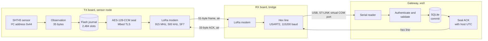

### 2.1 The layers

Each layer has one job. A layer does not depend on the internal details of a different layer.

| # | Layer | Format | Where | Section |
|---|---|---|---|---|
| 1 | Sensor bus | I²C, 6-byte reply with CRC-8 | TX | [3](#3-layer-1--sensor-bus-i2c) |
| 2 | Observation record | 22-byte head + catalog fields (35 bytes for the current build), big-endian | TX, gateway | [4](#4-layer-2--observation-record) |
| 3 | Journal | 56-byte flash slots (current build) | TX | [5](#5-layer-3--flash-journal) |
| 4 | Identity and counters | Epoch, sequence, 40-bit counter | TX, gateway | [6](#6-layer-4--identity-and-counters) |
| 5 | Secure frame | 8 + 35 + 8 bytes for the current build, AES-128-CCM | TX, gateway | [7](#7-layer-5--secure-frame-aes-128-ccm) |
| 6 | Radio | LoRa packet, 915 MHz | TX, RX | [8](#8-layer-6--radio-lora) |
| 7 | Exchange | Send, ACK window, retry | TX, RX, gateway | [9](#9-layer-7--exchange-and-retry) |
| 8 | USB serial | Hex text lines | RX, gateway | [10](#10-layer-8--usb-serial-link) |
| 9 | Storage and time | SQLite, freshness, time sync | Gateway, TX | [11](#11-layer-9--gateway-storage-and-time) |

### 2.2 The three rules that keep data safe

These three rules apply to the full stack. Do not break them.

1. **Store before send.** The TX board writes the observation to flash before it transmits. A power loss after the write does not lose the observation.
2. **Commit before ACK.** The gateway makes an ACK only after SQLite commits the observation. The RX board never makes an ACK.
3. **Never repeat a nonce.** Each frame that the TX board seals uses a new 40-bit counter. The board records each counter block in flash **before** it uses a counter from that block.

---

## 3. Layer 1 — Sensor bus (I2C)

### 3.1 Wiring

The SHT45 breakout (Adafruit 6174) connects to I2C2 of the STM32WL55. The pins come from ST UM2592 Rev 4, Table 17 [[UM2592]](#UM2592).

| Signal | Nucleo connector | Arduino name | MCU pin | Function |
|---|---|---|---|---|
| SDA | CN5 pin 9 | D14 | PA11 | I2C2_SDA (AF4) |
| SCL | CN5 pin 10 | D15 | PA12 | I2C2_SCL (AF4) |
| 3.3 V | CN6 pin 4 | 3V3 | — | Sensor supply |
| GND | CN6 pin 6 | GND | — | Ground |

**The same signals are on the ST morpho headers** (UM2592 Rev 4, Table 18 and Figure 24). No solder bridges are in the path. Use these pins with the Adafruit 4397 cable. Its female sockets cannot plug into the female Arduino headers. Hold the board component side up, with the SMA antenna connector at the top. The pins count from the top.

| Signal | Morpho pin | Position | 4397 wire (STEMMA QT colors) |
|---|---|---|---|
| SCL (PA12) | CN10 pin 3 | right edge, inner column, 2nd from top | yellow |
| SDA (PA11) | CN10 pin 5 | right edge, inner column, 3rd from top | blue |
| GND | CN10 pin 9 | right edge, inner column, 5th from top | black |
| 3.3 V | CN7 pin 16 | left edge, inner column, 8th from top | red (not CN7 pin 18, which is 5 V) |

On CN10, the odd pins are the inner column. On CN7, the odd pins are the outer column (board edge).

The bus speed is 100 kHz (standard mode). The timing register value is `0x20303E5D` at PCLK1 = 48 MHz. The 10 kΩ resistors on the breakout are the bus pull-ups. The internal pull-ups of the MCU (about 40 kΩ) are also on. Thus an unplugged breakout leaves the lines defined, and the read fails as a clean address NACK (`App/sensor.c`, changed 2026-10-13).

### 3.2 Measurement transaction

The firmware uses the code in `firmware/stage0.c`. The host tests use the same code. The node reads the sensor every 15 s and builds one observation from 4 samples (section 4.2).


The sensor gives two 16-bit raw values. Each value has its own CRC-8. The CRC uses polynomial `0x31`, initial value `0xFF`, and no final XOR [[SHT4x]](#SHT4x).

The firmware converts the raw values to integers. It does not use floating point:

- Temperature, in 0.01 °C: `T = −4500 + (17500 × S_T + 32767) / 65535`
- Relative humidity, in 0.01 %: `RH = −600 + (12500 × S_RH + 32767) / 65535`, then limited to the range 0 to 10000.

### 3.3 Faults

If the write, the read, or a CRC check fails, the function returns an error. The function does not change the output values. Every `#sample` line prints the code (`App/sensor.h`) as `rc=`:

| `rc` | Meaning |
|---:|---|
| 0 | ok |
| −2 | address NACK (sensor absent, or a wiring fault) |
| −3 | read NACK |
| −4 | CRC mismatch |
| −5 | bus still stuck after recovery |

At boot, the TX board makes one test reading. It prints `#sensor ok t=… rh=…` or `#sensor fault rc=…`. After a fault, the observation carries the **INVALID** code for both temperature and humidity (section 4.2). The gateway stores them as `null`, with `quality=sensor_fault`. The system never shows an invalid reading as a real value.

After a bus fault, the firmware does a bus recovery. A sensor can hold SDA low if it resets during a byte. The recovery does these steps:

1. Release both lines (output latch high). Then make SCL and SDA GPIO open-drain outputs. Thus the takeover never drives SCL low.
2. Give up to 9 clock pulses on SCL until the sensor releases SDA.
3. Make a STOP condition: SDA low while SCL is low, SCL high, then SDA high.
4. Start the I²C peripheral again. If SDA was still held low, the read reports −5.

The pin sequence is `ws_i2c_recover()` in `firmware/stage0.c`. A host test checks it against a model of the open-drain bus (`firmware/test_policy.c`). The test requires exactly one STOP, no accidental START, and an idle bus at the end. It covers a free bus and a device that holds SDA for 1 to 9 clocks. Before 2026-10-13, the routine left SCL low when SDA was not stuck. Thus its STOP was not a real STOP.

> **Note:** The SHT45 was wired on 2026-10-14 and gave valid readings ([`hardware/nucleo-wl55jc-bringup.md`](hardware/nucleo-wl55jc-bringup.md), "SHT45 first light"). Before that, all observations were `sensor_fault`. That was the correct behavior.

**More information:** Sensirion SHT4x datasheet [[SHT4x]](#SHT4x) · I²C specification, NXP UM10204 [[I2C]](#I2C) · bus recovery, UM10204 section 3.1.16.

---

## 4. Layer 2 — Observation record

The observation record is the **plaintext** payload. Its length depends on the fields that the build measures. All integers are big-endian (network byte order). [`protocol.md`](protocol.md) section 5 has the byte-exact rules.

### 4.1 Head (22 bytes)

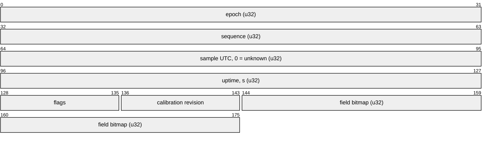

| Offset | Size | Field | Rule |
|---:|---:|---|---|
| 0 | 4 | Epoch | Boot epoch. Increases on each TX boot. Stored durably. |
| 4 | 4 | Sequence | Sample number in this epoch. Starts at 0. |
| 8 | 4 | UTC | Unix seconds at sample time (u32, valid to 2106). **0 if the time is unknown.** |
| 12 | 4 | Uptime | Seconds since the TX board booted. **Always present.** Time sync does not change it. Section 11.3 uses it. |
| 16 | 1 | Flags | Bit 0: time known (must equal UTC ≠ 0). Bits 1–2: energy state (0 SURPLUS, 1 NORMAL, 2 CONSERVE, 3 CRITICAL). Bits 3–7: 0. |
| 17 | 1 | Calibration revision | 0 in the current build. |
| 18 | 4 | Field bitmap | Bit *i* set = catalog field *i* follows. Current build: `0x03E00003` (fields 0, 1 and 21–25). |

### 4.2 Fields

The present fields follow the head, in increasing bit order. Each field has a fixed width from the **field catalog** (`firmware/common/ws_obs.h`, `ws0/fields.py`). [`protocol.md`](protocol.md) section 5.3 has the full table. The current build sends seven fields:

| Bit | Field | Bytes | Code | Valid range | INVALID |
|---:|---|---:|---|---|---|
| 0 | `temperature_c` | 2 | 0.01 °C + 4000 (so −40.00 °C = 0). Mean of the minute's valid samples. | 0–16500 = −40.00 to 125.00 °C | `0xFFFF` |
| 1 | `humidity_pct` | 2 | 0.01 %. Mean of the minute's valid samples. | 0–10000 = 0 to 100.00 % | `0xFFFF` |
| 21 | `temperature_min_c` | 2 | as bit 0: the lowest valid sample | as bit 0 | `0xFFFF` |
| 22 | `temperature_max_c` | 2 | as bit 0: the highest valid sample | as bit 0 | `0xFFFF` |
| 23 | `humidity_min_pct` | 2 | as bit 1: the lowest valid sample | as bit 1 | `0xFFFF` |
| 24 | `humidity_max_pct` | 2 | as bit 1: the highest valid sample | as bit 1 | `0xFFFF` |
| 25 | `th_samples` | 1 | count of valid samples in the minute | 0–60 | `0xFF` |

Thus the current record is 22 + 13 = **35 bytes**.

- **Every field has its own INVALID code**: its all-ones value. A sensor fault, a missing sample, or an out-of-range reading gives INVALID. The node never leaves a field out because of a fault. Only the build decides which fields are present (`App/node_fields.h`). Thus a fault does not change the frame length.
- **Out of range is INVALID, not clamped.** A temperature outside −40.00 to 125.00 °C becomes INVALID (`ws_code_temp_centi`). Relative humidity is the exception. It is clamped to 0–100 % (`ws_code_rh_centi`), as Sensirion recommends.
- **One SHT45 fault invalidates both temperature and humidity.** The two values come from one I²C reply.
- **INVALID codes are impossible values.** A reader that forgets to check gets 615.35 °C (`0xFFFF` − 4000, in 0.01 °C) or 655.35 %. Range checks reject both.

The gateway rejects a record that is not canonical. Each reading has only one correct byte form. The length must match the bitmap. Reserved bits must be 0. Each code must be in range or INVALID. The time-known flag must match the UTC field. Section 11.1 and [`protocol.md`](protocol.md) section 5.5 list the rules.

The gateway stores an INVALID field as `null`. The record's `quality` is `valid` (all present fields have values), `partial` (some are `null`) or `sensor_fault` (all are `null`). The sample count `th_samples` is metadata and does not count towards `quality`.

The triple **(station, epoch, sequence)** is the **observation identity**. Section 6 explains why this identity cannot repeat.

**Source:** `ws_obs_encode()` in `firmware/common/ws_obs.c` · `fields.encode()` and `fields.decode()` in `ws0/fields.py`.

---

## 5. Layer 3 — Flash journal

The TX board keeps each observation in internal flash until an authentic ACK arrives. This layer gives the **store before send** rule.

### 5.1 Flash map

The STM32WL55JC has 256 KB of flash in 128 pages of 2 KB. The flash programs 64 bits (one double-word) at a time. You cannot program a double-word two times without an erase. The firmware uses this property.

| Pages | Size | Contents |
|---|---|---|
| 0–54 | 110 KB | Firmware. The linker script enforces this limit. |
| 55–124 | 140 KB | Journal ring: 70 pages × 36 slots (current build) |
| 125–126 | 4 KB | Monotonic log, two pages (A and B): epochs, counter reservations, lost total, abandoned total |
| 127 | 2 KB | Configuration: station ID, key, key check value (KCV) |

A firmware update programs only pages 0–54. The configuration, the counters, and the journal stay. (Verified 2026-10-12.)

### 5.2 Slot format

The fields that the build measures set the slot size (`App/node_fields.h`, section 4). A slot is the observation plaintext rounded up to whole double-words, plus a commit double-word and an ACK double-word (`JOURNAL_SLOT_BYTES` in `App/node_store.h`).

For the current build, the plaintext is 35 bytes. It rounds up to 5 double-words (40 bytes). Thus a slot is 40 + 8 + 8 = **56 bytes**.

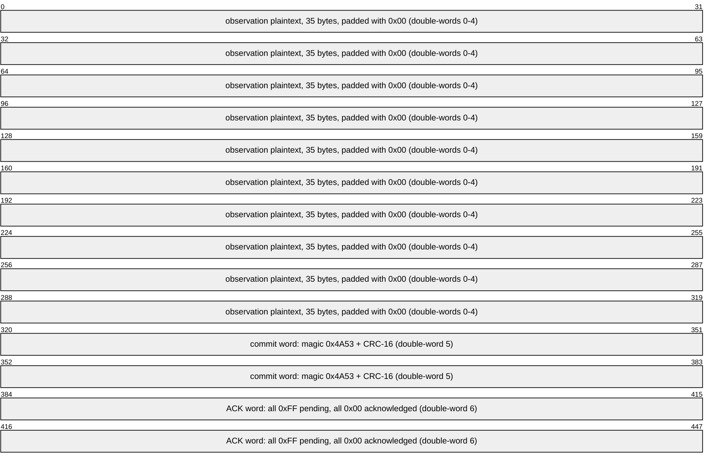

| Double-word | Bytes | Contents | Programmed |
|---:|---:|---|---|
| 0–4 | 40 | Observation plaintext (35 bytes), padded with `0x00` | First |
| 5 | 8 | Commit word: magic `0x4A53` + CRC-16/CCITT of the 35 plaintext bytes | Second |
| 6 | 8 | ACK word: all `0xFF` = pending, all `0x00` = acknowledged | When the ACK arrives |

Each journal page starts with an 8-byte header: a 32-bit magic and a 32-bit page sequence number. Then the page has (2048 − 8) / 56 = 36.4, so **36 slots**. The magic is `"WSJ"` plus the slot size in its low byte: `0x57534A38` (`WSJ8`, because 56 = `0x38` = ASCII `8`). The firmware ignores a page with another magic at boot and recycles it by the normal erase-before-reuse. Examples are a page from an older journal format, or a page from a build whose field set gives another slot size. The firmware never reads such a page as data. When the firmware reads a record back, its own field bitmap gives its length (`ws_obs_plain_len`).

### 5.3 Slot life cycle

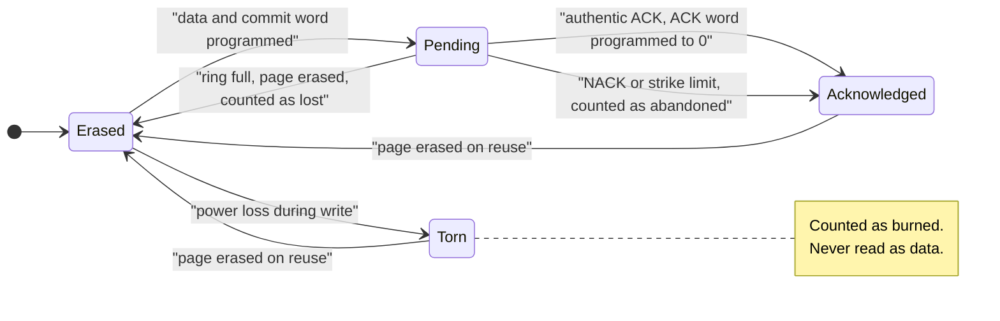

### 5.4 Power-loss behavior

A power loss can stop a flash write at any time. The firmware reads a partly written slot in one of three ways. All three are safe.

| What the scan finds | Cause | Result |
|---|---|---|
| All `0xFF` | Write did not start | Free slot |
| Data present, commit word bad or `0xFF` | Write stopped before the commit word | Counted as `burned`. Not used. |
| Double ECC error on read | Double-word write stopped in the middle | `NMI_Handler` catches it, sets `ws_flash_ecc_fault`, and returns. The slot is not used. |

If the ECC (error-correcting code) error is in the ACK word only, the firmware counts the slot as acknowledged. The gateway made that ACK after its commit, so the gateway already has the observation.

### 5.5 Capacity

One of the 70 journal pages is always being recycled. The journal therefore holds at least 69 pages × 36 slots = **2,484 observations**. At one observation each minute, this is 2,484 / 60 = **41.4 hours** without an ACK. A build with more fields has larger slots and fewer of them. The full proof-of-concept field set needs 80-byte slots, 25 per page, 1,725 records, about 28.8 hours. A build with every catalog field needs 96-byte slots, 21 per page, 1,449 records, **24.2 hours**. A compile-time check in `node_store.c` keeps this 24-hour floor. When the ring is full, the firmware erases the oldest page. It counts each pending observation on that page as `lost`.

> **Caution:** The 30-day buffer requirement (test H11) needs external SPI NOR flash. The internal journal does not satisfy H11.

> **Warning:** The power-loss behavior agrees with the design, but **nobody has tested it with real power cuts yet**. Do this test before H01.

**More information:** STM32WL5x reference manual RM0453, flash chapter (ECC and programming rules) [[RM0453]](#RM0453) · `firmware/stage0-node/App/node_store.c`.

---

## 6. Layer 4 — Identity and counters

Two different numbers prevent two different failures:

| Number | Size | Prevents | Where it is in the frame |
|---|---|---|---|
| **Epoch + sequence** | 32 + 32 bits | Two different observations with the same identity (a database collision) | Inside the encrypted plaintext |
| **Transmission counter** | 40 bits (1 to 2^40 − 1) | Two frames with the same CCM nonce (a total loss of security) | Clear header, authenticated |

A retry of one observation uses the **same identity** and a **new counter**. Thus the gateway can find duplicates, and the radio never repeats a nonce.

### 6.1 Durable reservation


Each log entry is one double-word: an 8-bit type and a 56-bit value. The counter allocator `store_next_counter` refuses to issue a counter above 2^40 − 1. The 5-byte header field would truncate it and repeat a nonce. (2^40 frames last more than 100,000 years at 20 frames a minute.) The recovery takes the maximum value of each type from both pages. A torn entry reads as an ECC error or a bad value. The firmware ignores that entry. The values only increase, so an ignored entry can only make the firmware skip numbers. It cannot make the firmware use a number again.

When a log page is full, the firmware writes the current maximum values to the other page. It writes the page header **last**. If power stops during this step, the old page stays valid.

**Example (observed 2026-10-12):** The TX board used counters 1 to 8. Then the board restarted ([`hardware/nucleo-wl55jc-bringup.md`](hardware/nucleo-wl55jc-bringup.md), "Reboot behaviour"). The next counter was **257**, because the board skips the rest of the reserved block (9 to 256). This is correct.

### 6.2 Why counter reuse is dangerous

AES-CCM uses counter mode for encryption. If two frames use the same key and nonce, an attacker can XOR the two ciphertexts and get the XOR of the two plaintexts. The authentication guarantee is also lost. RFC 3610 section 2.1 ("destroys the security properties of this mode") and NIST SP 800-38C describe this risk [[RFC3610]](#RFC3610) [[SP800-38C]](#SP800-38C).

> **Warning:** Do not restore an old copy of the TX flash state or the gateway nonce database while you keep the same key. If counter state is lost, provision a **new key** for both ends.

> **Warning:** Before release `0f456040fe54`, `WIPE ERASE-ALL-NODE-STATE` reset the node's counter to 1. From `0f456040fe54` on, it keeps the counter. The `PROVISION` epoch floor raises only the epoch (the observation identity), **not** the counter. A key used before `0f456040fe54`, or on another board, can therefore repeat nonces already sent on air. Prefer a new key. See [`runbook-moving-boards.md`](runbook-moving-boards.md).

---

## 7. Layer 5 — Secure frame (AES-128-CCM)

### 7.1 Frame format

Every frame has an 8-byte clear header and an 8-byte tag around the ciphertext. The ciphertext has the same length as the plaintext of the kind.

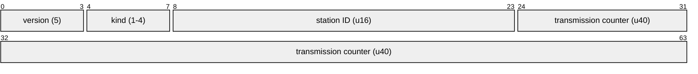

| Offset | Size | Field | Protection |
|---:|---:|---|---|
| 0 | 1 | High 4 bits: version = `5`. Low 4 bits: kind (`1` observation, `2` ACK, `3` NACK, `4` health report). So `0x51`, `0x52`, `0x53` or `0x54`. | Authenticated, clear |
| 1 | 2 | Station ID, 1 to 65,535 | Authenticated, clear |
| 3 | 5 | Transmission counter, 1 to 2^40 − 1 | Authenticated, clear |
| 8 | *n* | Ciphertext | Encrypted and authenticated |
| 8 + *n* | 8 | CCM authentication tag | — |

| Kind | Plaintext *n* | Frame |
|---|---:|---:|
| Observation, current build | 35 | **51 bytes** |
| Observation, any build | 23 to 78 | 39 to 94 bytes |
| ACK, NACK | 17 | **33 bytes** |
| Health report | 32 | **48 bytes** |

The current observation frame:

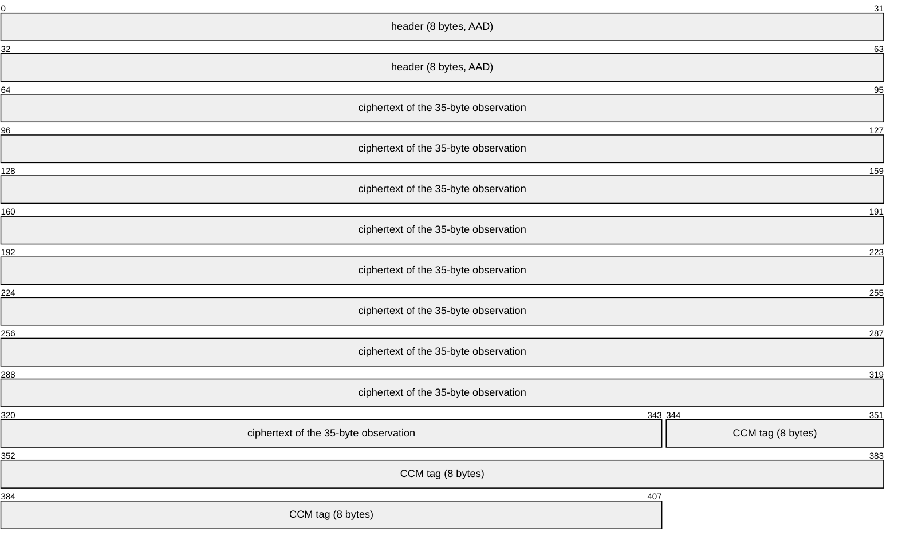

### 7.2 Nonce and associated data

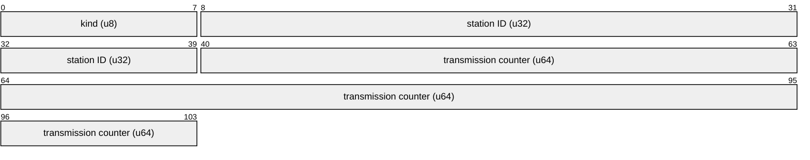

- **Nonce (13 bytes)** = kind (1 byte) + station ID as a 4-byte integer + counter as an 8-byte integer. The firmware and the gateway build it **from the integers**. They do not copy the header bytes. Kinds 1 and 4 use the node's counter space. Kinds 2 and 3 use the gateway's counter space. The kind byte makes each (kind, counter) pair different. Thus all kinds can use the same key and never share a nonce.
- **Additional authenticated data (AAD)** = all 8 header bytes. The tag covers them, but they are not encrypted. An attacker cannot change the version, the kind, the station, or the counter without a tag failure.
- **Key** = 128 bits. Each station has a different key. The gateway and the TX board share it.
- **Tag** = 64 bits (8 bytes). A forgery attempt succeeds with probability 2^−64. Each attempt is online, and airtime limits the attempts. At about 50 attempts per second, 2^64 attempts take about 10^10 years. RFC 3610 permits tags of 4 to 16 bytes. NIST SP 800-38C permits 64-bit tags.
- **Limits.** The seal function (`ws_seal_kind` in C, `seal()` in Python) refuses a station of 0 or above 65,535, a counter of 0 or above 2^40 − 1, and a kind outside 1–4. It does not truncate them. The C function then wipes its output buffer.
- **Length checks.** The gateway checks the frame length for the kind **before** it decrypts: observation 39–94 bytes, ACK and NACK 33, health report 48. The gateway drops a frame that fails, with no reply. After decryption, an observation must have exactly the length that its own field bitmap gives. If not, the gateway sends a NACK.

### 7.3 ACK plaintext (17 bytes)

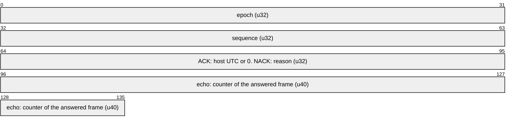

| Offset | Size | Field |
|---:|---:|---|
| 0 | 4 | Acknowledged epoch |
| 4 | 4 | Acknowledged sequence |
| 8 | 4 | Host UTC at commit (Unix seconds). **0** if the gateway measured its own clock as wrong (section 11.3). |
| 12 | 5 | **Echo**: transmission counter of the observation frame that this ACK answers |

Section 11.3 explains the echo.

### 7.3.1 NACK plaintext (kind 3, 17 bytes)

The NACK has the same layout as the ACK (diagram in section 7.3). The gateway sends a NACK only for an **authentic** frame that it must reject permanently. It first stores the raw frame in its `rejections` table. A NACK uses the gateway's ACK counter space.

| Offset | Size | Field |
|---:|---:|---|
| 0 | 4 | Epoch of the rejected observation |
| 4 | 4 | Sequence of the rejected observation |
| 8 | 4 | Reason: `1` identity collision, `2` invalid record |
| 12 | 5 | **Echo**: counter of the observation frame |

### 7.3.2 Health report plaintext (kind 4, 32 bytes)

The TX board sends the health report to the gateway and expects no reply. The report has no journal entry and no receive window. It uses the node's counter space. The gateway stores it in its `diagnostics` table. It orders the reports by (epoch, uptime), not by arrival.

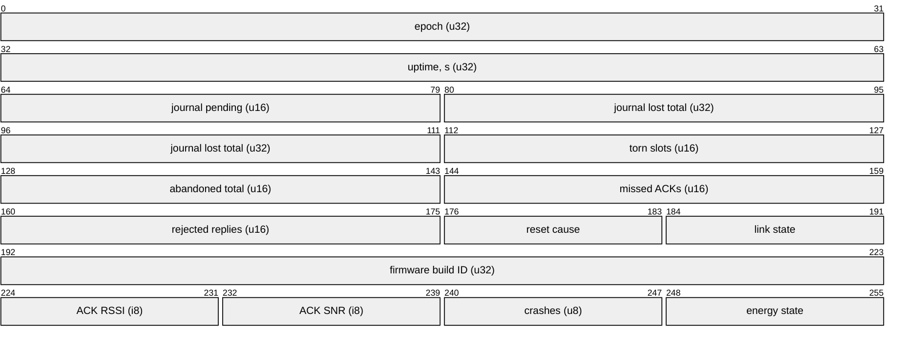

| Offset | Size | Field |
|---:|---:|---|
| 0 | 4 | Epoch |
| 4 | 4 | Uptime, seconds |
| 8 | 2 | Journal pending |
| 10 | 4 | Journal lost total (cumulative, persisted) |
| 14 | 2 | Torn (burned) slots |
| 16 | 2 | Abandoned total (cumulative, persisted) |
| 18 | 2 | Missed ACKs since boot |
| 20 | 2 | Rejected replies since boot |
| 22 | 1 | Reset cause: 0 unknown, 1 power, 2 pin, 3 brownout, 4 software, 5 watchdog, 6 lowpower, 7 option-bytes |
| 23 | 1 | Link state: 0 linked, 1 probing |
| 24 | 4 | Firmware build ID: the first 8 hex digits of the firmware version (the release commit) |
| 28 | 1 | RSSI (received signal strength) of the last authentic reply, as the TX board heard it, signed dBm. −128 = none yet. |
| 29 | 1 | SNR (signal-to-noise ratio) of that reply, signed dB. −128 = none yet. |
| 30 | 1 | Crashes since power-up (`App/fault.c`, RTC backup register DR11). Stops at 255. |
| 31 | 1 | Energy state (section 4.1) |

The 16-bit fields stop at `0xFFFF`. The RSSI and SNR show the downlink (gateway to node). The `#rx obs` line of the RX board shows the uplink. The two can be different, so check both directions at the real placement (`docs/H01-checklist.md`). The node sends a report after boot, every 15 minutes, and after each link-state change. It sends the report after that minute's exchange, also while the link is probing. (Before 2026-10-13, the node sent it only while LINKED, so the link field always read 0.)

### 7.4 Implementations

| Side | Library | Version | Pinned by |
|---|---|---|---|
| TX board | Mbed TLS (`mbedtls_ccm_*`) | 3.6.6 LTS | `tools/fetch-vendor.sh`: `STM32CubeWL` submodule `mbed-crypto` @ `7ee7e20` |
| Gateway | `cryptography` (`AESCCM`, OpenSSL) | 50.0.1 | `requirements.txt` |

The project does not have its own AES code. The test file `tests/test_frame.py` compiles the C frame code on the host. It makes sure that C and Python give the **same bytes**. It uses known-answer vectors made directly with the `cryptography` library from the specified header and nonce, and 300 random frames over the full station and counter ranges. It also does rejection tests (bad tag, wrong station, wrong key, wrong length, other version bytes). It does limit tests: counter 2^40 − 1 accepted, 2^40 refused, station 65,535 accepted, 65,536 refused. `tests/test_obs.py` checks the observation encoder. It uses a known-answer record and checks that every code makes the round trip exactly. It checks that C and Python give identical bytes for 3,000 random records.

The TX board runs a self-test at each boot (`kat=pass`). The self-test encodes the known-answer observation, seals it, and compares the frame with the stored vector. It opens a known ACK and NACK. It checks that a changed tag fails and that counter 2^40 is refused. If the test fails, the board does not transmit.

**Key check value (KCV):** The first 3 bytes of AES-128(key, 16 zero bytes). It identifies a key and does not show the key. Example: the FIPS-197 test key `000102…0f` has the KCV `c6a13b`.

**More information:** RFC 3610 (CCM) [[RFC3610]](#RFC3610) · NIST SP 800-38C [[SP800-38C]](#SP800-38C) · Mbed TLS CCM API [[MBEDTLS]](#MBEDTLS) · Python `cryptography` AESCCM [[PYCA]](#PYCA).

---

## 8. Layer 6 — Radio (LoRa)

### 8.1 Configuration

| Parameter | Value | Note |
|---|---|---|
| Frequency | 915.0 MHz | NUCLEO-WL55JC1 is the high-band board (865–928 MHz) [[DB3933]](#DB3933) |
| Modulation | LoRa (chirp spread spectrum) | — |
| Bandwidth (BW) | **500 kHz** | Gives the FCC §15.247(a)(2) digital-modulation class (see 8.3) |
| Spreading factor (SF) | SF7 | Bench value. Tune it for the H01 location. |
| Coding rate | 4/5 | — |
| Preamble | 8 symbols | — |
| Header | Explicit | The packet header contains the length |
| PHY CRC | On (16-bit) | The radio discards packets with a CRC error |
| Sync word | `0x1424` (private network) | SubGHz_Phy default. LoRaWAN uses `0x3444`. |
| IQ | Normal, both directions | — |
| Transmit power | 0 dBm | Bench value |
| Symbol timeout | **0 (off)** | See 8.4 |

All values are in `firmware/stage0-node/App/radio_cfg.h`. **The two boards must use the same values.**

### 8.2 Time on air

The symbol time is `Ts = 2^SF / BW = 128 / 500 kHz = 0.256 ms`. This formula gives the number of header, payload and CRC symbols for a payload of PL bytes. It applies with an explicit header, CRC on, coding rate 4/5, and low data rate optimization off:

`n = 8 + ceil((8 × PL − 4 × SF + 28 + 16) / (4 × SF)) × 5`

| Frame | PL | ceil(…) | n | Preamble (8 + 4.25) | **Total** |
|---|---:|---|---:|---:|---:|
| Observation (current build) | 51 | ceil(424 / 28) = 16 | 88 | 12.25 symbols | 100.25 × 0.256 = **25.7 ms** |
| ACK / NACK | 33 | ceil(280 / 28) = 10 | 58 | 12.25 symbols | 70.25 × 0.256 = **18.0 ms** |
| Health report | 48 | ceil(400 / 28) = 15 | 83 | 12.25 symbols | 95.25 × 0.256 = **24.4 ms** |

At SF12, the same frames take 534.5 ms (observation), 411.6 ms (ACK) and 493.6 ms (health report). Airtime increases in steps of 4 × SF bits: about every 3–4 bytes at SF7. The firmware uses the same formula (`ws_lora_airtime_ms()` in `firmware/common/ws_policy.c`). It rounds up to whole milliseconds: 26 ms and 18 ms at SF7.

The formula is in Semtech AN1200.13 and the SX1261/2 datasheet [[SX126X]](#SX126X). You can also use an online calculator [[AIRTIME]](#AIRTIME).

### 8.3 Regulatory basis (US)

| Rule | Limit at 902–928 MHz | Status on the bench |
|---|---|---|
| 47 CFR §15.249 | 50 mV/m at 3 m (approximately −1.25 dBm EIRP) | Not used. A 125 kHz signal at 0 dBm is near or above this limit. |
| 47 CFR §15.247(a)(1) | Frequency hopping: 50 or more channels if the 20 dB bandwidth is less than 250 kHz | Not used (one channel) |
| 47 CFR §15.247(a)(2) | Digital modulation: 6 dB bandwidth of 500 kHz or more. Up to +30 dBm. Power density 8 dBm/3 kHz or less. | **Used.** At 0 dBm, the density is approximately −22 dBm/3 kHz. |

> **Caution:** Nobody has measured the 6 dB bandwidth of these boards with a spectrum analyzer. The antenna gain is also not known. This section is an engineering reading of Part 15. It is not a compliance certificate.

**More information:** eCFR §15.247 [[FCC247]](#FCC247) · eCFR §15.249 [[FCC249]](#FCC249) · LoRa Alliance regional parameters (US915 uses 500 kHz channels) [[RP002]](#RP002).

### 8.4 Lesson: the symbol timeout

The first firmware used ST's default symbol timeout of 5 symbols. At SF7 and 500 kHz, 5 symbols is **1.3 ms**. The radio stopped the ACK window after 1.3 ms if no preamble had started. Thus the TX board missed all ACKs. It also sent backlog frames while the RX board was busy with an ACK, so those frames were lost.

The firmware now sets the symbol timeout to 0 (off). The firmware's own 2-second window timer stops the receive operation. **If you change the SF or the bandwidth, calculate the symbol time again.**

### 8.5 Measured link (bench, 2026-10-12)

The boards were approximately 30 cm apart, at 0 dBm. Source: [`hardware/nucleo-wl55jc-bringup.md`](hardware/nucleo-wl55jc-bringup.md), "Stage-0 firmware bring-up" (end-to-end link, epoch 2, seq 0–12, trial-and-error item 1).

| Measure | Value |
|---|---|
| Readings delivered | seq 0–12, `pending=0` |
| RSSI | −23 / −24 dBm |
| SNR | 12 to 13 dB |
| After the symbol-timeout fix | `sent=3 acked=3 no_ack=0` |

This is a bench result. It is not a range result. H01 requires a test at the real locations.

---

## 9. Layer 7 — Exchange and retry

### 9.1 One minute of operation

This diagram shows one minute in the LINKED state. Section 9.4 gives the transmission policy that limits the backlog and the PROBING state.

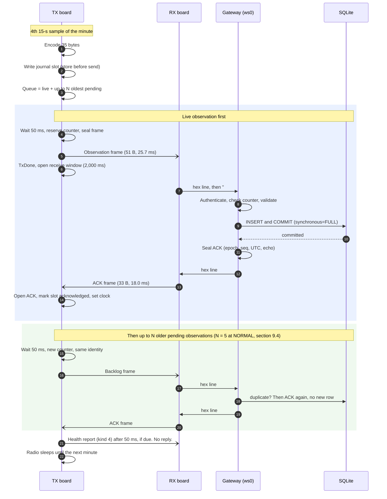

### 9.2 TX exchange state machine

`App/tx_exchange.c` runs the exchange as a state machine. Only events that are certain to come move it: the radio's TxDone or TxTimeout, the ACK window timer (2,000 ms), and the gap timer (50 ms). [`firmware-event-model.md`](firmware-event-model.md) has the full event table.

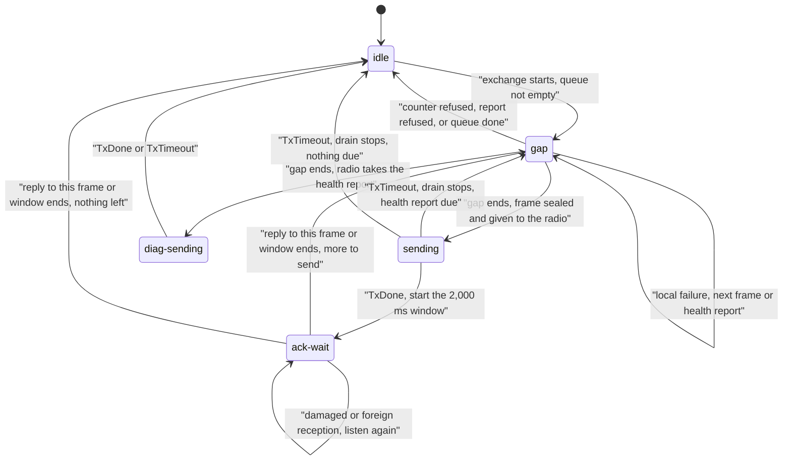

- In the gap state, a local failure (journal read, seal, radio busy) skips the frame. The exchange moves to the next frame after a new gap.
- A refused counter reservation ends the exchange at once. The policy still gets the replies so far.
- When the queue is done, the policy updates the link state and the strikes. If a health report is due, the exchange waits one more gap and sends it.
- Each way out of ack-wait puts the radio in standby first. Idle puts the radio to sleep.
- If the exchange takes longer than its worst case, `exchange_abort()` stops the timers and the radio and returns to idle.

### 9.3 Rules

- **Live first.** The current observation goes first. The backlog cannot delay new data.
- **Bounded backlog.** Each minute sends N old observations at most (section 9.4). At NORMAL (N = 5), a full 41-hour journal (2,484 records) clears in approximately 8.3 hours (2,484 / 5 = 497 minutes). In CONSERVE (N = 0) the backlog does not clear. The 30-day buffer test (H11) must examine this rate.
- **A retry is the same data.** A retry has the same identity and a new counter. The gateway stores it once and sends the ACK again.
- **The RX board does not decide.** It forwards frames with the correct version, kind and length. Upstream, that is an observation of 39–94 bytes or a 48-byte health report (`ws_air_frame_ok`). Downstream, it is a 33-byte ACK or NACK (`ws_host_reply_ok`). It does not check the tag. It has no key.
- **Any authentic ACK clears its own slot.** An ACK can arrive late. It still clears the correct slot.

### 9.4 Transmission policy

Source: [`radio-energy-policy.md`](radio-energy-policy.md), `App/tx_policy.c` and `firmware/common/ws_policy.c`. The stricter of the energy state and the link state applies.

| Energy state | Backlog per minute | Radio time per minute | Note |
|---|---:|---:|---|
| SURPLUS | 20 | 15 s | — |
| NORMAL | 5 | 5 s | **The bench prototype is fixed at NORMAL** (USB power) |
| CONSERVE | 0 | 2 s | Live reading only, at most every 300 s |
| CRITICAL | 0 | 0 | Nothing is sent. Readings stay in the journal. |

- **Airtime cap.** The firmware estimates one answered exchange as observation airtime + ACK airtime + 300 ms. That is 26 + 18 + 300 = 344 ms at SF7 and 500 kHz (`exchange_ms` in `App/tx_policy.c`). The number of frames in a minute is limited to the radio time ÷ 344 ms. For the 5 s NORMAL cap that is 14, so the NORMAL backlog limit of 5 applies. The live reading always fits.
- **The drain stops one frame after a miss.** If a frame gets no reply, the node sends one more frame of the planned queue, then stops. A second miss in a row, or a transmit timeout, stops it at once. The one more frame lets a strike tell a record that the gateway refuses from a lossy link (section 9.5).
- **PROBING.** After 3 consecutive minutes with no answer, the link state becomes PROBING. The node then sends the live reading only, with no backlog. In SURPLUS and NORMAL, the live reading still goes every minute, so the bench prototype always sends every minute. Only CONSERVE waits 120 s, 240 s and 480 s, then every 900 s (`ws_link_may_send()` in `firmware/stage0.c`, changed 2026-10-13). Any answer to a sent frame makes the link LINKED again. The node also sends the health report while probing, with link state 1.

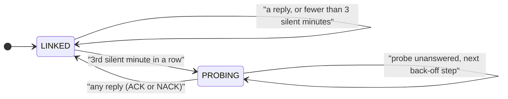

- **Simulator.** The Python simulator (`ws0/simulator.py`, `BACKLOG_PER_MINUTE = 5`) drains 5 records per minute, like NORMAL. It sends the live reading every minute. It does not model the drain stop or PROBING. In NORMAL, its delivery timing matches the firmware.

### 9.5 NACK and abandoned records

A record leaves the journal without an ACK in three cases. The node counts each case, and the counts go into the health report (section 7.3.2).

1. **NACK.** The gateway authenticated the frame but must reject it permanently (identity collision or invalid record). The node accepts a NACK only if its echo, epoch and sequence match the frame just sent. It marks the slot done and adds 1 to the persisted `abandoned` total.
2. **Strike limit.** A record earns a strike when it gets no reply but a frame sent **after** it in the same exchange gets one. At 10 strikes, the node abandons the record and counts it (`STRIKE_LIMIT` 10, 6 tracking slots). An answer to an earlier frame proves nothing, because on a weak link the next frame can be lost. Thus a link or gateway outage never abandons data. A refused record that is the only backlog is the minute's last frame. No later frame can show that the gateway refuses it. Thus the node retries it each minute (one frame) and never abandons it.
3. **Ring overflow.** The firmware erases the oldest page and counts its pending records as `lost` (section 5.5).

### 9.6 Failure cases

| Failure | Result | Recovery |
|---|---|---|
| Observation frame lost on air | No ACK in 2 s. Red LED on TX. | Next minute: sent again as backlog |
| ACK lost on air | Gateway has the row. TX keeps the slot. | Next minute: duplicate. Gateway gives the ACK again. No second row. |
| Gateway not running | RX prints the frame. Nobody answers. | TX keeps observations for about 41 hours |
| Database commit fails | No ACK | TX keeps the slot and sends it again |
| Authentic frame, identity collision or invalid record | Gateway stores the frame in `rejections`. It sends a NACK. | TX abandons the record (section 9.5) |
| Gateway silent for 3 minutes | TX goes to PROBING | Live reading every minute in SURPLUS and NORMAL. Probes after 120, 240 and 480 s, then every 900 s, in CONSERVE. The backlog drains after the link returns. |
| TX power loss | Unsent slots stay in flash | After boot: new epoch, backlog sent first-in, first-out |
| RX power loss | Frames are lost while RX is off | TX backlog |
| Forged or changed frame | Tag fails | Gateway rejects it and logs it. No ACK. |
| Replayed old frame | Tag is valid. Counter at or below the gateway's mark. Same bytes as the frame first accepted. | No reply. Stored in `rejections` as `replay` and counted. No alarm (section 11.1). |

---

## 10. Layer 8 — USB serial link

### 10.1 Physical path

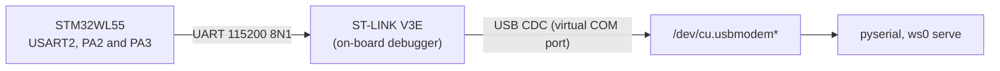

The ST-LINK on each Nucleo board makes the USB virtual COM port. The port name changes when you move the cable. **Identify a board by its ST-LINK serial number, not by its port name.**

### 10.2 Line format

| Direction | Line | Meaning |
|---|---|---|
| RX to host | Lowercase hex digits + `\n`: 102 for a current observation (51 bytes), 96 for a health report (48 bytes). Any observation of 39–94 bytes is forwarded. | One observation or health-report frame (kind 1 or 4) |
| RX to host | `#rx obs rssi=-23 snr=13` | Diagnostic for the line before (also printed for kind 4) |
| RX to host | `#rx drop …`, `#rx crc …`, `#rx hdr …`, `#tx timeout`, `#tx busy`, `#host reject …`, `#boot …`, `#status …`, `#watchdog radio not listening; re-arming` | Diagnostics |
| RX to host | `#alive uptime=… forwarded=… dropped=… acks=… diag=… listening=…` | Every 60 s. The gateway marks the receiver silent after 180 s without it. |
| host to RX | 66 hex digits + `\n` (33 bytes) | One ACK or NACK frame (kind 2 or 3). The RX board transmits it once, with the uplink radio settings. |
| host to RX | `STATUS` | Ask for counters |

Rules:

- A line is 256 bytes or less. The gateway discards a longer line.
- A line that starts with `#` is a diagnostic. The gateway writes it to `receiver.log` in its run directory (`--directory`, for example `run-hw/` at home or `run-office/` at the office). It never decodes it as a frame. It reads the fields of `#alive` and `#boot role=rx` only for receiver liveness.
- The gateway writes each frame and its ACK or NACK to `receiver.log`, with the UTC time (`frame <hex> -> ack <hex>` or `-> nack <hex>`, and health reports as `diag <hex>`). This file is evidence for H01.
- The serial read timeout is 50 ms. The gateway answers a frame immediately. (The TX ACK window is 2 s.)
- While the RX console holds a complete line for processing, it drops more input. The host sends one line for each exchange.

### 10.3 TX console (not part of the data path)

The TX board also has a console. It is for provisioning and diagnostics. All lines from the TX board start with `#`.

| Command | Function |
|---|---|
| `STATUS` | Shows provisioning, KCV, self-test, epoch, sequence, time quality, and journal counters |
| `KAT` | Runs the boot self-test again: observation encoding and sealing, ACK, tampered ACK, NACK, and the refusal of counter 2^40 |
| `PROVISION <id> <32 hex> [epoch_floor]` | Writes the station ID (1 to 65,535) and the key. Only on an empty board. The optional epoch floor raises the next epoch above every epoch that the gateway stored. Thus a wiped board never repeats an **observation identity**. It does not change the transmission counter. |
| `WIPE ERASE-ALL-NODE-STATE` | Erases the key and the journal. Keeps the counter, the epoch, and the `lost` and `abandoned` totals. **You must then provision a new key** (section 6.2, [`runbook-moving-boards.md`](runbook-moving-boards.md)). |
| `TEST-HANG` | Bench only. Stops the main loop. The watchdog must reset the board in approximately 8 s. |
| `TEST-FLASH-STORM` | Bench only. Writes flash continuously for power-cut tests. Its slots use epoch `0xFFFFFFFF`. The next boot removes any of them that a cut left pending. |

Use `python -m ws0 provision-node`. Do not type the key by hand. The tool calculates the epoch floor from the gateway database. It compares the KCV of the board with the KCV of the gateway key.

**More information:** UM2592 section on the STLINK-V3E virtual COM port [[UM2592]](#UM2592) · pyserial [[PYSERIAL]](#PYSERIAL).

---

## 11. Layer 9 — Gateway, storage, and time

### 11.1 Frame processing

`Gateway.receive()` in `ws0/service.py` processes each hex line from the RX board:

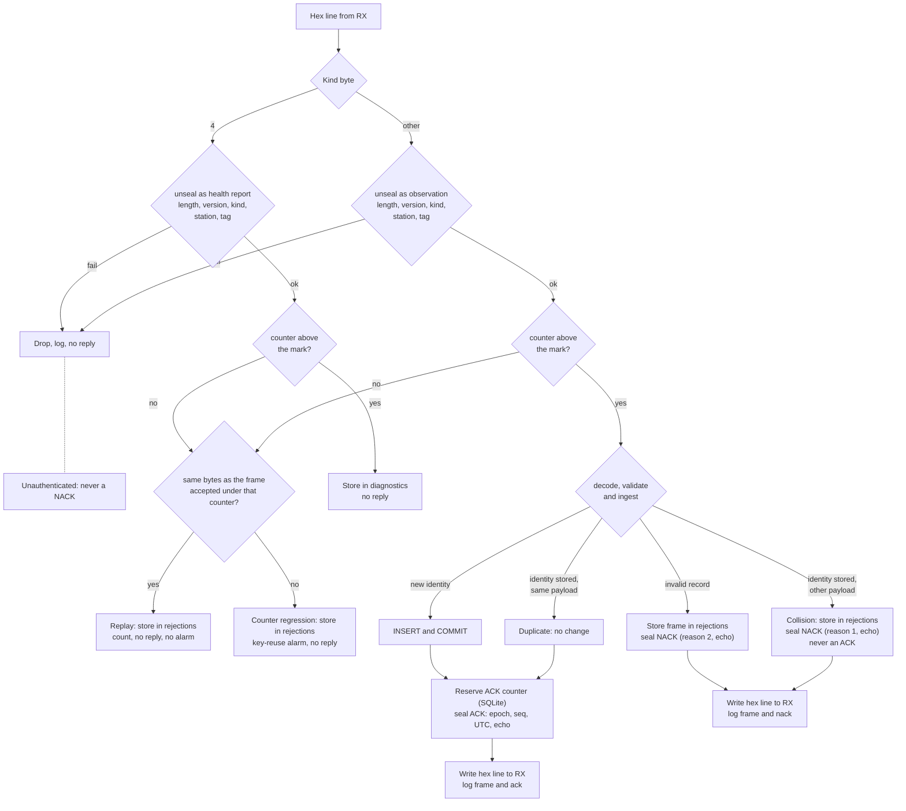

A commit failure (`OSError` or `sqlite3.Error`) gives no reply. The node keeps the record and sends it again.

**Replay or key reuse.** The gateway keeps a high-water mark of the node counter. It also keeps the SHA-256 of each authentic node frame that it accepted as fresh, by counter (nonce database, tables `node_counter` and `node_frames`). The gateway never answers an authentic frame at or below the mark and never stores it as data:

- **Same bytes** as the frame accepted under that counter: a **replay**. Anyone who recorded a frame can do this. It is harmless. The gateway counts it (`replays`) and keeps it in `rejections` with reason `replay`. It raises no alarm.
- **Different bytes** under a counter that was used, or a counter that was never accepted: a **counter regression**. The node never repeats a counter, and a direct LoRa link cannot reorder frames. Thus this means a repeated nonce (a reused key). The gateway keeps the frame in `rejections` with reason `counter_regression`. It raises the persistent `/v1/status` alarm "possible key reuse: re-key the node".

### 11.2 Storage rules

- SQLite uses `PRAGMA synchronous=FULL` [[SQLITE]](#SQLITE), plus `PRAGMA fullfsync=ON` and `checkpoint_fullfsync=ON`. On macOS, `fsync()` does not flush the drive cache, but `F_FULLFSYNC` does. Thus the commit is on stable storage before the ACK exists (`gateway.py`, `full_flush`). Both databases use a write-ahead log (WAL). Simulations and unit tests can switch durability off with `WS0_UNSAFE_FAST_FSYNC=1` (`synchronous=OFF`, no `fullfsync`). Results made that way do not show power-loss durability.
- The gateway ACK counters use a `BEGIN IMMEDIATE` transaction. The counter is in the database before the gateway seals the ACK.
- The nonce database is bound to the key fingerprint, the station, and the direction. A different key cannot use it by accident.
- An authentic frame that the gateway must reject permanently goes into the `rejections` table (station, session, sequence, received_at, reason, detail, frame_hex) **before** the gateway seals the NACK.
- The gateway **quarantines** a sample time more than 5 s after the receipt time (`future_clock_at_receipt`). Waiting does not make it valid.
- An observation is **available** for 180 s after its sample time, only if its clock is known. Availability is decided **per field**. A field is available only if its own value is not `null` (`fields_available` in `/v1/observations/latest`, and one Home Assistant entity per field). A dead sensor does not hide the other fields. After 180 s, Home Assistant and the API show the fields as unavailable.
- Since-boot counters (rain tips, energy, charge) must not decrease **in sequence order** within one epoch. The gateway compares a new record with its stored neighbours by sequence, not by arrival. Thus it accepts a late backlog record. A decrease is an invalid record (NACK reason 2).

### 11.3 Time synchronization

The TX board has no clock source at boot. It gets the UTC time from the ACK.

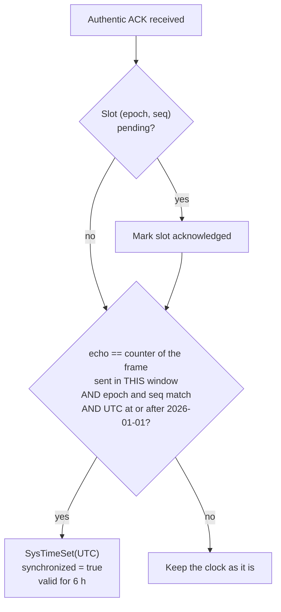

**Host clock check.** The gateway is the only time source. It measures its own clock with SNTP at start and every hour (`ws0/clock.py`). If the offset is more than 1 s, every ACK carries UTC **0**. The TX board then does not change its clock, because 0 is before 2026-01-01. If no measurement is possible, the gateway still sends its time and shows `unverified` in `/v1/status`.

**Why the echo is necessary.** An attacker can record an authentic ACK. Later, the attacker can jam the real ACK and send the recorded ACK. Without the echo, the TX board would accept the old time. With the echo, the old ACK has an old counter. The TX board uses a new counter for each frame, so the old ACK does not match. The attacker cannot make a new valid echo without the key.

**Accuracy.** The gateway writes its time at the commit. The TX board sets its clock when the ACK arrives. The TX clock is late by the time between these two events. This time is normally much less than 1 s (two airtimes + USB + commit). Nobody has measured it exactly yet.

**Drift.** The RTC uses the 32.768 kHz LSE crystal. A tuning-fork crystal drifts approximately 20 ppm at room temperature. Its error increases with the square of the temperature difference. At −35 °C it can be more than 120 ppm. After 6 hours without an ACK, the TX board marks new samples `time unknown` (UTC = 0).

#### 11.3.1 Time across a reset

A system reset (RESET button, NRST, software reset, watchdog) does not stop the RTC or clear its backup registers. The TX board keeps a trust marker in two backup registers: a magic value and the RTC second of the last sync. At boot, the board trusts its clock again only if all of these are true:

- the marker is present,
- the RTC counted forward since the sync,
- the sync is less than 6 hours old,
- the clock shows a plausible date (2026-01-01 or later).

If a power loss clears the backup domain, the marker is gone. The board then starts with `time unknown`.

**Open:** Nobody has checked yet whether a real power loss clears the backup domain on this board (VBAT supply). Check it against the board schematic and with a true power-removal test (deferred). A simulated loss (the debugger pulsed `RCC_BDCR.BDRST`) gave no restore and `time=unknown` ([`hardware/nucleo-wl55jc-bringup.md`](hardware/nucleo-wl55jc-bringup.md)).

**Bench result (2026-10-12):** after a warm reset, the board printed `#time restored … sync_age=11`. Its first reading in the new epoch was synchronized. The difference between board and host was −1.0 s (same log).

#### 11.3.2 Reconstructed time

Every observation carries **uptime**: whole seconds since the TX board booted. Time sync does not change uptime. Thus all readings of one epoch share one monotonic time line. When the gateway has at least one **synchronized** reading of an epoch, it calculates the time of every unsynchronized reading of the same epoch:

`effective_time = ref_utc + (uptime − ref_uptime)`, with the synchronized reading nearest in uptime.

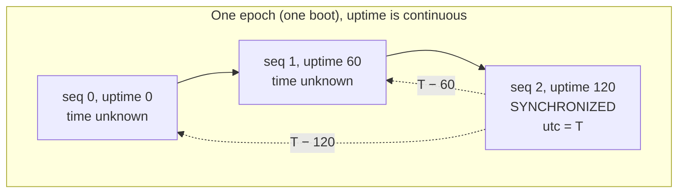

Rules:

- The raw payload does not change. It stays immutable and stays the deduplication authority. The result goes into separate columns: `effective_at`, `time_basis` (`synchronized`, `reconstructed`, or `unknown`), and `time_uncertainty_s`.
- **Uncertainty** = 2 s (whole-second quantization of two fields) + 150 ppm × |uptime − ref_uptime|. Example: 2 s after one minute, about 41 s after a 3-day outage.
- The gateway never uses a quarantined reference (its clock was ahead of its receipt time).
- The gateway never shows a reading with an uncertainty above 10 s as **current**. The reading stays in the history with its error bound.
- **H01:** a reconstructed time counts as a known acquisition time when it meets the same 5 s tolerance. The project owner decided this on 2026-10-12. Reports give the reconstructed count separately.
- **Limit:** an epoch that ends (reboot) before its first synchronized reading has no reference. Its readings stay `unknown`. With the trust marker of section 11.3.1, only a power loss followed by a reboot before the first ACK causes this.

**Bench result (2026-10-12):** a simulated power loss (backup-domain reset) started epoch 8 with no time. One minute later, the gateway reconstructed reading 0 as 03:15:34Z ± 2.0 s. The board log shows the sample at 03:15:35Z.

**Simulation:** scenario `reboot-during-outage` reboots the node in the middle of a 60-minute link outage. All 32 buffered unsynchronized readings got a correct time. None stayed unresolved.

### 11.4 Upward interfaces (summary)

| Interface | Address | Notes |
|---|---|---|
| HTTP API | `127.0.0.1:8088`, bearer token | `/v1/status`, `/v1/observations/latest`, `/v1/observations` (JSON or CSV) |
| MQTT | `weatherstation/v1/{station}/…` | Off by default. Home Assistant discovery is available. Verified against a local Mosquitto broker on 2026-10-13 (`evidence/mqtt-local-broker-2026-10-13/`). Not yet tested against the real Home Assistant broker. |

See [`openapi.json`](openapi.json) and the firmware README ([`../firmware/stage0-node/README.md`](../firmware/stage0-node/README.md)).

---

## 12. Worked example: the known-answer frames

The boot self-test of the TX board and `tests/test_frame.py` share these frames (`KAT_OBS` and `KAT_ACK` in `App/selftest.c`). They use the FIPS-197 test key `000102…0f` and station 1. The gateway code opens them (`ws0/protocol.py`).

### 12.1 Observation frame (TX to gateway)

42 bytes:

```text
5100010100000002 bd50c6be3400a750d40cca5aadad57b716f16658a09d968acf9a 212d7f2e95a5e34f
```

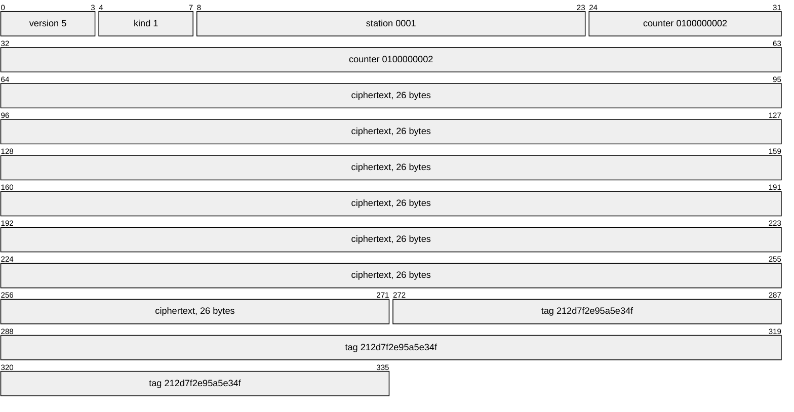

The gateway opens it with the station key. The plaintext is 26 bytes. It has temperature and humidity only (bitmap `0x00000003`), not the minute summary of the current build:

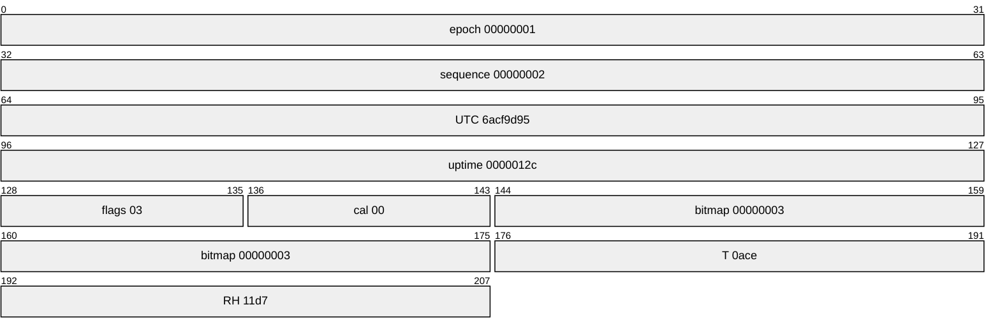

`decode_observation()` gives: epoch 1, sequence 2, `sampled_at` 1791991189, uptime 300 s, `time_quality` `synchronized`, `energy_state` `normal`, `temperature_c` −12.34, `humidity_pct` 45.67, `quality` `valid`.

### 12.2 ACK frame (gateway to TX)

33 bytes:

```text
5200010000000005 0e1eb4544766f4e6e0ffdbb3f6d1413d06 f6369500199b8fe2
```

```mermaid
packet-beta
  0-3: "version 5"
  4-7: "kind 2"
  8-23: "station 0001"
  24-63: "counter 0000000005"
  64-199: "ciphertext, 17 bytes"
  200-263: "tag f6369500199b8fe2"
```

Plaintext:

```mermaid
packet-beta
  0-31: "epoch 00000011 (17)"
  32-63: "sequence 0000002a (42)"
  64-95: "UTC 68e77800"
  96-135: "echo 0100000002"
```

The echo `0x0100000002` is equal to the counter of the observation frame. The counter of the ACK (5) comes from the gateway's own counter space. This vector is for the self-test only. Its UTC (1760000000) is before 2026-01-01, so a node would not set its clock from it.

### 12.3 Try it yourself

The script opens the logged exchanges of protocol version 5. It skips frames of other versions. Give the run directory as the argument.

```sh
# Decode the logged exchanges (needs the key in <run dir>/gateway.json; prints no key)
.venv/bin/python - run-hw <<'EOF'
import json, re, sys
from pathlib import Path
from ws0.protocol import unseal, frame_counter, frame_kind, unpack_reply, decode_observation, KIND_OBS
run = Path(sys.argv[1] if len(sys.argv) > 1 else 'run-hw')
cfg = json.loads((run/'gateway.json').read_text())
key, sid = bytes.fromhex(cfg['radio_key']), cfg['station_id']
for line in open(run/'receiver.log'):
    m = re.search(r'(\S+) frame (\w+) -> (ack|nack) (\w+)', line)
    if not m:
        continue
    f, a = bytes.fromhex(m[2]), bytes.fromhex(m[4])
    if frame_kind(f) != KIND_OBS:
        continue  # frames of other protocol versions cannot be opened by this code
    record = decode_observation(unseal(key, sid, KIND_OBS, f), cfg['station'])
    reply = unpack_reply(unseal(key, sid, frame_kind(a), a))  # (epoch, sequence, UTC or reason, echo)
    print(m[1], frame_counter(f), record, m[3], reply)
EOF
```

---

## 13. Security summary

| Threat | Protection | Limit |
|---|---|---|
| Read observations on air | AES-128-CCM encryption | — |
| Change or forge a frame | 64-bit CCM tag over header and payload | 2^−64 per attempt. Airtime limits the attempts (section 7.2). |
| Replay an old observation | Counter mark + SHA-256 of each accepted frame. An exact copy is a replay and is never answered. Identity deduplication. Freshness uses identity, not arrival. | Replays are counted (`replays`) and kept in `rejections`. No alarm. |
| Replay an old ACK to move the clock | Counter echo (section 11.3) | — |
| Replay an old ACK to clear a slot | Clears only the slot that the gateway already committed | No data loss |
| Nonce reuse after reset | Durable counter reservation (section 6). Counter refused past 2^40 − 1. | Do not clone or roll back flash state |
| Nonce reuse after a key is used again | The gateway raises the key-reuse alarm for an authentic frame at or below its counter mark whose bytes differ from the frame it accepted under that counter (section 11.1) | Detected, not prevented: re-key |
| RX board is compromised | RX has no key. It can only drop or delay frames. | Drop = backlog. Delay = late data. |
| Key extraction from the TX board | **None on the bench prototype.** Readout protection (RDP) is at level 0 (`FLASH_OPTR` = `0x3FFFF0AA` on both boards, [`hardware/nucleo-wl55jc-bringup.md`](hardware/nucleo-wl55jc-bringup.md), board inventory). The key is in plain flash. | Use RDP level 1 or higher before field use |
| Radio jamming | None (physical layer) | The backlog survives about 41 hours |

---

## 14. Change control

When you change the protocol, do these steps:

1. Increase the version (the high 4 bits of byte 0). Old frames must fail at the header check. A change of the frame format also needs a **new key** ([`protocol.md`](protocol.md) section 2).
2. Update [`protocol.md`](protocol.md) and this document.
3. Update `ws0/protocol.py` and `firmware/common/ws_frame.{c,h}` together. Update `ws0/fields.py` and `firmware/common/ws_obs.{c,h}` together.
4. Make new known-answer vectors directly with the `cryptography` library from the specified header and nonce (not with `ws0/protocol.py`). Put them in `tests/test_frame.py` **and** `App/selftest.c`.
5. Run `WS0_UNSAFE_FAST_FSYNC=1 .venv/bin/python -m unittest discover -s tests` and `make -C firmware/fuzz check`. All must pass.
6. Run the harness into a **new** output directory. Do not overwrite old evidence.
7. Build both roles. Record the binary SHA-256 values. Flash **both** boards. A version mismatch stops all traffic.

---

## 15. Glossary

| Term | Meaning |
|---|---|
| AAD | Additional authenticated data. Data that the tag protects but does not encrypt. |
| ACK | Acknowledgment. Here: an encrypted frame from the gateway that confirms a database commit. |
| Bench prototype | The current system: two NUCLEO-WL55JC1 boards and a gateway computer, on USB power. Stage 0 of the staged plan. |
| CCM | Counter with CBC-MAC. An authenticated encryption mode: it encrypts and authenticates. |
| ECC | Error-correcting code. The flash adds it to each double-word. |
| Epoch | A number that increases at each TX boot. |
| H01 | The 24-hour delivery test of the bench prototype at the real locations ([`H01-checklist.md`](H01-checklist.md)). |
| H11 | The 30-day buffer test of the product requirements. It needs external SPI NOR flash. |
| KAT | Known-answer test. Fixed input, fixed expected output. |
| KCV | Key check value. Identifies a key and does not show it. |
| LoRa | A chirp spread-spectrum modulation by Semtech. |
| NACK | Negative acknowledgment. An encrypted frame from the gateway that rejects an authentic record permanently. |
| Nonce | A number used once. CCM fails if a nonce repeats with the same key. |
| RDP | Readout protection of the STM32 flash. |
| RSSI / SNR | Received signal strength indicator / signal-to-noise ratio. |
| RX board / TX board | The receiving bridge / the transmitting sensor node. |
| SF | Spreading factor. A higher SF gives a longer range and a longer airtime. |

---

## 16. References

| Key | Source |
|---|---|
| <a id="STE"></a>STE | ASD-STE100 Simplified Technical English — <https://www.asd-ste100.org/> |
| <a id="UM2592"></a>UM2592 | ST, *STM32WL Nucleo-64 board (MB1389)*, user manual, Rev 4 — <https://www.st.com/resource/en/user_manual/um2592-stm32wl-nucleo64-board-mb1389-stmicroelectronics.pdf> |
| <a id="DB3933"></a>DB3933 | ST, *NUCLEO-WL55JC* data brief — <https://www.st.com/en/evaluation-tools/nucleo-wl55jc.html> |
| <a id="RM0453"></a>RM0453 | ST, STM32WL5x reference manual (flash, ECC, SUBGHZ radio) — <https://www.st.com/en/microcontrollers-microprocessors/stm32wl55jc.html> (Documentation tab) |
| CubeWL | ST, STM32CubeWL v1.6.0 (HAL, SubGHz_Phy, Mbed TLS) — <https://github.com/STMicroelectronics/STM32CubeWL> |
| <a id="SX126X"></a>SX126X | Semtech SX1261/2 (the radio core in STM32WL): time-on-air formula, sync word, symbol timeout — <https://www.semtech.com/products/wireless-rf/lora-connect/sx1262> |
| <a id="AIRTIME"></a>AIRTIME | LoRa airtime calculator (select US915, 500 kHz, SF7, 51 bytes) — <https://avbentem.github.io/airtime-calculator/> |
| <a id="RP002"></a>RP002 | LoRa Alliance, *RP002 Regional Parameters* — <https://resources.lora-alliance.org/technical-specifications> |
| <a id="FCC247"></a>FCC247 | 47 CFR §15.247 — <https://www.ecfr.gov/current/title-47/chapter-I/subchapter-A/part-15/subpart-C/section-15.247> |
| <a id="FCC249"></a>FCC249 | 47 CFR §15.249 — <https://www.ecfr.gov/current/title-47/chapter-I/subchapter-A/part-15/subpart-C/section-15.249> |
| <a id="RFC3610"></a>RFC3610 | *Counter with CBC-MAC (CCM)* — <https://www.rfc-editor.org/rfc/rfc3610> |
| <a id="SP800-38C"></a>SP800-38C | NIST, *Recommendation for Block Cipher Modes: CCM* — <https://csrc.nist.gov/pubs/sp/800/38/c/upd1/final> |
| <a id="MBEDTLS"></a>MBEDTLS | Mbed TLS project and docs — <https://github.com/Mbed-TLS/mbedtls> · <https://mbed-tls.readthedocs.io/> |
| <a id="PYCA"></a>PYCA | `cryptography` AESCCM — <https://cryptography.io/en/latest/hazmat/primitives/aead/#cryptography.hazmat.primitives.ciphers.aead.AESCCM> |
| <a id="SHT4x"></a>SHT4x | Sensirion SHT4x datasheet (commands, CRC, conversion) — <https://sensirion.com/resource/datasheet/sht4x> |
| <a id="I2C"></a>I2C | NXP UM10204, *I²C-bus specification* (bus clear, 3.1.16) — <https://www.nxp.com/docs/en/user-guide/UM10204.pdf> |
| <a id="SQLITE"></a>SQLITE | SQLite `PRAGMA synchronous` — <https://www.sqlite.org/pragma.html#pragma_synchronous> |
| <a id="PYSERIAL"></a>PYSERIAL | pyserial — <https://pyserial.readthedocs.io/> |

Project sources: [`protocol.md`](protocol.md) · [`hardware/nucleo-wl55jc-bringup.md`](hardware/nucleo-wl55jc-bringup.md) · [`../firmware/stage0-node/README.md`](../firmware/stage0-node/README.md) · [`../ws0/protocol.py`](../ws0/protocol.py) · [`../firmware/common/ws_frame.c`](../firmware/common/ws_frame.c) · [`../tests/test_frame.py`](../tests/test_frame.py)

> **Link check (2026-10-12):** All links returned HTTP 200, with two exceptions. The `st.com` links timed out for scripts, and `nxp.com` returned 404 to all scripted requests (including its search page). These two sites block automated requests. The UM2592 link is the URL of the PDF that the project used.
