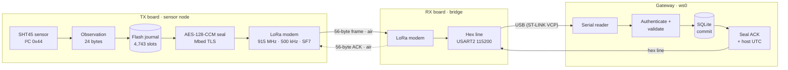
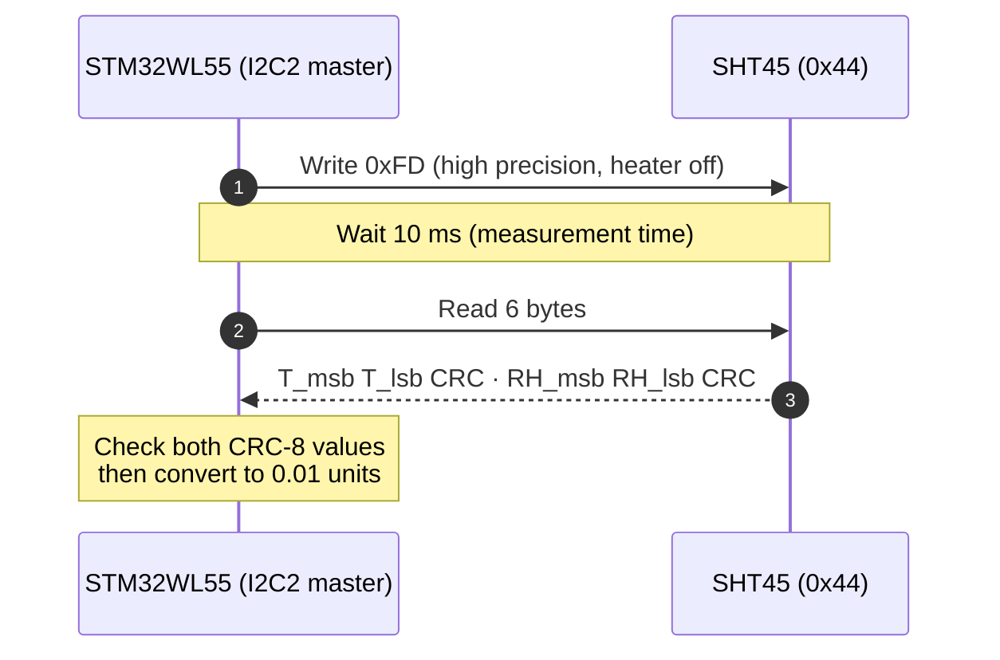
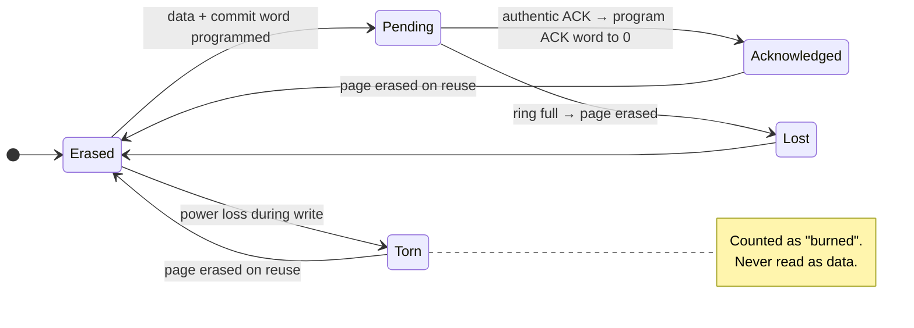
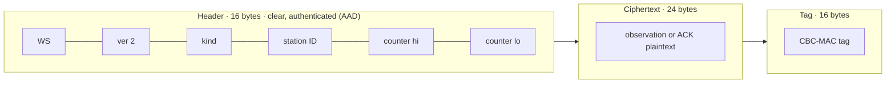
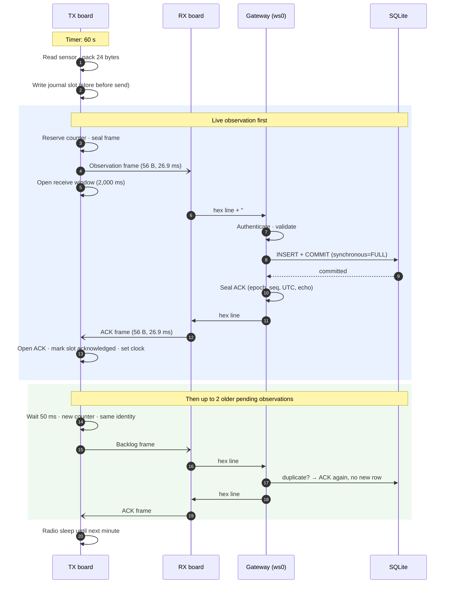
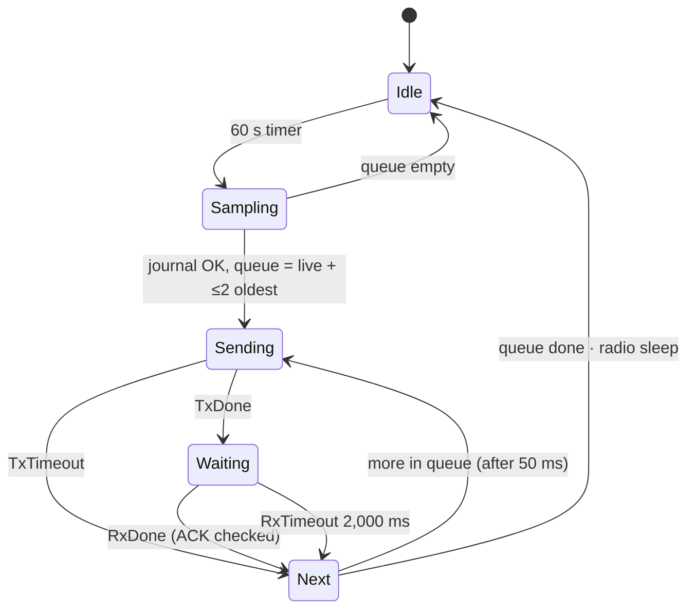
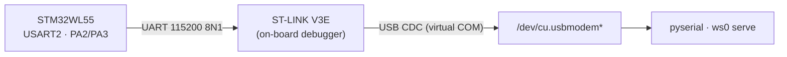
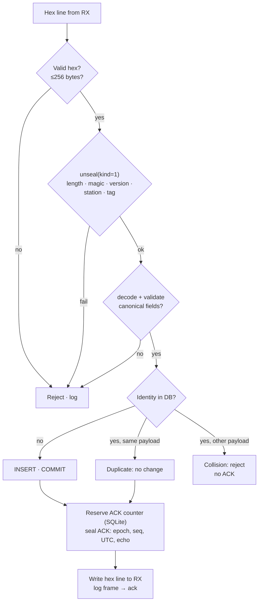
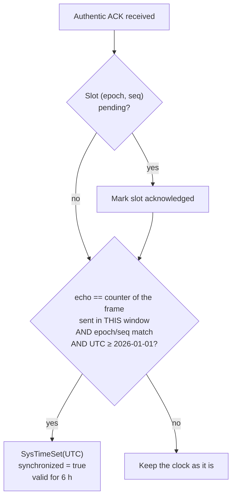
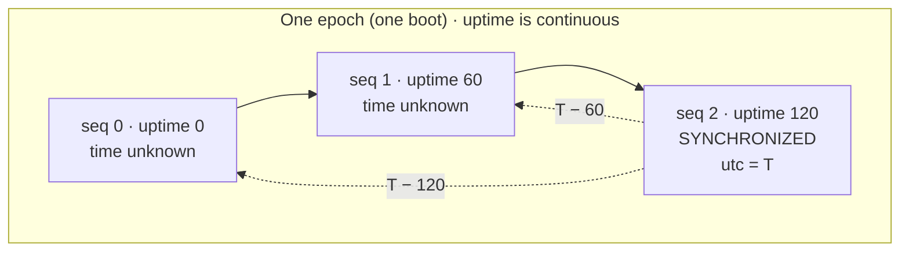

# Stage-0 protocol stack: from sensor to database

> **Document type:** Technical description. **Language:** ASD-STE100 Simplified Technical English (STE) [[STE]](#STE).
> **Applies to:** protocol draft 4, firmware `firmware/stage0-node`, gateway `ws0/`. Commit `d825c17` and later.
> **Status:** Bench data path operates. The sensor is not connected yet. **H01 is NOT RUN.**
> **Short reference:** [`protocol.md`](protocol.md) gives the byte tables only. This document tells how each layer operates and why.
> **Failures and recovery:** [`failure-modes.md`](failure-modes.md) defines every non-happy-path behavior, the loss budget, and the known gaps, for the battery/solar deployment.

---

## 1. Purpose

This document describes how one weather observation moves from the sensor to the database, and how the acknowledgment (ACK) moves back. It describes each layer. For each layer, it gives:

- the data format,
- the rules that each component must obey,
- the failure modes and the recovery,
- links to the source documents.

Read section 2 first. It gives the full picture. Then read the section for the layer that you must change.

---

## 2. The full picture

The system has three physical units:

| Unit | Hardware | Function |
|---|---|---|
| **TX board** | NUCLEO-WL55JC1, board A, ST-LINK serial `003B00194142500E20353451` | Reads the sensor. Stores each observation. Encrypts and transmits it. Keeps it until an ACK arrives. |
| **RX board** | NUCLEO-WL55JC1, board B, ST-LINK serial `0016001E4142500E20353451` | Receives radio frames and sends them to the host. Transmits ACKs from the host. It has no key. It cannot read or make frames. |
| **Gateway** | Host computer (Mac), Python service `ws0` | Authenticates frames. Stores observations in SQLite. Makes the ACK **after** the database commit. Supplies the time. |



### 2.1 The layers

Each layer has one job. A layer does not depend on the internal details of a different layer.

| # | Layer | Format | Where | Section |
|---|---|---|---|---|
| 1 | Sensor bus | I²C, 6-byte reply with CRC-8 | TX | [3](#3-layer-1--sensor-bus-i2c) |
| 2 | Observation record | 24 bytes, big-endian | TX, gateway | [4](#4-layer-2--observation-record) |
| 3 | Journal | 40-byte flash slots | TX | [5](#5-layer-3--flash-journal) |
| 4 | Identity and counters | Epoch, sequence, 64-bit counter | TX, gateway | [6](#6-layer-4--identity-and-counters) |
| 5 | Secure frame | 16 + 24 + 16 bytes, AES-128-CCM | TX, gateway | [7](#7-layer-5--secure-frame-aes-128-ccm) |
| 6 | Radio | LoRa packet, 915 MHz | TX, RX | [8](#8-layer-6--radio-lora) |
| 7 | Exchange | Send, ACK window, retry | TX, RX, gateway | [9](#9-layer-7--exchange-and-retry) |
| 8 | USB serial | Hex text lines | RX, gateway | [10](#10-layer-8--usb-serial-link) |
| 9 | Storage and time | SQLite, freshness, time sync | Gateway, TX | [11](#11-layer-9--gateway-storage-and-time) |

### 2.2 The three rules that keep data safe

These three rules apply to the full stack. Do not break them.

1. **Store before send.** The TX board writes the observation to flash before it transmits. A power loss after the write does not lose the observation.
2. **Commit before ACK.** The gateway makes an ACK only after SQLite commits the observation. The RX board never makes an ACK.
3. **Never repeat a nonce.** Each frame that the TX board seals uses a new 64-bit counter. The board records each counter block in flash **before** it uses a counter from that block.

---

## 3. Layer 1 — Sensor bus (I2C)

### 3.1 Wiring

The SHT45 breakout (Adafruit 6174) connects to I2C2 of the STM32WL55. The pins come from ST UM2592 Rev 4, Table 17 [[UM2592]](#UM2592).

| Signal | Nucleo connector | Arduino name | MCU pin | Function |
|---|---|---|---|---|
| SDA | CN5 pin 9 | D14 | PA11 | I2C2_SDA (AF4) |
| SCL | CN5 pin 10 | D15 | PA12 | I2C2_SCL (AF4) |
| 3.3 V | CN6 pin 4 | 3V3 | — | Sensor supply |
| GND | CN6 pin 6 | GND | — | Ground |

The bus speed is 100 kHz (standard mode). The timing register value is `0x20303E5D` at PCLK1 = 48 MHz. The MCU pull-up resistors are off, because the breakout has its own pull-up resistors.

### 3.2 Measurement transaction

The firmware uses the code in `firmware/stage0.c`. This code is the same code that the host tests use.



The sensor gives two 16-bit raw values. Each value has its own CRC-8. The CRC uses polynomial `0x31`, initial value `0xFF`, and no final XOR [[SHT4x]](#SHT4x).

The firmware converts the raw values to integers. It does not use floating point:

- Temperature, in 0.01 °C: `T = −4500 + (17500 × S_T + 32767) / 65535`
- Relative humidity, in 0.01 %: `RH = −600 + (12500 × S_RH + 32767) / 65535`, then limited to the range 0 to 10000.

### 3.3 Faults

If the write, the read, or a CRC check fails, the function returns an error. The function does not change the output values. The observation then has **validity = 0**, and the packer writes the impossible filler values (section 4.1). The system never shows an invalid reading as a real value.

After a bus fault, the firmware does a bus recovery. A sensor can hold SDA low if it resets during a byte. The recovery does these steps:

1. Set SCL and SDA to GPIO open-drain outputs.
2. Give up to 9 clock pulses on SCL until the sensor releases SDA.
3. Make a STOP condition (SDA goes high while SCL is high).
4. Start the I²C peripheral again.

> **Note:** The sensor is not connected yet (expected 2026-10-14). All current observations are `sensor_fault`. This is the correct behavior.

**More information:** Sensirion SHT4x datasheet [[SHT4x]](#SHT4x) · I²C specification, NXP UM10204 [[I2C]](#I2C) · bus recovery, UM10204 section 3.1.16.

---

## 4. Layer 2 — Observation record

The observation record is the **plaintext** payload. It is 24 bytes. All integers are big-endian (network byte order).

| Offset | Size | Field | Rule |
|---:|---:|---|---|
| 0 | 4 | Epoch | Boot epoch. Increases on each TX boot. Stored durably. |
| 4 | 4 | Sequence | Sample number in this epoch. Starts at 0. |
| 8 | 4 | UTC | Unix seconds at sample time (u32, valid to 2106). **0 if the time is unknown.** |
| 12 | 4 | Uptime | Seconds since the TX board booted. **Always present.** Time sync does not change it. Section 11.3 uses it. |
| 16 | 2 | Temperature | Signed, 0.01 °C. **`0x8000` (−327.68 °C) if the sensor is invalid.** |
| 18 | 2 | Humidity | Unsigned, 0.01 %. **`0xFFFF` (655.35 %) if the sensor is invalid.** |
| 20 | 1 | Validity | 1 = both measurements valid. 0 = sensor fault. |
| 21 | 1 | Time quality | 1 = synchronized. 0 = unknown. |
| 22 | 2 | Calibration revision | Must be 0 in Stage 0. |

The gateway rejects a record that is not canonical. Each record has only one correct byte form:

- Validity 0 requires temperature `0x8000` **and** humidity `0xFFFF`.
- Validity 1 with either filler value is rejected.
- Time quality 0 requires UTC 0.

### 4.1 Why the fillers are impossible values (draft 3)

The **validity flag** tells if a reading is valid. The filler values only protect a reader that does not check the flag. Draft 2 used 0 as the filler. But 0.00 °C is a normal Chicago temperature. A flag-blind reader (a debug script, a log reader, new firmware) shows a sensor fault as a real, plausible temperature. A range check cannot find this error, because 0 °C is in range.

Draft 3 uses values that a sensor cannot make. A flag-blind reader gets −327.68 °C or 655.35 % RH. All range checks reject these values. A real reading of exactly 0.00 °C with validity 1 is still correct and accepted.

| Field | Valid range (SHT45) | Filler | Filler decoded |
|---|---|---|---|
| Temperature | −40.00 to 125.00 °C | `0x8000` | −327.68 °C |
| Humidity | 0.00 to 100.00 % | `0xFFFF` | 655.35 % |

The pair **(station, epoch, sequence)** is the **observation identity**. Section 6 explains why this identity cannot repeat.

**Source:** `ws_pack_observation()` in `firmware/stage0.c` · `OBS` in `ws0/protocol.py`.

---

## 5. Layer 3 — Flash journal

The TX board keeps each observation in internal flash until an authentic ACK arrives. This layer gives the **store before send** rule.

### 5.1 Flash map

The STM32WL55JC has 256 KB of flash in 128 pages of 2 KB. The flash programs 64 bits (one double-word) at a time. You cannot program a double-word two times without an erase. The firmware uses this property.

| Pages | Size | Contents |
|---|---|---|
| 0–31 | 64 KB | Firmware. The linker script enforces this limit. |
| 32 | 2 KB | Configuration: station ID, key, key check value (KCV) |
| 33–34 | 4 KB | Monotonic log, two pages (A/B): epochs and counter reservations |
| 35–127 | 186 KB | Journal ring: 93 pages × 51 slots |

A firmware update programs only pages 0–31. The configuration, the counters, and the journal stay. (Verified 2026-10-12.)

### 5.2 Slot format

Each journal page starts with an 8-byte header: magic `WSJ1` and a 32-bit page sequence number. Then the page has 51 slots of 40 bytes.

| Double-word | Bytes | Contents | Programmed |
|---:|---:|---|---|
| 0–2 | 24 | Observation plaintext | First |
| 3 | 8 | Commit word: magic `0x4A53` + CRC-16/CCITT of the plaintext | Second |
| 4 | 8 | ACK word: all `0xFF` = pending, all `0x00` = acknowledged | When the ACK arrives |

### 5.3 Slot life cycle



### 5.4 Power-loss behavior

A power loss can stop a flash write at any time. The firmware reads a partly written slot in one of three ways. All three are safe.

| What the scan finds | Cause | Result |
|---|---|---|
| All `0xFF` | Write did not start | Free slot |
| Data present, commit word bad or `0xFF` | Write stopped before the commit word | Counted as `burned`. Not used. |
| Double ECC error on read | Double-word write stopped in the middle | `NMI_Handler` catches it, sets `ws_flash_ecc_fault`, and returns. The slot is not used. |

If the ECC error is in the ACK word only, the firmware counts the slot as acknowledged. The gateway made that ACK after its commit, so the gateway already has the observation.

### 5.5 Capacity

The journal holds **4,743 observations**. At one observation each minute, this is **79 hours (approximately 3.3 days)** without an ACK. When the ring is full, the firmware erases the oldest page. It counts each pending observation on that page as `lost`.

> **Caution:** The 30-day buffer requirement (H11) needs external SPI NOR flash. The internal journal does not satisfy H11.

> **Warning:** The power-loss behavior agrees with the design, but **nobody has tested it with real power cuts yet**. Do this test before H01.

**More information:** STM32WL5x reference manual RM0453, flash chapter (ECC and programming rules) [[RM0453]](#RM0453) · `firmware/stage0-node/App/node_store.c`.

---

## 6. Layer 4 — Identity and counters

Two different numbers prevent two different failures:

| Number | Size | Prevents | Where it is in the frame |
|---|---|---|---|
| **Epoch + sequence** | 32 + 32 bits | Two different observations with the same identity (a database collision) | Inside the encrypted plaintext |
| **Transmission counter** | 64 bits | Two frames with the same CCM nonce (a total loss of security) | Clear header, authenticated |

A retry of one observation uses the **same identity** and a **new counter**. Thus the gateway can find duplicates, and the radio never repeats a nonce.

### 6.1 Durable reservation


Each log entry is one double-word: an 8-bit type and a 56-bit value. The recovery takes the maximum value of each type from both pages. A torn entry reads as an ECC error or a bad value. The firmware ignores that entry. Because the values only increase, an ignored entry can only make the firmware skip numbers. It cannot make the firmware use a number again.

When a log page is full, the firmware writes the current maximum values to the other page. It writes the page header **last**. If power stops during this step, the old page stays valid.

**Example (observed 2026-10-12):** The TX board used counters 1 to 8. Then a firmware update reset the board. The next counter was **257**, because the board skips the rest of the reserved block (9 to 256). This is correct.

### 6.2 Why counter reuse is dangerous

AES-CCM uses counter mode for encryption. If two frames use the same key and nonce, an attacker can XOR the two ciphertexts and get the XOR of the two plaintexts. The attacker can also forge messages. RFC 3610 section 7 and NIST SP 800-38C describe this risk [[RFC3610]](#RFC3610) [[SP800-38C]](#SP800-38C).

> **Warning:** Do not restore an old copy of the TX flash state or the gateway nonce database while you keep the same key. If counter state is lost, provision a **new key** for both ends.

---

## 7. Layer 5 — Secure frame (AES-128-CCM)

### 7.1 Frame format

Both frame kinds are 56 bytes.

| Offset | Size | Field | Protection |
|---:|---:|---|---|
| 0 | 2 | Magic `WS` (`0x57 0x53`) | Authenticated, clear |
| 2 | 1 | Version = `4` | Authenticated, clear |
| 3 | 1 | Kind: `1` observation, `2` ACK, `3` NACK, `4` health report | Authenticated, clear |
| 4 | 4 | Station ID | Authenticated, clear |
| 8 | 4 | Counter, high 32 bits | Authenticated, clear |
| 12 | 4 | Counter, low 32 bits | Authenticated, clear |
| 16 | 24 | Ciphertext | Encrypted and authenticated |
| 40 | 16 | CCM authentication tag | — |



### 7.2 Nonce and associated data

- **Nonce (13 bytes)** = kind (1) + station ID (4) + counter (8). The kind byte separates the TX → gateway direction from the gateway → TX direction. Thus the two directions can use the same key and never share a nonce.
- **Associated data (AAD)** = all 16 header bytes. An attacker cannot change the station, the kind, or the counter without a tag failure.
- **Key** = 128 bits. Each station has a different key. The gateway and the TX board share it.
- **Tag** = 128 bits (16 bytes).

### 7.3 ACK plaintext (24 bytes)

| Offset | Size | Field |
|---:|---:|---|
| 0 | 4 | Acknowledged epoch |
| 4 | 4 | Acknowledged sequence |
| 8 | 8 | Host UTC at commit (Unix seconds) |
| 16 | 8 | **Echo**: transmission counter of the observation frame that this ACK answers |

Section 11.3 explains the echo.

### 7.4 Implementations

| Side | Library | Version | Pinned by |
|---|---|---|---|
| TX board | Mbed TLS (`mbedtls_ccm_*`) | 3.6.6 LTS | `STM32CubeWL` submodule `mbed-crypto` @ `7ee7e20` |
| Gateway | `cryptography` (`AESCCM`, OpenSSL) | 50.0.1 | `requirements.txt` |

The project does not have its own AES code. The test file `tests/test_frame.py` compiles the C frame code on the host. It makes sure that C and Python give the **same bytes**. It does a known-answer test and 200 random frames in each direction. It also does rejection tests: bad tag, wrong station, wrong key, wrong length, and the draft-1, draft-2 and draft-3 version bytes. It also tests the filler rules (section 4.1). The TX board does the same known-answer test at each boot (`kat=pass`). If the test fails, the board does not transmit.

**Key check value (KCV):** The first 3 bytes of AES-128(key, 16 zero bytes). It identifies a key and does not show the key. Example: the FIPS-197 test key `000102…0f` has the KCV `c6a13b`.

**More information:** RFC 3610 (CCM) [[RFC3610]](#RFC3610) · NIST SP 800-38C [[SP800-38C]](#SP800-38C) · Mbed TLS CCM API [[MBEDTLS]](#MBEDTLS) · Python `cryptography` AESCCM [[PYCA]](#PYCA).

---

## 8. Layer 6 — Radio (LoRa)

### 8.1 Configuration

| Parameter | Value | Note |
|---|---|---|
| Frequency | 915.0 MHz | NUCLEO-WL55JC1 is the high-band board (865–928 MHz) [[DB3933]](#DB3933) |
| Modulation | LoRa (chirp spread spectrum) | — |
| Bandwidth | **500 kHz** | Gives the FCC §15.247(a)(2) digital-modulation class (see 8.3) |
| Spreading factor | SF7 | Bench value. Tune it for the H01 location. |
| Coding rate | 4/5 | — |
| Preamble | 8 symbols | — |
| Header | Explicit | The packet header contains the length |
| PHY CRC | On (16-bit) | The radio discards packets with a CRC error |
| Sync word | `0x1424` (private network) | SubGHz_Phy default; LoRaWAN uses `0x3444` |
| IQ | Normal, both directions | — |
| TX power | 0 dBm | Bench value |
| Symbol timeout | **0 (off)** | See 8.4 |

All values are in `firmware/stage0-node/App/radio_cfg.h`. **The two boards must use the same values.**

### 8.2 Time on air

The symbol time is `Ts = 2^SF / BW = 128 / 500 kHz = 0.256 ms`. The time on air for a 56-byte frame is:

| Part | Symbols | Time |
|---|---:|---:|
| Preamble (8 + 4.25) | 12.25 | 3.1 ms |
| Header + payload + CRC | 93 | 23.8 ms |
| **Total** | **105.25** | **26.9 ms** |

The formula is in Semtech AN1200.13 and the SX1261/2 datasheet [[SX126X]](#SX126X). You can also use an online calculator [[AIRTIME]](#AIRTIME).

### 8.3 Regulatory basis (US)

| Rule | Limit at 902–928 MHz | Stage-0 status |
|---|---|---|
| 47 CFR §15.249 | 50 mV/m at 3 m (approximately −1.25 dBm EIRP) | Not used. A 125 kHz signal at 0 dBm is near or above this limit. |
| 47 CFR §15.247(a)(1) | Frequency hopping: 50 or more channels if the 20 dB bandwidth is less than 250 kHz | Not used (one channel) |
| 47 CFR §15.247(a)(2) | Digital modulation: 6 dB bandwidth of 500 kHz or more. Up to +30 dBm. Power density 8 dBm/3 kHz or less. | **Used.** At 0 dBm, the density is approximately −22 dBm/3 kHz. |

> **Caution:** Nobody has measured the 6 dB bandwidth of these boards with a spectrum analyzer. The antenna gain is also not known. This section is an engineering reading of Part 15. It is not a compliance certificate.

**More information:** eCFR §15.247 [[FCC247]](#FCC247) · eCFR §15.249 [[FCC249]](#FCC249) · LoRa Alliance regional parameters (US915 uses 500 kHz channels) [[RP002]](#RP002).

### 8.4 Lesson: the symbol timeout

The first firmware used ST's default symbol timeout of 5 symbols. At SF7 and 500 kHz, 5 symbols is **1.3 ms**. The radio stopped the ACK window after 1.3 ms if no preamble had started. Thus the TX board missed all ACKs. It also sent backlog frames while the RX board was busy with an ACK, so those frames were lost.

The firmware now sets the symbol timeout to 0 (off). The 2-second window timer stops the receive operation. **If you change the SF or the bandwidth, calculate the symbol time again.**

### 8.5 Measured link (bench, 2026-10-12)

Antennas: supplied stub antennas, approximately 30 cm apart, 0 dBm.

| Measure | Value |
|---|---|
| Exchanges logged | 28 |
| RSSI | −22 to −24 dBm |
| SNR | 12 to 14 dB |
| Lost after the fix | 0 |

This is a bench result. It is not a range result. H01 requires a test at the real locations.

---

## 9. Layer 7 — Exchange and retry

### 9.1 One minute of operation



### 9.2 TX state machine



### 9.3 Rules

- **Live first.** The current observation goes first. The backlog cannot delay new data.
- **Bounded backlog.** Each minute sends 2 old observations at most. A 3.3-day backlog takes longer to clear than the outage that made it. H11 must examine this rate.
- **Retry is the same data.** A retry has the same identity and a new counter. The gateway stores it once and sends the ACK again.
- **The RX board does not decide.** It forwards frames with the correct length, magic, version, and kind. It does not check the tag. It has no key.
- **Any authentic ACK clears its own slot.** An ACK can arrive late. It still clears the correct slot.

### 9.4 Failure cases

| Failure | Result | Recovery |
|---|---|---|
| Observation frame lost on air | No ACK in 2 s. Red LED on TX. | Next minute: sent again as backlog |
| ACK lost on air | Gateway has the row. TX keeps the slot. | Next minute: duplicate. Gateway gives the ACK again. No second row. |
| Gateway not running | RX prints the frame. Nobody answers. | TX keeps observations for 3.3 days |
| Database commit fails | No ACK | TX keeps the slot and sends it again |
| TX power loss | Unsent slots stay in flash | After boot: new epoch, backlog sent first-in, first-out |
| RX power loss | Frames are lost while RX is off | TX backlog |
| Forged or changed frame | Tag fails | Gateway rejects it and logs it. No ACK. |
| Replayed old frame | Tag is valid, identity exists | Gateway gives the ACK again. Stored time and freshness do not change. |

---

## 10. Layer 8 — USB serial link

### 10.1 Physical path



The ST-LINK on each Nucleo board makes the USB virtual COM port. The port name changes when you move the cable. **Identify a board by its ST-LINK serial number, not by its port name.**

### 10.2 Line format

| Direction | Line | Meaning |
|---|---|---|
| RX → host | 112 lowercase hex digits + `\n` | One observation frame (56 bytes) |
| RX → host | `#rx obs rssi=-23 snr=13` | Diagnostic for the line before |
| RX → host | `#rx drop …`, `#rx error`, `#tx timeout`, `#host reject …`, `#boot …`, `#status …` | Diagnostics |
| host → RX | 112 hex digits + `\n` | One ACK frame to transmit |
| host → RX | `STATUS` | Ask for counters |

Rules:

- A line is 256 bytes or less. The gateway discards a longer line.
- A line that starts with `#` is a diagnostic. The gateway writes it to `run-hw/receiver.log`. It never decodes it as a frame.
- The gateway writes each frame and its ACK to `receiver.log`, with UTC time. This file is evidence for H01.
- The serial read timeout is 50 ms. The gateway answers a frame immediately. (The TX ACK window is 2 s.)

### 10.3 TX console (not part of the data path)

The TX board also has a console. It is for provisioning and diagnostics. All lines from the TX board start with `#`.

| Command | Function |
|---|---|
| `STATUS` | Shows provisioning, KCV, self-test, epoch, sequence, time quality, and journal counters |
| `KAT` | Runs the crypto known-answer test again |
| `PROVISION <id> <32 hex>` | Writes the station ID and the key. Only on an empty board. |
| `WIPE ERASE-ALL-NODE-STATE` | Erases the key, the counters, and the journal. **You must then provision a new key.** |

Use `python -m ws0 provision-node`. Do not type the key by hand. The tool compares the KCV of the board with the KCV of the gateway key.

**More information:** UM2592 section on the STLINK-V3E virtual COM port [[UM2592]](#UM2592) · pyserial [[PYSERIAL]](#PYSERIAL).

---

## 11. Layer 9 — Gateway, storage, and time

### 11.1 Frame processing



### 11.2 Storage rules

- SQLite uses `PRAGMA synchronous=FULL` [[SQLITE]](#SQLITE). The commit is on the disk before the ACK exists.
- The gateway ACK counters use a `BEGIN IMMEDIATE` transaction. The counter is in the database before the gateway seals the ACK.
- The nonce database is bound to the key fingerprint, the station, and the direction. A different key cannot use it by accident.
- A sample time more than 5 s after the receipt time is **quarantined** (`future_clock_at_receipt`). Waiting does not make it valid.
- An observation is **available** for 180 s after its sample time, only if it is valid and its clock is known. After 180 s, Home Assistant and the API show it as unavailable.

### 11.3 Time synchronization

The TX board has no clock source at boot. It gets the UTC time from the ACK.



**Why the echo is necessary.** An attacker can record an authentic ACK. Later, the attacker can jam the real ACK and send the recorded ACK. Without the echo, the TX board accepts the old time. With the echo, the old ACK has an old counter. The TX board uses a new counter for each frame, so the old ACK does not match. The attacker cannot make a new valid echo without the key.

**Accuracy.** The gateway writes its time at the commit. The TX board sets its clock when the ACK arrives. The TX clock is late by the time between these two events. This time is normally much less than 1 s (two air times + USB + commit). Nobody has measured it exactly yet.

**Drift.** The RTC uses the 32.768 kHz LSE crystal. A tuning-fork crystal drifts approximately 20 ppm at room temperature, but its error increases with the square of the temperature difference. At −35 °C it can be more than 120 ppm. After 6 hours without an ACK, the TX board marks new samples `time unknown` (UTC = 0).

#### 11.3.1 Time across a reset (option D)

A system reset (RESET button, NRST, software reset, future watchdog) does not stop the RTC or clear its backup registers. The TX board keeps a trust marker in two backup registers: a magic value and the RTC second of the last sync. At boot, the board trusts its clock again only if all of these are true:

- the marker is present,
- the RTC counted forward since the sync,
- the sync is less than 6 hours old,
- the clock shows a plausible date.

A power loss clears the backup domain on this board, so the board then starts with `time unknown`. **Bench result (2026-10-12):** after a reset the board printed `#time restored … sync_age=11`. Its first reading in the new epoch was synchronized, within about 1 s of the host.

#### 11.3.2 Reconstructed time (option C, draft 4)

Every observation carries **uptime**: whole seconds since the TX board booted. Time sync does not change uptime. Thus all readings of one epoch share one monotonic time line. When the gateway has at least one **synchronized** reading of an epoch, it calculates the time of every unsynchronized reading of the same epoch:

`effective_time = ref_utc + (uptime − ref_uptime)`, using the synchronized reading nearest in uptime.



Rules:

- The raw payload does not change. It stays immutable and stays the deduplication authority. The result goes into separate columns: `effective_at`, `time_basis` (`synchronized`, `reconstructed`, or `unknown`), and `time_uncertainty_s`.
- **Uncertainty** = 2 s (whole-second quantization of two fields) + 150 ppm × |uptime − ref_uptime|. Example: 2 s after one minute; about 41 s after a 3-day outage.
- A reference that was quarantined (its clock was ahead of its receipt time) is never used.
- A reading with an uncertainty above 10 s is never shown as **current**. It stays in the history with its error bound.
- **H01:** a reconstructed time counts as a known acquisition time when it meets the same 5 s tolerance (decision by Clint, 2026-10-12). Reports give the reconstructed count separately.
- **Limit:** an epoch that ends (reboot) before its first synchronized reading has no reference. Its readings stay `unknown`. With option D, only a power loss followed by a reboot before the first ACK causes this.

**Bench result (2026-10-12):** a simulated power loss (backup-domain reset) started epoch 8 with no time. One minute later the gateway reconstructed reading 0 as 03:15:34Z ± 2.0 s. The board log shows the sample at 03:15:35Z.

**Simulation:** scenario `reboot-during-outage` reboots the node in the middle of a 60-minute link outage. All 32 buffered unsynchronized readings got a correct time. None stayed unresolved.

### 11.4 Upward interfaces (summary)

| Interface | Address | Notes |
|---|---|---|
| HTTP API | `127.0.0.1:8088`, bearer token | `/v1/status`, `/v1/observations/latest`, `/v1/observations` (JSON or CSV) |
| MQTT | `weatherstation/v1/{station}/…` | Off by default. Home Assistant discovery is available. Not tested with a live broker yet. |

See [`openapi.json`](openapi.json) and the stage-0 README.

---

## 12. Worked example: one real exchange

This exchange occurred on 2026-10-13 at 02:11:25 UTC, **under draft 2**. Draft 3 changes two things in it: the version byte becomes `03`, and the invalid temperature and humidity become `8000 ffff` instead of `0000 0000`. Thus the ciphertext and the tag are different. The structure is the same. It comes from `run-hw/receiver.log`. The key is not shown.

### 12.1 Observation frame (TX → gateway)

```text
5753 02 01 00000001 00000000 00000104 | ed6e99446b30922f0b0e656e51f928f3e6eccfbbeeac799a | e7a5903526cb3fc821319ff0e1942e20
WS   v2 obs station=1 ctr_hi ctr_lo=260 | ciphertext (24 bytes)                               | tag (16 bytes)
```

The gateway opens it with the station key. The plaintext is:

```text
00000002 00000001 000000006acd934c 0000 0000 00 01 0000
epoch=2  seq=1    utc=1791857484   T=0  RH=0 v=0 t=1 cal=0
                  = 2026-10-13T02:11:24Z     sensor_fault, time synchronized
```

Note:
- The counter is 260, not 10. A reboot skipped the rest of the reserved block (section 6.1).
- Validity is 0, because the sensor is not connected. Temperature and humidity are 0, as the canonical rule requires.
- Time quality is 1. An earlier ACK set the clock.

### 12.2 ACK frame (gateway → TX)

```text
5753 02 02 00000001 00000000 00000009 | 7589657bf540d9ce79d2a5d005e52a81a9b07617df6de10b | 316dc77436634b4174e9c08f938c7a52
WS   v2 ack station=1 ctr_hi ctr_lo=9   | ciphertext (24 bytes)                               | tag (16 bytes)
```

Plaintext:

```text
00000002 00000001 000000006acd934d 0000000000000104
epoch=2  seq=1    utc=1791857485   echo=260
                  = 2026-10-13T02:11:25Z (commit time)
```

The echo (260) is equal to the counter of the observation frame. The TX board accepts the time. The commit time is 1 s after the sample time, so the observation was in the database 1 s after the TX board read the sensor.

### 12.3 Try it yourself

```sh
# Decode the logged exchanges (needs the key in run-hw/gateway.json; prints no key)
.venv/bin/python - <<'EOF'
import json, re
from ws0.protocol import unseal, frame_counter, OBS, ACK
cfg = json.load(open('run-hw/gateway.json')); key = bytes.fromhex(cfg['radio_key'])
for line in open('run-hw/receiver.log'):
    m = re.search(r'(\S+) frame (\w+) -> ack (\w+)', line)
    if m:
        f, a = bytes.fromhex(m[2]), bytes.fromhex(m[3])
        print(m[1], frame_counter(f), OBS.unpack(unseal(key, 1, 1, f)), ACK.unpack(unseal(key, 1, 2, a)))
EOF
```

---

## 13. Security summary

| Threat | Protection | Limit |
|---|---|---|
| Read observations on air | AES-128-CCM encryption | — |
| Change or forge a frame | 128-bit CCM tag over header and payload | — |
| Replay an old observation | Identity deduplication. Freshness uses identity, not arrival. | Replay is visible in the log |
| Replay an old ACK to move the clock | Counter echo (section 11.3) | — |
| Replay an old ACK to clear a slot | Clears only the slot that the gateway already committed | No data loss |
| Nonce reuse after reset | Durable counter reservation (section 6) | Do not clone or roll back flash state |
| RX board is compromised | RX has no key. It can only drop or delay frames. | Drop = backlog; delay = late data |
| Key extraction from the TX board | **None in Stage 0.** RDP level 0. The key is in plain flash. | Use RDP level 1 or higher before field use |
| Radio jamming | None (physical layer) | Backlog survives 3.3 days |

---

## 14. Change control

When you change the protocol, do these steps:

1. Increase the version byte. Old frames must fail at the header check.
2. Update [`protocol.md`](protocol.md) and this document.
3. Update `ws0/protocol.py` and `firmware/common/ws_frame.{c,h}` together.
4. Make new known-answer vectors with Python. Put them in `tests/test_frame.py` **and** `App/app_tx.c`.
5. Run `python -m unittest discover -s tests`. All tests must pass.
6. Run the harness into a **new** output directory. Do not overwrite old evidence.
7. Build both roles. Record the binary SHA-256 values. Flash **both** boards. A version mismatch stops all traffic.

---

## 15. Glossary

| Term | Meaning |
|---|---|
| AAD | Additional authenticated data. Data that the tag protects but does not encrypt. |
| ACK | Acknowledgment. Here: an encrypted frame from the gateway that confirms a database commit. |
| CCM | Counter with CBC-MAC. An AEAD mode: it encrypts and authenticates. |
| ECC | Error-correcting code. The flash adds it to each double-word. |
| Epoch | A number that increases at each TX boot. |
| H01 | The Stage-0 acceptance test: 24 hours at the real locations. |
| KAT | Known-answer test. Fixed input, fixed expected output. |
| KCV | Key check value. Identifies a key and does not show it. |
| LoRa | A chirp spread-spectrum modulation by Semtech. |
| Nonce | A number used once. CCM fails if a nonce repeats with the same key. |
| RSSI / SNR | Received signal strength / signal-to-noise ratio. |
| SF | Spreading factor. Higher SF = longer range, longer air time. |
| VCP | Virtual COM port. A USB serial port. |

---

## 16. References

| Key | Source |
|---|---|
| <a id="STE"></a>STE | ASD-STE100 Simplified Technical English — <https://www.asd-ste100.org/> |
| <a id="UM2592"></a>UM2592 | ST, *STM32WL Nucleo-64 board (MB1389)*, user manual, Rev 4 — <https://www.st.com/resource/en/user_manual/um2592-stm32wl-nucleo64-board-mb1389-stmicroelectronics.pdf> |
| <a id="DB3933"></a>DB3933 | ST, *NUCLEO-WL55JC* data brief — <https://www.st.com/en/evaluation-tools/nucleo-wl55jc.html> |
| <a id="RM0453"></a>RM0453 | ST, STM32WL5x reference manual (flash, ECC, SUBGHZ radio) — <https://www.st.com/en/microcontrollers-microprocessors/stm32wl55jc.html> (Documentation tab) |
| CubeWL | ST, STM32CubeWL v1.6.0 (HAL, SubGHz_Phy, Mbed TLS) — <https://github.com/STMicroelectronics/STM32CubeWL> |
| <a id="SX126X"></a>SX126X | Semtech SX1261/2 (the radio core in STM32WL): time-on-air formula, sync word, symbol timeout — <https://www.semtech.com/products/wireless-rf/lora-connect/sx1262> |
| <a id="AIRTIME"></a>AIRTIME | LoRa air-time calculator (select US915, 500 kHz, SF7, 56 bytes) — <https://avbentem.github.io/airtime-calculator/> |
| <a id="RP002"></a>RP002 | LoRa Alliance, *RP002 Regional Parameters* — <https://resources.lora-alliance.org/technical-specifications> |
| <a id="FCC247"></a>FCC247 | 47 CFR §15.247 — <https://www.ecfr.gov/current/title-47/chapter-I/subchapter-A/part-15/subpart-C/section-15.247> |
| <a id="FCC249"></a>FCC249 | 47 CFR §15.249 — <https://www.ecfr.gov/current/title-47/chapter-I/subchapter-A/part-15/subpart-C/section-15.249> |
| <a id="RFC3610"></a>RFC3610 | *Counter with CBC-MAC (CCM)* — <https://www.rfc-editor.org/rfc/rfc3610> |
| <a id="SP800-38C"></a>SP800-38C | NIST, *Recommendation for Block Cipher Modes: CCM* — <https://csrc.nist.gov/pubs/sp/800/38/c/upd1/final> |
| <a id="MBEDTLS"></a>MBEDTLS | Mbed TLS project and docs — <https://github.com/Mbed-TLS/mbedtls> · <https://mbed-tls.readthedocs.io/> |
| <a id="PYCA"></a>PYCA | `cryptography` AESCCM — <https://cryptography.io/en/latest/hazmat/primitives/aead/#cryptography.hazmat.primitives.ciphers.aead.AESCCM> |
| <a id="SHT4x"></a>SHT4x | Sensirion SHT4x datasheet (commands, CRC, conversion) — <https://sensirion.com/resource/datasheet/sht4x> |
| <a id="I2C"></a>I2C | NXP UM10204, *I²C-bus specification* (bus clear, 3.1.16) — <https://www.nxp.com/docs/en/user-guide/UM10204.pdf> |
| <a id="SQLITE"></a>SQLITE | SQLite `PRAGMA synchronous` — <https://www.sqlite.org/pragma.html#pragma_synchronous> |
| <a id="PYSERIAL"></a>PYSERIAL | pyserial — <https://pyserial.readthedocs.io/> |

Project sources: [`protocol.md`](protocol.md) · [`hardware/nucleo-wl55jc-bringup.md`](hardware/nucleo-wl55jc-bringup.md) · [`../firmware/stage0-node/README.md`](../firmware/stage0-node/README.md) · [`../ws0/protocol.py`](../ws0/protocol.py) · [`../firmware/common/ws_frame.c`](../firmware/common/ws_frame.c) · [`../tests/test_frame.py`](../tests/test_frame.py)

> **Link check (2026-10-12):** All links returned HTTP 200, with two exceptions. The `st.com` links timed out for scripts, and `nxp.com` returned 404 to all scripted requests (including its search page). These two sites block automated requests. The UM2592 link is the URL of the PDF that the project used.
