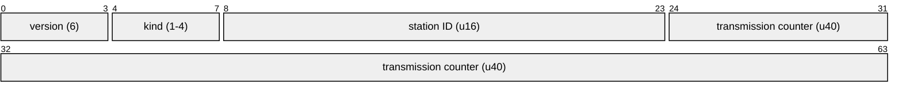
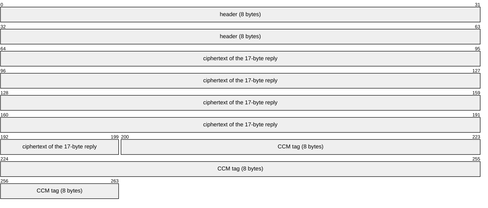
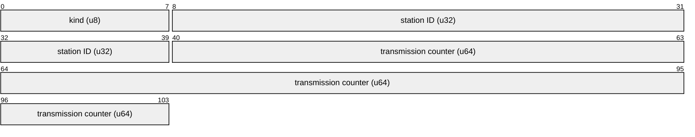
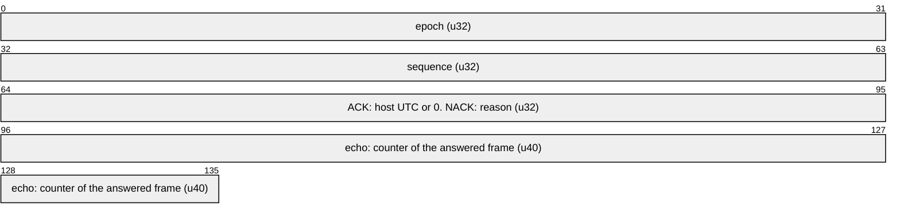
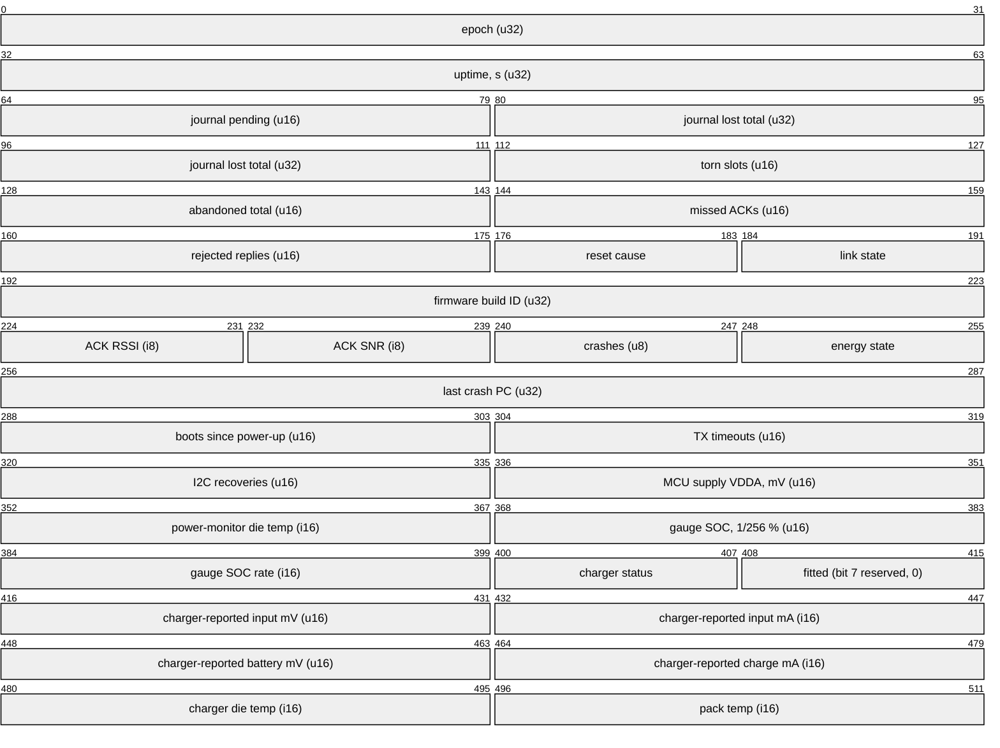
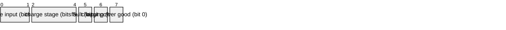
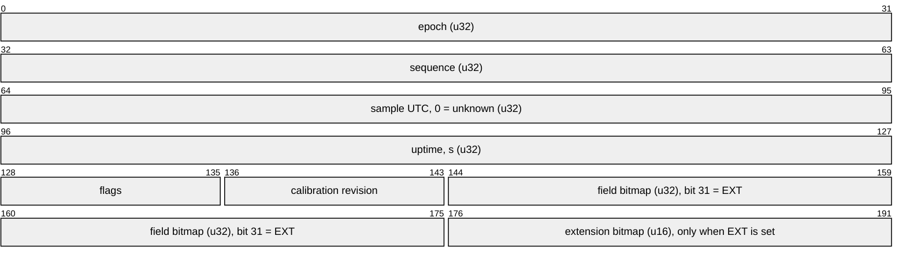
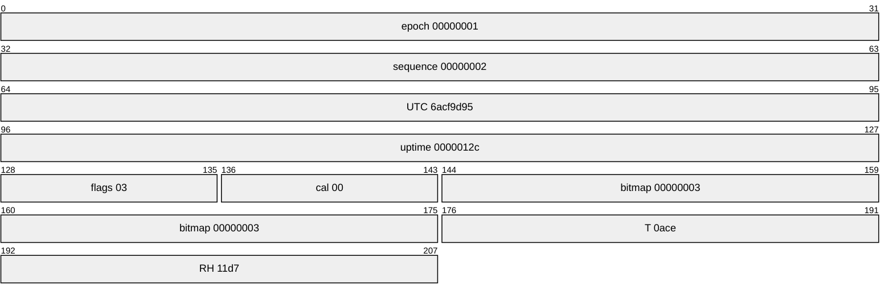
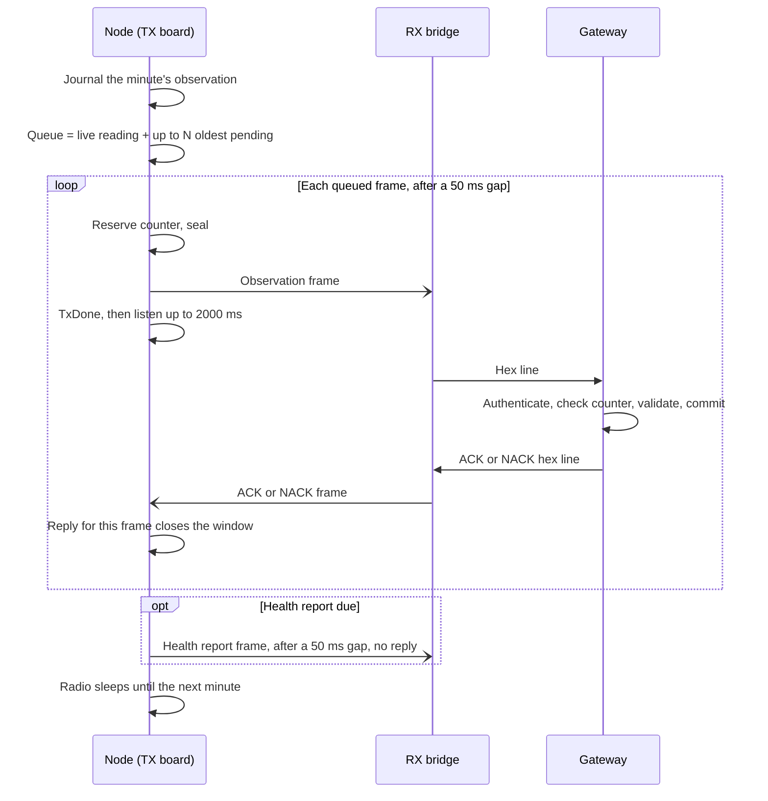
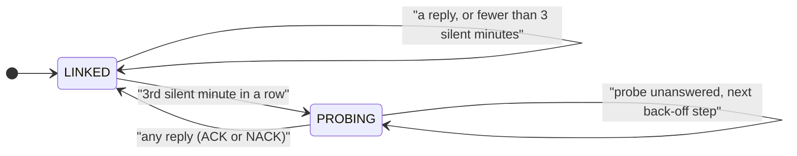

# Wire protocol

This document is the normative specification of the radio protocol. The protocol version is **6**:
observation catalog version 2 (section 5.3) and the 64-byte health report (section 4), from the
power telemetry design
([`2026-10-29-power-telemetry-design.md`](superpowers/specs/2026-10-29-power-telemetry-design.md),
"the power design" below). Version 5 (catalog version 1, the 32-byte health report) was first
released to both boards as `bc5e6ede429c` on 2026-10-14. Version 6 reaches the boards by the
release procedure of [`protocol-design.md`](protocol-design.md) section 7, which drains the journal
first. [`firmware/stage0-node/RELEASES.md`](../firmware/stage0-node/RELEASES.md) lists the release
that the boards run now.

The format is not frozen yet. The 24-hour delivery test (H01, [`H01-checklist.md`](H01-checklist.md))
must pass first. Then the product requirements document (PRD) freezes the identity, time and
quality contract.

Other documents:
- [`protocol-design.md`](protocol-design.md) gives the design rationale.
- [`protocol-stack.md`](protocol-stack.md) tells how each layer operates end to end: sensor,
  journal, encryption, LoRa, USB, SQLite and time.
- [`module-protocol.md`](module-protocol.md) is DATAVANE5K (WSMP), the contract between the station and
  its sensor modules (draft, being implemented).

The node sends LoRa packets directly to the receiver. One packet carries one frame. A frame is an
observation, a health report, an acknowledgment (ACK) or a negative acknowledgment (NACK). There is
no mesh and no module discovery. Every integer on the wire is **big-endian**.

If the code and this text disagree, the code is correct. The code is:

| Part | C (node, RX bridge) | Python (gateway) |
|---|---|---|
| Envelope, ACK and NACK | `firmware/common/ws_frame.{c,h}` | `ws0/protocol.py` |
| Observation and field catalog | `firmware/common/ws_obs.{c,h}` | `ws0/fields.py` |
| RX filters, console line parsing | `firmware/common/ws_console.{c,h}` | `ws0/link.py`, `ws0/__main__.py` |
| Node application | `firmware/stage0-node/App/app_tx.c` and the `tx_*.c` modules, `selftest.c`, `app_rx.c`, `node_store.c`, `node_fields.h` (file map: `firmware/stage0-node/README.md`) | — |
| Validation, storage | — | `gateway.py`, `ws0/service.py` |

In the code, the four frame kinds have short names: `OBS` (observation), `ACK`, `NACK` and `DIAG`
(health report).

## 1. Envelope

Every frame has an 8-byte clear header, then the ciphertext, then an 8-byte tag. The diagram shows
the header. Each row is 32 bits.

| Offset | Bytes | Field | Protection |
|---:|---:|---|---|
| 0 | 1 | High nibble: version **6** (`WS_FRAME_VERSION`, `firmware/common/ws_frame.h:10`; `VERSION`, `ws0/protocol.py:24`). Low nibble: kind (1 observation, 2 ACK, 3 NACK, 4 health report) | Clear, authenticated |
| 1 | 2 | Station ID, u16, 1 to 65,535 | Clear, authenticated |
| 3 | 5 | Transmission counter, u40, 1 to 2^40 − 1 | Clear, authenticated |
| 8 | *n* | AES-128-CCM ciphertext of the kind's plaintext | Encrypted, authenticated |
| 8 + *n* | 8 | CCM tag. Its length M = 8 is a constant. The receiver never infers it from the frame length. | — |

Byte 0 per version:

| Kind | Version 6 (this protocol) | Version 5 (earlier releases) |
|---|---|---|
| 1 observation | `0x61` | `0x51` |
| 2 ACK | `0x62` | `0x52` |
| 3 NACK | `0x63` | `0x53` |
| 4 health report | `0x64` | `0x54` |

A receiver of one version drops every frame of the other version silently (`ws_frame_kind`,
`firmware/common/ws_frame.h:62-65`; `frame_kind`, `ws0/protocol.py:244`). Thus a node and a
gateway that do not match lose no record: the records stay in the journal until both ends run the
same version. The envelope, the nonce, the counters, the tag and the ACK/NACK plaintext did not
change from version 5.

As an example, an ACK or NACK frame is 33 bytes:

The encryption is AES-128 in CCM mode (counter with CBC-MAC, RFC 3610):
- **Additional authenticated data (AAD):** the 8 header bytes. The tag covers them, but they are
  not encrypted. A change to the version, kind, station or counter makes the tag fail.
- **Nonce (13 bytes):** the code builds it from the integers. It never copies it from the header
  bytes (`header()` in `ws_frame.c`, `_header_and_nonce()` in `protocol.py`). The nonce has wider
  fields than the header:

- **Key:** 128 bits per station. The node and the gateway share it. The key check value (KCV) is
  the first 3 bytes of AES-128(key, 16 zero bytes). The KCV identifies a key and is safe to
  display.
- **Libraries:** the node uses Mbed TLS 3.6.6 CCM. The gateway uses `cryptography` AESCCM
  (OpenSSL). The project has no AES code of its own.
- **Overhead:** 16 bytes per frame (8 header + 8 tag).

Example: the boot self-test vector (`KAT_OBS` in `App/selftest.c:15-16`, key `000102…0f`). The
header `61 0001 0100000002` is an observation from station 1 with counter 0x100000002. Its nonce is
`01 00000001 0000000100000002`.

### Frame lengths

| Kind | Plaintext | Frame | Checked |
|---|---:|---:|---|
| Observation | 23 to 94 B (22 + the 2-byte extension word when present + 1 to 70 field bytes) | 39 to 110 B | The range before decryption. The exact length from the field bitmap after decryption. |
| ACK, NACK | 17 B | 33 B | Exact, before decryption |
| Health report | 64 B | 80 B | Exact, before decryption |

The gateway checks the length, version, kind and station **before** it decrypts
(`plain_lengths()`, `unseal()`; `PLAIN_LENGTHS`, `ws0/protocol.py:255-256`). It drops a frame that
fails a check or the tag, and it sends no reply. Thus an outsider cannot make the gateway send a
NACK.

The observation bounds differ on purpose:

| Bound | Plaintext | Frame | Who applies it |
|---|---:|---:|---|
| Every catalog version 2 field (`WS_OBS_PLAIN_ALL`, `firmware/common/ws_obs.h:111`) | 94 B | 110 B | the RX bridge (`ws_air_frame_ok`, `firmware/common/ws_console.c:81`) and the gateway (`PLAIN_LENGTHS`) only. No node build sends it. |
| **Per-build ceiling** | 80 B | **96 B** | every node build: a field set above 80 B of plaintext does not compile (`node_store.c:71-75`, section 5.3) |
| The node's field set (`WS_F_WSMP_BENCH`, `App/node_fields.h:20-29`; `OBS_FRAME_MAX`) | 77 B | 93 B | the current build's widest record |

The current node build sends observations of up to 93 bytes. Their length depends on the power
phase of the build and on the modules in the layout (section 5.1).

## 2. Counters and limits

There are two counter spaces under one key. The nonce contains the kind byte. Thus each
(kind, counter) pair is different, and no two frames share a nonce.

| Counter space | Used by | Kept in |
|---|---|---|
| Node | Observation and health report | The node's monotonic log in flash. The node reserves counters in blocks of 256 before use (`store_next_counter`, `App/node_store.c`). |
| Gateway | ACK and NACK | `gateway-nonces.sqlite3`. One `BEGIN IMMEDIATE` transaction per counter (`Nonces.next`). |

The 5-byte header field cannot hold a larger counter. A truncated counter repeats a nonce. Thus
each place that issues or seals a counter enforces the limits:

| Limit | Node (C) | Gateway (Python) |
|---|---|---|
| Counter 1 to 2^40 − 1 | `store_next_counter` refuses past `WS_COUNTER_MAX`. `ws_seal_kind` refuses 0 and values above `WS_COUNTER_MAX`, wipes its output buffer and returns a negative value. The boot self-test checks that 2^40 is refused. | `Nonces.next` raises "Nonce space exhausted; rotate key". `_header_and_nonce` raises. `to_bytes(5)` also raises. |
| Station 1 to 65,535 | `ws_parse_provision` (`firmware/stage0.c`), `store_config_write`, `store_config_load`, `ws_seal_kind`, `ws_open_reply` | `_header_and_nonce`. `station_id` in `gateway.json` (`ws0/service.py`, `STATION_MAX`). |
| Kind 1 to 4 | `ws_seal_kind` | `_header_and_nonce` |

2^40 frames last more than 100,000 years at 20 frames a minute.

These rules keep nonces unique:
- The node reserves a counter block in flash **before** it uses a counter from it. A reset skips
  the rest of the block (for example, counter 8 is followed by 257).
- `WIPE ERASE-ALL-NODE-STATE` erases the key and the journal. It **keeps** the counter and the
  epoch (since release `0f456040fe54`). The `PROVISION` epoch floor raises only the epoch.
- Do not restore old node flash or an old gateway nonce database with the same key. If the
  counter state is lost, use a new key ([`runbook-moving-boards.md`](runbook-moving-boards.md)).
- **A change of the frame format needs a new key and fresh state.** WIPE the node, `init` a new
  run directory, and run `provision-node`. The CCM keystream blocks encode only the nonce length,
  not the tag length. Thus a key from the previous format could repeat keystream. The first
  release of protocol version 5 got a new key (run directory `run-d5`, KCV `5618eb`). The first
  release of protocol version 6 gets a new key and a new run directory the same way, after the
  journal is drained (`protocol-design.md` section 7).

## 3. ACK and NACK (kinds 2 and 3, gateway to node)

The ACK and the NACK have the same 17-byte plaintext. They use the gateway's counter space.

| Offset | Bytes | ACK | NACK |
|---:|---:|---|---|
| 0 | 4 | Epoch of the observation | Epoch of the rejected observation |
| 4 | 4 | Sequence of the observation | Sequence of the rejected observation |
| 8 | 4 | Host UTC at commit, Unix seconds. **0** when the gateway measured its own clock as wrong (`ws0/clock.py`). | Reason: **1** identity collision, **2** invalid record |
| 12 | 5 | **Echo:** the counter of the observation frame that the reply answers | Echo, as for the ACK |

C API: `ws_open_reply(key, station, frame, len, &kind, &counter, &epoch, &seq, &word, &echo)`.
`word` is the UTC or the reason.

**Gateway.** The gateway seals an ACK only **after** the SQLite commit. It also sends an ACK for an
identity that it already holds (a retry after a lost ACK). It seals a NACK only for an
**authentic** observation that it must reject permanently. Before that, it stores the raw frame in
its `rejections` table.

**Node.**
- Any authentic ACK clears its own journal record. The node finds the record by epoch and sequence.
- The node sets its clock only from an ACK that matches the frame it just sent. The echo, epoch and
  sequence must match, and the ACK must arrive in that frame's receive window. The UTC must be at
  or after 2026-01-01. This rule also ignores the UTC value 0. A recorded ACK that an attacker
  replays later cannot match, so it cannot move the clock.
- The node accepts a NACK only for the frame it just sent. It then marks the record done and adds 1
  to the persisted `abandoned` total.
- After an authentic reply, the node keeps the RSSI (received signal strength) and SNR
  (signal-to-noise ratio) of that reply for the health report. A forged reply cannot set them.

## 4. Health report (kind 4, node to gateway)

The node sends the health report and expects no reply. The report has no journal entry and no
receive window. It uses the node's counter space. The node sends a report after boot, every
15 minutes, and after each link-state change. It sends the report after that minute's exchange,
also while the link is probing (`send_diag`, `App/tx_exchange.c:199-221`). The gateway stores the
report in its `diagnostics` table. It orders the reports by (epoch, uptime), not by arrival.

The plaintext is a fixed **64 bytes** (`WS_DIAG_PLAIN_LEN`, `firmware/common/ws_frame.h:33`), so
the frame is 80 bytes. The first 32 bytes keep their version 5 layout; bytes 32–63 are new in
version 6 (power design section 6.1). A fixed length keeps the RX bridge's exact-length check
(`ws_console.c:82`) and the gateway's `PLAIN_LENGTHS`.

| Offset | Bytes | Type | Field (C member of `ws_diag_t`) | None code | Gateway JSON name |
|---:|---:|---|---|---|---|
| 0 | 4 | u32 | Epoch (`epoch`) | — | `epoch` |
| 4 | 4 | u32 | Uptime, seconds (`uptime`) | — | `uptime_s` |
| 8 | 2 | u16 | Journal records pending (`pending`) | — | `journal_pending` |
| 10 | 4 | u32 | Journal records lost to overflow, cumulative, persisted (`lost`) | — | `journal_lost_total` |
| 14 | 2 | u16 | Torn (burned) slots found at boot (`torn`) | — | `journal_torn_slots` |
| 16 | 2 | u16 | Abandoned records, cumulative, persisted (`abandoned`) | — | `abandoned_total` |
| 18 | 2 | u16 | Missed ACKs since boot (`no_ack`) | — | `missed_acks_since_boot` |
| 20 | 2 | u16 | Rejected replies since boot (`rejects`) | — | `rejected_replies_since_boot` |
| 22 | 1 | u8 | Reset cause: 0 unknown, 1 power, 2 pin, 3 brownout, 4 software, 5 watchdog, 6 lowpower, 7 option-bytes (`reset_cause`). A brown-out still reads as power. | — | `reset_cause` |
| 23 | 1 | u8 | Link state: 0 linked, 1 probing (`link`) | — | `link` |
| 24 | 4 | u32 | Firmware build ID: the first 8 hex digits of `WS_FW_VERSION` (the release commit). 0 ("not identified") if they are not hex or the tree was dirty, so the commit names every constant of a nonzero ID (`build`; power spec section 8.6) | — | `firmware_build` (8 hex digits) |
| 28 | 1 | i8 | RSSI of the last authentic ACK or NACK, as the node heard it. Signed dBm, clamped to −127 to 127 (`rssi`) | −128 = none yet | `ack_rssi_dbm` |
| 29 | 1 | i8 | SNR of that reply, signed dB (`snr`) | −128 = none yet | `ack_snr_db` |
| 30 | 1 | u8 | Crashes since power-up (`fault_count()`, RTC backup register DR11). Saturates at 255 (`crashes`) | — | `crashes_since_power_up` |
| 31 | 1 | u8 | Energy state, section 5.2 (`energy`) | — | `energy_state` |
| 32 | 4 | u32 | PC of the last crash since power-up, backup register DR6 (`crash_pc`) | 0 = none; 0xFFFFFFFF = the stacked frame was not trusted | `last_crash_pc`: 8 hex digits, `null` for 0 |
| 36 | 2 | u16 | Boots since power-up, backup register DR12, saturating (`boots`) | — | `boots_since_power_up` |
| 38 | 2 | u16 | Radio TX timeouts since boot, saturating (`tx_timeouts`) | — | `tx_timeouts_since_boot` |
| 40 | 2 | u16 | I2C bus recoveries started since boot, saturating (`i2c_recoveries`) | — | `i2c_recoveries_since_boot` |
| 42 | 2 | u16 | MCU supply VDDA, mV, mean of the last minute's VREFINT conversions (`vdda_mv`) | 0xFFFF | `mcu_supply_mv` |
| 44 | 2 | i16 | Power-monitor die temperature, 0.1 °C: the hottest fitted INA228, latest read (`monitor_temp`) | −32768 | `power_monitor_temp_c` (°C) |
| 46 | 2 | u16 | Gauge state of charge, 1/256 %: the MAX17048 register as read; it can exceed 100 % near full (`soc`) | 0xFFFF | `battery_soc_pct` (%) |
| 48 | 2 | i16 | Gauge SOC rate, 0.1 %/h, + while charging, saturating (`soc_rate`) | −32768 | `battery_soc_rate_pct_h` (%/h) |
| 50 | 1 | u8 | Charger status, section 4.1 (`charger_status`) | 0xFF | `charger_input_power_ok`, `charger_charging`, `charger_fault`, `charger_stage`, `charger_active_input` |
| 51 | 1 | u8 | **Fitted**: which slots this build has a source for, one bit a group (table below); bit 7 reserved, 0 (`fitted`) | — | `power_not_measured`, `power_sensor_faults` (lists of power keys) |
| 52 | 2 | u16 | Charger-reported input voltage, mV (`chg_input_mv`) | 0xFFFF | `charger_reported_input_mv` |
| 54 | 2 | i16 | Charger-reported input current, 1 mA, + into the charger (`chg_input_ma`) | −32768 | `charger_reported_input_ma` |
| 56 | 2 | u16 | Charger-reported battery voltage, mV (`chg_batt_mv`) | 0xFFFF | `charger_reported_battery_mv` |
| 58 | 2 | i16 | Charger-reported charge current, 1 mA, + into the cell, mean of the last minute (`chg_batt_ma`). Phase A: the ISET current, I = 400 × V_ISET ÷ R_ISET (SLUS810 eq. 3), while PGOOD is asserted; 0 while PGOOD is deasserted | −32768 | `charger_reported_battery_ma` |
| 60 | 2 | i16 | Charger die temperature, 0.1 °C (`chg_temp`) | −32768 | `charger_temp_c` (°C) |
| 62 | 2 | i16 | Pack temperature, 0.1 °C (`pack_temp`) | −32768 | `pack_temp_c` (°C) |

The 2-byte counts saturate at `0xFFFF`. Signed none codes are the type's minimum, as −128 is for
the i8 signal fields; unsigned ones are all-ones. A none code means that this build or power phase
has no source for the value, or that its source failed; the fitted byte (byte 51) says which. The
gateway maps every none code to `null` (`power_keys`, `ws0/service.py:109-126`). Python layout:
`DIAG = struct.Struct('>IIHIHHHHBBIbbBBIHHHHhHhBBHhHhhh')` (64 B, `ws0/protocol.py:61`; byte 51
is decoded as `B`, not skipped). `pack_diag`, `unpack_diag` and `diag_problems`
(`ws0/protocol.py:84-108`) name every value by its C member; no caller depends on the tuple order.
The C packer is `ws_diag_pack` (`firmware/common/ws_frame.c:100`), which writes byte 51 as
`fitted & WS_FIT_DEFINED`, so bit 7 is always 0.

**The fitted byte** (byte 51). A set bit means the build has a source for the slots named, so a none
code there is a **sensor fault**; a clear bit means the slots are **not measured in this build**.
It keeps apart in the health report what absent and INVALID keep apart in the observation (the
presence rule, section 5.1).

| Bit | C / Python | Slots | Phases A, B |
|---:|---|---|---|
| 0 | `WS_FIT_MCU_SUPPLY` / `FIT_MCU_SUPPLY` | `vdda_mv` | set |
| 1 | `WS_FIT_MONITOR_TEMP` / `FIT_MONITOR_TEMP` | `monitor_temp` | set |
| 2 | `WS_FIT_GAUGE` / `FIT_GAUGE` | `soc`, `soc_rate` | set |
| 3 | `WS_FIT_CHARGER_STATUS` / `FIT_CHARGER_STATUS` | `charger_status` bits 0–2 | set |
| 4 | `WS_FIT_CHARGER_REGS` / `FIT_CHARGER_REGS` | `charger_status` stage and active input, `chg_input_mv`, `chg_input_ma`, `chg_batt_mv`, `chg_temp` | clear |
| 5 | `WS_FIT_CHARGE_CURRENT` / `FIT_CHARGE_CURRENT` | `chg_batt_ma` | set |
| 6 | `WS_FIT_PACK_TEMP` / `FIT_PACK_TEMP` | `pack_temp` | clear |
| 7 | — | reserved, 0 | 0 |

Phases A and B send 0x2F. The gateway stores two derived keys (`why_null`, `ws0/service.py:88-97`):
`power_not_measured`, the `null` power keys whose bit is clear, and `power_sensor_faults`, the `null`
power keys whose bit is set; both are sorted lists. A phase A station with a dead fuel gauge thus
reports `battery_soc_pct` and `battery_soc_rate_pct_h` in `power_sensor_faults`, never as not
measured.

**Fill per power phase** (power design sections 2 and 3.3). Phase A is the current hardware: the
bq24074 charger, one INA228 on the battery and the MAX17048 gauge on the cell.

| Value | Phase A | Phase B (four INA228 rails) |
|---|---|---|
| `battery_soc_pct`, `battery_soc_rate_pct_h` | MAX17048 SOC and CRATE | as phase A |
| charger status bits 0–2 | PGOOD and CHG pins | as phase A |
| charger stage, active input | 0 (not reported) | 0 (not reported) |
| `power_monitor_temp_c` | battery INA228 | the hottest of the four INA228s |
| `mcu_supply_mv` | VDDA from VREFINT | as phase A |
| `charger_reported_input_mv`, `_input_ma`, `_battery_mv` | none | none |
| `charger_reported_battery_ma` | ISET (above) | as phase A |
| `charger_temp_c`, `pack_temp_c` | none | none |
| crash PC, boots, TX timeouts, I2C recoveries | every phase | every phase |

The "charger-reported" keys carry the charger's own measurements. They are named apart from the
observation field `charger_input_mv` (field 28, section 5.3), which is a separate measurement (the
PA10 divider in phases A and B). The two never share a name, and the health keys and the
observation field names are disjoint (`HEALTH_KEYS`, `ws0/service.py:138`).

**Value notes.**
- **Boots** and **crashes since power-up** live in RTC backup registers, which a power loss clears.
  The durable boot count since provisioning is the epoch at offset 0.
- **Last crash PC** stays after the crash is reported, until the next crash or a power loss. It is 0
  when the crash count is 0.
- **`battery_soc_pct` over-reads while the cell charges.** The MAX17048 estimates the state of
  charge from the cell voltage, and a charge current raises that voltage. Read it at rest, or
  together with the battery current (field 12) and `battery_soc_rate_pct_h`. It is a fuel-gauge
  estimate, not a calibrated state of charge.
- **Values are cached.** `send_diag` copies cached values only (`mod_power_health`,
  `App/tx_exchange.c:164-184`). Nothing in the radio path touches I2C or the ADC.

### 4.1 Charger status byte (offset 50)

The diagram shows the most significant bit (bit 7) on the left:

| Bits | Meaning | Phase A source (bq24074 pins) |
|---|---|---|
| 0 | input power good | PGOOD asserted |
| 1 | charging | CHG asserted steadily |
| 2 | fault | CHG flashing at about 2 Hz (SLUS810 section 9.3.5.6 and table 9-2): 3 or more CHG edges within 2 s; clears after 4 s without an edge (`App/power_acq.c:293-306`) |
| 3–5 | charge stage: 0 not reported, 1 pre-charge or trickle, 2 constant current, 3 constant voltage, 4 top-off, 5 terminated, 6 not charging, **7 reserved (not canonical)** | 0 (the pins cannot tell) |
| 6–7 | active input: 0 not reported, 1 solar input, 2 USB-C input, 3 no input (the charger reports that neither input powers it) | 0 (one VBUS input; the source is not identified) |

0xFF = no charger status (its stage is 7). "Not reported" (input 0) and "no input" (input 3) are
different: 0 says the build cannot tell the input, 3 is a charger's reading that no input is
present (no breadboard build reports it). Every input code 0–3 is canonical; code 3 was reserved until
2026-10-29. C constants: `WS_CHG_*`, `firmware/common/ws_frame.h:96-118`.

Gateway keys (`charger_keys`, `ws0/protocol.py:111-119`): three booleans
(`charger_input_power_ok`, `charger_charging`, `charger_fault`), `charger_stage` as one of
`precharge`, `cc`, `cv`, `topoff`, `terminated`, `not_charging` or `null`, and
`charger_active_input` as `solar`, `usb_c`, `no_input` or `null` (input 0). All five are `null` when the byte is 0xFF.

**Phase A limits** (the bq24074 has two status pins and one input):
- CHG is off during a refresh charge after termination (SLUS810 table 9-2). So "not charging" in
  phase A is read together with the battery current (field 12) and `charger_reported_battery_ma`.
- CHG asserted without PGOOD is kept as it is: bit 1 set, bit 0 clear. The stage is 0.
- **TMR is tied to GND on the #4755** per its schematic (`hardware/bench-breadboard-r0/source/wiring.toml`
  CHGR note, the build sheet), so all bq24074 safety timers are disabled; confirm it on the board in
  hand (build-sheet check 10). CHG flashing at about 2 Hz is the bq24074's only fault signal and means
  expired safety timers (SLUS810 section 9.3.5.6, table 9-2). With TMR at GND a fault (bit 2) is
  therefore not the normal end of a long charge: it means something else, such as a board strapped
  differently from the schematic or a CHG line toggling for another reason (an intermittent CHG
  contact). It stays until CE or the input is toggled. (Before 2026-10-29 this note assumed TMR
  floating, a 4–6 h timer, and called a timer fault the expected outcome of a long charge.)

### 4.2 Canonical rules

The node never sends a non-canonical report: `diag_power` puts 0xFF in place of a non-canonical
status byte (`App/tx_exchange.c:157-175`), and `ws_diag_pack` clears bit 7 of byte 51. A health
report is never answered, so the gateway keeps every other value of a report that breaks a rule
(`receive_diagnostic`, `ws0/service.py:204-213`):

| Rule | What the gateway does |
|---|---|
| Bit 7 of byte 51 (the fitted byte) must be 0 | Logs a warning and stores the report (the bit carries no meaning) |
| A charger status byte other than 0xFF must not have stage 7 (bits 3–5) | Stores the five charger keys as `null` and logs a warning |

`diag_problems(d)` returns the broken rules, empty when the report is canonical.

### 4.3 Health reports are not journaled

An outage loses the slow values of the reports sent during it: the SOC and its rate, the charger
status, the die temperatures, VDDA and the charger-reported values have gaps. That is accepted
(power design section 6.4, risk R1). The counters (boots, crashes, TX timeouts, I2C recoveries, the
journal counts) recover with the next report, and every fast value (voltages, currents, energy and
charge counters) travels in the journaled observation.

## 5. Observation (kind 1, node to gateway)

### 5.1 Layout

The plaintext is a 22-byte header, then the 2-byte extension word when bitmap bit 31 (EXT) is set,
then the fields that the bitmaps name.

The flags byte. The diagram shows the most significant bit (bit 7) on the left:

| Offset | Bytes | Field |
|---:|---:|---|
| 0 | 4 | Epoch: the boot epoch. It is durable and increases at each node boot. |
| 4 | 4 | Sequence within the epoch, from 0 |
| 8 | 4 | Sample UTC, Unix seconds (u32, valid to 2106). **0** if the time is unknown. |
| 12 | 4 | Uptime: seconds since the node booted. It is always present. A time sync never changes it. |
| 16 | 1 | Flags: bit 0 time known (must equal UTC ≠ 0). Bits 1–2 energy state. Bits 3–7 zero. |
| 17 | 1 | Calibration revision, u8. 0 in the current build. |
| 18 | 4 | Field bitmap, u32: for *i* = 0–30, field *i* is present when `(bitmap >> i) & 1`. **Bit 31 = EXT**: it is not a field; it announces the extension bitmap. Temperature and humidity alone = `0x00000003`. |
| 22 | 2 | **Extension bitmap**, u16, present only when EXT is set: bit *j* = field 32 + *j* (fields 32–47). |
| 22 or 24 | *k* | The present fields in increasing *i* (0–30, then 32–47). Each is a big-endian unsigned integer of its catalog width. |

The plaintext length is 22 + 2 when EXT is set + the widths of the present fields
(`WS_OBS_PLAIN_LEN(mask)`, `firmware/common/ws_obs.h:109-110`; `plain_len()`, `ws0/fields.py:141`).
In C the field mask is a 64-bit logical mask of field indices: `WS_F(i)` is `(uint64_t)1 << i`, bit
31 is never a field (`WS_FI_EXT` = 31 has width 0), and the encoder writes the wire bitmap and the
extension word from it (`ws_obs.c:69-77`). Python keeps `HEAD = '>IIIIBBI'` and adds the optional
`'>H'` extension word (`ws0/fields.py:13-17`).

**The records of each power phase** (section 5.3 has the fill per field). With every module in the
layout, a record carries fields 0–6, 9, 19, 20 and 25 of the weather and enclosure modules, plus
the power fields of the build's phase:

| Record | Fields | Wire bitmap | Extension | Plaintext | Frame |
|---|---|---|---|---:|---:|
| Phase A (the current hardware) | 0–6, 9, 11–16, 19, 20, 25, 26, 28 | `0x1619FA7F` | — | 65 B | 81 B |
| Phase B (every rail) | 0–6, 9, 11–16, 19, 20, 25–30, 32, 33 | `0xFE19FA7F` | `0x0003` | 77 B | 93 B |

The current build's field set (`WS_F_WSMP_BENCH`, `App/node_fields.h:15-29`) holds every power
field of every phase: fields 0–6, 9, 11–16, 19, 20, 25–30, 32 and 33, **77 bytes** of plaintext
and a 93-byte frame. A phase change therefore moves neither the journal slot nor the journal page
magic (`protocol-design.md` section 5.5).

**Presence rule.** "Absent" (the field is not in the bitmap) and INVALID (the field is present with
its all-ones code) mean different things:
- The build sets the fields that a record can carry (`WS_NODE_FIELDS` in `App/node_fields.h`).
- The modules in the layout set the fields that a record carries (`wsmp_map_obs()` in
  `App/wsmp_catalog_map.c`). An active or suspect module puts all its fields in the bitmap.
- **Absent = this build has no source** for the field: a module that is not in the layout, or a
  power slot that the build's power phase does not fit (`WS_POWER_PROFILE`,
  `App/power_config.h:7-39`; the WSMP snapshot quality "not fitted"). Absence is a property of the
  build, never of a part's state, and never makes a record "partial".
- **INVALID = a fault**: a fitted source failed, or its reading is out of range. The node sends a
  faulted field or a missing channel with its INVALID code. It never leaves the field out. Thus a
  sensor fault does not change the frame length.
- **The power modules are always present.** The battery module (fields 11–16) and the rails module
  (fields 26–30, 32, 33) are base-board modules fixed by `WS_POWER_PROFILE`, not pluggable ones.
  A station whose INA228 and gauge are both dead sends fields 11–16 as INVALID, never absent
  (`App/wsmp_catalog_map.c:8-27`).
- A pluggable module that leaves the layout removes its fields, and the frame becomes shorter.
- With no module in the layout, the record carries fields 0 and 1 as INVALID and field 25 as 0
  (`App/wsmp_catalog_map.c:202-207`). The power modules are always in the layout, so this needs
  both of them missing.
- The gateway rejects a record with no field (section 5.5).

Example: the encoder's known answer (`tests/test_obs.py`, `selftest_kat` in `App/selftest.c`).
Epoch 1, sequence 2, UTC 1791991189, uptime 300 s, energy state NORMAL, temperature −12.34 °C,
humidity 45.67 %:

Flags `0x03` = time known + energy state 1 (NORMAL). The temperature code `0x0ace` = 2766 =
(−12.34 °C + 40.00 °C) in 0.01 °C. The humidity code `0x11d7` = 4567. The bitmap has no field at
or above 31, so EXT is clear and no extension word follows.

### 5.2 Energy state (flag bits 1–2)

| Code | State | Gateway string |
|---:|---|---|
| 0 | SURPLUS | `surplus` |
| 1 | NORMAL | `normal` |
| 2 | CONSERVE | `conserve` |
| 3 | CRITICAL | `critical` |

This is the firmware's `energy_t` numbering. The energy-state thresholds are deferred (power design
section 9.9): the firmware always sends 1 (NORMAL, `energy_state()` in `App/tx_policy.c`).

### 5.3 Field catalog, version 2

Value = (code − offset) / scale. INVALID is the field's all-ones code (`0xFF`, `0xFFFF` or
`0xFFFFFF`). The exception is `qualifiers`, which has no INVALID code. The C table is
`WS_OBS_CATALOG` (`firmware/common/ws_obs.h:69-103`); the Python table is `FIELDS`
(`ws0/fields.py:81-125`).

| *i* | Field | Bytes | Unit, step | Offset (codes) | In-range codes | Value range | Special codes | Status |
|---:|---|---:|---|---:|---|---|---|---|
| 0 | `temperature_c` | 2 | 0.01 °C | 4000 | 0–16500 | −40.00 to 125.00 | `0xFFFF` INVALID | **built** (SHT45) |
| 1 | `humidity_pct` | 2 | 0.01 % | 0 | 0–10000 | 0 to 100.00 | `0xFFFF` INVALID | **built** (SHT45) |
| 2 | `pressure_hpa` | 2 | 0.1 hPa | −3000 | 0–8000 | 300.0 to 1100.0 | `0xFFFF` INVALID | **built** (BMP581) |
| 3 | `wind_speed_ms` | 2 | 0.1 m/s | 0 | 0–750 | 0 to 75.0, mean over the minute | `0xFFFF` INVALID | **built** (SEN-15901) |
| 4 | `wind_gust_ms` | 2 | 0.1 m/s | 0 | 0–750 | 0 to 75.0, highest 3-s mean | `0xFFFF` INVALID | **built** (SEN-15901) |
| 5 | `wind_dir_deg` | 2 | 1° | 0 | 0–359 | 0 to 359, wraps modulo 360 | `0xFFFE` CALM, `0xFFFF` INVALID | **built** (SEN-15901) |
| 6 | `rain_tips` | 3 | tips since boot | 0 | 0–16,777,214 | counter | `0xFFFFFF` INVALID | **built** (SEN-15901) |
| 7 | `uv_index` | 1 | 0.1 UVI | 0 | 0–250 | 0 to 25.0 | `0xFF` INVALID | defined |
| 8 | `irradiance_wm2` | 2 | 1 W/m² | 0 | 0–2000 | 0 to 2000 | `0xFFFF` INVALID | defined |
| 9 | `uva_raw` | 3 | sensor counts | 0 | 0–1,048,575 (2^20 − 1) | raw, never reported as UV index | `0xFFFFFF` INVALID | **built** (LTR390) |
| 10 | `qualifiers` | 4 | 2 bits per field 0–15: 0 ok, 1 suspected icing, 2 delayed melt, 3 outside the qualified envelope | — | any u32 | — | none (never INVALID) | defined |
| 11 | `batt_mv` | 2 | 1 mV: battery terminal (cell) voltage, mean over the minute | 0 | 0–65,534 | 0 to 65,534 mV | `0xFFFF` INVALID | **built** (battery module). **Meaning corrected in version 6** |
| 12 | `batt_current_ma` | 2 | 1 mA, offset binary (`code = I + 32768`), **+ = into the cell**, mean over the minute | 32768 | 0–65,534 | −32,768 to +32,766 mA | `0xFFFF` INVALID | **built** (battery module). **Step 0.1 mA → 1 mA in version 6** |
| 13 | `energy_in_mwh` | 3 | mWh since boot: Σ ΔQ × battery voltage over the steps with a positive battery current | 0 | 0–16,777,214 | counter | `0xFFFFFF` INVALID | **built** (battery module). **Meaning corrected in version 6** |
| 14 | `energy_out_mwh` | 3 | mWh since boot: as 13, steps with a negative battery current | 0 | 0–16,777,214 | counter | `0xFFFFFF` INVALID | **built** (battery module). **Meaning corrected in version 6** |
| 15 | `charge_in_mah` | 3 | mAh since boot, into the cell | 0 | 0–16,777,214 | counter | `0xFFFFFF` INVALID | **built** (battery module). Sign corrected in version 6 |
| 16 | `charge_out_mah` | 3 | mAh since boot, out of the cell | 0 | 0–16,777,214 | counter | `0xFFFFFF` INVALID | **built** (battery module). Sign corrected in version 6 |
| 17 | `soc_gauge_pct` | 1 | 1 %, fuel-gauge estimate | 0 | 0–100 | 0 to 100 | `0xFF` INVALID | **retired**: version 6 builds do not send it (the health report carries `battery_soc_pct`) |
| 18 | `charger_pins` | 1 | bit 0 PGOOD, bit 1 CHG | 0 | 0–3 | raw pins | `0xFF` INVALID | **retired**: version 6 builds do not send it (the health report carries the charger status, section 4.1) |
| 19 | `enclosure_temp_c` | 2 | as field 0 | 4000 | 0–16500 | −40.00 to 125.00 | `0xFFFF` INVALID | **built** (SHTC3) |
| 20 | `enclosure_rh_pct` | 2 | as field 1 | 0 | 0–10000 | 0 to 100.00 | `0xFFFF` INVALID | **built** (SHTC3) |
| 21 | `temperature_min_c` | 2 | as field 0: lowest valid 15-s sample of the minute | 4000 | 0–16500 | −40.00 to 125.00 | `0xFFFF` INVALID | defined, not sent |
| 22 | `temperature_max_c` | 2 | as field 0: highest | 4000 | 0–16500 | −40.00 to 125.00 | `0xFFFF` INVALID | defined, not sent |
| 23 | `humidity_min_pct` | 2 | as field 1: lowest | 0 | 0–10000 | 0 to 100.00 | `0xFFFF` INVALID | defined, not sent |
| 24 | `humidity_max_pct` | 2 | as field 1: highest | 0 | 0–10000 | 0 to 100.00 | `0xFFFF` INVALID | defined, not sent |
| 25 | `th_samples` | 1 | valid temperature and humidity samples behind fields 0, 1 and 21–24 (metadata) | 0 | 0–60 | count | `0xFF` INVALID | **built** (SHT45 module) |
| 26 | `load_mv` | 2 | 1 mV: load (system rail) voltage, the charger output that supplies the station, mean over the minute | 0 | 0–65,534 | 0 to 65,534 mV | `0xFFFF` INVALID | **built** (rails module), new in version 6 |
| 27 | `load_current_ma` | 2 | 1 mA, offset binary, **+ = into the load**, mean over the minute | 32768 | 0–65,534 | −32,768 to +32,766 mA | `0xFFFF` INVALID | **built** (rails module; phase B on), new in version 6 |
| 28 | `charger_input_mv` | 2 | 1 mV: charger input voltage after the sources join, measured under load, mean over the minute. **The source is not identified** | 0 | 0–65,534 | 0 to 65,534 mV | `0xFFFF` INVALID | **built** (rails module), new in version 6 |
| 29 | `solar_mv` | 2 | 1 mV: solar input voltage, upstream of the join, mean over the minute | 0 | 0–65,534 | 0 to 65,534 mV | `0xFFFF` INVALID | **built** (rails module; phase B on), new in version 6 |
| 30 | `solar_current_ma` | 2 | 1 mA, offset binary, **+ = into the station**, mean over the minute | 32768 | 0–65,534 | −32,768 to +32,766 mA | `0xFFFF` INVALID | **built** (rails module; phase B on), new in version 6 |
| 31 | — | — | **EXT**: not a field (section 5.1) | — | — | — | — | the bitmap's extension bit |
| 32 | `usb_mv` | 2 | 1 mV: USB-C input voltage, upstream of the join, mean over the minute | 0 | 0–65,534 | 0 to 65,534 mV | `0xFFFF` INVALID | **built** (rails module; phase B on), new in version 6, extension bitmap bit 0 |
| 33 | `usb_current_ma` | 2 | 1 mA, offset binary, **+ = into the station**, mean over the minute | 32768 | 0–65,534 | −32,768 to +32,766 mA | `0xFFFF` INVALID | **built** (rails module; phase B on), new in version 6, extension bitmap bit 1 |
| 34–47 | reserved | — | — | — | must be zero (extension bitmap bits 2–15) | — | — | — |

All 33 fields together are 70 bytes; with the extension word the largest plaintext is 94 bytes and
the largest frame 110 bytes. That bound is for the RX bridge and the gateway only: no node build
sends every field, and a node build's ceiling is 80 bytes of plaintext, a 96-byte frame (section 1,
"Frame lengths"; `protocol-design.md` section 5.5). The current build (the WSMP bench station) fills
the fields of the local modules in its layout (`App/wsmp_catalog_map.c`). "Built" in the table
names the module that fills the field. "Defined, not sent" fields are in the catalog, but the
current build does not send them. The catalog fixes the other fields now, so later builds need no
wire change. The counter fields (6 and 13–16) start at 0 when their epoch starts.

**Retired fields.** A retired field stays in the catalog: a version 6 gateway still decodes it, and
a later build may send it again with the same meaning. No field index is ever reused. The
`qualifiers` field still covers fields 0–15 only.

**Changed meanings in version 6** (power design section 5.2). Version 5 builds sent field 11 as the
INA228 VBUS, which the official wiring puts on the charger OUT, not on the cell; they integrated
fields 13 and 14 from the INA228 ENERGY register (OUT voltage × current); and they counted a
discharge as charge in fields 15 and 16. Version 6 sends the cell voltage, the battery-terminal
energy and the corrected sign. Stored version 5 values keep their version 5 meaning
(`protocol-design.md` section 5.7).

**Field notes.**
- **Currents** (fields 12, 27, 30, 33) share one encoding: 2 bytes, 1 mA, offset binary
  (`code = I + 32768`), range −32,768 to +32,766 mA (codes 0–65,534), `0xFFFF` INVALID, mean over
  the minute. A value outside that range is INVALID; the node uses the codec's own range check
  (`ws_obs_code_ok`, `firmware/common/ws_obs.c:26-33`), never a separate clamp. The encoding is
  wider than a monitor: an INA228 rail measures ±5.24 A at its 10 µA current step
  (`App/power_config.h:75-80`).
- **Voltages** (fields 11, 26, 28, 29, 32) share one encoding: 2 bytes, 1 mV, 0 to 65,534 mV,
  `0xFFFF` INVALID, mean over the minute.
- **Signs**: battery current is + into the cell (charging); load current + into the load; solar and
  USB-C currents + into the station.
- **`batt_mv`** is the gauge's cell voltage (the MAX17048 senses the cell) in every phase. When the
  gauge is absent or fails, field 11 is INVALID; no other source stands in.
- **`energy_in_mwh`, `energy_out_mwh` are INVALID in any minute in which a step added charge
  without a fresh battery voltage.** The counter then lacks that step's energy for good, so the
  energy delta across such a minute is unknown. The charge counters (15, 16) add every valid step.
- **`charger_input_mv`** is measured at the charger's VBUS while the charger draws current. With the
  bq24074's EN2 low (USB100/USB500) it can sit at VIN-DPM (4.35–4.63 V, SLUS810 section 9.3.4.1.1)
  while the charger limits its input current; with EN2 high (the R_ILIM mode phase B needs) VIN-DPM
  does not act, and a source that cannot supply the current is pulled down, as far as a FET drop
  above the cell (`docs/hardware/power-metering.md` section 5.4). It is not the source's
  open-circuit voltage, and it is **not a source identifier**: solar and USB-C join before
  this point. In phases A and B it is PA10 × the stored divider ratio (`POWER_VIN_DIVIDER_PPM`, 3 nominal), and a clipped ADC reading makes it
  INVALID.

**15-second sampling.** Each module samples on its own schedule (the air module every 15 s). The
node latches the modules once a minute, on the 4th 15-s tick (`SAMPLES_PER_REPORT`), and sends one
observation:
- `temperature_c` and `humidity_pct` are the **mean** of the minute's valid samples. The node
  rounds half up, in integers (`mean_of`, `firmware/stage0-node/App/mod_mean.c`).
- Fields 21–24 (the minute extremes) are not sent. WSMP-H8 (`docs/module-protocol.md`) gives the
  gateway the task to derive extremes from the means. The gateway does not do this yet.
- The power voltages and currents are the means over the minute of the battery and rails modules
  (power design section 9.4).
- Field 25 is the number of valid samples.

The node does not count a sample outside −40.00 to 125.00 °C. It clamps humidity to 0–100 %
before it counts the sample. With no valid sample, fields 0 and 1 are INVALID, and field 25 is 0.
`th_samples` is metadata. It does not count towards the record's `quality`. Thus a dead sensor
still gives `sensor_fault`.

#### Power telemetry: what each phase fills

The power fields describe what is measured, not which part measures it. Each power phase fills the
fields it has a source for and leaves the others absent (power design section 3.2).

| Field | Phase A (current) | Phase B |
|---|---|---|
| 11 `batt_mv` | MAX17048 cell voltage | as A |
| 12 `batt_current_ma` | battery INA228 | as A |
| 13–16 energy and charge | battery INA228 × cell voltage | as A |
| 26 `load_mv` | battery INA228 VBUS (its own sense lead to OUT) | load INA228 |
| 27 `load_current_ma` | absent | load INA228 |
| 28 `charger_input_mv` | PA10 × the stored divider ratio (3 nominal), source not identified | as A |
| 29 `solar_mv` | absent | solar INA228 |
| 30 `solar_current_ma` | absent | solar INA228 |
| 32 `usb_mv` | absent | USB-C INA228 |
| 33 `usb_current_ma` | absent | USB-C INA228 |

USB-C is for bench work and occasional backup charging only, and it is never connected at the same
time as solar. So at most one source rail carries current. Phase A cannot tell solar from USB-C:
the bq24074 has one input, and no monitor sits upstream of the point where the sources join. The
node never guesses the source. `protocol-design.md` section 5.3 gives the rationale.

### 5.4 Encoding rules

| Rule | Where |
|---|---|
| Code = round half up of (value × scale) + offset, that is `floor(x × scale + 0.5) + offset`. The computation is exact: Python uses `Decimal`, and C works from integer 0.01 units. | `Field.code()`, `ws_code_temp_centi`, `ws_code_rh_centi` |
| A value out of range gives **INVALID**. It is never clamped. | `Field.code()`, `ws_code_temp_centi` (temperature outside −40.00 to 125.00 °C), `put()` in `App/wsmp_catalog_map.c` (a current outside −32,768 to +32,766 mA) |
| Exception: relative humidity (fields 1, 20, 23 and 24) is **clamped** to 0–100 %. | `Field.code()`, `ws_code_rh_centi` |
| `wind_dir_deg` wraps modulo 360 before the range check. | `Field.code()` |
| No sample or a sensor fault gives INVALID. When the air module's window has no valid sample, the node sends **both** temperature and humidity as INVALID. | `th()` in `App/wsmp_catalog_map.c` |
| A wind direction needs a valid speed. If `wind_speed_ms` is INVALID, `wind_dir_deg` must be INVALID. CALM is not permitted either. | `ws_obs_encode`, `_check_wind` |
| The extension word is written exactly when a field 32–47 is present. | `ws_obs_encode` (`ws_obs.c:69-77`), `fields.encode` |
| Decoding is exact. (code − offset) is an integer before the single division. Thus no floating-point noise reaches the stored JSON. | `Field.value()` |

The C encoder `ws_obs_encode` refuses (returns −1) each record that the decoder would reject. The C
and Python encoders produce identical bytes (`tests/test_obs.py`).

### 5.5 One valid encoding per reading (canonical rules)

The gateway accepts exactly one byte form for each reading. It stores an **authentic** observation
that breaks one of these rules in `rejections`, and it answers with a **NACK**:

| Rule | NACK reason | Code |
|---|---:|---|
| Plaintext length ≠ 22 + 2 when EXT is set + the widths of the present fields | 2 | `fields.decode` |
| A flag bit 3–7 set | 2 | `fields.decode` |
| **EXT set with an extension bitmap of 0** | 2 | `fields._mask` |
| **EXT set in a plaintext too short for the extension word** | 2 | `fields._mask` |
| **An extension bitmap bit for an undefined field** (today bits 2–15, fields 34–47) | 2 | `fields.decode` |
| **A record with no field**: base bits 0–30 all zero and EXT clear. A record whose only fields are extension fields (bitmap `0x80000000`, extension bitmap non-zero) is legal. | 2 | `fields.decode` |
| Time-known flag ≠ (UTC ≠ 0) | 2 | `fields.decode` |
| A code above its field's maximum that is not that field's INVALID or CALM code | 2 | `Field.code_ok` |
| `wind_dir_deg` not INVALID while `wind_speed_ms` is INVALID | 2 | `_check_wind` |
| A since-boot counter that decreases **in sequence order** within its epoch (section 6) | 2 | `Store.check_counters` |
| Anything else that `gateway.validate` refuses. Examples: a value that is not an exact catalog value, or a quality that does not match the fields. | 2 | `gateway.validate` |
| Same identity (station, epoch, sequence) as a stored record, with different content | **1** | `Store.ingest` |

The C side applies the same header rules when it reads a stored record back (`plain_mask`,
`firmware/common/ws_obs.c:82-95`). Bitmap bits 0–30 name fields 0–30, which are all defined, so a
base bitmap bit can no longer be reserved; the reserved fields are 34–47.

Some frames never reach these checks. The gateway drops them with no reply (section 1): a length
outside 39–110 bytes, a wrong version, kind or station, or a bad tag. The gateway and the node ship
one catalog together. Thus an unknown bit is a bug, not a newer node.

The gateway does **not** reject a sample time that is more than 5 s after its receipt time. It
stores the record and **quarantines** it (`future_clock_at_receipt`). Waiting does not make it
valid.

## 6. Gateway record

`decode_observation()` turns a plaintext into this JSON record. `gateway.validate()` checks it. The
schema is closed: no other keys are permitted.

| Key | Value |
|---|---|
| `version` | `6` (`RECORD_VERSION`, `gateway.py:26`). A run directory holds one record version (`protocol-design.md` section 5.7). |
| `station` | Configured station name (string) |
| `session` | The epoch, as a decimal string |
| `sequence` | Sequence number |
| `sampled_at` | UTC seconds, or `null` when the time is unknown |
| `uptime_s` | Uptime |
| `time_quality` | `synchronized` or `unknown` |
| `energy_state` | `surplus`, `normal`, `conserve` or `critical` |
| `calibration_revision` | 0–255 |
| `quality` | `valid`, `partial` or `sensor_fault` (below) |
| *each present field* | Its value in catalog units, or **`null`** for INVALID |
| `wind_calm` | Present exactly when `wind_dir_deg` is present. `true` for CALM (then `wind_dir_deg` is `null`), else `false`. |
| `qualifiers` | An object with only the fields that are not ok, for example `{"temperature_c": "suspected_icing"}` |

**Quality** uses the present measurement fields. It excludes `qualifiers` and the metadata field
`th_samples`:
- `valid`: every present field has a value. CALM counts as a value.
- `partial`: some present fields are `null`.
- `sensor_fault`: every present field is `null`.

For the current build, an air-module fault gives `temperature_c: null` and `humidity_pct: null`.
The record's `quality` is then `partial` while other present fields have values. It is
`sensor_fault` only when every present field is `null`.

The power fields count like every measurement field. A present INVALID power field makes the
record `partial`; an absent one (a rail that the build's power phase does not fit, section 5.1)
never does. A healthy phase A record is `valid`. H01 still scores temperature and humidity only.

**Availability per field.** `/v1/observations/latest` reports `fields_available` and the unit for
each field. Home Assistant gets one entity per field. Each entity is unavailable when its own value
is `null`. Thus a dead sensor never hides the others. The 24-hour delivery test (H01) scores the
validity of the temperature and humidity fields (`tools/h01_report.py`). The power fields are
diagnostic fields (`DIAGNOSTIC_FIELDS`, `ws0/fields.py:272`): they reach the API, the CSV export,
the MQTT weather topic and Home Assistant discovery (entity category diagnostic) like every catalog
field. The health report's keys (section 4) are stored in the `diagnostics` table and reach
`/v1/diagnostics`, `/v1/status` `node_diagnostics`, the SSE `diagnostic` event and the diagnostics
MQTT topic; they are not observation fields.

**Identity.** The observation identity is station + epoch + sequence. A record whose identity is
already stored with the same content is a duplicate. The gateway adds no row and sends the ACK
again. Different content under the same identity is a collision. The gateway sends NACK reason 1,
never an ACK. Identity order (epoch, then sequence) decides which record is the newest, not
wall-clock time.

**Since-boot counters** (`rain_tips`, `energy_*`, `charge_*`) must not decrease **in sequence
order** within one epoch. The gateway compares a new record with its stored neighbours by
sequence: the nearest lower and the nearest higher sequence that has a value. It never compares by
arrival order. Thus it accepts an older record that arrives late (backfill). It skips `null`
values.

**Reconstructed time.** The gateway gives an unsynchronized record an effective time. It uses the
nearest synchronized record of the same epoch: `ref_utc + (uptime − ref_uptime)`. The uncertainty
is 2 s + 150 ppm × |uptime − ref_uptime| (`Store.reconstruct`, `protocol-stack.md` section
11.3.2).

## 7. Replay and key reuse

The gateway keeps a high-water mark of the node counter. It also keeps the SHA-256 of each
authentic node frame that it accepted as fresh, by counter (`node_counter` and `node_frames` tables
in the nonce database, `Nonces.advance_node_counter`). It applies this table to each **authentic**
observation or health report:

| Case | Verdict | What the gateway does |
|---|---|---|
| Counter above the mark | fresh | Raises the mark, keeps the digest, then processes the frame |
| Counter at or below the mark, same bytes as the frame accepted under that counter | **replay** | Sends no reply and stores no data. Keeps the raw frame in `rejections` with reason `replay`. Counts `replays`. Raises **no alarm**. |
| Counter at or below the mark, different bytes, or a counter that it never accepted | **counter regression** | Sends no reply and stores no data. Keeps the raw frame in `rejections` with reason `counter_regression`. `/v1/status` raises the persistent alarm "possible key reuse: re-key the node". |

The gateway commits the mark before it acts on the frame. A direct LoRa link cannot reorder frames.
Thus an older counter that the gateway never saw means a repeated nonce or a reused key, not a late
frame. Only a new key in a new state directory clears the alarm
([`runbook-moving-boards.md`](runbook-moving-boards.md)).

## 8. RX bridge and USB line contract

The RX board holds no key. It never sends an acknowledgment itself. The gateway is the only ACK
authority. The serial port runs at 115200 baud, 8N1, one line per message. A line ends with `\n`.
The receiver ignores `\r`.

| Direction | Line | Rule |
|---|---|---|
| RX to host | Lowercase hex of one received frame | Only if `ws_air_frame_ok()` accepts the frame: version 6, and kind 1 with 39–110 bytes (78–220 hex digits) or kind 4 with 80 bytes (160 digits). An observation of the current build is at most 186 digits (93 bytes); no node build exceeds 192 digits (96 bytes). Any other frame gives `#rx drop len= rssi= snr=`. |
| RX to host | `#…` | Diagnostics: `#rx obs rssi= snr=` after each forwarded frame, `#rx crc len= rssi= snr= data=` and `#rx hdr rssi=` for bad receptions, `#alive` every 60 s, `#boot`, `#status`, `#watchdog …`, `#tx busy`, `#host reject len=`, and others |
| host to RX | 66 hex digits | One ACK or NACK. The RX board transmits it once with the uplink radio settings. Only if `ws_host_reply_ok()` accepts it: exactly 33 bytes, version 6, kind 2 or 3. Any other line gives `#host reject len=`. |
| host to RX | `STATUS`, `TEST-HANG`, `TEST-FAULT` | Commands. The RX board ignores lines that start with `#`. |

- The RX board accepts a host line of at most 256 bytes (`WS_LINE_MAX`, `firmware/common/ws_console.h`).
  The gateway accepts an RX line of at most 1,024 characters (`MAX_LINE`, `ws0/link.py`). Each side
  discards a longer line whole.
- The bridge prints the largest catalog frame (110 bytes, 220 hex digits) whole (`hex_print` in
  `App/console.c`). A static assert checks it against the 640-byte trace buffer
  (`UTIL_ADV_TRACE_TMP_BUF_SIZE`, `App/console.c:58-59`). The
  bridge reports anything longer as `#error` and never prints a truncated line.
- The gateway holds the serial port exclusively (`open_port()` in `ws0/link.py`). A second program
  that opens the port fails. It cannot take lines from the same buffer.
- The gateway writes every `#` line to `receiver.log`. It never decodes such a line as a frame. It
  reads `#alive` and `#boot role=rx` only for receiver liveness. It marks the receiver silent after
  180 s. It logs each frame and its reply (`frame <hex> -> ack <hex>`, `-> nack <hex>`,
  `diag <hex>`).
- While the RX console holds a complete line, it drops more input. The host sends one line per
  exchange.

## 9. Radio exchange (`firmware/stage0-node`)

Radio settings (`App/radio_cfg.h`): 915.0 MHz LoRa, 500 kHz bandwidth, spreading factor 7 (SF7),
coding rate 4/5, 8-symbol preamble, explicit header, CRC on, 0 dBm (bench), symbol timeout off.
[`hardware/nucleo-wl55jc-bringup.md`](hardware/nucleo-wl55jc-bringup.md) gives the regulatory basis.
At SF7, a 93-byte observation (the widest of the current build) takes 41.0 ms on air, a 33-byte
ACK takes 18.0 ms, and an 80-byte health report takes 35.9 ms (`protocol-stack.md` section 8.2).
At SF12 the same frames take 821.2 ms, 411.6 ms and 739.3 ms.

One minute of the exchange, with the link LINKED (`App/tx_exchange.c`):

- Each minute, the node journals one observation. While the link is LINKED, the node sends it, then
  up to *N* older pending records, oldest first. The transmission policy sets *N*
  ([`radio-energy-policy.md`](radio-energy-policy.md)): 20, 5, 0 and 0 for SURPLUS, NORMAL,
  CONSERVE and CRITICAL. The bench prototype is fixed at NORMAL, so *N* = 5.
- A radio-time budget per minute also caps *N*: 15, 5, 2 and 0 s. The firmware estimates one
  exchange as observation airtime + ACK airtime + 300 ms. It uses the widest observation frame of
  the build (`OBS_FRAME_MAX`, 93 bytes). That is 41.0 + 18.0 + 300 = **359 ms** at SF7 (360 ms
  with the firmware's whole-millisecond rounding, 42 + 18 + 300) and 821.2 + 411.6 + 300 =
  **1,532.8 ms** at SF12 (`exchange_ms` in `App/tx_policy.c:43`, `ws_lora_airtime_ms()` in
  `firmware/common/ws_policy.c:43-56`).
- **Health report reserve.** In a minute whose health report is due, the allowance first reserves
  the health frame's airtime from the energy state's cap, saturating (`ws_minute_backlog`,
  `firmware/common/ws_policy.c:88-99`; `App/tx_policy.c:52-58`):
  `by_airtime = cap_ms > reserve_ms ? (cap_ms − reserve_ms) / exchange_ms : 0`, then
  `backlog = min(backlog, by_airtime − 1)` when `by_airtime > 1`, else 0. The live reading and a
  due health report always go. At SF7 nothing changes (13 exchanges per 5 s). At SF12 NORMAL allows
  3 exchanges, and 2 in a health minute. In CONSERVE at SF12 the live exchange plus the health
  report is 2,272 ms (2,274 ms with the firmware's rounding: 1,534 + 740), over the 2 s cap once
  per health report; CONSERVE sends only every 5th minute, so its average stays far below the cap
  (`radio-energy-policy.md`).
- CONSERVE sends only the live reading, at most every 300 s. CRITICAL journals and does not send.
- After each frame, the node listens up to 2000 ms for the reply. It waits 50 ms before each frame.
- A missed reply ends that minute's drain one frame later. A second miss in a row, or a transmit
  timeout, ends it at once.
- After 3 consecutive minutes with no answer, the link state becomes PROBING (diagram below). The
  node then sends only the live reading, with no backlog. In SURPLUS and NORMAL it sends every
  minute, so the bench prototype always does. In CONSERVE it sends after 120, 240 and 480 s, then
  every 900 s. Any answer returns the link to LINKED.
- A missing ACK leaves the record in the journal. Each retry has the same identity and a new
  counter.
- **Strike limit.** A record earns a strike when it gets no reply but a frame sent **after** it in
  the same exchange gets one. At 10 strikes, the node abandons the record and counts it
  (`STRIKE_LIMIT` 10, 6 tracking slots). An answer to an earlier frame proves nothing, because on a
  weak link the next frame can be lost. Thus a link or gateway outage never abandons data. A
  refused record that is the only backlog is the minute's last frame. No later frame can show that
  the gateway refuses it. Thus the node retries it each minute and never abandons it.
- The node trusts its clock for 6 hours after the last time sync. After that, it sends UTC 0 (time
  unknown) until the next accepted ACK.
- The Python simulator (`ws0/simulator.py`) drains 5 records per minute, like NORMAL.

Link state (`ws_link_minute()` in `firmware/common/ws_policy.c`). The node updates it at the end of
each minute that sent something:

References:
- RFC 3610, *Counter with CBC-MAC (CCM)*: <https://www.rfc-editor.org/rfc/rfc3610>
- NIST SP 800-38C: <https://csrc.nist.gov/pubs/sp/800/38/c/upd1/final>
- `cryptography` AESCCM: <https://cryptography.io/en/latest/hazmat/primitives/aead/#cryptography.hazmat.primitives.ciphers.aead.AESCCM>
- Sensirion SHT4x datasheet: <https://sensirion.com/resource/datasheet/sht4x>
