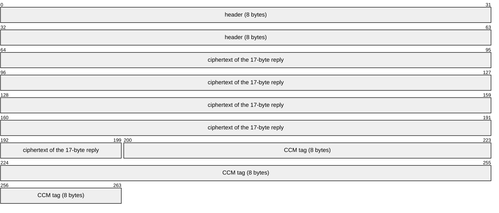
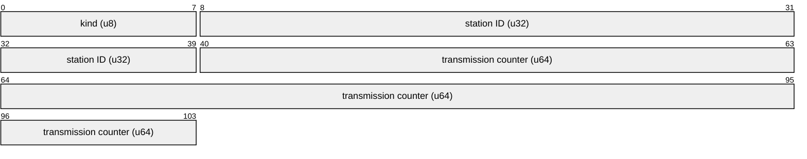
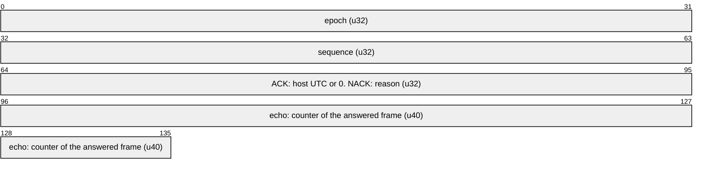
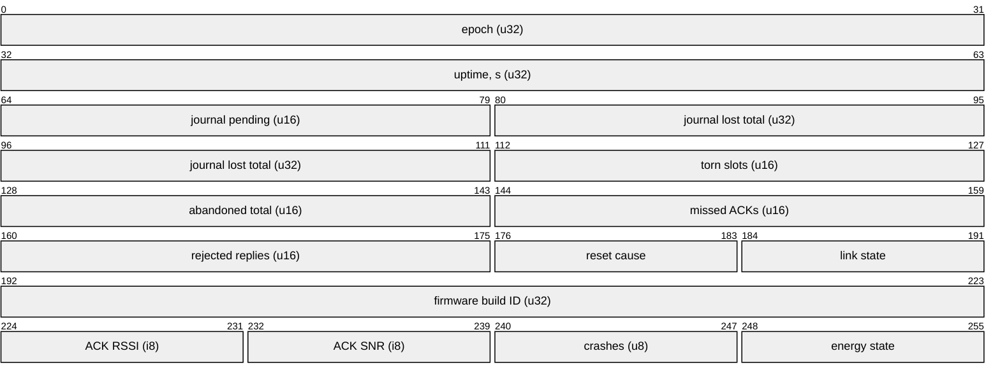
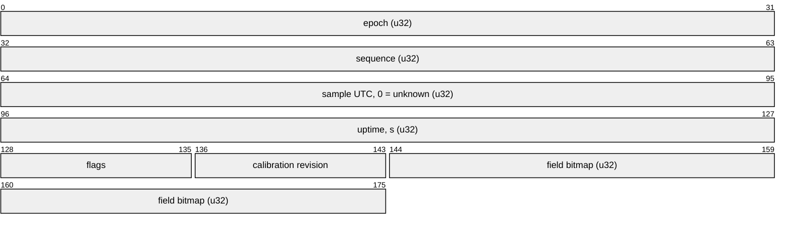
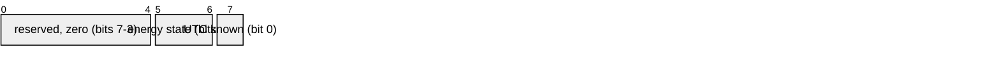
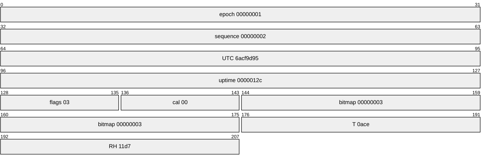
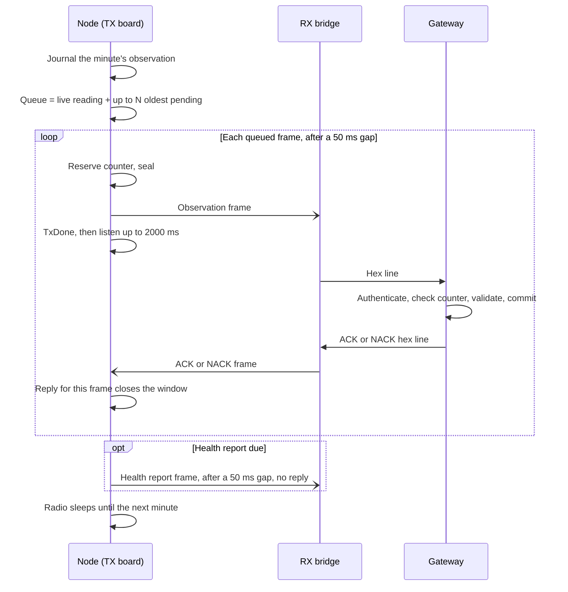
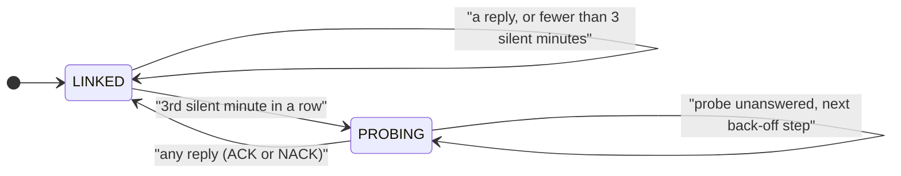

# Wire protocol

This document is the normative specification of the radio protocol on `master`. The protocol
version is 5. It was first released to both boards as `bc5e6ede429c` on 2026-10-14.
[`firmware/stage0-node/RELEASES.md`](../firmware/stage0-node/RELEASES.md) lists the release that
the boards run now.

The format is not frozen yet. The 24-hour delivery test (H01, [`H01-checklist.md`](H01-checklist.md))
must pass first. Then the product requirements document (PRD) freezes the identity, time and
quality contract.

Other documents:
- [`protocol-design.md`](protocol-design.md) gives the design rationale.
- [`protocol-stack.md`](protocol-stack.md) tells how each layer operates end to end: sensor,
  journal, encryption, LoRa, USB, SQLite and time.
- [`module-protocol.md`](module-protocol.md) is WSMP, the contract between the station and its
  sensor modules (draft, not implemented yet).

The node sends LoRa packets directly to the receiver. One packet carries one frame. A frame is an
observation, a health report, an acknowledgment (ACK) or a negative acknowledgment (NACK). There is
no mesh and no module discovery. Every integer on the wire is **big-endian**.

If the code and this text disagree, the code is correct. The code is:

| Part | C (node, RX bridge) | Python (gateway) |
|---|---|---|
| Envelope, ACK and NACK | `firmware/common/ws_frame.{c,h}` | `ws0/protocol.py` |
| Observation and field catalog | `firmware/common/ws_obs.{c,h}` | `ws0/fields.py` |
| RX filters, console line parsing | `firmware/common/ws_console.{c,h}` | `ws0/link.py`, `ws0/__main__.py` |
| Node application | `firmware/stage0-node/App/app_tx.c` and the `tx_*.c` modules, `selftest.c`, `app_rx.c`, `node_store.c`, `node_fields.h` (file map: `firmware/stage0-node/README.md`) | — |
| Validation, storage | — | `gateway.py`, `ws0/service.py` |

In the code, the four frame kinds have short names: `OBS` (observation), `ACK`, `NACK` and `DIAG`
(health report).

## 1. Envelope

Every frame has an 8-byte clear header, then the ciphertext, then an 8-byte tag. The diagram shows
the header. Each row is 32 bits.

| Offset | Bytes | Field | Protection |
|---:|---:|---|---|
| 0 | 1 | High nibble: version **5**. Low nibble: kind (1 observation, 2 ACK, 3 NACK, 4 health report) | Clear, authenticated |
| 1 | 2 | Station ID, u16, 1 to 65,535 | Clear, authenticated |
| 3 | 5 | Transmission counter, u40, 1 to 2^40 − 1 | Clear, authenticated |
| 8 | *n* | AES-128-CCM ciphertext of the kind's plaintext | Encrypted, authenticated |
| 8 + *n* | 8 | CCM tag. Its length M = 8 is a constant. The receiver never infers it from the frame length. | — |

Byte 0 is `0x51` (observation), `0x52` (ACK), `0x53` (NACK) or `0x54` (health report).

As an example, an ACK or NACK frame is 33 bytes:

The encryption is AES-128 in CCM mode (counter with CBC-MAC, RFC 3610):
- **Additional authenticated data (AAD):** the 8 header bytes. The tag covers them, but they are
  not encrypted. A change to the version, kind, station or counter makes the tag fail.
- **Nonce (13 bytes):** the code builds it from the integers. It never copies it from the header
  bytes (`header()` in `ws_frame.c`, `_header_and_nonce()` in `protocol.py`). The nonce has wider
  fields than the header:

- **Key:** 128 bits per station. The node and the gateway share it. The key check value (KCV) is
  the first 3 bytes of AES-128(key, 16 zero bytes). The KCV identifies a key and is safe to
  display.
- **Libraries:** the node uses Mbed TLS 3.6.6 CCM. The gateway uses `cryptography` AESCCM
  (OpenSSL). The project has no AES code of its own.
- **Overhead:** 16 bytes per frame (8 header + 8 tag).

Example: the boot self-test vector (`KAT_OBS` in `App/selftest.c`, key `000102…0f`). The header
`51 0001 0100000002` is an observation from station 1 with counter 0x100000002. Its nonce is
`01 00000001 0000000100000002`.

### Frame lengths

| Kind | Plaintext | Frame | Checked |
|---|---:|---:|---|
| Observation | 23 to 78 B (22 + 1 to 56 field bytes) | 39 to 94 B | The range before decryption. The exact length from the field bitmap after decryption. |
| ACK, NACK | 17 B | 33 B | Exact, before decryption |
| Health report | 32 B | 48 B | Exact, before decryption |

The gateway checks the length, version, kind and station **before** it decrypts
(`plain_lengths()`, `unseal()`). It drops a frame that fails a check or the tag, and it sends no
reply. Thus an outsider cannot make the gateway send a NACK. The current node build sends 51-byte
observations: temperature and humidity with the minute summary (section 5.3).

## 2. Counters and limits

There are two counter spaces under one key. The nonce contains the kind byte. Thus each
(kind, counter) pair is different, and no two frames share a nonce.

| Counter space | Used by | Kept in |
|---|---|---|
| Node | Observation and health report | The node's monotonic log in flash. The node reserves counters in blocks of 256 before use (`store_next_counter`, `App/node_store.c`). |
| Gateway | ACK and NACK | `gateway-nonces.sqlite3`. One `BEGIN IMMEDIATE` transaction per counter (`Nonces.next`). |

The 5-byte header field cannot hold a larger counter. A truncated counter repeats a nonce. Thus
each place that issues or seals a counter enforces the limits:

| Limit | Node (C) | Gateway (Python) |
|---|---|---|
| Counter 1 to 2^40 − 1 | `store_next_counter` refuses past `WS_COUNTER_MAX`. `ws_seal_kind` refuses 0 and values above `WS_COUNTER_MAX`, wipes its output buffer and returns a negative value. The boot self-test checks that 2^40 is refused. | `Nonces.next` raises "Nonce space exhausted; rotate key". `_header_and_nonce` raises. `to_bytes(5)` also raises. |
| Station 1 to 65,535 | `ws_parse_provision` (`firmware/stage0.c`), `store_config_write`, `store_config_load`, `ws_seal_kind`, `ws_open_reply` | `_header_and_nonce`. `station_id` in `gateway.json` (`ws0/service.py`, `STATION_MAX`). |
| Kind 1 to 4 | `ws_seal_kind` | `_header_and_nonce` |

2^40 frames last more than 100,000 years at 20 frames a minute.

These rules keep nonces unique:
- The node reserves a counter block in flash **before** it uses a counter from it. A reset skips
  the rest of the block (for example, counter 8 is followed by 257).
- `WIPE ERASE-ALL-NODE-STATE` erases the key and the journal. It **keeps** the counter and the
  epoch (since release `0f456040fe54`). The `PROVISION` epoch floor raises only the epoch.
- Do not restore old node flash or an old gateway nonce database with the same key. If the
  counter state is lost, use a new key ([`runbook-moving-boards.md`](runbook-moving-boards.md)).
- **A change of the frame format needs a new key and fresh state.** WIPE the node, `init` a new
  run directory, and run `provision-node`. The CCM keystream blocks encode only the nonce length,
  not the tag length. Thus a key from the previous format could repeat keystream. The first
  release of protocol version 5 got a new key (run directory `run-d5`, KCV `5618eb`).

## 3. ACK and NACK (kinds 2 and 3, gateway to node)

The ACK and the NACK have the same 17-byte plaintext. They use the gateway's counter space.

| Offset | Bytes | ACK | NACK |
|---:|---:|---|---|
| 0 | 4 | Epoch of the observation | Epoch of the rejected observation |
| 4 | 4 | Sequence of the observation | Sequence of the rejected observation |
| 8 | 4 | Host UTC at commit, Unix seconds. **0** when the gateway measured its own clock as wrong (`ws0/clock.py`). | Reason: **1** identity collision, **2** invalid record |
| 12 | 5 | **Echo:** the counter of the observation frame that the reply answers | Echo, as for the ACK |

C API: `ws_open_reply(key, station, frame, len, &kind, &counter, &epoch, &seq, &word, &echo)`.
`word` is the UTC or the reason.

**Gateway.** The gateway seals an ACK only **after** the SQLite commit. It also sends an ACK for an
identity that it already holds (a retry after a lost ACK). It seals a NACK only for an
**authentic** observation that it must reject permanently. Before that, it stores the raw frame in
its `rejections` table.

**Node.**
- Any authentic ACK clears its own journal record. The node finds the record by epoch and sequence.
- The node sets its clock only from an ACK that matches the frame it just sent. The echo, epoch and
  sequence must match, and the ACK must arrive in that frame's receive window. The UTC must be at
  or after 2026-01-01. This rule also ignores the UTC value 0. A recorded ACK that an attacker
  replays later cannot match, so it cannot move the clock.
- The node accepts a NACK only for the frame it just sent. It then marks the record done and adds 1
  to the persisted `abandoned` total.
- After an authentic reply, the node keeps the RSSI (received signal strength) and SNR
  (signal-to-noise ratio) of that reply for the health report. A forged reply cannot set them.

## 4. Health report (kind 4, node to gateway)

The node sends the health report and expects no reply. The report has no journal entry and no
receive window. It uses the node's counter space. The node sends a report after boot, every
15 minutes, and after each link-state change. It sends the report after that minute's exchange,
also while the link is probing. The gateway stores the report in its `diagnostics` table. It orders
the reports by (epoch, uptime), not by arrival.

| Offset | Bytes | Field | Gateway JSON name |
|---:|---:|---|---|
| 0 | 4 | Epoch | `epoch` |
| 4 | 4 | Uptime, seconds | `uptime_s` |
| 8 | 2 | Journal records pending | `journal_pending` |
| 10 | 4 | Journal records lost to overflow (cumulative, persisted) | `journal_lost_total` |
| 14 | 2 | Torn (burned) slots found at boot | `journal_torn_slots` |
| 16 | 2 | Abandoned records (cumulative, persisted) | `abandoned_total` |
| 18 | 2 | Missed ACKs since boot | `missed_acks_since_boot` |
| 20 | 2 | Rejected replies since boot | `rejected_replies_since_boot` |
| 22 | 1 | Reset cause: 0 unknown, 1 power, 2 pin, 3 brownout, 4 software, 5 watchdog, 6 lowpower, 7 option-bytes | `reset_cause` |
| 23 | 1 | Link state: 0 linked, 1 probing | `link` |
| 24 | 4 | Firmware build ID: the first 8 hex digits of `WS_FW_VERSION` (the release commit). 0 if they are not hex. | `firmware_build` (8 hex digits) |
| 28 | 1 | RSSI of the last authentic ACK or NACK, as the node heard it. Signed dBm, clamped to −127 to 127. **−128 = none yet.** | `ack_rssi_dbm` (`null` for −128) |
| 29 | 1 | SNR of that reply, signed dB. −128 = none yet. | `ack_snr_db` (`null` for −128) |
| 30 | 1 | Crashes since power-up (`fault_count()`, RTC backup register DR11). Saturates at 255. | `crashes_since_power_up` |
| 31 | 1 | Energy state (section 5.2) | `energy_state` |

The 2-byte counts saturate at `0xFFFF`. Python layout: `DIAG = struct.Struct('>IIHIHHHHBBIbbBB')`.

## 5. Observation (kind 1, node to gateway)

### 5.1 Layout

The plaintext is a 22-byte header, then the fields that the bitmap names.

The flags byte. The diagram shows the most significant bit (bit 7) on the left:

| Offset | Bytes | Field |
|---:|---:|---|
| 0 | 4 | Epoch: the boot epoch. It is durable and increases at each node boot. |
| 4 | 4 | Sequence within the epoch, from 0 |
| 8 | 4 | Sample UTC, Unix seconds (u32, valid to 2106). **0** if the time is unknown. |
| 12 | 4 | Uptime: seconds since the node booted. It is always present. A time sync never changes it. |
| 16 | 1 | Flags: bit 0 time known (must equal UTC ≠ 0). Bits 1–2 energy state. Bits 3–7 zero. |
| 17 | 1 | Calibration revision, u8. 0 in the current build. |
| 18 | 4 | Field bitmap, u32: field *i* is present when `(bitmap >> i) & 1`. Temperature and humidity alone = `0x00000003`. |
| 22 | *k* | The present fields in increasing *i*. Each is a big-endian unsigned integer of its catalog width. |

The plaintext length is 22 + the widths of the present fields (`WS_OBS_PLAIN_LEN(bitmap)`,
`ws_obs_plain_len()`). The current build sends fields 0, 1 and 21–25 (bitmap `0x03E00003`). Its
plaintext is 22 + 13 = **35 bytes**, and its frame is 51 bytes.

**Presence rule.** The build alone decides which fields are present (`WS_NODE_FIELDS` in
`App/node_fields.h`). A reading never changes it. The node sends a faulted field with its INVALID
code and never leaves it out. Thus the frame length does not show a sensor fault. The gateway
rejects a bitmap of 0.

Example: the encoder's known answer (`tests/test_obs.py`, `selftest_kat` in `App/selftest.c`).
Epoch 1, sequence 2, UTC 1791991189, uptime 300 s, energy state NORMAL, temperature −12.34 °C,
humidity 45.67 %:

Flags `0x03` = time known + energy state 1 (NORMAL). The temperature code `0x0ace` = 2766 =
(−12.34 °C + 40.00 °C) in 0.01 °C. The humidity code `0x11d7` = 4567.

### 5.2 Energy state (flag bits 1–2)

| Code | State | Gateway string |
|---:|---|---|
| 0 | SURPLUS | `surplus` |
| 1 | NORMAL | `normal` |
| 2 | CONSERVE | `conserve` |
| 3 | CRITICAL | `critical` |

This is the firmware's `energy_t` numbering. The bench prototype runs on USB power. Its firmware
always sends 1 (NORMAL, `energy_state()` in `App/tx_policy.c`).

### 5.3 Field catalog, version 1

Value = (code − offset) / scale. INVALID is the field's all-ones code (`0xFF`, `0xFFFF` or
`0xFFFFFF`). The exception is `qualifiers`, which has no INVALID code.

| *i* | Field | Bytes | Unit, step | Offset (codes) | In-range codes | Value range | Special codes | Status |
|---:|---|---:|---|---:|---|---|---|---|
| 0 | `temperature_c` | 2 | 0.01 °C | 4000 | 0–16500 | −40.00 to 125.00 | `0xFFFF` INVALID | **built** (SHT45) |
| 1 | `humidity_pct` | 2 | 0.01 % | 0 | 0–10000 | 0 to 100.00 | `0xFFFF` INVALID | **built** (SHT45) |
| 2 | `pressure_hpa` | 2 | 0.1 hPa | −3000 | 0–8000 | 300.0 to 1100.0 | `0xFFFF` INVALID | defined, not built |
| 3 | `wind_speed_ms` | 2 | 0.1 m/s | 0 | 0–750 | 0 to 75.0, mean over the minute | `0xFFFF` INVALID | defined |
| 4 | `wind_gust_ms` | 2 | 0.1 m/s | 0 | 0–750 | 0 to 75.0, highest 3-s mean | `0xFFFF` INVALID | defined |
| 5 | `wind_dir_deg` | 2 | 1° | 0 | 0–359 | 0 to 359, wraps modulo 360 | `0xFFFE` CALM, `0xFFFF` INVALID | defined |
| 6 | `rain_tips` | 3 | tips since boot | 0 | 0–16,777,214 | counter | `0xFFFFFF` INVALID | defined |
| 7 | `uv_index` | 1 | 0.1 UVI | 0 | 0–250 | 0 to 25.0 | `0xFF` INVALID | defined |
| 8 | `irradiance_wm2` | 2 | 1 W/m² | 0 | 0–2000 | 0 to 2000 | `0xFFFF` INVALID | defined |
| 9 | `uva_raw` | 3 | sensor counts | 0 | 0–1,048,575 (2^20 − 1) | raw, never reported as UV index | `0xFFFFFF` INVALID | defined |
| 10 | `qualifiers` | 4 | 2 bits per field 0–15: 0 ok, 1 suspected icing, 2 delayed melt, 3 outside the qualified envelope | — | any u32 | — | none (never INVALID) | defined |
| 11 | `batt_mv` | 2 | 1 mV | 0 | 0–65,534 | 0 to 65,534 | `0xFFFF` INVALID | defined |
| 12 | `batt_current_ma` | 2 | 0.1 mA, positive = into the cells | 32768 | 0–65,534 | −3276.8 to +3276.6 | `0xFFFF` INVALID | defined |
| 13 | `energy_in_mwh` | 3 | mWh since boot | 0 | 0–16,777,214 | counter | `0xFFFFFF` INVALID | defined |
| 14 | `energy_out_mwh` | 3 | mWh since boot | 0 | 0–16,777,214 | counter | `0xFFFFFF` INVALID | defined |
| 15 | `charge_in_mah` | 3 | mAh since boot | 0 | 0–16,777,214 | counter | `0xFFFFFF` INVALID | defined |
| 16 | `charge_out_mah` | 3 | mAh since boot | 0 | 0–16,777,214 | counter | `0xFFFFFF` INVALID | defined |
| 17 | `soc_gauge_pct` | 1 | 1 %, fuel-gauge estimate | 0 | 0–100 | 0 to 100 | `0xFF` INVALID | defined |
| 18 | `charger_pins` | 1 | bit 0 PGOOD, bit 1 CHG | 0 | 0–3 | raw pins | `0xFF` INVALID | defined |
| 19 | `enclosure_temp_c` | 2 | as field 0 | 4000 | 0–16500 | −40.00 to 125.00 | `0xFFFF` INVALID | defined |
| 20 | `enclosure_rh_pct` | 2 | as field 1 | 0 | 0–10000 | 0 to 100.00 | `0xFFFF` INVALID | defined |
| 21 | `temperature_min_c` | 2 | as field 0: lowest valid 15-s sample of the minute | 4000 | 0–16500 | −40.00 to 125.00 | `0xFFFF` INVALID | **built** |
| 22 | `temperature_max_c` | 2 | as field 0: highest | 4000 | 0–16500 | −40.00 to 125.00 | `0xFFFF` INVALID | **built** |
| 23 | `humidity_min_pct` | 2 | as field 1: lowest | 0 | 0–10000 | 0 to 100.00 | `0xFFFF` INVALID | **built** |
| 24 | `humidity_max_pct` | 2 | as field 1: highest | 0 | 0–10000 | 0 to 100.00 | `0xFFFF` INVALID | **built** |
| 25 | `th_samples` | 1 | valid temperature and humidity samples behind fields 0, 1 and 21–24 (metadata) | 0 | 0–60 | count | `0xFF` INVALID | **built** |
| 26–31 | reserved | — | — | — | must be zero | — | — | — |

All 26 fields together are 56 bytes. Thus the largest plaintext is 78 bytes, and the largest frame
is 94 bytes. The current build has drivers for fields 0, 1 and 21–25. Fields 21–25 first shipped
in release `586001994b09`. The catalog fixes the other fields now, so later builds need no wire
change. The counter fields (6 and 13–16) start at 0 when their epoch starts.

**15-second sampling.** The node reads the SHT45 every 15 s (`SAMPLE_PERIOD_MS`). It sends one
observation per minute, after the 4th sample (`SAMPLES_PER_REPORT`). With fields 21–25 present:
- `temperature_c` and `humidity_pct` are the **mean** of the minute's valid samples. The node
  rounds half up, in integers (`ws_th_mean_*`, `firmware/stage0.c`).
- Fields 21–24 are the extrema of those samples.
- Field 25 is the number of valid samples.

The node does not count a sample outside −40.00 to 125.00 °C. It clamps humidity to 0–100 %
before it counts the sample. With no valid sample, fields 0, 1 and 21–24 are INVALID, and field 25
is 0. `th_samples` is metadata. It does not count towards the record's `quality`. Thus a dead
sensor still gives `sensor_fault`.

### 5.4 Encoding rules

| Rule | Where |
|---|---|
| Code = round half up of (value × scale) + offset, that is `floor(x × scale + 0.5) + offset`. The computation is exact: Python uses `Decimal`, and C works from integer 0.01 units. | `Field.code()`, `ws_code_temp_centi`, `ws_code_rh_centi` |
| A value out of range gives **INVALID**. It is never clamped. | `Field.code()`, `ws_code_temp_centi` (temperature outside −40.00 to 125.00 °C) |
| Exception: relative humidity (fields 1, 20, 23 and 24) is **clamped** to 0–100 %. | `Field.code()`, `ws_code_rh_centi` |
| `wind_dir_deg` wraps modulo 360 before the range check. | `Field.code()` |
| No sample or a sensor fault gives INVALID. After any SHT45 fault, the node sends **both** temperature and humidity as INVALID. | `obs_codes()` in `App/app_tx.c` |
| A wind direction needs a valid speed. If `wind_speed_ms` is INVALID, `wind_dir_deg` must be INVALID. CALM is not permitted either. | `ws_obs_encode`, `_check_wind` |
| Decoding is exact. (code − offset) is an integer before the single division. Thus no floating-point noise reaches the stored JSON. | `Field.value()` |

The C encoder `ws_obs_encode` refuses (returns −1) each record that the decoder would reject. The C
and Python encoders produce identical bytes (`tests/test_obs.py`).

### 5.5 One valid encoding per reading (canonical rules)

The gateway accepts exactly one byte form for each reading. It stores an **authentic** observation
that breaks one of these rules in `rejections`, and it answers with a **NACK**:

| Rule | NACK reason | Code |
|---|---:|---|
| Plaintext length ≠ 22 + the widths of the present fields | 2 | `fields.decode` |
| A flag bit 3–7 set, a reserved bitmap bit (26–31) set, or a bitmap of 0 | 2 | `fields.decode` |
| Time-known flag ≠ (UTC ≠ 0) | 2 | `fields.decode` |
| A code above its field's maximum that is not that field's INVALID or CALM code | 2 | `Field.code_ok` |
| `wind_dir_deg` not INVALID while `wind_speed_ms` is INVALID | 2 | `_check_wind` |
| A since-boot counter that decreases **in sequence order** within its epoch (section 6) | 2 | `Store.check_counters` |
| Anything else that `gateway.validate` refuses. Examples: a value that is not an exact catalog value, or a quality that does not match the fields. | 2 | `gateway.validate` |
| Same identity (station, epoch, sequence) as a stored record, with different content | **1** | `Store.ingest` |

Some frames never reach these checks. The gateway drops them with no reply (section 1): a length
outside 39–94 bytes, a wrong version, kind or station, or a bad tag. The gateway and the node ship
one catalog together. Thus an unknown bit is a bug, not a newer node.

The gateway does **not** reject a sample time that is more than 5 s after its receipt time. It
stores the record and **quarantines** it (`future_clock_at_receipt`). Waiting does not make it
valid.

## 6. Gateway record

`decode_observation()` turns a plaintext into this JSON record. `gateway.validate()` checks it. The
schema is closed: no other keys are permitted.

| Key | Value |
|---|---|
| `version` | `5` |
| `station` | Configured station name (string) |
| `session` | The epoch, as a decimal string |
| `sequence` | Sequence number |
| `sampled_at` | UTC seconds, or `null` when the time is unknown |
| `uptime_s` | Uptime |
| `time_quality` | `synchronized` or `unknown` |
| `energy_state` | `surplus`, `normal`, `conserve` or `critical` |
| `calibration_revision` | 0–255 |
| `quality` | `valid`, `partial` or `sensor_fault` (below) |
| *each present field* | Its value in catalog units, or **`null`** for INVALID |
| `wind_calm` | Present exactly when `wind_dir_deg` is present. `true` for CALM (then `wind_dir_deg` is `null`), else `false`. |
| `qualifiers` | An object with only the fields that are not ok, for example `{"temperature_c": "suspected_icing"}` |

**Quality** uses the present measurement fields. It excludes `qualifiers` and the metadata field
`th_samples`:
- `valid`: every present field has a value. CALM counts as a value.
- `partial`: some present fields are `null`.
- `sensor_fault`: every present field is `null`.

For the current build, a sensor fault gives `temperature_c: null, humidity_pct: null,
quality: "sensor_fault"`.

**Availability per field.** `/v1/observations/latest` reports `fields_available` and the unit for
each field. Home Assistant gets one entity per field. Each entity is unavailable when its own value
is `null`. Thus a dead sensor never hides the others. The 24-hour delivery test (H01) scores the
validity of the temperature and humidity fields (`tools/h01_report.py`).

**Identity.** The observation identity is station + epoch + sequence. A record whose identity is
already stored with the same content is a duplicate. The gateway adds no row and sends the ACK
again. Different content under the same identity is a collision. The gateway sends NACK reason 1,
never an ACK. Identity order (epoch, then sequence) decides which record is the newest, not
wall-clock time.

**Since-boot counters** (`rain_tips`, `energy_*`, `charge_*`) must not decrease **in sequence
order** within one epoch. The gateway compares a new record with its stored neighbours by
sequence: the nearest lower and the nearest higher sequence that has a value. It never compares by
arrival order. Thus it accepts an older record that arrives late (backfill). It skips `null`
values.

**Reconstructed time.** The gateway gives an unsynchronized record an effective time. It uses the
nearest synchronized record of the same epoch: `ref_utc + (uptime − ref_uptime)`. The uncertainty
is 2 s + 150 ppm × |uptime − ref_uptime| (`Store.reconstruct`, `protocol-stack.md` section
11.3.2).

## 7. Replay and key reuse

The gateway keeps a high-water mark of the node counter. It also keeps the SHA-256 of each
authentic node frame that it accepted as fresh, by counter (`node_counter` and `node_frames` tables
in the nonce database, `Nonces.advance_node_counter`). It applies this table to each **authentic**
observation or health report:

| Case | Verdict | What the gateway does |
|---|---|---|
| Counter above the mark | fresh | Raises the mark, keeps the digest, then processes the frame |
| Counter at or below the mark, same bytes as the frame accepted under that counter | **replay** | Sends no reply and stores no data. Keeps the raw frame in `rejections` with reason `replay`. Counts `replays`. Raises **no alarm**. |
| Counter at or below the mark, different bytes, or a counter that it never accepted | **counter regression** | Sends no reply and stores no data. Keeps the raw frame in `rejections` with reason `counter_regression`. `/v1/status` raises the persistent alarm "possible key reuse: re-key the node". |

The gateway commits the mark before it acts on the frame. A direct LoRa link cannot reorder frames.
Thus an older counter that the gateway never saw means a repeated nonce or a reused key, not a late
frame. Only a new key in a new state directory clears the alarm
([`runbook-moving-boards.md`](runbook-moving-boards.md)).

## 8. RX bridge and USB line contract

The RX board holds no key. It never sends an acknowledgment itself. The gateway is the only ACK
authority. The serial port runs at 115200 baud, 8N1, one line per message. A line ends with `\n`.
The receiver ignores `\r`.

| Direction | Line | Rule |
|---|---|---|
| RX to host | Lowercase hex of one received frame | Only if `ws_air_frame_ok()` accepts the frame: version 5, and kind 1 with 39–94 bytes (78–188 hex digits) or kind 4 with 48 bytes (96 digits). The current observation is 102 digits. Any other frame gives `#rx drop len= rssi= snr=`. |
| RX to host | `#…` | Diagnostics: `#rx obs rssi= snr=` after each forwarded frame, `#rx crc len= rssi= snr= data=` and `#rx hdr rssi=` for bad receptions, `#alive` every 60 s, `#boot`, `#status`, `#watchdog …`, `#tx busy`, `#host reject len=`, and others |
| host to RX | 66 hex digits | One ACK or NACK. The RX board transmits it once with the uplink radio settings. Only if `ws_host_reply_ok()` accepts it: exactly 33 bytes, version 5, kind 2 or 3. Any other line gives `#host reject len=`. |
| host to RX | `STATUS`, `TEST-HANG`, `TEST-FAULT` | Commands. The RX board ignores lines that start with `#`. |

- A line is at most 256 bytes on both sides (`WS_LINE_MAX`, `ws0/link.py`). The receiver discards a
  longer line whole.
- The bridge prints the largest catalog frame (94 bytes) whole (`hex_print` in `App/console.c`). A
  static assert checks it against the 256-byte trace buffer. The bridge reports anything longer as
  `#error` and never prints a truncated line.
- The gateway writes every `#` line to `receiver.log`. It never decodes such a line as a frame. It
  reads `#alive` and `#boot role=rx` only for receiver liveness. It marks the receiver silent after
  180 s. It logs each frame and its reply (`frame <hex> -> ack <hex>`, `-> nack <hex>`,
  `diag <hex>`).
- While the RX console holds a complete line, it drops more input. The host sends one line per
  exchange.

## 9. Radio exchange (`firmware/stage0-node`)

Radio settings (`App/radio_cfg.h`): 915.0 MHz LoRa, 500 kHz bandwidth, spreading factor 7 (SF7),
coding rate 4/5, 8-symbol preamble, explicit header, CRC on, 0 dBm (bench), symbol timeout off.
[`hardware/nucleo-wl55jc-bringup.md`](hardware/nucleo-wl55jc-bringup.md) gives the regulatory basis.
At SF7, a 51-byte observation takes 25.7 ms on air, a 33-byte ACK takes 18.0 ms, and a 48-byte
health report takes 24.4 ms (`protocol-stack.md` section 8.2).

One minute of the exchange, with the link LINKED (`App/tx_exchange.c`):

- Each minute, the node journals one observation. While the link is LINKED, the node sends it, then
  up to *N* older pending records, oldest first. The transmission policy sets *N*
  ([`radio-energy-policy.md`](radio-energy-policy.md)): 20, 5, 0 and 0 for SURPLUS, NORMAL,
  CONSERVE and CRITICAL. The bench prototype is fixed at NORMAL, so *N* = 5.
- A radio-time budget per minute also caps *N*: 15, 5, 2 and 0 s. The firmware estimates one
  exchange as observation airtime + ACK airtime + 300 ms. That is 26 + 18 + 300 = **344 ms** at SF7
  (`exchange_ms` in `App/tx_policy.c`, `ws_lora_airtime_ms()` in `firmware/common/ws_policy.c`).
- CONSERVE sends only the live reading, at most every 300 s. CRITICAL journals and does not send.
- After each frame, the node listens up to 2000 ms for the reply. It waits 50 ms before each frame.
- A missed reply ends that minute's drain one frame later. A second miss in a row, or a transmit
  timeout, ends it at once.
- After 3 consecutive minutes with no answer, the link state becomes PROBING (diagram below). The
  node then sends only the live reading, with no backlog. In SURPLUS and NORMAL it sends every
  minute, so the bench prototype always does. In CONSERVE it sends after 120, 240 and 480 s, then
  every 900 s. Any answer returns the link to LINKED.
- A missing ACK leaves the record in the journal. Each retry has the same identity and a new
  counter.
- **Strike limit.** A record earns a strike when it gets no reply but a frame sent **after** it in
  the same exchange gets one. At 10 strikes, the node abandons the record and counts it
  (`STRIKE_LIMIT` 10, 6 tracking slots). An answer to an earlier frame proves nothing, because on a
  weak link the next frame can be lost. Thus a link or gateway outage never abandons data. A
  refused record that is the only backlog is the minute's last frame. No later frame can show that
  the gateway refuses it. Thus the node retries it each minute and never abandons it.
- The node trusts its clock for 6 hours after the last time sync. After that, it sends UTC 0 (time
  unknown) until the next accepted ACK.
- The Python simulator (`ws0/simulator.py`) drains 5 records per minute, like NORMAL.

Link state (`ws_link_minute()` in `firmware/common/ws_policy.c`). The node updates it at the end of
each minute that sent something:

References:
- RFC 3610, *Counter with CBC-MAC (CCM)*: <https://www.rfc-editor.org/rfc/rfc3610>
- NIST SP 800-38C: <https://csrc.nist.gov/pubs/sp/800/38/c/upd1/final>
- `cryptography` AESCCM: <https://cryptography.io/en/latest/hazmat/primitives/aead/#cryptography.hazmat.primitives.ciphers.aead.AESCCM>
- Sensirion SHT4x datasheet: <https://sensirion.com/resource/datasheet/sht4x>
