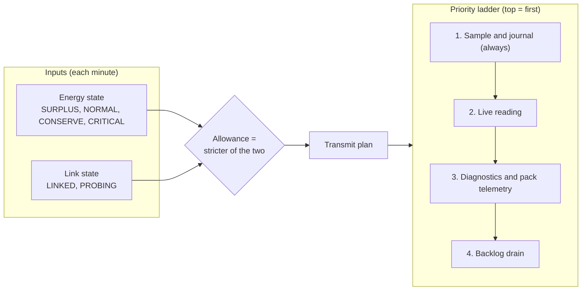
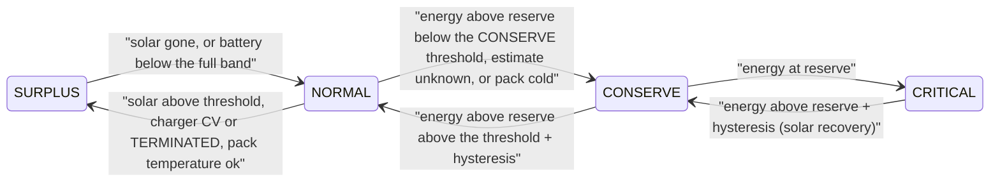
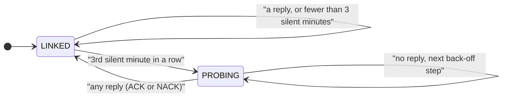

# Radio transmission policy: energy, link health, and backlog

> **Document type:** Design specification. **Language:** ASD-STE100 style.
> **Status:** Approved 2026-10-12 (section 9 lists the approved values). The link-health part (section 6) was implemented on 2026-10-13 for the bench prototype. The code is `App/tx_policy.c` over the pure functions in `firmware/common/ws_policy.c`, host-tested in `firmware/test_tx_policy.c`. It has the link states, the probe back-off, live-only probes, the drain stop after a miss, the airtime cap from the configured spreading factor, the health-report airtime reserve (added 2026-10-29, section 6), and an energy-state hook fixed at NORMAL. Bench evidence: `evidence/g13-outage-2026-10-13/`. **Amended 2026-10-29** by the [power telemetry design](superpowers/specs/2026-10-29-power-telemetry-design.md) ("the power design" below): the node now measures its power system in phase A (the 1S3P pack, the bq24074 charger, the battery INA228 and the MAX17048 gauge) and sends it in protocol version 6. The energy state stays NORMAL (`energy_state()`, `App/tx_policy.c:34`) until the thresholds exist. They need the measured loads (H02) and Clint's open decision D1 on the pack reserve (section 3). The energy inputs (section 5) connect then (product specification sections 4–5, tests H02 and H03).
> **Related:** [`failure-modes.md`](failure-modes.md) §1.1–1.2 (energy cost of failure), §1.2 (link back-off), §6.1 (power measurement and charger failures), §10 open issues (backlog drain rate, low-voltage inhibit, blind ACK window). [Power telemetry design](superpowers/specs/2026-10-29-power-telemetry-design.md) §2 (phases), §3 (fill table), §6.4 (health airtime), §15 (D1).

In this document, "the product specification" is the Weather Station v0.2 PRD/TRD (product and technical requirements). It names requirements R02 (reporting modes, with conservation reports every 5 minutes) and R03 (the radio never takes the energy of the next 7 days of sampling). Its tests H02 (pack Ah and Wh accounting within 5 %) and H03 (168 hours at −35 °C, with cold-charge inhibit and dawn recovery) apply to the battery and solar build. The staged plan is in [`next-stages-plan.md`](next-stages-plan.md):

| Stage | Build |
|---|---|
| 0 | The bench prototype: two development boards on USB power. It must pass the 24-hour delivery test (H01, [`H01-checklist.md`](H01-checklist.md)). Since 2026-10-29 the TX board also measures the power phase A hardware on the bench (power design section 2) |
| 1 | The battery and solar build: main power and pack state, in the power phases A (bq24074), B (four INA228 rails) and C (BQ25798) of the power design |
| 2 | One wired sensor module |
| 3 | Complete unheated sensing |

---

## 1. The problem

The station is an unattended node on battery and solar power. It sends one-minute readings over a long LoRa path to an indoor receiver. Each minute, the radio must decide:

- whether to transmit at all,
- what to transmit: the live reading, older readings from the journal, or diagnostics,
- how much to transmit.

Before this policy (before 2026-10-13), the rule was fixed. The node sent the live reading and up to 2 older readings every minute, whatever the link and energy state. That rule wasted energy when the link was down. It ignored the battery and the sun. It also cleared a long backlog slowly when energy was plentiful.

---

## 2. Goals, in priority order

1. **Collect the data.** Sampling and journaling continue whenever the station operates. The radio never takes the energy that the next 7 days of sampling need (requirement R03).
2. **Deliver live readings on time.** One reading per minute, committed within 120 s (H01), when energy permits.
3. **Lose no journaled reading.** Deliver the backlog before the journal overflows.
4. **Recover history quickly.** Clear a backlog soon after a link outage ends.
5. **Spend energy when it is cheap.** Prefer energy that would otherwise be lost: solar input with a full battery.
6. **Be a good neighbor on 915 MHz.** Limit the radio-active time per minute.

A lower goal never takes energy or airtime from a higher goal.

---

## 3. Energy facts that drive the design

The current values are datasheet-class assumptions: transmit (TX) ≈ 100 mA at +20 dBm, receive (RX) ≈ 5 mA. The battery and solar build measures them (H02).

| Quantity | SF7 | SF10 | SF12 |
|---|---:|---:|---:|
| Airtime, 56-byte frame (previous format, protocol version 4) | 27 ms | 164 ms | 576 ms |
| Airtime, 51-byte observation (T/RH with the minute summary, protocol version 5 before the WSMP modules) | 26 ms | 154 ms | 535 ms |
| Airtime, 77-byte observation (widest record of the version 5 bench build) | 35 ms | 206 ms | 699 ms |
| Charge per **delivered** reading (TX + short ACK window) | ≈ 3 mC | ≈ 18 mC | ≈ 62 mC |
| Charge per **failed** attempt (TX + full 2 s window) | ≈ 13 mC | ≈ 26 mC | ≈ 68 mC |
| One day of live readings (1,440 delivered), at 3.3 V | ≈ 0.004 Wh | ≈ 0.024 Wh | ≈ 0.08 Wh |
| **A full journal** (4,743 readings, previous format) delivered | ≈ 0.013 Wh | ≈ 0.08 Wh | ≈ **0.27 Wh** |
| One day of failed attempts at the old fixed rule (3 per minute) | ≈ 0.05 Wh | ≈ 0.10 Wh | ≈ **0.27 Wh** |

SF is the LoRa spreading factor. The table above was computed for the previous format: 56-byte frames and ACKs, and a journal of 4,743 readings. It stays as the reference of the decisions in section 9. The current format is protocol version 6 (power design sections 4–7):

| Quantity, protocol version 6 | SF7 | SF10 | SF12 |
|---|---:|---:|---:|
| Airtime, 93-byte observation (widest record of the node field set, `OBS_FRAME_MAX`) | 41.0 ms | 236.0 ms | 821.2 ms |
| Airtime, 80-byte health report (64-byte plaintext) | 35.9 ms | 215.6 ms | 739.3 ms |
| Airtime, 33-byte ACK | 18.0 ms | 113.2 ms | 411.6 ms |
| One answered exchange as the firmware counts it (observation + ACK + 300 ms, each airtime rounded up to whole ms) | 360 ms | 651 ms | 1,534 ms |
| Charge per **delivered** reading (TX; receive for the ACK airtime + 300 ms) | ≈ 6 mC | ≈ 26 mC | ≈ 86 mC |
| Charge per **failed** attempt (TX + full 2 s window) | ≈ 14 mC | ≈ 34 mC | ≈ 92 mC |
| One day of live readings (1,440 delivered), at 3.3 V | ≈ 0.008 Wh | ≈ 0.034 Wh | ≈ 0.11 Wh |
| **A full journal** (1,449 readings) delivered, at 3.3 V | ≈ 0.008 Wh | ≈ 0.034 Wh | ≈ 0.11 Wh |
| One day of health reports (96, no reply), at 3.3 V | ≈ 0.0003 Wh | ≈ 0.002 Wh | ≈ 0.007 Wh |
| One day of failed attempts at the old fixed rule (3 per minute), at 3.3 V | ≈ 0.06 Wh | ≈ 0.13 Wh | ≈ 0.37 Wh |

The airtimes come from `ws_lora_airtime_ms()` (`firmware/common/ws_policy.c:43-56`, 500 kHz, CR 4/5, explicit header, CRC). The node field set `WS_F_WSMP_BENCH` is 77 bytes of plaintext (`App/node_fields.h:29`), so its frame is 93 bytes (`App/tx_exchange.h:13`). A record carries only the fields of the modules present, so many frames are shorter. No node build exceeds a 96-byte frame (80 bytes of plaintext, the per-build ceiling of power design sections 5.4 and 7; 41 / 246 / 821 ms). The receive charge counts the full 300 ms turnaround allowance, so the delivered row is an upper bound. The journal holds 1,449 readings (69 usable pages × 21 slots of 96 bytes, `App/flash_layout.h:20`, `App/node_store.c:71-75`). The Wh rows use 3.3 V. The radio draws its current from the pack through the regulator, so the pack energy is up to about 27 % higher at a full cell (4.2 V).

Core budget: ≤ 0.25 W average = **6 Wh/day** (product specification section 4).

**The pack** (Clint's decision, 2026-10-29; power design section 1):

| Quantity | Value |
|---|---|
| Pack | 1S3P Li-ion: three 2,200 mAh cells in parallel. It stays 1S3P into the BQ25798 phase (C) and on the carrier (v1 base board): decided 2026-10-30 (build-progression record section 7.1, Q3) |
| Capacity and voltage | 6,600 mAh, 3.0 to 4.2 V, 3.7 V nominal |
| Energy, nominal | 6.6 Ah × 3.7 V ≈ **24.4 Wh** |
| Runtime at the 0.25 W core budget, no solar input | 24.4 Wh ÷ 0.25 W ≈ 98 h (about 4.1 days) |
| Reserve that this policy uses (product specification section 4: ≥ 1.2 × 168 h × core load) | ≥ **50.4 Wh** at 0.25 W (R03: 168 h × 0.25 W = 42 Wh, × 1.2) |
| Pack against that reserve | about 48 %: the reserve is about twice the pack |
| Core load whose reserve fits in the pack | ≤ 0.12 W (24.4 ÷ (1.2 × 168)); ≤ 0.10 W with the CONSERVE band (reserve + 20 %, section 9) also inside it |
| Earlier plan | a 4S4P pack of about 200 Wh ([`next-stages-plan.md`](next-stages-plan.md) section 3). *Amended 2026-10-30:* this row said "The carrier's cell count is open (build-progression record, Q3)". Clint answered Q3 on 2026-10-30: the carrier stays **1S3P** (build-progression record section 7.1), with the BQ25798 at 1S and the MAX17048. The 4S4P plan is not taken |

**Open decision D1 (for Clint; power design section 15).** The 1S3P pack (about 24.4 Wh) is below the reserve that this policy uses (≥ 50.4 Wh). With a reserve larger than the pack, the energy above reserve is negative at every state of charge, and the states of section 5.2 would hold the node in CRITICAL. Options:

| Option | What it means | Cost or risk |
|---|---|---|
| a. A lower measured core load | H02 measures the core load. The reserve shrinks with it: at ≤ 0.10 W the reserve and the CONSERVE band fit in 24.4 Wh; at about 0.06 W half the pack stays above the reserve | Depends on the measurement. No hardware change. A load above about 0.12 W leaves the conflict |
| b. A larger 1S pack for phase C | More cells in parallel: the reserve at 0.25 W alone needs about 13.6 Ah at 3.7 V (7 cells of 2,200 mAh), about 16.3 Ah (8 cells) with the CONSERVE band | Pack, cradle and connector. Charge time: the bq24074 charges at most 1.5 A, so a larger pack wants the BQ25798 (phase C). *Amended 2026-10-30:* not the carrier plan as answered (the carrier stays 1S3P, build-progression record 7.1 Q3); any change of pack is Clint's decision |
| c. The 4S4P pack of `next-stages-plan.md` (about 200 Wh) | About four times the reserve | The MAX17048 gauges one cell only and the bq24074 is a 1S charger: a new gauge and the BQ25798 at 4S. *Amended 2026-10-30:* not taken for the carrier: Clint answered the build-progression record's Q3 with 1S3P (section 7.1); this row said "The build-progression record's Q3" |
| d. A PRD deviation | Shorter autonomy for this pack: at 0.25 W the reserve rule (1.2 × hours × load) fits in 24.4 Wh at about 81 h (3.4 days) instead of 168 h, with nothing above it | Weaker cold-weather autonomy. H03 (168 h at −35 °C) fails as written |

**D1 stays open** after the 2026-10-30 answer to Q3: that answer fixes the carrier's cell count (1S3P), not the reserve conflict, so options a and d remain the open choices unless Clint changes the pack. Until D1 is decided, the energy state stays NORMAL (power design section 9.9), and the thresholds of sections 5.2 and 9 stay unset. The node only reports the measurements (sections 5.1 and 7).

**Conclusions:**

1. **Delivering data is cheap.** A full backlog costs at most about 0.27 Wh (the previous 4,743-reading journal at SF12; the version 6 journal of 1,449 readings costs about 0.11 Wh). That is at most about **1.1 % of the 24.4 Wh pack**. The *total* energy to deliver a backlog does not depend on the drain rate. The drain speed decides **when** to spend, not **how much**.
2. **Failed attempts are the waste.** At SF12, one day of futile retries at the old fixed rule costs more than the delivery of the full journal (0.37 Wh against 0.11 Wh in version 6, about 1.5 % of the pack a day).
3. **The timing of the spend matters.**
   - A burst at night, in cold weather, from a low battery causes voltage sag and a brown-out risk (`failure-modes.md`, brown-out cycling). The same burst at noon with the charger full costs nothing.
   - Solar energy is lost when the charger stops because the battery is full. Energy spent in that state is free.

---

## 4. Policy structure

Two independent inputs decide the allowance each minute. The **stricter** input wins.



**Rule:** The allowance removes items from the **bottom** of the ladder first. The allowance never removes sampling (item 1) while the station operates. The power system and the battery management system (BMS) decide when the station stops.

---

## 5. Energy state (inputs from the power hardware; always NORMAL until D1 and the thresholds)

### 5.1 Inputs, by measured quantity and phase

The product specification requires these inputs (sections 4 and 5). The power design (section 2) names the hardware phases: **A** (now) the bq24074 with one input, the battery INA228 (0x40) and the MAX17048 (0x36); **B** phase A plus a load, a solar and a USB-C INA228, each upstream of the point where the sources join; **C** the TI BQ25798 (VAC1 solar, VAC2 USB-C, its own ADC), with or without phase B's monitors. An input is named by what it measures, not by the chip. The field numbers and health keys are those of [`protocol.md`](protocol.md) (catalog version 2, the 64-byte health report); the fill table is power design section 3.

| Input (where it travels) | Phase A | Phase B | Phase C | Use in the policy |
|---|---|---|---|---|
| Charger status: input power good, charging, fault (health `charger_input_power_ok`, `charger_charging`, `charger_fault`) | PGOOD (PB8) and CHG (PB10) pins; fault = CHG flashing at about 2 Hz | as A | BQ25798 status registers | Battery full or nearly full (SURPLUS, section 5.2). A fault is reported, not used as a state input |
| Charge stage (health `charger_stage`) | not measured: the pins cannot tell | not measured | BQ25798 CHG_STAT | `cv`, `topoff` or `terminated`: full or nearly full |
| Charger input voltage (field 28 `charger_input_mv`) | PA10 × the stored divider ratio (`POWER_VIN_DIVIDER_PPM`, 3 nominal). The source is not identified; under load it can sit at VIN-DPM (4.35–4.63 V) with the charger's EN2 low, or be pulled down towards the cell voltage by a weak source with EN2 high (power-metering §5.4) | as A | BQ25798 VBUS | An input is present |
| Charger-reported charge current (health `charger_reported_battery_ma`) | ISET (PB1): 400 × V_ISET ÷ R_ISET, ±10 %; 0 mA without PGOOD | as A | BQ25798 IBAT | Cross-check of the battery current |
| Battery voltage (field 11 `batt_mv`) | MAX17048 VCELL at the CELL+ node (includes the pack-lead drop, I × R_pack; build-progression record M4) | as A | as A | Brown-out margin (voltage under load). The full band (SURPLUS) |
| Battery current and the charge and energy counters (fields 12–16) | battery INA228, + into the cell | as A | as A | Energy above reserve: the integral with the calibrated capacity (`energy_above_reserve_wh`, H02) |
| Gauge SOC and SOC rate (health `battery_soc_pct`, `battery_soc_rate_pct_h`) | MAX17048 (over-reads while charging) | as A | as A | Estimate confidence (`estimate_confidence`): a cross-check of the counted energy |
| Solar input voltage and current (fields 29, 30) | not measured | solar INA228 | solar INA228 if fitted, else BQ25798 VAC1, and IBUS while solar is the active input | Solar input power, W: surplus detection |
| USB-C input voltage and current (fields 32, 33) | not measured | USB-C INA228 | USB-C INA228 if fitted, else BQ25798 VAC2, and IBUS while USB-C is the active input | External power (bench or backup charging): counts as an input for SURPLUS |
| Active input (health `charger_active_input`) | not reported | not reported (the two source rails tell it) | BQ25798 input selection: `solar`, `usb_c` or `no_input` | Which source carries the station; `no_input`: the battery does |
| Load voltage and current (fields 26, 27) | voltage only: the battery INA228 VBUS on OUT | load INA228 | load INA228 if fitted, else BQ25798 VSYS (no current) | The core load of the reserve (H02); input power above the load (SURPLUS, phase B) |
| Pack temperature (health `pack_temp_c`) | not measured: the NTC goes to the charger's TS pin only | not measured | BQ25798 TS | Cold pack: smaller bursts (CONSERVE) |
| MCU supply (health `mcu_supply_mv`) | VDDA from VREFINT | as A | as A | Brown-out margin at the MCU ([`failure-modes.md`](failure-modes.md) §10, *No low-voltage inhibit*) |

Energy above reserve and estimate confidence are not sent. The node will compute them from the battery counters, the calibrated capacity and the gauge when D1 sets the reserve.

**Not measured is not unknown.** The fail-closed rule (section 5.2, decision 6) applies to an input that the phase **can** fill: a fitted source that gives INVALID, or an estimate without confidence, makes CONSERVE. An input that the phase **cannot** fill ("not measured": absent from the record by build, or a health none code by design) never forces CONSERVE by itself. The rule that needs it uses the phase's substitute, or does not apply:

| Input the phase cannot fill | Phases | Rule that needs it | Instead |
|---|---|---|---|
| Solar input power | A | SURPLUS | the phase A SURPLUS rule (section 5.2) |
| Charge stage | A, B | SURPLUS | CHG off and steady, with PGOOD (section 5.2) |
| Pack temperature | A, B | cold pack → CONSERVE | not evaluated by the node. With the NTC fitted correctly, the charger's TS window stops charging outside 0 to 50 °C for the 103AT curve that SLUS810 specifies, about +3.5 to +47 °C for a B = 3950 part ([`failure-modes.md`](failure-modes.md) §6.1). The cold discharge limit is open (power design D3, H03) |
| Load current | A | the core load of the reserve | the H02 measurement, as a constant |

Without this rule, phase A would stay in CONSERVE for ever: it never measures the solar power or the pack temperature.

### 5.2 States

This diagram is the proposal for the battery and solar build. The firmware does not implement it yet (`energy_state()` returns NORMAL, `App/tx_policy.c:34`). Its SURPLUS entry is written for phase C; the SURPLUS rule below gives each phase's version.



| State | Meaning | Live reading | Backlog drain | Diagnostics | Radio time cap |
|---|---|---|---|---|---|
| **SURPLUS** | The sun is up and the battery is full or nearly full. Energy would otherwise be lost. | Every 60 s | **Fast**: up to the airtime cap (current firmware: at most 20) | Full | 15 s per minute |
| **NORMAL** | Healthy margin above reserve | Every 60 s | **Moderate**: up to 2–5 per minute (current firmware: 5, `backlog_limit` in `firmware/common/ws_policy.c`) | Normal rate | 5 s per minute |
| **CONSERVE** | Near the reserve, estimate unknown, or pack cold | Every 300 s: the latest reading (requirement R02, conservation reports). All readings are still journaled. | **None** | Reduced: state changes only | 2 s per minute |
| **CRITICAL** | At the protected reserve | **None** | None | None | 0 |

**Notes:**

- **Sampling continues in all four states.** In CONSERVE and CRITICAL, readings wait in the journal. They drain later, usually in SURPLUS.
- The node publishes the **reporting mode** (60 s or 300 s), as requirement R02 requires. The gateway must not show a CONSERVE gap as a link failure.
- **CRITICAL is not a shutdown.** It removes the radio load first. The power system and the BMS protect the pack below that level.
- The thresholds come from the measured reserve (product specification section 4: ≥ 1.2 × 168 h × measured core load). This document does not invent them. Approved provisional values: CONSERVE below reserve + 20 %, hysteresis 5 %.
- **An unknown energy state means CONSERVE**, never NORMAL. This is the same fail-closed rule as product specification section 5 ("unknown estimate disables automatic export"). "Unknown" is a fitted input that fails, not an input that the phase does not measure (section 5.1).
- **No threshold is set yet.** With the 1S3P pack the reserve can exceed the pack (D1, section 3). The firmware stays at NORMAL until D1 and H02.

**SURPLUS rule, per phase** (proposal; its thresholds come with the others, after D1 and H02). Every phase needs all of these: no charger fault; the battery does not discharge over the minute (field 12 ≥ 0 within the INA228 offset); the battery voltage (field 11) in the full band. Then each phase needs its own evidence that an input carries the station and that the charger is in its last stage:

| Phase | An input carries the station | The charger is full or nearly full | Pack temperature |
|---|---|---|---|
| A | PGOOD asserted, and `charger_input_mv` (field 28) above the threshold. Solar or USB-C: the source is not identified, and either one is energy that the pack does not pay | CHG off and steady: charge done, or a refresh charge (SLUS810 table 9-2). CHG on with about 0 mA is a TS suspend (SLUS810 section 9.3.6), not a full battery | not measured: no condition |
| B | as A, and the solar power (fields 29 × 30) or the USB-C power (fields 32 × 33) above the threshold and above the load power (fields 26 × 27) | as A | not measured: no condition |
| C | the solar or the USB-C power above the threshold: the INA228s if fitted, else BQ25798 VBUS × IBUS with the active input | `charger_stage` is `cv`, `topoff` or `terminated` | `pack_temp_c` inside the charge window |

SURPLUS ends when any condition fails: the input goes, the battery starts to discharge, or its voltage leaves the full band.

### 5.3 Typical day (deployment, Chicago winter, illustration)

```mermaid
gantt
  title Illustration only: one winter day with a night-time house power outage
  dateFormat HH:mm
  axisFormat %H:%M
  section Energy state
  NORMAL (battery, night)      :n1, 00:00, 07:30
  NORMAL (weak sun)            :n2, 07:30, 10:30
  SURPLUS (sun, battery full)  :crit, s1, 10:30, 14:00
  NORMAL                       :n3, 14:00, 24:00
  section Link
  LINKED                       :l1, 00:00, 01:00
  PROBING (house power out)    :active, l2, 01:00, 06:00
  LINKED                       :l3, 06:00, 24:00
  section Backlog
  Grows (300 readings)         :b1, 01:00, 06:00
  Drains 2-5/min (NORMAL)      :b2, 06:00, 08:00
  Empty                        :b3, 08:00, 24:00
```



A short outage drains in NORMAL within hours. A long outage (days) drains mostly in the SURPLUS hours near noon.

---

## 6. Link state (implemented on the bench prototype)

This part needs no energy hardware. It stops the node from spending full radio energy every minute on a link that is down. Thus a failure costs little.

The node updates the link state at the end of each minute that sent something (`ws_link_minute()` in `firmware/common/ws_policy.c`). Any reply in that minute's exchange counts, ACK or NACK.



While PROBING, the node sends only the live reading, with no backlog. With healthy energy (SURPLUS, NORMAL), it sends the live reading **every minute**. Only CONSERVE uses the back-off: 2, 4 and 8 minutes, then 15 minutes, counted from the start of the unanswered exchange. The project owner made this change on 2026-10-13. It removes the risk to H01 that one outage makes up to 14 readings late. It also keeps live data flowing on a one-way link. Code: `ws_link_may_send()` in `firmware/stage0.c`, host-tested in `firmware/test_policy.c`, and used by `ws_minute_backlog()` in `firmware/common/ws_policy.c`. The node is always NORMAL in this phase (section 5). Thus PROBING now means "live reading only, every minute".

| Parameter | Value | Reason |
|---|---|---|
| *K*, silent minutes before PROBING | **3** | One lost minute costs **0** H01 intervals. Two in a row cost 1 (failure-modes §3.3). The office range walk saw a 121.6 s commit after a 2-minute dropout (`evidence/range-walk-office-2026-10-13/`). Do not back off for normal packet loss. |
| Probe interval | SURPLUS, NORMAL: **every minute** (changed 2026-10-13). CONSERVE: 2, 4, 8, then **15 min** maximum. | With healthy energy, the node relinks within a minute. In CONSERVE, a long outage saves about 97 % of the futile radio energy against the old fixed rule of 3 frames per minute (about 93 % against 1 frame per minute). Probing every minute saves about 67 % against that rule (1 frame instead of 3). |
| Probe content | **Live reading only**, 1 frame | A probe that succeeds also delivers data |
| LINKED drain | Live reading, then backlog up to the energy-state limit (now always NORMAL) | — |
| Drain stop | After a missed reply, send one more frame, then stop the drain for this minute. A second miss in a row, or a transmit timeout, stops it at once. | A failing link does not use up the drain allowance. The one more frame lets the strike rule tell a refused record from a lossy link (`protocol.md` section 9). |

**Energy effect (SF12, one-day outage):** the old fixed rule (3 frames every minute, about 0.27 Wh/day) becomes 1 frame per minute in SURPLUS and NORMAL. That is about 0.09 Wh/day, one third. In CONSERVE it becomes about 100 probes (about **0.007 Wh/day**). With the 93-byte frame of protocol version 6 the figures are about 0.37, 0.12 and 0.008 Wh/day: about 1.5 %, 0.5 % and 0.03 % of the 24.4 Wh pack a day.

**Timeliness effect:** with healthy energy, there is no effect beyond the outage itself. The live reading goes every minute. Thus the gateway receives the first minute after the link returns on time, and the backlog drains at up to 5 per minute. In CONSERVE, readings acquired between the return of the link and the next probe (up to 14) are late because of the back-off. That is acceptable there, because CONSERVE protects the pack, and H01 runs in NORMAL.

**Asymmetric link:** the node decides the link state from replies only. Frames can reach the gateway while its ACKs do not reach the node (`failure-modes.md`, asymmetric link). Then the node enters PROBING. With healthy energy, the live reading still reaches the gateway every minute, so the data stays timely. The backlog cannot drain (no ACKs). Thus unacknowledged records accumulate in the journal. The journal overwrites them after about 24 hours (1,449 one-minute records, the version 6 node field set), although the gateway already holds them. The health report (also sent while probing, link field = probing) shows this state to the operator.

**Airtime cap per minute (all states):** The firmware calculates the exchange time from the spreading factor: observation airtime + ACK airtime + a **fixed 300 ms** turnaround allowance (`TURNAROUND_MS`, `App/tx_policy.c:16`, "conservative"), each airtime rounded up to whole milliseconds (`App/tx_policy.c:43-45`). The firmware does not measure it per exchange. Gateway database commits were measured at ≤ 16 ms. The node sends no more frames in a minute than the cap allows. The firmware uses the widest observation frame of the build (`OBS_FRAME_MAX`: 93 bytes for the version 6 node field set) and the 33-byte ACK. The cap counts answered exchanges. A failed exchange costs about 2 s plus airtime, and the drain stops one frame after it.

**Health-report reserve (added 2026-10-29, power design section 6.4).** In a minute whose health report follows the exchange (due now, or due before the next minute: `diag_follows`, `App/tx_policy.c:52`), the allowance first reserves the 80-byte report's airtime from the energy state's cap, saturating (`ws_minute_backlog`, `firmware/common/ws_policy.c:88-99`):

```
by_airtime = cap_ms > reserve_ms ? (cap_ms - reserve_ms) / exchange_ms : 0
backlog    = by_airtime > 1 ? min(backlog, by_airtime - 1) : 0     (never below 0)
```

The live reading and a due health report always go. The earlier form, `backlog = by_airtime - 1`, wrapped when `by_airtime` was 0 (unsigned). Host test: `health_reserve()` in `firmware/test_tx_policy.c:95-127`.

| SF | One exchange (firmware) | Health report | NORMAL, 5 s: exchanges (health minute) | CONSERVE, 2 s | SURPLUS, 15 s |
|---|---:|---:|---|---|---|
| 7 | 42 + 18 + 300 = 360 ms | 36 ms | 13 (13): the NORMAL limit of 5 applies | 5 (5); CONSERVE sends no backlog | 41 (41): the maximum of 20 applies |
| 10 | 237 + 114 + 300 = 651 ms | 216 ms | 7 (7): the limit of 5 applies | 3 (2) | 23 (22): 20 applies |
| 12 | 822 + 412 + 300 = 1,534 ms | 740 ms | 3 (2): backlog 2, and 1 in a health minute | 1 (0): the live reading only | 9 (9): backlog 8 |

**The CONSERVE exception at SF12.** In CONSERVE at SF12, the live exchange and the health report take 1,534 + 740 = **2,274 ms** (2,272 ms by the exact formula: 1,532.8 + 739.3), more than the 2 s cap. The report still goes: it carries the energy and link state. Thus the cap is exceeded by 274 ms **once per health report**: every 15 minutes, and once after each link-state change. CONSERVE sends only every 5th minute, so its average radio time stays far below the cap. This is a documented exception (power design risk R3), not a change to decision 3. The energy state is NORMAL in this phase, so the exception cannot occur yet.

---

## 7. Each end reports its power

The operator must see the energy situation of **both** ends.

| End | What it reports | How | Stage |
|---|---|---|---|
| **Station (TX)** | **Energy state**, **link state**, journal pending, lost and burned. Since protocol version 6 also the power data, source-agnostic, with "not measured" (absent, or a none code) where a phase cannot fill a value. Every minute in the observation: battery voltage, current and counters, load, charger input, solar and USB-C rails (fields 11–16, 26–33). Every 15 minutes in the health report: gauge SOC and rate, charger status, power-monitor die temperature, MCU supply, the charger-reported values, pack temperature, and the station counters (boots, crashes and the last crash PC, TX timeouts, I2C recoveries) | The observation (priority 2) and the authenticated **health report**, kind 4 (priority 3). The report goes every 15 min and at each link-state change, also while PROBING (since release `0f456040fe54`) | **Closed 2026-10-29:** kind 4 grows to a fixed **64 bytes** in protocol version 6 (power design section 6, [`protocol.md`](protocol.md) section 4). No new kind. The first 32 bytes keep their version 5 layout (journal counters, reset cause, link state, firmware build ID, ACK RSSI and SNR, crash count and energy state). Energy above reserve and estimate confidence are not sent yet: they wait for D1 and the thresholds |
| **Gateway and receiver** | Power source: mains, or UPS battery with its charge and runtime | A host UPS daemon (for example Network UPS Tools, `upsc`) that the gateway reads. Shown in `/v1/status` and MQTT diagnostics. | The battery and solar build or later, optional. The product specification puts the receiver on continuous power. |

The gateway does **not** tell the node how much to transmit. The node knows its own energy better than the gateway does. The gateway only shows and records the situation. (The gateway can still send a NACK for a permanently rejected record.)

---

## 8. What changes, by stage

| Stage | Work |
|---|---|
| **0 (now)** | Link state machine (*K*, probe back-off, live-only probes, drain stop after a miss). Airtime cap per minute from the spreading factor. Energy-state interface in the firmware, fixed at `NORMAL`. The node reports the link state and the journal counters (kind-4 health report). **Done 2026-10-13.** Note: the Python simulator (`ws0/simulator.py`) drains 5 backlog records per minute, like NORMAL. It does not model PROBING or the drain stop. Thus simulation results do not cover this behaviour. **2026-10-29 (power design):** the node runs power phase A. It reads the CHG and PGOOD pins, ISET, the charger input voltage, the battery INA228, the MAX17048 and VREFINT, and sends them in protocol version 6: the observation fields and the 64-byte health report (section 7). The health-report airtime reserve is in the allowance (section 6). The energy state stays `NORMAL`: no thresholds before D1 and H02. |
| **1, phase A** (bq24074, 1S3P, one panel or USB-C) | Measure the TX and RX current and the core load (H02). Decide D1 (section 3). Set the thresholds from the measured reserve. Connect the phase A inputs of section 5.1 to the energy-state interface: SURPLUS by the phase A rule (section 5.2); no pack temperature. Test the CONSERVE and CRITICAL transitions with a bench supply and replayed solar profiles (H03). The energy state stays NORMAL until then |
| **1, phase B** (four INA228 rails) | Add the solar, USB-C and load rails to the SURPLUS rule and the core load. No protocol change: the fields exist. The energy state stays NORMAL until the thresholds exist |
| **1, phase C** (BQ25798, with or without phase B's monitors) | Add the charge stage and the pack temperature (cold pack → CONSERVE). The BQ25798 ADC cross-checks the INA228s. No protocol change. The energy state stays NORMAL until the thresholds exist |
| **4 and later** | Tune the SURPLUS thresholds and caps in the field from real winter data. |

---

## 9. Decisions (approved by the project owner, 2026-10-12)

All six proposals below are approved as written. The thresholds in item 4 stay provisional until the H02 and H03 measurements.

| # | Decision | Approved value |
|---|---|---|
| 1 | *K* before back-off | 3 minutes |
| 2 | Maximum probe interval | 15 minutes |
| 3 | Radio time cap: SURPLUS / NORMAL / CONSERVE | 15 / 5 / 2 s per minute |
| 4 | CONSERVE threshold and hysteresis | reserve + 20 %, 5 % hysteresis (final values from the H02 and H03 measurements) |
| 5 | CONSERVE live interval | 300 s (requirement R02) |
| 6 | Unknown energy state | Act as CONSERVE (fail closed) |

**Amendments 2026-10-29** (power design; these are design choices, not owner decisions):

- **Health-report airtime reserve.** In a minute whose health report follows the exchange, the report's airtime comes off the cap first, with the saturating form of section 6. Decisions 3 and 5 do not change.
- **The CONSERVE exception at SF12.** The live exchange plus the health report (2,274 ms in firmware rounding) exceed the 2 s CONSERVE cap once per health report: every 15 minutes and after each link-state change (section 6; power design risk R3).
- **Decision 6, made precise.** "Unknown" is a fitted input that fails. An input that the phase does not measure uses the substitute of section 5.1.
- **Decision 4 waits for D1.** Its thresholds need a reserve that fits the pack (section 3).

## 10. Open question for the battery and solar build: adaptive spreading factor and power (not approved, not implemented)

The project owner raised this on 2026-10-13, after the office range walk (`evidence/rangetest-office-2026-10-13/`). Today, the spreading factor and the power are fixed per placement ([`CONTEXT-PACK.md`](CONTEXT-PACK.md) section 6, step 4). This policy caps the airtime and backs off the probes around that fixed spreading factor.

**Idea:** start at, and fall back to, the longest reach (SF12, +22 dBm). Then let the gateway step the node down to cheaper settings while the margin allows. LoRaWAN does this with its adaptive data rate (ADR).

| For | Against |
|---|---|
| Energy: SF12 costs about 20× the airtime of SF7 per frame (821 against 41 ms for the 93-byte frame; 576 against 27 ms for the previous 56-byte frame, section 3) | A new failure mode: two ends on different settings cannot hear each other. `firmware/rangetest` needed restart adoption and a lost-contact fallback to the longest reach to stay safe. |
| Follows a changing link (snow or ice on the antenna) | The airtime cap, *K* and the probe interval (sections 6 and 9) currently assume one spreading factor |
| A failing link recovers at the longest reach without help | More firmware and gateway state to test |

**Evidence to respect if adopted:** in the office, losses began near 0 dB SNR, not at the −20 dB limit of SF12. They came in bursts (probable in-band interference). Step-down decisions must use the measured delivery rate over a window, not the reported SNR alone.

Decide this in the battery and solar build, when H02 and H03 give the real TX energy per frame. The bench prototype keeps a fixed spreading factor.
