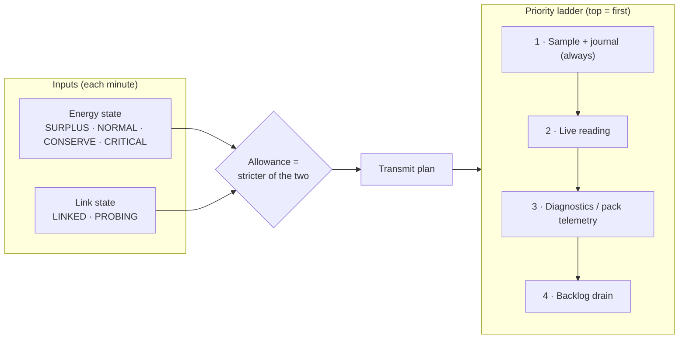
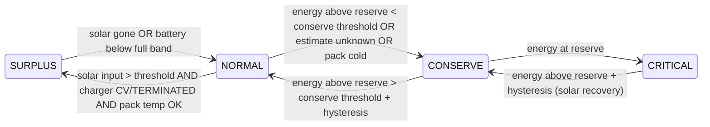
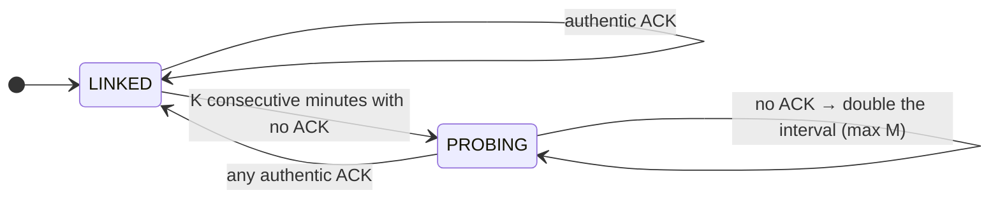

# Radio transmission policy: energy, link health, and backlog

> **Document type:** Design specification (proposal for approval). **Language:** ASD-STE100 style.
> **Status:** Approved 2026-10-12 (section 9). **Stage-0 part implemented 2026-10-13** (`App/app_tx.c`): link states, probe back-off, live-only probes, drain stop at first miss, airtime cap from the configured SF, and a fixed-NORMAL energy hook. Bench evidence: `evidence/g13-outage-2026-10-13/`. Stage 0 implements the link-health part (section 6). Stage 1 connects the energy inputs (section 5) when the pack and charger telemetry exist (spec §4–5, H02/H03). Items marked ⚠ were approved in section 9.
> **Related:** [`failure-modes.md`](failure-modes.md) §1.1–1.2 (energy cost of failure), gaps G11, G13, G14, G16 · spec v0.2 R02, R03, §4, §5, §11.

---

## 1. The problem

The station is an unattended node on battery and solar. It sends one-minute readings over a long LoRa path to an indoor receiver. The radio must decide, each minute:

- whether to transmit at all,
- what to transmit (the live reading, older readings from the journal, diagnostics),
- how much to transmit.

Today the rule is fixed: send the live reading and up to 2 older readings every minute, whatever the link and energy state. This rule wastes energy when the link is down. It ignores the battery and the sun. And it clears a long backlog slowly when energy is plentiful.

---

## 2. Goals, in priority order

1. **Collect the data.** Sampling and journaling continue whenever the station operates. The radio never takes the energy that the next 7 days of sampling need (spec R03).
2. **Deliver live readings on time.** One reading per minute, committed within 120 s (H01), when energy permits.
3. **Lose no journaled reading.** Deliver the backlog before the journal overflows.
4. **Recover history quickly.** Clear a backlog soon after a link outage ends.
5. **Spend energy when it is cheap.** Prefer energy that would otherwise be lost (solar input with a full battery).
6. **Be a good neighbor on 915 MHz.** Bound the radio-active time per minute.

A lower goal never takes energy or airtime from a higher goal.

---

## 3. Energy facts that drive the design

The current values are datasheet-class assumptions (TX ≈ 100 mA at +20 dBm, RX ≈ 5 mA). Stage 1 measures them (H02).

| Quantity | SF7 | SF10 | SF12 |
|---|---:|---:|---:|
| Airtime, 56-byte frame | 27 ms | 164 ms | 576 ms |
| Charge per **delivered** reading (TX + short ACK window) | ≈ 3 mC | ≈ 18 mC | ≈ 62 mC |
| Charge per **failed** attempt (TX + full 2 s window) | ≈ 13 mC | ≈ 26 mC | ≈ 68 mC |
| One day of live readings (1,440 delivered), at 3.3 V | ≈ 0.004 Wh | ≈ 0.024 Wh | ≈ 0.08 Wh |
| **A full journal** (4,743 readings) delivered | ≈ 0.013 Wh | ≈ 0.08 Wh | ≈ **0.27 Wh** |
| One day of failed attempts at today's rule (3 per minute) | ≈ 0.05 Wh | ≈ 0.10 Wh | ≈ **0.27 Wh** |

Core budget: ≤ 0.25 W average = **6 Wh/day**. Main pack: about **200 Wh nominal**, reserve ≥ 50.4 Wh (spec §4).

**Conclusions:**

1. **Delivering data is cheap.** A full backlog costs at most about 0.27 Wh, about 0.1 % of the pack. The *total* energy to deliver a backlog does not depend on the drain rate. Drain speed is a question of **when** to spend, not **how much**.
2. **Failed attempts are the waste.** At SF12, one day of futile retries costs as much as delivering the full journal.
3. **Timing of the spend matters.**
   - A burst at night, in cold weather, from a low battery causes voltage sag and brown-out risk (failure-modes E11). The same burst at noon with the charger full costs nothing.
   - Solar energy is lost when the charger stops because the battery is full. Energy spent in that state is free.

---

## 4. Policy structure

Two independent inputs decide the allowance each minute. The **stricter** input wins.

**Rule:** The allowance removes items from the **bottom** of the ladder first. Sampling (item 1) is never removed while the station operates. The power system and the BMS decide when the station stops.

---

## 5. Energy state (Stage 1 inputs; Stage 0 is always NORMAL)

### 5.1 Inputs

These inputs come from the Stage 1 hardware. The spec already requires each of them (§4, §5).

| Input | Source | Use |
|---|---|---|
| Energy above reserve, Wh | INA228 integration + calibrated capacity (`energy_above_reserve_wh`) | Main gate |
| Estimate confidence | Pack model (`estimate_confidence`) | Unknown → act as CONSERVE |
| Solar input power, W | BQ25798 input measurement (`input_power_w`) | Surplus detection |
| Charger state | BQ25798 (`charger_state`) | `TERMINATED` or `CONSTANT_VOLTAGE` with solar = battery full or nearly full |
| Pack temperature min/max | Two NTC probes | Cold pack: smaller bursts (voltage sag) |
| Pack voltage under load | INA228 | Brown-out margin (G14) |

### 5.2 States

| State | Meaning | Live reading | Backlog drain | Diagnostics | Radio time cap |
|---|---|---|---|---|---|
| **SURPLUS** | Sun is up and the battery is full or nearly full. Energy would otherwise be lost. | Every 60 s | **Fast**: up to the airtime cap | Full | ⚠ 15 s per minute |
| **NORMAL** | Healthy margin above reserve | Every 60 s | **Moderate**: up to 2–5 per minute | Normal rate | ⚠ 5 s per minute |
| **CONSERVE** | Near the reserve, estimate unknown, or pack cold | ⚠ Every 300 s: the latest reading (spec R02 "conservation reports"); all readings are still journaled | **None** | Reduced; state changes only | ⚠ 2 s per minute |
| **CRITICAL** | At the protected reserve | **None** | None | None | 0 |

**Notes:**

- **Sampling continues in all four states.** In CONSERVE and CRITICAL, readings wait in the journal and drain later, usually in SURPLUS.
- The **reporting mode** (60 s or 300 s) is published, as spec R02 requires. The gateway must not show a CONSERVE gap as a link failure.
- **CRITICAL is not a shutdown.** It removes the radio load first. The power system and the BMS protect the pack below that level.
- Thresholds come from the measured reserve (spec §4: ≥ 1.2 × 168 h × measured core load). This document does not invent them. ⚠ Proposal: CONSERVE below reserve + 20 %; hysteresis 5 %.
- **Unknown energy state means CONSERVE**, never NORMAL. This is the same fail-closed rule as spec §5 ("unknown estimate disables automatic export").

### 5.3 Typical day (deployment, Chicago winter, illustration)

```mermaid
gantt
  title Illustration only: one winter day with a night-time house power outage
  dateFormat HH:mm
  axisFormat %H:%M
  section Energy state
  NORMAL (battery, night)      :n1, 00:00, 07:30
  NORMAL (weak sun)            :n2, 07:30, 10:30
  SURPLUS (sun, battery full)  :crit, s1, 10:30, 14:00
  NORMAL                       :n3, 14:00, 24:00
  section Link
  LINKED                       :l1, 00:00, 01:00
  PROBING (house power out)    :active, l2, 01:00, 06:00
  LINKED                       :l3, 06:00, 24:00
  section Backlog
  Grows (300 readings)         :b1, 01:00, 06:00
  Drains 2-5/min (NORMAL)      :b2, 06:00, 08:00
  Empty                        :b3, 08:00, 24:00
```

A short outage drains in NORMAL within hours. A long outage (days) drains mostly in the SURPLUS hours near noon.

---

## 6. Link state (implement in Stage 0)

This part needs no energy hardware. It closes gap **G13** and makes failure cheap.

| Parameter | Proposal | Reason |
|---|---|---|
| *K*, minutes without an ACK before PROBING | ⚠ **3** | One or two lost minutes cost **0** H01 intervals (failure-modes §3.3). Do not back off for normal packet loss. |
| Probe interval | ⚠ 2, 4, 8, then **15 min** maximum | After the link returns, the node finds it within 15 min. A long outage then saves about 93 % of the futile radio energy. |
| Probe content | **Live reading only**, 1 frame | A probe that succeeds also delivers data |
| LINKED drain | Live, then backlog up to the energy-state limit (Stage 0: NORMAL) | — |
| Drain stop | Stop the drain in this minute at the first missed ACK | A failing link does not burn the drain allowance |

**Energy effect (SF12, one-day outage):** 3 frames every minute, about 0.27 Wh/day, becomes about 100 probes, about **0.007 Wh/day**.

**Timeliness effect:** None for outages shorter than *K*. After a longer outage, live delivery resumes within the probe interval (≤ 15 min). Those minutes were already late because of the outage.

**Airtime cap per minute (all states):** The firmware calculates the exchange time from the SF (airtime × 2 + measured gateway turnaround). It sends no more frames in this minute than the cap allows. At SF12, a 5 s cap allows about 3 exchanges. At SF7, the cap allows the configured maximum (⚠ 20).

---

## 7. Each end reports its power

The operator must see the energy situation of **both** ends.

| End | What it reports | How | Stage |
|---|---|---|---|
| **Station (TX)** | Pack schema subset: energy above reserve, SOC (when calibrated), solar input W, charger state, pack temperatures, **energy state**, **link state**, journal pending/lost/burned | New authenticated **diagnostic frame** (kind 4; kind 3 is the NACK), sent as priority 3 on the ladder. Every 15 min, and at each state change. | Stage 1 (frame format with pack telemetry). The journal counters can go first (G8). |
| **Gateway / receiver** | Power source: mains, or UPS battery with its charge and runtime | Host UPS daemon (for example Network UPS Tools, `upsc`) read by the gateway; shown in `/v1/status` and MQTT diagnostics | Stage 1+, optional. The spec puts the receiver on continuous power. |

The gateway does **not** tell the node how much to transmit. The node knows its own energy better than the gateway does. The gateway only shows and records the situation. (The gateway can still send a NACK for a permanently rejected record, G2.)

---

## 8. What changes, by stage

| Stage | Work |
|---|---|
| **0 (now)** | Link state machine (*K*, probe back-off, live-only probes, drain stop on first miss). Airtime cap per minute from the SF. Energy-state interface in firmware with a fixed `NORMAL` (USB power). The node reports link state and journal counters. **No energy hardware and no speculative telemetry code.** |
| **1** | Connect INA228/BQ25798/NTC data to the energy-state interface. Measure TX/RX current (H02). Set thresholds from the measured reserve. Diagnostic frame (kind 4). Test CONSERVE/CRITICAL transitions with a bench supply and replayed solar profiles (H03). |
| **4+** | Field-tune SURPLUS thresholds and caps from real winter data. |

---

## 9. Decisions (approved by Clint, 2026-10-12)

All six proposals below are approved as written. Thresholds in item 4 stay provisional until the H02/H03 measurements.

| # | Decision | Approved value |
|---|---|---|
| 1 | *K* before back-off | 3 minutes |
| 2 | Maximum probe interval | 15 minutes |
| 3 | Radio time cap: SURPLUS / NORMAL / CONSERVE | 15 / 5 / 2 s per minute |
| 4 | CONSERVE threshold and hysteresis | reserve + 20 %, 5 % hysteresis (final values from H02/H03 measurements) |
| 5 | CONSERVE live interval | 300 s (spec R02) |
| 6 | Unknown energy state | Act as CONSERVE (fail closed) |

## 10. Open question for Stage 1: adaptive SF and power (not approved, not implemented)

Raised by Clint, 2026-10-13, after the office range walk (`evidence/rangetest-office-2026-10-13/`).
Today the SF and power are fixed per placement (§6.4 of the context pack); this policy caps airtime
and backs off probing around that fixed SF.

**Idea:** start at, and fall back to, the longest reach (SF12 / +22 dBm), then let the gateway step the
node down to cheaper settings while the margin allows, as LoRaWAN ADR does.

| For | Against |
|---|---|
| Energy: SF12 costs about 22× the airtime of SF7 per frame (§3) | New failure mode: the two ends on different settings cannot hear each other. `firmware/rangetest` needed restart adoption and a lost-contact fallback to the longest reach to stay safe |
| Follows a changing link (snow or ice on the antenna, failure mode L9) | The airtime cap, *K* and the probe interval (§6, §9) currently assume one SF |
| A failing link recovers at the longest reach on its own | More firmware and gateway state to test |

**Evidence to respect if adopted:** in the office, losses began near 0 dB SNR, not at SF12's −20 dB
limit, and came in bursts (probable in-band interference). Step-down decisions must use the
measured delivery rate over a window, not reported SNR alone.

Decide in Stage 1, when H02/H03 give real TX energy per frame. Stage 0 keeps a fixed SF.
