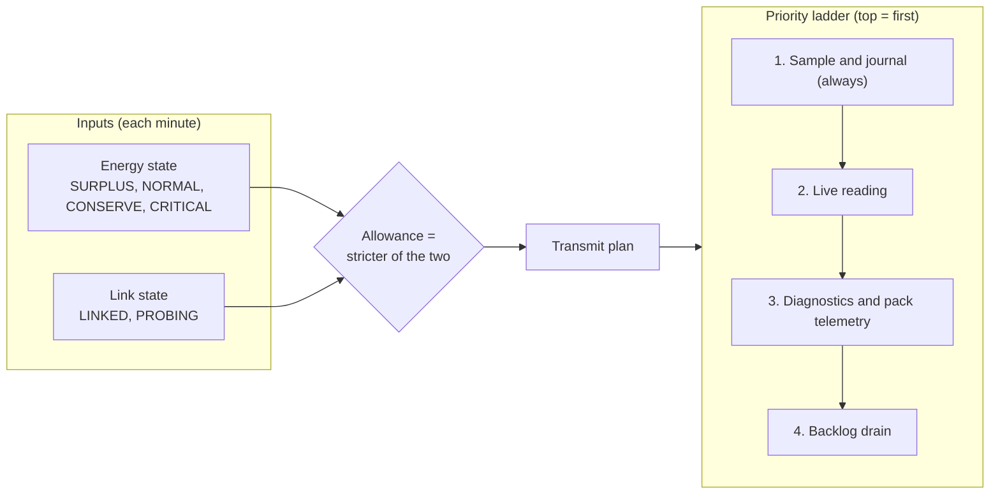
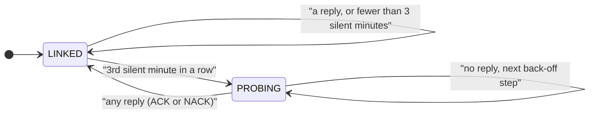

# Radio transmission policy: energy, link health, and backlog

> **Document type:** Design specification. **Language:** ASD-STE100 style.

**Status:** Clint approved this policy on 2026-10-12. Section 9 lists the approved values.

- **Link health (section 6).** The bench prototype got it on 2026-10-13. Bench evidence: `evidence/g13-outage-2026-10-13/`.
- **Where the code lives.** `firmware/stage0-node/App/tx_policy.c` makes the link-state, backlog and airtime decisions. `firmware/stage0-node/App/tx_exchange.c` stops the drain after a miss. Both sit on the pure functions in `firmware/common/ws_policy.c`, and `firmware/test_tx_policy.c` tests those functions on the host. Below, `App/` means `firmware/stage0-node/App/`.
- **What the code does today:**
  - the link states, the probe back-off and live-only probes,
  - the drain stop after a miss: one more frame, then stop (a second miss in a row, or a transmit failure, stops it at once),
  - the airtime cap from the configured spreading factor,
  - the health-report airtime reserve (section 6). Commit `66e5def` added it on 2026-10-30, from power design section 6.4 of 2026-10-29,
  - the energy state from the battery (section 3, D1 settled for now on 2026-11-22): the TX stack build (`WS_POWER_PROFILE=3`) only; the bench builds stay NORMAL,
  - the CRITICAL hourly beacon, and gateway freshness that follows the station's energy state (R9).
- **Amended 2026-10-29** by the [power telemetry design](superpowers/specs/2026-10-29-power-telemetry-design.md) ("the power design" below). The node now measures its power system in phase A: the 1S3P pack, the bq24074 charger, the battery INA228 and the MAX17048 gauge. It sends that data in protocol version 6.
- **The energy state is live in the TX stack build** (`energy_state()` and `policy_energy_minute()` in `App/tx_policy.c`, `ws_energy_next()` in `firmware/common/ws_policy.c`). The thresholds come from a planning load until H02 measures the real one (D1, section 3). H02 and H03 then confirm or move them.
- *2026-11-02:* sections 8 (changes by stage) and 10 (adaptive spreading factor and power) left with the later build stages. Section 5 shrank to the energy states that the firmware implements. Commit `e2a56da` in git history has the old text. The other sections keep their numbers.

> **Related:** [`failure-modes.md`](failure-modes.md) §1.1 and §1.2 (operating context and the energy cost of failure), §1.2 (link back-off), §6.1 (power measurement and charger failures), §10 open issues (backlog drain rate, low-voltage inhibit, blind ACK window). [Power telemetry design](superpowers/specs/2026-10-29-power-telemetry-design.md) §2 (phases), §3 (fill table), §6.4 (health airtime), §15 (D1).

In this document, "the product specification" is the Weather Station v0.2 PRD/TRD (product and technical requirements, 8 October 2026). That file is not in this repository. It names two requirements that steer the radio:

- **R02:** reporting modes, with conservation reports every 5 minutes.
- **R03:** core battery autonomy of 168 hours without solar at −35 °C, with full required sampling. From R03, this policy derives its first rule: the radio never uses the energy that the next 7 days of sampling need.

Its tests H02 (pack Ah and Wh accounting within 5 %) and H03 (168 hours at −35 °C, with cold-charge inhibit and dawn recovery) apply to the battery and solar build.

This repository holds the breadboarded development version: two development boards on USB power. It must pass the 24-hour delivery test (H01, [`H01-checklist.md`](H01-checklist.md)). Since 2026-10-30, the TX firmware reads phase A on the breadboard in the default build. Phase A first proved itself with `firmware/benchlink` on 2026-10-28 and 2026-10-29. The four INA228 rails of phase B are in the firmware as build option `WS_POWER_PROFILE=2` and in the host tests. The breadboard does not carry them yet: that is step 1b, after H01 (power design section 2).

---

## 1. The problem

The station is an unattended node on battery and solar power. It sends one-minute readings over a long LoRa path to an indoor receiver. Each minute, the radio must decide:

- if it transmits at all,
- what to transmit: the live reading, older readings from the journal, or diagnostics,
- how much to transmit.

Before this policy (before 2026-10-13), the node used one fixed rule. It sent the live reading and up to 2 older readings every minute, whatever the link and energy state. So it kept spending energy on a link that was down. It ignored the battery and the sun. And when energy was plentiful, it still cleared a long backlog slowly.

---

## 2. Goals, in priority order

Higher rules win over lower ones.

1. **Collect the data.** Sampling and journaling continue whenever the station operates. The radio never takes the energy that the next 7 days of sampling need (derived from requirement R03).
2. **Deliver live readings on time.** One reading per minute, committed within 120 s (H01), when energy permits.
3. **Lose no journaled reading.** Deliver the backlog before the journal overflows.
4. **Recover history quickly.** Clear a backlog soon after a link outage ends.
5. **Spend energy when it is cheap.** Prefer energy that the station would otherwise lose: solar input with a full battery.
6. **Be a good neighbor on 915 MHz.** Limit the radio-active time per minute.

A lower goal never takes energy or airtime from a higher goal.

---

## 3. Energy facts

Most numbers here rest on assumed currents, and we say so up front. Transmit (TX) ≈ 100 mA at +20 dBm. The datasheet gives 87 mA at +20 dBm (LoRa 125 kHz), so 100 mA is a margin of about 15 %. Receive (RX) ≈ 5 mA. The bench firmware transmits at 0 dBm (`WS_TX_POWER_DBM`, `App/radio_cfg.h:12`), far below that. The battery and solar build measures the real currents (H02).

| Quantity | SF7 | SF10 | SF12 |
|---|---:|---:|---:|
| Airtime, 56-byte frame (previous format, protocol version 4) | 27 ms | 164 ms | 576 ms |
| Airtime, 51-byte observation (T/RH with the minute summary, protocol version 5 before the WSMP modules) | 26 ms | 154 ms | 535 ms |
| Airtime, 77-byte observation (widest record of the version 5 bench build) | 35 ms | 206 ms | 699 ms |
| Charge per **delivered** reading (TX at 100 mA + RX at 5 mA for a short ACK window of about 1.5 × the 56-byte ACK airtime) | ≈ 3 mC | ≈ 18 mC | ≈ 62 mC |
| Charge per **failed** attempt (TX + full 2 s window) | ≈ 13 mC | ≈ 26 mC | ≈ 68 mC |
| One day of live readings (1,440 delivered), at 3.3 V | ≈ 0.004 Wh | ≈ 0.024 Wh | ≈ 0.08 Wh |
| **A full journal** (4,743 readings, previous format) delivered | ≈ 0.013 Wh | ≈ 0.08 Wh | ≈ **0.27 Wh** |
| One day of failed attempts at the old fixed rule (3 per minute) | ≈ 0.05 Wh | ≈ 0.10 Wh | ≈ **0.27 Wh** |

SF is the LoRa spreading factor. We computed the table above for the previous format: 56-byte frames and ACKs, and a journal of 4,743 readings. It stays as the reference for the decisions in section 9. The current format is protocol version 6 (power design sections 4 to 7):

| Quantity, protocol version 6 | SF7 | SF10 | SF12 |
|---|---:|---:|---:|
| Airtime, 93-byte observation (widest record of the node field set, `OBS_FRAME_MAX`) | 41.0 ms | 236.0 ms | 821.2 ms |
| Airtime, 80-byte health report (64-byte plaintext) | 35.9 ms | 215.6 ms | 739.3 ms |
| Airtime, 33-byte ACK | 18.0 ms | 113.2 ms | 411.6 ms |
| One answered exchange as the firmware counts it (observation + ACK + 300 ms, each airtime rounded up to whole ms) | 360 ms | 651 ms | 1,534 ms |
| Charge per **delivered** reading (TX, then receive for the ACK airtime + 300 ms) | ≈ 6 mC | ≈ 26 mC | ≈ 86 mC |
| Charge per **failed** attempt (TX + full 2 s window) | ≈ 14 mC | ≈ 34 mC | ≈ 92 mC |
| One day of live readings (1,440 delivered), at 3.3 V | ≈ 0.008 Wh | ≈ 0.034 Wh | ≈ 0.11 Wh |
| **A full journal** (609 readings) delivered, at 3.3 V | ≈ 0.003 Wh | ≈ 0.014 Wh | ≈ 0.05 Wh |
| One day of health reports (96, no reply), at 3.3 V | ≈ 0.0003 Wh | ≈ 0.002 Wh | ≈ 0.007 Wh |
| One day of failed attempts at the old fixed rule (3 per minute), at 3.3 V | ≈ 0.06 Wh | ≈ 0.13 Wh | ≈ 0.37 Wh |

Where these numbers come from:

- **Airtimes.** `ws_lora_airtime_ms()` computes them (`firmware/common/ws_policy.c:43-56`, 500 kHz, CR 4/5, explicit header, CRC).
- **Frame size.** The node field set `WS_F_WSMP_BENCH` is 77 bytes of plaintext (`App/node_fields.h:29`), so its frame is 93 bytes (`App/tx_exchange.h:13`). A record carries only the fields of the modules present, so many frames are shorter.
- **Ceiling.** No node build exceeds a 96-byte frame. That is 80 bytes of plaintext, the per-build ceiling of power design sections 5.4 and 7 (41 / 246 / 821 ms).
- **Receive charge.** It counts the full 300 ms turnaround allowance, so the delivered row is an upper bound.
- **Journal.** It holds 609 readings: 29 usable pages × 21 slots of 96 bytes (`App/flash_layout.h:20`, `App/node_store.c`).
- **Voltage.** The Wh rows use 3.3 V. The radio draws its current from the pack through the regulator, so the pack energy is up to about 27 % higher at a full cell (4.2 V).

Core budget: ≤ 0.25 W average = **6 Wh/day** (product specification section 4, not in this repo).

**The pack** (Clint's decision on 2026-10-29, power design section 1):

| Quantity | Value |
|---|---|
| Pack | 1S3P Li-ion: three 2,200 mAh cells in parallel |
| Capacity and voltage | 6,600 mAh, 3.0 to 4.2 V, 3.7 V nominal |
| Energy, nominal | 6.6 Ah × 3.7 V ≈ **24.4 Wh** |
| Runtime at the 0.25 W core budget, no solar input | 24.4 Wh ÷ 0.25 W ≈ 98 h (about 4.1 days) |
| Reserve that this policy uses (product specification section 4: ≥ 1.2 × 168 h × core load) | ≥ **50.4 Wh** at 0.25 W (R03: 168 h × 0.25 W = 42 Wh, × 1.2) |
| Pack against that reserve | about 48 %: the reserve is about twice the pack |
| Core load whose reserve fits in the pack | ≤ 0.12 W (24.4 ÷ (1.2 × 168)). With the CONSERVE band (reserve + 20 %, section 9) also inside it: ≤ 0.10 W |

**Decision D1 (power design section 15; settled for now below, 2026-11-22).** This is a real problem. The 1S3P pack (about 24.4 Wh) is smaller than the reserve that this policy uses (≥ 50.4 Wh). With a reserve larger than the pack, the energy above reserve is negative at every state of charge. The energy states would then pin the node in CRITICAL. The options:

| Option | What it means | Cost or risk |
|---|---|---|
| a. A lower measured core load | H02 measures the core load. The reserve shrinks with it. At ≤ 0.10 W the reserve and the CONSERVE band fit in 24.4 Wh. At about 0.06 W, half the pack stays above the reserve | Depends on the measurement. No hardware change. A load above about 0.12 W leaves the conflict |
| b. A larger 1S pack | More cells in parallel. The reserve at 0.25 W alone needs about 13.6 Ah at 3.7 V (7 cells of 2,200 mAh), or about 16.3 Ah (8 cells) with the CONSERVE band | Pack, cradle and connector. Charge time: the bq24074 charges at most 1.5 A. Any change of pack is Clint's decision |
| c. A PRD deviation | Shorter autonomy for this pack. At 0.25 W the reserve rule (1.2 × hours × load) fits in 24.4 Wh at about 81 h (3.4 days) instead of 168 h, with nothing above it | Weaker cold-weather autonomy. H03 (168 h at −35 °C) fails as written |

**D1, settled for now (2026-11-22): option a, with a planning load.** The pack stays. The reserve rule stays. What changes is the load we size it with: 0.25 W is the PRD's ceiling, not what this node draws. The TX stack's parts (MCU mostly in stop mode, SHT45, MAX17048, the INA228s converting, the BQ25798 with its ADC, one SF7 exchange a minute) add up to a few mA. We plan with **25 mW** (about 6.8 mA at 3.7 V), on the high side of that estimate. H02 measures the real load and replaces it. If H02 comes in above about 0.10 W, D1 reopens (options b and c).

With 25 mW:

| Quantity | Value |
|---|---|
| Reserve (1.2 × 168 h × 25 mW) | 5.04 Wh, 20.7 % of the 24.4 Wh pack |
| Reserve + 20 % (decision 4) | 6.05 Wh, 24.8 % |
| MAX17048 SOC error, allowed for on top | about 5 points (ModelGauge with the default cell model, no custom profile) |
| **CONSERVE below** | **30 % SOC** (24.8 + 5, rounded up) |
| CONSERVE exit (5-point hysteresis, decision 4) | 35 % |
| CONSERVE run time to CRITICAL (30 % to 8 %, 5.4 Wh at 25 mW) | about 215 h, over the 168 h the reserve is for, with the 1.2 factor (5.4 ÷ 4.2 = 1.28) |
| **CRITICAL below** | **8 % SOC**, exit at 13 % |
| What 8 % buys | about 530 mAh (1.95 Wh). At the CRITICAL load (no radio but one beacon an hour, roughly half the core load) that is well over 100 h before the gauge reads 0 %, and the cell is still above the protection board's cut-off there |

The reserve is what CONSERVE lives on: 168 h of reduced reporting with no sun. CRITICAL is the floor under it. It stops the radio so the node can keep sampling and journaling for days, and so the pack never reaches its protection board. That is how this document now reads "CRITICAL: at the protected reserve" in section 5: the protected part is the floor, not the whole 168 h reserve. Without that reading, CONSERVE would be a 4-point sliver and the station would go silent for a week with a usable pack.

**Voltage, as a second signal.** The gauge's SOC can drift. A cell voltage catches a gauge that reads high. The thresholds sit below the SOC ones, so on a healthy gauge the SOC decides:

| | Enter below | Leave at | Why |
|---|---|---|---|
| CONSERVE | 3.60 V | 3.70 V | about 10 to 15 % on a typical Li-ion OCV curve; a cold pack also lands here, and CONSERVE is right for a cold pack (section 5) |
| CRITICAL | 3.45 V | 3.55 V | about 3 to 5 % at rest; still well above a 2.5 to 3.0 V protection cut-off |

The 100 mV hysteresis covers the cold sag. The 3P pack's resistance at −20 °C is a few tenths of an ohm, so an SF7 burst at about 120 mA moves the cell a few tens of mV, and the slower polarisation of a cold cell under load adds about 50 to 100 mV more. It also covers the MAX17048's ±7.5 mV VCELL error many times over.

**The rules** (`ws_energy_next`, `firmware/common/ws_policy.lit.md` section 2):

- Each signal applies its own enter and leave thresholds. The worse signal wins, so leaving a state needs both past their leave thresholds.
- **The gauge missing or failed** (no SOC): the estimate is unknown, so at least CONSERVE (decision 6). The cell voltage then comes from the BQ25798's VBAT ADC (no older than 30 s) and can still take the node to CRITICAL and back. The INA228 does not help here: in the TX stack (profile 3) its VBUS is not on the cell. It does supply the "not discharging" evidence for SURPLUS.
- **No SOC and no voltage:** CONSERVE, or CRITICAL if the node was already there.
- **SURPLUS** (phase C, the TX stack): a NORMAL result, and the charger shows power good, no fault, and top-off or terminated; the battery INA228 reads −0.5 mA or more (not discharging); the cell is at 4.00 V or more; SOC at 95 % or more. It ends below 90 % SOC or when any other condition fails.
- The node boots in CONSERVE and moves at the first minute with a reading. It decides once a minute, before it builds the reading, so the reading and the send of that minute agree.

**Visibility.** Every reading carries the energy state (flags bits 1 and 2), and so does the health report (byte `energy`). No new fields. A change prints `#energy <old> -> <new> …` on the console and makes a health report due at the next exchange. The bench builds (profiles 1 and 2) stay at NORMAL: their battery is a bench supply or a loose cell.

**What H02 and H03 must confirm:** the real core load (the 25 mW plan), the CONSERVE run time on the real pack, and the cold sag at −20 °C and below against the 100 mV hysteresis. Change the numbers in `ws_policy.lit.md` section 2 and in this section together.

**What the numbers tell us:**

1. **Delivering data is cheap.** A full backlog costs at most about 0.27 Wh (the previous 4,743-reading journal at SF12). The version 6 journal of 609 readings costs about 0.05 Wh. That is at most about **1.1 % of the 24.4 Wh pack**. The *total* energy to deliver a backlog does not depend on the drain rate. The drain speed decides **when** to spend, not **how much**.
2. **Failed attempts are the waste.** At SF12, one day of futile retries at the old fixed rule costs more than the delivery of the full journal. In version 6 that is 0.37 Wh against 0.05 Wh, about 1.5 % of the pack a day. It even beats a full day of live readings (0.11 Wh).
3. **The timing of the spend matters.**
   - A radio burst from a near-empty battery can sag the voltage into brown-out cycling (`failure-modes.md`, brown-out cycling, with the example of dawn and weak solar). A burst at night or in the cold, from a low battery, is the bad case. The same burst at noon with the charger full costs nothing.
   - Solar energy is lost when the charger stops because the battery is full. Energy spent in that state is free.

---

## 4. Policy structure

Two independent inputs decide the allowance each minute. The **stricter** input wins.



**Rule:** The allowance removes items from the **bottom** of the ladder first. The allowance never removes sampling (item 1) while the station operates. The power system and the battery management system (BMS) decide when the station stops.

---

## 5. Energy states

The firmware defines four energy states and their limits (`firmware/common/ws_policy.c`). The TX stack build picks one each minute from the battery (section 3). The bench builds stay at NORMAL. *Trimmed 2026-11-02 to phases A and B, when the later build stages left this document.*

| State | Meaning | Live reading | Backlog drain | Diagnostics | Radio time cap |
|---|---|---|---|---|---|
| **SURPLUS** | The sun is up and the battery is full or nearly full. The station would otherwise lose the energy. | Every 60 s | **Fast**: up to the airtime cap (current firmware: at most 20) | Full | 15 s per minute |
| **NORMAL** | Healthy margin above reserve | Every 60 s | **Moderate**: up to 2 to 5 per minute (current firmware: 5, `backlog_limit` in `firmware/common/ws_policy.c`) | Normal rate | 5 s per minute |
| **CONSERVE** | Near the reserve, estimate unknown, or pack cold | Every 300 s: the latest reading (requirement R02, conservation reports). The node still journals every reading. | **None** | The same as NORMAL: a health report every 15 minutes (`DIAG_PERIOD_S`, `App/tx_policy.c:19`) and after each link-state change, sent after a CONSERVE exchange. At SF12 this goes over the 2 s cap once per report (power design section 6.4) | 2 s per minute |
| **CRITICAL** | At the protected floor under the reserve (8 % SOC or 3.45 V, section 3) | **None**, but for a beacon: the live reading once an hour (and at boot), sent as a CONSERVE minute (`policy_minute_backlog`, `App/tx_policy.c`) | None | A due health report rides on the beacon | 0, but for the beacon |

**Notes:**

- **Sampling continues in all four states.** In CONSERVE and CRITICAL, readings wait in the journal. They drain later, usually in SURPLUS.
- The node publishes the **reporting mode** through the energy state in every reading, as requirement R02 requires. The gateway must not show a CONSERVE gap as a link failure. Built 2026-11-22 (power design risk R9): the gateway keeps a reading current for the station's live interval plus 120 s, by the state the reading carries: 180 s in SURPLUS and NORMAL, 420 s in CONSERVE, 3720 s in CRITICAL (`current_max_age`, `gateway.lit.md`; the dashboard does the same in `ws0/static/app.js`). Home Assistant's availability follows it. No wire change.
- **CRITICAL is not a shutdown.** It removes the radio load first. The power system and the BMS protect the pack below that level.
- The thresholds come from the reserve (product specification section 4: ≥ 1.2 × 168 h × core load), with a planning load until H02 measures it (section 3). Approved provisional values: CONSERVE below reserve + 20 %, hysteresis 5 %. Section 3 adds the gauge error on top.
- **An unknown energy state means CONSERVE**, never NORMAL. This is the same fail-closed rule as product specification section 5 ("unknown estimate disables automatic export to auxiliary charging"). "Unknown" is a fitted input that fails, not an input that the phase does not measure.
- **The thresholds are set for now** (D1, section 3): SOC 30 / 35 % and 8 / 13 %, voltage 3.60 / 3.70 V and 3.45 / 3.55 V (enter / leave).

**SURPLUS rule, per phase** (phase C, the TX stack, is built: section 3; phases A and B stay NORMAL). SURPLUS is the "free lunch" state, so it must prove the lunch is free. Every phase needs all of these:

- no charger fault,
- the battery does not discharge over the minute (field 12 ≥ 0 within the INA228 offset),
- the battery voltage (field 11) in the full band.

Then each phase needs its own evidence that an input carries the station and that the charger is in its last stage:

| Phase | An input carries the station | The charger is full or nearly full | Pack temperature |
|---|---|---|---|
| A | PGOOD asserted, and `charger_input_mv` (field 28) above the threshold. Solar or USB-C: the source is not identified, and either one is energy that the pack does not pay | CHG off and steady: charge done, or a refresh charge (SLUS810 table 9-2). CHG on with about 0 mA is a suspended or throttled charge, not a full battery. The cause can be a TS (pack temperature) suspend (SLUS810 section 9.3.6), the die thermal loop (table 9-2, section 9.3.5.8), or DPPM/VIN-DPM when the load takes all of the input current (section 9.3.4.1.2) | not measured: no condition |
| B | as A, and the solar power (fields 29 × 30) or the USB-C power (fields 32 × 33) above the threshold and above the load power (fields 26 × 27) | as A | not measured: no condition |

SURPLUS ends when any condition fails: the input goes, the battery starts to discharge, or its voltage leaves the full band.

## 6. Link state (implemented on the bench prototype)

This part needs no energy hardware. It stops the node from spending full radio energy every minute on a link that is down. Thus a failure costs little.

The node updates the link state at the end of each minute that sent something (`ws_link_minute()` in `firmware/common/ws_policy.c`). Any reply in that minute's exchange counts, ACK or NACK.



While PROBING, the node sends only the live reading, with no backlog. How often it sends depends on the energy state:

- **SURPLUS and NORMAL:** the live reading goes **every minute**.
- **CONSERVE:** the node backs off. It waits 2, 4 and 8 minutes, then 15 minutes, counted from the start of the unanswered exchange.

Clint made this change on 2026-10-13. A back-off in NORMAL could make up to 14 readings late in one outage, and that put H01 at risk. Probing every minute removes that risk and keeps live data flowing on a one-way link.

Code: `ws_link_may_send()` in `firmware/stage0.c`, host-tested in `firmware/test_policy.c`, and used by `ws_minute_backlog()` in `firmware/common/ws_policy.c`. The bench builds are always NORMAL, so there PROBING means "live reading only, every minute". The TX stack backs off in CONSERVE.

| Parameter | Value | Reason |
|---|---|---|
| *K*, silent minutes before PROBING | **3** | One lost minute costs **0** H01 intervals. Two in a row cost 1 (failure-modes §3.3). The office range walk saw a 121.6 s commit after a 2-minute dropout (`evidence/range-walk-office-2026-10-13/`). Do not back off for normal packet loss. |
| Probe interval | SURPLUS, NORMAL: **every minute** (changed 2026-10-13). CONSERVE: 2, 4, 8, then **15 min** maximum. | With healthy energy, the node relinks within a minute. In CONSERVE, a long outage saves about 97 % of the futile radio energy against the old fixed rule of 3 frames per minute (about 93 % against 1 frame per minute). Probing every minute saves about 67 % against that rule (1 frame instead of 3). |
| Probe content | **Live reading only**, 1 frame | A probe that succeeds also delivers data |
| LINKED drain | Live reading, then backlog up to the energy-state limit | n/a |
| Drain stop | After a missed reply, send one more frame, then stop the drain for this minute. A second miss in a row, or a transmit timeout, stops it at once (`App/tx_exchange.c`). | A failing link does not use up the drain allowance. The one more frame lets the strike rule tell a refused record from a lossy link (`protocol.md` section 9). |

**Energy effect (SF12, one-day outage).** The old fixed rule sends 3 frames every minute, about 0.27 Wh/day. In SURPLUS and NORMAL, PROBING cuts that to 1 frame per minute: about 0.09 Wh/day, one third.

In CONSERVE it becomes about 100 probes, about **0.006 Wh/day** (100 × 68 mC × 3.3 V). Those figures use the version 4 frame. With the 93-byte frame of protocol version 6, the figures are about 0.37, 0.12 and 0.008 Wh/day. That is about 1.5 %, 0.5 % and 0.03 % of the 24.4 Wh pack a day.

**Timeliness effect.** With healthy energy, the outage itself is the only cost. The live reading goes every minute. Thus the gateway receives the first minute after the link returns on time, and the backlog drains at up to 5 per minute. In CONSERVE, readings that the node takes between the return of the link and the next probe (up to 14) are late because of the back-off. That is acceptable there, because CONSERVE protects the pack, and H01 runs in NORMAL.

**Asymmetric link: the gateway hears, the node does not.** The node decides the link state from replies only. Frames can reach the gateway while its ACKs do not reach the node (`failure-modes.md`, asymmetric link). Then the node enters PROBING. With healthy energy, the live reading still reaches the gateway every minute, so the data stays timely.

The backlog cannot drain (no ACKs), so unacknowledged records pile up in the journal. The journal overwrites them after about 10 hours (609 one-minute records, the version 6 node field set), although the gateway already holds them. The health report (also sent while probing, link field = probing) shows this state to the operator.

**Airtime cap per minute (all states).** The firmware calculates the exchange time from the spreading factor:

- observation airtime + ACK airtime + a **fixed 300 ms** turnaround allowance (`TURNAROUND_MS`, `App/tx_policy.c:16`, "conservative"),
- each airtime rounded up to whole milliseconds (`App/tx_policy.c:43-45`).

The firmware does not measure the exchange time per exchange. Gateway database commits measured ≤ 16 ms, so 300 ms is generous.

The node sends no more frames in a minute than the cap allows. The firmware uses the widest observation frame of the build (`OBS_FRAME_MAX`: 93 bytes for the version 6 node field set) and the 33-byte ACK. The cap counts answered exchanges. A failed exchange costs about 2 s plus airtime, and the drain stops one frame after it.

**Health-report reserve (power design section 6.4 of 2026-10-29, in the code since 2026-10-30).** Some minutes have a health report that follows the exchange. The report is due now, or due before the next minute (`diag_follows`, `App/tx_policy.c:52`). In those minutes, the allowance first reserves the 80-byte report's airtime from the energy state's cap, saturating (`ws_minute_backlog`, `firmware/common/ws_policy.c:88-99`):

```
by_airtime = cap_ms > reserve_ms ? (cap_ms - reserve_ms) / exchange_ms : 0
backlog    = by_airtime > 1 ? min(backlog, by_airtime - 1) : 0     (never below 0)
```

The live reading and a due health report always go. The earlier code clamped `by_airtime` to at least 1 (`if (by_airtime == 0) by_airtime = 1`) before `backlog = by_airtime - 1`, so it never wrapped. Without that clamp, it would wrap at `by_airtime` = 0 (unsigned), and a reserve can make `by_airtime` 0. The saturating form cannot wrap and needs no separate clamp. Host test: `health_reserve()` in `firmware/test_tx_policy.c:95-127`.

| SF | One exchange (firmware) | Health report | NORMAL, 5 s: exchanges (health minute) | CONSERVE, 2 s | SURPLUS, 15 s |
|---|---:|---:|---|---|---|
| 7 | 42 + 18 + 300 = 360 ms | 36 ms | 13 (13): the NORMAL limit of 5 applies | 5 (5). CONSERVE sends no backlog | 41 (41): the maximum of 20 applies |
| 10 | 237 + 114 + 300 = 651 ms | 216 ms | 7 (7): the limit of 5 applies | 3 (2) | 23 (22): 20 applies |
| 12 | 822 + 412 + 300 = 1,534 ms | 740 ms | 3 (2): backlog 2, and 1 in a health minute | 1 (0): the live reading only | 9 (9): backlog 8 |

**The CONSERVE exception at SF12.** In CONSERVE at SF12, the live exchange and the health report take 1,534 + 740 = **2,274 ms**. The exact formula gives 2,272 ms (1,532.8 + 739.3). Both are more than the 2 s cap. The report still goes, because it carries the energy and link state.

Thus the node goes over the cap by 274 ms **once per health report**: every 15 minutes, and once after each link-state change. CONSERVE sends only every 5th minute, so its average radio time stays far below the cap. This is a documented exception (power design risk R3), not a change to decision 3. It can occur in the TX stack build, which has the energy state (section 3).

---

## 7. Each end reports its power

The operator must see the energy situation of **both** ends. No flying blind at either end of the link.

| End | What it reports | How | Stage |
|---|---|---|---|
| **Station (TX)** | **Energy state**, **link state**, journal pending, lost and burned. Since protocol version 6, also the power data, source-agnostic, with "not measured" (absent, or a none code) where a phase cannot fill a value. Every minute in the observation: battery voltage, current and counters, load, charger input, solar and USB-C rails (fields 11 to 16, 26 to 33). Every 15 minutes in the health report: gauge SOC and rate, charger status, power-monitor die temperature, MCU supply, the charger-reported values, pack temperature, and the station counters (boots, crashes and the last crash PC, TX timeouts, I2C recoveries) | The observation (priority 2) and the authenticated **health report**, kind 4 (priority 3). The report goes every 15 min and at each link-state change, also while PROBING (since release `0f456040fe54`) | **Closed 2026-10-29:** kind 4 grows to a fixed **64 bytes** in protocol version 6 (power design section 6, [`protocol.md`](protocol.md) section 4). No new kind. The first 32 bytes keep their version 5 layout (journal counters, reset cause, link state, firmware build ID, ACK RSSI and SNR, crash count and energy state). Energy above reserve and estimate confidence are not sent yet: they wait for D1 and the thresholds |
| **Gateway and receiver** | Power source: mains, or UPS battery with its charge and runtime | Planned, not built: the gateway would read a host UPS daemon (for example Network UPS Tools, `upsc`) and show the power source, charge and runtime in `/v1/status` and MQTT diagnostics. | The battery and solar build or later, optional. The product specification puts the receiver on continuous power. |

The gateway does **not** tell the node how much to transmit. The node knows its own energy better than the gateway does. The gateway only shows and records the situation. (The gateway can still send a NACK for a permanently rejected record.)

---

## 9. Decisions (approved by the project owner, 2026-10-12)

Clint approved all six proposals below as written. The thresholds in item 4 stay provisional until the H02 and H03 measurements.

| # | Decision | Approved value |
|---|---|---|
| 1 | *K* before back-off | 3 minutes |
| 2 | Maximum probe interval | 15 minutes |
| 3 | Radio time cap: SURPLUS / NORMAL / CONSERVE | 15 / 5 / 2 s per minute |
| 4 | CONSERVE threshold and hysteresis | reserve + 20 %, 5 % hysteresis (final values from the H02 and H03 measurements). Set 2026-11-22 with a 25 mW planning load: 30 % SOC, out at 35 % (section 3) |
| 5 | CONSERVE live interval | 300 s (requirement R02) |
| 6 | Unknown energy state | Act as CONSERVE (fail closed) |

**Amendments 2026-10-29** (from the power design). These are design choices, not owner decisions:

- **Health-report airtime reserve.** In a minute whose health report follows the exchange, the report's airtime comes off the cap first, with the saturating form of section 6. Decisions 3 and 5 do not change.
- **The CONSERVE exception at SF12.** The live exchange plus the health report (2,274 ms in firmware rounding) go over the 2 s CONSERVE cap once per health report: every 15 minutes and after each link-state change (section 6, power design risk R3).
- **Decision 6, made precise.** "Unknown" is a fitted input that fails. An input that the phase does not measure is not unknown.
- **Decision 4 and D1** (2026-11-22): the thresholds use a 25 mW planning load, which fits the pack (section 3). H02 replaces the planning load.
