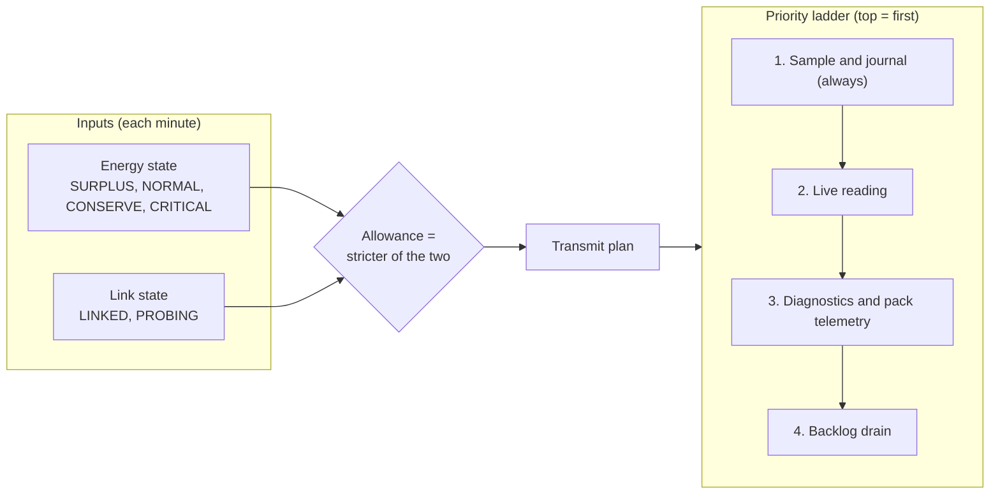
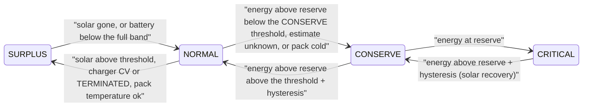
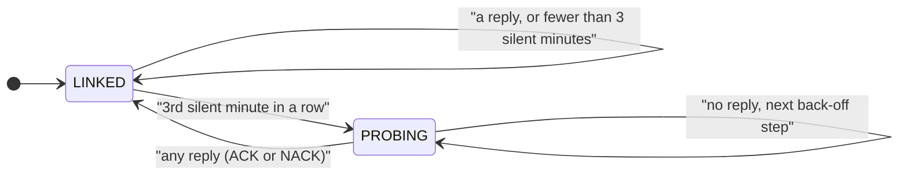

# Radio transmission policy: energy, link health, and backlog

> **Document type:** Design specification. **Language:** ASD-STE100 style.
> **Status:** Approved 2026-10-12 (section 9 lists the approved values). The link-health part (section 6) was implemented on 2026-10-13 for the bench prototype. The code is `App/tx_policy.c` over the pure functions in `firmware/common/ws_policy.c`, host-tested in `firmware/test_tx_policy.c`. It has the link states, the probe back-off, live-only probes, the drain stop after a miss, the airtime cap from the configured spreading factor, and an energy-state hook fixed at NORMAL. Bench evidence: `evidence/g13-outage-2026-10-13/`. The battery and solar build connects the energy inputs (section 5) when the pack and charger telemetry exist (product specification sections 4–5, tests H02 and H03).
> **Related:** [`failure-modes.md`](failure-modes.md) §1.1–1.2 (energy cost of failure), §1.2 (link back-off), §10 open issues (backlog drain rate, low-voltage inhibit, blind ACK window).

In this document, "the product specification" is the Weather Station v0.2 PRD/TRD (product and technical requirements). It names requirements R02 (reporting modes, with conservation reports every 5 minutes) and R03 (the radio never takes the energy of the next 7 days of sampling). Its tests H02 (pack Ah and Wh accounting within 5 %) and H03 (168 hours at −35 °C, with cold-charge inhibit and dawn recovery) apply to the battery and solar build. The staged plan is in [`next-stages-plan.md`](next-stages-plan.md):

| Stage | Build |
|---|---|
| 0 | The bench prototype: two development boards on USB power. It must pass the 24-hour delivery test (H01, [`H01-checklist.md`](H01-checklist.md)). |
| 1 | The battery and solar build: main power and pack state |
| 2 | One wired sensor module |
| 3 | Complete unheated sensing |

---

## 1. The problem

The station is an unattended node on battery and solar power. It sends one-minute readings over a long LoRa path to an indoor receiver. Each minute, the radio must decide:

- whether to transmit at all,
- what to transmit: the live reading, older readings from the journal, or diagnostics,
- how much to transmit.

Before this policy (before 2026-10-13), the rule was fixed. The node sent the live reading and up to 2 older readings every minute, whatever the link and energy state. That rule wasted energy when the link was down. It ignored the battery and the sun. It also cleared a long backlog slowly when energy was plentiful.

---

## 2. Goals, in priority order

1. **Collect the data.** Sampling and journaling continue whenever the station operates. The radio never takes the energy that the next 7 days of sampling need (requirement R03).
2. **Deliver live readings on time.** One reading per minute, committed within 120 s (H01), when energy permits.
3. **Lose no journaled reading.** Deliver the backlog before the journal overflows.
4. **Recover history quickly.** Clear a backlog soon after a link outage ends.
5. **Spend energy when it is cheap.** Prefer energy that would otherwise be lost: solar input with a full battery.
6. **Be a good neighbor on 915 MHz.** Limit the radio-active time per minute.

A lower goal never takes energy or airtime from a higher goal.

---

## 3. Energy facts that drive the design

The current values are datasheet-class assumptions: transmit (TX) ≈ 100 mA at +20 dBm, receive (RX) ≈ 5 mA. The battery and solar build measures them (H02).

| Quantity | SF7 | SF10 | SF12 |
|---|---:|---:|---:|
| Airtime, 56-byte frame (previous format, protocol version 4) | 27 ms | 164 ms | 576 ms |
| Airtime, 51-byte observation (T/RH with the minute summary, protocol version 5 before the WSMP modules) | 26 ms | 154 ms | 535 ms |
| Airtime, 77-byte observation (widest record of the current bench build) | 35 ms | 206 ms | 699 ms |
| Charge per **delivered** reading (TX + short ACK window) | ≈ 3 mC | ≈ 18 mC | ≈ 62 mC |
| Charge per **failed** attempt (TX + full 2 s window) | ≈ 13 mC | ≈ 26 mC | ≈ 68 mC |
| One day of live readings (1,440 delivered), at 3.3 V | ≈ 0.004 Wh | ≈ 0.024 Wh | ≈ 0.08 Wh |
| **A full journal** (4,743 readings, previous format) delivered | ≈ 0.013 Wh | ≈ 0.08 Wh | ≈ **0.27 Wh** |
| One day of failed attempts at the old fixed rule (3 per minute) | ≈ 0.05 Wh | ≈ 0.10 Wh | ≈ **0.27 Wh** |

SF is the LoRa spreading factor. The charge and Wh rows were computed for the previous format: 56-byte frames and ACKs, and a journal of 4,743 readings. The ACK is now 33 bytes. A current record carries only the fields of the modules present, so its frame is at most 77 bytes in the bench build (`OBS_FRAME_MAX`, `App/tx_exchange.h`). A 77-byte frame takes about 20–30 % more airtime than a 56-byte frame. Thus the per-reading rows can be low by that amount. The current journal holds 1,725 readings (69 usable pages × 25 slots, `App/flash_layout.h`). Thus the full-journal row stays an upper bound.

Core budget: ≤ 0.25 W average = **6 Wh/day**. Main pack: about **200 Wh nominal**, reserve ≥ 50.4 Wh (product specification section 4).

**Conclusions:**

1. **Delivering data is cheap.** A full backlog costs at most about 0.27 Wh, about 0.1 % of the pack. The *total* energy to deliver a backlog does not depend on the drain rate. The drain speed decides **when** to spend, not **how much**.
2. **Failed attempts are the waste.** At SF12, one day of futile retries costs as much as the delivery of the full journal.
3. **The timing of the spend matters.**
   - A burst at night, in cold weather, from a low battery causes voltage sag and a brown-out risk (`failure-modes.md`, brown-out cycling). The same burst at noon with the charger full costs nothing.
   - Solar energy is lost when the charger stops because the battery is full. Energy spent in that state is free.

---

## 4. Policy structure

Two independent inputs decide the allowance each minute. The **stricter** input wins.

**Rule:** The allowance removes items from the **bottom** of the ladder first. The allowance never removes sampling (item 1) while the station operates. The power system and the battery management system (BMS) decide when the station stops.

---

## 5. Energy state (inputs from the battery and solar build, always NORMAL on the bench prototype)

### 5.1 Inputs

These inputs come from the battery and solar hardware. The product specification already requires each of them (sections 4 and 5).

| Input | Source | Use |
|---|---|---|
| Energy above reserve, Wh | INA228 integration + calibrated capacity (`energy_above_reserve_wh`) | Main gate |
| Estimate confidence | Pack model (`estimate_confidence`) | Unknown: act as CONSERVE |
| Solar input power, W | BQ25798 input measurement (`input_power_w`) | Surplus detection |
| Charger state | BQ25798 (`charger_state`) | `TERMINATED`, or `CONSTANT_VOLTAGE` with solar input, means the battery is full or nearly full |
| Pack temperature minimum and maximum | Two NTC probes | Cold pack: smaller bursts (voltage sag) |
| Pack voltage under load | INA228 | Brown-out margin |

### 5.2 States

This diagram is the proposal for the battery and solar build. The firmware does not implement it yet.

| State | Meaning | Live reading | Backlog drain | Diagnostics | Radio time cap |
|---|---|---|---|---|---|
| **SURPLUS** | The sun is up and the battery is full or nearly full. Energy would otherwise be lost. | Every 60 s | **Fast**: up to the airtime cap (current firmware: at most 20) | Full | 15 s per minute |
| **NORMAL** | Healthy margin above reserve | Every 60 s | **Moderate**: up to 2–5 per minute (current firmware: 5, `backlog_limit` in `firmware/common/ws_policy.c`) | Normal rate | 5 s per minute |
| **CONSERVE** | Near the reserve, estimate unknown, or pack cold | Every 300 s: the latest reading (requirement R02, conservation reports). All readings are still journaled. | **None** | Reduced: state changes only | 2 s per minute |
| **CRITICAL** | At the protected reserve | **None** | None | None | 0 |

**Notes:**

- **Sampling continues in all four states.** In CONSERVE and CRITICAL, readings wait in the journal. They drain later, usually in SURPLUS.
- The node publishes the **reporting mode** (60 s or 300 s), as requirement R02 requires. The gateway must not show a CONSERVE gap as a link failure.
- **CRITICAL is not a shutdown.** It removes the radio load first. The power system and the BMS protect the pack below that level.
- The thresholds come from the measured reserve (product specification section 4: ≥ 1.2 × 168 h × measured core load). This document does not invent them. Approved provisional values: CONSERVE below reserve + 20 %, hysteresis 5 %.
- **An unknown energy state means CONSERVE**, never NORMAL. This is the same fail-closed rule as product specification section 5 ("unknown estimate disables automatic export").

### 5.3 Typical day (deployment, Chicago winter, illustration)

```mermaid
gantt
  title Illustration only: one winter day with a night-time house power outage
  dateFormat HH:mm
  axisFormat %H:%M
  section Energy state
  NORMAL (battery, night)      :n1, 00:00, 07:30
  NORMAL (weak sun)            :n2, 07:30, 10:30
  SURPLUS (sun, battery full)  :crit, s1, 10:30, 14:00
  NORMAL                       :n3, 14:00, 24:00
  section Link
  LINKED                       :l1, 00:00, 01:00
  PROBING (house power out)    :active, l2, 01:00, 06:00
  LINKED                       :l3, 06:00, 24:00
  section Backlog
  Grows (300 readings)         :b1, 01:00, 06:00
  Drains 2-5/min (NORMAL)      :b2, 06:00, 08:00
  Empty                        :b3, 08:00, 24:00
```

A short outage drains in NORMAL within hours. A long outage (days) drains mostly in the SURPLUS hours near noon.

---

## 6. Link state (implemented on the bench prototype)

This part needs no energy hardware. It stops the node from spending full radio energy every minute on a link that is down. Thus a failure costs little.

The node updates the link state at the end of each minute that sent something (`ws_link_minute()` in `firmware/common/ws_policy.c`). Any reply in that minute's exchange counts, ACK or NACK.

While PROBING, the node sends only the live reading, with no backlog. With healthy energy (SURPLUS, NORMAL), it sends the live reading **every minute**. Only CONSERVE uses the back-off: 2, 4 and 8 minutes, then 15 minutes, counted from the start of the unanswered exchange. The project owner made this change on 2026-10-13. It removes the risk to H01 that one outage makes up to 14 readings late. It also keeps live data flowing on a one-way link. Code: `ws_link_may_send()` in `firmware/stage0.c`, host-tested in `firmware/test_policy.c`, and used by `ws_minute_backlog()` in `firmware/common/ws_policy.c`. The bench prototype is always NORMAL. Thus on the bench, PROBING means "live reading only, every minute".

| Parameter | Value | Reason |
|---|---|---|
| *K*, silent minutes before PROBING | **3** | One lost minute costs **0** H01 intervals. Two in a row cost 1 (failure-modes §3.3). The office range walk saw a 121.6 s commit after a 2-minute dropout (`evidence/range-walk-office-2026-10-13/`). Do not back off for normal packet loss. |
| Probe interval | SURPLUS, NORMAL: **every minute** (changed 2026-10-13). CONSERVE: 2, 4, 8, then **15 min** maximum. | With healthy energy, the node relinks within a minute. In CONSERVE, a long outage saves about 97 % of the futile radio energy against the old fixed rule of 3 frames per minute (about 93 % against 1 frame per minute). Probing every minute saves about 67 % against that rule (1 frame instead of 3). |
| Probe content | **Live reading only**, 1 frame | A probe that succeeds also delivers data |
| LINKED drain | Live reading, then backlog up to the energy-state limit (bench prototype: NORMAL) | — |
| Drain stop | After a missed reply, send one more frame, then stop the drain for this minute. A second miss in a row, or a transmit timeout, stops it at once. | A failing link does not use up the drain allowance. The one more frame lets the strike rule tell a refused record from a lossy link (`protocol.md` section 9). |

**Energy effect (SF12, one-day outage):** the old fixed rule (3 frames every minute, about 0.27 Wh/day) becomes 1 frame per minute in SURPLUS and NORMAL. That is about 0.09 Wh/day, one third. In CONSERVE it becomes about 100 probes (about **0.007 Wh/day**).

**Timeliness effect:** with healthy energy, there is no effect beyond the outage itself. The live reading goes every minute. Thus the gateway receives the first minute after the link returns on time, and the backlog drains at up to 5 per minute. In CONSERVE, readings acquired between the return of the link and the next probe (up to 14) are late because of the back-off. That is acceptable there, because CONSERVE protects the pack, and H01 runs in NORMAL.

**Asymmetric link:** the node decides the link state from replies only. Frames can reach the gateway while its ACKs do not reach the node (`failure-modes.md`, asymmetric link). Then the node enters PROBING. With healthy energy, the live reading still reaches the gateway every minute, so the data stays timely. The backlog cannot drain (no ACKs). Thus unacknowledged records accumulate in the journal. The journal overwrites them after about 28.7 hours (1,725 one-minute records), although the gateway already holds them. The health report (also sent while probing, link field = probing) shows this state to the operator.

**Airtime cap per minute (all states):** The firmware calculates the exchange time from the spreading factor: observation airtime + ACK airtime + a **fixed 300 ms** turnaround allowance (`TURNAROUND_MS` in `App/tx_policy.c`, "conservative"). The firmware does not measure it per exchange. Gateway database commits were measured at ≤ 16 ms. The node sends no more frames in a minute than the cap allows. The firmware uses the widest observation frame of the build (`OBS_FRAME_MAX`: 77 bytes in the bench build) and the 33-byte ACK. A 5 s cap at SF12 then allows 3 exchanges (5000 / (699 + 412 + 300) = 5000 / 1411 ms). At SF7 (35 + 18 + 300 = 353 ms per exchange), the 5 s NORMAL cap allows 14, so the NORMAL limit of 5 applies. The 15 s SURPLUS cap allows the configured maximum of 20. The cap counts answered exchanges. A failed exchange costs about 2 s plus airtime, and the drain stops one frame after it.

---

## 7. Each end reports its power

The operator must see the energy situation of **both** ends.

| End | What it reports | How | Stage |
|---|---|---|---|
| **Station (TX)** | Pack schema subset: energy above reserve, state of charge (when calibrated), solar input W, charger state, pack temperatures, **energy state**, **link state**, journal pending, lost and burned | Authenticated **diagnostic frame**, sent as priority 3 on the ladder. Every 15 min, and at each state change. | Pack telemetry: the battery and solar build. **Done on the bench prototype:** kind 4 is the 32-byte health report. It has the journal counters, reset cause, link state, firmware build ID, ACK RSSI and SNR, crash count and energy state. The node sends it every 15 min and at each link-state change, also while PROBING (since release `0f456040fe54`). Open: whether the battery and solar build extends kind 4 or adds a new kind. |
| **Gateway and receiver** | Power source: mains, or UPS battery with its charge and runtime | A host UPS daemon (for example Network UPS Tools, `upsc`) that the gateway reads. Shown in `/v1/status` and MQTT diagnostics. | The battery and solar build or later, optional. The product specification puts the receiver on continuous power. |

The gateway does **not** tell the node how much to transmit. The node knows its own energy better than the gateway does. The gateway only shows and records the situation. (The gateway can still send a NACK for a permanently rejected record.)

---

## 8. What changes, by stage

| Stage | Work |
|---|---|
| **0 (now)** | Link state machine (*K*, probe back-off, live-only probes, drain stop after a miss). Airtime cap per minute from the spreading factor. Energy-state interface in the firmware, fixed at `NORMAL` (USB power). The node reports the link state and the journal counters (kind-4 health report). **Done 2026-10-13.** Note: the Python simulator (`ws0/simulator.py`) drains 5 backlog records per minute, like NORMAL. It does not model PROBING or the drain stop. Thus simulation results do not cover this behaviour. **No energy hardware and no speculative telemetry code.** |
| **1** | Connect the INA228, BQ25798 and NTC data to the energy-state interface. Measure the TX and RX current (H02). Set the thresholds from the measured reserve. Diagnostic frame with pack telemetry (extend kind 4, or add a new kind). Test the CONSERVE and CRITICAL transitions with a bench supply and replayed solar profiles (H03). |
| **4 and later** | Tune the SURPLUS thresholds and caps in the field from real winter data. |

---

## 9. Decisions (approved by the project owner, 2026-10-12)

All six proposals below are approved as written. The thresholds in item 4 stay provisional until the H02 and H03 measurements.

| # | Decision | Approved value |
|---|---|---|
| 1 | *K* before back-off | 3 minutes |
| 2 | Maximum probe interval | 15 minutes |
| 3 | Radio time cap: SURPLUS / NORMAL / CONSERVE | 15 / 5 / 2 s per minute |
| 4 | CONSERVE threshold and hysteresis | reserve + 20 %, 5 % hysteresis (final values from the H02 and H03 measurements) |
| 5 | CONSERVE live interval | 300 s (requirement R02) |
| 6 | Unknown energy state | Act as CONSERVE (fail closed) |

## 10. Open question for the battery and solar build: adaptive spreading factor and power (not approved, not implemented)

The project owner raised this on 2026-10-13, after the office range walk (`evidence/rangetest-office-2026-10-13/`). Today, the spreading factor and the power are fixed per placement ([`CONTEXT-PACK.md`](CONTEXT-PACK.md) section 6, step 4). This policy caps the airtime and backs off the probes around that fixed spreading factor.

**Idea:** start at, and fall back to, the longest reach (SF12, +22 dBm). Then let the gateway step the node down to cheaper settings while the margin allows. LoRaWAN does this with its adaptive data rate (ADR).

| For | Against |
|---|---|
| Energy: SF12 costs about 21× the airtime of SF7 per frame (576 against 27 ms, section 3) | A new failure mode: two ends on different settings cannot hear each other. `firmware/rangetest` needed restart adoption and a lost-contact fallback to the longest reach to stay safe. |
| Follows a changing link (snow or ice on the antenna) | The airtime cap, *K* and the probe interval (sections 6 and 9) currently assume one spreading factor |
| A failing link recovers at the longest reach without help | More firmware and gateway state to test |

**Evidence to respect if adopted:** in the office, losses began near 0 dB SNR, not at the −20 dB limit of SF12. They came in bursts (probable in-band interference). Step-down decisions must use the measured delivery rate over a window, not the reported SNR alone.

Decide this in the battery and solar build, when H02 and H03 give the real TX energy per frame. The bench prototype keeps a fixed spreading factor.
