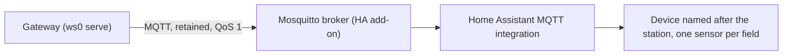
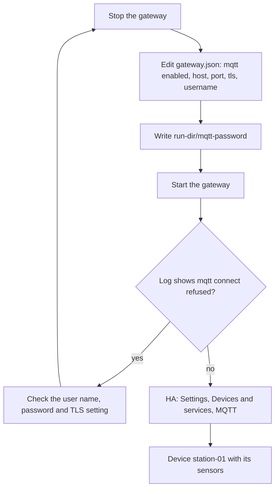

# Runbook: connect the gateway to Home Assistant (MQTT)

The gateway publishes to an MQTT broker. Home Assistant (HA) finds the station through MQTT
discovery. We first tested the gateway against a local Mosquitto broker
(`evidence/mqtt-local-broker-2026-10-13/`). Then we tested it against Clint's Home Assistant
(`evidence/ha-broker-2026-10-22/`). That run verified two things: the HA user's login (checked with
a read-only client), and the `station-01` device with its entities, from the gateway's run-d7
discovery. We haven't verified TLS, because that broker has no certificate.

Two checks wait for the next hardware session: the gateway logging in with the rotated password,
and entities updating live ([`CONTEXT-PACK.md`](CONTEXT-PACK.md)).



## What is needed

| Item | Where it goes |
|---|---|
| Broker host name or IP, port (1883 plain, usually 8883 for TLS) | `gateway.json` → `mqtt.host`, `mqtt.port` |
| TLS on or off | `gateway.json` → `mqtt.tls` (`true` uses the system's trusted CA certificates: `paho` `tls_set()`) |
| MQTT user name | `gateway.json` → `mqtt.username` |
| MQTT password | **Not in `gateway.json`, and never in chat or git.** Put it in a file `mqtt-password` in the run directory (first line), or in the `WS_MQTT_PASSWORD` environment variable. The variable wins if it is set (`mqtt_password()` in `ws0/service.py`) |

The run directory (for example `run-office/`) already holds the radio key. Git ignores it
(`run*/`). When the gateway reads `mqtt-password`, it warns if the file has any group or other
permission bits set. It checks only the POSIX mode bits (not ACLs). It skips the check when
`WS_MQTT_PASSWORD` supplies the password.

The gateway runs on macOS and Linux. Windows isn't supported.

## Set up the broker in Home Assistant OS (Clint's setup)

Source: the Mosquitto add-on documentation,
https://github.com/home-assistant/addons/blob/master/mosquitto/DOCS.md (checked 2026-10-13).
Recent HA versions call add-ons "Apps", so menu names can differ on older versions.

1. **Install the broker:** Settings → Apps → Install app → **Mosquitto broker** → Install, then
   Start. Check its log after a couple of minutes.
2. **Create a user for the gateway:** Settings → People → Users → Add user (for example
   `weatherstation`).
   - If you don't see the Users tab, enable Advanced Mode in your HA profile.
   - Don't use the names `homeassistant` or `addons`. They're reserved.
   - The broker accepts HA users and refuses anonymous connections.
3. **Enable the MQTT integration:** Settings → Devices & services. MQTT appears as a discovered
   integration. Select it, keep discovery on, and submit.
4. **Gateway settings:**
   - `host` = the HA machine's IP or Tailscale name. Not `core-mosquitto` (it resolves only
     inside HA). `homeassistant.local` needs mDNS from the gateway host to the HA machine, so
     prefer the IP or the Tailscale name,
   - `port` 1883,
   - `tls` false (TLS on 8883 needs the add-on's `certfile` and `keyfile`),
   - `username` = the user from step 2.

   Then follow the steps below.

## Steps

1. Stop the gateway (Ctrl-C, or the service. See below).
2. Edit `<run dir>/gateway.json`:

   ```json
   "mqtt": {"enabled": true, "host": "<broker>", "port": 1883, "tls": false, "username": "<user>"}
   ```

3. Write the password file yourself (macOS / Linux):

   ```sh
   ( umask 077; printf '%s\n' '<password>' > run-office/mqtt-password )
   ```

4. Start the gateway. The gateway logs a refused login or a TLS problem as
   `#gateway mqtt connect refused: <reason>` (stderr, or `serve.out` under launchd). If
   `mqtt.username` is set and no password is found, the gateway does not start. Its error names
   the password file.
5. In HA, open Settings → Devices & services → MQTT. A device named after the station
   (`station-01`) appears. It has one sensor for each field of the newest reading. Before the
   first reading, it has Temperature (°C) and Humidity (%). With both of these fields, the gateway
   also adds "Dew point (derived)" (`discovery()` in `ws0/service.py`).



## What the gateway publishes

Root topic `weatherstation/v1/<station>`. The gateway sends every message retained, at QoS 1 (`ws0/service.py`, `MQTT`):

| Topic | Content |
|---|---|
| `homeassistant/sensor/<station>_<field>/config` (for example `…_temperature_c/config`) | HA discovery. The gateway publishes it again on every broker connect, and when a new field appears |
| `…/weather` | Latest observation and the derived values (JSON), on change and every 300 s |
| `…/availability` | `online` when the latest reading is available: younger than 180 s, with a known and bounded clock, and not a `sensor_fault` record. Else `offline` |
| `…/gateway_availability` | `online` after connect. `offline` at a clean stop, and as the last will, so HA marks the station unavailable if the gateway dies |
| `…/diagnostics` | Node health report, the key-reuse alarm and the newest descriptor-set alarms (`descriptor_set_alarms`: a different set under a held generation, WSMP-E6, or a set that failed its check, WSMP-E7; also on stderr). The gateway publishes this topic only when it has a health report or an alarm |
| `…/modules` | The modules of the station's current descriptor set (WSMP section 11.1): the set of the generation that the station's newest frame carries (by its authenticated counter). By module type id (`air_th`, `pressure`, …): port, type, serial (16 hex digits; the top byte is its namespace), serial source, record status (`applied`, a `NO_RECORD` reason, `CAL_REJECTED`, `SENSOR_CHANGED`, or `none` for a module that never has a record) and record CRC. On change only; `{}` when the current set has no module; an empty retained message, which clears the topic, when there is no current set (also once after each broker connect, so a stale payload never stays). Not yet sent by a station: readings carry the generation, and the radio the set, from WSMP-E9 on |
| `homeassistant/<component>/<station>_diag_<key>/config` (`sensor` or `binary_sensor`) | HA discovery for the power keys of the node health report ([Power entities](#power-entities)). Their own unique-ID namespace `<station>_diag_<key>`, so they never overwrite an observation entity `<station>_<field>`. Published once a broker connection for each key the newest health report carries (`advertise_health`, `ws0/service.py:616`) |
| `…/alerts` | The gateway's alerts (JSON: `station_stale`, `battery_low`, `charger_fault`, `charger_cold_hold`, `receiver_silent`; `true`, `false` or `null` for not known), on change and every 300 s ([Alerts](#alerts)) |
| `homeassistant/binary_sensor/<station>_alert_<key>/config` | HA discovery for the alert binary sensors (device class `problem`), once a broker connection |
| `homeassistant/sensor/<station>_module_<type id>/config` | HA discovery for one diagnostic sensor per module type id: its state is the record status, the rest are attributes. The ID has no port and no serial in it (WSMP-H1), so a module that moves keeps its entity |

A sensor shows as available only when all three conditions hold:

- `…/availability` is `online`,
- `…/gateway_availability` is `online`,
- the sensor's field is present and not null in the latest `…/weather` message. So a faulted sensor
  shows as unavailable, never as a number. So does a pod that is unplugged, or a build without that
  sensor: its key is missing from the payload, and the availability template reads it with
  `value_json.get('<field>')`, so HA shows the entity unavailable instead of logging a template error.

Since-boot counters (rain, energy and charge) have the state class `total_increasing`: HA reads the
drop to 0 at a node reboot as a counter reset. Wind direction has `measurement_angle` (device class
`wind_direction`), so HA's statistics treat 350° and 10° as neighbours. The other sensors have
`measurement`. The power, enclosure, UVA raw, rain tip and sample-count sensors are diagnostic
entities (`DIAGNOSTIC_FIELDS` in `ws0/fields.py`, plus `rain_tips` for HA only). So are the
health-report entities ([Power entities](#power-entities)). The gateway publishes `…/weather` and
`…/availability` on change and every 300 s.

## Weather entities

From `…/weather`, unique ID `<station>_<field>`. The node sends the catalog fields. The gateway adds
the derived ones (`DERIVED` in `ws0/fields.py`), computed from the newest reading at publication and
never stored. A derived entity exists when its input field does.

| Field | Entity name | Unit, class, state class | Source |
|---|---|---|---|
| `temperature_c`, `humidity_pct` | Temperature, Humidity | °C / %, temperature / humidity, measurement | SHT45 |
| `pressure_hpa` | Pressure | hPa, atmospheric_pressure, measurement | BMP581 |
| `wind_speed_ms`, `wind_gust_ms` | Wind speed, Wind gust | m/s, wind_speed, measurement | SEN-15901 cups |
| `wind_dir_deg` | Wind direction | °, wind_direction, measurement_angle | SEN-15901 vane |
| `rain_mm` (derived) | Rain since boot | mm, precipitation, total_increasing | `rain_tips` × 0.2794 mm (the SEN-15901 bucket, 0.011 in a tip) |
| `rain_tips` | Rain tips | count, total_increasing, **diagnostic** | the raw tip count since boot |
| `uv_index_est` (derived) | UV index (LTR390, window uncalibrated) | UV index, measurement | `uva_raw` (below) |
| `uva_raw` | UVA raw (not UV index) | counts, measurement, **diagnostic** | LTR390 UVS counts |
| `dew_point_c` (derived) | Dew point (derived) | °C, temperature, measurement | Magnus formula |

**UV index.** The LTR390 datasheet gives UVI = UVS counts / sensitivity × window factor, with a
sensitivity of 2300 counts per UVI at gain 18 and 20-bit resolution. It scales with the gain and with
the integration time. The node leaves the LTR390 at its power-on gain 3 and 18-bit resolution (100 ms;
`mod_reg.c` writes only MAIN_CTRL), so the gateway divides by 2300 × 3/18 × 1/4 = 95.8 counts per UVI.
The window factor is 1.0 (`LTR390_WINDOW_FACTOR` in `ws0/fields.py`). That means no window: the PTFE
window under the UV dome attenuates by an amount nobody has measured yet. **Treat the UV index as
uncalibrated** until it is compared with a reference UV meter in sun and the factor is set from that.
The raw counts stay as the diagnostic `uva_raw`.

**Rain today and rain rate.** The node's tip counter restarts at each boot, so a daily total needs
history. HA does that with helpers on `rain_mm` (it is `total_increasing`, so a reboot doesn't lose
rain):

```yaml
utility_meter:
  rain_today:
    source: sensor.station_01_rain_since_boot
    cycle: daily
sensor:
  - platform: derivative
    source: sensor.station_01_rain_since_boot
    name: Rain rate
    unit_time: h          # mm/h
    time_window: "00:15:00"
```

The entity IDs here and below assume the station is `station-01`. Check yours under the device.

## Power entities

Protocol version 6 (design: [`superpowers/specs/2026-10-29-power-telemetry-design.md`](superpowers/specs/2026-10-29-power-telemetry-design.md)
sections 3 and 10) adds the station's power data. All of it is diagnostic (entity category
`diagnostic`), so HA lists it under the device's "Diagnostic" section, not with the weather.

**Every minute, from `…/weather`** (observation fields, `discovery()` in `ws0/service.py:512`,
unique ID `<station>_<field>`). The gateway creates an entity only for a field in the newest
reading. So a rail this build doesn't measure has no entity at all. The table shows which phase
fills each rail (design section 3.2). Phase A is the bq24074 breadboard build. Phase B adds one INA228
per rail (step 1b of the breadboard build). Phase C (`WS_POWER_PROFILE` 3) is the TX stack
(`hardware/tx-stack-r1`): a BQ25798 replaces the bq24074 and the load, solar and USB-C INA228s. The
battery INA228 and the MAX17048 stay.

| Field | Entity name | Unit, class | Phase A | Phase B | Phase C |
|---|---|---|---|---|---|
| `batt_mv` | Battery voltage | mV, voltage | yes (fuel gauge) | yes | yes (fuel gauge) |
| `batt_current_ma` | Battery current (+ charging) | mA, current | yes | yes | yes (battery INA228) |
| `energy_in_mwh`, `energy_out_mwh` | Energy in, Energy out | mWh, energy, `total_increasing` | yes | yes | yes |
| `charge_in_mah`, `charge_out_mah` | Charge in, Charge out | mAh, `total_increasing` | yes | yes | yes |
| `load_mv` | Load voltage | mV, voltage | yes (charger OUT) | yes | yes (BQ25798 VSYS) |
| `load_current_ma` | Load current | mA, current | no entity | yes | no entity |
| `charger_input_mv` | Charger input voltage (source not identified) | mV, voltage | yes | yes | yes (BQ25798 VBUS) |
| `solar_mv`, `solar_current_ma` | Solar input voltage, Solar input current | mV, mA | no entity | yes | no entity |
| `usb_mv`, `usb_current_ma` | USB-C input voltage, USB-C input current | mV, mA | no entity | yes | no entity |

- **Phase A cannot tell solar from USB-C.** The bq24074 has one input. "Charger input voltage
  (source not identified)" is the voltage after the sources join. There's no solar or USB-C
  entity. USB-C is for bench work and occasional backup charging only, never together with solar.
- **Battery current sign:** + into the cell (charging), − out of the cell (discharging), mA. Load
  and source currents are + into the load or into the station.
- **Field 11 (`batt_mv`, "Battery voltage") changed meaning in version 6:** it is the cell
  voltage from the fuel gauge. Under version 5 it was the INA228 VBUS of whatever net its jumper
  sensed (on the official wiring the charger OUT). The unique ID `<station>_batt_mv` doesn't
  change, so HA keeps one history across the release. Values from before the version 6 release
  aren't the cell voltage. Compare only values after the release date.
- A present field whose sensor failed is `null`: the entity is unavailable (the three conditions
  above), never a number.

**Every 15 minutes, from `…/diagnostics`** (health-report keys, `HEALTH_ENTITIES` and
`health_discovery()` in `ws0/service.py:449` and `:474`, unique ID `<station>_diag_<key>`, config
topic `homeassistant/<component>/<station>_diag_<key>/config`). An entity is available while
`…/gateway_availability` is `online`, `…/diagnostics/availability` is `online` and its key is not
`null` in the newest report. The gateway sets `…/diagnostics/availability` (retained) to `offline`
once the newest health report is older than 1,900 s (`HEALTH_MAX_AGE_S` in `ws0/service.py`: two
15-minute reports plus slack, the dashboard's "overdue" limit).

Say a node browns out or its radio
dies. Its last SOC and charger state don't stay on screen as live values. They go unavailable about
32 minutes after the last report. This availability doesn't follow `…/availability` (the
every-minute reading's 180 s freshness).

| Key | Entity name | Component, unit, class | Phases A and B | Phase C (BQ25798) |
|---|---|---|---|---|
| `battery_soc_pct` | Battery state of charge (gauge) | sensor, %, battery | yes (MAX17048; can exceed 100 near full) | yes |
| `battery_soc_rate_pct_h` | Battery state of charge rate (gauge) | sensor, %/h (+ charging) | yes | yes |
| `charger_charging` | Charger charging | binary_sensor, battery_charging | yes (CHG pin) | yes (CHG_STAT) |
| `charger_input_power_ok` | Charger input power good | binary_sensor, power | yes (PGOOD pin) | yes (PG_STAT) |
| `charger_fault` | Charger fault | binary_sensor, problem | yes (CHG flashing. TMR is tied to GND on the #4755 per its schematic, so the safety timers are disabled: confirm on the board; a fault then means something else, such as TMR strapped differently or an intermittent CHG line) | yes (REG20/REG21 OVP, OCP, VSYS and TSHUT faults, or charge held for a wrong part, cell count or read-back; a thermistor hold is not a fault) |
| `charger_stage` | Charger stage | sensor, enum (`precharge`, `cc`, `cv`, `topoff`, `terminated`, `not_charging`) | no entity (the pins cannot tell) | yes (CHG_STAT) |
| `charger_active_input` | Charger active input | sensor, enum (`solar`, `usb_c`, `no_input`) | no entity (source not identified) | yes (VAC1/VAC2) |
| `power_monitor_temp_c` | Power monitor temperature | sensor, °C, temperature | yes (battery INA228; B: hottest of four) | yes (battery INA228) |
| `mcu_supply_mv` | MCU supply voltage | sensor, mV, voltage | yes (VDDA from VREFINT) | yes |
| `charger_reported_battery_ma` | Charger-reported charge current | sensor, mA, current | yes (bq24074 ISET; 0 while PGOOD is off) | yes (IBAT ADC) |
| `charger_reported_input_mv`, `charger_reported_input_ma` | Charger-reported input voltage, current | sensor, mV / mA | no entity | yes (VBUS, IBUS ADC) |
| `charger_reported_battery_mv` | Charger-reported battery voltage | sensor, mV, voltage | no entity | yes (VBAT ADC) |
| `charger_temp_c`, `pack_temp_c` | Charger temperature, Battery pack temperature | sensor, °C, temperature | no entity | charger die: yes (TDIE); pack: no entity (no fitted curve for the NTC divider yet) |

Every report carries every key. But the gateway advertises an entity only for a key the build
measures. The report's fitted byte lists the other keys in `power_not_measured` (power design
section 6.1). This works the same way as an observation field that the record doesn't carry: no
entity.

So phases A and B create **8** power entities (the "yes" rows) and phase C **14** (fitted byte
0x3F: everything but the pack temperature). The other keys are in the report format, but that
build doesn't measure them. Say the build measures a key but its
source fails (a dead fuel gauge, listed in `power_sensor_faults`). The key keeps its entity and
shows it unavailable.

If an earlier version 6 test run advertised all fifteen, remove the seven phase A "no entity"
configs. Use the same steps as for the retired entities below. The report's station counters stay
in the `…/diagnostics` JSON only, with no entity. These are boots since power-up, crashes and last
crash PC, radio TX timeouts, I2C recoveries, journal counts and reset cause. Read them there or on
the dashboard. The full key list with units and `null` rules is the `HealthReport` schema in
[`openapi.json`](openapi.json).

### Remove the retired entities after the version 6 release

Version 6 builds no longer send `soc_gauge_pct` ("Battery (fuel gauge estimate)") and
`charger_pins` ("Charger status pins"). The health report replaces them (`battery_soc_pct`, the
charger binary sensors). The gateway never advertises them again. But their retained discovery
configs from the version 5 run stay in the broker, so HA keeps showing two unavailable entities.
Do this only after the version 6 release. A version 5 gateway would advertise them again.

After the first version 6 reading arrives:

1. In HA: Settings → Devices & services → MQTT → Configure → **Publish a packet**.
2. Topic `homeassistant/sensor/<station>_soc_gauge_pct/config`, payload empty, retain on, Publish.
   An empty retained discovery message removes the entity and clears the broker's copy.
3. The same for `homeassistant/sensor/<station>_charger_pins/config`.
4. Check the device page. The two entities no longer show. Their state history ages out (the
   recorder keeps 10 days by default). But their hourly long-term statistics stay until you delete
   them in Developer tools → Statistics.

## Alerts

The gateway works out five alerts each second and publishes them, retained, on `…/alerts`
(`alerts()` and `alert_discovery()` in `ws0/service.py`). Each is a `binary_sensor` with device class
`problem`: **on means something is wrong**. Unique ID `<station>_alert_<key>`. They are normal
entities, not diagnostic ones, so they show on the device page with the weather.

An alert is available while `…/gateway_availability` is `online` and its value is not `null`. It
does **not** follow the station's `…/availability`. So when the station goes quiet, "Station stale"
turns on rather than going unavailable. If the gateway itself dies, its last will makes every alert
unavailable: alert on that too (the last automation below).

| Key | Entity name | On when | `null` (unavailable) when |
|---|---|---|---|
| `station_stale` | Station stale | the newest reading is older than 180 s, has an unknown or uncertain clock, or there is none. A fresh reading flagged `sensor_fault` is not stale | never |
| `battery_low` | Battery low | gauge SOC below 20 % (`BATTERY_LOW_SOC_PCT`) in a fresh health report, or the node's energy state is `conserve` or `critical` (from the fresh reading, else from the fresh health report) | neither source is fresh |
| `charger_fault` | Charger fault (alert) | `charger_fault` in a fresh health report ([Power entities](#power-entities)) | no fresh report, or no charger status |
| `charger_cold_hold` | Charger cold hold | the health report's `charger_cold_hold` key is true | no fresh report. The entity is advertised only once a report carries the key: today's firmware holds charge on a cold thermistor but reports it through the pack temperature, not as its own bit |
| `receiver_silent` | Receiver silent | no `#alive` from the RX board for 180 s (it sends one every 60 s), or none in the first 180 s after `serve` starts | no receiver expected (the demo before its first simulated report) |

Example automations, in `automations.yaml` or pasted as YAML in the automation editor. Replace
`notify.mobile_app_phone` with your notify service, and check the entity IDs on the device page
(they follow the station name, here `station-01`).

```yaml
- alias: Weather station stale
  triggers:
    - trigger: state
      entity_id: binary_sensor.station_01_station_stale
      to: "on"
      for: "00:05:00"            # skip a lost minute or two
  actions:
    - action: notify.mobile_app_phone
      data:
        title: Weather station
        message: No fresh reading from the station for 8 minutes.

- alias: Weather station battery low
  triggers:
    - trigger: state
      entity_id: binary_sensor.station_01_battery_low
      to: "on"
  actions:
    - action: notify.mobile_app_phone
      data:
        title: Weather station
        message: >
          Battery low: {{ states('sensor.station_01_battery_state_of_charge_gauge') }} %.

- alias: Weather station charger fault
  triggers:
    - trigger: state
      entity_id: binary_sensor.station_01_charger_fault_alert
      to: "on"
  actions:
    - action: notify.mobile_app_phone
      data:
        title: Weather station
        message: The charger reports a fault. Run CHARGER on the TX console.

- alias: Weather station charger cold hold
  triggers:
    - trigger: state
      entity_id: binary_sensor.station_01_charger_cold_hold
      to: "on"
      for: "01:00:00"            # a short hold on a cold night is normal
  actions:
    - action: notify.mobile_app_phone
      data:
        title: Weather station
        message: Charging held for an hour because the battery is too cold.

- alias: Weather station receiver silent
  triggers:
    - trigger: state
      entity_id: binary_sensor.station_01_receiver_silent
      to: "on"
  actions:
    - action: notify.mobile_app_phone
      data:
        title: Weather station
        message: The RX board stopped reporting. Check its USB cable and the gateway log.

- alias: Weather station gateway down
  triggers:
    - trigger: state
      entity_id: binary_sensor.station_01_station_stale
      to: "unavailable"
      for: "00:05:00"
  actions:
    - action: notify.mobile_app_phone
      data:
        title: Weather station
        message: The gateway is offline (its MQTT last will fired).
```

## Run the gateway unattended

| OS | How |
|---|---|
| macOS, at login | `tools/deploy/macos/install.sh install <run dir> <RX ST-LINK serial>` (LaunchAgent in `~/Library/LaunchAgents`. It starts when you log in and restarts the gateway on exit. No sudo) |
| macOS, at boot | `tools/deploy/macos/install.sh --daemon install <run dir> <RX ST-LINK serial>` (LaunchDaemon in `/Library/LaunchDaemons`. It starts at boot with nobody logged in, so it comes back by itself after a power cut. It runs as you, not root (`UserName` in the plist), so the run directory and `mqtt-password` keep their owner. It asks for sudo. It removes the LaunchAgent, since two gateways can't share the RX serial port. `--daemon status` and `--daemon uninstall` work the same way) |
| Linux | `tools/deploy/linux/ws0-gateway.service` (systemd unit. See the comments in the file) |

For a boot start on macOS, also turn on System Settings → Energy → "Start up automatically after a
power failure". The repository and run directory must not sit in a folder macOS protects for
background processes (Desktop, Documents, Downloads): a daemon can't answer the privacy prompt.

Both read the password from the run directory, so you don't need an OS-specific secret store.
