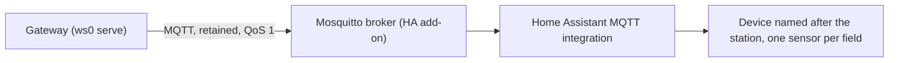
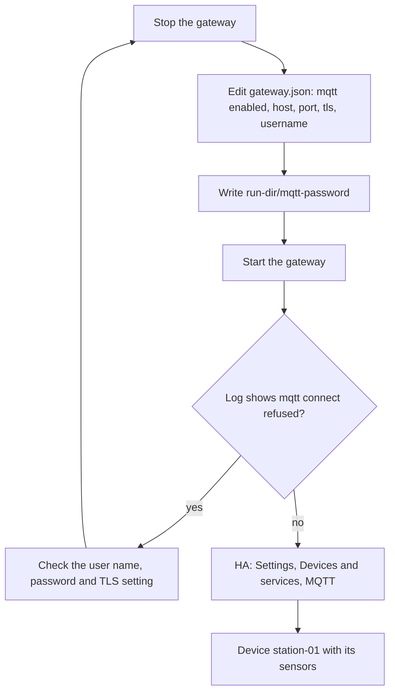

# Runbook: connect the gateway to Home Assistant (MQTT)

The gateway publishes to an MQTT broker. Home Assistant (HA) finds the station through MQTT
discovery. The gateway was tested against a local Mosquitto broker
(`evidence/mqtt-local-broker-2026-10-13/`), then against Clint's Home Assistant: the HA user's login (checked with a read-only client) and
the `station-01` device with its entities, from the gateway's run-d7 discovery, are verified
(`evidence/ha-broker-2026-10-22/`). TLS is not verified: that broker has no certificate. The
gateway logging in on the rotated password and entities updating live are checked at the next
hardware session ([`CONTEXT-PACK.md`](CONTEXT-PACK.md)).



## What is needed

| Item | Where it goes |
|---|---|
| Broker host name or IP, port (1883 plain, usually 8883 for TLS) | `gateway.json` → `mqtt.host`, `mqtt.port` |
| TLS on or off | `gateway.json` → `mqtt.tls` (`true` uses the system's trusted CA certificates: `paho` `tls_set()`) |
| MQTT user name | `gateway.json` → `mqtt.username` |
| MQTT password | **Not in `gateway.json`, and never in chat or git.** Put it in a file `mqtt-password` in the run directory (first line), or in the `WS_MQTT_PASSWORD` environment variable. The variable wins if it is set (`mqtt_password()` in `ws0/service.py`) |

The run directory (for example `run-office/`) already holds the radio key. Git ignores it
(`run*/`). When the gateway reads `mqtt-password`, it warns if the file has any group or other
permission bits set. It checks only the POSIX mode bits (not ACLs), and it skips the check when
`WS_MQTT_PASSWORD` supplies the password. The gateway runs on macOS and Linux; Windows is not
supported.

## Set up the broker in Home Assistant OS (Clint's setup)

Source: the Mosquitto add-on documentation,
https://github.com/home-assistant/addons/blob/master/mosquitto/DOCS.md (checked 2026-10-13).
Recent HA versions call add-ons "Apps", so menu names can differ on older versions.

1. **Install the broker:** Settings → Apps → Install app → **Mosquitto broker** → Install, then
   Start. Check its log after a couple of minutes.
2. **Create a user for the gateway:** Settings → People → Users → Add user (for example
   `weatherstation`).
   - If the Users tab is missing, turn on Advanced Mode in your HA profile.
   - The names `homeassistant` and `addons` are reserved.
   - The broker accepts HA users and refuses anonymous connections.
3. **Enable the MQTT integration:** Settings → Devices & services. MQTT appears as a discovered
   integration. Select it, keep discovery on, and submit.
4. **Gateway settings:**
   - `host` = the HA machine's IP or Tailscale name. Not `core-mosquitto` (it resolves only
     inside HA). `homeassistant.local` needs mDNS from the gateway host to the HA machine, so
     prefer the IP or the Tailscale name,
   - `port` 1883,
   - `tls` false (TLS on 8883 needs the add-on's `certfile` and `keyfile`),
   - `username` = the user from step 2.

   Then follow the steps below.

## Steps

1. Stop the gateway (Ctrl-C, or the service. See below).
2. Edit `<run dir>/gateway.json`:

   ```json
   "mqtt": {"enabled": true, "host": "<broker>", "port": 1883, "tls": false, "username": "<user>"}
   ```

3. Write the password file yourself (macOS / Linux):

   ```sh
   ( umask 077; printf '%s\n' '<password>' > run-office/mqtt-password )
   ```

4. Start the gateway. The gateway logs a refused login or a TLS problem as
   `#gateway mqtt connect refused: <reason>` (stderr, or `serve.out` under launchd). If
   `mqtt.username` is set and no password is found, the gateway does not start. Its error names
   the password file.
5. In HA, open Settings → Devices & services → MQTT. A device named after the station
   (`station-01`) appears. It has one sensor for each field of the newest reading. Before the
   first reading, it has Temperature (°C) and Humidity (%). With both of these fields, the gateway
   also adds "Dew point (derived)" (`discovery()` in `ws0/service.py`).



## What the gateway publishes

Root topic `weatherstation/v1/<station>`. All messages are retained, QoS 1 (`ws0/service.py`, `MQTT`):

| Topic | Content |
|---|---|
| `homeassistant/sensor/<station>_<field>/config` (for example `…_temperature_c/config`) | HA discovery. The gateway publishes it again on every broker connect, and when a new field appears |
| `…/weather` | Latest observation and the derived values (JSON), on change and every 300 s |
| `…/availability` | `online` when the latest reading is available: younger than 180 s, with a known and bounded clock, and not a `sensor_fault` record. Else `offline` |
| `…/gateway_availability` | `online` after connect. `offline` at a clean stop, and as the last will, so HA marks the station unavailable if the gateway dies |
| `…/diagnostics` | Node health report, the key-reuse alarm and the newest descriptor-set alarms (`descriptor_set_alarms`: a different set under a held generation, WSMP-E6, or a set that failed its check, WSMP-E7; also on stderr). The gateway publishes this topic only when it has a health report or an alarm |
| `…/modules` | The modules of the station's current descriptor set (WSMP section 11.1): the set of the generation that the station's newest frame carries (by its authenticated counter). By module type id (`air_th`, `pressure`, …): port, type, serial (16 hex digits; the top byte is its namespace), serial source, record status (`applied`, a `NO_RECORD` reason, `CAL_REJECTED`, `SENSOR_CHANGED`, or `none` for a module that never has a record) and record CRC. On change only; `{}` when the current set has no module; an empty retained message, which clears the topic, when there is no current set (also once after each broker connect, so a stale payload never stays). Not yet sent by a station: readings carry the generation, and the radio the set, from WSMP-E9 on |
| `homeassistant/<component>/<station>_diag_<key>/config` (`sensor` or `binary_sensor`) | HA discovery for the power keys of the node health report ([Power entities](#power-entities)). Their own unique-ID namespace `<station>_diag_<key>`, so they never overwrite an observation entity `<station>_<field>`. Published once a broker connection for each key the newest health report carries (`advertise_health`, `ws0/service.py:616`) |
| `homeassistant/sensor/<station>_module_<type id>/config` | HA discovery for one diagnostic sensor per module type id: its state is the record status, the rest are attributes. The ID has no port and no serial in it (WSMP-H1), so a module that moves keeps its entity |

A sensor shows as available only when all three conditions hold:

- `…/availability` is `online`,
- `…/gateway_availability` is `online`,
- the sensor's field is not null in the latest `…/weather` message. A faulted sensor therefore shows as unavailable, never as a number.

Since-boot counters (rain tips, energy and charge) have the state class `total_increasing`. The
other sensors have `measurement`. The power, enclosure, UVA raw and sample-count sensors are diagnostic
entities (`DIAGNOSTIC_FIELDS` in `ws0/fields.py`); so are the health-report entities ([Power
entities](#power-entities)). The gateway publishes `…/weather` and
`…/availability` on change and every 300 s.

## Power entities

Protocol version 6 (design: [`superpowers/specs/2026-10-29-power-telemetry-design.md`](superpowers/specs/2026-10-29-power-telemetry-design.md)
sections 3 and 10) adds the station's power data. All of it is diagnostic (entity category
`diagnostic`), so HA lists it under the device's "Diagnostic" section, not with the weather.

**Every minute, from `…/weather`** (observation fields, `discovery()` in `ws0/service.py:512`;
unique ID `<station>_<field>`). The gateway creates an entity only for a field that the newest
reading carries, so a rail this build does not measure has no entity at all. Which phase fills each
rail (design section 3.2; phase A is the current bq24074 build, B adds one INA228 per rail, step 1b
of the breadboard build):

| Field | Entity name | Unit, class | Phase A | Phase B |
|---|---|---|---|---|
| `batt_mv` | Battery voltage | mV, voltage | yes (fuel gauge) | yes |
| `batt_current_ma` | Battery current (+ charging) | mA, current | yes | yes |
| `energy_in_mwh`, `energy_out_mwh` | Energy in, Energy out | mWh, energy, `total_increasing` | yes | yes |
| `charge_in_mah`, `charge_out_mah` | Charge in, Charge out | mAh, `total_increasing` | yes | yes |
| `load_mv` | Load voltage | mV, voltage | yes (charger OUT) | yes |
| `load_current_ma` | Load current | mA, current | no entity | yes |
| `charger_input_mv` | Charger input voltage (source not identified) | mV, voltage | yes | yes |
| `solar_mv`, `solar_current_ma` | Solar input voltage, Solar input current | mV, mA | no entity | yes |
| `usb_mv`, `usb_current_ma` | USB-C input voltage, USB-C input current | mV, mA | no entity | yes |

- **Phase A cannot tell solar from USB-C.** The bq24074 has one input. "Charger input voltage
  (source not identified)" is the voltage after the sources join; there is no solar or USB-C
  entity. USB-C is for bench work and occasional backup charging only, never together with solar.
- **Battery current sign:** + into the cell (charging), − out of the cell (discharging), mA. Load
  and source currents are + into the load or into the station.
- **Field 11 (`batt_mv`, "Battery voltage") changed meaning in version 6:** it is the cell
  voltage from the fuel gauge. Under version 5 it was the INA228 VBUS of whatever net its jumper
  sensed (on the official wiring the charger OUT). HA keeps the history of an entity across the
  release, because the unique ID `<station>_batt_mv` does not change: values before the version 6
  release are not the cell voltage. Compare only values after the release date.
- A present field whose sensor failed is `null`: the entity is unavailable (the three conditions
  above), never a number.

**Every 15 minutes, from `…/diagnostics`** (health-report keys, `HEALTH_ENTITIES` and
`health_discovery()` in `ws0/service.py:449` and `:474`; unique ID `<station>_diag_<key>`, config
topic `homeassistant/<component>/<station>_diag_<key>/config`). An entity is available while
`…/gateway_availability` is `online`, `…/diagnostics/availability` is `online` and its key is not
`null` in the newest report. The gateway sets `…/diagnostics/availability` (retained) to `offline`
once the newest health report is older than 1,900 s (`HEALTH_MAX_AGE_S` in `ws0/service.py`: two
15-minute reports plus slack, the dashboard's "overdue" limit). So a node that browns out or whose
radio dies does not leave its last SOC and charger state on screen as live values: they go
unavailable about 32 minutes after the last report. It does not follow `…/availability` (the
every-minute reading's 180 s freshness).

| Key | Entity name | Component, unit, class | Phases A and B |
|---|---|---|---|
| `battery_soc_pct` | Battery state of charge (gauge) | sensor, %, battery | yes (MAX17048; can exceed 100 near full) |
| `battery_soc_rate_pct_h` | Battery state of charge rate (gauge) | sensor, %/h (+ charging) | yes |
| `charger_charging` | Charger charging | binary_sensor, battery_charging | yes (CHG pin) |
| `charger_input_power_ok` | Charger input power good | binary_sensor, power | yes (PGOOD pin) |
| `charger_fault` | Charger fault | binary_sensor, problem | yes (CHG flashing. TMR is tied to GND on the #4755 per its schematic, so the safety timers are disabled: confirm on the board; a fault then means something else, such as TMR strapped differently or an intermittent CHG line) |
| `charger_stage` | Charger stage | sensor, enum (`precharge`, `cc`, `cv`, `topoff`, `terminated`, `not_charging`) | no entity (the pins cannot tell) |
| `charger_active_input` | Charger active input | sensor, enum (`solar`, `usb_c`, `no_input`) | no entity (source not identified) |
| `power_monitor_temp_c` | Power monitor temperature | sensor, °C, temperature | yes (battery INA228; B: hottest of four) |
| `mcu_supply_mv` | MCU supply voltage | sensor, mV, voltage | yes (VDDA from VREFINT) |
| `charger_reported_battery_ma` | Charger-reported charge current | sensor, mA, current | yes (bq24074 ISET; 0 while PGOOD is off) |
| `charger_reported_input_mv`, `charger_reported_input_ma` | Charger-reported input voltage, current | sensor, mV / mA | no entity |
| `charger_reported_battery_mv` | Charger-reported battery voltage | sensor, mV, voltage | no entity |
| `charger_temp_c`, `pack_temp_c` | Charger temperature, Battery pack temperature | sensor, °C, temperature | no entity |

Every report carries every key, but the gateway advertises an entity only for a key the build
measures: the report's fitted byte lists the others in `power_not_measured` (power design section
6.1), as an observation field the record does not carry gets no entity. So phases A and B create
**8** power entities (the "yes" rows); the other seven keys are in the report format, but no
breadboard build measures them. A key the build measures whose source
fails (a dead fuel gauge: listed in `power_sensor_faults`) keeps its entity and shows it unavailable.
If an earlier version 6 test run advertised all fifteen, remove the seven phase A "no entity"
configs the same way as the retired entities below. The station counters of the report
(boots since power-up, crashes and last crash PC, radio TX timeouts, I2C recoveries, journal
counts, reset cause) stay in the `…/diagnostics` JSON only, with no entity: read them there or on
the dashboard. The full key list with units and `null` rules is the `HealthReport` schema in
[`openapi.json`](openapi.json).

### Remove the retired entities after the version 6 release

Version 6 builds no longer send `soc_gauge_pct` ("Battery (fuel gauge estimate)") and
`charger_pins` ("Charger status pins"); the health report replaces them (`battery_soc_pct`, the
charger binary sensors). The gateway never advertises them again, but their retained discovery
configs from the version 5 run stay in the broker, and HA keeps showing two unavailable entities.
After the first version 6 reading has arrived:

1. In HA: Settings → Devices & services → MQTT → Configure → **Publish a packet**.
2. Topic `homeassistant/sensor/<station>_soc_gauge_pct/config`, payload empty, retain on, Publish.
   An empty retained discovery message removes the entity and clears the broker's copy.
3. The same for `homeassistant/sensor/<station>_charger_pins/config`.
4. Check the device page: the two entities are gone. Their recorded history stays in HA's database
   until it ages out.

Do this only after the version 6 release: a version 5 gateway would advertise them again.

## Run the gateway unattended

| OS | How |
|---|---|
| macOS | `tools/deploy/macos/install.sh install <run dir> <RX ST-LINK serial>` (LaunchAgent. It restarts the gateway on exit) |
| Linux | `tools/deploy/linux/ws0-gateway.service` (systemd unit. See the comments in the file) |

Both read the password from the run directory, so no OS-specific secret store is involved.
