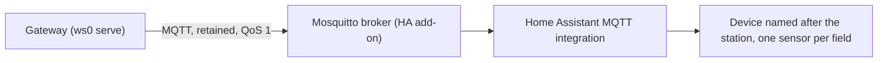
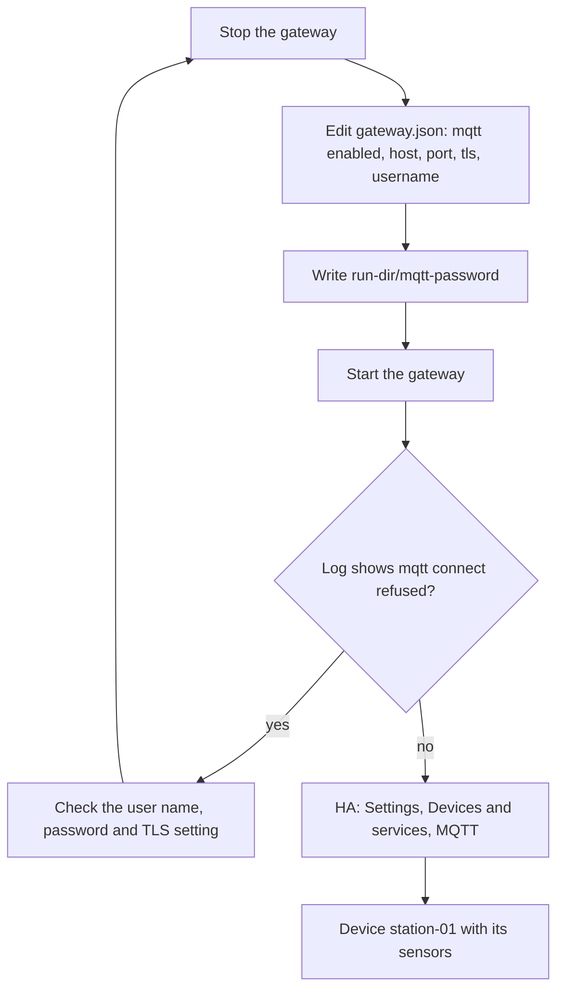

# Runbook: connect the gateway to Home Assistant (MQTT)

The gateway publishes to an MQTT broker. Home Assistant (HA) finds the station through MQTT
discovery. The gateway was tested against a local Mosquitto broker
(`evidence/mqtt-local-broker-2026-10-13/`), then against Clint's Home Assistant: the HA-user login
and the `station-01` device with its entities are verified (`evidence/ha-broker-2026-10-22/`).
TLS is not verified: that broker has no certificate. Entities updating live is checked at the
next hardware session ([`CONTEXT-PACK.md`](CONTEXT-PACK.md) §6, step 3).



## What is needed

| Item | Where it goes |
|---|---|
| Broker host name or IP, port (1883 plain, usually 8883 for TLS) | `gateway.json` → `mqtt.host`, `mqtt.port` |
| TLS on or off | `gateway.json` → `mqtt.tls` (`true` uses the system's trusted CA certificates: `paho` `tls_set()`) |
| MQTT user name | `gateway.json` → `mqtt.username` |
| MQTT password | **Not in `gateway.json`, and never in chat or git.** Put it in a file `mqtt-password` in the run directory (first line), or in the `WS_MQTT_PASSWORD` environment variable. The variable wins if it is set (`mqtt_password()` in `ws0/service.py`) |

The run directory (for example `run-office/`) already holds the radio key. Git ignores it
(`run*/`). When the gateway reads `mqtt-password`, it warns if the file has any group or other
permission bits set. It checks only the POSIX mode bits (not ACLs), and it skips the check when
`WS_MQTT_PASSWORD` supplies the password. The gateway runs on macOS and Linux; Windows is not
supported.

## Set up the broker in Home Assistant OS (Clint's setup)

Source: the Mosquitto add-on documentation,
https://github.com/home-assistant/addons/blob/master/mosquitto/DOCS.md (checked 2026-10-13).
Recent HA versions call add-ons "Apps", so menu names can differ on older versions.

1. **Install the broker:** Settings → Apps → Install app → **Mosquitto broker** → Install, then
   Start. Check its log after a couple of minutes.
2. **Create a user for the gateway:** Settings → People → Users → Add user (for example
   `weatherstation`).
   - If the Users tab is missing, turn on Advanced Mode in your HA profile.
   - The names `homeassistant` and `addons` are reserved.
   - The broker accepts HA users and refuses anonymous connections.
3. **Enable the MQTT integration:** Settings → Devices & services. MQTT appears as a discovered
   integration. Select it, keep discovery on, and submit.
4. **Gateway settings:**
   - `host` = the HA machine's IP or Tailscale name. Not `core-mosquitto` (it resolves only
     inside HA). `homeassistant.local` needs mDNS from the gateway host to the HA machine, so
     prefer the IP or the Tailscale name,
   - `port` 1883,
   - `tls` false (TLS on 8883 needs the add-on's `certfile` and `keyfile`),
   - `username` = the user from step 2.

   Then follow the steps below.

## Steps

1. Stop the gateway (Ctrl-C, or the service. See below).
2. Edit `<run dir>/gateway.json`:

   ```json
   "mqtt": {"enabled": true, "host": "<broker>", "port": 1883, "tls": false, "username": "<user>"}
   ```

3. Write the password file yourself (macOS / Linux):

   ```sh
   ( umask 077; printf '%s\n' '<password>' > run-office/mqtt-password )
   ```

4. Start the gateway. The gateway logs a refused login or a TLS problem as
   `#gateway mqtt connect refused: <reason>` (stderr, or `serve.out` under launchd). If
   `mqtt.username` is set and no password is found, the gateway does not start. Its error names
   the password file.
5. In HA, open Settings → Devices & services → MQTT. A device named after the station
   (`station-01`) appears. It has one sensor for each field of the newest reading. Before the
   first reading, it has Temperature (°C) and Humidity (%). With both of these fields, the gateway
   also adds "Dew point (derived)" (`discovery()` in `ws0/service.py`).



## What the gateway publishes

Root topic `weatherstation/v1/<station>`. All messages are retained, QoS 1 (`ws0/service.py`, `MQTT`):

| Topic | Content |
|---|---|
| `homeassistant/sensor/<station>_<field>/config` (for example `…_temperature_c/config`) | HA discovery. The gateway publishes it again on every broker connect, and when a new field appears |
| `…/weather` | Latest observation and the derived values (JSON), on change and every 300 s |
| `…/availability` | `online` when the latest reading is available: younger than 180 s, with a known and bounded clock, and not a `sensor_fault` record. Else `offline` |
| `…/gateway_availability` | `online` after connect. `offline` at a clean stop, and as the last will, so HA marks the station unavailable if the gateway dies |
| `…/diagnostics` | Node health report and the key-reuse alarm. The gateway publishes this topic only when it has a health report or an alarm |

A sensor shows as available only when all three conditions hold:

- `…/availability` is `online`,
- `…/gateway_availability` is `online`,
- the sensor's field is not null in the latest `…/weather` message. A faulted sensor therefore shows as unavailable, never as a number.

Since-boot counters (rain tips, energy and charge) have the state class `total_increasing`. The
other sensors have `measurement`. The power, enclosure, UVA raw and sample-count sensors are diagnostic
entities (`DIAGNOSTIC_FIELDS` in `ws0/fields.py`). The gateway publishes `…/weather` and
`…/availability` on change and every 300 s.

## Run the gateway unattended

| OS | How |
|---|---|
| macOS | `tools/deploy/macos/install.sh install <run dir> <RX ST-LINK serial>` (LaunchAgent. It restarts the gateway on exit) |
| Linux | `tools/deploy/linux/ws0-gateway.service` (systemd unit. See the comments in the file) |

Both read the password from the run directory, so no OS-specific secret store is involved.
