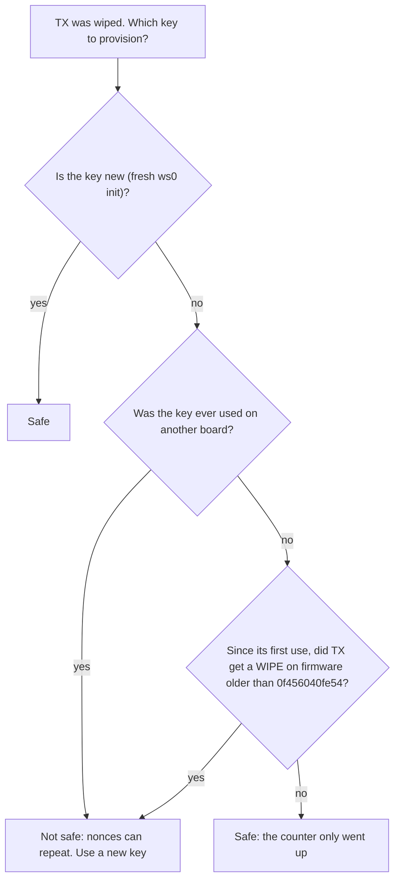
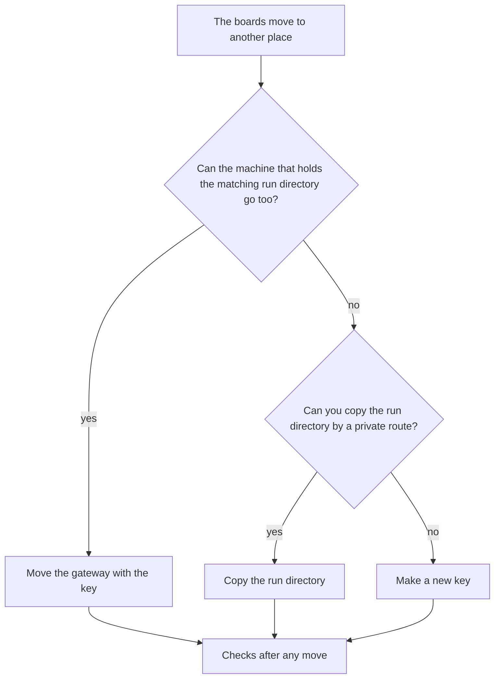

# Runbook: moving the boards between gateways

Use this runbook when the transmitter (TX) and receiver (RX) boards move between machines (for
example office ↔ home). Written 2026-10-13. Each rule below names the code that implements it,
so you can check it again.

## The rule that matters

Use a TX key only with a counter that only goes up.

- The AES-CCM nonce is kind + station ID + the transmission counter, a 40-bit value (`header()`
  in `firmware/common/ws_frame.c`, `docs/protocol.md` section 1).
- `PROVISION … [epoch_floor]` raises only the **epoch** (`App/node_store.c`,
  `store_epoch_floor`). The epoch keeps observation identities unique. The floor does not raise
  the counter.

What `WIPE ERASE-ALL-NODE-STATE` erases depends on the firmware (`App/node_store.c`, `store_wipe`):

- **Before release `0f456040fe54`:** the key, the counters and the journal. The counter restarted at 1.
- **From `0f456040fe54` on:** the key and the journal only. The counter and the epoch keep
  rising for the life of the board.

| After a WIPE, provision with… | Safe? |
|---|---|
| a **new** key (`python -m ws0 init --hardware` into a new directory) | Yes, always |
| a key used only on this board, with a counter that never went back since its first use. This means no WIPE under firmware older than `0f456040fe54` after that first use. Example: the office key `b7142e`, first used after the morning wipe | Yes: the counter only went up |
| a key that TX used before a WIPE on firmware older than `0f456040fe54`, or a key used on another board. Example: the key in `run-hw`, used before the morning office wipe | **No**: it can repeat nonces already sent on air |



Prefer a new key. A new key is never wrong.

A run directory holds the key (`gateway.json`), the observation database and the gateway's own
nonce state. Git ignores it (`run*/`). Move it only by a private route (AirDrop, USB stick).
Never move it by git, chat or email.

## Know which key TX has

```sh
.venv/bin/python tools/console.py 003B00194142500E20353451 STATUS   # read kcv=… in the #status line
# or interactively:
.venv/bin/python -m serial.tools.list_ports -v            # TX = SER=003B00194142500E20353451
.venv/bin/python -m serial.tools.miniterm /dev/cu.usbmodem<TX> 115200
#   type STATUS and read kcv=… (Ctrl-] quits)
```

The key check value (KCV) identifies a key without showing it. Known values: office `run-office`
(2026-10-13) = `b7142e`, `run-d5` (2026-10-14) = `5618eb`, `run-d7` (2026-10-19) = `6e30cf`
(`firmware/stage0-node/RELEASES.md`). The repo does not record the value of the home `run-hw` key. Compute it
on the home Mac. The gateway's KCV is `key_check()` of the key in `gateway.json`
(`ws0/__main__.py`).

## Choose how to move



### Move the gateway with the key (no re-provisioning)

Run the gateway on the machine that holds the matching run directory, wherever the boards are:

```sh
.venv/bin/python -m ws0 serve --directory run-office --serial-number 0016001E4142500E20353451
# or keep it running unattended (LaunchAgent; replaces any existing one):
tools/deploy/macos/install.sh install run-office 0016001E4142500E20353451
```

### Copy the run directory

1. Copy the run directory to the other machine by a private route.
2. Stop any other gateway for the same RX board. Only one process can hold the RX port, and a
   gateway with the wrong key rejects every frame.
3. Point that machine's gateway at the copy:
   `tools/deploy/macos/install.sh install <copied-dir> 0016001E4142500E20353451`.

### Make a new key

1. `.venv/bin/python -m ws0 init --hardware --station station-01 --station-id 1 --directory run-<new>`.
2. On TX, send `WIPE ERASE-ALL-NODE-STATE`.
3. `.venv/bin/python -m ws0 provision-node --directory run-<new> --serial /dev/cu.usbmodem<TX>`.

Readings then start a new history in the new directory.

## Changing the flash layout

A release that moves the page map (`App/flash_layout.h`) loses the counter. The old meta log
pages become firmware or journal pages, so the new firmware finds no meta log and starts the
counter again at 1. The old key has already used those counters on air. Re-using it would repeat
nonces. Therefore a layout change always gets a new key, in a new run directory:

1. Stop the gateway.
2. Archive the old run directory. Its key is retired: never provision it again.
3. Flash RX, then TX (`firmware/stage0-node/RELEASES.md`, "How to cut a release", step 5).
4. Clint sends `WIPE ERASE-ALL-NODE-STATE` on TX. It erases every journal page and the
   provisioning page. These pages still hold data of the old layout.
5. `.venv/bin/python -m ws0 init --hardware --station station-01 --station-id 1 --directory run-<new>`.
   This makes a new key.
6. `.venv/bin/python -m ws0 provision-node --directory run-<new> --serial /dev/cu.usbmodem<TX>`.
7. `.venv/bin/python -m ws0 serve --directory run-<new> --serial-number <RX serial>`.

Then do the checks below. `STATUS` on TX also shows `epoch=1` and a counter near 1.

Until step 6, TX is not provisioned: the old journal data on the provisioning page does not read as
a provisioning record. So TX sends nothing from the old layout. If step 4 is skipped, PROVISION
refuses with `#error journal-not-empty (WIPE first)` while old records are pending.

## Checks after any move

- `STATUS` on TX shows `provisioned=1` and the expected `kcv`.
- The gateway status shows frames accepted and none rejected: run
  `.venv/bin/python tools/status.py --directory <dir>`.
  `accepted_this_process` rises, and `rejected_this_process` stays 0.
- TX shows a green LED after each blue flash (ACK received).

## Bench notes

- A USB dropout of about 1 s makes the ST-LINK reset its board. This happened on both boards
  (`docs/hardware/nucleo-wl55jc-bringup.md`, "Office session"). Seat the cables firmly. For long
  runs, do not touch them.
- Port names (`/dev/cu.usbmodem…`) follow the USB socket, not the board. Always identify a board
  by its ST-LINK serial number.
