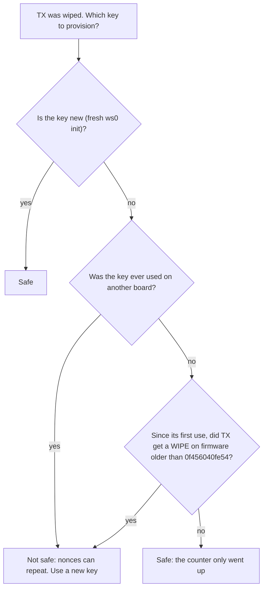
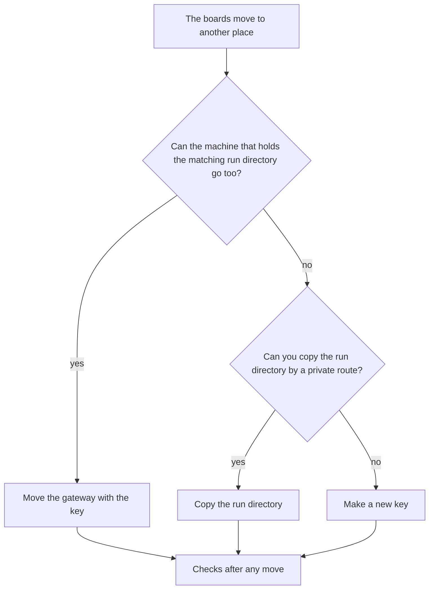

# Runbook: moving the boards between gateways

Use this runbook when the transmitter (TX) and receiver (RX) boards move between machines (for
example office ↔ home). Written 2026-10-13. Each rule below names the code that implements it,
so you can check it again.

## The rule that matters

Use a TX key only with a counter that only goes up.

- The AES-CCM nonce is kind + station ID + the transmission counter, a 40-bit value (`header()`
  in `firmware/common/ws_frame.c`, `docs/protocol.md` section 1).
- `PROVISION … [epoch_floor]` raises only the **epoch** (`App/node_store.c`,
  `store_epoch_floor`). The epoch keeps observation identities unique. The floor does not raise
  the counter.

What `WIPE ERASE-ALL-NODE-STATE` erases depends on the firmware (`App/node_store.c`, `store_wipe`):

- **Before release `0f456040fe54`:** the key, the counters and the journal. The counter restarted at 1.
- **From `0f456040fe54` on:** the key and the journal only. The counter and the epoch keep
  rising for the life of the board.

| After a WIPE, provision with… | Safe? |
|---|---|
| a **new** key (`python -m ws0 init --hardware` into a new directory) | Yes, always |
| a key used only on this board, with a counter that never went back since its first use. This means no WIPE under firmware older than `0f456040fe54` after that first use. Example: the office key `b7142e`, first used after the morning wipe | Yes: the counter only went up |
| a key that TX used before a WIPE on firmware older than `0f456040fe54`, or a key used on another board. Example: the key in `run-hw`, used before the morning office wipe | **No**: it can repeat nonces already sent on air |



Prefer a new key. A new key is never wrong.

A run directory holds the key (`gateway.json`), the observation database and the gateway's own
nonce state. Git ignores it (`run*/`). Move it only by a private route (AirDrop, USB stick).
Never move it by git, chat or email.

## Know which key TX has

```sh
.venv/bin/python tools/console.py 003B00194142500E20353451 STATUS   # read kcv=… in the #status line
# or interactively:
.venv/bin/python -m serial.tools.list_ports -v            # TX = SER=003B00194142500E20353451
.venv/bin/python -m serial.tools.miniterm /dev/cu.usbmodem<TX> 115200
#   type STATUS and read kcv=… (Ctrl-] quits)
```

The key check value (KCV) identifies a key without showing it. Known values: office `run-office`
(2026-10-13) = `b7142e`, `run-d5` (2026-10-14) = `5618eb`, `run-d7` (2026-10-19) = `6e30cf`
(`firmware/stage0-node/RELEASES.md`). The repo does not record the value of the home `run-hw` key. Compute it
on the home Mac. The gateway's KCV is `key_check()` of the key in `gateway.json`
(`ws0/__main__.py`).

## Choose how to move



### Move the gateway with the key (no re-provisioning)

Run the gateway on the machine that holds the matching run directory, wherever the boards are:

```sh
.venv/bin/python -m ws0 serve --directory run-office --serial-number 0016001E4142500E20353451
# or keep it running unattended (LaunchAgent; replaces any existing one):
tools/deploy/macos/install.sh install run-office 0016001E4142500E20353451
```

### Copy the run directory

1. Copy the run directory to the other machine by a private route.
2. Stop any other gateway for the same RX board. Only one process can hold the RX port, and a
   gateway with the wrong key rejects every frame.
3. Point that machine's gateway at the copy:
   `tools/deploy/macos/install.sh install <copied-dir> 0016001E4142500E20353451`.

### Make a new key

1. `.venv/bin/python -m ws0 init --hardware --station station-01 --station-id 1 --directory run-<new>`.
2. On TX, send `WIPE ERASE-ALL-NODE-STATE`.
3. `.venv/bin/python -m ws0 provision-node --directory run-<new> --serial /dev/cu.usbmodem<TX>`.

Readings then start a new history in the new directory.

## Changing the flash layout

A release that moves the meta log pages (`WS_META_PAGE_A`/`WS_META_PAGE_B` in `App/flash_layout.h`)
loses the counter. The old meta log pages become firmware or journal pages. So the new firmware
finds no meta log and starts the counter again at 1. The old key has already used those counters on
air, and re-using it would repeat nonces.

A change that only resizes the firmware region or the journal leaves pages 125-127 where they are.
The counter stays. Layout v3 (`649412a`) was a change like that.

`firmware/stage0-node/RELEASES.md` now lists a layout change as a format change, so steps a to g
there are the source of truth. Those steps always give you a new key in a new run directory. Here's
the order:

1. Keep the old gateway running until the TX console shows `pending=0` (`STATUS` or `#counts`).
2. Stop the gateway. Archive the old run directory. Its key is now retired, so don't provision it
   again.
3. Clint sends `WIPE ERASE-ALL-NODE-STATE` on TX.
4. Flash RX, then TX (`firmware/stage0-node/RELEASES.md`, "How to cut a release", step 5).
5. `.venv/bin/python -m ws0 init --hardware --station station-01 --station-id 1 --directory run-<new>`.
   This makes a new key.
6. `.venv/bin/python -m ws0 provision-node --directory run-<new> --serial /dev/cu.usbmodem<TX>`.
7. `.venv/bin/python -m ws0 serve --directory run-<new> --serial-number <RX serial>`.

Then do the checks below. `STATUS` on TX also shows `epoch=1` and a counter near 1.

The cc2766a layout change used an older order: stop the gateway, archive, flash RX then TX, WIPE,
init, provision-node, serve. RELEASES.md replaced that order later.

The WIPE in step 3 runs on the old firmware. It erases the old layout's journal pages and the
provisioning page, and nothing else. If the journal moved onto pages the old layout didn't use, the
new image can find leftover data there. Then PROVISION refuses with
`#error journal-not-empty (WIPE first)`. Send the WIPE once more on the new image and provision
again. If you skip step 3, PROVISION refuses the same way while old records are pending.

Until step 6, TX isn't provisioned. Old journal data on the provisioning page doesn't read as a
provisioning record. So TX sends nothing from the old layout.

## Changing the protocol version or the journal slot

Some releases change a format. That means the protocol version, the observation catalog, the
health report or the journal slot size. Protocol version 5 to 6 is an example. A release like that
needs more than a layout change.

Version 6 is such a release. Its node field set is 77 bytes of plaintext, so the journal slot grows
from 80 B to 96 B (power telemetry design section 7). The slot size is part of the journal page
magic. On its first boot, the new image finds no page of its own format. It **recycles every old
journal page**, and any record still pending is lost.

The TX and RX roles share `WS_FRAME_VERSION`. A board left on the old version drops every frame of
the new one. A gateway of the old release drops the new frames as another version (`VERSION` in
`ws0/protocol.py`, checked on byte 0). An old RX bridge drops them first, as `#rx drop`.

The procedure is the power telemetry design's section 4 release procedure. Steps a to g of "When
the release changes a format" in `firmware/stage0-node/RELEASES.md` write it out. In short:

0. **Drain first.** Keep the old gateway running on the old release until the TX console shows
   `pending=0` (`STATUS` or `#counts`). Don't move, re-key or reflash a TX that still has pending
   records. The WIPE and the new page magic both discard them for good.
1. Clint sends `WIPE ERASE-ALL-NODE-STATE` on TX.
2. Flash RX, then TX, **from the same release**.
3. `init` a new run directory (a new key). The old directory and its database stay with the old
   release. There's no migration. Never reuse the live run directory or an evidence directory.
4. `provision-node` with the new key. Start the gateway of the same release on the new directory.
5. Record the release in RELEASES.md. Name the protocol version, field set, power phase and rails,
   and I2C profile. Also name the old and new run directories and any one-time actions, such as
   Home Assistant entities to remove.

What if you move the boards between gateways and cross a format change at the same time? No
document spells out that case. Our best reading of RELEASES.md step a is this: drain on the old
gateway first, then follow this section on the new one.

## Checks after any move

- `STATUS` on TX shows `provisioned=1` and the expected `kcv`.
- The gateway status shows frames accepted and none rejected. Run
  `.venv/bin/python tools/status.py --directory <dir>`.
  `accepted_this_process` goes up, and `rejected_this_process` stays 0.
- TX shows a green LED after each blue flash (ACK received).
- **The versions match.**
  - The TX and RX `#boot` lines show the same `fw=` release. This is the check that catches a TX
    and an RX built for different versions.
  - TX shows `kat=pass`. That means the TX's own known-answer vectors match its own protocol
    version. A build whose version changed without new vectors fails `kat=` and doesn't transmit.
  - The gateway is the same release. Its records carry `version` equal to `RECORD_VERSION`
    (`gateway.py`), which you can see in `/v1/observations/latest`.
  - The RX drops frames of another version. They show as `#rx drop` lines, in the gateway's
    `rx_drop` count and as `radio_events` rows with outcome `dropped_by_rx`. They're never stored
    as readings. Only CRC-failed captures whose byte 0 belongs to the previous version show in
    `tools/rx_faults.py` as "ours (previous version)".
- After a format change, the first health report arrives within 15 minutes and is 64 bytes
  (version 6). `/v1/status` `node_diagnostics` carries `boots_since_power_up` and the power keys.

## Bench notes

- A USB dropout of about 1 s makes the ST-LINK reset its board. This happened on both boards
  (`docs/hardware/nucleo-wl55jc-bringup.md`, "Office session"). Seat the cables firmly. For long
  runs, don't touch them.
- Port names (`/dev/cu.usbmodem…`) follow the USB socket, not the board. Always identify a board
  by its ST-LINK serial number.
- **USB topology** (build-progression record H8, 7.1 Q5). On 2026-10-28/29 both NUCLEOs shared one
  hub, and unplugging one stalled the other's serial port on the Mac: open but silent (record F6).
  - The RX gateway NUCLEO goes alone on a direct Mac port. Never unplug or replug it during a run.
  - The TX and any other bench board go on another port or hub. Replug them only there, at the
    board end.
  - Label each USB cable with its board's ST-LINK serial number.
  - Acceptance (H8(d)): log both boards, unplug and replug the TX 5 times, and find no gap in the
    RX log. Use a powered hub only if this test fails.
  - If the RX port still goes silent, the gateway reopens it after 90 s of silence (doubling to
    400 s) and logs a `serial-reopen` event. `receiver-silent` at 180 s stays the outer alarm.
