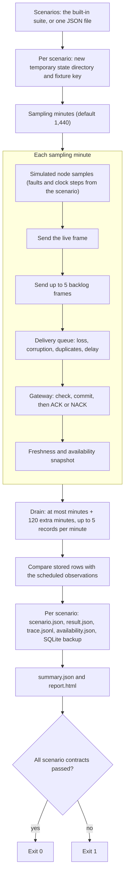

# Simulation harness for the bench data path

Run `python -m ws0.harness --output my-results` from the project root. The harness uses the
installed gateway dependencies and a virtual clock. It uses no device, radio transmission,
network listener, MQTT broker or cloud service.

The harness tests the protocol and the gateway before and between hardware runs. It cannot
replace the 24-hour delivery test on the real boards (H01, [`H01-checklist.md`](H01-checklist.md)).

## Pipeline

## Model boundary

The real Python components run unchanged:

- observation encode and decode,
- AES-CCM authentication and durable nonce allocation,
- the node journal and the SQLite storage,
- commit-before-ACK, backfill, identity deduplication and freshness.

The harness replaces the physical sensor, the clock, packet delivery and selected failure
sources. A simulated reboot closes and reopens the real node and gateway objects and their
database connections. Packets in flight stay in the delivery queue.

The harness is a discrete-event model. It is not an STM32 instruction emulator or a radio
simulator. Independent random (Bernoulli) loss is a test stimulus, not an estimate of a real
channel. Host SQLite persistence does not prove that the MCU flash survives power loss.

The harness sets `WS0_UNSAFE_FAST_FSYNC=1` by default. This setting skips the slow drive-cache
flush, because the harness models restarts, not power loss.

The harness does not model these items:

- radio receive windows, airtime, duty cycle, interference, RSSI and SNR,
- firmware concurrency, power and current,
- journal overflow,
- enclosure and environmental effects.

The serial line adapter, the MQTT broker and Home Assistant are outside the harness. The unit
test suite has separate HTTP, C core and mocked MQTT tests.

## Built-in scenarios

| Scenario | Injection | Required result |
|---|---|---|
| baseline | None | Complete exact storage. At least 99% within 120 s |
| noisy-link (3 seeds) | 10% uplink loss, 10% ACK loss, 1% corruption, 15% duplicates, 0–20 s delay | Exact eventual recovery. Measure latency without assuming success. Since 2026-10-13 the gateway does not answer a duplicated or reordered copy (counter at or below its high-water mark). The harness counts these as expected `counter_regressions`. A real LoRa link cannot reorder frames, so this lowers only the simulated timeliness (about 1–2 points against `simulation-results/`) |
| radio-outage | Link unavailable during minutes 20–40 | Unavailable state and complete recovery. The full latency denominator stays. The 99% target is expected to fail (runs of 1 day or less) |
| host-outage | Host unavailable minutes 20–30, restart at 30 | Recovery from the node journal |
| reboots | Node, gateway and simultaneous restarts with delayed packets | Exact recovery, nonce continuity, at least 99% within 120 s |
| sensor-fault | Null or fault samples, minutes 20–25 | The gateway never presents a fault as a current valid measurement. Recovery. At least 99% within 120 s |
| clock-errors | Unknown clock minutes 20–25. +3600 s minutes 30–35 | Unavailable during bad-clock samples. A corrected clock recovers |
| reboot-during-outage | Link unavailable minutes 20–80. Node reboot at minute 50 (no clock until the link returns) | Every unsynchronized sample ends with a reconstructed or synchronized time. Complete recovery. The 99% target is expected to fail (runs of 1 day or less) |
| storage-failure | Database commit raises an error, minutes 20–25 | No ACK on a failed commit. The journal keeps the records, and they are recovered later |
| ack-loss | 50% ACK loss, 15% duplicates | Idempotent storage and eventual journal drainage. At least 99% within 120 s |
| identity-collision | Authenticated changed payload with an existing identity | The gateway rejects the collision (with an authenticated NACK) and keeps the original observation. At least 99% within 120 s |

## Scoring

Each default scenario schedules 1,440 one-minute samples. The denominator always counts every
sample. An observation is timely only when both conditions hold:

- it has a synchronized or gateway-reconstructed time within 5 s of the harness's acquisition
  clock,
- its first commit occurs within 120 s of acquisition.

Like the firmware, the simulated node has no trusted clock after a boot until its first
authentic ACK. Those samples rely on gateway reconstruction. The report gives them as
`reconstructed_time_samples` and `unresolved_time_samples`.

The harness counts sensor faults separately. Transport timeliness alone is not evidence that the
sensor worked.

Each minute, the simulated node sends the live sample first, then up to 5 older samples
(`BACKLOG_PER_MINUTE` in `ws0/simulator.py`). After the sampling window, the harness allows at
most `minutes + 120` extra drain minutes, at up to 5 records per minute. The report gives the
drain time separately. A complete eventual recovery does not erase late delivery. It also does
not pass a failed latency threshold.

## Difference from the firmware

The drain model is simpler than the firmware:

| Behavior | Simulated node | Board firmware |
|---|---|---|
| Backlog per minute | Up to 5, every minute, also while the link is down | Up to 5 in the NORMAL energy state, capped by airtime (`backlog_limit`, `firmware/common/ws_policy.c`) |
| Missed ACK | The minute's drain continues | The minute's drain stops at the first missed ACK |
| Link down | No change | After 3 silent minutes the node enters PROBING: live reading only, no backlog (`radio-energy-policy.md` §6) |

The harness does not model PROBING. Its outage latencies and drain times are therefore not
accurate for the firmware.

## Custom scenarios

Copy `examples/scenarios/custom-outage.json` and edit it.

- Every interval uses minute indices `[start, end)`.
- A clock-step interval has a third element: the offset in seconds.
- Rates are probabilities in [0,1].
- `seed` sets the packet fault choices.
- `node_reboots` and `gateway_reboots` list minute indices.

The harness maps the JSON strictly to the Scenario fields. A misspelled option fails. The harness
does not ignore it.

The harness records:

- every sampled expected identity and its true virtual acquisition time,
- raw encrypted frame sends, losses, arrivals, rejected packets and ACK events,
- freshness and availability at the end of every sampling minute,
- exact comparisons of stored payloads against scheduled observations,
- new-encryption nonce reuse (wire duplication of identical ciphertext is allowed),
- pending journal records, late and missing records, duplicate rows and recovery time.

`result.json` and the exit code report the declared scenario contract. Exit 0 means all
requested scenario contracts passed. Exit 1 means a contract failed. Input and configuration
errors also exit nonzero. `physical_H01` always stays `NOT RUN`.

## Reproducibility and evidence

Each scenario gets an isolated temporary state directory. Its key is a deterministic public
fixture key: `SHA256("PUBLIC-TEST-KEY/" + scenario_name)[:16]`. This key exists only for
repeatable test bytes. Never use these keys, or cloned simulation nonce state, for a device.
Real provisioning stays `python -m ws0 init`, which generates random local keys. Campaign
evidence contains no deployment secrets.

The output contains, per scenario, `scenario.json`, `result.json`, `trace.jsonl`,
`availability.json` and an SQLite backup. It also contains `summary.json` and a readable
`report.html`. Identical scenario inputs and source versions give identical event traces and
results. SQLite file bytes and wall-clock test timings can differ. The archive's source commit
and SHA256 manifest identify the code and evidence checkpoint.

Tests verify repeatability, outage denominator preservation, commit-failure recovery, detection
of corrupt or missing data, and a total-loss case that ends with failure.

`--negative-control` removes a row from the oracle input on purpose. It proves that the harness
reports a missing-data failure. It does not change stored evidence or the gateway code. Its
report identifies the negative control.

## Next hardware gate

Use this harness for regression tests of protocol and gateway changes. The boards are running,
and bench and office radio measurements exist (see `evidence/README.md`). Use the measured radio
loss and latency traces to write more scenarios. H01 still requires the real 24-hour placement
run, restarts, stale behavior and outage recovery in [`H01-checklist.md`](H01-checklist.md).
