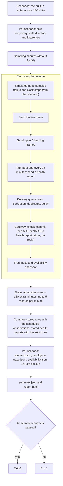

# Simulation harness for the bench data path

Run `python -m ws0.harness --output my-results` from the project root. Without `--output`, the
results go to `simulation-results/`. `--minutes` sets the sampling minutes (default 1,440), and
the built-in suite needs at least 120 minutes. `--scenario <file>` runs one JSON scenario instead
of the built-in suite.

The harness uses the installed gateway dependencies and a virtual clock. It doesn't use a device,
a radio transmission, a network listener, an MQTT broker or a cloud service.

You can use it to test the protocol and the gateway before and between hardware runs. It can't
replace the 24-hour delivery test on the real boards (H01, [`H01-checklist.md`](H01-checklist.md)).

## Pipeline

## Model boundary

These real Python components run unchanged:

- observation encode and decode, with the power fields and the extension bitmap,
- health report (kind 4, 64 bytes) pack, decode and storage (`Gateway.receive_diagnostic`),
- AES-CCM authentication and durable nonce allocation,
- the node journal and the SQLite storage,
- commit-before-ACK, backfill, identity deduplication and freshness.

The harness replaces the physical sensors, the power system, the clock, packet delivery and
some failure sources. A simulated reboot closes and reopens the real node and gateway objects and
their database connections. Packets in flight stay in the delivery queue.

It's a discrete-event model, not an STM32 instruction emulator or a radio simulator. Independent
random (Bernoulli) loss is a test stimulus. It isn't an estimate of a real channel. Host SQLite
persistence doesn't prove that the MCU flash survives power loss.

By default the harness sets `WS0_UNSAFE_FAST_FSYNC=1`. This setting skips the slow drive-cache
flush. That's fine here because the harness models restarts, not power loss.

The harness doesn't model these items:

- radio receive windows, airtime, duty cycle, interference, RSSI and SNR,
- firmware concurrency,
- power physics: the power values are synthetic (section "Power telemetry"),
- health reports after a link-state change, and health reports during the drain,
- journal overflow,
- enclosure and environmental effects.

The serial line adapter, the MQTT broker and Home Assistant are outside the harness. The unit
test suite has separate HTTP, C core and mocked MQTT tests.

## Built-in scenarios

| Scenario | Injection | Required result |
|---|---|---|
| baseline | None | Complete exact storage. At least 99% within 120 s |
| noisy-link (3 seeds) | 10% uplink loss, 10% ACK loss, 1% corruption, 15% duplicates, 0–20 s delay | Exact eventual recovery. Measure latency without assuming success. Since 2026-10-13 the gateway doesn't answer a duplicated or reordered copy (counter at or below its high-water mark). The harness counts exact duplicate copies as expected `replays` and reordered older copies as expected `counter_regressions`. A real LoRa link can't reorder frames, so this lowers only the simulated timeliness. The drop is about 1.5 to 2.5 points against the committed `simulation-results/` (99.24/98.82/99.03% then, 96.81/97.36/97.01% now, for seeds 7/73/2026) |
| radio-outage | Link unavailable during minutes 20–40 | Unavailable state and complete recovery. The full latency denominator stays. The 99% target is expected to fail (runs of 1 day or less) |
| host-outage | Host unavailable minutes 20–30, restart at 30 | Recovery from the node journal |
| reboots | Node, gateway and simultaneous restarts with delayed packets | Exact recovery, nonce continuity, at least 99% within 120 s |
| sensor-fault | Null or fault samples, minutes 20–25 | The gateway never presents a fault as a current valid measurement. Recovery. At least 99% within 120 s |
| clock-errors | Unknown clock minutes 20–25. +3600 s minutes 30–35 | Unavailable during the +3600 s samples. During the unknown-clock samples, unavailable unless the gateway shows a correctly reconstructed or synchronized time (within 5 s). A corrected clock recovers |
| reboot-during-outage | Link unavailable minutes 20–80. Node reboot at minute 50 (no clock until the link returns) | Every unsynchronized sample ends with a reconstructed or synchronized time. Complete recovery. The 99% target is expected to fail (runs of 1 day or less) |
| storage-failure | Database commit raises an error, minutes 20–25 | No ACK on a failed commit. The journal keeps the records, and they're recovered later |
| ack-loss | 50% ACK loss, 15% duplicates | Idempotent storage and eventual journal drainage. At least 99% within 120 s |
| identity-collision | Authenticated changed payload with an existing identity | The gateway rejects the collision (with an authenticated NACK) and keeps the original observation. At least 99% within 120 s |
| power-monitor-fault | The battery INA228 fails, minutes 20–40 (`monitor_faults`) | Its fields are stored present as `null`, never absent. The record is `partial`. The health reports keep every key, with `power_monitor_temp_c` `null`. At least 99% within 120 s |
| phase-b-rails | `power_profile` `B`: every rail, USB-C in the extension bitmap | Every rail stored exactly. At least 99% within 120 s |

Every scenario also checks the power fields and the health reports (section "Power telemetry").

## Power telemetry

The simulated node (`ws0/simulator.py`, `Node.power` and `Node.health`) sends the phase A power
set of the power telemetry design (`docs/superpowers/specs/2026-10-29-power-telemetry-design.md`
sections 3 and 6.1). The values follow a made-up day/night pattern. They're synthetic, not a
model of the pack, the charger or the INA228. So the harness covers how the power data is
decoded, stored and exposed, not its physics.

| Data | Cadence | Fields or keys | Phase A content |
|---|---|---|---|
| Observation | every minute | `batt_mv`, `batt_current_ma` (signed, + charging), `energy_in_mwh`, `energy_out_mwh`, `charge_in_mah`, `charge_out_mah`, `load_mv`, `charger_input_mv` | all present |
| Observation | every minute | `load_current_ma`, `solar_mv`, `solar_current_ma`, `usb_mv`, `usb_current_ma` | absent (not in the record, never `null`) |
| Health report | after each node boot, then every 15 minutes, after the minute's exchange | every key of `ws0.service.HEALTH_KEYS` | SOC and rate, charger status, `charger_reported_battery_ma`, monitor temperature, MCU supply, station counters. `charger_reported_input_mv`, `charger_reported_input_ma`, `charger_reported_battery_mv`, `charger_temp_c`, `pack_temp_c`, `charger_stage`, `charger_active_input` and `last_crash_pc` are `null`. The fitted byte is 0x2F (phase A), so those power keys are in `power_not_measured` and `power_sensor_faults` is empty. The first boot (epoch 1) is a power-on with `boots_since_power_up` 1. Each simulated reboot is a pin reset that keeps counting (epoch n reports n), as `fault_boot_note` does |

Scenario options (`ws0/harness.py`, `Scenario`):

| Option | Default | Effect |
|---|---|---|
| `monitor_faults` | `[]` | Minute intervals in which the battery INA228 fails. Its fields (`batt_current_ma`, the four counters and, in profile `A`, `load_mv`) are sent INVALID and stored `null`. `batt_mv` (the gauge) and `charger_input_mv` (the divider) stay valid. A health report sent in the interval has `power_monitor_temp_c` `null` |
| `power_profile` | `A` | `A`: the phase A set, the phase B rails absent. `B`: adds the five phase B rails (solar carries the charger input, USB-C 0 mV and 0 mA, never both connected). `load_mv` then comes from the load monitor, so a battery-monitor fault leaves it valid |

What the verdict checks:

| Check | Failure label |
|---|---|
| The power fields of every stored row equal the sent ones: same keys present, same values, `null` where the node sent INVALID (`assess`, `power_mismatches`) | `power_mismatches` |
| Every health report whose frame reached the gateway intact outside an outage is stored once under (epoch, uptime) | `health_reports_not_stored` |
| Every stored health report was sent, carries exactly the keys of `HEALTH_KEYS`, and matches the simulated truth at its send time: the not-measured keys `null`, the charger booleans, the charger-reported charge current, the SOC within 1/256 % and its rate within 0.05 %/h, the monitor temperature `null` exactly in a monitor fault, the counters | `health_report_mismatches` |

A health report has no journal (design section 6.4), so a report that the link loses isn't a
failure. `result.json` gives `health_reports` with `sent`, `arrived_intact` and `stored` as
counts. `not_stored` and `mismatches` are lists: the (epoch, uptime) of each report, and for
`mismatches` the failing keys or `not_sent` after it. A health report uses the node's one frame
counter, so the counter and replay oracles cover it too.

## Scoring

Each default scenario schedules 1,440 one-minute samples. The denominator always counts every
sample. An observation is timely only when both of these are true:

- it has a synchronized or gateway-reconstructed time within 5 s of the harness's acquisition
  clock,
- its first commit happens within 120 s of acquisition.

After a boot, the simulated node has no trusted clock until its first authentic ACK. Those
samples rely on gateway reconstruction. The firmware also loses its clock when a power loss
clears the RTC backup domain. We've only tested that with a simulated backup-domain reset, and a
real power-removal test is still open (`protocol-stack.md` section 11.3.1). After a warm reset,
the firmware can keep its clock (same section). The report gives these samples as
`reconstructed_time_samples` and `unresolved_time_samples`.

The harness counts sensor faults separately in `sensor_fault_samples`. That's every sample whose
quality isn't `valid`, so a minute with a failed power monitor counts too. On-time transport alone
doesn't show that the sensor worked.

Each minute, the simulated node sends the live sample first, then up to 5 older samples
(`BACKLOG_PER_MINUTE` in `ws0/simulator.py`). After the sampling window, the harness allows at
most `minutes + 120` extra drain minutes, at up to 5 records per minute. The report gives the
drain time separately. Late delivery still counts as late, even after complete recovery. And
complete recovery doesn't turn a failed latency threshold into a pass.

## Difference from the firmware

The drain model is simpler than the firmware:

| Behavior | Simulated node | Board firmware |
|---|---|---|
| Backlog per minute | Up to 5, every minute, also while the link is down | Up to 5 in the NORMAL energy state, capped by airtime (`backlog_limit`, `firmware/common/ws_policy.c`) |
| Missed ACK | The minute's drain continues | The node sends one more frame, then stops the minute's drain. A second miss in a row or a transmit timeout stops it at once |
| Link down | No change | After 3 silent minutes the node enters PROBING: live reading only, no backlog (`radio-energy-policy.md` §6) |

The harness doesn't model PROBING. So its outage latencies and drain times aren't accurate for
the firmware.

## Custom scenarios

Copy `examples/scenarios/custom-outage.json` and edit it.

- Every interval uses minute indices `[start, end)`.
- A clock-step interval has a third element: the offset in seconds.
- Rates are probabilities in [0,1].
- `seed` sets the packet fault choices.
- `node_reboots` and `gateway_reboots` list minute indices.
- `monitor_faults` is a list of intervals.
- `power_profile` is `A` or `B`.

The harness maps the JSON strictly to the Scenario fields. A misspelled option fails. The
harness doesn't ignore it.

The harness records:

- every sampled expected identity and its true virtual acquisition time,
- raw encrypted frame sends, losses, arrivals, rejected packets and ACK events,
- freshness and availability at the end of every sampling minute,
- exact comparisons of stored payloads against scheduled observations, with the power fields
  compared on their own,
- every health report sent, and its comparison with the stored report,
- nonce reuse by a new encryption (the link can duplicate the same ciphertext byte for byte, and
  that's fine),
- pending journal records, missing records, duplicate rows, the on-time count and maximum
  latency, and the drain minutes after the sampling window.

You can read recovery from `availability.json`.

`result.json` and the exit code report the declared scenario contract. Exit 0 means all
requested scenario contracts passed. Exit 1 means a contract failed. Input and configuration
errors also exit nonzero. `physical_H01` always stays `NOT RUN`.

## Reproducibility and evidence

Each scenario gets an isolated temporary state directory. Its key is a deterministic public
fixture key: `SHA256("PUBLIC-TEST-KEY/" + scenario_name)[:16]`. This key exists only to get
repeatable test bytes. Never use these keys, or cloned simulation nonce state, for a device.

Real provisioning stays `python -m ws0 init`, which generates random local keys. Campaign
evidence contains no deployment secrets.

The output has, per scenario, `scenario.json`, `result.json`, `trace.jsonl`,
`availability.json` and an SQLite backup. It also has `summary.json` and a readable
`report.html`. The same scenario inputs and source versions give the same event traces and
results. SQLite file bytes and wall-clock test timings can differ. The archive's source commit
and SHA256 manifest identify the code and evidence checkpoint.

The tests in `tests/test_harness.py` check these things:

- repeatability,
- the outage denominator stays whole,
- commit-failure recovery,
- detection of corrupt or missing data,
- a total-loss case that ends with failure,
- the phase A power set in storage, with the phase B rails absent,
- the 15-minute health reports with every key and their `null`s,
- a health report after a node reboot,
- the faulted-monitor and profile `B` options,
- detection of a dropped or changed health report.

`--negative-control` removes a row from the oracle input on purpose. This shows that the harness
reports a missing-data failure. It doesn't change stored evidence or the gateway code.
`result.json` and `summary.json` mark the run with `negative_control: true`. `report.html`
doesn't mark it.

## Next hardware gate

Use this harness for regression tests of protocol and gateway changes. The boards run now, and
we have bench and office radio measurements (see `evidence/README.md`). Use the measured radio
loss and latency traces to write more scenarios. H01 still needs the real 24-hour placement run,
restarts, stale behavior and outage recovery in [`H01-checklist.md`](H01-checklist.md).
