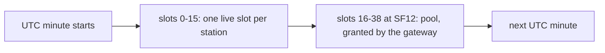
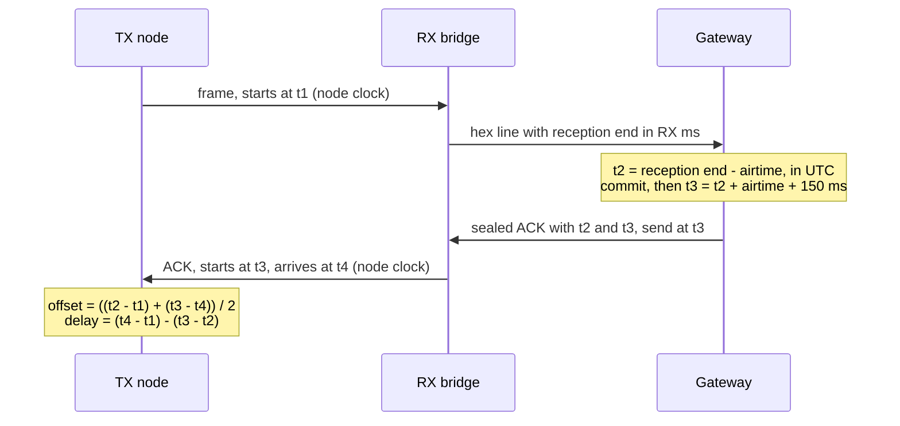
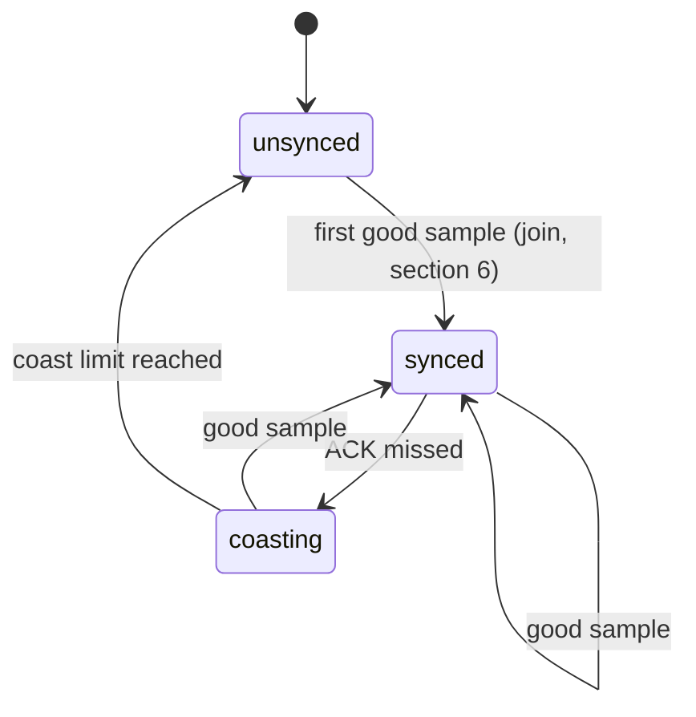
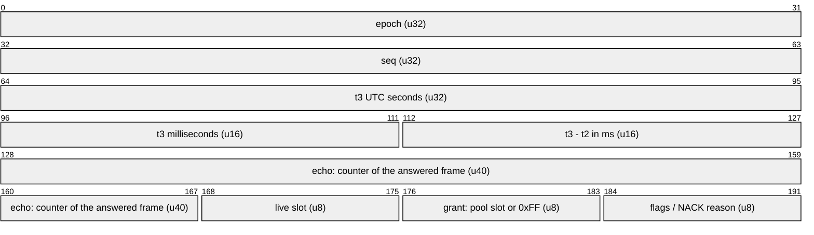
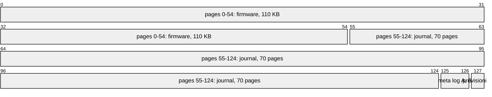
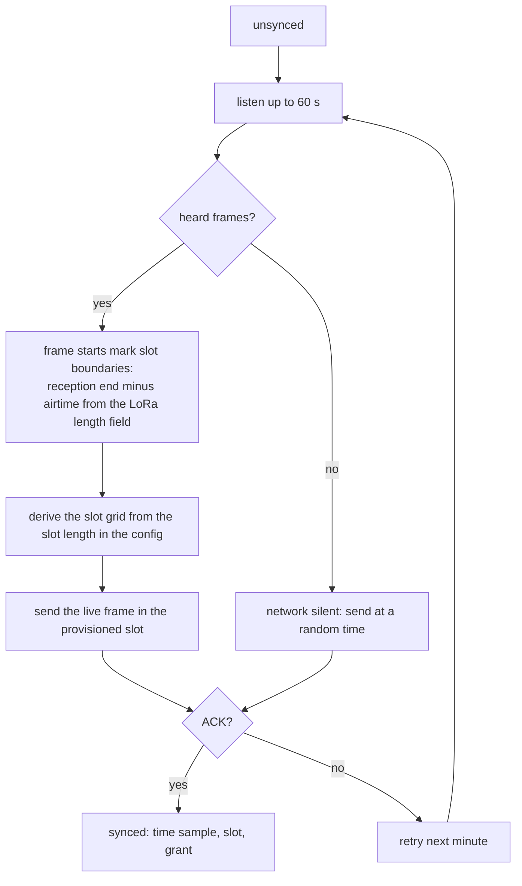
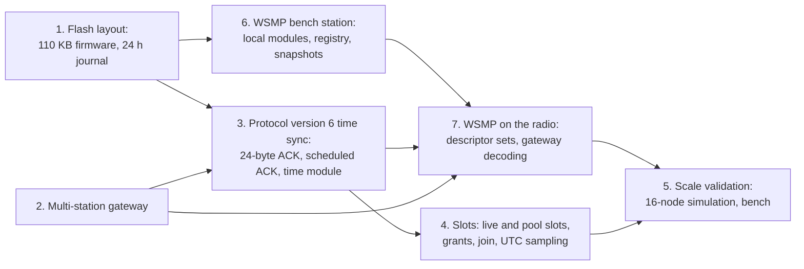

# Sixteen stations on one receiver: design

Status: design, approved section by section on 2026-10-16. Not implemented. Each sub-project in
section 9 gets its own spec, plan and implementation.

## 1. Goal and constraints

Support up to 16 fully equipped stations reliably on one single-channel receiver. Design for the
worst case: every station at spreading factor 12 (SF12) on a 500 kHz channel.

| | Decision |
|---|---|
| Receiver | one RX bridge with one radio, one channel. No multi-channel gateway hardware. |
| Spreading factor | one network-wide SF for every station and the RX bridge, set in the gateway config. |
| Station | full sensor set. Its modules follow WSMP ([`docs/module-protocol.md`](../../module-protocol.md)). The minute reading of the bench station is about 46 bytes of plaintext (a 62-byte frame). The radio ceiling stays a 78-byte plaintext in a 94-byte frame. |
| Traffic | one live reading a minute per station, as today. |
| Reliable | every station meets the 24-hour delivery test (H01, `docs/H01-checklist.md`): at least 99 % of minutes committed within 120 s. |
| Backlog | live readings come first. Backlog drains only in spare capacity, with no deadline. |
| Outage buffer | at least 24 hours for a full station. |
| Regulation | US 915 MHz, FCC §15.247 digital modulation at 500 kHz (no duty-cycle limit). |
| Compatibility | greenfield: a new protocol version, every board reflashed and re-provisioned. |

Why the current design cannot do this: every node transmits on a fixed 60-second grid. Its own
boot time sets the grid, and there is no jitter or schedule. At SF12 one full exchange (frame and ACK) takes about
1.3 s, and 16 stations keep the channel busy 34 % of each minute. Two exchanges that overlap once
overlap every minute for hours. With random timing instead, 65 % of exchanges would collide.

## 2. Approach

Gateway-scheduled time slots with one authenticated ACK per frame (approach A). The minute is
split into fixed slots on the UTC clock. Each station owns one live slot. The gateway grants the
remaining slots, one at a time, to stations that have backlog or a health report waiting.

Rejected:

- **One group ACK (beacon) per minute.** It saves ACK airtime. But one missed beacon makes all 16
  stations resend. Authenticating it per station takes one tag each, about 128 bytes, so the
  beacon is about 1.5 s long at SF12. That removes most of the saving.
- **Slotted random access** (each station picks a random slot each minute). With 16 stations in 39
  slots, about 34 % of minutes collide.
- **Mixed spreading factors.** The receiver decodes one SF at a time. Slots would allow the RX
  bridge to retune between slots, but 16 stations already fit at SF12, so this stays out. The slot
  design does not prevent adding it later.

## 3. Slots

A slot holds one exchange: the frame, the gateway turnaround, the ACK and a guard.

```text
slot = frame airtime + 150 ms turnaround + ACK airtime + 100 ms guard
```

Airtimes use the firmware's Semtech formula (`firmware/common/ws_policy.c`), rounded up to whole
milliseconds, for a 94-byte frame and the 40-byte ACK of section 5:

| SF | Frame | ACK | Health report | Slot | Slots a minute | Pool slots with 16 live |
|---|---:|---:|---:|---:|---:|---:|
| 7 | 42 ms | 21 ms | 25 ms | 313 ms | 191 | 175 |
| 8 | 72 ms | 39 ms | 44 ms | 361 ms | 166 | 150 |
| 9 | 134 ms | 72 ms | 78 ms | 456 ms | 131 | 115 |
| 10 | 237 ms | 134 ms | 144 ms | 621 ms | 96 | 80 |
| 11 | 452 ms | 247 ms | 268 ms | 949 ms | 63 | 47 |
| 12 | 822 ms | 453 ms | 494 ms | 1,525 ms | 39 | 23 |

- **Live slots** are slots 0 to 15. Each station uses its own every minute, so a live reading
  never contends with another transmission.
- **Pool slots** are the rest, plus any live slot no station uses. The gateway grants them.
- **Slots stay sized for the 94-byte ceiling.** The WSMP minute reading is smaller: a 62-byte frame
  takes 617 ms at SF12. The ceiling lets any slot carry a health report with the battery channels
  (about 68 bytes), a descriptor-set fragment or a later sensor. A slot sized for the real frame
  (1,320 ms at SF12, 45 slots) is a later option.
- Slot k of a minute starts at the UTC minute + k × slot length.
- The guard covers clock error and timing jitter. The 150 ms turnaround is a target that
  sub-project 3 measures (section 10). If it misses, the slot grows: 1.6 s at SF12 still gives
  37 slots.



## 4. Time synchronisation (modelled on NTP)

**Hierarchy.** The gateway host keeps UTC by NTP (`ws0/clock.py` checks it). The gateway models the
RX bridge's millisecond clock against UTC (offset and rate). Nodes synchronise to the gateway. The
slot grid is UTC, so every node and the gateway agree on where a slot starts.

**Four timestamps per exchange**, as in NTP:

| | Meaning | Clock |
|---|---|---|
| t1 | the node starts its frame | node |
| t2 | the frame starts at the RX bridge: reception end minus the known airtime | RX bridge, converted to UTC by the gateway |
| t3 | the ACK starts at the RX bridge | UTC, chosen by the gateway |
| t4 | the ACK starts at the node: reception end minus the known airtime | node |

The gateway cannot measure t3 and still put it in a sealed ACK. So it schedules it: t3 = t2 + frame
airtime + 150 ms. It seals t3 into the ACK, and the RX bridge transmits at exactly t3.



The airtimes are deterministic, so the delay is near zero. A large delay marks a bad sample.

**Filtering on the node**, as in NTP:

- **Clock filter.** Keep the last 8 samples. Use the sample with the smallest delay.
- **Frequency discipline.** Estimate the crystal drift in ppm from the offsets over time. Correct
  for it between ACKs, so a node keeps its slot through many missed minutes.
- **Sanity checks.** Reject a sample with a delay over 20 ms. Accept an offset jump over 1 s only
  when two samples in a row confirm it.
- **Coast limit.** The time until the predicted error reaches the guard, from the drift estimate
  and its uncertainty. Without a drift estimate the worst case applies: 120 ppm is about 7 ms a
  minute, so about 12 minutes.



**Gateway grid discipline.** The gateway never steps its grid. It slews by at most 0.5 ms a second
when the host clock or the RX clock model changes. A host clock step therefore cannot throw every
node out of its slot.

**Gains.** Nodes get UTC within a few milliseconds instead of whole seconds. The node knows to the
millisecond when its ACK arrives, so its receive window shrinks from 2 s to about 50 ms. That
closes the open "blind 2 s ACK window" issue in `docs/failure-modes.md`.

## 5. Protocol version 6

Unchanged: the frame header layout (the version nibble becomes 6), the nonce, AES-CCM, the
observation catalog and the health report. WSMP replaces the catalog in its own later protocol step
(sub-project 7). Version 6 changes only the time sync, so a failed test points at one change.

**ACK and NACK plaintext: 17 bytes become 24 bytes.** The frame grows from 33 to 40 bytes.



| Field | Meaning |
|---|---|
| epoch, seq | the record being answered, as today |
| t3 seconds, t3 ms | UTC when this ACK starts on air |
| t3 − t2 | milliseconds from the frame's start at the RX bridge to t3 |
| echo | the counter of the frame being answered, as today. It binds the reply to the frame. |
| live slot | the live slot the gateway expects this station to use |
| grant | one pool slot this station may use in the next minute, or 0xFF for none |
| flags / reason | ACK: bit 0 set means "UTC not trusted" (the gateway measured its clock wrong). NACK: the reason, as today's `word` field. |

A NACK carries the timestamps too, so a refused record still synchronises the node.

**Observation flags byte.** Reserved bit 3 becomes "backlog pending". The gateway grants pool slots
only to a station that sets it, or whose health report is due. Bits 4 to 7 stay reserved.

**Node configuration.**

- The provisioning record gains a fifth double-word: the network SF and the provisioned live slot.
  The station double-word is still written last as the commit word.
- The `PROVISION` command gains the network SF and the slot. The gateway chooses the slot: the
  lowest one free in its station table.
- A slot moved by an ACK is stored in the meta log as a new record type whose latest record wins,
  not the highest. A reboot then resumes in the moved slot.

**Health reports** stay fire-and-forget, with no ACK. They use a granted pool slot instead of
following the live frame.

## 6. Node (TX) firmware

### 6.1 Flash layout (sub-project 1)

The node-state pages move to the top of flash. One boundary constant and the linker script set the
firmware region.



| Pages | Size | Contents |
|---|---|---|
| 0–54 | 110 KB | firmware. TX uses 58 KB today, so the 90 % guard leaves about 41 KB for this design and later sensor drivers. |
| 55–124 | 140 KB | journal: 70 pages |
| 125–126 | 4 KB | meta log A and B |
| 127 | 2 KB | provisioning record |

Journal capacity. Opening a page erases the oldest one, so 69 pages always hold records:

| Build | Plaintext | Slot | Slots a page | Records retained | Outage buffer |
|---|---:|---:|---:|---:|---:|
| full station (the 78-byte radio ceiling) | 78 B | 96 B | 21 | 1,449 | 24.2 h |
| temperature and humidity | 35 B | 56 B | 36 | 2,484 | 41.4 h |

### 6.2 Sampling on the UTC minute

Samples land at :00, :15, :30 and :45 of each UTC minute. The minute's report closes after the :45
sample and goes out in the node's live slot of the next minute. The worst-case latency
is about 39 s: 15 s, plus 22.9 s to the start of the last live slot (slot 15) at SF12, plus the
frame. That is inside the 120 s limit.

### 6.3 The exchange

| When | The node |
|---|---|
| its live slot | sends the live observation, with "backlog pending" set if the journal holds more. Then it listens for about 50 ms around t3. |
| on an ACK | acknowledges the record in the journal, takes a time sample, stores a moved slot, notes the grant |
| a granted pool slot, next minute | sends one backlog record (oldest first) or a due health report |
| no ACK | keeps the record pending and keeps its slot next minute |

Removed: the inter-frame gaps, the drain rule after a miss, the per-minute backlog limits and
airtime caps, and the probing back-off. The gateway's grants control the drain.

Kept:

- the journal and commit-before-ACK.
- the energy gates: CRITICAL never sends, and CONSERVE uses its own slot at most every 5 minutes.
- held readings while the radio is busy.
- the watchdog rules, re-derived for one exchange per slot.
- the strike rule, restated for slots. A record gets a strike when its frame got no reply. Another
  frame from the same station in the same minute must have got a reply.

### 6.4 Time module and join

The time module grows out of `App/tx_time.c`. It holds the clock filter, the drift estimate and the
trust states of section 4. It also holds a slot timer on the RTC, with 1/1024 s ticks (about 1 ms).

A node joins after boot, after its coast limit, or when its time is not trusted:



A forged frame heard during the listen can only mislead the grid estimate. That attempt misses and
the node retries, which is no worse than jamming.

### 6.5 Energy at SF12

About 0.12 Wh a day of radio per node for one exchange a minute, plus about 0.3 C for each join.
The station budget is 6 Wh a day.

## 7. RX bridge and gateway

### 7.1 RX bridge (holds no key)

- Every received frame line carries its reception end in RX milliseconds:
  `#rx obs rssi=... snr=... t=<ms>`. The `#alive` line carries the RX clock too.
- The host's ACK line gains a send time: `<hex> @<t3 in RX ms>`. The bridge arms a timer and
  transmits at exactly that time. A line that arrives less than 5 ms before t3 is dropped with
  `#tx late`. The record is already committed, so the node resends and the gateway's duplicate
  check absorbs it.
- One ACK on air at a time, as today. The slots make that automatic.
- The gateway sets the network SF after connecting: `RADIO sf=12`. Changing the SF needs no RX
  reflash.
- Unchanged: CRC deduplication, drop rules, the failure-line budget, relisten after silence and the
  dead-radio watchdog reset.

### 7.2 Gateway

- **Station table:** station ID, name, key check value, provisioned slot, current slot, and its own
  nonce databases. Keys stay in one file per station, mode 600, in the state directory. They never
  enter the database, the API or logs.
- **Routing:** the station field in the clear header selects the key. A frame from an unknown
  station is rejected and rate-limited like noise.
- **RX clock model:** offset and rate against UTC, fitted from the RX timestamps. Like NTP, the fit
  trusts the samples with the least USB delay. An RX `#boot` line resets the model.
- **Turnaround:** frame line in, unseal, commit, counter commit, compute t3, seal, ACK line out. The
  target is under 150 ms. The gateway records each frame's turnaround and alarms after more than 3 late
  ACKs in an hour.
- **Grant scheduler,** once a minute: the pool is the pool slots plus unused live slots. Eligible
  stations set "backlog pending" in their last observation or have a health report due. Grants go
  round-robin, at most one per station per ACK, so one long backlog cannot starve the others.
- **Slot moves:** only by an operator command, `ws0 move-slot`. The gateway reserves the old and the
  new slot until it hears the station in the new one.
- **Provisioning:** `ws0 provision-node --station-id N` creates the key, picks the lowest free slot
  and sends `PROVISION` with the SF and the slot. `ws0 remove-station` frees a slot after the
  operator confirms.
- **Dashboard, API, MQTT and Home Assistant:** a station selector and per-station topics
  (`.../<station>/...`). Each station shows its delivery status against the 24-hour test, and its
  timing health: offset, delay, late ACKs and grants served.
- Storage and freshness are already keyed by station.

## 8. Failure handling

| Failure | What happens | Recovery |
|---|---|---|
| Gateway or RX bridge down | Nodes journal and keep sending in their slots on drift-corrected clocks. After the coast limit they go unsynced. | When the gateway returns, synced nodes get ACKs again and unsynced nodes join by listening. Backlog drains through grants, live readings first. |
| Outage longer than the buffer | The oldest records are overwritten and counted in the lost total, as today. | 24 h is guaranteed for a full station. |
| RX bridge reboots | Its millisecond clock restarts. | The gateway refits its RX clock model from the next lines. The grid is UTC, so nodes are unaffected. |
| Gateway host clock wrong | Slot timing is unaffected, because all nodes follow the gateway. Reading timestamps would be wrong. | The ACK sets "UTC not trusted". Nodes keep their own reading time. |
| Host clock steps | A grid jump would throw every node out of its slot. | The gateway slews its grid at most 0.5 ms a second and never steps it. |
| ACK late | The RX bridge drops it with `#tx late`. The node resends next minute. | Logged per frame, with an alarm after more than 3 in an hour. The turnaround budget is network config, so raising it means re-provisioning. |
| Two stations in one slot | That slot keeps failing. | Provisioning enforces unique slots. Moves reserve both slots. The gateway alarms on repeated failed receptions in one slot. |
| Node drifts outside its guard | Its frames start to miss the slot. | It goes unsynced at the coast limit, before the drift reaches the guard, and joins again. |
| Node energy CRITICAL | The node stays silent. | Its slot stays reserved. |

Security is unchanged. Each station has its own key. The ACK's echo binds a reply to its frame.
Replay and key-reuse detection run per station. The gateway seals t3 inside the authenticated ACK.

## 9. Testing and acceptance

**Tests.**

- The simulator (`ws0/simulator.py`, `ws0/harness.py`) grows to N nodes on one channel. It models
  airtime per SF and collisions, where any overlap destroys both frames. It also models each node's
  crystal drift (random within ±120 ppm), the RX bridge clock, gateway turnaround with jitter, and
  outages of the gateway, the RX bridge and nodes. It runs the real gateway code, as today.
- Host harnesses run the real C. On TX they test the time module, join, grants and UTC-aligned
  sampling. On RX they test the scheduled ACK, `#tx late` and frame timestamps.
- Shared C and Python test vectors for the 24-byte ACK, as `tests/test_frame.py` has today.
- A mutation pass over the new code.
- Bench: the two real boards, with a clock offset and drift injected on TX. The other 14 stations
  come from the simulator.

**Acceptance** at SF12, 500 kHz, 16 full stations, 24 simulated hours with drift and jitter:

| Criterion | Target |
|---|---|
| Every station on time (the 24-hour delivery test, H01) | at least 99 % of minutes committed within 120 s |
| Collisions with a correct configuration | 0 |
| Slot timing error (frame start against slot start) | p99 under 20 ms |
| Time after the first ACK | node UTC within 10 ms of the gateway |
| Join after boot on a busy network | in its slot within 2 minutes, without a collision |
| 6-hour gateway outage | live readings on time within 2 minutes of the return; backlog drains with no live reading late |
| Late ACKs at the 150 ms budget | under 0.1 %, measured on the bench Mac |

## 10. Sub-projects



1. **Flash layout.** Firmware region 110 KB, a 70-page journal, the state pages at the top of
   flash. A prerequisite for the firmware work, and useful on its own.
2. **Multi-station gateway.** Station table, key files, routing, per-station provisioning,
   dashboard, MQTT and Home Assistant. Useful on its own: 2 or 3 stations on today's protocol. It
   uses the WSMP entity rule now (`<station>_<role>_<quantity>_<kind>`, WSMP-H1), so the Home
   Assistant history survives sub-project 7.
3. **Protocol version 6 time sync.** The 24-byte ACK, the four-timestamp exchange, the RX bridge's
   scheduled ACKs and timestamps, and the node time module. Still one station, so the time sync can
   be proved on the bench before slots exist.
4. **Slots.** Live and pool slots, grants, join, UTC-aligned sampling, removing the drain and
   probing logic, and the gateway scheduler.
5. **Scale validation.** The 16-node simulation and bench runs against the acceptance table, with
   WSMP readings.
6. **WSMP bench station.** The Plan B parts as local WSMP modules on one station: the registry file
   and its generator, the module driver interface, presence and admission, the latch at :50 and
   the snapshots. Until sub-project 7, the station maps its channels onto today's catalog fields, so
   the readings reach the gateway on today's protocol.
7. **WSMP on the radio.** The generation in the reading in place of the field bitmap, descriptor-set
   frames and their journal records, the health-class channels in the health report, and gateway
   decoding, derived values and Home Assistant mapping (WSMP sections 11 and 12).

Sub-projects 1 and 2 do not depend on each other and can run in either order. Sub-project 6 needs
only sub-project 1, so it can run beside 2 and 3.
