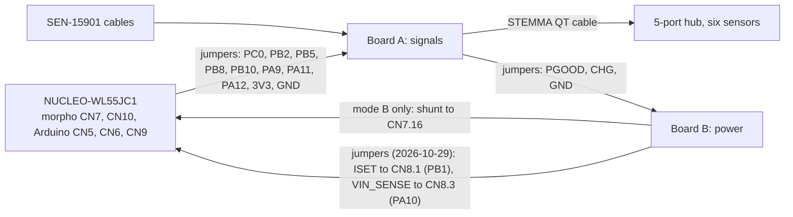
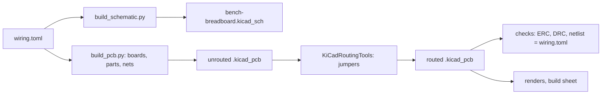

# Bench breadboard wiring map: design

Status: approved in chat 2026-10-19 (Clint). This spec is for review before a plan is written.

**Amended 2026-10-29** by the power telemetry design
([`2026-10-29-power-telemetry-design.md`](2026-10-29-power-telemetry-design.md), "PT" below, section
11.1). The bench power wiring proven on 2026-10-28/29
([`firmware/benchlink/README.md`](../../../firmware/benchlink/README.md) "Wiring") is the official
phase A design, and the breadboard model draws it. The approved body stands except where a dated
note says otherwise:

| Item | Change (2026-10-29) | Where |
|---|---|---|
| Nets | **ISET** (`mcu = "PB1"`: CHGR.ISET to CN8.1, A0, ADC1_IN5) and **VIN_SENSE** (`mcu = "PA10"`: the divider's tap to CN8.3, A2, ADC1_IN6); the divider R4 + R5 (two 10 kΩ 1 % in series) from CHGR_VBUS over R6 (10 kΩ 1 %) to GND, VIN = 3 × the pin | sections 2 and 4 |
| Header | CN8 (the ARDUINO analog header, 1 × 6, female: male-male jumpers) in the model, its label and its 3D header | section 3 |
| Leads | a `[[lead]]` construct (gauge, length): the battery path (cell + to INA228 VIN+, VIN− to the charger's LIPO, cell − to the charger's GND), the gauge's Kelvin sense pair and the charger input are short leads off the breadboard, never strips. *Superseded 2026-10-30 (header block above): WAGO joints, role-tagged leads, the charger's BATT socket, the gauge on CELL+ by its own lead* | sections 3 and 4 |
| Firmware check | `wiring.FIRMWARE` also maps `ISET_PIN` and `VIN_PIN` in the node's `App/board_inputs.c` and in `firmware/benchlink/App/benchlink.c` (the same MCU pins on the bench and in the field), checks a header or ADC channel named in the constant's comment, and checks that the file selects the pin's ADC1 channel | section 4 |
| Parts | three more 10 kΩ 1 % resistors (R4-R6), the NTC, the battery leads and JST PH pigtails; RTMR only if TMR floats | section 6 |
| Build sheet | the bench lessons as numbered power checks | section 6 |

**Amended 2026-10-30** by the build-progression decision record
([`2026-10-29-build-progression-decisions.md`](2026-10-29-build-progression-decisions.md), "BP"
below: decisions D1–D4, N2, N3, P1–P5) and Clint's answers of 2026-10-30 (BP section 7.1). The model
describes breadboard v2 (step 1) before the bench is touched (D1). These items supersede the body and
the text they name below by place (the 2026-10-29 block's Leads row; section 2's board table and
diagram; section 6's `build-sheet.md` output row, its "Parts still to get" paragraph and its power check
2). Places, not line numbers: the line numbers moved with each amendment. That text stays as history:

| Item | Change (2026-10-30) | Supersedes | BP |
|---|---|---|---|
| Power off the breadboard | no battery, charge, input or load current through any breadboard contact, header pin or Dupont contact. One tolerated exception, in mode B: the S7V8F3 regulator chain, each member tagged `exception = "P1 regulator"`. The force path is the pack → the cut #1131 pigtail → WAGO 222 CELL+ → the INA228 terminal (VIN+, 15 mΩ shunt, VIN−) → WAGO BATT → the charger's BATT socket (7.1 P3: change A as written); the SYSOUT socket → WAGO OUT (the 100 Ω load, the INA228 VBUS sense lead, the regulator VIN); one WAGO STAR at pack − with one TIE to logic ground. The gauge's red lead sits in its own CELL+ position, its minus unconnected, its ground over STEMMA QT. At step 1 the charger input is the breakout's USB-C from a floating wall adapter | the battery path to the charger's LIPO pin and the gauge's Kelvin pair (the 2026-10-29 block's Leads row); the power parts on board B (section 2's board table, row B); the JST PH pigtails and 20 AWG stranded leads (section 6, "Parts still to get"): now cut #1131 pigtail halves and 22 AWG solid | P1–P5 |
| Joints and leads | off-board parts are data (D2): `[[joint]]` (id, kind with part number, members; the WAGO CELL+, BATT, OUT and STAR) and `[[lead]]` (id, a, b; role force, sense, signal or supply; gauge; kind pigtail, solid, cable or dupont; length, max current, insulated, exception, domain). The breakout sockets and the INA228 terminal are pins; ground members carry `domain = "power"` or `"logic"`. The connectivity proof treats a joint as a node | the `[[lead]]` construct of 2026-10-29 | D2 |
| Checks | the D3 checks in `source/checks.py`, all without KiCad: (1) no force lead or member in a breadboard hole except the tagged P1 chain; (2) a sense lead never shares a clamp position with a force lead, and lands on its declared joint; (3) one conductor joins the power and logic ground domains, and no logic-supply current runs on the board-B ground rail; (4) the gauge sense is on CELL_POS, upstream of the shunt; (5) nothing but the shunt joins INA VIN+ and VIN−; (6) each breakout test-point pin is alone in its strip; (7) `check_guide` both ways; (8) the firmware pins of `board_inputs.c`, `benchlink.c` and the ISET/VIN constants, with trailing comment text allowed; (9) the firmware divider ratio equals the model's resistors | section 4's three checks gain these | D3 |
| Headers | no screw shield: every station signal lands on the NUCLEO's Arduino female headers with solid 22 AWG jumpers: CN9.5 (D4) cups, CN8.4 (A3) rain, CN8.2 (A1) vane, CN9.6 (D5) PGOOD, CN9.7 (D6) CHG, CN8.1 (A0) ISET, CN8.3 (A2) VIN_SENSE, CN5.2 (D9) PA9. The model draws CN8 and CN9. Only the bench OLED stays on morpho: its signals on CN10, its own supply pair on CN7.16 and CN10.20. Kapton "NO 5V" over CN6.5, CN6.8, CN7.18, CN7.24, CN7.6 and CN10.8 | "The NUCLEO morpho pins jumper straight to it" (section 2's board table, row A); the diagram's header list (section 2 diagram, the NUCLEO → board A jumper label) | N3 |
| Pin remap | cups PC0 → **PB5** (LPTIM1_IN1 on AF1; D4, CN9.5; morpho CN10.29); rain PB5 → **PB4** (EXTI4; A3, CN8.4; morpho CN7.34). Approved by Clint 2026-10-30 (7.1 N2); change B (BP 4.5), tagged `bench-bb-r0.2` | the pins in section 2's board table (row A) and diagram (the NUCLEO → board A jumper label); the example `W7 A:J14 → NUCLEO CN10.14 PC0, cups` (section 6, the `build-sheet.md` output row) shows the old map | N2 |
| Mode-B feed | the regulator → LK_REG_SHUNT → the BATTERY POWER shunt header → L_REG_3V3 → the unswitched board-A 3V3 node → LK_3V3_CN6_4 → **CN6.4**; the station return on its own lead from CN6.7 (L_NUC_RET). CN6.4 and CN7.16 are one 3V3 net (UM2592 Tables 17 and 18) | "mode B only: shunt to CN7.16" (section 2 diagram, the board B → NUCLEO edge) | N3, P1 |
| Regeneration | two tiers, both stamped with the `wiring.toml` git blob hash: `make.py sheet` (no KiCad: load, prove, checks, build sheet) on every commit that changes the model; `make.py all` (KiCad, router, renders, schematic PDF) at every step exit and whenever nets change. The build sheet prints both hashes, so a lagging render shows. It opens with a "Changes from the previous revision" section (what to remove, then what to add); W-numbers change on every regeneration, so the record names links and leads by their stable ids. Every bench rewire is one commit with the model and the regenerated sheet. Tags: `bench-bb-r0.1`, `r0.2` and `r0.3` after changes A, B and C | section 5's single generation flow | D4 |
| Power checks | the build sheet's section 6 holds BP 4.3's pre-run checklist (C1–C23, mode A and mode B); the ten checks of section 6 below are the 2026-10-29 history. Check 8 now follows step 1 exit 5: the gauge reads the CELL+ node | section 6 checks 1–10 | 4.3, M4 |
| R_ISET | R9 = 1 kΩ (record 1.4); adopted with change A, read by this workflow from 7.1 P3 "change A as written"; R_ISET confirmed by build-sheet check 2; Clint to confirm (design D4/D5); ICHG = 0.89 A typ | "R_ISET about 890 Ω inferred" (section 6, power check 2) | 1.4 |

## 1. Purpose

Clint wires the bench station's sensor suite to the TX board (NUCLEO-WL55JC1, board A) on
breadboards. He has three 830-point breadboards. This design makes a KiCad 10 model of that build:
a schematic, a breadboard-shaped PCB for each board, and jumper wires routed with
[KiCadRoutingTools](https://github.com/drandyhaas/KiCadRoutingTools). The outputs are pictures and
a build sheet that say which hole goes to which hole.

The electrical source of truth is [`docs/hardware/bench-station-wiring.md`](../../hardware/bench-station-wiring.md).
This design adds no circuit. It draws the circuits of that guide on breadboards.

Success:

- Clint can build board A and board B from the renders and the build sheet alone.
- Every connection in the wiring guide appears exactly once, and nothing else does.
- A wrong pin fails a check before Clint sees a picture.

Not in scope: a PCB to order, a protoboard layout, the W25Q128 flash, a custom PCB.

## 2. The boards

| Board | Carries | Why |
|---|---|---|
| A: signals | both RJ11 breakouts and their circuits (cups to PC0, vane to PB2, rain to PB5), the I2C2 entry to the STEMMA QT hub, PGOOD and CHG from the charger, the PA9 sensor power enable. *Superseded pins, 2026-10-30 (BP N2): cups to PB5 (LPTIM1_IN1 AF1, CN9.5), rain to PB4 (EXTI4, CN8.4)* | 3.3 V logic only. The NUCLEO morpho pins jumper straight to it. *Amended 2026-10-30 (BP N3): the Arduino female headers (CN5, CN6, CN8, CN9), not morpho* |
| B: power | bq24074 charger, Pololu S7V8F3 regulator, INA228 with its shunt in the cell's positive lead, MAX17048, the 100 Ω test load, the "BATTERY POWER" shunt jumper (wiring guide section 5). *Added 2026-10-29: the ISET line and the 20 kΩ / 10 kΩ charger input divider (R4-R6), both jumpered to the NUCLEO's CN8; the NTC on THERM; the 1S3P pack (6,600 mAh, 3.0-4.2 V), the gauge's sense pigtail and the charger's input source off the breadboard on leads* | Battery current flows here. The mode A to B change happens on this board only |
| spare | nothing | kept for the W25Q128 flash |

The six STEMMA QT sensors stay on their cables from the hub. Board A has only the hub's input
connection (SDA, SCL, 3V3, GND).

*Amended 2026-10-30 (BP N2, N3; header block):* the diagram above is the 2026-10-19 map. The
jumpers now land on the Arduino headers: cups on PB5 (CN9.5), rain on PB4 (CN8.4), vane CN8.2, PGOOD
CN9.6, CHG CN9.7, PA9 CN5.2. Mode B feeds **CN6.4** (not CN7.16) from the shunt through the
unswitched board-A 3V3 node, and the battery path, load and gauge leads are off the breadboard.

## 3. The breadboard model

An 830-point board is a PCB with these features:

- The 63 columns of terminal strips a–e and f–j. Each 5-hole strip is one net.
- Two power rails along each long edge, each one net for the full length.
- Holes on a 2.54 mm grid. The pad and drill sizes come from the generator. They need not match a real board, only its grid.

**Verify on the part:** some 830-point boards split each rail at the centre. If Clint's boards
do, the generator gets a "split rails" setting, and the build sheet adds the bridging jumpers.

Each part is a footprint whose pins sit on the holes it uses:

| Part | Footprint |
|---|---|
| SparkFun BOB-14021 (×2) | its header row, from the board's own pin order |
| Adafruit bq24074 #4755, INA228 #5832, MAX17048 #5580 | their header rows, from Adafruit's pinouts |
| Pololu S7V8F3 | its 4-pin header (EN, VIN, GND, VOUT; order from Pololu's page) |
| 10 kΩ resistors, 100 nF capacitors, 100 Ω ½ W load | axial or radial, 0.4 inch or 0.3 inch spans |
| STEMMA QT hub input | a 4-pin header (SDA, SCL, 3V3, GND) from a STEMMA QT to header cable |
| NUCLEO | its morpho and Arduino headers, placed beside board A at their real spacing (UM2592) |

*Amended 2026-10-29:* the Arduino headers include CN8 (A0-A5, female, male-male jumpers): CN8.1 = A0
= PB1 (ISET), CN8.3 = A2 = PA10 (VIN_SENSE), UM2592 Table 17. The divider R4-R6 are 10 kΩ 1 %
axial parts on board B; R4 is the only part on the strip of the charger's VBUS header pin (a
microamp sense tap). Parts that carry battery or input current, or sense the cell, are `off_board`
and join their nets by `[[lead]]`s (gauge and length in the file), never through a breadboard hole:
the pack, the gauge's JST PH sense pigtail and the charger's input source (the panel on the DC jack
or a USB-C cable, never both).

The datasheets give each pin order. The plan names the source page of each. A pin order that
the plan cannot confirm from a manufacturer page is listed as a bench check, not guessed.

## 4. One source of truth

A data file, `hardware/bench-breadboard-r0/source/wiring.toml`, lists:

- each net and its pins (part and pin name);
- the NUCLEO pin and header position of each MCU signal;
- the placement of each part (board, column, row);
- the jumper colours by net class (I2C, wind, rain, charger, power, ground).
- *added 2026-10-29:* the analog nets (ISET, VIN_SENSE) and the short heavy leads (`[[lead]]`: from,
  to, gauge, length) of the battery path, the gauge's sense and the charger input.

Three checks read it:

1. **Against the wiring guide:** each pin row in the guide's section 2 table appears with the same pin and header position.
2. **Against the firmware:** the MCU pins match the constants in `App/board_inputs.c` (`CUPS_PIN`, `VANE_PIN`, `RAIN_PIN`, `PGOOD_PIN`, `CHG_PIN`) and the I2C pins in `App/i2c_bus.lit.md`. *Amended 2026-10-29:* also `ISET_PIN` (PB1) and `VIN_PIN` (PA10) in the node's `App/board_inputs.c`, and the I2C, CHG, PGOOD, ISET and VIN pins of `firmware/benchlink/App/benchlink.c`, so the bench tool and the node use the same pins. A constant's comment may name its header pin and ADC channel (`/* PB1 = A0, CN8.1: ADC1_IN5 */`); both are checked against the model and UM2592 Table 17, and a net read by ADC1 (VANE, ISET, VIN_SENSE) fails unless the file selects its channel (`ADC_CHANNEL_5` for PB1, `ADC_CHANNEL_6` for PA10).
3. **Against the generated PCB:** the KiCad netlist has the same nets and pins as the file, no more and no fewer.

A change of pin is a change to the file, the guide and the firmware together, or a check fails.

## 5. Generation, routing and checks

- The generators run on the Python of KiCad 10.0.6 (`pcbnew`). The tests skip without KiCad, and `tools/gates.sh` reports the skip.
- KiCadRoutingTools is pinned to release **v0.23.1** (tag commit `a26048ab714e`) with its prebuilt
  `grid_router-macos-arm64.so`. `tools/fetch-vendor.sh` fetches it into `vendor/` (git-ignored)
  and checks the commit and the SHA-256 of the binary, as it does for STM32CubeWL.
- **Jumpers:** one track is one jumper wire. The router works on the 2.54 mm grid, with straight and 45° segments allowed. A jumper may cross another, as wires do: the two copper layers are only drawing layers. A jumper never lands on a hole that a part uses.
- **Checks:** ERC with 0 errors; DRC with 0 unconnected pads and 0 shorts; and the netlist check of section 4. The tests run all three.

## 6. Outputs

In `hardware/bench-breadboard-r0/`:

| Output | Content |
|---|---|
| `bench-breadboard.kicad_pro`, `.kicad_sch`, `.kicad_pcb` | the KiCad 10 project, editable |
| `renders/board-a.png`, `renders/board-b.png` | top views. Each jumper in its net-class colour, with its number |
| `renders/schematic.pdf` | the wiring schematic |
| `build-sheet.md` | each jumper and each part, hole by hole, in build order. Example: `W7  A:J14 → NUCLEO CN10.14  PC0, cups`. *Superseded 2026-10-30 (BP N2, N3, D4): cups now land on CN9.5 (PB5); the sheet also lists the leads and joints and opens with "Changes from the previous revision"* |
| `README.md` | how to regenerate, the checks, and the parts still to get |

The wiring guide links the renders and the build sheet from its section 1 (step 1, breadboard).

**Parts still to get** (in the README, not ordered): three 10 kΩ resistors, two 100 nF
capacitors, one 100 Ω ½ W resistor, jumper wires, a STEMMA QT to header cable, and a second
BOB-14021. The shopping list names one board and two jacks, and each meter cable needs a board.
*Amended 2026-10-29:* plus three more 10 kΩ 1 % resistors (R4-R6, the charger input divider),
male-male jumpers for CN8, the 10 kΩ NTC thermistor (#372), JST PH 2-pin pigtails (the pack's mating
socket and the gauge's sense pigtail) and 20 AWG stranded wire for the battery leads (*superseded 2026-10-30, BP P3 and section 5: cut #1131
pigtail halves, WAGO 222 lever connectors and 22 AWG solid*), and RTMR =
72 kΩ only if the board in hand has TMR floating (Adafruit's #4755 schematic ties TMR to GND: the
timers are disabled). The README keeps the current list.

**Build-sheet power checks** (added 2026-10-29, PT section 11.1; the bench lessons of 2026-10-28/29).
`build-sheet.md` lists them in this order; the value of check 2 goes to
`firmware/stage0-node/App/power_config.h`, and check 3's only if the shunt fails its check. *Amended
later on 2026-10-29 (PT sections 8.6, 11.2 and 2, records M1, P8, P9): checks 3, 7 and 10 below
follow the build-progression record; they said "shunt as V ÷ I", "total at most 50 mV" and "CHG off
and steady" only. The build sheet also has the phase B checks B1-B6 (PT section 11.3).*

| # | Check | Lesson or limit |
|---:|---|---|
| 1 | before power, no VBUS wire fitted: INA228 VBUS to VIN+ and to VIN− read open | the back VBUS-to-VIN+ jumper is cut |
| 2 | R_ISET, ISET to GND, the charger unpowered and the cell disconnected | ISET current = 400 × V_ISET ÷ R_ISET; R_ISET about 890 Ω inferred. *Amended 2026-10-30: R_ISET is R9 = 1 kΩ (record 1.4); adopted with change A, read by this workflow from 7.1 P3 "change A as written"; R_ISET confirmed by build-sheet check 2; Clint to confirm (design D4/D5)* |
| 3 | shunt verified, not measured: the INA228 battery current agrees with a series reference within 2 % + 2 mA; only on a fail does the reference-derived value (mV ÷ A, never an ohm range) replace 15 mΩ | a two-wire meter cannot resolve 15 mΩ better than its 1 % |
| 4 | ISET and VIN_SENSE read sensibly before the cell is fitted (VIN_SENSE × 3 within 2 % of a meter on VBUS) | the firmware's two new ADC inputs |
| 5 | TS about 0.75 V at 25 °C with input power present | the breakout's fixed 10 kΩ TS resistor is removed |
| 6 | CHG and PGOOD released, on the panel at its highest Voc, with the pull-ups on: both below min(VDD, VDDA) + 0.3 V | DS13293 table 26 note 3; the bench measured at most 2.9 V on USB |
| 7 | battery path in the first 10 minutes of a CC charge at 0.8–1.0 A, each span's mV drop over the INA228 current: + span at most 75 mΩ, − span at most 40 mΩ, each pack-side span at most 28 mΩ, each JST PH mating at most 20 mΩ, each clamp or screw at most 5 mΩ | a 0.2 Ω breadboard path ended 1 A charges early; stock JST PH pigtails cannot meet a 50 mΩ loop |
| 8 | gauge VCELL within 10 mV of a meter on the cell at 1 A | the gauge senses the cell, not OUT |
| 9 | during a charge below 4.1 V, OUT (`load_mv`) reads 4.3-4.5 V and at least 100 mV above VCELL | the INA228 VBUS jumper is on OUT and the back jumper is open |
| 10 | TMR reads 0 Ω to GND (charger unpowered); a 1 A charge ends with CHG off and steady, not flashing, while the INA228 battery current is 0.20–0.40 A and the cell is at 4.12 V or more | termination (ITERM about 0.3 A), not a safety-timer fault |

## 7. Risks

| Risk | Answer |
|---|---|
| A breakout's pin order is wrong in the model | The plan cites the manufacturer page for each. What it cannot cite becomes a bench check in the build sheet |
| The NUCLEO header positions are not yet checked (wiring guide section 6) | The renders mark the NUCLEO pins "check against UM2592". The model uses the guide's positions |
| The router cannot route on a 2.54 mm grid, or leaves a net | Fall back to straight point-to-point jumpers drawn by the generator, with the same checks |
| KiCad runs from a disk image that may not be mounted | The tests skip with a clear reason. `tools/gates.sh` says so |
| A battery-path or input net routed through a breadboard strip (added 2026-10-29) | `tests/test_breadboard.py` refuses it: those nets are leads only, and an off-board part's pin needs a lead |
| An ADC input on a pin without an ADC1 channel, or a firmware file that never selects it (added 2026-10-29) | the firmware check of section 4 fails before any picture is drawn |
