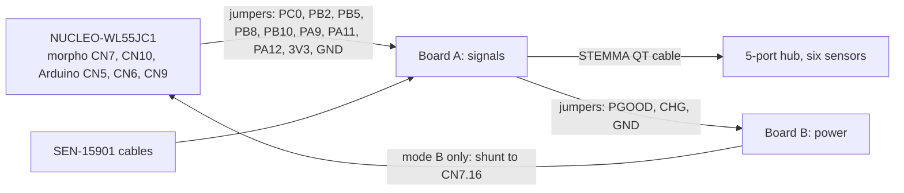
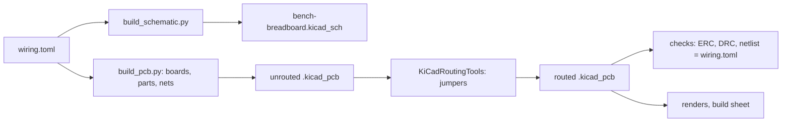

# Bench breadboard wiring map: design

Status: approved in chat 2026-10-19 (Clint). This spec is for review before a plan is written.

## 1. Purpose

Clint wires the bench station's sensor suite to the TX board (NUCLEO-WL55JC1, board A) on
breadboards. He has three 830-point breadboards. This design makes a KiCad 10 model of that build:
a schematic, a breadboard-shaped PCB for each board, and jumper wires routed with
[KiCadRoutingTools](https://github.com/drandyhaas/KiCadRoutingTools). The outputs are pictures and
a build sheet that say which hole goes to which hole.

The electrical source of truth is [`docs/hardware/bench-station-wiring.md`](../../hardware/bench-station-wiring.md).
This design adds no circuit. It draws the circuits of that guide on breadboards.

Success:

- Clint can build board A and board B from the renders and the build sheet alone.
- Every connection in the wiring guide appears exactly once, and nothing else does.
- A wrong pin fails a check before Clint sees a picture.

Not in scope: a PCB to order, a protoboard layout, the W25Q128 flash, the custom PCB of build step 3.

## 2. The boards

| Board | Carries | Why |
|---|---|---|
| A: signals | both RJ11 breakouts and their circuits (cups to PC0, vane to PB2, rain to PB5), the I2C2 entry to the STEMMA QT hub, PGOOD and CHG from the charger, the PA9 sensor power enable | 3.3 V logic only. The NUCLEO morpho pins jumper straight to it |
| B: power | bq24074 charger, Pololu S7V8F3 regulator, INA228 with its shunt in the cell's positive lead, MAX17048, the 100 Ω test load, the "BATTERY POWER" shunt jumper (wiring guide section 5) | Battery current flows here. The mode A to B change happens on this board only |
| spare | nothing | kept for the W25Q128 flash |

The six STEMMA QT sensors stay on their cables from the hub. Board A has only the hub's input
connection (SDA, SCL, 3V3, GND).

## 3. The breadboard model

An 830-point board is a PCB with these features:

- The 63 columns of terminal strips a–e and f–j. Each 5-hole strip is one net.
- Two power rails along each long edge, each one net for the full length.
- Holes on a 2.54 mm grid. The pad and drill sizes come from the generator. They need not match a real board, only its grid.

**Verify on the part:** some 830-point boards split each rail at the centre. If Clint's boards
do, the generator gets a "split rails" setting, and the build sheet adds the bridging jumpers.

Each part is a footprint whose pins sit on the holes it uses:

| Part | Footprint |
|---|---|
| SparkFun BOB-14021 (×2) | its header row, from the board's own pin order |
| Adafruit bq24074 #4755, INA228 #5832, MAX17048 #5580 | their header rows, from Adafruit's pinouts |
| Pololu S7V8F3 | its 4-pin header (EN, VIN, GND, VOUT; order from Pololu's page) |
| 10 kΩ resistors, 100 nF capacitors, 100 Ω ½ W load | axial or radial, 0.4 inch or 0.3 inch spans |
| STEMMA QT hub input | a 4-pin header (SDA, SCL, 3V3, GND) from a STEMMA QT to header cable |
| NUCLEO | its morpho and Arduino headers, placed beside board A at their real spacing (UM2592) |

The datasheets give each pin order. The plan names the source page of each. A pin order that
the plan cannot confirm from a manufacturer page is listed as a bench check, not guessed.

## 4. One source of truth

A data file, `hardware/bench-breadboard-r0/source/wiring.toml`, lists:

- each net and its pins (part and pin name);
- the NUCLEO pin and header position of each MCU signal;
- the placement of each part (board, column, row);
- the jumper colours by net class (I2C, wind, rain, charger, power, ground).

Three checks read it:

1. **Against the wiring guide:** each pin row in the guide's section 2 table appears with the same pin and header position.
2. **Against the firmware:** the MCU pins match the constants in `App/board_inputs.c` (`CUPS_PIN`, `VANE_PIN`, `RAIN_PIN`, `PGOOD_PIN`, `CHG_PIN`) and the I2C pins in `App/i2c_bus.lit.md`.
3. **Against the generated PCB:** the KiCad netlist has the same nets and pins as the file, no more and no fewer.

A change of pin is a change to the file, the guide and the firmware together, or a check fails.

## 5. Generation, routing and checks

- The generators run on the Python of KiCad 10.0.6 (`pcbnew`). The tests skip without KiCad, and `tools/gates.sh` reports the skip.
- KiCadRoutingTools is pinned to release **v0.23.1** (tag commit `a26048ab714e`) with its prebuilt
  `grid_router-macos-arm64.so`. `tools/fetch-vendor.sh` fetches it into `vendor/` (git-ignored)
  and checks the commit and the SHA-256 of the binary, as it does for STM32CubeWL.
- **Jumpers:** one track is one jumper wire. The router works on the 2.54 mm grid, with straight and 45° segments allowed. A jumper may cross another, as wires do: the two copper layers are only drawing layers. A jumper never lands on a hole that a part uses.
- **Checks:** ERC with 0 errors; DRC with 0 unconnected pads and 0 shorts; and the netlist check of section 4. The tests run all three.

## 6. Outputs

In `hardware/bench-breadboard-r0/`:

| Output | Content |
|---|---|
| `bench-breadboard.kicad_pro`, `.kicad_sch`, `.kicad_pcb` | the KiCad 10 project, editable |
| `renders/board-a.png`, `renders/board-b.png` | top views. Each jumper in its net-class colour, with its number |
| `renders/schematic.pdf` | the wiring schematic |
| `build-sheet.md` | each jumper and each part, hole by hole, in build order. Example: `W7  A:J14 → NUCLEO CN10.14  PC0, cups` |
| `README.md` | how to regenerate, the checks, and the parts still to get |

The wiring guide links the renders and the build sheet from its section 1 (step 1, breadboard).

**Parts still to get** (in the README, not ordered): three 10 kΩ resistors, two 100 nF
capacitors, one 100 Ω ½ W resistor, jumper wires, a STEMMA QT to header cable, and a second
BOB-14021. The shopping list names one board and two jacks, and each meter cable needs a board.

## 7. Risks

| Risk | Answer |
|---|---|
| A breakout's pin order is wrong in the model | The plan cites the manufacturer page for each. What it cannot cite becomes a bench check in the build sheet |
| The NUCLEO header positions are not yet checked (wiring guide section 6) | The renders mark the NUCLEO pins "check against UM2592". The model uses the guide's positions |
| The router cannot route on a 2.54 mm grid, or leaves a net | Fall back to straight point-to-point jumpers drawn by the generator, with the same checks |
| KiCad runs from a disk image that may not be mounted | The tests skip with a clear reason. `tools/gates.sh` says so |
