# Sensor module ports: design

Status: design draft, 2026-10-21. Not reviewed by Clint. Not implemented. Nothing has been ordered.
This spec plans how sensors attach to the station, in three steps: the breadboard now, the v1
production station (STEMMA QT sensor modules on RJ11 I2C ports), and a possible v2 (RS-485 over
RJ45). It changes no normative document. Section 13 lists the changes that the normative documents
need, for Clint to review.

It builds on:
- [`docs/module-protocol.md`](../../module-protocol.md), DATAVANE5K / WSMP 1.0 (normative). The design
  mostly touches its sections 7, 10 and 13. Section 13.1 here also proposes edits to its sections 1,
  2, 6.1, 12, 14 and 15.
- [`docs/next-stages-plan.md`](../../next-stages-plan.md): Stage 2, gate H04, the long-lead parts.
- [`2026-10-18-wsmp-bench-station-design.md`](2026-10-18-wsmp-bench-station-design.md): the bench
  station's local modules.
- [`docs/hardware/bench-station-wiring.md`](../../hardware/bench-station-wiring.md) and
  [`hardware/bench-breadboard-r0/`](../../../hardware/bench-breadboard-r0/README.md): today's wiring.
- The PRD, `weather-station-v0.2-prd-trd.html`. **It is not in the repository.** This spec quotes it
  from Clint's local copy (§1 platform table, §3 stage table, §6 "Wired module interface", §12 H04,
  Appendix A).

**Estimates.** A figure marked *(estimate, measure)* is not from a datasheet or a measurement. It
only sizes a decision. The phase 2 cable test (section 5) replaces it. A part detail marked **TBD** is
not known yet. This spec does not guess part specifications.

## 1. Decisions

These are Clint's decisions (given 2026-10-21). This spec does not reopen them. Where the analysis
found a problem with one, the problem is an open question in section 11, with a recommendation.

| | Decision (Clint) |
|---|---|
| Phase 1, breadboard | The sensors connect to the TX NUCLEO-WL55JC1's I2C2 over STEMMA QT: the 5-port hub (Adafruit 5625), boards daisy-chained by their second QT socket. MAX17048 0x36, INA228 0x40, SHT45 0x44 (outdoor T/RH, in the radiation shield), BMP581 0x47, LTR390 0x53, SHTC3 0x70 (enclosure T/RH). The SEN-15901 wind and rain meter on its two RJ11 (6P4C) cables into SparkFun BOB-14021 breakouts, read by GPIO and ADC |
| Phase 1 addition | An 8-channel I2C multiplexer (PCA9548 or TCA9548A, for example an Adafruit STEMMA QT board). Each channel stands in for a future port |
| v1 modules | Every external sensor goes on its own small module board. The board adapts STEMMA QT to RJ11 (6P6C) |
| v1 base | The base unit (the collector, in the IP66 box) has one RJ11 port for each sensor. Star topology. Each port on its own mux channel. **No RJ45 anywhere in v1** |
| v1 port pinout (proposed) | 1 = 3.3 V, 2 = SDA, 3 = GND, 4 = SCL, 5 = INT/spare, 6 = GND |
| v1 port circuit | One mux channel. 4.7 kΩ pull-ups on the base side (the Adafruit boards' pull-ups are cut). 33–100 Ω series resistor and a TVS diode on SDA and SCL. Current-limited 3.3 V (load switch or PTC). Firmware rescan and 9-clock bus recovery for each channel |
| v1 base-only parts | INA228, MAX17048 and SHTC3 stay on the base board, upstream of the mux, never on a port |
| v1 meter ports | Stay as they are (the SEN-15901's RJ11 6P4C cables on GPIO and ADC) |
| Before any board | A bench test sets the real cable limit: 3 m, then 5 m, of 6-conductor flat cable. Scope rise time ≤ 1000 ns at 100 kHz. A long error-count loop |
| Open (Clint) | Sealing RJ11 on an IP66 box. Likely: the jacks inside, glands that fit flat cable |
| v2 (later, maybe) | RS-485 over RJ45, as WSMP section 13 and Stage 2 describe: an adapter MCU per module, Modbus, eFuse-protected 10–18 V port power, sealed Amphenol RJF544, 10 m outdoor Cat6 |

## 2. Goals, non-goals and anti-goals

**Goals**
- A sensor on a mast or in the radiation shield plugs into the station with an ordinary modular
  cable. Replacing a sensor needs no tools and no reflash.
- One faulty sensor, cable or port never stops the other sensors, and never resets the station.
- The cable limit is a measured number, not a guess.
- A v1 sensor's data keeps its Home Assistant history when the sensor later moves to v2, or to
  another port (WSMP-H1: the entity ID has no port and no serial).
- One module contract (WSMP) for every binding: on-board part, passive I2C port, RS-485 port.

**Non-goals**
- v2 hardware. This spec only makes sure v1 does not block it.
- Multi-drop buses or daisy chains on a port. One module per port (PRD §3, Stage 2 "do not build
  yet").
- Long outdoor runs in v1. Runs longer than the qualified length wait for v2 or an extender.
- A general discovery framework. The station knows a short, fixed table of parts.

**Anti-goals** (failures even if everything "works")
- A cable that fits a jack and puts power where it does damage.
- A stuck sensor that holds the whole I2C bus, so the battery monitor and the enclosure sensor go
  dark with it.
- Hardware designed before the cable test, then redesigned after it.
- A v1 decision that forces a translation layer between v1 and v2 modules (WSMP-V3: no translation).

## 3. Overview

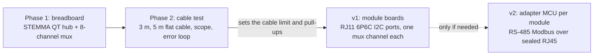

The v1 base unit:

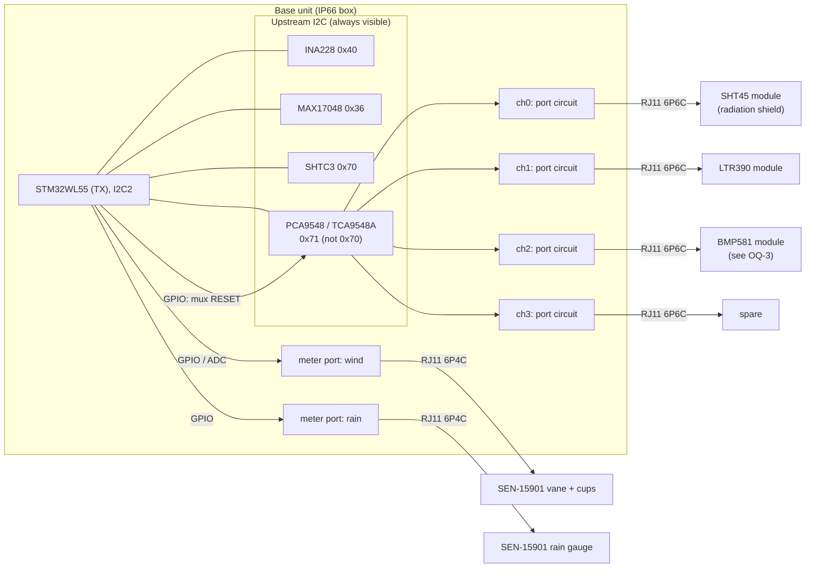

**Finding: the mux must not sit at 0x70.** The PCA9548 and TCA9548A answer at 0x70 to 0x77, set by
their A0–A2 pins, and 0x70 is the default. The SHTC3 is fixed at 0x70 and sits upstream of the mux,
on the same wires. The two would collide. Set the mux to another address with its address pins or
jumpers. This spec uses 0x71 (my call; any free address from 0x71 to 0x77 works). Check the jumper on
the board in hand. This applies to the breadboard too.

## 4. Phase 1: the breadboard with the mux

### 4.1 Topology

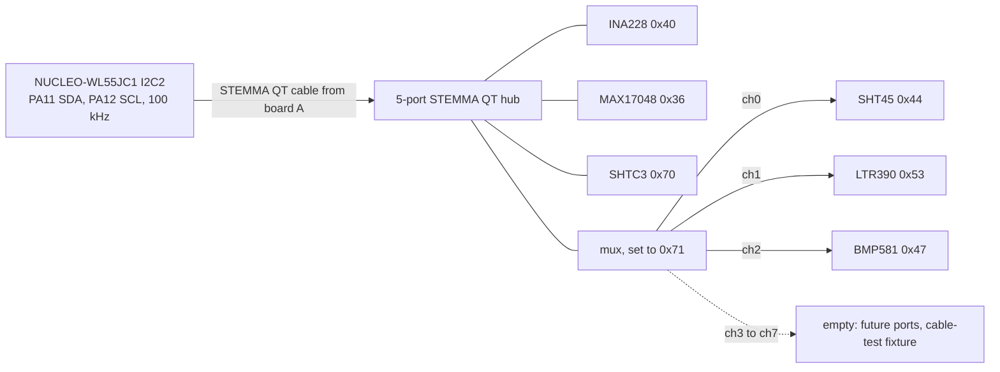

- The hub's five sockets take the NUCLEO cable, the INA228, the MAX17048, the SHTC3 and the mux.
  Daisy-chaining by the boards' second sockets also works. The topology is what matters: the three
  base-only parts and the mux are upstream; each external sensor is alone on a channel.
- The channel numbers above are my call. Any assignment works, but firmware and wiring must agree.
- **The breadboard itself does not change.** Board A keeps one STEMMA QT cable to the hub
  ([`build-sheet.md`](../../../hardware/bench-breadboard-r0/build-sheet.md), part QT). The mux lives
  on the QT chain, off the breadboard. The meter circuits on board A stay as they are.
- **Mux RESET** (active low on the TCA9548A; check the PCA9548 board) goes to a free NUCLEO GPIO, so
  firmware can release a stuck channel (section 6.6). The pin is **TBD**: it must pass the UM2592
  checklist of the wiring guide (section 6 there), like every other pin. Until it is wired, the
  breadboard has no way out of a channel whose device holds SDA low, other than unplugging.

### 4.2 Pull-ups on the breadboard

Keep the Adafruit boards' own pull-ups on the breadboard. Each channel then has its sensor board's
pull-ups, and the upstream bus has those of the hub-side boards. Cutting pull-ups is a v1 and cable-test
step, not a phase 1 step.

When a channel is selected, the mux joins it to the upstream bus. The two sets of pull-ups are then
in parallel, and the capacitances add. So the bus that the NUCLEO sees is upstream plus one
channel. The phase 2 test measures exactly that combination.

### 4.3 Firmware for phase 1

Smallest change: a **static channel map**.
- `i2c_bus` (`firmware/stage0-node/App/i2c_bus.lit.md`) gets a channel for each client. Before a
  transfer to a client on another channel, the bus writes the mux control register, and reads it back
  to check it. Upstream clients (INA228, MAX17048, SHTC3) need no channel and work with any channel
  selected.
- The stuck-bus recovery (WSMP-B3) runs with the failing channel still selected, then deselects all
  channels (section 6.6).
- The module drivers stay as they are. Discovery (a port finds out which sensor it holds) is a v1
  step (section 6.7).
- The host test harness gets a register model of the mux.

Bench checks to add to the wiring guide's section 8 (each a few minutes):

| Check | Expected |
|---|---|
| `MODULES` after a minute | every module active, as today |
| Unplug the SHT45 from ch0 | `air_th` goes suspect, then absent. The others stay active |
| Short SDA to GND on ch0 for 10 s (a jumper on the QT breakout). **Only with mux RESET wired** | ch0's module goes suspect. INA228, MAX17048, SHTC3, LTR390 and BMP581 keep reading. No reset. Without RESET wired the upstream bus is held too, and every I2C module goes suspect until the short is removed: that is the expected result then, and it shows why RESET is needed |
| Plug the SHT45 into ch3 instead of ch0 | with the static map: absent (the expected result for phase 1). With discovery (v1): found on ch3 |

## 5. Phase 2: the cable test

The test decides the cable limit and the pull-up value before any board is designed.

### 5.1 Fixture

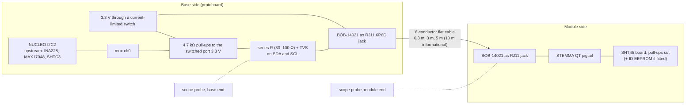

- Wire the port pinout of section 6.2 on both BOB-14021 breakouts.
- **Fix the upstream pull-ups first.** When ch0 is selected, the line's pull-up is the channel's
  pull-up in parallel with every upstream pull-up (section 4.2). The Adafruit boards upstream (INA228,
  MAX17048, SHTC3, the mux board) each bring their own. Either remove them and fit one known upstream
  pair (4.7 kΩ, my call, the same as the v1 base will have), or measure their combined value and
  record it. The test result is only valid for the combined pull-up that the v1 base will really
  have. Record that combined value with every capture.
- Crimp the cables **straight through** (pin 1 to pin 1). Check each cable with a modular cable
  tester before use. Many ready-made flat modular cords are *reversed* (pin 1 to pin 6). Section 6.3
  explains why that matters.
- If the TVS diodes and series resistors are not in hand, run the test once without them and again
  with them. The TVS capacitance counts against the rise time.

### 5.2 Procedure

1. **Cable capacitance.** With an LCR meter, measure SDA (and SCL) to all other conductors tied
   together, on a 0.5 m and a 5 m piece. The difference gives pF per metre and removes the plugs. Flat
   modular cable is roughly 40–70 pF/m conductor to neighbours *(estimate, measure)*.
2. **Baseline at 0.3 m.** Scope SDA and SCL at both ends at 100 kHz while the loop of step 4 runs.
3. **3 m, then 5 m.** Repeat step 2. Record for SDA and SCL, at the module end and the base end:
   - the rise time from 30 % to 70 % of 3.3 V (the I2C definition),
   - the fall time,
   - the low level at the receiver (the far end from the device that pulls low),
   - ringing and overshoot,
   - crosstalk: SDA while SCL toggles and SDA stays high.
4. **Error-count loop.** A test build of the station firmware runs CRC-checked transactions on the
   port and counts the results: OK, address NACK, data NACK, bad CRC, timeout, bus error, recovery.
   - SHT45: the serial-number read and the measurement read. Both carry a CRC.
   - With an ID EEPROM fitted: write a fixed pattern once, then read it back and compare. This finds
     corruption that a CRC cannot (the EEPROM has no CRC).
   - 10⁶ transactions at each length that is to qualify. At about 1.5 ms each this is roughly
     25 minutes *(estimate)*.
5. **Hot-plug, a separate trial.** The 10⁶-transaction run of step 4 has no plug events. Afterwards,
   with the same loop running, unplug and replug the module end 20 times, at least 30 s apart. Log
   each event's time, so every error can be assigned to a plug event or not. Judged by the hot-plug
   criterion below, not by the error-loop one.
6. **10 m, informational.** One scope capture and a short loop, to see where the limit is. It is not
   a v1 criterion.
7. Record the results under `evidence/cable-test-<date>/`: the setup, the cable's make and type,
   captures, counts and the firmware commit.

### 5.3 Pass criteria (at each length)

| Criterion | Limit | Source |
|---|---|---|
| Rise time, 30–70 %, SDA and SCL, both ends | ≤ 1000 ns | Clint; the I2C standard-mode limit |
| Fall time | ≤ 300 ns | my addition: the standard-mode limit |
| Low level at the receiver | ≤ 0.4 V | my addition. 0.3 × 3.3 V ≈ 1.0 V is the input threshold; 0.4 V keeps margin for ground offset |
| Error loop (step 4, no plug events) | 10⁶ transactions, **0 undetected corruption and 0 detected errors** | my proposal (OQ-2). Zero in 10⁶ bounds the error rate below about 3 × 10⁻⁶ at 95 % confidence |
| Hot-plug (step 5, 20 events) | detected errors only within a plug event (from unplug until the port is admitted again), and 0 undetected corruption. After each replug the port is admitted again within two probes. No reset, and the other ports keep reading | WSMP-P2 |

### 5.4 What each result changes

The rise-time arithmetic: for a pull-up R and a bus capacitance C, the 30–70 % rise time is
0.8473 × R × C. **R is the combined pull-up**: the channel's in parallel with the upstream pair. With
4.7 kΩ on both, R is about 2.35 kΩ; the figures below give the channel value and assume the upstream
pair is removed or much larger, so they are a worst case for C. Check the combined R against the
1 kΩ floor below before choosing a lower channel value: 2.2 kΩ on the channel with 4.7 kΩ upstream
gives about 1.5 kΩ, still above it. At 4.7 kΩ and 1000 ns, the bus may have at most about 250 pF. At 2.2 kΩ, about
540 pF. The standard-mode spec also caps the bus at 400 pF. The lowest pull-up that still lets a part
pull the line to 0.4 V at 3 mA is (3.3 − 0.4) / 3 mA ≈ 1 kΩ, but the sensors' actual sink
capability is **TBD** from their datasheets.

A rough budget at 4.7 kΩ *(estimate, measure)*: upstream bus, mux channel, TVS and module together
about 50–80 pF, plus 50 pF/m of cable. 3 m then gives about 200–230 pF (pass, near the edge). 5 m
gives about 300–330 pF (fail at 4.7 kΩ, pass at 2.2 kΩ).

**Margin.** Clint's ≤ 1000 ns is the pass line. A length that passes at room temperature with less
than about 20 % margin (rise time over about 800 ns) should be treated as marginal: H04a repeats the
test cold and on the final cable (my proposal; Clint may set a different margin).

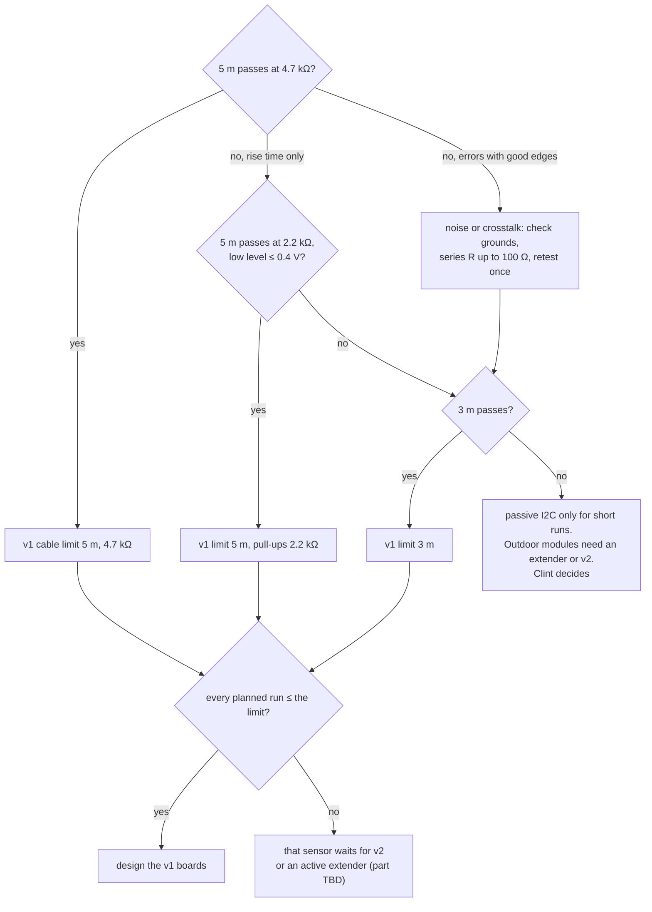

Other results:
- **The measured pF/m** replaces every estimate in this spec and goes into the base board design.
- **The run lengths that are needed** come from the site: the shield on the mast (the R1 enclosure
  plan already assumes a cable of about 2 m), the UV sensor's mounting, any remote sensor. If a run
  is longer than the limit, the choice is an extender, v2 for that sensor, or a different site.
- **A slower clock** (for example 50 kHz) gives more time per bit but does not change the rise-time
  limit as written. It is a fallback, not a fix (my view).
- **Cold.** The test is at room temperature. H04a (section 10) repeats the loop at the cold end of
  the PRD range with the final cable.
- **The final cable.** If sealing (OQ-7) needs a round jacketed cable instead of flat cable, repeat
  the test on that cable. Its capacitance differs.

## 6. v1 design

### 6.1 The module board

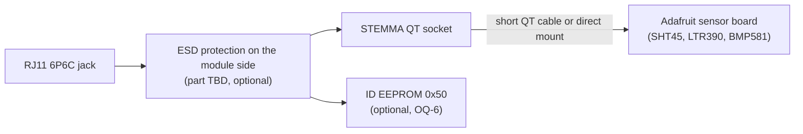

- The module board is passive: a jack, a STEMMA QT socket, an optional ID EEPROM, optional ESD
  parts, and no pull-ups. The sensor stays on its own Adafruit breakout. So the sensor part can be
  swapped without a new board.
- **Pull-ups to cut.** Each Adafruit breakout's pull-ups are removed (cut jumper or removed
  resistors). **Verify for each board**: some STEMMA QT breakouts carry a regulator and a level
  shifter, with pull-ups on both sides of the shifter. Cutting one jumper may leave the other side
  pulled up. The board schematics decide; this spec does not assume. A board with a regulator also
  drops a little voltage from 3.3 V, and its standby current is **TBD**.
- **The ID EEPROM** must answer at one address only. A 2 Kbit "24C02-class" part with its address
  pins tied low uses 0x50. Larger single-byte-address parts use extra addresses for their page bits:
  a 24C04 takes 0x50–0x51, a 24C08 0x50–0x53, a 24C16 0x50–0x57. The last two collide with the LTR390
  at 0x53. A part with 2-byte addressing (24C32-class) keeps
  one address and holds the whole record of section 6.7. The part is **TBD**. Its write-protect pin
  is tied to protect, and is opened only on the programming fixture.
- The module housing, the shield cartridge and the UV window are out of scope here.

### 6.2 The base port

**Pinout.** Clint's proposed pinout, as the baseline (OQ-1 raises a reversed-cable hazard):

| Pin | Signal | Why |
|---|---|---|
| 1 | 3.3 V (switched, current-limited) | an outer pin: a 4-conductor plug never touches it |
| 2 | SDA | |
| 3 | GND | separates SDA from SCL on untwisted flat cable |
| 4 | SCL | |
| 5 | INT / spare | pulled up on the base, so it is never a floating antenna next to SCL |
| 6 | GND | an outer pin: a 4-conductor plug never touches it |

**The port circuit** (one per port):

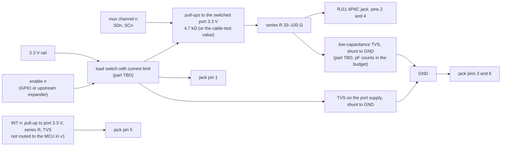

- **One mux channel per port** (PORT-2). The mux isolates every other port from a fault on this one.
- **Pull-ups on the base side** (PORT-3), on the channel side of the series resistor. The value is
  4.7 kΩ unless the cable test says otherwise. The upstream bus keeps one known pair (4.7 kΩ, my
  call); it is in parallel with the channel's when the channel is selected (section 4.2).
- **The pull-ups take their supply from the switched port rail**, after the load switch, not from the
  station's 3.3 V. Otherwise a port that is switched off still feeds the sensor through the pull-ups
  and its SDA and SCL clamp diodes, and the power cycle of section 6.6 may not clear a latch-up. With
  the port off, its lines sit low, and the mux keeps them off the upstream bus.
- **INT (pin 5)** gets a pull-up, a series resistor and a TVS, and goes nowhere else in v1: no v1
  driver uses an interrupt, so it costs no MCU pin (my call). OQ-1 may remove it.
- **Series resistor and TVS** (PORT-4). The series resistor limits the current of an ESD event into
  the mux and slows edges a little. It also lifts the low level by I × R: at 1.5 mA through 100 Ω,
  0.15 V. The cable test checks this.
- **Port power** (PORT-5). **A load switch, not a PTC** (my recommendation, within Clint's "load
  switch or PTC"):
  - a PTC reacts in milliseconds to seconds and does not stop the rail dip when a module is plugged
    in live;
  - a switch with a current limit and a soft start does, and the firmware can switch it;
  - the firmware needs the switch anyway, as the last step of recovery (section 6.6).

  The current limit is **TBD**. It must be above the module's peak (a few mA for these sensors,
  *estimate, measure*) and low enough that a reversed or shorted cable does no damage (section 6.3).
- **Mux RESET** goes straight to an MCU GPIO. The port enables can go to an upstream I/O expander if
  the MCU runs out of pins. The mux RESET cannot: it is what frees the upstream bus when a channel
  device holds SDA low, and an expander on a stuck bus cannot be reached.
- **Labels.** Sensor ports and meter ports use the same 6-position jack. Label them SENSOR 1–n and
  WIND, RAIN, and give the sensor cables a different colour (PORT-12).

### 6.3 Cross-mating and reversed cables

The meter ports today (from `hardware/bench-breadboard-r0/source/wiring.toml`): the wind port has
pins 2 and 3 on GND, pin 4 = cups (10 kΩ pull-up, 100 nF), pin 5 = vane (10 kΩ pull-up). The rain
port has pin 3 on GND and pin 4 = rain (10 kΩ pull-up, 100 nF). Pins 1 and 6 are not connected. A
6P4C plug touches only positions 2 to 5 of a 6-position jack.

| Mismatch | What happens | Result |
|---|---|---|
| Wind cable in a sensor port | the cup switch joins pins 3–4: GND to SCL. The vane network joins pins 2–5: SDA to INT | SCL held low when the cups stop on a closed switch: a channel fault on that port only. No 3.3 V reaches the meter. Safe |
| Rain cable in a sensor port | the bucket switch joins GND to SCL | a short channel fault at each tip. Safe |
| Sensor module in the wind port | pin 1 (3.3 V) is open, so the module is unpowered. Its SDA goes to GND. Its SCL goes to the cups net, which has 10 kΩ to 3.3 V | the cups input reads high: no pulses. The vane reads near 3.3 V: "no vane", so the wind module goes absent. **But** the 10 kΩ pull-up feeds about 0.3 mA into the unpowered sensor's SCL clamp diode *(estimate)*. Probably harmless; check against the sensor's injection-current limit (**TBD**) |
| Sensor module in the rain port | as above, on pin 4 only | the rain module counts nothing (it cannot show presence, WSMP-P1). Same back-feed note |
| **Reversed 6P6C cable** (pin 1 to pin 6, the common telephone-cord wiring) on a sensor port | base pin 1 (3.3 V) reaches module pin 6 (GND). Base pin 6 (GND) reaches module pin 1 (VDD). SDA meets INT. GND meets SCL | **the sensor is powered backwards.** Its clamp diodes conduct until the port's current limit acts. This can destroy the sensor. See OQ-1 |

So Clint's rationale holds for 4-conductor plugs. It does not hold for a reversed 6-conductor cable,
and reversed cords are what a hardware store sells. OQ-1 gives two fixes.

A telephone line plugged into a sensor port puts about 48 V DC (and ring voltage) on the centre pair,
pins 3 and 4: GND and SCL. The TVS clamps it; whether the TVS survives depends on the line's loop
current. OQ-12 asks whether H04a tests this, as the PRD's H04 tests a 24/48 V injector on RJ45.

### 6.4 Hot-plug

- Live plugging is tolerated, not just allowed. RJ11 contacts mate in no fixed order, so the
  design assumes any pin can touch first.
- ESD from the plug or a hand goes into the TVS diodes.
- The module's input capacitance charges through the load switch's current limit and soft start,
  not from the station's 3.3 V rail directly.
- A plug event on the selected channel can corrupt the transfer in progress. The bus reports an
  error, recovers that channel, and the module probes again (WSMP-B2, B3). A plug event on another
  channel does nothing to the bus: the mux keeps that channel open.
- PRD §6 says "power off the port before connecting or disconnecting a module" and "no live mating".
  That rule was written for 10–18 V RS-485 ports. For a 3.3 V current-limited I2C port it costs
  usability and buys little. OQ-5 asks Clint to confirm that v1 departs from it.

### 6.5 Scheduling on the mux

- Only one channel is selected at a time. The bus queue of `i2c_bus` serves transfers in order. A
  transfer whose client is on another channel first writes the mux (one byte) and reads it back.
- Upstream parts are reachable with any channel selected. The bus still finishes the current
  transfer before it serves them, as today.
- The SHT45 does not answer during a measurement (WSMP-B2). That stays a per-module rule; the mux
  does not change it.
- Each channel switch costs a few hundred microseconds at 100 kHz *(estimate)*. The station reads
  four ports in well under the 5 s read deadline (WSMP-T2).

### 6.6 Recovery, rescan and port faults

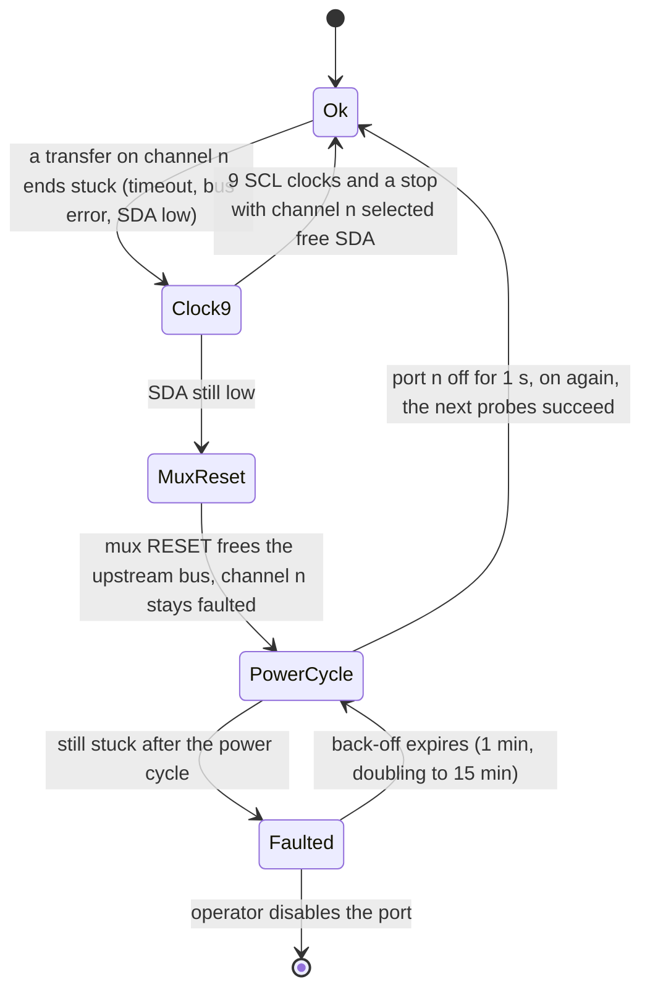

- Step 1 is WSMP-B3 as it is today, run on the failing channel.
- Step 2 is new: if a device on channel n still holds SDA, the upstream bus is held too, because the
  mux joins them. The firmware cannot write the mux to deselect the channel. Mux RESET does it in
  hardware. The upstream parts (battery monitor, enclosure sensor) are back at once.
- Step 3 is new: switching the port's power off and on clears a latched-up sensor.
- The back-off times are my call. A faulted port costs no bus time between attempts.
- **Rescan.** Every 15 s (my call: the station's sample tick), an empty port probes every address in
  the probe table (section 6.7), as one short burst of transfers in its probe slot. Two good probes in
  a row admit the module (WSMP-P2), so admission takes 15–30 s, and the module joins the layout at the
  next latch (up to 60 s later). A newly plugged module is in the readings within 90 s.
- **Unknown-device scan** (my call). The probe table alone cannot see a device at another address,
  so a port that stays absent also gets a bounded scan: once at boot, then at most once every
  15 min, in its probe slot. It addresses 0x08–0x77 except the table addresses and every address on
  the upstream bus (the mux, the battery monitor, the enclosure sensor: they answer through any
  selected channel), a fixed list built from the board's upstream table, not learned. Each address
  gets a zero-length write, and the whole scan is about 110 address bytes, under 15 ms at 100 kHz
  *(estimate)*. An ACK marks the port "unknown device at 0xNN". It is never admitted (WSMP-P3).
  Whether a zero-length write is harmless to every part we might meet is **TBD**.
- **Port faults are reported.** A faulted port, or a device the scan found at an address that is not
  in the table, shows in the `MODULES` line and later in the health report. A port fault never changes the
  descriptor set by itself (WSMP-P3).

### 6.7 Presence, identity and descriptors for a passive module

A v1 external module is a WSMP **local** module: its driver runs on the station. WSMP rule 1 ("one
contract") holds unchanged. What is new is that a port no longer implies a module type. Today each
port is fixed to one type (`enum wsmp_port` in `firmware/stage0-node/App/wsmp_local.h`). On an I2C
port the station finds out what is plugged in.

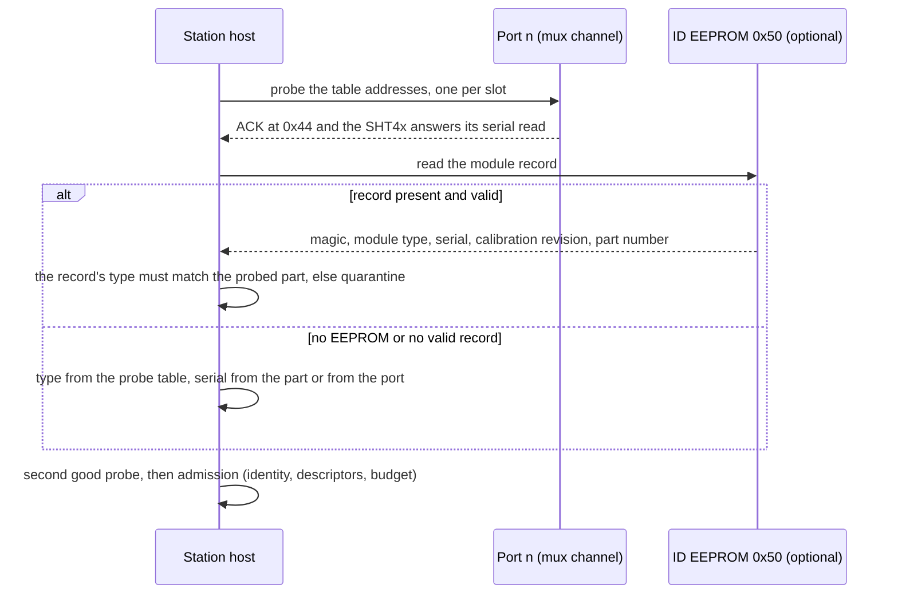

**Probe table** (the module types already in the registry, WSMP section 4.4):

| Address | Check | Module type |
|---|---|---|
| 0x44 | the SHT4x serial-number read with a good CRC (verify the command in the datasheet) | 1, air temperature and humidity |
| 0x46 or 0x47 | BMP581 CHIP_ID = 0x50 (as `App/mod_reg.c` does today) | 2, air pressure |
| 0x53 | LTR390 part ID (as today) | 3, UVA |

**Presence** (a proposed bullet for WSMP-P1): an I2C port shows presence by a successful probe of a
table address on its mux channel, with the part's ID check. NACK at every table address means
absent. SDA or SCL held low on the channel is a port fault (WSMP-P3). Two table parts on one port
are refused: one module per port.

**Identity block**, filled by the station's driver as today, from these sources:

| Field | Source |
|---|---|
| magic, WSMP version | the station |
| module type, schema | the probe table. An EEPROM record must agree, or the module is quarantined |
| serial | 1. the EEPROM record. 2. Else the sensor's own serial number, if it has one (the SHT4x does; the BMP581 and LTR390: **TBD**). 3. Else `WSMP_LOCAL_SERIAL(port, type)`, as today. Sources 1 and 2 travel with the module; source 3 is bound to the port (see **Serial rules** below) |
| firmware version and build | the station's |
| boot ID | proposed: changes at each admission of the port. A passive module has no clock of its own, so a re-plug is its "boot". This keeps WSMP-I2's intent (a counter series never spans a power loss) for any future passive module with a counter |
| capabilities | bit 0 set if the EEPROM record carries metadata. Bit 1 clear |
| descriptor digest | computed, as today |

**Descriptors** come from the driver and the registry, as today. They never come from the EEPROM.
Rule 3 of WSMP (codes, not text, carry meaning) and WSMP-X3 (no text as identity) hold.

**The module record** in the EEPROM (layout to be defined in a WSMP annex; my proposal):
- a magic and a record version;
- the module type and schema codes;
- the serial (u64, not 0);
- a calibration revision for each channel, and the part number and labels in the WSMP-M1 character
  set. These map onto the metadata block (section 6.5 of WSMP).
- a CRC-32C over the record.

The station parses it into a fixed structure and checks every length, code and character (WSMP-X2).
The fuzz target `wsmp` grows to cover it. A bad record makes the module quarantined, not absent.

**Why the EEPROM is worth it** (OQ-6): it gives each physical sensor a serial that survives a move to
another port, and later to a v2 adapter. The gateway's planned calibration and siting archive
(WSMP section 15) needs exactly that. Without it, a module's serial is its port, and a swap of two
SHT45 modules is invisible.

**Serial rules** (they hold for v1 ports and v2 adapters alike, section 7):
- One precedence everywhere: EEPROM record, then the sensor's own serial, then a binding-derived
  fallback. A v2 adapter uses the same order, so a module whose serial came from source 1 or 2 keeps
  it on any v1 port and behind a v2 adapter.
- A fallback serial (v1: `WSMP_LOCAL_SERIAL(port, type)`; v2: from the adapter MCU's unique ID)
  names the binding, not the sensor. Moving such a module gives it a new serial, by design. Nobody
  aliases the old serial to the new one: the station and the gateway cannot tell a moved module from
  a swapped one, and a wrong alias would attach one sensor's calibration and siting record to another.
- Home Assistant history does not depend on the serial: the WSMP-H1 entity ID has no port and no
  serial in it, so it continues across moves for every module (section 2).
- A module whose calibration or siting record must follow it across ports or to v2 needs source 1
  or 2. This is why OQ-6 fits the EEPROM by default; a module without one and without a sensor serial
  is fine where only the readings matter.

**Port numbers.** Today a port number is a module type (1 = outside air … 7 = rain). In v1 a port
number is a place. Proposal (my call; it only has to be stable):

| Port numbers | What |
|---|---|
| 1–8 | I2C ports on mux channels 0–7, labelled SENSOR 1–8 |
| 9 | battery and charger (on the base) |
| 10 | enclosure T/RH, SHTC3 (on the base) |
| 11 | air pressure, BMP581, if it goes on the base (OQ-3) |
| 12, 13 | meter ports: wind, rain |
| 14 and up | reserved for v2 remote ports |

The station's limit stays 8 modules and 24 channels (WSMP-P8). With four base modules (battery,
enclosure, wind, rain), four sensor ports reach it exactly. With the BMP581 on the base (OQ-3), there
are five base modules and room for three port modules; a fourth would be refused unless WSMP-P8 is
raised (OQ-4).

### 6.8 Sealing (open, Clint's)

The Adafruit 905 box is IP66, but an RJ11 jack in its wall is not. RJ11 plugs do not pass a PG-7 or
PG-9 gland ([`docs/poc-shopping-list.md`](../../poc-shopping-list.md), caveats). Options:

| Option | For | Against |
|---|---|---|
| A. Jacks inside the box. Cables enter through split-insert glands or a cable-entry frame, so a plug never has to pass through | the jack stays dry. Cheap. A module is still swapped by unplugging inside the box | the box must be opened to swap a module. Flat cable seals badly in round seals; the gland or frame must fit the cable's real cross-section (part **TBD**) |
| B. Sealed panel-mount RJ11 receptacles | swap without opening the box | sealed RJ11 parts and their mated rating are **TBD**; the plugs need sealed boots too |
| C. A short sealed pigtail from the box to an in-line coupler | no hole cut for a jack | the coupler is outdoors and is the weak point |

Recommendation (OQ-7): option A, with a round jacketed 6-conductor cable if one passes the cable
test, because round cable seals in standard glands. Re-run the cable test on that cable.

## 7. v2: RS-485 over RJ45, and I2C sensors behind an adapter

v2 is the RJ45 binding of WSMP section 13 and the PRD's §6, unchanged. This section works out how
the same STEMMA QT sensors live in it.

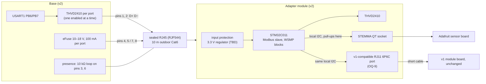

- **The adapter owns a local I2C bus.** The STM32C0 runs the same sensor drivers as the v1 station
  (`mod_th.c`, `mod_reg.c`), on its own `i2c_bus` implementation. It serves the WSMP blocks as Modbus
  registers (WSMP section 6). The WSMP core `firmware/common/wsmp.c` is already portable for this
  (its header says so).
- **Calibration moves into the module.** WSMP-G6 ("a module applies its own calibration") is met
  natively, with coefficients in the adapter's flash.
- **Identity.** Serial: the precedence of section 6.7 (**Serial rules**): the v1 EEPROM record's
  serial if the sensor brought one, else the sensor's own serial, else one derived from the MCU's
  unique device ID (check that the STM32C011 has one). The last is a fallback bound to the adapter. Boot ID: the adapter's own, kept
  in its flash (WSMP-I2).
- **Same module type codes.** A v2 SHT45 module reports type 1, schema 1, the same channels and
  descriptors as a v1 one. The gateway entity ID (WSMP-H1) has no binding, port or serial in it, so
  Home Assistant history continues.
- **The local/remote split of WSMP already covers both.** A v1 passive module is a local module whose
  driver runs on the station. A v2 module is a remote module that runs the same driver itself. WSMP-B1
  already requires the station code above the driver interface to be the same for both. What WSMP
  lacks is the I2C port binding (section 6.7 here), which section 13 of this spec proposes.
- **More than one v2 port.** WSMP section 13 notes that the NUCLEO has one free UART (USART1). The
  PRD allows "an explicit mux or valid tri-state scheme". A design to evaluate (my suggestion): one
  UART shared by several transceivers, with only one transceiver's receiver and driver enabled at a
  time. Whether the THVD2410's receiver output goes high-impedance when disabled is **TBD** from its
  datasheet. A custom v2 controller could pick an MCU with more UARTs instead.
- **The long-lead parts** (STM32C0116-DK, RJF544) are v2 parts. Nothing in v1 needs them.

## 8. Migration and coexistence

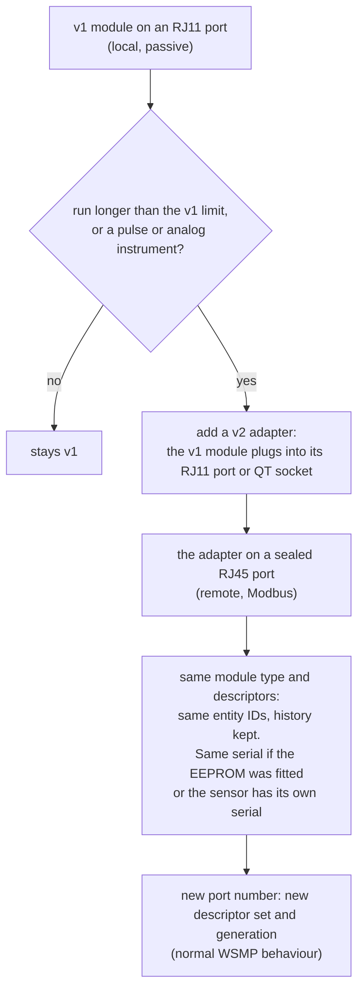

- **A v1 sensor becomes a v2 module by adding an adapter.** Two ways, both supported by the adapter
  sketch of section 7: the Adafruit sensor board moves to the adapter's STEMMA QT socket, or the whole
  v1 module board plugs into the adapter's v1-compatible RJ11 port with a short cable. The second
  keeps the v1 board, its EEPROM and its serial. The adapter's RJ11 port is the base port circuit of
  section 6.2. The design carries over, but the qualification does not: the adapter has its own
  controller, pull-ups and bus load, so its RJ11 port is retested (a short-cable run of the H04a
  loop) as part of H04b.
- **One base with both kinds of port** (my recommendation, OQ-10): allowed, with distinct connectors
  and separate port-number ranges, and no jack that serves both. A v2 base keeps a few v1 I2C ports for
  in-box or short-run modules and adds RJ45 ports for long runs.
- **A 6P plug fits an 8P jack.** An RJ11 module cable pushed into an unsealed RJ45 port lands on RJ45
  pins 2–7: its 3.3 V on D−, its GND on the 10–18 V supply pin. The presence loop (10 kΩ across pins 3
  and 6) is not there, so WSMP-P7 never enables port power. H04b must test this case. A sealed RJF544
  receptacle may not admit a bare RJ11 plug at all (**TBD**).
- **Do not design v1 for v2 beyond these cheap steps:** keep USART1 (PB6, PB7) free, reserve port
  numbers 14 and up, keep the module board's STEMMA QT side unchanged, and keep the WSMP terms neutral.
  The PRD's scope rule allows accommodation "where cheap", not speculative boards.

## 9. Requirements (v1 port)

| ID | Requirement |
|---|---|
| PORT-1 | Each sensor port uses the pinout of section 6.2 (or the OQ-1 alternative, once chosen) |
| PORT-2 | Each sensor port has its own mux channel. One module per port |
| PORT-3 | Pull-ups are on the base side only, at the value the cable test sets. Module boards have none |
| PORT-4 | SDA and SCL have a series resistor (33–100 Ω) and a low-capacitance TVS at the jack |
| PORT-5 | Port power is 3.3 V through a current-limited load switch that the firmware controls |
| PORT-6 | Live plugging and unplugging never resets the station and never disturbs another port |
| PORT-7 | An empty port is rescanned every 15 s. A plugged module is in the readings within 90 s |
| PORT-8 | A stuck channel is recovered by the ladder of section 6.6. The upstream parts keep working throughout |
| PORT-9 | INA228, MAX17048 and SHTC3 are upstream of the mux and never on a port. The mux is not at 0x70 |
| PORT-10 | The cable length is at most the qualified length from the cable test |
| PORT-11 | Sensor cables are straight through and tested (or the pinout is reversal-safe, OQ-1) |
| PORT-12 | Sensor and meter ports are labelled, and sensor cables are coloured differently |
| PORT-13 | A passive module's identity follows section 6.7. An EEPROM record is optional and checked |

## 10. Tests: what replaces or splits H04

The PRD's H04 is one test of one RJ45 RS-485 port. This spec proposes to split it (OQ-2):

| PRD H04 element | **H04a: v1 I2C port** (Stage 2 gate) | **H04b: v2 RS-485 port** (when v2 is built) |
|---|---|---|
| "10 m chosen cable" | the qualified length from the cable test, on the final cable type | 10 m Cat6, as the PRD |
| "full operating span and temperature range" | 3.3 V supply span (**TBD**), and the PRD's temperature range with the final cable | 10–18 V, PRD range |
| "≥ 10⁶ error-checked transactions, no undetected corruption" | 10⁶ CRC-checked or read-back-checked I2C transactions. 0 undetected corruption, 0 detected errors | as the PRD, on Modbus |
| "shorted/wet pairs and open presence loop cannot reset core" | each conductor shorted to GND and to 3.3 V, a wet jack, SDA or SCL held low. No reset; the other ports and the upstream parts keep reading | as the PRD |
| "24/48 V injector and network-fixture misuse" | cross-mating (section 6.3): meter cables in sensor ports, modules in meter ports, a reversed cable. A current-limited 48 V source on pins 3–4 if OQ-12 says yes | as the PRD, plus an RJ11 v1 cable in the RJ45 port (section 8) |
| "freeze pinout/cable/termination" | freeze pinout, pull-up value, series resistor, TVS, cable type and length | as the PRD |

| Requirement | Test |
|---|---|
| PORT-1, 11, 12 | inspection; cable tester on every cable; H04a cross-mate cases |
| PORT-2, 6, 8, 9 | phase 1 bench checks (section 4.3); H04a shorts and stuck lines; host tests with the mux model: a fault on one channel, the others and the upstream parts keep reading |
| PORT-3, 4, 10 | the phase 2 cable test (section 5); H04a at temperature |
| PORT-5 | H04a: a shorted port supply trips the limit, the station stays up; reversed-cable case |
| PORT-7 | host test: plug at a random time, in the layout within 90 s; bench: 20 plugs |
| PORT-13 | host tests: probe table, EEPROM record parsing, type mismatch quarantines; fuzzing of the record parser (WSMP-X2) |
| WSMP conformance | a new row in WSMP section 14 for the I2C port binding |

## 11. Open questions for Clint

Most important first. Each has my recommendation.

| ID | Question | Recommendation |
|---|---|---|
| OQ-1 | **Reversed cables.** With the proposed pinout, a reversed 6P6C cord (pin 1 to pin 6, the usual telephone-cord wiring) powers the sensor backwards (section 6.3). Keep the pinout and guard against it, or change it? | Change to a reversal-safe pinout: **1 = 3.3 V, 2 = SDA, 3 = GND, 4 = GND, 5 = SCL, 6 = 3.3 V**. A reversed cable then maps 3.3 V to 3.3 V, GND to GND, and only swaps SDA and SCL (harmless: nothing answers). A 4-conductor plug still never meets 3.3 V, and SDA and SCL are now two grounds apart. The cost is the INT/spare pin, which no v1 driver uses. **One cross-mate case gets worse:** a sensor module in the wind port puts its GND on the cups net (no pulses, speed 0) and its unpowered SCL clamp on the vane net, which can pull the vane voltage into a valid window. The wind module then looks present, with speed 0 and a false direction. The interim catalog map reports CALM below 0.5 m/s, so the direction is not published, but the vector sums are wrong. Firmware can flag "vane steady and no pulses for a long time" as suspect. Redo the section 6.3 table for whichever pinout is chosen. If INT must stay: keep the pinout, add reverse-polarity protection on every module board (part **TBD**), set the port current limit low enough to survive the reversed case, and allow only tested straight cables |
| OQ-2 | **H04 split.** Split H04 into H04a (v1 I2C port, the Stage 2 gate) and H04b (v2 RS-485 port, unchanged)? Zero detected errors in 10⁶ transactions for H04a? | Yes to both. Zero is the strict reading of "never loosen a test criterion" and is cheap to run |
| OQ-3 | **Where does the BMP581 go?** The registry gives pressure the role "enclosure", but the decision list puts only INA228, MAX17048 and SHTC3 on the base | On the base, upstream of the mux, like the SHTC3. Pressure is measured fine in a vented box, it saves a port and a cable, and it needs no change to the registry role. If it must be modular, put it on a short port inside the box |
| OQ-4 | **How many sensor ports on the v1 base?** | Four RJ11 sensor ports on channels 0–3 (the PRD's "four positions"); channels 4–7 not fitted. With four base modules this reaches the WSMP limit of 8 modules. If the BMP581 goes on the base (OQ-3), either use only three ports or raise WSMP-P8 to 9 modules (the 24-channel and radio-budget limits still hold: 18 channels today). I recommend raising P8 to 12 modules, since the channel and byte budgets are the real limits |
| OQ-5 | **Port power policy.** The PRD says ports are off by default, enabled only for a commissioned module type, and never live-mated. Apply that to 3.3 V I2C ports? | No for v1: ports on by default, live mating tolerated, automatic discovery. Commissioning stays optional: a configured expected type raises an alarm on a mismatch. Keep the PRD rule for v2 10–18 V ports |
| OQ-6 | **ID EEPROM on v1 module boards?** | Footprint on every board, fitted by default. A single-address, 2-byte-addressed part. The firmware treats it as optional. It gives each sensor a serial that survives port moves and the move to v2 |
| OQ-7 | **Sealing RJ11 on the IP66 box** | Option A of section 6.8: jacks inside, split-insert glands or a cable-entry frame. Prefer a round jacketed cable if it passes the cable test, and re-run the test on it |
| OQ-8 | **Is v2 scheduled?** | No. v1 replaces the PRD's Stage 2 RJ45 port. v2 is built only when a needed run exceeds the v1 limit, or an instrument needs an adapter (pulse, analog, or a remote head). The long-lead v2 parts are not ordered for v1 |
| OQ-9 | **What does a v2 adapter accept?** | Both, on one local bus: a STEMMA QT socket (for a bare Adafruit board) and a v1-compatible RJ11 port (for a whole v1 module board, keeping its EEPROM serial) |
| OQ-10 | **v1 and v2 ports on one base?** | Allowed, with distinct connectors and separate port-number ranges. No dual-use jack. v1 adds no v2 hardware beyond keeping USART1 free |
| OQ-11 | **Identical jacks with different pinouts.** PRD §6 and Appendix A forbid "a different pinout on an identical external jack". v1 sensor ports and meter ports share the 6-position RJ11 jack | Amend the PRD: allowed when the cross-mate analysis shows no power reaches the wrong device and H04a's cross-mate tests pass, with labels and coloured cables |
| OQ-12 | **Telephone-line misuse.** Does H04a test 48 V on the centre pair (an RJ11 port plugged into a phone line)? | Yes, once, with a current-limited bench supply, as H04 does with its 24/48 V injector. Declare it outside the operating contract |
| OQ-13 | **Stage 3 instruments.** The next-stages plan picks Davis instruments for Stage 3. The meter ports assume the SEN-15901's passive switches. A Davis anemometer's vane needs a supply conductor *(verify)* | Decide at Stage 3. Do not put a supply on meter-port pins 2–5 without redoing the cross-mate analysis of section 6.3 |

| OQ-14 | **What is the v1 base unit physically?** A carrier board under the NUCLEO-WL55JC1, or a custom STM32WL55 board? It sets the GPIO budget (mux RESET, four port enables) and whether an I/O expander is needed | A carrier board for the NUCLEO first. The PRD puts the custom controller in Stage 4, after the port is frozen. Keep the mux RESET on a direct GPIO either way; the port enables may go on an upstream expander |
| OQ-15 | **How long are the real runs at the site?** Only the shield's ~2 m is known (R1 enclosure plan) | Measure the planned mounting of the shield, the UV sensor and any other sensor before the cable test, so the test qualifies the lengths that matter |

## 12. Calls I made (check these while reading)

- The mux address 0x71 (any of 0x71–0x77 works; 0x70 does not).
- Channel assignment on the breadboard, and the port numbers of section 6.7.
- A load switch rather than a PTC, and mux RESET on a direct GPIO.
- The added cable-test criteria: fall time ≤ 300 ns, low level ≤ 0.4 V, 20 hot-plugs, the 10 m
  informational run.
- The recovery back-off times (1 s off; 1 min doubling to 15 min).
- The rescan period of 15 s.
- The proposed boot-ID rule for passive modules (changes at each admission).
- The module record's content in the EEPROM.
- Left to the builder: the exact parts (mux board, load switch, TVS, EEPROM, jacks, cable), the GPIO
  for mux RESET and the port enables (after the UM2592 check), the module board layout, the firmware
  structure of discovery within the Power of Ten rules (a switch on the module type, no function
  pointers), and the host test design.

## 13. Consistency change list

These existing texts contradict v1-RJ11-now / RS-485-RJ45-in-v2, or must change with it. **None of
these edits is applied.** Clint reviews them first. Quoted text is the current wording; the arrow
gives the proposed wording.

### 13.1 Normative and planning documents

| File and section | Current | Proposed |
|---|---|---|
| `docs/module-protocol.md`, introduction (line 11–12) | "This applies to a driver on the station's own microcontroller and to a module board behind an RJ45 port alike." | "This applies alike to a driver on the station's own microcontroller, to a passive I2C module on an RJ11 port (v1), and to a module board with an adapter microcontroller behind an RJ45 port (v2)." |
| `docs/module-protocol.md`, "Other documents" | "`next-stages-plan.md` and the PRD give the RJ45 port hardware." | "`superpowers/specs/2026-10-21-sensor-module-ports-design.md` gives the v1 RJ11 I2C port and the v2 RJ45 port. `next-stages-plan.md` and the PRD give the RJ45 port parts." |
| `docs/module-protocol.md` §1, "Port" | "A local port is a bus address on the station. A remote port is an RJ45 socket." | "An on-board port is a bus address on the station. An I2C port is an RJ11 socket on its own I2C multiplexer channel (v1). A remote port is an RJ45 socket (v2). A port number names a place, not a module type." |
| `docs/module-protocol.md` §1, "Local module" | "A module that runs as a driver on the station's microcontroller. The bench station uses local modules." | "A module whose driver runs on the station's microcontroller: an on-board part, or a passive module on an I2C port. The bench station uses local modules." |
| `docs/module-protocol.md` §1, "Remote module" | "… behind an RJ45 port, reached by Modbus." | "… behind an RJ45 port, reached by Modbus (v2)." |
| `docs/module-protocol.md` §2, diagram | local module and remote module only | add a node "passive I2C module (RJ11 port, mux channel)" with the edge "same contract, local driver" to the host |
| `docs/module-protocol.md` §6.1, WSMP-I2 | "A local module uses the station's own boot epoch." | add: "A passive module on an I2C port gets a new boot ID at each admission of its port." |
| `docs/module-protocol.md` §7, WSMP-P1 | four bullets (remote, local I2C, wind, rain) | add: "A module on an I2C port shows presence by a successful probe of an address in the probe table (section 10.1) on its multiplexer channel, with the part's ID check. NACK at every table address means absent. SDA or SCL held low on the channel is a port fault (WSMP-P3)." |
| `docs/module-protocol.md` §7, WSMP-P3 | "… MUST NOT change the descriptor set by itself." | add: "On an I2C port, a fault of one channel MUST NOT stop the other channels or the upstream bus." |
| `docs/module-protocol.md` §7, WSMP-P8 | "A station has at most 8 modules and 24 channels." | only if OQ-4 raises it: "… at most 12 modules and 24 channels." (`wsmp_host` and the descriptor-set size of WSMP-E4 change with it) |
| `docs/module-protocol.md` §7, new WSMP-P9 | — | "**WSMP-P9. I2C port power.** An I2C port gets 3.3 V through a current limit that the station switches. The station switches it off and on to recover a stuck channel. Live mating is tolerated. (WSMP-P7 stays the rule for remote ports.)" |
| `docs/module-protocol.md` §10, WSMP-B3 | "… at most nine times, and then sends a stop condition. A clean NACK gets no recovery." | add: "On an I2C port the station runs this with the failing channel selected. If SDA stays low, it resets the multiplexer, then switches the port's power off and on, then backs off (spec 2026-10-21 §6.6)." |
| `docs/module-protocol.md`, new §10.1 | — | "**10.1 Passive modules on I2C ports (the RJ11 binding).**" The probe table, the identity sources, the optional module record at 0x50, the multiplexer rules and the port numbers, from section 6.7 of this spec |
| `docs/module-protocol.md` §12, WSMP-X2 | "A fuzz test MUST cover the station's parser of every block." | "… of every block and of the passive module record." |
| `docs/module-protocol.md` §12, WSMP-X4 | "Before a remote port is used outdoors …" | "Before any external port (I2C or remote) is used outdoors …" |
| `docs/module-protocol.md` §13, title and first line | "## 13. Remote modules (the RJ45 binding)" | "## 13. Remote modules (the RJ45 binding, v2)", and first line: "v1 has no remote ports. v1 external modules use the I2C port binding (section 10.1)." |
| `docs/module-protocol.md` §14, conformance table | no I2C port row | add: "I2C port binding \| P1, P3, P9, B3, X2 \| plug at random times, hold SDA and SCL low on one channel, check the other channels; a bad module record quarantines" |
| `docs/module-protocol.md` §15, open items | "Remote ports beyond one \| Needs a UART multiplexer or a different station microcontroller." | "Remote ports beyond one (v2) \| …". Add: "I2C port cable limit \| set by the cable test (spec 2026-10-21 §5)." |
| `docs/next-stages-plan.md` §1, diagram | `S2 -- "H04 passes" --> S3` | `S2 -- "H04a passes" --> S3` |
| `docs/next-stages-plan.md` §1, Stage 2 row | "One wired sensor module on a sealed RJ45 port \| H04, the port test: power, faults, 10 m cable, 10⁶ transactions" | "One wired sensor module on an RJ11 I2C port (v1) \| H04a, the I2C port test: the qualified cable length, faults, cross-mating, 10⁶ transactions. (H04b, the RS-485 port test, moves to v2.)" |
| `docs/next-stages-plan.md` §2, STM32C0116-DK and RJF544 rows | Stage "2" | Stage "v2 (not scheduled)". Add under the table: "v1 needs neither." |
| `docs/next-stages-plan.md` §2, TI EVM row | Stage "1, 2" | "1, v2" |
| `docs/next-stages-plan.md` §4, title and RS-485 rows | "Stages 2 and 3: chosen parts"; adapter MCU, RS-485, port eFuse, bench RS-485 adapter, Cat6 cable | title "Stage 2 (v1), v2 and Stage 3: chosen parts". Mark those five rows "v2". Add v1 rows: I2C mux board, 6-conductor cable and 6P6C plugs, crimp tool, modular cable tester, load switch (TBD), TVS (TBD), ID EEPROM (TBD); prices not verified |
| `docs/next-stages-plan.md` §4, rough cost | "Stage 2 ≈ $250–650 (mostly connectors)." | "Stage 2 (v1): not estimated. The $250–650 figure was for the RJ45 port and belongs to v2." |
| `docs/next-stages-plan.md` §6, "Connectors" decision | "RJF544 composite … or RJF TV metal …" | prefix "(v2)". Add a row: "RJ11 sealing (v1) \| jacks inside with split glands or an entry frame, sealed RJ11 receptacles, or a pigtail and coupler" |
| `docs/next-stages-plan.md` §7 | "The RJ45 plug's cable-diameter range against the 6.1 mm cable." | prefix "(v2)" |
| PRD (`weather-station-v0.2-prd-trd.html`, outside the repository) §1, "Module communication" | "RS-485 with Modbus RTU over ordinary straight-through four-pair Cat5e/Cat6 cable …" | "v1: passive I2C over straight-through 6-conductor modular cable (RJ11 6P6C), one multiplexer channel per port, length as qualified by H04a. v2: RS-485 with Modbus RTU over … Cat5e/Cat6 (unchanged)." |
| PRD §1, "Sensor electronics" | "One reusable adapter board and firmware source supporting pulse, analog and short local I²C instruments." | "v1: a passive STEMMA QT to RJ11 module board per I²C sensor. v2: one reusable adapter board …" |
| PRD R06 | "Common RJ45 cables attach compatible sensor modules." | "Common modular cables attach compatible sensor modules: RJ11 6P6C in v1, RJ45 in v2." |
| PRD §3, Stage 2 row | "One protected RJ45 port and one common adapter carrying the existing T/RH reading … H04: power, fault, 10 m cable and protocol tests pass." | "One protected RJ11 I2C port and one SHT45 module board. H04a: the qualified cable length, fault, cross-mate and protocol tests pass." |
| PRD §6, "Wired module interface" | the RS-485 contract only | a new v1 subsection with the pinout, port circuit, power and hot-plug policy of this spec; the RS-485 text becomes "v2" |
| PRD §6, connection policy | "power off the port before connecting/disconnecting … Ports are disabled at factory defaults …" | "(v2 ports.) v1 I2C ports are on by default and tolerate live mating (OQ-5)." |
| PRD §6 and Appendix A, identical jacks | "do not expose a different pinout on an identical external jack" | add: "except where the cross-mate analysis shows no power reaches the wrong device, H04a's cross-mate tests pass, and the jacks are labelled (OQ-11)." |
| PRD §7, component families | adapter MCU, RS-485, port protection "stage 2" | "v2" |
| PRD §12, H04 | one test | H04a and H04b as section 10 of this spec |

### 13.2 Descriptive documents

| File and section | Current | Proposed |
|---|---|---|
| `docs/CONTEXT-PACK.md` §1, diagram | `S2 -- "H04 passes" --> S3` | `S2 -- "H04a passes" --> S3` |
| `docs/CONTEXT-PACK.md` §1 | "Stage 2 adds one wired sensor module on an RS-485 port." | "Stage 2 adds one wired sensor module on an RJ11 I2C port (v1). RS-485 over RJ45 is v2, not scheduled." |
| `README.md`, "Ordered next steps" | "This repository adds no … RJ45/Modbus abstraction …" | "This repository adds no … external sensor ports yet (v1 RJ11 I2C ports, v2 RJ45 and Modbus) …" |
| `docs/failure-modes.md` §1, out of scope | "Stage 1 and later items (battery, solar, RS-485 modules, heaters) …" | "… (battery, solar, external sensor ports and modules, heaters) …" |
| `docs/firmware-budget.md`, "Future features" | "RS-485 and Modbus sensor modules (Stage 2) \| 4–8 KB, plus a few KB per sensor type" | two rows: "I2C mux, port discovery, recovery ladder, module record (Stage 2, v1) \| not estimated" and "RS-485 and Modbus remote modules (v2) \| 4–8 KB …". The sentence above the table: "Stage 2 adds one wired sensor module on an I2C port." |
| `docs/poc-shopping-list.md`, intro | "… uses a 4-cell series pack, RS-485 sensor modules and qualified instruments." | "… a 4-cell series pack, sensor modules on RJ11 I2C ports (v1; RS-485 in v2) and qualified instruments." |
| `docs/poc-shopping-list.md`, diagram and "I2C addresses" table | six parts on the hub | add the mux on the hub, with SHT45, BMP581 (subject to OQ-3) and LTR390 behind it; add "0x71 \| I2C multiplexer (moved from its default 0x70, which the SHTC3 uses)" |
| `docs/poc-shopping-list.md`, "Storage and wiring" | hub and QT cables | add a row: "I2C multiplexer \| Adafruit STEMMA QT PCA9548 or TCA9548A board (product number and price not verified)" |
| `docs/hardware/bench-station-wiring.md` §2, diagram and table | six sensors on the hub; "The breakouts have the pull-ups" | the mux on the hub with the three external sensors behind it; add a row "Mux RESET \| TBD \| a free GPIO after the UM2592 check"; note the 0x71 jumper |
| `docs/hardware/bench-station-wiring.md` §6 | checklist | add "[ ] the mux RESET pin, free of any board function" |
| `docs/hardware/bench-station-wiring.md` §8 | hot-plug check | add the mux checks of section 4.3 of this spec |
| `hardware/bench-breadboard-r0/README.md`, "Decisions" | "Your RJ45 module cables are a later step (`docs/module-protocol.md`)." | "The sensor module cables are RJ11 6P6C I2C ports in v1 (`docs/superpowers/specs/2026-10-21-sensor-module-ports-design.md`); RJ45 is v2. The I2C mux sits on the STEMMA QT chain, off the breadboard." |
| `hardware/poc-enclosure-r1/README.md`, diagram | `CABLE["4-wire cable, about 2 m, JST-SH ends"]` | `CABLE["v1: SHT45 module board, 6-conductor RJ11 cable, length set by the cable test"]` |
| `hardware/poc-enclosure-r1/README.md`, "Hardware to buy" | "4-wire cable, about 2 m, plus JST-SH (STEMMA QT) ends" | keep for the proof of concept, and add: "v1 replaces it with an RJ11 module cable (sensor-module ports spec)". The glands row gets a note on OQ-7 |
| `docs/superpowers/specs/2026-10-18-wsmp-bench-station-design.md` §1 | "Outdoor cabling and RJ45 modules come later"; "Remote modules \| RS-485 and Modbus per WSMP section 13, later" | leave the body (it records a decision of 2026-10-18). Add under the status line: "Superseded in part on 2026-10-21: external modules are RJ11 I2C ports in v1 ([sensor-module ports](2026-10-21-sensor-module-ports-design.md)); RS-485 is v2." |
| `docs/superpowers/specs/2026-10-18-wsmp-bench-station-design.md` §2 | "the breakouts give the pull-ups (six 10 kΩ in parallel, about 1.7 kΩ)" | covered by the same note: with the mux, the bus is upstream plus one channel |
| `firmware/common/wsmp.lit.md`, introduction, and `firmware/common/wsmp.h` (plain header), first comment | "The remote module adapter will use the same file later" / "later, the remote module adapter" | "… the v2 remote module adapter …". Changing the `.lit.md` prose does not change the tangled `.c`; `tools/tangle.py --check` must still pass |
| `hardware/chicago-test-hardware-r0/docs/bench-equipment.md` row "2 — module bus" (and the `.csv` and `technical-guide.html`) | "Isolated USB–RS-485 adapter, 10 m selected cable …" | do not edit: `SHA256SUMS.txt` locks the package. Add an entry to `hardware/chicago-test-hardware-r0-ERRATA.md`: "Stage 2 in v1 is an RJ11 I2C port. Its bench needs an oscilloscope, an LCR meter, a modular cable tester and 6-conductor cable. The RS-485 adapter and 10 m cable move to v2." |

### 13.3 Code that must change (implementation, after approval)

Not documentation contradictions, but the work this design implies. Each literate file changes in its
`.lit.md`, never in the generated `.c`.
- `firmware/stage0-node/App/i2c_bus.lit.md`: a channel for each client, the mux write and read-back,
  recovery per channel, mux RESET, port power cycling.
- `firmware/stage0-node/App/wsmp_local.h` and `wsmp_local.c`: ports as places (section 6.7), the probe
  table, a driver bound to a port at admission.
- `firmware/stage0-node/App/wsmp_host.lit.md`: the port table for the new port numbers; port faults
  in the `MODULES` line.
- `firmware/fuzz/fuzz_wsmp.c`: the module record parser.
- `tests/`: a mux model in the TX harness; isolation, recovery and discovery tests.

## 14. What I could not verify

- The flat cable's capacitance, the rise times and the whole capacitance budget are estimates until
  the cable test.
- The Adafruit boards' pull-up, regulator and level-shifter details, the mux board's address jumpers,
  RESET pin and channel pull-ups: from the board schematics, not checked here.
- The SHT4x serial-number command, the BMP581 and LTR390 serial numbers, the sensors' injection-current
  and sink-current limits, the STM32C011 unique ID, the THVD2410 receiver output when disabled: all
  from datasheets, not checked here.
- Sealed RJ11 receptacles and split glands for flat cable: not researched.
- The PRD was read from a copy outside the repository. Its section numbers are as found there. Its
  exact H04 and §6 wording should be checked against Clint's current copy before the edits of
  section 13.1 are made.
- Whether a Davis 6410 needs a supply conductor on its cable (OQ-13).
