# Sensor module ports: design

Status: design, adversarially reviewed in five rounds on 2026-10-22; approved by Clint for
implementation. Not implemented. Nothing has been ordered.
This spec plans how sensors attach to the station, in three steps: the breadboard now, the v1
production station (STEMMA QT sensor modules on RJ11 I2C ports), and a possible v2 (RS-485 over
RJ45). It changes no normative document. Section 13 lists the changes that the normative documents
need, for Clint to review.

It builds on:
- [`docs/module-protocol.md`](../../module-protocol.md), DATAVANE5K / WSMP 1.0 (normative). The design
  mostly touches its sections 7, 10 and 13. Section 13.1 here also proposes edits to its sections 1,
  2, 6.1, 12, 14 and 15.
- [`docs/next-stages-plan.md`](../../next-stages-plan.md): Stage 2, gate H04, the long-lead parts.
- [`2026-10-18-wsmp-bench-station-design.md`](2026-10-18-wsmp-bench-station-design.md): the bench
  station's local modules.
- [`docs/hardware/bench-station-wiring.md`](../../hardware/bench-station-wiring.md) and
  [`hardware/bench-breadboard-r0/`](../../../hardware/bench-breadboard-r0/README.md): today's wiring.
- The PRD, `weather-station-v0.2-prd-trd.html`. **It is not in the repository.** This spec quotes it
  from Clint's local copy (§1 platform table, §3 stage table, §6 "Wired module interface", §12 H04,
  Appendix A).

**Estimates.** A figure marked *(estimate, measure)* is not from a datasheet or a measurement. It
only sizes a decision. The phase 2 cable test (section 5) replaces it. A part detail marked **TBD** is
not known yet. This spec does not guess part specifications.

## 1. Decisions

These are Clint's decisions (given 2026-10-21). This spec does not reopen them. Where the analysis
found a problem with one, the problem is an open question in section 11, with a recommendation.

| | Decision (Clint) |
|---|---|
| Phase 1, breadboard | The sensors connect to the TX NUCLEO-WL55JC1's I2C2 over STEMMA QT: the 5-port hub (Adafruit 5625), boards daisy-chained by their second QT socket. MAX17048 0x36, INA228 0x40, SHT45 0x44 (outdoor T/RH, in the radiation shield), BMP581 0x47, LTR390 0x53, SHTC3 0x70 (enclosure T/RH). The SEN-15901 wind and rain meter on its two RJ11 (6P4C) cables into SparkFun BOB-14021 breakouts, read by GPIO and ADC |
| Phase 1 addition | An 8-channel I2C multiplexer (PCA9548 or TCA9548A, for example an Adafruit STEMMA QT board). Each channel stands in for a future port |
| v1 modules | Every external sensor goes on its own small module board. The board adapts STEMMA QT to RJ11 (6P6C) |
| v1 base | The base unit (the collector, in the IP66 box) has one RJ11 port for each sensor. Star topology. Each port on its own mux channel. **No RJ45 anywhere in v1** |
| v1 port pinout (proposed) | 1 = 3.3 V, 2 = SDA, 3 = GND, 4 = SCL, 5 = INT/spare, 6 = GND |
| v1 port circuit | One mux channel. 4.7 kΩ pull-ups on the base side (the Adafruit boards' pull-ups are cut). 33–100 Ω series resistor and a TVS diode on SDA and SCL. Current-limited 3.3 V (load switch or PTC). Firmware rescan and 9-clock bus recovery for each channel |
| v1 base-only parts | INA228, MAX17048 and SHTC3 stay on the base board, upstream of the mux, never on a port |
| v1 meter ports | Stay as they are (the SEN-15901's RJ11 6P4C cables on GPIO and ADC) |
| Before any board | A bench test sets the real cable limit: 3 m, then 5 m, of 6-conductor flat cable. Scope rise time ≤ 1000 ns at 100 kHz. A long error-count loop |
| Open (Clint) | Sealing RJ11 on an IP66 box. Likely: the jacks inside, glands that fit flat cable |
| v1 module identity (2026-10-21) | **Every v1 module board carries a programmed ID EEPROM** (OQ-6, decided). Its record gives each module (module board plus its sensor board) a serial that follows it across ports and to v2. A sensor-board swap gets a new serial |
| Identity is normalized (2026-10-21) | **No port sensor is ever without an ID EEPROM.** On the breadboard each sensor gets an EEPROM breakout on its own mux channel; in v2 an I2C sensor's adapter takes only a whole v1 module board, never a bare sensor board. The meters are the one exception ("Meter identity", below) |
| Meter identity (2026-10-22) | **The SEN-15901 meters carry no ID EEPROM in v1.** They are not I2C port sensors: reed switches and a resistor network on the meter ports (12 wind, 13 rain), no electronics. The meter ports' serial is the binding fallback `WSMP_LOCAL_SERIAL(port, type)`, which names the port, not the meter, and a meter swap is invisible, by decision: one kit per station, rarely swapped, and its calibration is fixed by the hardware (2.4 km/h per Hz, 0.2794 mm per tip). The vane's north offset depends on the mounting, not the meter, so it belongs in the siting archive (WSMP section 15) as part of the vane's installation record, keyed by (station, role), not by a serial or port number (section 13.1). A v1-to-v2 migration (new port, new serial) adds a dated installation entry that carries the offset over unless the vane was remounted, so the offset is never orphaned. **If v2 is built (OQ-8; section 8, "a pulse or analog instrument"), each meter gets a meter adapter at the mast** (section 7): an adapter MCU that counts the reed pulses or reads the vane directly, with its own EEPROM, wired permanently to that meter's cable so the pair is one unit and a new meter means a new adapter record. A base EEPROM beside the meter port is rejected: it names the port, not the meter |
| Calibration in the record (2026-10-22) | **Per-sensor calibration coefficients live in the module's EEPROM record**: an offset and a gain for each (quantity, kind) (section 6.9). The station applies them before it reports a value, so a passive module meets WSMP-G6, and they travel with the serial across ports and to v2. A v2 adapter reads them from the board's record and keeps no per-sensor data in its flash |
| One module per type (2026-10-22) | **A v1 station has at most one module of each module type.** A second module of a type that is already admitted is refused with the port status `DUP_TYPE` (section 6.7). Per-port driver instances, which several modules of one type would need, are a v2 item |
| ID EEPROM part (2026-10-22) | **24LC32A** (Microchip, 4 KiB): one address, 0x50 with A0–A2 tied to GND, a 2-byte word address, 32-byte pages. WP is pulled up to VCC through 10 kΩ (write-protected), with a fixture pad that pulls it low for programming (section 6.1) |
| Calibration bounds (2026-10-22, decided by review crew) | **A frozen per-quantity table** for record major 1 (section 6.9): air temperature offset ±2 °C, gain 0.98–1.02; relative humidity offset ±10 %RH, gain 0.90–1.10; pressure offset ±5 hPa, gain 0.99–1.01; UVA offset ±16 counts, gain 0.1–10. Later minors may only widen it. No calibration on a quantity not in the table. A record that fails only these checks is `CAL_REJECTED`: its serial is kept, no calibration is applied. The programming fixture enforces the same table |
| Rounding (2026-10-22, decided by review crew) | **One helper, `ws_div_round(num, den)` = floor((2·num + den) / (2·den))** (half up), shared by the window mean and calibration, with one table of C and Python golden vectors. Order: the parser returns raw values, then calibration (int64), then the crop and range check, then the window sum. Relative humidity calibrated to 100–103 % is cropped to 100 % with good quality, −3–0 % to 0 %, beyond that it is suspect (WSMP-S2) |
| Duplicate holder (2026-10-22, decided by review crew) | A duplicate (same serial, or same type) checks the holder's port, as a step of the holder driver's own step machine (section 6.7). Holder gone: it is ended and the newcomer admitted. Holder present: the newcomer is refused and re-evaluated at every latch, after all ports' latches, in port order; never a removal-only quarantine (section 6.7). The gateway alarms when a role's serial changes (archive work) |
| Record CRC (2026-10-22, decided by review crew) | `record_crc` is in each descriptor-set entry, 0 whenever no record is applied (`NO_RECORD`, `SENSOR_CHANGED`, `CAL_REJECTED`). **A confirmed record-CRC change is a leave and a join**; there is no in-place recalibration. The serial ledger stores the full 128-byte record image, so the gateway can recompute the CRC. Deferred to the gateway archive work: an alarm on an unknown (serial, CRC) pair, and fixture refusal of a repeated CRC for one serial |
| v2 (later, maybe) | RS-485 over RJ45, as WSMP section 13 and Stage 2 describe: an adapter MCU per module, Modbus, eFuse-protected 10–18 V port power, sealed Amphenol RJF544, 10 m outdoor Cat6 |

## 2. Goals, non-goals and anti-goals

**Goals**
- A sensor on a mast or in the radiation shield plugs into the station with an ordinary modular
  cable. Replacing a sensor needs no tools and no reflash.
- One faulty sensor, cable or port never stops the other sensors, and never resets the station.
- The cable limit is a measured number, not a guess.
- A v1 sensor's data keeps its Home Assistant history when the sensor later moves to v2, or to
  another port (WSMP-H1: the entity ID has no port and no serial).
- One module contract (WSMP) for every binding: on-board part, passive I2C port, RS-485 port.

**Non-goals**
- v2 hardware. This spec only makes sure v1 does not block it.
- Multi-drop buses or daisy chains on a port. One module per port (PRD §3, Stage 2 "do not build
  yet").
- Long outdoor runs in v1. Runs longer than the qualified length wait for v2 or an extender.
- A general discovery framework. The station knows a short, fixed table of parts.

**Anti-goals** (failures even if everything "works")
- A cable that fits a jack and puts power where it does damage.
- A stuck sensor that holds the whole I2C bus, so the battery monitor and the enclosure sensor go
  dark with it.
- Hardware designed before the cable test, then redesigned after it.
- A v1 decision that forces a translation layer between v1 and v2 modules (WSMP-V3: no translation).

## 3. Overview

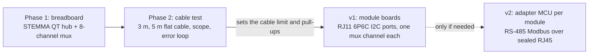

The v1 base unit:

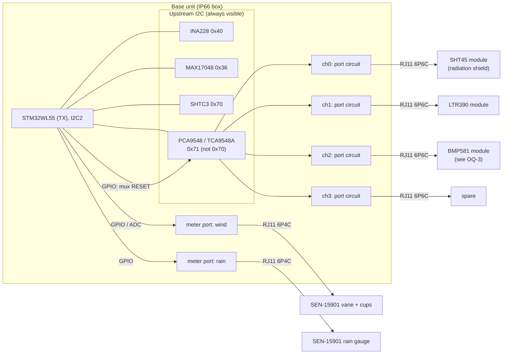

**Finding: the mux must not sit at 0x70.** The PCA9548 and TCA9548A answer at 0x70 to 0x77, set by
their A0–A2 pins, and 0x70 is the default. The SHTC3 is fixed at 0x70 and sits upstream of the mux,
on the same wires. The two would collide. Set the mux to another address with its address pins or
jumpers. This spec uses 0x71 (my call; any free address from 0x71 to 0x77 works). Check the jumper on
the board in hand. This applies to the breadboard too.

## 4. Phase 1: the breadboard with the mux

### 4.1 Topology

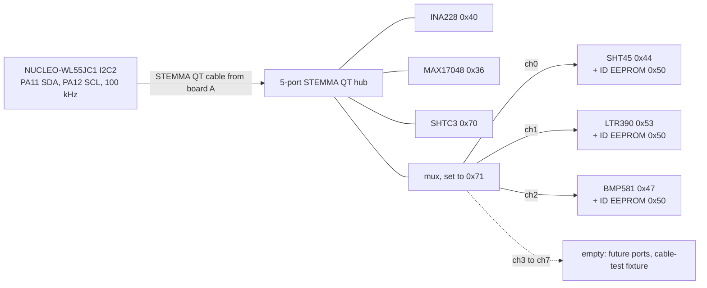

- The hub's five sockets take the NUCLEO cable, the INA228, the MAX17048, the SHTC3 and the mux.
  Daisy-chaining by the boards' second sockets also works. The topology is what matters: the three
  base-only parts and the mux are upstream; each external sensor is alone on a channel.
- The channel numbers above are my call. Any assignment works, but firmware and wiring must agree.
- **Every channel's sensor has its ID EEPROM from phase 1 on** (decision: identity is normalized).
  On the breadboard it is a STEMMA QT EEPROM breakout (a 24LC32-class part at 0x50, for example
  Adafruit's 24LC32 board; check its address and write-protect jumper), chained from the sensor
  board's second QT socket. All channels' EEPROMs share 0x50; only one channel is selected at a time,
  and nothing upstream uses 0x50. Each one is programmed once with its sensor's record (section 6.9),
  then write-protected: WP strapped to VCC (the breakout's default WP state is **TBD**; check it).
  When the sensor moves onto its v1 module board, the record is copied to that board's EEPROM, so the
  serial does not change, and the breakout's copy is invalidated (section 6.9, **Copying a record**):
  two live EEPROMs never carry one serial. On the breadboard each EEPROM breakout and its sensor
  board are a labelled pair; replacing the sensor board means a new record with a new serial.
- **The breadboard itself does not change.** Board A keeps one STEMMA QT cable to the hub
  ([`build-sheet.md`](../../../hardware/bench-breadboard-r0/build-sheet.md), part QT). The mux lives
  on the QT chain, off the breadboard. The meter circuits on board A stay as they are.
- **Mux RESET** (active low on the TCA9548A; check the PCA9548 board) goes to a free NUCLEO GPIO, so
  firmware can release a stuck channel (section 6.6). The pin is **TBD**: it must pass the UM2592
  checklist of the wiring guide (section 6 there), like every other pin. Until it is wired, the
  breadboard has no way out of a channel whose device holds SDA low, other than unplugging.

### 4.2 Pull-ups on the breadboard

Keep the Adafruit boards' own pull-ups on the breadboard. Each channel then has its sensor board's
pull-ups, and the upstream bus has those of the hub-side boards. Cutting pull-ups is a v1 and cable-test
step, not a phase 1 step.

When a channel is selected, the mux joins it to the upstream bus. The two sets of pull-ups are then
in parallel, and the capacitances add. So the bus that the NUCLEO sees is upstream plus one
channel. The phase 2 test measures exactly that combination.

### 4.3 Firmware for phase 1

Smallest change: a **static channel map**.
- `i2c_bus` (`firmware/stage0-node/App/i2c_bus.lit.md`) gets a channel for each client. Before a
  transfer to a client on a channel, the bus writes the mux control register, and reads it back
  to check it. After the burst it deselects every channel (writes 0x00 and reads it back). Upstream
  clients (INA228, MAX17048, SHTC3) are served only with no channel selected (section 6.5).
- The stuck-bus recovery (WSMP-B3) runs with the failing channel still selected, then deselects all
  channels (section 6.6). The breadboard has no per-port power switch, so step 3 of the ladder (the
  power cycle) does not exist there: a channel still stuck after mux RESET stays faulted until
  unplugged.
- The module drivers stay as they are. Discovery (a port finds out which sensor it holds) is a v1
  step (section 6.7).
- The host test harness gets a register model of the mux.

Bench checks to add to the wiring guide's section 8 (each a few minutes):

| Check | Expected |
|---|---|
| `MODULES` after a minute | every module active, as today |
| Unplug the SHT45 from ch0 | `air_th` goes suspect, then absent. The others stay active |
| Short SDA to GND on ch0 for 10 s (a jumper on the QT breakout). **Only with mux RESET wired** | ch0's module goes suspect. INA228, MAX17048, SHTC3, LTR390 and BMP581 keep reading. No reset. Without RESET wired the upstream bus is held too, and every I2C module goes suspect until the short is removed: that is the expected result then, and it shows why RESET is needed |
| Plug the SHT45 into ch3 instead of ch0 | with the static map: absent (the expected result for phase 1). With discovery (v1): found on ch3 |

## 5. Phase 2: the cable test

The test decides the cable limit and the pull-up value before any board is designed.

### 5.1 Fixture

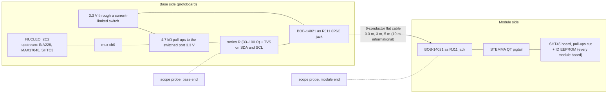

- Wire the port pinout of section 6.2 on both BOB-14021 breakouts.
- **Fix the upstream pull-ups first.** When ch0 is selected, the line's pull-up is the channel's
  pull-up in parallel with every upstream pull-up (section 4.2). The Adafruit boards upstream (INA228,
  MAX17048, SHTC3, the mux board) each bring their own. Either remove them and fit one known upstream
  pair (4.7 kΩ, my call, the same as the v1 base will have), or measure their combined value and
  record it. The test result is only valid for the combined pull-up that the v1 base will really
  have. Record that combined value with every capture.
- Crimp the cables **straight through** (pin 1 to pin 1). Check each cable with a modular cable
  tester before use. Many ready-made flat modular cords are *reversed* (pin 1 to pin 6). Section 6.3
  explains why that matters.
- If the TVS diodes and series resistors are not in hand, run the test once without them and again
  with them. The TVS capacitance counts against the rise time.

### 5.2 Procedure

1. **Cable capacitance.** With an LCR meter, measure SDA (and SCL) to all other conductors tied
   together, on a 0.5 m and a 5 m piece. The difference gives pF per metre and removes the plugs. Flat
   modular cable is roughly 40–70 pF/m conductor to neighbours *(estimate, measure)*.
2. **Baseline at 0.3 m.** Scope SDA and SCL at both ends at 100 kHz while the loop of step 4 runs.
3. **3 m, then 5 m.** Repeat step 2. Record for SDA and SCL, at the module end and the base end:
   - the rise time from 30 % to 70 % of 3.3 V (the I2C definition),
   - the fall time,
   - the low level at the receiver (the far end from the device that pulls low),
   - ringing and overshoot,
   - crosstalk: SDA while SCL toggles and SDA stays high.
4. **Error-count loop.** A test build of the station firmware runs CRC-checked transactions on the
   port and counts the results: OK, address NACK, data NACK, bad CRC, timeout, bus error, recovery.
   - SHT45: the serial-number read and the measurement read. Both carry a CRC.
   - The test module's ID EEPROM: write a fixed pattern once, then read it back and compare. This
     finds corruption that a CRC cannot (the EEPROM has no CRC). The cable-test module is a fixture,
     not a fielded module: its write-protect is opened by a jumper, and the pattern goes only to the
     test page (section 6.9), never to the record itself. A fielded module is write-protected, so
     H04a counts its CRC-checked record reads instead.
   - 10⁶ transactions at each length that is to qualify. At about 1.5 ms each this is roughly
     25 minutes *(estimate)*.
5. **Hot-plug, a separate trial.** The 10⁶-transaction run of step 4 has no plug events. Afterwards,
   with the same loop running:
   - **Replugs of the same module**, 20 events: 10 outs of about 5 s, at least 30 s apart, and 10
     outs of about 70 s, at least 3 min apart (so no three latches in a row can all miss a read:
     with 60 s latches, two 70 s outs 30 s apart can). A replug changes no descriptor set, so it does
     not count toward WSMP-P6.
   - **Swaps**, 4: two modules exchanged between two occupied ports, at least 61 min apart. A swap is
     at most 2 descriptor-set changes on each port, so no port sees more than 2 in any hour, against
     WSMP-P6's limit of 4.
   - **Moves**, 4: one module moved to an empty port, plugged within 5 s of the unplug, 61 min
     apart.

   Log each event's time, so every error can be assigned to a plug event or not. Judged by the
   hot-plug criterion below, not by the error-loop one.
6. **10 m, informational.** One scope capture and a short loop, to see where the limit is. It is not
   a v1 criterion.
7. Record the results under `evidence/cable-test-<date>/`: the setup, the cable's make and type,
   captures, counts and the firmware commit.

### 5.3 Pass criteria (at each length)

| Criterion | Limit | Source |
|---|---|---|
| Rise time, 30–70 %, SDA and SCL, both ends | ≤ 1000 ns | Clint; the I2C standard-mode limit |
| Fall time | ≤ 300 ns | my addition: the standard-mode limit |
| Low level at the receiver | ≤ 0.4 V | my addition. 0.3 × 3.3 V ≈ 1.0 V is the input threshold; 0.4 V keeps margin for ground offset |
| Error loop (step 4, no plug events) | 10⁶ transactions, **0 undetected corruption and 0 detected errors** | my proposal (OQ-2). Zero in 10⁶ bounds the error rate below about 3 × 10⁻⁶ at 95 % confidence |
| Hot-plug (step 5: 20 replugs, 4 swaps, 4 moves) | detected errors only within a plug event (from unplug until the port reads again), and 0 undetected corruption. **Replug:** no descriptor-set change. A replug that a probe or read noticed gives a new boot ID at the next latch whose identity check matches; a 5 s replug that no probe or read fell in goes unnoticed and keeps its boot ID (acceptable: the module missed no sample, and no v1 passive module has a counter). **Swap:** the destination ports are occupied, so no rescan probes them; each port's pre-latch identity check (section 6.7) finds a different module, ends the port at that latch with its window missing, and the module joins on its new port at a following latch: back in the readings within 2 latches (about 2 min), one window missing on each port. **Move:** the newcomer's duplicate verdict checks the holder (section 6.7), the holder is gone, and the module is in the readings within PORT-7's 120 s. **Never** a quarantine | WSMP-P2 (admission); PORT-6, PORT-7, PORT-14, PORT-16; live mating per the proposed WSMP-P9 (OQ-5), not current WSMP (WSMP-P7 covers remote ports only) |

### 5.4 What each result changes

The rise-time arithmetic: for a pull-up R and a bus capacitance C, the 30–70 % rise time is
0.8473 × R × C. **R is the combined pull-up**: the channel's in parallel with the upstream pair. With
4.7 kΩ on both, R is about 2.35 kΩ; the figures below give the channel value and assume the upstream
pair is removed or much larger, so they are a worst case for C. Check the combined R against the
1 kΩ floor below before choosing a lower channel value: 2.2 kΩ on the channel with 4.7 kΩ upstream
gives about 1.5 kΩ, still above it. At 4.7 kΩ and 1000 ns, the bus may have at most about 250 pF. At 2.2 kΩ, about
540 pF. The standard-mode spec also caps the bus at 400 pF. The lowest pull-up that still lets a part
pull the line to 0.4 V at 3 mA is (3.3 − 0.4) / 3 mA ≈ 1 kΩ, but the sensors' actual sink
capability is **TBD** from their datasheets.

A rough budget at 4.7 kΩ *(estimate, measure)*: upstream bus, mux channel, TVS and module together
about 50–80 pF, plus 50 pF/m of cable. 3 m then gives about 200–230 pF (pass, near the edge). 5 m
gives about 300–330 pF (fail at 4.7 kΩ, pass at 2.2 kΩ).

**Margin.** Clint's ≤ 1000 ns is the pass line. A length that passes at room temperature with less
than about 20 % margin (rise time over about 800 ns) should be treated as marginal: H04a repeats the
test cold and on the final cable (my proposal; Clint may set a different margin).

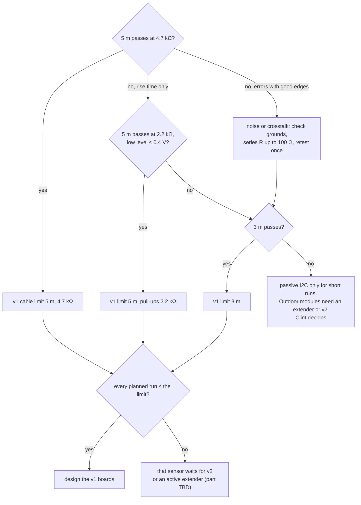

Other results:
- **The measured pF/m** replaces every estimate in this spec and goes into the base board design.
- **The run lengths that are needed** come from the site: the shield on the mast (the R1 enclosure
  plan already assumes a cable of about 2 m), the UV sensor's mounting, any remote sensor. If a run
  is longer than the limit, the choice is an extender, v2 for that sensor, or a different site.
- **A slower clock** (for example 50 kHz) gives more time per bit but does not change the rise-time
  limit as written. It is a fallback, not a fix (my view).
- **Cold.** The test is at room temperature. H04a (section 10) repeats the loop at the cold end of
  the PRD range with the final cable.
- **The final cable.** If sealing (OQ-7) needs a round jacketed cable instead of flat cable, repeat
  the test on that cable. Its capacitance differs.

## 6. v1 design

### 6.1 The module board

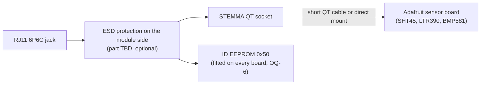

- The module board is passive: a jack, a STEMMA QT socket, an ID EEPROM (always fitted), optional ESD
  parts, and no pull-ups. The sensor stays on its own Adafruit breakout. So the sensor part can be
  swapped without a new board, but **not without a new serial**: the EEPROM's serial names the
  module assembly (this module board with this sensor board), so a sensor-board swap includes
  reprogramming the EEPROM with a new serial on the programming fixture. Otherwise the replacement
  would inherit the old sensor's calibration and siting record. For the SHT45, the record also binds
  the sensor's own serial (section 6.9, `sensor_bind`), so a swap without reprogramming is caught
  (`SENSOR_CHANGED`, section 6.7): the identity check before the latch ends the port at the latch that would publish the new sensor's data, so the old coefficients are never published on it.
- **Pull-ups to cut.** Each Adafruit breakout's pull-ups are removed (cut jumper or removed
  resistors). **Verify for each board**: some STEMMA QT breakouts carry a regulator and a level
  shifter, with pull-ups on both sides of the shifter. Cutting one jumper may leave the other side
  pulled up. The board schematics decide; this spec does not assume. A board with a regulator also
  drops a little voltage from 3.3 V, and its standby current is **TBD**.
- **The ID EEPROM** must answer at one address only. A 2 Kbit "24C02-class" part with its address
  pins tied low uses 0x50. Larger single-byte-address parts use extra addresses for their page bits:
  a 24C04 takes 0x50–0x51, a 24C08 0x50–0x53, a 24C16 0x50–0x57. The last two collide with the LTR390
  at 0x53. A part with 2-byte addressing (24C32-class) keeps
  one address and holds the whole record of section 6.9. **The part is the 24LC32A** (decided
  2026-10-22, section 1). WP is pulled up to VCC through 10 kΩ, so the whole array is write-protected
  in the field. A fixture pad on WP lets the programming fixture pull it low; a hard tie to VCC could
  not be opened by a fixture. The station has no write path to 0x50 (section 6.9).
- The module housing, the shield cartridge and the UV window are out of scope here.

### 6.2 The base port

**Pinout.** Clint's proposed pinout, as the baseline (OQ-1 raises a reversed-cable hazard):

| Pin | Signal | Why |
|---|---|---|
| 1 | 3.3 V (switched, current-limited) | an outer pin: a 4-conductor plug never touches it |
| 2 | SDA | |
| 3 | GND | separates SDA from SCL on untwisted flat cable |
| 4 | SCL | |
| 5 | INT / spare | pulled up on the base, so it is never a floating antenna next to SCL |
| 6 | GND | an outer pin: a 4-conductor plug never touches it |

**The port circuit** (one per port):

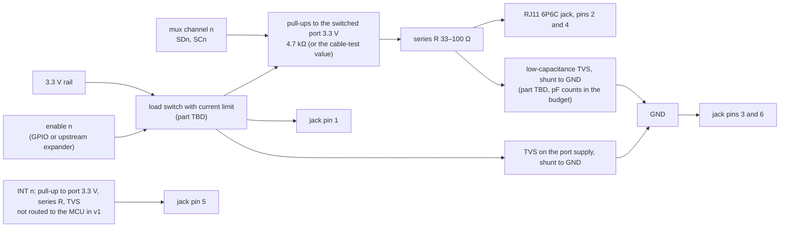

- **One mux channel per port** (PORT-2). The mux isolates every other port from a fault on this one.
- **Pull-ups on the base side** (PORT-3), on the channel side of the series resistor. The value is
  4.7 kΩ unless the cable test says otherwise. The upstream bus keeps one known pair (4.7 kΩ, my
  call); it is in parallel with the channel's when the channel is selected (section 4.2).
- **The pull-ups take their supply from the switched port rail**, after the load switch, not from the
  station's 3.3 V. Otherwise a port that is switched off still feeds the sensor through the pull-ups
  and its SDA and SCL clamp diodes, and the power cycle of section 6.6 may not clear a latch-up. With
  the port off, its lines sit low, and the mux keeps them off the upstream bus.
- **INT (pin 5)** gets a pull-up, a series resistor and a TVS, and goes nowhere else in v1: no v1
  driver uses an interrupt, so it costs no MCU pin (my call). OQ-1 may remove it.
- **Series resistor and TVS** (PORT-4). The series resistor limits the current of an ESD event into
  the mux and slows edges a little. It also lifts the low level by I × R: at 1.5 mA through 100 Ω,
  0.15 V. The cable test checks this.
- **Port power** (PORT-5). **A load switch, not a PTC** (my recommendation, within Clint's "load
  switch or PTC"):
  - a PTC reacts in milliseconds to seconds and does not stop the rail dip when a module is plugged
    in live;
  - a switch with a current limit and a soft start does, and the firmware can switch it;
  - the firmware needs the switch anyway, as the last step of recovery (section 6.6).

  The current limit is **TBD**. It must be above the module's peak (a few mA for these sensors,
  *estimate, measure*) and low enough that a reversed or shorted cable does no damage (section 6.3).
- **Mux RESET** goes straight to an MCU GPIO. The port enables can go to an upstream I/O expander if
  the MCU runs out of pins. The mux RESET cannot: it is what frees the upstream bus when a channel
  device holds SDA low, and an expander on a stuck bus cannot be reached.
- **Labels.** Sensor ports and meter ports use the same 6-position jack. Label them SENSOR 1–n and
  WIND, RAIN, and give the sensor cables a different colour (PORT-12).

### 6.3 Cross-mating and reversed cables

The meter ports today (from `hardware/bench-breadboard-r0/source/wiring.toml`): the wind port has
pins 2 and 3 on GND, pin 4 = cups (10 kΩ pull-up, 100 nF), pin 5 = vane (10 kΩ pull-up). The rain
port has pin 3 on GND and pin 4 = rain (10 kΩ pull-up, 100 nF). Pins 1 and 6 are not connected. A
6P4C plug touches only positions 2 to 5 of a 6-position jack.

| Mismatch | What happens | Result |
|---|---|---|
| Wind cable in a sensor port | the cup switch joins pins 3–4: GND to SCL. The vane network joins pins 2–5: SDA to INT | SCL held low when the cups stop on a closed switch: a channel fault on that port only. No 3.3 V reaches the meter. Safe |
| Rain cable in a sensor port | the bucket switch joins GND to SCL | a short channel fault at each tip. Safe |
| Sensor module in the wind port | pin 1 (3.3 V) is open, so the module is unpowered. Its SDA goes to GND. Its SCL goes to the cups net, which has 10 kΩ to 3.3 V | the cups input reads high: no pulses. The vane reads near 3.3 V: "no vane", so the wind module goes absent. **But** the 10 kΩ pull-up feeds about 0.3 mA into the unpowered sensor's SCL clamp diode *(estimate)*. Probably harmless; check against the sensor's injection-current limit (**TBD**) |
| Sensor module in the rain port | as above, on pin 4 only | the rain module counts nothing (it cannot show presence, WSMP-P1). Same back-feed note |
| **Reversed 6P6C cable** (pin 1 to pin 6, the common telephone-cord wiring) on a sensor port | base pin 1 (3.3 V) reaches module pin 6 (GND). Base pin 6 (GND) reaches module pin 1 (VDD). SDA meets INT. GND meets SCL | **the sensor is powered backwards.** Its clamp diodes conduct until the port's current limit acts. This can destroy the sensor. See OQ-1 |

So Clint's rationale holds for 4-conductor plugs. It does not hold for a reversed 6-conductor cable,
and reversed cords are what a hardware store sells. OQ-1 gives two fixes.

A telephone line plugged into a sensor port puts about 48 V DC (and ring voltage) on the centre pair,
pins 3 and 4: GND and SCL. The TVS clamps it; whether the TVS survives depends on the line's loop
current. OQ-12 asks whether H04a tests this, as the PRD's H04 tests a 24/48 V injector on RJ45.

### 6.4 Hot-plug

- Live plugging is tolerated, not just allowed. RJ11 contacts mate in no fixed order, so the
  design assumes any pin can touch first.
- ESD from the plug or a hand goes into the TVS diodes.
- The module's input capacitance charges through the load switch's current limit and soft start,
  not from the station's 3.3 V rail directly.
- A plug event on the selected channel can corrupt the transfer in progress. The bus reports an
  error, recovers that channel, and the module probes again (WSMP-B2, B3). A plug event on another
  channel does nothing to the bus: the mux keeps that channel open.
- **GND mating last is not analysed (open, M9 of the 2026-10-22 review).** RJ11 has no staggered
  contacts. If pin 1 (3.3 V) and SDA or SCL touch before both GND pins, the sensor's ground floats up
  and current can flow through its SDA and SCL clamp diodes into a line held low, limited only by the
  series resistor. Whether that exceeds the sensor's, the mux's or the STM32's injection-current
  limit is **TBD** from their datasheets *(Hypothesis: it can)*. Twenty random plugs may never hit
  this order, so H04a gets a deliberate case: a switch in the GND conductor, opened, the cable
  plugged, then GND closed (section 10). If it fails, the fix (a larger series resistor, module-side
  clamps, or a power-last plug sequence) is decided then.
- PRD §6 says "power off the port before connecting or disconnecting a module" and "no live mating".
  That rule was written for 10–18 V RS-485 ports. For a 3.3 V current-limited I2C port it costs
  usability and buys little. OQ-5 asks Clint to confirm that v1 departs from it.

### 6.5 Scheduling on the mux

- Only one channel is selected at a time. The bus queue of `i2c_bus` serves transfers in order. A
  transfer whose client is on a channel first writes the mux (one byte) and reads it back.
- **After every channel burst the bus deselects all channels** (writes 0x00 and reads it back).
  Upstream parts are served only with no channel selected. So a plug event or a latch-up on a port
  can never corrupt an INA228 or MAX17048 transfer, a foreign device on a port can never answer at an
  upstream address, and a bus stuck with no channel selected is an upstream fault, not a port fault.
- **A channel whose port power is off is never selected.** With its pull-ups unpowered, selecting it
  would load the upstream bus through the channel's pull-ups to a 0 V rail.
- The SHT45 does not answer during a measurement (WSMP-B2). That stays a per-module rule; the mux
  does not change it.
- Each channel switch, and each deselect, costs a few hundred microseconds at 100 kHz *(estimate)*.
  The station reads four ports in well under the 5 s read deadline (WSMP-T2).

### 6.6 Recovery, rescan and port faults

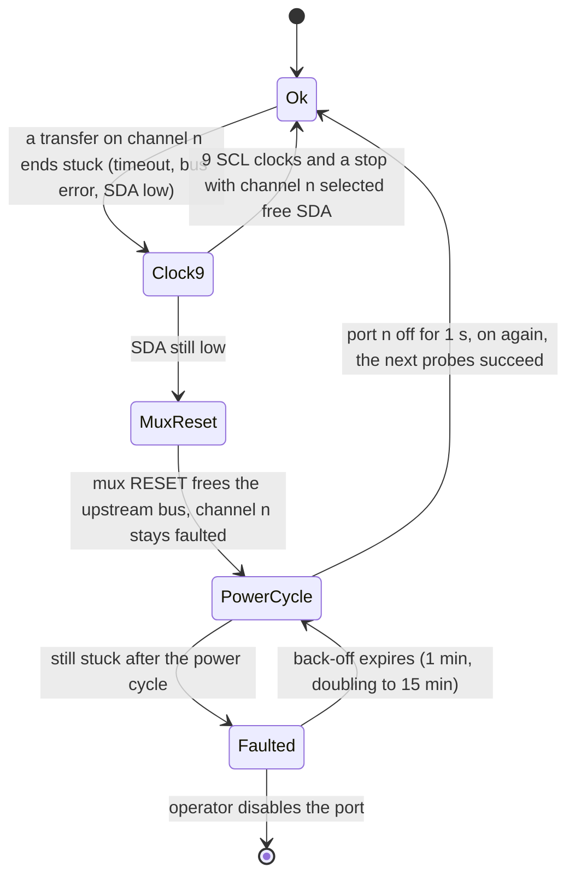

- Step 1 is WSMP-B3 as it is today, run on the failing channel.
- Step 2 is new: if a device on channel n still holds SDA, the upstream bus is held too, because the
  mux joins them. The firmware cannot write the mux to deselect the channel. Mux RESET does it in
  hardware. The upstream parts (battery monitor, enclosure sensor) are back at once.
- Step 3 is new: switching the port's power off and on clears a latched-up sensor.
- The back-off times are my call. A faulted port costs no bus time between attempts.
- **Rescan.** Every 15 s (my call: the station's sample tick), an empty port probes every address in
  the probe table (section 6.7), as one burst of transfers in its probe slot (one burst per slot,
  every table address in it). Two good probes in
  a row admit the module (WSMP-P2), so admission takes 15–30 s, and the module joins the layout at the
  next latch (up to 60 s later). With a first probe lost to contact bounce (+15 s) and the
  identification and holder check (up to about 2.25 s, section 6.7), plus up to 3 s if that falls in
  a pre-latch slot, a newly plugged module is in the readings within about 111 s
  (15 + 15 + 15 + 2.25 + 3 + 60 s); PORT-7 allows 120 s.
- **Unknown-device scan** (my call). The probe table alone cannot see a device at another address,
  so a port that stays absent also gets a bounded scan: once at boot, then at most once every
  15 min, in its probe slot. It addresses 0x08–0x77 except the table addresses and every address on
  the upstream bus (the mux, the battery monitor, the enclosure sensor: they answer through any
  selected channel), a fixed list built from the board's upstream table, not learned, and except
  0x50. Each address gets a zero-length write, and the whole scan is about 110 address bytes, under
  15 ms at 100 kHz *(estimate)*. An ACK marks the port "unknown device at 0xNN". It is never admitted
  (WSMP-P3). Whether a zero-length write is harmless to every part we might meet is **TBD**. A port
  whose 0x50 answers with a valid record but whose probe finds no sensor reports "record present,
  sensor missing", with the module type the record names.
- **Boot order.** At boot, before any upstream transfer: pulse mux RESET, write mask 0x00 and read
  it back, then run the phantom check below, then start the upstream drivers.
- **No phantom modules** (PORT-15). No probe-table or scan address may answer with every channel
  deselected. At boot, with mux mask 0x00, the station probes every probe-table address and 0x50;
  any that answers is removed from the port probe table and the scan for that boot and reported as
  an upstream conflict. A build-time check asserts that the upstream table and the probe table share
  no address. Otherwise an upstream device (for example a BMP581 on the base, OQ-3) answers through
  every selected channel, and every empty port is admitted as that module.
- **Port faults are reported.** A faulted port, or a device the scan found at an address that is not
  in the table, shows in the `MODULES` line and later in the health report. A port fault never changes the
  descriptor set by itself (WSMP-P3).

### 6.7 Presence, identity and descriptors for a passive module

A v1 external module is a WSMP **local** module: its driver runs on the station. WSMP rule 1 ("one
contract") holds unchanged. What is new is that a port no longer implies a module type. Today each
port is fixed to one type (`enum wsmp_port` in `firmware/stage0-node/App/wsmp_local.h`). On an I2C
port the station finds out what is plugged in.

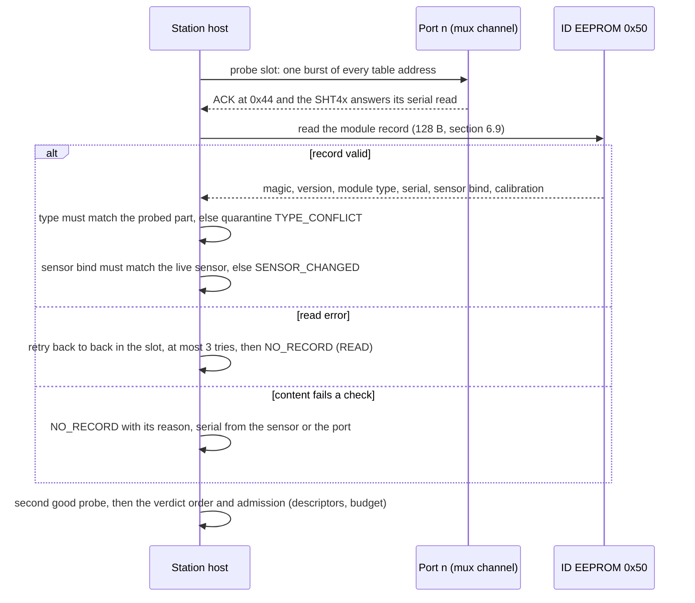

**Probe table** (the module types already in the registry, WSMP section 4.4):

| Address | Check | Module type |
|---|---|---|
| 0x44 | the SHT4x serial-number read with a good CRC (verify the command in the datasheet) | 1, air temperature and humidity |
| 0x46 or 0x47 | BMP581 CHIP_ID = 0x50 (as `App/mod_reg.c` does today). **Only if the BMP581 is a port module** (OQ-3); if it goes on the base, upstream of the mux, type 2 leaves the port probe table and the phantom rule (section 6.6) would remove it anyway | 2, air pressure |
| 0x53 | LTR390 PART_ID register 0x06, high nibble = 0xB (part number). The low nibble is the revision and is not compared (`App/mod_reg.c` today compares the whole byte, 0xB2: change it, section 13.3; the nibble split is from memory of the datasheet, verify) | 3, UVA |

**Presence** (a proposed bullet for WSMP-P1): an I2C port shows presence by a successful probe of a
table address on its mux channel, with the part's ID check. NACK at every table address means
absent. SDA or SCL held low on the channel is a port fault (WSMP-P3). Two table parts on one port
are refused: one module per port. A module whose type is already admitted on another port is
refused with the port status `DUP_TYPE` (one module per type in v1, section 1) if the holder check
finds the holder present (below). **After a station reboot** with two modules of one type plugged in,
the station holds the boot verdicts for the first two station-wide probe rounds (two 15 s ticks; a Faulted or operator-disabled port, never probed, does not hold them), then
decides them in port order, so the lower port wins; a port whose probes bounced in those rounds
decides later and loses. The gateway then sees the role's
serial change if the other one held it before (the archive's role-serial alarm, section 13.3).

**Identity block**, filled by the station's driver as today, from these sources:

| Field | Source |
|---|---|
| magic, WSMP version | the station |
| module type, schema | the probe table gives the type; the schema is the one the station's registry (WSMP section 4.4) assigns to that type. The record carries the type only, never a schema: a schema is a property of the driver and registry, so a firmware schema change never invalidates fielded records. A valid record whose type differs is quarantined |
| serial | 1. the EEPROM record (namespace 0x01). 2. Else derived from the sensor's own serial number, if it has one (namespace 0x02; the SHT4x does; the BMP581 and LTR390: **TBD**). 3. Else `WSMP_LOCAL_SERIAL(port, type)`, as today (namespace 0x00). Sources 1 and 2 travel with the module; source 3 is bound to the port (see **Serial rules** below) |
| firmware version and build | the station's |
| boot ID | `(station boot epoch << 8) \| (admission count of the port, mod 256)`, u32, assuming the epoch stays below 2²⁴ (16.7 million station boots). The admission count goes up at each admission of the port, and at the latch where a port's sticky *possibly replugged* flag (set by a missed probe or a failed data read, not by a failed identity-check read) is cleared by a matching identity check at a latch whose data read is good (section 6.7). A passive module has no clock of its own, so a re-plug is its "boot". This keeps WSMP-I2's intent (a counter series never spans a power loss) for any future passive module with a counter. The snapshot carries the low 16 bits (8 bits of epoch, 8 of count). **Accepted limit:** a boot ID repeats only after 256 noticed replugs or admissions of one port within one station boot; WSMP-C1 also needs the same serial, and no v1 passive module has a counter. A passive module with a counter needs a wider field first. This replaces, for I2C ports, the identity table's "increases by one at each boot, kept in non-volatile memory" (section 13.1) |
| identity flags (register 0x000F, now reserved) | bits 0–1 serial source (0 port or station, 1 record, 2 sensor, 3 adapter UID); bits 2–3 reserved, 0; bits 4–7 the record status (0 applied, 1 READ, 2 BLANK, 3 NO_MAGIC, 4 VERSION, 5 MALFORMED, 6 CRC, 7 CAL_REJECTED, 8 SENSOR_CHANGED: valid but not applied; 1–6 are `NO_RECORD`; section 6.9); bits 8–15 0. A reader rejects nonzero reserved bits (2–3 and 8–15) as malformed (`wsmp_unpack_identity`; the descriptor-set parser for bits 2–3 of `id_flags`). The low byte is the descriptor set's `id_flags`, so the reason reaches the gateway. The flags describe an admitted module only: for a verdict that is not admitted (`TYPE_CONFLICT`, `DUP_SERIAL`, `DUP_TYPE`) they have no meaning and are not sent, and the console's `MODULES` line prints the verdict instead. Proposed WSMP edit, section 13.1 |
| capabilities | bit 0 set if the record is valid (it fills the metadata block: part number and calibration revisions). Bit 1 clear |
| descriptor digest | computed, as today |

**Descriptors** come from the driver and the registry, as today. They never come from the EEPROM.
Rule 3 of WSMP (codes, not text, carry meaning) and WSMP-X3 (no text as identity) hold.

**The module record** in the EEPROM is defined in section 6.9 (Module record v1.0). The station
parses it into a fixed structure and checks every length, code and character (WSMP-X2). The fuzz
target `wsmp` grows to cover it.

**Verdicts, in this order** (the first that applies decides; the same order for every serial
source, so the result is deterministic):

| Step | Verdict | When | Result |
|---|---|---|---|
| 1 | `NO_RECORD` (READ) | no ACK at 0x50, or a transfer error, on 3 tries back to back inside the probe slot (about 40 ms). A single read error is retried, not a verdict | go on to step 4 with the serial from source 2 or 3, no calibration |
| 2 | `NO_RECORD` (BLANK, NO_MAGIC, VERSION, MALFORMED, CRC) | the record was read but fails a structural check (section 6.9, **Checks** 2–6). A CRC failure is read once more first | go on to step 4 with the serial from source 2 or 3, no calibration |
| 3a | `TYPE_CONFLICT` quarantine | a valid record whose module type differs from the probed part | quarantined; stop |
| 3b | `SENSOR_CHANGED` | a valid record whose sensor bind differs from the live sensor's serial, **read** (a good CRC) and different (a sensor-board swap without reprogramming). A read error is not a verdict: the sensor serial (0x89) is tried 3 times back to back in the slot, like the record; if all 3 fail, the identification is incomplete: no verdict at all, the port stays Identifying, the incomplete identification is counted (console `MODULES` line), and the port is identified again at its next probe slot | go on with the source-2 serial, no calibration |
| 3c | `CAL_REJECTED` | a structurally valid record whose calibration fails only the calibration checks (section 6.9, **Checks** 7) | go on with the record's serial, no calibration |
| 4 | duplicate serial | the serial (any source) equals that of a module Admitted, Active or Suspect on another port | **check the holder now** (below) |
| 5 | duplicate type | the module type is Admitted, Active or Suspect on another port (one per type, section 1) | **check the holder now** (below) |
| 6 | admit | otherwise | admitted with its serial, its flags and, for an applied record (status 0), the record's calibration |

**Checking the holder** (steps 4 and 5; decided by the review crew, section 1). The holder check is
a step of the **holder driver's own step machine**, started only from its idle state (`mod_th`'s
ST_IDLE), so never between the SHT45's 0xFD and its read: the newcomer's verdict waits for it,
usually one or two driver ticks (250 ms each; `mod_reg` needs 2), and up to about 9 ticks (about
2.25 s) if the holder driver is in its own identity check or the holder check confirms a different
identity (4–6 steps). In the pre-latch slot it waits until after the latch (below). The step selects the holder's channel and reads the holder's
probe-table address with its ID check, its record serial at 0x50 if it was admitted with a record,
and its sensor serial if it has one.
- **Holder gone** only on (a) an address NACK at the holder's probe-table address on two tries back
  to back, or (b) a confirmed different identity (as the identity check confirms one, below), or (c)
  a holder port that is Faulted (section 6.6, after the power-cycle step failed) or disabled by the
  operator (it is never selected, so its module is unreadable and treated as gone). The 1 s off of a
  recovery power cycle is not "gone": the check waits for it. The holder is ended (Absent, new descriptor set at the next latch) and the
  newcomer goes on to admission; its driver's window is reset at the bind, so no sample of the old
  module is in the newcomer's first window. A moved module is therefore admitted within two probes
  of the plug, before the old port's next latch. This is a removal sooner than WSMP-P2's three missed
  latches, so §13.1 amends WSMP-P2.
- **Holder present** otherwise. An EEPROM or sensor-serial read that fails is not absence: the holder
  is present and its identity unverified. The newcomer is refused (`DUP_SERIAL` for a clone,
  `DUP_TYPE` for a second module of a type), never quarantined. A refusal is re-evaluated at every
  latch, after all ports' latches, in port order; the newcomer is admitted only once the holder is
  Absent.

A `TYPE_CONFLICT` quarantine is released only by removing the module (WSMP §7: Quarantined →
Absent; a WSMP-P6 flap quarantine still ends after its hour); the record is corrected off the station, on the programming fixture. **A quarantined or
refused port keeps its probe slot**: it probes the module's address each slot, and two missed probes
in a row make it Absent, so a removal is always seen. **Reporting:** the serial source and
the record status (including `SENSOR_CHANGED`) reach the gateway in the descriptor set (below).
`TYPE_CONFLICT`, `DUP_SERIAL` and `DUP_TYPE` are not admitted, so in v1 they show only on the console
(`MODULES` line); a radio health field for them is a later item.

**Accepted risk.** Only the SHT4x has a sensor serial to bind. A BMP581 or LTR390 sensor board
swapped under its module board without reprogramming keeps the old record and its calibration,
undetected. The programming procedure (section 6.1) is the only guard.

**Re-identification** (PORT-16, PORT-17). A module can be swapped between two reads without one
failed read, and an unplugged module stays Active until a latch read fails, so admission alone does
not see a swap. **Every latch is preceded by an identity check** of every Admitted, Active and
Suspect I2C module, on a fixed schedule:
- **The pre-latch slot** starts 3 s before each latch (my call: longer than a sample in progress, one
  250 ms tick, plus the worst-case check, about 9 ticks or 2.25 s for an SHT45 whose change is
  confirmed with full reads). Sampling is free-running (WSMP-T4) and the latch has its own timer, so
  the slot is defined from the latch time, not from a sample. The latch time is the one scheduled
  (the sample timer's, a minute after the latch before was due), not the moment the sample task runs:
  a latch whose task runs late does not move the next slot, and a latch that comes before its slot
  has no check (unverified). **The slot applies only to I2C
  port-module drivers** (ports 1–8); on-board drivers (power, wind, rain, enclosure) sample as today.
  In the slot a port-module driver starts no new sample: **a sample that falls due in the slot is
  deferred**, not dropped, to the driver's first tick after the latch, and its period keeps its
  phase (the next sample is due when it would have been), so the deferred sample lands in the new
  window and every window keeps its sample count. In the real code the sample phase is about 0 (each
  driver's first sample is due at boot, and the latch is every fourth 15 s tick), so a port module's
  sample is due at the latch every time; deferring keeps it. §13.1 amends WSMP-T4. The identity
  check has priority in the slot: a newcomer's identification or a holder check for the same driver
  waits until after the latch. A sample already in progress finishes, then the driver runs the check
  as a step of its own step machine from its idle state (`mod_th`'s ST_IDLE, section 13.3), never
  between the SHT45's 0xFD measure command and its 6-byte read. The
  0x89 reply has the same two-words-and-CRC form as a measurement, so the step, not the bytes, decides
  which parser reads it. Sampling resumes after the latch.
- The check re-observes the identity seen **at admission** and compares like with like:

| Admitted with | Re-observed | A confirmed change is |
|---|---|---|
| an applied or `SENSOR_CHANGED` record | the serial at 0x0C and the CRC at 0x7C (12 bytes, two short reads) | a different serial or CRC, confirmed by a full 128-byte CRC-checked read whose verdict (steps 2–3c) is redone on the new record. If that full read is not a valid record (blank, corrupt, or 0x50 NACKs: a module with a blank, corrupt or missing EEPROM), it is read once more, back to back: two full reads that agree with each other (the same image, compared by CRC-32C as in the image row, or both NACK at 0x50) both differ from the record admitted, a confirmed change; two that disagree are unverified, as in the image row. The short reads themselves must complete: a NACK on the 8-byte serial read is a failed part (unverified), so an EEPROM that dies after admission stays unverified (PORT-17) |
| `NO_RECORD` (READ): 0x50 did not answer | whether 0x50 answers. A NACK is a **completed, agreeing** part (it matches what admission saw) | 0x50 answering with a record that passes a full read. Allowed **once per admission**; a later NACK is never a change |
| `NO_RECORD` with a content reason (BLANK, NO_MAGIC, VERSION, MALFORMED, CRC), or `CAL_REJECTED` | the whole 128-byte record (one full read, about 12 ms), compared by the CRC-32C computed over the 128 bytes read against the one computed over the image read at admission (not the stored CRC at 0x7C, which a corrupt image need not match) | a different image on two full reads back to back in the slot that agree with each other (two that disagree: unverified), the second parsed as at admission (steps 2–3c): a change if its verdict, its record status or its serial differs from admission. A different image with the same verdict, status and serial agrees, so a corrupt tail that drifts is not a leave and a join at every latch |
| a sensor serial (SHT4x), with or without a record | the sensor's serial (command 0x89, its own CRC) | a different serial on two reads back to back in the slot |

- **Why the whole image for these** (Codex review of PR #18): a content fault or a rejected calibration may lie anywhere in the 128 bytes, past the serial. A module admitted as `NO_RECORD` (CRC) after a transient corruption, or MALFORMED by a field after 0x13, would otherwise keep a prefix that matches for ever, its fallback serial and no calibration, after the record reads valid again; a `CAL_REJECTED` record rewritten on the fixture is a new record. **Tick count:** the two full reads take one driver step each and replace the earlier compare's three (two 20-byte reads and a full read), so the worst case stays about 9 ticks (2.25 s) and the 3 s slot still fits.
- **Outcome of a check:** *changed* if any part confirms a difference (a confirmed difference wins
  over a part that NACKed or failed: an SHT45 replaced by an LTR390 module NACKs 0x89 but its record
  serial differs); *matched* if every part that completed agrees and at least one part completed;
  otherwise *unverified* (NACK, transfer error, CRC failure on a confirming read, a port fault, or
  the check not finished by the latch).
- **Changed: the port ends at that same latch.** The window that the latch closes is published as
  missing (the new module's samples are never published under the old serial, descriptors or
  coefficients), the port goes Absent (new descriptor set), and the new module is probed and
  admitted as any new module. A changed record CRC with the same serial is also a leave and a join
  (decided by the review crew, section 1): there is no in-place recalibration.
- **The sticky *possibly replugged* flag.** A missed probe or a failed data (sample) read sets it; a
  failed identity-check read does not. Only a *matched* check at a latch whose data read is also good
  clears it, and that latch gives the module a new boot ID: a latch with a missed probe or a failed
  read never counts as matched (it is unverified), so an unplugged `NO_RECORD` (READ) module, whose
  0x50 NACK agrees, keeps its flag and its boot ID until it is plugged back, then takes one new boot
  ID. While it is set and the check is not matched, **the window is published as
  missing**: a module that may have been swapped is never published unverified.
- **Timeout, in any state.** A port whose flag is set and whose check is unverified for 60 latches in
  a row (about 1 h; a matched check or a confirmed change resets the run) is ended (a leave) and
  rejoins as any new module, with whatever identity it then shows. This bounds the silence of a
  working sensor whose record has become unreadable (a BMP581 or LTR390 has no sensor serial to
  match on): it comes back within the hour as `NO_RECORD` (READ), whose NACK then matches. At most
  one descriptor-set change pair an hour, well inside WSMP-P6.
- **Suspect.** A Suspect module returns to Active only at a latch whose check matched. At a latch
  where its data read was good but its check is unverified, its missed-latch count (WSMP-P2) is
  neither raised nor reset, and its window is missing (the flag is set). So "three missed latches in
  a row" counts the missed latches with the good-but-unverified ones between them skipped: miss,
  good-unverified, miss, good-unverified, miss removes the module (amended WSMP-P2, section 13.1).
  The timeout above applies here too.
- **Unverified without the flag** (PORT-17): a module that missed nothing since the last latch keeps
  its state and is published normally; the per-port unverified counter shows on the console
  (`MODULES` line) after 3 latches in a row, and is never sent in the descriptor set. An unverified
  check never moves a port between Active, Suspect and Absent, except the one-hour timeout above;
  only the module's own data reads do that (WSMP-P2, P3), as today. An EEPROM that fails after
  admission therefore leaves a working, unmoved sensor admitted, unverified, its serial unchanged.
- **Order within a latch** (fixed): first the state transitions of every port, in port order; then
  the identity-check results, in port order; then the re-evaluation of refused ports, in port order;
  then the new descriptor set, if any.

**Why every module board has one** (OQ-6, decided 2026-10-21): it gives each physical sensor a serial that survives a move to
another port, and later to a v2 adapter, and it carries the sensor's calibration (section 1). The
gateway's planned calibration and siting archive (WSMP section 15) needs the serial. Without it, a
module's serial is its port, and a swap of two SHT45 modules is invisible.

**The serial reaches the gateway** (B1 of the 2026-10-22 review). Today no frame carries a module
serial: the WSMP section 11.1 descriptor-set entry is port, type, schema and channel count. Each
module entry gains `serial` (u64), `id_flags` (u8: the identity flags' low byte above: serial
source, `SENSOR_CHANGED`, record status) and `record_crc` (u32: the applied record's CRC-32C; 0
whenever no record is applied: `NO_RECORD`, `SENSOR_CHANGED`, `CAL_REJECTED`). A swap or a new
record gives a new set and generation, which is the gateway's series boundary for WSMP-C1 and C4.
The gateway keys calibration and siting history by serial and knows which coefficients were applied
by `record_crc`; the coefficients do not go over the radio: the serial ledger (section 6.9) holds
the whole 128-byte record image, from which the gateway can recompute the CRC and read the
coefficients. An entry grows from 5 to 18 bytes. WSMP-E4 becomes 8 + 8 × 18 + 24 × 6 = 296 bytes
(Calculated; 8 + 12 × 18 + 24 × 6 = 368 if P8 were raised to 12). The fragment payload is not
defined yet (WSMP-E9); with the same 58 bytes that a reading gets (WSMP-A1: a 78-byte plaintext less
a 20-byte header), a full set takes at least ⌈296 / 58⌉ = 6 fragments, against at least ⌈192 / 58⌉ = 4 today
(Calculated, before any fragment header; 7 for 368 B). The WSMP section 11.2 diagram's 3 fragments
illustrate the exchange, not a full set. The radio code has no frame kind for a descriptor set yet:
`ws_air_frame_ok` (`firmware/common/ws_console.c`) accepts only the observation and diagnostic
kinds (section 13.3). The WSMP edits are in section 13.1.

**Serial rules** (they hold for v1 ports and v2 adapters alike, section 7):
- One precedence everywhere: EEPROM record, then the sensor's own serial, then a binding-derived
  fallback. A v2 adapter uses the same order, so a module whose serial came from source 1 or 2 keeps
  it on any v1 port and behind a v2 adapter. The serial may change only at admission or at
  re-identification (a leave and a join), never silently between reads.
- **Namespaces.** The serial's top byte names its source, so the sources never collide:

  | Top byte | Source | Low 56 bits |
  |---|---|---|
  | 0x00 | station-bound fallback, `WSMP_LOCAL_SERIAL(port, type)` (its value `0x575300000000 \| port << 8 \| type` already has a zero top byte) | unique only within one station |
  | 0x01 | programmed record (source 1) | random, from the programming fixture's CSPRNG, never 0 and never all ones, logged in the serial ledger (section 6.9) |
  | 0x02 | the sensor's own serial (source 2) | bits 55–40 the module type, bits 39–32 0, bits 31–0 the sensor's serial (SHT4x: its 32-bit serial) |
  | 0x03 | v2 adapter MCU unique ID (fallback) | the low 56 bits of FNV-1a-64 over the 12 UID bytes (section 7) |

- **Duplicates.** A second module with an admitted serial on one station meets the holder check
  (above): refused (`DUP_SERIAL`) while the holder is present. One namespace-0x01 or 0x02 serial in
  the current descriptor sets of two stations that are both still reporting (heard within the last
  10 minutes) for more than 10 minutes is a gateway alarm (my call:
  the old station's 3 latches to drop the module plus the delivery of its new set; it covers a module
  moved between stations). Namespace-0x00 serials repeat across stations by design, so the gateway always pairs a
  serial with its station key.
- A fallback serial (v1: `WSMP_LOCAL_SERIAL(port, type)`; v2: from the adapter MCU's unique ID)
  names the binding, not the sensor. Moving such a module gives it a new serial, by design. Nobody
  aliases the old serial to the new one: the station and the gateway cannot tell a moved module from
  a swapped one, and a wrong alias would attach one sensor's calibration and siting record to another.
- Home Assistant history does not depend on the serial: the WSMP-H1 entity ID has no port and no
  serial in it, so it continues across moves for every module (section 2).
- A module whose calibration or siting record must follow it across ports or to v2 needs source 1
  or 2. This is why every v1 module board carries a programmed EEPROM (OQ-6).
- **No usable record is a fault, not a normal case.** The station still admits the module
  (its readings stay useful, and one bad part never stops a sensor), takes the serial from sources 2
  and 3, applies no record calibration, and raises the flag `NO_RECORD` with its reason in the
  identity flags, which reach the gateway in the descriptor set. There is no expected record-less
  case: the breadboard has an EEPROM per sensor (section 4.1) and an I2C sensor's v2 adapter takes
  only a v1 module board (section 7). The meter ports (12, 13) are not I2C module ports and are
  outside this rule: the SEN-15901 has no record in v1, by decision (section 1, "Meter identity"),
  and raises no `NO_RECORD`.
- **On an I2C module port, `NO_RECORD` always means a missing, blank, corrupt or unreadable
  EEPROM.** A valid record whose type disagrees is quarantined instead (the verdict table above).

**Port numbers.** Today a port number is a module type (1 = outside air … 7 = rain). In v1 a port
number is a place. Proposal (my call; it only has to be stable):

| Port numbers | What |
|---|---|
| 1–8 | I2C ports on mux channels 0–7, labelled SENSOR 1–8 |
| 9 | battery and charger (on the base) |
| 10 | enclosure T/RH, SHTC3 (on the base) |
| 11 | air pressure, BMP581, if it goes on the base (OQ-3) |
| 12, 13 | meter ports: wind, rain |
| 14 and up | reserved for v2 remote ports |

**One-time serial change at the renumbering.** The base modules move (enclosure 4 → 10, battery
5 → 9, wind 6 → 12, rain 7 → 13), so their namespace-0x00 serials change at the firmware upgrade
that brings in these numbers. Each starts a new counter series once (WSMP-C3); the entity IDs have
no port or serial, so Home Assistant history continues. The same release also changes the serials
of the phase-1 port modules: on the static channel map they had namespace-0x00 serials, and with
discovery they take their records' (namespace 0x01). Note both in that release's notes.

The station's limit stays 8 modules and 24 channels (WSMP-P8). With one module per type (section 1),
v1 has at most three port modules (types 1, 2 and 3), or two with the BMP581 on the base (OQ-3).
With four base modules (battery, enclosure, wind, rain) that is at most 7 modules, so P8 is not
reached in v1. A fourth sensor port is a spare: a free place to move a module to, or for a later
module type.

### 6.8 Sealing (open, Clint's)

The Adafruit 905 box is IP66, but an RJ11 jack in its wall is not. RJ11 plugs do not pass a PG-7 or
PG-9 gland ([`docs/poc-shopping-list.md`](../../poc-shopping-list.md), caveats). Options:

| Option | For | Against |
|---|---|---|
| A. Jacks inside the box. Cables enter through split-insert glands or a cable-entry frame, so a plug never has to pass through | the jack stays dry. Cheap. A module is still swapped by unplugging inside the box | the box must be opened to swap a module. Flat cable seals badly in round seals; the gland or frame must fit the cable's real cross-section (part **TBD**) |
| B. Sealed panel-mount RJ11 receptacles | swap without opening the box | sealed RJ11 parts and their mated rating are **TBD**; the plugs need sealed boots too |
| C. A short sealed pigtail from the box to an in-line coupler | no hole cut for a jack | the coupler is outdoors and is the weak point |

Recommendation (OQ-7): option A, with a round jacketed 6-conductor cable if one passes the cable
test, because round cable seals in standard glands. Re-run the cable test on that cable.

### 6.9 Module record v1.0 (proposed as WSMP section 10.1)

The record in every v1 module board's 24LC32A (section 1). Section 13.1 proposes it as WSMP section
10.1's record. **All integers are big-endian** (as WSMP section 6). The record is exactly 128 bytes
at word address 0x000 (pages 0–3). Its length is fixed in format major 1: the station reads 128 bytes
in one transfer before it knows anything else, `i2c_bus` takes at most 255 bytes, and the CRC sits at
a fixed offset. A longer record needs a new major.

| Offset | Size | Field | Rule |
|---|---|---|---|
| 0x00 | 4 | magic | `57 53 4D 52` ("WSMR") |
| 0x04 | 1 | format major | 1. A station accepts only its own major |
| 0x05 | 1 | format minor | 0. A higher minor is accepted: it may only give meaning to bytes that are reserved here, covered by the CRC, and may only widen the calibration table; this station ignores reserved bytes it does not know, but its calibration check (**Checks** 7) is strict at any minor, so stations are upgraded before records that use a widened table are fielded |
| 0x06 | 2 | record length | 128; any other value is MALFORMED |
| 0x08 | 2 | module type | registry code (WSMP section 4.4). **No schema** (section 6.7) |
| 0x0A | 1 | module-board hardware revision | informational |
| 0x0B | 1 | flags | 0 in 1.0 (checked when the minor is 0) |
| 0x0C | 8 | serial | top byte 0x01; low 56 bits random, not 0, not all ones (section 6.7, **Namespaces**) |
| 0x14 | 1 | sensor-bind kind | 0 none; 1 SHT4x serial (command 0x89). Kind 1 is required for module type 1 and forbidden for any type whose part has no readable sensor serial (types 2 and 3 in v1) |
| 0x15 | 3 | reserved | 0 |
| 0x18 | 4 | sensor-bind value | the bound sensor's serial; 0 when the kind is 0 |
| 0x1C | 4 | programming time | UTC seconds; informational, never identity |
| 0x20 | 16 | part number | WSMP-M1 characters. Shorter than 16: padded with 0 bytes, and no non-zero byte after the first 0. Exactly 16 characters: no 0 byte. The station accepts an empty part number (16 zero bytes); the programming fixture requires a non-empty one |
| 0x30 | 16 | reserved | 0 |
| 0x40 | 48 | calibration, 3 entries of 16 B | see below |
| 0x70 | 12 | reserved | 0 |
| 0x7C | 4 | CRC-32C | over bytes 0x00–0x7B |

**Calibration entry** (16 B). Keyed by (quantity, kind), never by channel number, so a later schema
that adds or reorders channels does not move a coefficient.

| Offset | Size | Field |
|---|---|---|
| +0 | 2 | quantity (registry code) |
| +2 | 1 | kind (registry code); 0 means every kind of that quantity on this module |
| +3 | 1 | reserved, 0 |
| +4 | 2 | calibration revision (u16; it fills the metadata block's per-channel calibration revision, WSMP section 6.5). 0 is reserved for an uncorrected channel: a used entry with revision 0 is `CAL_REJECTED` |
| +6 | 2 | reserved, 0 |
| +8 | 4 | offset, s32, in units of the matching channel's descriptor scale (for example 0.01 °C at scale −2) |
| +12 | 4 | gain, u32, in ppm (1,000,000 = unity) |

An all-zero entry is unused and skipped before any check (WSMP-G2).

**Calibration table, frozen for major 1** (decided by the review crew, 2026-10-22, section 1). A
quantity not in the table takes no calibration: an entry for it is `CAL_REJECTED`, at any minor (**Checks** 7); this covers every
counter and sum channel. Later minors may only widen a bound, never tighten it. Bounds are integers
at the channel's scale; no floating point.

| Quantity (code) | Scale | Offset bound | Gain bound (ppm) | Physical range (registry) | Crop margin |
|---|---|---|---|---|---|
| air temperature (1) | −2 (0.01 °C) | ±200 (±2 °C) | 980,000–1,020,000 | −80 to 60 °C | 0 |
| relative humidity (2) | −2 (0.01 %RH) | ±1,000 (±10 %RH) | 900,000–1,100,000 | 0 to 100 % | 300 (3 %) each side |
| station air pressure (3) | −1 (0.1 hPa) | ±50 (±5 hPa) | 990,000–1,010,000 | 300 to 1100 hPa | 0 |
| UVA sensor counts (8) | 0 (counts) | ±16 counts | 100,000–10,000,000 | 0 to 1,048,576 | 16 below, 0 above |

The UVA offset bound (my call within the crew's decision): a dark-count correction of a few counts
is the only physical reason for an offset on a counting sensor; ±16 counts covers it and is far too
small, against a 0–1,048,576 range, to fake a reading. The UVA gain range is wide because a window
in front of the sensor can cut its signal by several times; a gain above 1 can push a bright reading
above the registry's 1,048,576, which is then suspect, not wrapped. The crop margins are my calls
(RH from the crew's decision).

**Applying it** (WSMP-G6):
- **Which entry.** For a channel (quantity q, kind k), an entry (q, k) wins over an entry (q, 0). A
  channel with neither is reported uncorrected, revision 0.
- **Rounding** (decided by the review crew): one shared helper,
  `ws_div_round(num, den) = floor((2·num + den) / (2·den))` for den > 0 (round half up), as
  `mod_mean.c`'s `mean_of` already computes the window mean. The window mean and calibration both use
  it, with one table of golden vectors for the C helper and the Python reference (which must not use
  Python's `round()`, which rounds half to even).
- **Order, on each sample:** the parser returns the raw value at the channel's scale (int32); then
  calibration, `v' = ws_div_round(v × gain, 10⁶) + offset`, in int64 (a sample of 6000 at scale −2
  times a gain of 1,100,000 is 6.6 × 10⁹: it does not fit 32 bits); then the crop and range check
  below; then the window sum (`mean_add`).
- **Crop and range check, for every channel of a port module** (I2C sensor ports 1–8, calibrated or
  not; on-board modules such as the SHTC3 enclosure sensor keep today's checks, whose cut-off is
  125 °C, not the registry's 60 °C). Each quantity has a physical range (the registry's) and a crop
  margin below and above it (the calibration table). The channel's metadata valid range (WSMP-M2) is
  the physical range widened by the margin, so WSMP-S2 holds as written. A value within the margin is
  cropped to the physical limit with good quality; a value beyond the margin is **suspect**: it is
  kept out of that channel's window sum. Each channel keeps its own sample count, so a suspect RH
  sample does not bias RH while temperature keeps its sample. A channel's window quality: missing if
  no sample entered its sum; otherwise suspect if any sample was suspect, which takes precedence over
  partial; otherwise as today. So a calibrated value never leaves the channel's unsigned or
  physical range: a UVA offset of −5 on a night reading of 0–2 gives 0, never a negative mean that
  would pack as 16,777,212 in 3 unsigned bytes.
- **Relative humidity:** margin 3.00 % each side: 100.00–103.00 % reports 100.00 % good, −3.00–0 %
  reports 0 % good, beyond is suspect. **This changes today's behaviour on purpose:** today
  `ws_sht45_parse` crops any raw value above 100 % to 100 % good; after this change a raw SHT45 value
  above 103 % is suspect.
- With `NO_RECORD`, `SENSOR_CHANGED` or `CAL_REJECTED`, no entry is applied.

**CRC.** `wsmp_crc32c` (`firmware/common/wsmp.c`): CRC-32C (Castagnoli), reflected polynomial
0x82F63B78, initial value and final XOR 0xFFFFFFFF. Check value: CRC-32C of the ASCII string
`123456789` = 0xE3069283 (computed with `wsmp_crc32c`, 2026-10-22). An all-zero or all-0xFF record
cannot pass it.

**Read.** One transfer: write the word address 0x0000 (2 bytes), repeated start, read 128 bytes,
about 12 ms at 100 kHz *(estimate)*. The bus guard must scale with the transfer length (section 13.3):
today's 30 ms is sized for a 0.8 ms transfer plus a 24.5 ms flash-erase stall. The identity check (section 6.7)
reads 8 bytes at 0x000C and 4 bytes at 0x007C and a full read to confirm (an applied or `SENSOR_CHANGED`
record), or the full 128 bytes twice (a content `NO_RECORD` or `CAL_REJECTED` record).

**Checks, in order** (the first failure decides; the record status goes in identity-flag bits 4–7:
0 applied, 1 READ, 2 BLANK, 3 NO_MAGIC, 4 VERSION, 5 MALFORMED, 6 CRC, 7 CAL_REJECTED, 8 SENSOR_CHANGED,
set by verdict step 3b). Checks 1–6
are steps 1 and 2 of the verdict order of section 6.7, check 7 is step 3c.
1. No ACK at 0x50, or a transfer error → retried back to back in the same probe slot; after 3 tries
   READ.
2. Every byte 0xFF → BLANK. Magic wrong → NO_MAGIC.
3. Major not 1 → VERSION.
4. Record length not 128 → MALFORMED.
5. CRC fails → read once more; still failing → CRC.
6. A structural check fails → MALFORMED: serial top byte not 0x01, or its low 56 bits 0 or all
   ones; module type not in the station's registry; sensor-bind kind unknown, value nonzero with
   kind 0, module type 1 without kind 1, or kind 1 on a type whose part has no readable sensor serial
   (types 2 and 3 in v1); part number not as the table says; flags or a reserved
   byte nonzero when the minor is 0 (including an entry's reserved bytes); a kind code unknown to
   the registry.
7. A calibration check fails → CAL_REJECTED (the record's serial is kept, no calibration applied):
   an entry whose quantity is not in the calibration table; an entry whose (quantity, kind) matches no
   channel of the module type (the registry's channel list for the type; kind 0 matches every channel
   of the quantity); a kind-0 entry over channels of different scales; two entries with the same
   (quantity, kind); an offset or gain outside the table's bounds; a calibration revision of 0 (it is
   reserved for an uncorrected channel). Check 7 is strict at any minor: an entry for a quantity
   unknown to this firmware's table is `CAL_REJECTED` even when the record's minor is above 0, so
   stations must be upgraded before records that use a widened table are fielded.

A record can at worst flag `NO_RECORD`, `CAL_REJECTED` or quarantine a port. Parsing happens only at
admission and at the identity check, and never resets the station.

**The station never writes 0x50.** `i2c_bus` has no write path to that address on a port channel;
WP holds the array in any case.

**Test page.** Page 127 (word addresses 0xFE0–0xFFF), outside the record and its CRC, is the cable
test's write-and-read-back page (section 5.2). It is written only on the cable-test fixture with WP
opened. On a fielded, write-protected module it is never written; H04a counts CRC-checked record
reads there instead.

**Programming fixture** (a host tool, section 13.3):
1. For an SHT4x module, read the sensor's serial (command 0x89, CRC-checked) and put it in the
   sensor bind (kind 1). Other types: kind 0 (kind 1 is refused on them).
2. Refuse to write a record that would fail any check above, the calibration table included (a
   used entry with revision 0, an entry matching no channel of the type), or whose part number is
   empty (the station accepts an empty one; the fixture does not).
3. WP pad pulled low. Write the record page by page (32-byte pages, 5 ms write cycle per page;
   24LC32A datasheet, verify).
4. Read back the whole record; byte-compare with what was written. Any difference: the board is
   rejected and the serial is not used.
5. Append a ledger row: serial, module type, sensor-bind value, board revision, the record CRC, the
   full 128-byte record image in hex, date and operator (a CSV in the repository, path chosen at
   implementation). A serial is never reused, even for a rejected board.
6. Release WP. Parse the record once more as the station does (**Checks** above): it must pass
   with status 0.

**Recalibration** keeps the serial: new coefficients, the changed entries' calibration revision
increased by one, a new record CRC, written and verified as above, and a new ledger row for the same
serial. On the station the new CRC is a leave and a join (section 6.7). A new serial is only for a
new sensor board or a new module board.

**Copying a record** (breadboard breakout to module board, section 4.1): write the record to the
new EEPROM, verify it as above, then **invalidate the source** by overwriting its magic with
`00 00 00 00` and reading that back. Two live EEPROMs never carry one serial. If the source cannot
be invalidated, the copy gets a new serial instead.

## 7. v2: RS-485 over RJ45, and I2C sensors behind an adapter

v2 is the RJ45 binding of WSMP section 13 and the PRD's §6, unchanged. This section works out how
the same STEMMA QT sensors live in it.

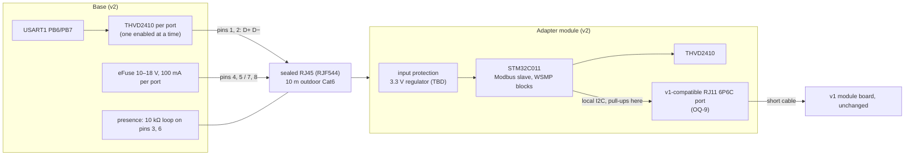

- **The adapter owns a local I2C bus.** The STM32C0 runs the same sensor drivers as the v1 station
  (`mod_th.c`, `mod_reg.c`), on its own `i2c_bus` implementation. It serves the WSMP blocks as Modbus
  registers (WSMP section 6). The WSMP core `firmware/common/wsmp.c` is already portable for this
  (its header says so).
- **Calibration travels with the board.** The adapter reads the coefficients from the v1 board's
  record (section 6.9) and applies them (WSMP-G6). Its flash holds no per-sensor data, so a board
  swapped behind an adapter never inherits the previous sensor's coefficients.
- **Identity.** Serial: the precedence of section 6.7 (**Serial rules**). An I2C sensor's adapter takes
  only a v1 module board, so the serial normally comes from that board's EEPROM record. The sensor's own serial,
  then one derived from the MCU's unique device ID (namespace 0x03: the low 56 bits of FNV-1a-64 over
  the 12 bytes of the STM32C0's 96-bit UID; the UID is from memory of RM0490, verify), are only the
  `NO_RECORD` fault fallbacks; the last is bound to the adapter. Boot ID: the adapter's own, kept
  in its flash (WSMP-I2). **A board change behind a powered adapter is a reboot**: the adapter runs
  the identity check of section 6.7 before each latch, and on a change it takes a new boot ID and
  new identity, so descriptors never change under a running module (WSMP-D6). The station sees it
  by the proposed WSMP-P10: a snapshot whose boot ID differs from the one admitted makes the station
  re-read the identity and descriptor blocks, and a changed serial, type or descriptor digest is a
  leave and a join.
- **Meter adapters (v2 only).** The one adapter without an RJ11 port: it is wired permanently to
  one SEN-15901 meter's cable at the mast, counts the reed pulses (wind, rain) or reads the vane's
  resistor network, and carries its own programmed EEPROM, so its serial comes from source 1 like a
  module board's, and its calibration (zero in practice: the SEN-15901 factors are fixed) is in that
  record. Adapter and meter are one unit; a replaced meter gets a new adapter record. Moving
  a meter from v1 to v2 changes its serial (binding fallback to EEPROM); the entity ID has none, so
  history continues.
- **Same module type codes.** A v2 SHT45 module reports type 1, schema 1, the same channels and
  descriptors as a v1 one. The gateway entity ID (WSMP-H1) has no binding, port or serial in it, so
  Home Assistant history continues.
- **The local/remote split of WSMP already covers both.** A v1 passive module is a local module whose
  driver runs on the station. A v2 module is a remote module that runs the same driver itself. WSMP-B1
  already requires the station code above the driver interface to be the same for both. What WSMP
  lacks is the I2C port binding (section 6.7 here), which section 13 of this spec proposes.
- **More than one v2 port.** WSMP section 13 notes that the NUCLEO has one free UART (USART1). The
  PRD allows "an explicit mux or valid tri-state scheme". A design to evaluate (my suggestion): one
  UART shared by several transceivers, with only one transceiver's receiver and driver enabled at a
  time. Whether the THVD2410's receiver output goes high-impedance when disabled is **TBD** from its
  datasheet. A custom v2 controller could pick an MCU with more UARTs instead.
- **The long-lead parts** (STM32C0116-DK, RJF544) are v2 parts. Nothing in v1 needs them.

## 8. Migration and coexistence

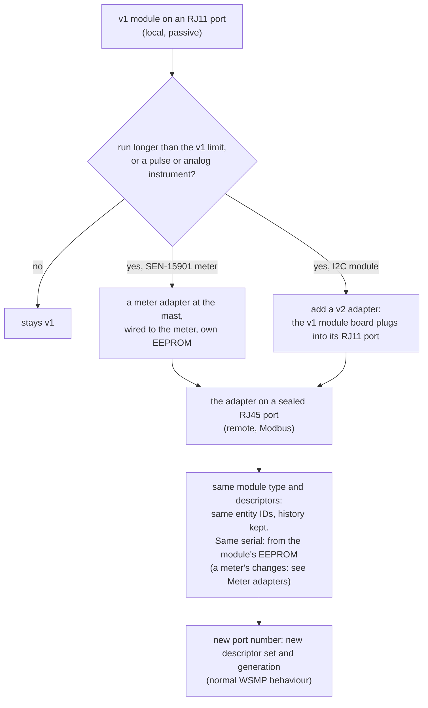

- **A v1 I2C sensor becomes a v2 module by adding an adapter.** One way only (identity is normalized):
  the whole v1 module board plugs into the adapter's v1-compatible RJ11 port with a short cable. It
  keeps the v1 board, its EEPROM and its serial. The adapter has no bare STEMMA QT socket. The adapter's RJ11 port is the base port circuit of
  section 6.2. The design carries over, but the qualification does not: the adapter has its own
  controller, pull-ups and bus load, so its RJ11 port is retested (a short-cable run of the H04a
  loop) as part of H04b.
- **One base with both kinds of port** (my recommendation, OQ-10): allowed, with distinct connectors
  and separate port-number ranges, and no jack that serves both. A v2 base keeps a few v1 I2C ports for
  in-box or short-run modules and adds RJ45 ports for long runs.
- **A 6P plug fits an 8P jack.** An RJ11 module cable pushed into an unsealed RJ45 port lands on RJ45
  pins 2–7: its 3.3 V on D−, its GND on the 10–18 V supply pin. The presence loop (10 kΩ across pins 3
  and 6) is not there, so WSMP-P7 never enables port power. H04b must test this case. A sealed RJF544
  receptacle may not admit a bare RJ11 plug at all (**TBD**).
- **Do not design v1 for v2 beyond these cheap steps:** keep USART1 (PB6, PB7) free, reserve port
  numbers 14 and up, keep the module board's STEMMA QT side unchanged, and keep the WSMP terms neutral.
  The PRD's scope rule allows accommodation "where cheap", not speculative boards.

## 9. Requirements (v1 port)

| ID | Requirement |
|---|---|
| PORT-1 | Each sensor port uses the pinout of section 6.2 (or the OQ-1 alternative, once chosen) |
| PORT-2 | Each sensor port has its own mux channel. One module per port |
| PORT-3 | Pull-ups are on the base side only, at the value the cable test sets. Module boards have none |
| PORT-4 | SDA and SCL have a series resistor (33–100 Ω) and a low-capacitance TVS at the jack |
| PORT-5 | Port power is 3.3 V through a current-limited load switch that the firmware controls |
| PORT-6 | Live plugging and unplugging never resets the station and never disturbs another port |
| PORT-7 | An empty port is rescanned every 15 s. A module plugged into an empty port is in the readings within 120 s (about 111 s worst case, section 6.6), unless it is refused or quarantined (section 6.7); a moved module too, since its duplicate verdict checks the old port's holder |
| PORT-8 | A stuck channel is recovered by the ladder of section 6.6. The upstream parts keep working throughout |
| PORT-9 | INA228, MAX17048 and SHTC3 are upstream of the mux and never on a port. The mux is not at 0x70 |
| PORT-10 | The cable length is at most the qualified length from the cable test |
| PORT-11 | Sensor cables are straight through and tested (or the pinout is reversal-safe, OQ-1) |
| PORT-12 | Sensor and meter ports are labelled, and sensor cables are coloured differently |
| PORT-13 | A passive module's identity on an I2C sensor port (1–8) follows section 6.7, and its record section 6.9. Every v1 module board carries a record written and read-back-verified on the programming fixture, with its serial in the serial ledger; a module without a valid one is admitted with the `NO_RECORD` flag and its reason. The serial and identity flags reach the gateway in the descriptor set. The meter ports (12, 13) have no record in v1 and raise no `NO_RECORD` (section 1, "Meter identity") |
| PORT-14 | At most one module of each module type per station (v1). A duplicate serial or type runs the holder check (section 6.7) in the holder driver's step machine: holder gone (address NACK twice, a confirmed different identity, or a Faulted or operator-disabled port), it is ended and the newcomer admitted; otherwise the newcomer is refused (`DUP_SERIAL` before `DUP_TYPE`) and re-evaluated at every latch. Never a removal-only quarantine. After a reboot the lower port wins, unless its probes bounced in the first two rounds (section 6.7) |
| PORT-15 | Upstream parts are served only with every channel deselected; every channel burst ends with a deselect. No probe-table or scan address answers with every channel deselected (checked at boot and at build time). A channel with its port power off is never selected |
| PORT-16 | Every Admitted, Active and Suspect I2C module passes an identity check in the pre-latch slot (3 s before each latch; port-module drivers only; a sample due in the slot is deferred to just after the latch, phase kept), against the identity seen at admission, from its driver's idle state. A confirmed change ends the port at that latch with the window missing; a changed record CRC is a leave and a join. A missed probe or failed data read sets a sticky flag; until a matched check at a latch whose data read is good clears it the window is missing; the clearing latch gives a new boot ID (once per replug); 60 unverified latches in a row with the flag set end the port in any state. A content-`NO_RECORD` or `CAL_REJECTED` module is re-observed by its whole 128-byte image. An applied record whose confirming full read is not a valid record is read twice: two that agree (same image, or both NACK) are a change, two that disagree unverified. Latch order: transitions, identity results, refusals, each in port order |
| PORT-17 | An unverified identity check never moves a port between Active, Suspect and Absent (except the one-hour timeout of section 6.7); it counts the identity as unverified (console). A READ module's NACK matches. A `NO_RECORD` (READ) module may change to its record once per admission. In Suspect, good-but-unverified latches neither raise nor reset the miss count |
| PORT-18 | A quarantined or refused port keeps probing its module each probe slot; two missed probes make it Absent |
| PORT-19 | Calibration follows section 6.9: the frozen table, (q, k) over (q, 0), `ws_div_round`, int64, calibrate before the crop and range check; every calibrated value is cropped within its margin or suspect and kept out of the window sum; `CAL_REJECTED` applies none |

## 10. Tests: what replaces or splits H04

The PRD's H04 is one test of one RJ45 RS-485 port. This spec proposes to split it (OQ-2):

| PRD H04 element | **H04a: v1 I2C port** (Stage 2 gate) | **H04b: v2 RS-485 port** (when v2 is built) |
|---|---|---|
| "10 m chosen cable" | the qualified length from the cable test, on the final cable type | 10 m Cat6, as the PRD |
| "full operating span and temperature range" | 3.3 V supply span (**TBD**), and the PRD's temperature range with the final cable | 10–18 V, PRD range |
| "≥ 10⁶ error-checked transactions, no undetected corruption" | 10⁶ CRC-checked or read-back-checked I2C transactions (on a fielded, write-protected module: CRC-checked record reads, not the test page). 0 undetected corruption, 0 detected errors | as the PRD, on Modbus |
| "shorted/wet pairs and open presence loop cannot reset core" | each conductor shorted to GND and to 3.3 V, a wet jack, SDA or SCL held low. **GND mating last** (section 6.4): a switch in the GND conductor, the cable plugged with it open, then closed. No reset; no damage; the other ports and the upstream parts keep reading | as the PRD |
| "24/48 V injector and network-fixture misuse" | cross-mating (section 6.3): meter cables in sensor ports, modules in meter ports, a reversed cable. A current-limited 48 V source on pins 3–4 if OQ-12 says yes | as the PRD, plus an RJ11 v1 cable in the RJ45 port (section 8) |
| "freeze pinout/cable/termination" | freeze pinout, pull-up value, series resistor, TVS, cable type and length | as the PRD |

| Requirement | Test |
|---|---|
| PORT-1, 11, 12 | inspection; cable tester on every cable; H04a cross-mate cases |
| PORT-2, 6, 8, 9 | phase 1 bench checks (section 4.3); H04a shorts and stuck lines; host tests with the mux model: a fault on one channel, the others and the upstream parts keep reading |
| PORT-3, 4, 10 | the phase 2 cable test (section 5); H04a at temperature |
| PORT-5 | H04a: a shorted port supply trips the limit, the station stays up; reversed-cable case |
| PORT-7 | host test: plug at a random time into an empty port, with and without a bounced first probe: in the layout within 120 s; a move to an empty port within 120 s; bench: 20 plugs and the moves of section 5.2 step 5 |
| PORT-13 | host tests: probe table; record parsing of every check of section 6.9 in order, each `NO_RECORD` reason (READ only after 3 tries in one probe slot, CRC only after a re-read); a record length other than 128 is MALFORMED; a structural fault is MALFORMED and a calibration-only fault is `CAL_REJECTED` with the serial kept and `record_crc` 0; module type 1 without sensor-bind kind 1 is MALFORMED, and kind 1 on types 2 and 3 too; a used calibration entry with revision 0, an entry whose (quantity, kind) matches no channel of the type, and an entry for a quantity unknown to the table under a higher minor are each `CAL_REJECTED`; an empty part number is accepted by the station and refused by the fixture; nonzero reserved identity-flag bits are rejected on unpack; a higher minor is accepted and another major gives VERSION; a valid record with a different type quarantines `TYPE_CONFLICT`; a sensor-bind mismatch gives `SENSOR_CHANGED` with no calibration applied; calibration applied by (quantity, kind) and kind 0 for every kind; a module moved from port 1 to port 3 keeps its serial; the serial precedence and namespaces; the serial and flags in the descriptor set; quarantine released only by removal; the meter ports raise no `NO_RECORD`; fuzzing of the record parser against an independent copy of the layout (WSMP-X2). Fixture: write, read-back compare, ledger entry, station-style parse |
| PORT-14 | host tests: **a module moved from SENSOR 1 to SENSOR 3 and admitted before SENSOR 1's next latch** (unplug at t = 0, plug at t = 3 s, the latch at t = 50 s): the holder is ended, the newcomer admitted, no quarantine, the newcomer's first window holds none of the old module's samples; **the holder check while the holder SHT45 is measuring** (between 0xFD and its read): it waits for ST_IDLE, the measurement is not disturbed and the holder is not ended; transient holder failures (one NACK, a failed 0x50 or 0x89 read): present, not ended; a Faulted or operator-disabled holder port: gone; a holder in the 1 s off of a recovery power cycle: not gone; two SHT45 modules with different serials both present: the second refused `DUP_TYPE`, admitted once the first is removed; a clone of a **BMP581 or LTR390** module (same record serial and type; an SHT45 clone would be `SENSOR_CHANGED`) present on both ports: refused `DUP_SERIAL`, never `DUP_TYPE`; a holder Admitted but not yet Active; a reboot with two modules of one type: the lower port wins; the same with the lower port's first probe bounced: the higher port wins; a Faulted port does not hold the boot verdicts. Gateway simulator: one serial in two stations' sets raises the alarm after 10 minutes, not before, and not when one of the two stations has been silent for more than 10 minutes |
| PORT-15 | host tests with the mux model: every burst ends with mask 0x00; upstream transfers never see a channel selected; an upstream device at a probe address is removed from the table at boot and reported; a port with power off is never selected. Build-time assertion on the address tables |
| PORT-16 | host tests: **per-window sample counts are unchanged by the slot for every driver** (power, wind, rain, enclosure and each port module, at sample phase 0 and at random phases: a port-module sample due in the slot is deferred and lands in the next window, on-board drivers never wait); the identity check has priority over a newcomer's identification and a holder check on the same driver; the pre-latch slot at every phase of the free-running sample schedule (no port-module sample starts in the slot, the check never runs between 0xFD and its read, a check that cannot finish by the latch is unverified); an SHT45 sensor-board swap inside one window ends the port at that latch with the window missing; a swap where the new module's 0x89 read fails but its record differs is a change; a same-module replug that a probe noticed: windows missing until a matched check, then a new boot ID, no set change; the flag survives a latch whose check is unverified; a swap within one read gives a leave and a join; a changed record CRC with the same serial gives a leave and a join; modules admitted as `NO_RECORD` (READ, BLANK, CRC), `SENSOR_CHANGED` and `CAL_REJECTED` do not flap over 100 latches; one corrupted bit in the 8-byte serial read is not a change (the full read confirms); **an applied BMP581 record swapped, with no missed probe, for a blank EEPROM, or one whose two full reads NACK, ends the port at the next latch with the window missing and the new module is admitted `NO_RECORD` (BLANK, READ); full reads that disagree are unverified**; an unplugged `NO_RECORD` (READ) module keeps its boot ID over its missed latches and takes one new boot ID per replug; a match partway through a flagged run resets the 60-latch timeout; a check still on the bus at the latch is unverified and finishes after it without effect; a latch before its slot is unverified; a late latch keeps the schedule (the next slot opens 3 s before the latch scheduled, not a minute after the late one); the next latch told by the application moves the slot; a module admitted as `NO_RECORD` (CRC) after a transient corruption, or MALFORMED by a field after 0x13, whose full record later reads valid is a change and rejoins with its record; a `CAL_REJECTED` record rewritten with a valid calibration is a change; a corrupt tail that drifts with the same verdict, status and serial is not; two full reads that disagree are unverified; the order within a latch with changes on several ports. Bench: the replugs, swaps and moves of section 5.2 step 5 |
| PORT-17 | host tests: an EEPROM that NACKs intermittently after admission (every other latch, then for 10 latches, then back) with no missed probe: the port stays Active and published, serial unchanged, unverified shown on the console after 3 latches, no set change; a Suspect module with good reads and an unverified check: its miss count frozen, windows missing, ended after 60 latches and rejoined once; **an Active BMP581 module whose EEPROM dies after admission, then one sample read fails** (flag set, check unverifiable, no sensor serial): windows missing, ended after 60 latches in a row, rejoined as `NO_RECORD` (READ), then published, and its NACK matches from then on; a failed identity-check read alone does not set the flag; **the interleaving miss, good-unverified, miss, good-unverified, miss** removes the module; a module removed by three missed latches shows no unverified count; a module admitted as READ whose record appears changes once and never back on a later NACK; a port fault (channel stuck, port power off) fails every identity check without moving the port; only failed data reads do (WSMP-P2, P3) |
| PORT-18 | host tests: a `TYPE_CONFLICT` module removed is Absent after two missed probes; a refused module removed is Absent likewise; a refused module stays refused while its holder is present |
| PORT-19 | host tests: the golden vectors of `ws_div_round` in C and Python (including negative numerators and exact halves); every bound of the calibration table at, inside and outside its limit; (q, k) over (q, 0); a 6000 × 1,100,000 sample does not overflow; RH calibrated to 102 % reported as 100 % good, to 104 % suspect and out of the sum; a raw SHT45 above 103 % suspect; a UVA offset of −5 on night readings of 0–2 gives 0, never a negative or wrapped value; a UVA gain of 10 on a bright reading above 1,048,576 suspect; a window with one suspect sample has suspect quality and the mean of the others; a suspect RH sample leaves the temperature count of the same window unchanged and the RH mean unbiased; a window whose samples were all suspect is missing; suspect wins over partial; the SHTC3 enclosure channel at 70 °C is not cropped or made suspect; calibration before the crop; a counter-channel entry is `CAL_REJECTED`; the fixture refuses every record the station would reject |
| WSMP conformance | a new row in WSMP section 14 for the I2C port binding |

## 11. Open questions for Clint

Most important first. Each has my recommendation.

| ID | Question | Recommendation |
|---|---|---|
| OQ-1 | **Reversed cables.** With the proposed pinout, a reversed 6P6C cord (pin 1 to pin 6, the usual telephone-cord wiring) powers the sensor backwards (section 6.3). Keep the pinout and guard against it, or change it? | Change to a reversal-safe pinout: **1 = 3.3 V, 2 = SDA, 3 = GND, 4 = GND, 5 = SCL, 6 = 3.3 V**. A reversed cable then maps 3.3 V to 3.3 V, GND to GND, and only swaps SDA and SCL (harmless: nothing answers). A 4-conductor plug still never meets 3.3 V, and SDA and SCL are now two grounds apart. The cost is the INT/spare pin, which no v1 driver uses. **One cross-mate case gets worse:** a sensor module in the wind port puts its GND on the cups net (no pulses, speed 0) and its unpowered SCL clamp on the vane net, which can pull the vane voltage into a valid window. The wind module then looks present, with speed 0 and a false direction. The interim catalog map reports CALM below 0.5 m/s, so the direction is not published, but the vector sums are wrong. Firmware can flag "vane steady and no pulses for a long time" as suspect. Redo the section 6.3 table for whichever pinout is chosen. If INT must stay: keep the pinout, add reverse-polarity protection on every module board (part **TBD**), set the port current limit low enough to survive the reversed case, and allow only tested straight cables |
| OQ-2 | **H04 split.** Split H04 into H04a (v1 I2C port, the Stage 2 gate) and H04b (v2 RS-485 port, unchanged)? Zero detected errors in 10⁶ transactions for H04a? | Yes to both. Zero is the strict reading of "never loosen a test criterion" and is cheap to run |
| OQ-3 | **Where does the BMP581 go?** The registry gives pressure the role "enclosure", but the decision list puts only INA228, MAX17048 and SHTC3 on the base | On the base, upstream of the mux, like the SHTC3. Pressure is measured fine in a vented box, it saves a port and a cable, and it needs no change to the registry role. If it must be modular, put it on a short port inside the box. **Either way it is never both:** on the base, type 2 leaves the port probe table (section 6.7), or every empty port would see it (the phantom rule, section 6.6) |
| OQ-4 | **How many sensor ports on the v1 base?** | Four RJ11 sensor ports on channels 0–3 (the PRD's "four positions"); channels 4–7 not fitted. With one module per type (section 1) at most three are used (two with the BMP581 on the base); the fourth is a spare to move a module to. Base and port modules together are at most 7, so WSMP-P8 (8 modules) is not reached in v1 and need not be raised. Raise it (and per-port driver instances) only with v2 or a fourth port module type |
| OQ-5 | **Port power policy.** The PRD says ports are off by default, enabled only for a commissioned module type, and never live-mated. Apply that to 3.3 V I2C ports? | No for v1: ports on by default, live mating tolerated, automatic discovery. Commissioning stays optional: a configured expected type raises an alarm on a mismatch. Keep the PRD rule for v2 10–18 V ports |
| OQ-6 | **ID EEPROM on v1 module boards?** | **Decided (Clint, 2026-10-21): fitted and programmed on every module board.** The part is the 24LC32A (decided 2026-10-22). A missing or invalid record is admitted with the `NO_RECORD` flag (section 6.7). It gives each sensor a serial that survives port moves and the move to v2, and carries its calibration (section 6.9) |
| OQ-7 | **Sealing RJ11 on the IP66 box** | Option A of section 6.8: jacks inside, split-insert glands or a cable-entry frame. Prefer a round jacketed cable if it passes the cable test, and re-run the test on it |
| OQ-8 | **Is v2 scheduled?** | No. v1 replaces the PRD's Stage 2 RJ45 port. v2 is built only when a needed run exceeds the v1 limit, or an instrument needs an adapter (pulse, analog, or a remote head). The long-lead v2 parts are not ordered for v1 |
| OQ-9 | **What does a v2 adapter accept?** | **Decided (Clint, 2026-10-21): only a whole v1 module board**, on a v1-compatible RJ11 port, keeping its EEPROM serial. No bare STEMMA QT socket, so every v2 I2C sensor has an EEPROM record too. The one exception is the SEN-15901 meter adapter (section 1, "Meter identity"; section 7), which carries its own record |
| OQ-10 | **v1 and v2 ports on one base?** | Allowed, with distinct connectors and separate port-number ranges. No dual-use jack. v1 adds no v2 hardware beyond keeping USART1 free |
| OQ-11 | **Identical jacks with different pinouts.** PRD §6 and Appendix A forbid "a different pinout on an identical external jack". v1 sensor ports and meter ports share the 6-position RJ11 jack | Amend the PRD: allowed when the cross-mate analysis shows no power reaches the wrong device and H04a's cross-mate tests pass, with labels and coloured cables |
| OQ-12 | **Telephone-line misuse.** Does H04a test 48 V on the centre pair (an RJ11 port plugged into a phone line)? | Yes, once, with a current-limited bench supply, as H04 does with its 24/48 V injector. Declare it outside the operating contract |
| OQ-13 | **Stage 3 instruments.** The next-stages plan picks Davis instruments for Stage 3. The meter ports assume the SEN-15901's passive switches. A Davis anemometer's vane needs a supply conductor *(verify)* | Decide at Stage 3. Do not put a supply on meter-port pins 2–5 without redoing the cross-mate analysis of section 6.3 |

| OQ-14 | **What is the v1 base unit physically?** A carrier board under the NUCLEO-WL55JC1, or a custom STM32WL55 board? It sets the GPIO budget (mux RESET, four port enables) and whether an I/O expander is needed | A carrier board for the NUCLEO first. The PRD puts the custom controller in Stage 4, after the port is frozen. Keep the mux RESET on a direct GPIO either way; the port enables may go on an upstream expander |
| OQ-15 | **How long are the real runs at the site?** Only the shield's ~2 m is known (R1 enclosure plan) | Measure the planned mounting of the shield, the UV sensor and any other sensor before the cable test, so the test qualifies the lengths that matter |

## 12. Calls I made (check these while reading)

- The mux address 0x71 (any of 0x71–0x77 works; 0x70 does not).
- Channel assignment on the breadboard, and the port numbers of section 6.7.
- A load switch rather than a PTC, and mux RESET on a direct GPIO.
- The added cable-test criteria: fall time ≤ 300 ns, low level ≤ 0.4 V, 20 hot-plugs, the 10 m
  informational run.
- The recovery back-off times (1 s off; 1 min doubling to 15 min).
- The rescan period of 15 s.
- The boot-ID formula for passive modules (section 6.7).
- The module record layout (section 6.9, from the 2026-10-22 review's proposal), the serial
  namespaces and the FNV-1a fold for the v2 adapter UID. The calibration bounds, the rounding, the
  duplicate-holder rule and the record CRC were decided by the review crew (section 1); the UVA
  offset bound of ±16 counts is mine.
- The pre-latch slot of 3 s and its scope (port modules only, samples deferred), the unverified
  counter (3 latches before the console shows it), the one-hour timeout (60 latches in a row), the cross-station alarm hold-off (10 minutes), the lower port winning
  after a reboot (verdicts held for two probe rounds), the crop margins, PORT-7's 120 s, and the replug, swap and move trials of
  section 5.2 step 5.
- Left to the builder: the exact parts (mux board, load switch, TVS, jacks, cable; the EEPROM is
  the 24LC32A), the GPIO
  for mux RESET and the port enables (after the UM2592 check), the module board layout, the firmware
  structure of discovery within the Power of Ten rules (a switch on the module type, no function
  pointers), and the host test design.

## 13. Consistency change list

These existing texts contradict v1-RJ11-now / RS-485-RJ45-in-v2, or must change with it. **None of
these edits is applied.** Clint reviews them first. Quoted text is the current wording; the arrow
gives the proposed wording.

### 13.1 Normative and planning documents

| File and section | Current | Proposed |
|---|---|---|
| `docs/module-protocol.md`, introduction (line 11–12) | "This applies to a driver on the station's own microcontroller and to a module board behind an RJ45 port alike." | "This applies alike to a driver on the station's own microcontroller, to a passive I2C module on an RJ11 port (v1), and to a module board with an adapter microcontroller behind an RJ45 port (v2)." |
| `docs/module-protocol.md`, "Other documents" | "`next-stages-plan.md` and the PRD give the RJ45 port hardware." | "`superpowers/specs/2026-10-21-sensor-module-ports-design.md` gives the v1 RJ11 I2C port and the v2 RJ45 port. `next-stages-plan.md` and the PRD give the RJ45 port parts." |
| `docs/module-protocol.md` §1, "Port" | "A local port is a bus address on the station. A remote port is an RJ45 socket." | "An on-board port is a bus address on the station. An I2C port is an RJ11 socket on its own I2C multiplexer channel (v1). A remote port is an RJ45 socket (v2). A port number names a place, not a module type." |
| `docs/module-protocol.md` §1, "Local module" | "A module that runs as a driver on the station's microcontroller. The bench station uses local modules." | "A module whose driver runs on the station's microcontroller: an on-board part, or a passive module on an I2C port. The bench station uses local modules." |
| `docs/module-protocol.md` §1, "Remote module" | "… behind an RJ45 port, reached by Modbus." | "… behind an RJ45 port, reached by Modbus (v2)." |
| `docs/module-protocol.md` §2, diagram | local module and remote module only | add a node "passive I2C module (RJ11 port, mux channel)" with the edge "same contract, local driver" to the host |
| `docs/module-protocol.md` §6.1, identity table, register 0x000F | "reserved \| 0" | "identity flags \| bits 0–1 serial source (0 port or station, 1 record, 2 sensor, 3 adapter UID), bits 2–3 reserved, bits 4–7 record status (0 applied, 1 READ, 2 BLANK, 3 NO_MAGIC, 4 VERSION, 5 MALFORMED, 6 CRC, 7 CAL_REJECTED, 8 SENSOR_CHANGED), bits 8–15 0. 0 for an on-board module; a v2 adapter fills them the same way for the board behind it" |
| `docs/module-protocol.md` §6.1, serial row | "u64, unique for the module, never 0" | add: "The top byte names the source: 0x00 station-bound (unique within one station), 0x01 programmed record, 0x02 derived from the sensor, 0x03 derived from an adapter's unique ID (spec 2026-10-21 §6.7)." |
| `docs/module-protocol.md` §6.1, WSMP-I2 | "A local module uses the station's own boot epoch." | add: "A passive module on an I2C port has boot ID `(station boot epoch << 8) \| (admission count of the port mod 256)`; the count goes up at each admission, and at the latch where a matching identity check clears the port's possibly-replugged flag (spec §6.7)." In the identity table, the boot ID row's "increases by one at each boot, kept in non-volatile memory" becomes "changes at each boot; for a passive I2C module, see WSMP-I2". |
| `docs/module-protocol.md` §4, WSMP-G6 | "The gateway keeps the coefficients in its calibration archive." | add: "A passive module's coefficients are in its module record (section 10.1); the station applies them. The gateway archives them by serial." |
| `docs/module-protocol.md` §7, state diagram and Identifying | no record checks; "Quarantined --> Absent: module removed, operator clears it, or a flap quarantine ends" | add the verdicts of spec §6.7 (TYPE_CONFLICT quarantine; DUP_SERIAL and DUP_TYPE refusal after the holder check, re-evaluated at every latch; NO_RECORD, SENSOR_CHANGED and CAL_REJECTED admission); add "Active --> Absent: the identity check confirms a change (a leave and a join)" and "Refused --> Absent: two missed probes"; a TYPE_CONFLICT quarantine ends only by removal, seen by probing (the WSMP-P6 flap quarantine still ends after its hour) |
| `docs/module-protocol.md` §7, WSMP-P2 | "It MUST miss three latches in a row before it removes a module." | add: "On an I2C port the station also removes a module when the holder check of another port's duplicate finds it gone (two address NACKs, a confirmed different identity, or a Faulted or operator-disabled port), when its pre-latch identity check confirms a change, or after 60 latches in a row with its possibly-replugged flag set and its identity unverified (spec §6.7). In Suspect, a latch with a good read but an unverified identity neither counts as missed nor breaks the run." |
| `docs/module-protocol.md` §9, WSMP-T4 | "samples on its own clock … the latch sets only the window boundaries" | add: "Exception: an I2C port module's driver starts no sample in the 3 s before a latch; a sample due then is deferred to just after the latch, keeping the sampling phase, so every window keeps its sample count (spec §6.7)." |
| `docs/module-protocol.md` §7, new WSMP-P10 | — | "**WSMP-P10. Re-identification.** An I2C module's identity (record serial and CRC, sensor serial, as seen at admission) is checked in a pre-latch slot before each latch, from the driver's idle state; a confirmed change ends the port at that latch with the window missing, then the new module is admitted (a record that no longer parses, or an EEPROM that no longer answers, is confirmed by two full reads that agree with each other). After a missed probe or a failed data read, windows are missing until a check matches at a latch whose data read is good. An unverified check never changes the port's state, except the timeout: 60 latches in a row with the flag set and no check matching end the port, in any state, and it rejoins. For any module with its own identity block (remote, or behind a v2 adapter): a snapshot whose boot ID differs from the one admitted makes the station re-read the identity and descriptor blocks; a changed serial, type or descriptor digest is a leave and a join. At most one module of each type is admitted (v1); a duplicate runs the holder check in the holder driver's step machine." |
| `docs/module-protocol.md` §11.1, module entry and WSMP-E4 | entry: port, module type, schema, channel count; "8 + 8 × 5 + 24 × 6 = 192 bytes" | entry adds `serial` (u64), `id_flags` (u8, the identity flags' low byte) and `record_crc` (u32, 0 when no record is applied); "8 + 8 × 18 + 24 × 6 = 296 bytes" (6 fragments at 58 bytes). A changed serial or record CRC gives a new set and generation (WSMP-C1 boundary). The radio protocol's fragment count for a full set grows with it (WSMP-E9) |
| `docs/module-protocol.md` §7, WSMP-P1 | four bullets (remote, local I2C, wind, rain) | add: "A module on an I2C port shows presence by a successful probe of an address in the probe table (section 10.1) on its multiplexer channel, with the part's ID check. NACK at every table address means absent. SDA or SCL held low on the channel is a port fault (WSMP-P3)." |
| `docs/module-protocol.md` §7, WSMP-P3 | "… MUST NOT change the descriptor set by itself." | add: "On an I2C port, a fault of one channel MUST NOT stop the other channels or the upstream bus." |
| `docs/module-protocol.md` §7, WSMP-P8 | "A station has at most 8 modules and 24 channels." | only if OQ-4 raises it: "… at most 12 modules and 24 channels." (`wsmp_host` and the descriptor-set size of WSMP-E4 change with it) |
| `docs/module-protocol.md` §7, new WSMP-P9 | — | "**WSMP-P9. I2C port power.** An I2C port gets 3.3 V through a current limit that the station switches. The station switches it off and on to recover a stuck channel. Live mating is tolerated. (WSMP-P7 stays the rule for remote ports.)" |
| `docs/module-protocol.md` §10, WSMP-B3 | "… at most nine times, and then sends a stop condition. A clean NACK gets no recovery." | add: "On an I2C port the station runs this with the failing channel selected. If SDA stays low, it resets the multiplexer, then switches the port's power off and on, then backs off (spec 2026-10-21 §6.6)." |
| `docs/module-protocol.md`, new §10.1 | — | "**10.1 Passive modules on I2C ports (the RJ11 binding).**" The probe table, the identity sources and verdicts, re-identification, the module record v1.0 at 0x50 on every v1 module board (layout, checks, CRC, programming and copying: spec §6.9), the multiplexer rules (deselect after every burst, upstream only with no channel selected, no phantom addresses) and the port numbers, from sections 6.5–6.9 of this spec |
| `docs/module-protocol.md` §12, WSMP-X2 | "A fuzz test MUST cover the station's parser of every block." | "… of every block and of the passive module record." |
| `docs/module-protocol.md` §12, WSMP-X3 | "Nothing that a module supplies becomes a file name, a database key, an MQTT topic or a template. Identifiers use only station, role, quantity and kind codes." | add: "A module serial (a u64 number, never text) MAY be a database key of the gateway's archive, as a bound parameter, never in a name, topic or template." |
| `docs/module-protocol.md` §12, WSMP-X4 | "Before a remote port is used outdoors …" | "Before any external port (I2C or remote) is used outdoors …" |
| `docs/module-protocol.md` §13, title and first line | "## 13. Remote modules (the RJ45 binding)" | "## 13. Remote modules (the RJ45 binding, v2)", and first line: "v1 has no remote ports. v1 external modules use the I2C port binding (section 10.1)." |
| `docs/module-protocol.md` §14, conformance table | no I2C port row | add: "I2C port binding \| P1, P3, P9, P10, B3, X2 \| plug at random times, hold SDA and SCL low on one channel, check the other channels; swap two modules between reads; every record verdict of spec §6.7; serial and flags in the descriptor set" |
| `docs/module-protocol.md` §15, open items | "Remote ports beyond one \| Needs a UART multiplexer or a different station microcontroller." | "Remote ports beyond one (v2) \| …". Add: "I2C port cable limit \| set by the cable test (spec 2026-10-21 §5)." |
| `docs/module-protocol.md` §15, "Siting and calibration archive" | "a dated record of each module's installation" | add: "An installation record is keyed by (station, role); calibration history by serial. A migration that changes a module's port or serial adds a dated installation entry and carries the siting values over." |
| `docs/next-stages-plan.md` §1, diagram | `S2 -- "H04 passes" --> S3` | `S2 -- "H04a passes" --> S3` |
| `docs/next-stages-plan.md` §1, Stage 2 row | "One wired sensor module on a sealed RJ45 port \| H04, the port test: power, faults, 10 m cable, 10⁶ transactions" | "One wired sensor module on an RJ11 I2C port (v1) \| H04a, the I2C port test: the qualified cable length, faults, cross-mating, 10⁶ transactions. (H04b, the RS-485 port test, moves to v2.)" |
| `docs/next-stages-plan.md` §2, STM32C0116-DK and RJF544 rows | Stage "2" | Stage "v2 (not scheduled)". Add under the table: "v1 needs neither." |
| `docs/next-stages-plan.md` §2, TI EVM row | Stage "1, 2" | "1, v2" |
| `docs/next-stages-plan.md` §4, title and RS-485 rows | "Stages 2 and 3: chosen parts"; adapter MCU, RS-485, port eFuse, bench RS-485 adapter, Cat6 cable | title "Stage 2 (v1), v2 and Stage 3: chosen parts". Mark those five rows "v2". Add v1 rows: I2C mux board, 6-conductor cable and 6P6C plugs, crimp tool, modular cable tester, load switch (TBD), TVS (TBD), ID EEPROM (TBD); prices not verified |
| `docs/next-stages-plan.md` §4, rough cost | "Stage 2 ≈ $250–650 (mostly connectors)." | "Stage 2 (v1): not estimated. The $250–650 figure was for the RJ45 port and belongs to v2." |
| `docs/next-stages-plan.md` §6, "Connectors" decision | "RJF544 composite … or RJF TV metal …" | prefix "(v2)". Add a row: "RJ11 sealing (v1) \| jacks inside with split glands or an entry frame, sealed RJ11 receptacles, or a pigtail and coupler" |
| `docs/next-stages-plan.md` §7 | "The RJ45 plug's cable-diameter range against the 6.1 mm cable." | prefix "(v2)" |
| PRD (`weather-station-v0.2-prd-trd.html`, outside the repository) §1, "Module communication" | "RS-485 with Modbus RTU over ordinary straight-through four-pair Cat5e/Cat6 cable …" | "v1: passive I2C over straight-through 6-conductor modular cable (RJ11 6P6C), one multiplexer channel per port, length as qualified by H04a. v2: RS-485 with Modbus RTU over … Cat5e/Cat6 (unchanged)." |
| PRD §1, "Sensor electronics" | "One reusable adapter board and firmware source supporting pulse, analog and short local I²C instruments." | "v1: a passive STEMMA QT to RJ11 module board per I²C sensor. v2: one reusable adapter board …" |
| PRD R06 | "Common RJ45 cables attach compatible sensor modules." | "Common modular cables attach compatible sensor modules: RJ11 6P6C in v1, RJ45 in v2." |
| PRD §3, Stage 2 row | "One protected RJ45 port and one common adapter carrying the existing T/RH reading … H04: power, fault, 10 m cable and protocol tests pass." | "One protected RJ11 I2C port and one SHT45 module board. H04a: the qualified cable length, fault, cross-mate and protocol tests pass." |
| PRD §6, "Wired module interface" | the RS-485 contract only | a new v1 subsection with the pinout, port circuit, power and hot-plug policy of this spec; the RS-485 text becomes "v2" |
| PRD §6, connection policy | "power off the port before connecting/disconnecting … Ports are disabled at factory defaults …" | "(v2 ports.) v1 I2C ports are on by default and tolerate live mating (OQ-5)." |
| PRD §6 and Appendix A, identical jacks | "do not expose a different pinout on an identical external jack" | add: "except where the cross-mate analysis shows no power reaches the wrong device, H04a's cross-mate tests pass, and the jacks are labelled (OQ-11)." |
| PRD §7, component families | adapter MCU, RS-485, port protection "stage 2" | "v2" |
| PRD §12, H04 | one test | H04a and H04b as section 10 of this spec |

### 13.2 Descriptive documents

| File and section | Current | Proposed |
|---|---|---|
| `docs/CONTEXT-PACK.md` §1, diagram | `S2 -- "H04 passes" --> S3` | `S2 -- "H04a passes" --> S3` |
| `docs/CONTEXT-PACK.md` §1 | "Stage 2 adds one wired sensor module on an RS-485 port." | "Stage 2 adds one wired sensor module on an RJ11 I2C port (v1). RS-485 over RJ45 is v2, not scheduled." |
| `README.md`, "Ordered next steps" | "This repository adds no … RJ45/Modbus abstraction …" | "This repository adds no … external sensor ports yet (v1 RJ11 I2C ports, v2 RJ45 and Modbus) …" |
| `docs/failure-modes.md` §1, out of scope | "Stage 1 and later items (battery, solar, RS-485 modules, heaters) …" | "… (battery, solar, external sensor ports and modules, heaters) …" |
| `docs/firmware-budget.md`, "Future features" | "RS-485 and Modbus sensor modules (Stage 2) \| 4–8 KB, plus a few KB per sensor type" | two rows: "I2C mux, port discovery, recovery ladder, module record (Stage 2, v1) \| not estimated" and "RS-485 and Modbus remote modules (v2) \| 4–8 KB …". The sentence above the table: "Stage 2 adds one wired sensor module on an I2C port." |
| `docs/poc-shopping-list.md`, intro | "… uses a 4-cell series pack, RS-485 sensor modules and qualified instruments." | "… a 4-cell series pack, sensor modules on RJ11 I2C ports (v1; RS-485 in v2) and qualified instruments." |
| `docs/poc-shopping-list.md`, diagram and "I2C addresses" table | six parts on the hub | add the mux on the hub, with SHT45, BMP581 (subject to OQ-3) and LTR390 behind it; add "0x71 \| I2C multiplexer (moved from its default 0x70, which the SHTC3 uses)" |
| `docs/poc-shopping-list.md`, "Storage and wiring" | hub and QT cables | add a row: "I2C multiplexer \| Adafruit STEMMA QT PCA9548 or TCA9548A board (product number and price not verified)" |
| `docs/hardware/bench-station-wiring.md` §2, diagram and table | six sensors on the hub; "The breakouts have the pull-ups" | the mux on the hub with the three external sensors behind it; add a row "Mux RESET \| TBD \| a free GPIO after the UM2592 check"; note the 0x71 jumper |
| `docs/hardware/bench-station-wiring.md` §6 | checklist | add "[ ] the mux RESET pin, free of any board function" |
| `docs/hardware/bench-station-wiring.md` §8 | hot-plug check | add the mux checks of section 4.3 of this spec |
| `hardware/bench-breadboard-r0/README.md`, "Decisions" | "Your RJ45 module cables are a later step (`docs/module-protocol.md`)." | "The sensor module cables are RJ11 6P6C I2C ports in v1 (`docs/superpowers/specs/2026-10-21-sensor-module-ports-design.md`); RJ45 is v2. The I2C mux sits on the STEMMA QT chain, off the breadboard." |
| `hardware/poc-enclosure-r1/README.md`, diagram | `CABLE["4-wire cable, about 2 m, JST-SH ends"]` | `CABLE["v1: SHT45 module board, 6-conductor RJ11 cable, length set by the cable test"]` |
| `hardware/poc-enclosure-r1/README.md`, "Hardware to buy" | "4-wire cable, about 2 m, plus JST-SH (STEMMA QT) ends" | keep for the proof of concept, and add: "v1 replaces it with an RJ11 module cable (sensor-module ports spec)". The glands row gets a note on OQ-7 |
| `docs/superpowers/specs/2026-10-18-wsmp-bench-station-design.md` §1 | "Outdoor cabling and RJ45 modules come later"; "Remote modules \| RS-485 and Modbus per WSMP section 13, later" | leave the body (it records a decision of 2026-10-18). Add under the status line: "Superseded in part on 2026-10-21: external modules are RJ11 I2C ports in v1 ([sensor-module ports](2026-10-21-sensor-module-ports-design.md)); RS-485 is v2." |
| `docs/superpowers/specs/2026-10-18-wsmp-bench-station-design.md` §2 | "the breakouts give the pull-ups (six 10 kΩ in parallel, about 1.7 kΩ)" | covered by the same note: with the mux, the bus is upstream plus one channel |
| `firmware/common/wsmp.lit.md`, introduction, and `firmware/common/wsmp.h` (plain header), first comment | "The remote module adapter will use the same file later" / "later, the remote module adapter" | "… the v2 remote module adapter …". Changing the `.lit.md` prose does not change the tangled `.c`; `tools/tangle.py --check` must still pass |
| `hardware/chicago-test-hardware-r0/docs/bench-equipment.md` row "2 — module bus" (and the `.csv` and `technical-guide.html`) | "Isolated USB–RS-485 adapter, 10 m selected cable …" | do not edit: `SHA256SUMS.txt` locks the package. Add an entry to `hardware/chicago-test-hardware-r0-ERRATA.md`: "Stage 2 in v1 is an RJ11 I2C port. Its bench needs an oscilloscope, an LCR meter, a modular cable tester and 6-conductor cable. The RS-485 adapter and 10 m cable move to v2." |

### 13.3 Code that must change (implementation, after approval)

Not documentation contradictions, but the work this design implies. Each literate file changes in its
`.lit.md`, never in the generated `.c`.
- `firmware/stage0-node/App/i2c_bus.lit.md`: a channel for each port client, the mux write and
  read-back, a deselect after every burst, upstream transfers only with mask 0x00, recovery per
  channel, mux RESET, port power cycling, and the boot order (RESET, mask 0x00 read back, phantom
  check, then upstream drivers). Interface limits to lift: `HAL_I2C_Mem_Read_IT` with
  `I2C_MEMADD_SIZE_8BIT` takes a 1-byte register address and the 24LC32A needs 2; `txlen == 0 &&
  rxlen == 0` is reserved for recovery, so the scan's zero-length write needs its own request kind;
  `rxlen` is a `uint8_t`; and the transfer guard must scale with the transfer length (today a fixed
  30 ms, sized for a 0.8 ms transfer plus a 24.5 ms flash-erase stall; a 128 B record read of about
  12 ms plus the stall needs about 37 ms, more than the guard's effective 29.3 ms).
- `firmware/common/wsmp.c` and `wsmp.lit.md`: `wsmp_identity` gains the identity flags; pack writes
  them at 0x000F (today it writes 0) and unpack reads them (today it ignores them); the descriptor-set
  entry gains `serial`, `id_flags` and `record_crc`; the module record parser and its checks
  (section 6.9).
- A shared `ws_div_round` (common code) used by `mod_mean.c`'s `mean_of` and by calibration, with a
  golden-vector table that the C tests and the Python reference both read.
- `firmware/stage0-node/App/mod_mean.c` (`mean_win`): a per-channel sample count (today one `n` for
  all channels) and a per-channel suspect flag; a suspect sample is kept out of that channel's sum;
  channel quality missing if its count is 0, else suspect if flagged (over partial); the window is
  reset when a driver is bound to a new module.
- `firmware/stage0-node/App/wsmp_local.h` and `wsmp_local.c`: ports as places (section 6.7), the
  probe table, the boot-time phantom check, a driver bound to a port at admission, the verdict order,
  the holder check, the identity check before each latch, the unverified counter, calibration by
  (quantity, kind) with the frozen table, one module per type. v1 keeps one driver instance per part
  (`enum i2c_client`, `mod_th`'s TH_AIR and TH_ENCL); per-port instances are a v2 item.
- `firmware/stage0-node/App/wsmp_host.lit.md`: the synchronous `identify()` becomes an asynchronous
  Identifying state (the record read, the holder check and the verdict take bus time across steps);
  the pre-latch slot (3 s before the latch timer; port-module drivers defer a sample due in it to
  just after the latch, keeping its phase), the sticky
  possibly-replugged flag, the window-missing rule, the frozen miss count and the 60-latch timeout
  (any state);
  the port table for the new port numbers; the latch order of section 6.7; quarantined and refused
  ports keep probing; port faults and identity flags in the `MODULES` line.
- `firmware/stage0-node/App/mod_th.c` (and `mod_reg.c`): the identity check, the holder check and
  the sensor-bind read as steps of the driver's own step machine, started only from ST_IDLE; no new
  sample in the pre-latch slot; the 0x89 reply parsed by a serial
  parser, never by `ws_sht45_parse`; calibration per sample; the temperature window check after
  calibration.
- `firmware/stage0.c`: move the relative-humidity crop out of `ws_sht45_parse`, to after calibration
  (section 6.9); it returns the raw value as a signed int32, so values below 0 % reach the −3 %
  margin.
- `firmware/stage0-node/App/mod_reg.c`: compare the LTR390 PART_ID's high nibble only.
- `firmware/common/wsmp_registry.h` and its generator: the calibration table of section 6.9, with
  each quantity's physical range and crop margin.
- `firmware/common/ws_console.c`: `ws_air_frame_ok` accepts only the observation and diagnostic
  kinds; the descriptor-set frame kind (WSMP-E9) is added there and in the radio protocol.
- The gateway (`ws0`): decode the larger descriptor-set entry (serial, flags, record CRC); show the
  record status (including `SENSOR_CHANGED`); alarm on one serial in two stations' sets for more than
  10 minutes, counting only stations heard from in the last 10 minutes.
  Later, with the archive: an alarm when a role's serial changes, an alarm on an unknown (serial,
  CRC) pair. (`TYPE_CONFLICT`, `DUP_SERIAL` and `DUP_TYPE` are console-only in v1.)
- A programming-fixture tool (it enforces the checks and the calibration table) and the serial
  ledger with full record images (section 6.9).
- `firmware/fuzz/fuzz_wsmp.c`: the module record parser, against an independent copy of the layout.
- `tests/`: a mux model in the TX harness; isolation, recovery, discovery, holder-check,
  identity-check, unverified, calibration and record tests (section 10).

## 14. What I could not verify

- The flat cable's capacitance, the rise times and the whole capacitance budget are estimates until
  the cable test.
- The Adafruit boards' pull-up, regulator and level-shifter details, the mux board's address jumpers,
  RESET pin and channel pull-ups: from the board schematics, not checked here.
- The SHT4x serial-number command, the BMP581 and LTR390 serial numbers, the sensors' injection-current
  and sink-current limits, the STM32C011 unique ID, the THVD2410 receiver output when disabled: all
  from datasheets, not checked here.
- Sealed RJ11 receptacles and split glands for flat cable: not researched.
- The PRD was read from a copy outside the repository. Its section numbers are as found there. Its
  exact H04 and §6 wording should be checked against Clint's current copy before the edits of
  section 13.1 are made.
- Whether a Davis 6410 needs a supply conductor on its cable (OQ-13).
- The 24LC32A details used in section 6.9 (32-byte page, 5 ms write cycle, WP protecting the whole
  array, 2-byte word address), the Adafruit 24LC32 breakout's default WP state, the LTR390 PART_ID
  nibble split, the SHT4x serial command 0x89 and the STM32C0's 96-bit UID: from memory or the
  review, not checked against the datasheets here.
- The currents when GND mates last (section 6.4): not analysed; H04a tests it.
