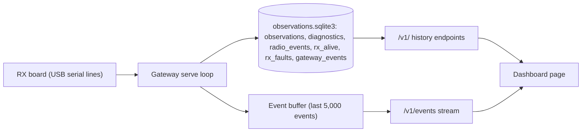
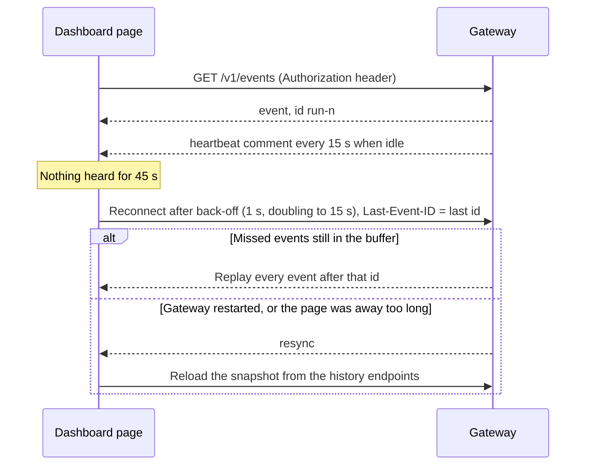

# Web dashboard

The gateway serves a live dashboard for the transmitter node (TX), the receiver board (RX) and the
sensor data. It uses the same process and port as the API. It needs no internet connection, no
account and no build step. It is plain HTML, CSS and JavaScript in `ws0/static/`, with its own SVG
charts (no libraries, nothing from a CDN). The server side is `ws0/web.py`, standard library only.

## Open it

1. Start the gateway as usual (`ws0 serve …`, or `ws0 demo` for a simulated node).
2. Open `http://127.0.0.1:<http_port>/` on the gateway machine (default port 8088).
3. Paste the API token: `api_token` in `<run dir>/gateway.json`. The page keeps the token in this
   tab's `sessionStorage` only. Closing the tab forgets it. **Sign out** clears it at once.

From another machine (a phone, a laptop), prefer an SSH tunnel to the gateway:
`ssh -L 8088:127.0.0.1:8088 <gateway host>`. Then open `http://127.0.0.1:8088/` locally.

## What it shows

**Live** (updates within about a second of each event. Ages count up locally):

| Part | Content |
|---|---|
| Status chips | Key-reuse alarm, reading fresh/stale (180 s, as the API), sensor quality, receiver alive/silent (180 s), host clock state (`ok` / `unverified` / `bad`, "not checked" in demo), node link and energy state, overdue node health report |
| Readings | Latest value of every catalog field the node sends, with unit and age. A null field shows "sensor fault". Wind calm shows "calm". Qualifiers (icing …) are shown |
| Node (TX) health | Latest 15-minute health report: firmware build, epoch, uptime, reset cause, link and energy state, journal pending/lost/torn, abandoned, missed ACKs, rejected replies, crashes, ACK signal strength and signal-to-noise ratio (RSSI/SNR) as the node heard the gateway |
| Receiver (RX) | Latest `#alive` report: forwarded, dropped, ACKs, re-listens, UART errors, stack peak, CRC/header errors since boot, bad receptions the RX could not capture (overrun: one arrived while the previous capture was still queued), longest task and interrupt (µs, with the name of the one that set the peak), trace drops, uptime. Also **bad receptions in the last hour** (CRC vs header), from the gateway's `rx_faults` table. A few an hour from other 915 MHz devices and noise is normal and shown plainly. The page marks a warning above 30 in the trailing hour, or when the rate limit dropped any in that hour ("n more dropped by the rate limit in the last hour"). The count stays current with no new bad reception: the gateway publishes it again (at most once a minute) when old ones leave the hour |
| Gateway | Accepted/rejected/NACKed this run, node-counter mark and regressions, host clock, stream state |
| Recent frames | Last 40 frames: time, kind, counter, outcome (ACK, duplicate, NACK, diag = health report, rejected, commit failed, dropped by RX, reply not delivered), RSSI and SNR as the RX heard them |
| Events | Last 60 gateway and receiver events: gateway start/stop, serial open/lost, receiver silent, host clock, rejected frames, RX boots, re-listens. The page does not list bad receptions one by one. It shows one info event per clock hour that had any ("bad receptions <hour> + 1 h: n CRC, m header"). It shows one warning (`rx-fault-rate`) when more than 30 fall in the trailing hour. The next such warning comes only after the rate has dropped to 15 or fewer |

**History** (last hour, day, week, or a custom range. Relative ranges keep following live):

- **Sensors:** one chart per catalog field present.
  - A solid line is synchronized time. A dashed line is time reconstructed from the node's uptime.
  - A break means no reading. A shaded band means a sensor fault.
  - The page never draws missing values as zeros. It counts readings that have no time yet, but does not plot them.
- **Link quality:** uplink RSSI and SNR per frame (RX side) next to downlink ACK RSSI/SNR (node
  side, from its health reports), and problem frames (NACK, rejected, dropped).
- **Node health:** energy and link state bands, journal pending, journal lost, missed ACKs,
  crashes, boot epoch, abandoned records. Markers: node boots (epoch changes, with reset cause),
  firmware changes, gateway starts.
- **Receiver health:** forwarded, dropped, re-listens, UART errors, stack peak, uptime, CRC and
  header errors, longest task and interrupt (counters and peaks since the RX board's last boot).
  Markers: RX boot, serial-lost and receiver-silent.

The server reduces long ranges (`max_points`, about 1.5 points per screen pixel). It uses the mean
per time bucket, and the last value for counters. A bucket whose readings are all faults stays a
gap. Hovering over (or touching) a chart shows the values at that time.

## How live updates work

The page opens one `GET /v1/events` stream (Server-Sent Events) with `fetch()`. It cannot use
`EventSource`, because `EventSource` cannot send the `Authorization` header.

The gateway pushes an event when it does one of these:

- stores an observation or a health report,
- handles a radio frame,
- gets an RX `#alive` report or a bad reception (`rx_fault`, with the trailing-hour count),
- logs a gateway event.

When that count changes only because time passed (or the rate limit dropped some), the gateway
sends `rx_fault_summary`, at most once a minute.

Every event has an id `<gateway run>-<n>`. On reconnect, the page sends the last id it handled as
`Last-Event-ID`. The gateway then replays everything after that id from a buffer of the last 5,000
events. If replay is impossible (the gateway restarted, or the page was away too long), the
gateway sends `resync`. The page then reloads its snapshot from the history endpoints. Either way,
the page misses nothing.

- When a snapshot or history load fails, the page shows the failure and retries (back-off 2 s,
  doubling to 60 s).
- History requests time out after 30 s.
- Until a snapshot has loaded, a resumed stream reloads it too.
- At most 8 streams are open at once (each holds one server thread). A ninth gets HTTP 503.

## Where the data comes from

The serve loop writes these tables next to the observations in `<run dir>/observations.sqlite3`:

| Table | One row per | Source |
|---|---|---|
| `radio_events` | frame line from the RX board | The frame + the RX's following `#rx obs rssi= snr=` line, or `#rx drop`. The outcome comes from the gateway. The table keeps the frame's bytes (`frame_hex`, for `tools/rx_faults.py`) for authentic frames only (outcome ack, duplicate, diag, nack). It does not keep a rejected frame's bytes |
| `rx_alive` | RX `#alive` report (60 s) | RX console. `task_peak`/`isr_peak` are names (text), the rest are numbers. Unknown fields are ignored |
| `rx_faults` | bad reception: `#rx crc` (with every received byte) or `#rx hdr` | RX console: `received_at` (gateway UTC), `kind` `crc`/`hdr`, `length`, `rssi_dbm`, `snr_db`, `data` (lowercase hex). Rate-limited with other radio noise (burst 200, then one per 10 s). The API's `summary.throttled` gives the number dropped in the same trailing hour. Each suppressed run is a `suppressed` event. The gateway deletes rows older than 30 days (hourly, `RX_FAULT_RETENTION_S`). Out-of-range values (RSSI outside -200..20 dBm, SNR outside -64..64 dB, length over 255) make a line malformed: the gateway logs a `rx_fault_malformed` warning and stores no row |
| `gateway_events` | gateway or receiver event | `#gateway …` notes, RX boot/re-listen lines, hourly bad-reception counts, rejected frames |

The `diagnostics` table (node health reports) already existed. `receiver.log` is unchanged and
stays the raw evidence. The volume is about 1,500 frames (with their bytes) and 1,440 RX reports a
day (tens of MB a year). Only `rx_faults` therefore has a retention limit (30 days).

The gateway creates missing tables but never migrates them (greenfield project).

- If a table in an existing database lacks a column this version writes, `ws0 serve` and
  `ws0 demo` refuse to start and name the table. Example: `rx_alive` from before `fault_overruns`.
- To fix it, stop the gateway, then rename or drop that table
  (`sqlite3 <run dir>/observations.sqlite3 "ALTER TABLE rx_alive RENAME TO rx_alive_old"`). Then
  start again.
- `tools/rx_faults.py` reports the same problem instead of a traceback.

The RX serial link accepts lines up to 1,024 characters (`ws0/link.py` `MAX_LINE`). The firmware's
longest line, a 255-byte `#rx crc` capture, is about 560 characters. The gateway drops a longer
line whole, through its newline.

Endpoints: `docs/openapi.json` (`/v1/events`, `/v1/history`, `/v1/radio`, `/v1/radio/faults`,
`/v1/receiver/alive`, `/v1/diagnostics`, `/v1/gateway/events`).

`tools/rx_faults.py` lists the stored bad receptions. For each CRC capture it says which of three
cases applies:

- one of our frames (and how many bits differ from the closest accepted frame),
- one of ours with a damaged kind byte (under 10% of bits differ from an accepted frame within ±5 s),
- foreign traffic or noise.

`ws0 demo` invents RSSI/SNR, RX reports and a node health report every 15 minutes, so every panel
has something to show. Demo values are not evidence.

## Security

- By default the server listens on **127.0.0.1 only**.
  - `http_bind` in `gateway.json` (an IP address, for example `"0.0.0.0"` or a LAN address) is the
    only way to listen elsewhere. The gateway then prints a warning at every start.
  - An IPv6 address is also permitted (for example `"::1"`). A host name is refused.
  - The API is plain HTTP, so the token would cross the network in clear text. Prefer the SSH
    tunnel above.
- The server does not look up the host name at start (no reverse DNS). A slow DNS server thus
  cannot delay the gateway start.
- The server accepts at most 32 connections at a time (`HTTP_MAX_CONNECTIONS` in
  `ws0/service.py`). It closes a connection above this limit at once. A request must arrive within
  10 s (`HTTP_TIMEOUT_S`). Thus slow or half-open clients cannot use all threads and file
  descriptors.
- The server sends the page itself (`/`, `/dashboard`, `/static/…`) without authentication. The
  page contains no data. It is a fixed list of files, and no request path reaches the file
  system. Every `/v1/` endpoint, the event stream included, needs
  `Authorization: Bearer <api_token>`.
- The user enters the token once per tab. The page keeps it in `sessionStorage` and sends it only
  in the header, never in a URL. The server never logs it (it keeps no access log).
- The page inserts text from the device, the logs and the API with `textContent` only, never as
  HTML.
- The server sends the page with a strict Content-Security-Policy (no inline script, `connect-src 'self'`), no
  framing, `nosniff` and `no-referrer`. The server sends no CORS headers, so other sites cannot
  call the API from a browser.
